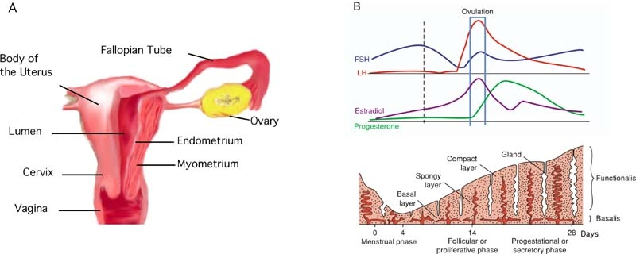
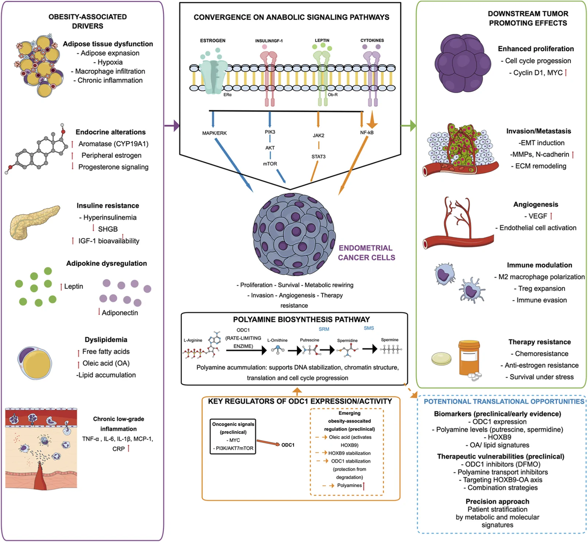
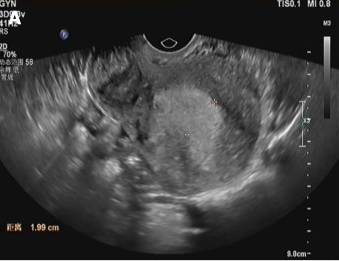
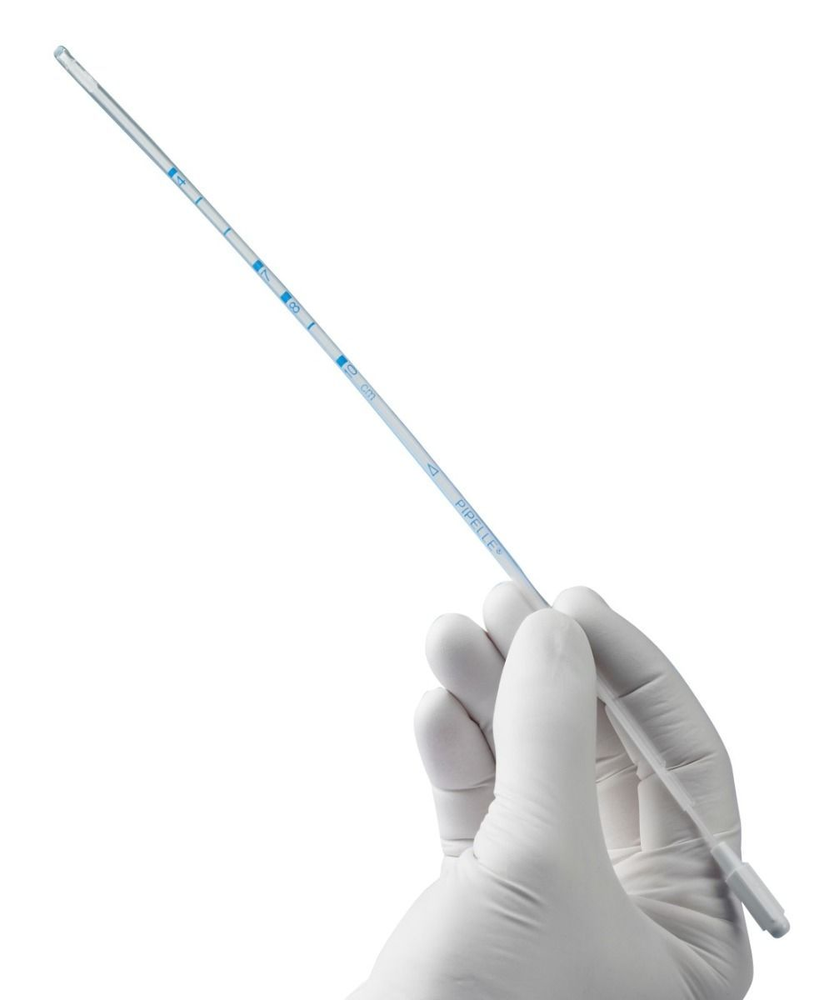
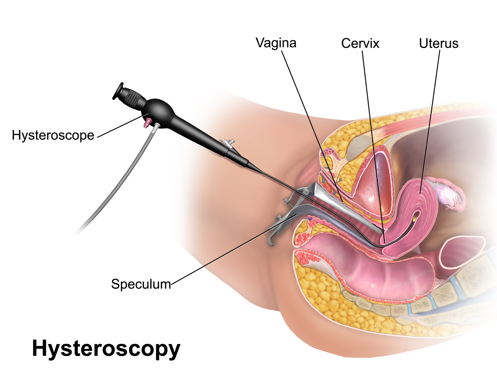
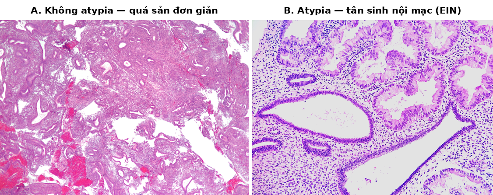
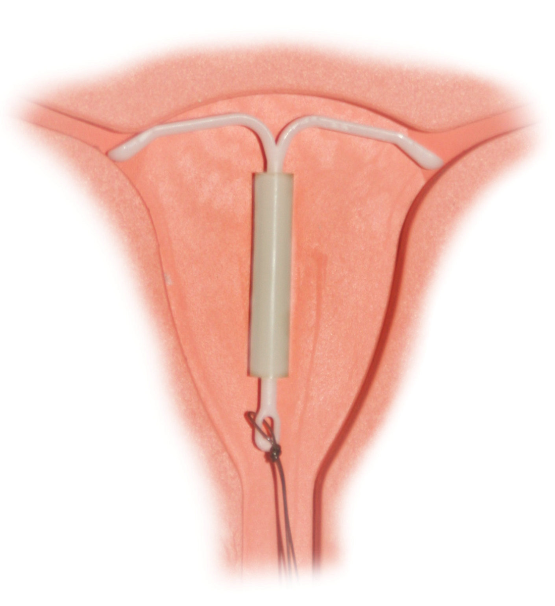
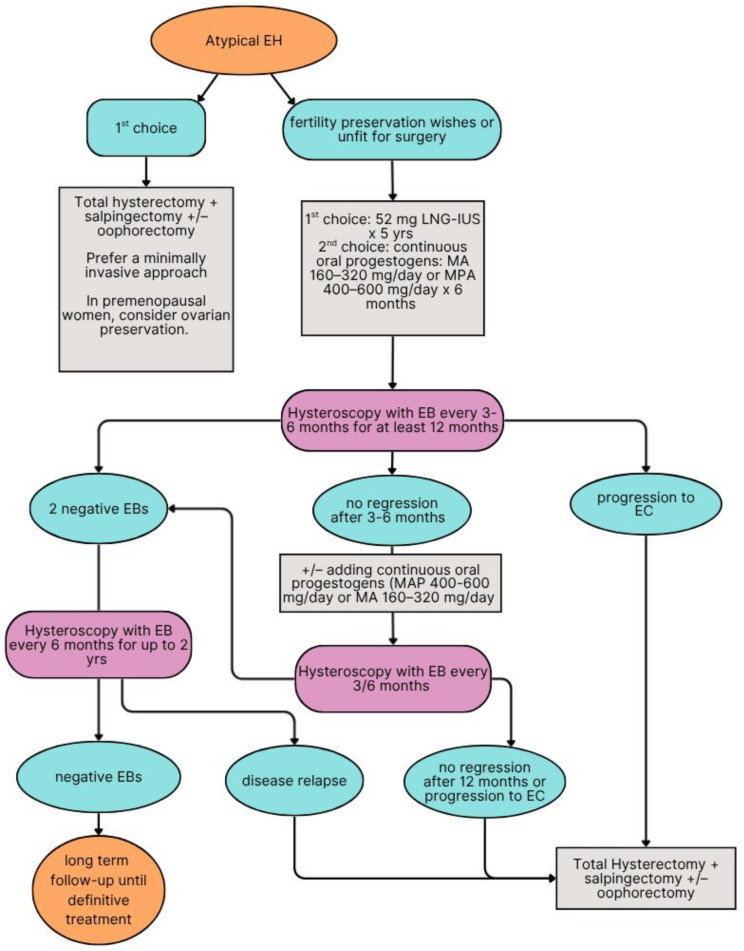

# BÀI HỌC Y KHOA: QUÁ SẢN NỘI MẠC TỬ CUNG (ENDOMETRIAL HYPERPLASIA)
**Ngày:** 2026-11-14 | **Chuyên khoa:** Sản phụ khoa | **Đối tượng:** Bác sĩ, học viên sau đại học và người học mất gốc cần học từ nền tảng

---

## 0. TỔNG QUAN — VÌ SAO BÀI NÀY QUAN TRỌNG? [CỐT LÕI]

&emsp;Quá sản nội mạc tử cung là tình trạng nội mạc tử cung tăng sinh quá mức dưới tác động của estrogen không có progesterone đối kháng.

&emsp;Bệnh này quan trọng vì nó là tiền thân trực tiếp của ung thư nội mạc tử cung, loại ung thư phụ khoa hay gặp nhất ở phụ nữ sau mãn kinh tại nhiều nước.

&emsp;Biểu hiện thường gặp nhất là chảy máu tử cung bất thường, một triệu chứng mà bác sĩ sản phụ khoa gặp hằng ngày ở phòng khám.

&emsp;Điểm mấu chốt làm bài này khó là một chữ duy nhất: **atypia**.

&emsp;Không có atypia, nguy cơ tiến triển thành ung thư trong 20 năm dưới 5%, đa số tự thoái triển.

&emsp;Có atypia, nguy cơ tiến triển trong 20 năm khoảng 28%, và khoảng 4 trong 10 phụ nữ được chẩn đoán atypia ngoài cộng đồng đã có sẵn ung thư nội mạc tại thời điểm cắt tử cung.

&emsp;Một chữ atypia đổi toàn bộ quyết định: điều trị nội khoa bảo tồn hay cắt tử cung triệt để.

&emsp;Bài này dạy người học nhận ra atypia quan trọng tới mức nào, chẩn đoán bằng gì, điều trị bằng progestin ra sao, và khi nào bắt buộc phải mổ.

**Mục tiêu của bài:**

- Giải thích được định nghĩa và phân loại quá sản nội mạc tử cung theo WHO 2014, phân biệt được với phân loại cũ 1994 khi đọc sách cũ.
- Trình bày được chuỗi cơ chế 5 tầng từ estrogen không đối kháng tới atypia và ung thư, kèm lý do vì sao béo phì, PCOS, tamoxifen và estrogen đơn thuần làm tăng nguy cơ.
- Chọn đúng ngưỡng độ dày nội mạc trên siêu âm theo tuổi và tình trạng mãn kinh, biết giới hạn của từng ngưỡng.
- So sánh được vòng LNG-IUS với progestin uống, kể đúng liều của từng chỉ định, và lập được lịch sinh thiết lại theo dõi đáp ứng.
- Nhận diện được chỉ định cắt tử cung, nguy cơ ung thư đồng thời, và các bẫy thi hay gặp nhất.

> **TIÊU CHUẨN BẮT BUỘC — DẠY TỪ GỐC, KHÔNG GIỚI HẠN ĐỘ DÀI:** Viết để một người học mất gốc vẫn theo được. Trước khi dùng một thuật ngữ, chữ viết tắt, chỉ số, cơ quan, cơ chế, thủ thuật hoặc quyết định điều trị lần đầu, phải giải thích bằng tiếng Việt đơn giản: **nó là gì → bình thường hoạt động ra sao → vì sao bất thường này quan trọng → nhận ra bằng cách nào → làm gì tiếp theo**. Sau lần giải thích đầu tiên, mới dùng viết tắt/thuật ngữ ngắn. Không dùng “rõ ràng”, “thường quy”, “theo protocol” hoặc danh sách bước trần nếu chưa giải thích lý do và ý nghĩa của hành động. Độ dài không có giới hạn tối đa: tiếp tục viết khi còn một mắt xích cần thiết để người học hiểu hoặc ra quyết định an toàn; ưu tiên chia nhỏ bằng tiêu đề, ví dụ và checkpoint thay vì cắt bỏ nền tảng.

> **CÁCH GIẢI THÍCH BẮT BUỘC CHO MỖI QUY TRÌNH:** Mỗi xét nghiệm, thang điểm, thuốc, thủ thuật hoặc algorithm phải ghi theo thứ tự: **mục tiêu → khi nào dùng/không dùng → cần chuẩn bị/đầu vào gì → làm hoặc đọc kết quả như thế nào → kết quả thay đổi quyết định ra sao → bẫy/an toàn → khi nào chuyển tuyến**. Chi tiết liều, đường dùng, trình tự và thời điểm phải có nguồn xác minh; không lấp chỗ trống bằng suy đoán.

### 📋 TRƯỚC KHI ĐỌC — NỀN TẢNG CẦN DÙNG

> Để hiểu bài này, người học nên đã biết:
> - Nội mạc tử cung là gì và chu kỳ kinh nguyệt hoạt động ra sao.
> - Estrogen và progesterone làm gì với nội mạc tử cung.
> - Chảy máu tử cung bất thường là gì.
>
> **Không được chặn việc học vì thiếu prerequisite.** Nếu bài tiên quyết chưa tồn tại hoặc người học chưa nắm, tạo mục `### 0.1 Nền tảng tối thiểu cần dùng ngay` sau Overview và dạy đủ khái niệm nền để hiểu bài hiện tại; link bài tiên quyết chỉ là đường học sâu hơn.

### 0.1. Nền tảng tối thiểu cần dùng ngay [CỐT LÕI]

&emsp;Tử cung là cơ quan hình quả lê nằm trong khung chậu, gồm thân tử cung và cổ tử cung.

&emsp;Lòng tử cung được lót bởi nội mạc tử cung, viết tắt tiếng Anh là endometrium.

&emsp;Nội mạc gồm 2 thành phần chính: các tuyến nội mạc và mô đệm bao quanh tuyến.

&emsp;Bình thường, nội mạc dày lên dưới tác động của estrogen trong nửa đầu chu kỳ kinh, rồi được progesterone ổn định trong nửa sau chu kỳ.

&emsp;Progesterone chỉ được tạo ra sau khi rụng trứng, từ hoàng thể trong buồng trứng.

&emsp;Nếu không có thai, hoàng thể teo đi, progesterone rơi xuống, nội mạc bong ra thành kinh nguyệt.

&emsp;Estrogen không đối kháng nghĩa là estrogen tác động lên nội mạc mà không có đủ progesterone đi kèm để kìm lại.

&emsp;Chảy máu tử cung bất thường, viết tắt tiếng Anh là AUB (abnormal uterine bleeding), là chảy máu ngoài chu kỳ kinh bình thường về lượng, tần suất, thời gian hoặc tính đều đặn.

&emsp;Bài OB-22 "Xuất huyết tử cung bất thường (AUB)" trong khung chương trình dạy đầy đủ phân loại nguyên nhân AUB theo FIGO PALM-COEIN; bài này chỉ dùng AUB làm triệu chứng trình bày của quá sản.

&emsp;Mãn kinh là thời điểm buồng trứng ngừng rụng trứng và ngừng tạo estrogen, đánh dấu bằng 12 tháng liên tiếp không có kinh.

&emsp;Sinh thiết nội mạc là lấy một mẩu nhỏ nội mạc đem soi dưới kính hiển vi để đọc mô bệnh học.

&emsp;Mô bệnh học là chẩn đoán xác định của quá sản nội mạc, vì siêu âm chỉ đo được độ dày chứ không đọc được tế bào.

&emsp;Cắt tử cung toàn bộ là phẫu thuật lấy toàn bộ thân và cổ tử cung, khác với cắt bán phần chỉ lấy thân tử cung mà giữ lại cổ tử cung.



*Nguồn ảnh: StemBook, Teixeira và cộng sự 2008, Hình 1 (Wikimedia Commons, CC BY 3.0) — sơ đồ giải phẫu tử cung kèm biến đổi nội mạc theo chu kỳ kinh.*

### 0.2. Ba câu hỏi lớn của bài [CỐT LÕI]

&emsp;Câu hỏi thứ nhất: làm sao phân biệt quá sản lành tính với tiền ung thư chỉ bằng một mẩu sinh thiết.

&emsp;Câu hỏi thứ hai: vì sao cùng một bệnh mà người này chỉ cần đặt vòng, người kia bắt buộc phải cắt tử cung.

&emsp;Câu hỏi thứ ba: vì sao sinh thiết âm tính vẫn chưa đủ để yên tâm, và vì sao phải sinh thiết lại nhiều lần.

&emsp;Ba câu hỏi này đi xuyên suốt bài, từ định nghĩa tới điều trị và theo dõi.

### 🛑 DỪNG 1 PHÚT — TỰ KIỂM TRA

> 1. Quá sản nội mạc tử cung là tiền thân của ung thư nào, và từ khóa nào quyết định chiến lược điều trị?
> 2. Vì sao siêu âm không thể thay thế sinh thiết trong chẩn đoán xác định quá sản?
>
> *(Đáp án: Tiền thân của ung thư nội mạc tử cung; từ khóa là atypia. Siêu âm chỉ đo độ dày nội mạc, còn chẩn đoán quá sản cần đọc tế bào và cấu trúc tuyến dưới kính hiển vi.)*

---

## 1. ĐỊNH NGHĨA & PHÂN LOẠI [CỐT LÕI]

### 1.0. Nền tảng: Sinh lý bình thường — đủ để hiểu bài này [CỐT LÕI]

> **Phân biệt 2 loại nội dung trong bài:**
>
> **Loại 1 — Kiến thức sinh lý/giải phẫu/khái niệm consensus** (không tranh cãi, ổn định ≥10 năm):
> Viết tự do, KHÔNG gán nhãn verification và KHÔNG cần PMID (đây là kiến thức textbook/nền tảng).
>
> **Loại 2 — Claim số liệu định lượng / ngưỡng / protocol / khuyến cáo guideline**:
> Bắt buộc Claim ID trong brief + PMID/guideline evidence + 1 trong 5 nhãn verification chuẩn:
> `[FETCHED]`, `[ABSTRACT VERIFIED]`, `[DATA VERIFIED]`, `[FULL TEXT VERIFIED]`, `[GUIDELINE VERIFIED]`.
> Cấm tuyệt đối dùng nhãn cho: %, mg/kg, mmol/L, RR/CI, liều thuốc, ngưỡng xét nghiệm, tỷ lệ dịch tễ khi chưa verify.

&emsp;Nội mạc bình thường có 2 lớp: lớp đáy nằm sát cơ tử cung và lớp chức năng bong ra mỗi chu kỳ kinh.

&emsp;Trong pha tăng sinh của chu kỳ, estrogen làm các tuyến nội mạc dài ra, thẳng, xếp song song, và mô đệm giữa các tuyến còn rộng rãi.

&emsp;Sau rụng trứng, progesterone làm tuyến nội mạc xoắn lại, tiết dịch, và mô đệm phù nề để chuẩn bị đón thai.

&emsp;Tỉ lệ tuyến trên mô đệm ở nội mạc bình thường pha tăng sinh thấp, vì tuyến còn thưa và mô đệm còn nhiều.

&emsp;Quá sản xảy ra khi estrogen kích thích tuyến tăng sinh liên tục mà progesterone không xuất hiện để dừng lại và làm tuyến biệt hóa.

&emsp;Khi đó tuyến mọc nhiều lên, chen chúc nhau, mô đệm bị ép thu hẹp, và tỉ lệ tuyến trên mô đệm tăng cao.

&emsp;Nếu quá trình này kéo dài, tế bào tuyến bắt đầu biến dạng nhân, gọi là atypia, và lúc đó tổn thương không còn là tăng sinh lành tính nữa mà đã thành tiền ung thư.

### 1.1. Định nghĩa quá sản nội mạc tử cung [CỐT LÕI]

&emsp;RCOG Green-top Guideline No. 67 (2016), guideline khung chính của bài, định nghĩa quá sản nội mạc tử cung là sự tăng sinh không đều của các tuyến nội mạc kèm tăng tỉ lệ tuyến trên mô đệm khi so với nội mạc pha tăng sinh [GUIDELINE VERIFIED].

&emsp;Định nghĩa này có 2 ý: tuyến mọc bất thường và tuyến chiếm tỉ lệ nhiều hơn mô đệm.

&emsp;Tăng sinh ở đây là tăng sinh lành tính về bản chất tế bào lúc đầu, nhưng tích lũy theo thời gian thì có thể chuyển sang ác tính.

&emsp;Quá sản nội mạc tử cung còn được gọi là tăng sinh nội mạc tử cung, tiếng Anh là endometrial hyperplasia, viết tắt EH.

&emsp;Hai cách gọi "quá sản" và "tăng sinh" chỉ cùng một bệnh, học viên không cần phân biệt.

&emsp;Điều cần phân biệt là quá sản nội mạc tử cung với lạc nội mạc tử cung, tiếng Anh là endometriosis.

&emsp;Lạc nội mạc tử cung là mô giống nội mạc mọc lạc chỗ ngoài tử cung, ví dụ ở buồng trứng hay phúc mạc, và là một bệnh hoàn toàn khác.

&emsp;Bài này chỉ dạy quá sản nội mạc tử cung, không dạy chẩn đoán hay điều trị của lạc nội mạc tử cung.

> ⚠️ HỌC VIÊN HAY NHẦM: Nhầm "quá sản nội mạc" với "lạc nội mạc" chỉ vì cả 2 đều có chữ "nội mạc". Quá sản là tăng sinh quá mức ngay trong lòng tử cung; lạc nội mạc là mô nội mạc mọc sai vị trí ngoài tử cung.

**Ví dụ — Phân biệt nhanh tại phòng khám:** Bệnh nhân A ra huyết bất thường, siêu âm thấy nội mạc dày, sinh thiết thấy tuyến tăng sinh trong lòng tử cung thì nghĩ tới quá sản nội mạc. Bệnh nhân B đau bụng kinh dữ dội kèm khối ở buồng trứng thì nghĩ tới lạc nội mạc, không phải quá sản.

### 1.2. Phân loại WHO 2014 — khung 2 nhóm đang dùng [CỐT LÕI]

&emsp;Phân loại WHO 2014 chia quá sản nội mạc thành 2 nhóm duy nhất, dựa vào có hay không có atypia tế bào [GUIDELINE VERIFIED].

&emsp;Nhóm thứ nhất là quá sản không atypia, tiếng Anh là hyperplasia without atypia.

&emsp;Nhóm thứ hai là quá sản atypia, tiếng Anh là atypical hyperplasia, đồng nghĩa với tân sinh biểu mô nội mạc, tiếng Anh là endometrial intraepithelial neoplasia, viết tắt EIN [GUIDELINE VERIFIED].

&emsp;Hai thuật ngữ "atypical hyperplasia" và "EIN" được WHO 2014 coi là đồng nghĩa và dùng thay thế nhau [GUIDELINE VERIFIED].

&emsp;Trích toàn văn RCOG Green-top Guideline No. 67: phân loại WHO 2014 sửa đổi chỉ tách quá sản nội mạc thành 2 nhóm dựa trên có hay không có atypia tế bào, và độ phức tạp của kiến trúc không còn là một phần của phân loại nữa [GUIDELINE VERIFIED].

&emsp;Điểm quan trọng nhất của khung 2 nhóm là kiến trúc tuyến đơn giản hay phức tạp không còn quyết định phân loại.

&emsp;Trước 2014, kiến trúc tuyến là một trục phân loại độc lập; sau 2014, chỉ atypia mới quyết định nhóm.

&emsp;Lý do là các nghiên cứu theo dõi dài hạn cho thấy atypia dự báo tiến triển thành ung thư tốt hơn nhiều so với kiến trúc tuyến.

| Nhóm WHO 2014 | Đặc điểm tế bào | Ý nghĩa |
|---|---|---|
| Quá sản không atypia | Tế bào tuyến bình thường, chỉ tăng số lượng tuyến | Nguy cơ ung thư thấp, điều trị nội khoa |
| Quá sản atypia / EIN | Tế bào tuyến biến dạng nhân, mất phân cực | Tiền ung thư, cân nhắc cắt tử cung |

&emsp;Bảng trên là toàn bộ khung phân loại hiện hành, học viên chỉ cần nhớ 2 nhóm và từ khóa atypia.

&emsp;WHO 2020, ấn bản 5, giữ nguyên khung 2 nhóm, và đổi tên đầy đủ của nhóm 2 thành EAH/EIN, tức Endometrial Atypical Hyperplasia / Endometrioid Intraepithelial Neoplasia [FULL TEXT VERIFIED].

&emsp;WHO 2020 bổ sung tiêu chuẩn kích thước ổ bất thường lớn hơn 1 mm cho nhóm EAH/EIN, và ghi nhận 1 phần 4 tới 1 phần 3 số EAH/EIN có ung thư ngay khi cắt tử cung hoặc trong năm đầu theo dõi [FULL TEXT VERIFIED].

&emsp;Lưu ý về nguồn: sách WHO 2020 chưa được đọc trực tiếp, các điểm trên xác minh qua toàn văn bài tổng quan của Swain và Kulkarni đã đọc toàn văn.

**Ví dụ — Đọc kết quả giải phẫu bệnh:** Kết quả ghi "hyperplasia without atypia" thì xếp nhóm 1, hướng điều trị nội khoa. Kết quả ghi "atypical hyperplasia / EIN" thì xếp nhóm 2, hướng cắt tử cung hoặc bảo tồn sinh sản có điều kiện chặt.

### 1.3. EIN là gì — tân sinh đơn dòng, không phải tăng sinh lan tỏa [CỐT LÕI]

&emsp;EIN là khái niệm do Nhóm Cộng tác Nội mạc Quốc tế đề xuất năm 2000, để gọi tên các tổn thương tiền ung thư đơn dòng, tiếng Anh là monoclonal [ABSTRACT VERIFIED].

&emsp;Đơn dòng nghĩa là toàn bộ tế bào trong ổ tổn thương bắt nguồn từ một tế bào gốc duy nhất đã đột biến, rồi nhân lên thành một đám tế bào giống nhau.

&emsp;Quá sản không atypia thì ngược lại: đó là hiệu ứng nội tiết lan tỏa, toàn bộ nội mạc cùng tăng sinh dưới estrogen, không có một dòng tế bào đột biến riêng.

&emsp;Sự khác nhau đơn dòng so với lan tỏa này giải thích vì sao EIN tiến triển thành ung thư còn quá sản không atypia thì đa số tự thoái triển.

&emsp;Tiêu chí kiến trúc đã xác minh của EIN là mô đệm giảm xuống dưới khoảng 1 phần 2 tổng thể tích mẫu, tức diện tích tuyến vượt diện tích mô đệm [ABSTRACT VERIFIED].

&emsp;Các tiêu chí EIN đầy đủ khác, như kích thước trên 1 mm và tế bào khác nền, chưa có trong abstract nên bài này không dạy chi tiết.

&emsp;Đột biến gen PTEN là dấu ấn phân tử sớm của quá trình này: tỉ lệ đột biến PTEN là 83% ở ung thư biểu mô tuyến dạng nội mạc và 55% ở tiền ung thư, trong khi không có đột biến PTEN ở nội mạc bình thường [ABSTRACT VERIFIED].

&emsp;PTEN là gen ức chế khối u, mất PTEN làm tế bào mất phanh hãm tăng sinh.

&emsp;Học viên không cần nhớ tỉ lệ PTEN để ra quyết định lâm sàng, chỉ cần hiểu EIN đã có đột biến gen từ trước khi thành ung thư.

> ⚠️ HỌC VIÊN HAY NHẦM: Đồng nhất EIN với "tăng sinh phức tạp có atypia" của phân loại cũ. Hai hệ dùng tiêu chí khác nhau: EIN định nghĩa bằng tiêu chuẩn định lượng và khái niệm đơn dòng riêng; phần lớn trùng lắp nhưng không đồng nhất hoàn toàn.

**Ví dụ — Vì sao 2 bệnh nhân cùng chẩn đoán cũ lại khác nhau:** Hai bệnh nhân cùng được đọc là "phức tạp có atypia" theo phân loại cũ, nhưng một người có ổ EIN đơn dòng thật sự còn người kia chỉ là tăng sinh lan tỏa có tế bào biến dạng nhẹ; hệ EIN tách được 2 trường hợp này, còn hệ cũ thì gộp chung.

### 1.4. Phân loại cũ WHO 1994 — 4 nhóm và vì sao vẫn phải biết [CỐT LÕI]

&emsp;Phân loại WHO 1994 chia quá sản thành 4 nhóm theo 2 trục: kiến trúc tuyến đơn giản hay phức tạp, và có hay không có atypia tế bào [ABSTRACT VERIFIED].

&emsp;Bốn nhóm đó là tăng sinh đơn giản, tăng sinh phức tạp, tăng sinh đơn giản có atypia, và tăng sinh phức tạp có atypia.

&emsp;Học viên vẫn phải biết phân loại cũ vì sách giáo khoa cũ, đề thi cũ và nhiều kết quả giải phẫu bệnh cũ vẫn dùng 4 nhóm này.

&emsp;Nghiên cứu kinh điển của Kurman và cộng sự năm 1985 theo dõi 170 bệnh nhân không điều trị trong trung bình 13,4 năm, cho tỉ lệ tiến triển thành ung thư: tăng sinh đơn giản 1%, tăng sinh phức tạp 3%, tăng sinh đơn giản có atypia 8%, tăng sinh phức tạp có atypia 29% [ABSTRACT VERIFIED].

&emsp;Gộp lại, nhóm không atypia tiến triển 1,6% so với nhóm có atypia 23%, khác biệt có ý nghĩa thống kê với p bằng 0,001 [ABSTRACT VERIFIED].

&emsp;Điểm dễ dạy sai: chính Kurman ghi khác biệt giữa 4 phân nhóm chỉ gợi ý một xu hướng nhưng không có ý nghĩa thống kê, vì mẫu nhỏ, nhất là nhóm đơn giản có atypia chỉ có 1 ca tiến triển.

&emsp;Chỉ khác biệt gộp atypia so với không atypia mới có ý nghĩa thống kê, và đây chính là cơ sở logic để WHO 2014 gộp thành 2 nhóm theo atypia.

| Nhóm WHO 1994 | Tiến triển thành ung thư | Ghi chú |
|---|---|---|
| Tăng sinh đơn giản | 1% | Nguy cơ thấp nhất |
| Tăng sinh phức tạp | 3% | Nguy cơ thấp |
| Tăng sinh đơn giản có atypia | 8% | Mẫu nhỏ, chỉ 1 ca tiến triển |
| Tăng sinh phức tạp có atypia | 29% | Nguy cơ cao nhất |

&emsp;Bảng trên dạy cả 4 con số, nhưng phải dạy kèm chú thích rằng khác biệt giữa 4 nhóm không có ý nghĩa thống kê.

&emsp;Nếu học viên chỉ nhớ 4 con số mà quên chú thích, họ sẽ tưởng 4 nhóm là 4 mức nguy cơ đã được chứng minh là khác nhau, trong khi thực tế không phải vậy.

### 1.5. Vì sao WHO 2014 bỏ phân loại cũ — độ lặp lại kém [CỐT LÕI]

&emsp;Lý do WHO 2014 bỏ phân loại 4 nhóm là độ lặp lại chẩn đoán giữa các nhà bệnh học quá kém, đặc biệt ở nhóm atypia.

&emsp;Nghiên cứu của Kendall và cộng sự năm 1998 cho 5 nhà bệnh học đọc độc lập 100 mẫu: hệ số kappa của nhóm tăng sinh không atypia là 0,60, còn nhóm atypical hyperplasia chỉ 0,47, thấp nhất trong các nhóm [ABSTRACT VERIFIED].

&emsp;Kappa là chỉ số đo mức đồng thuận vượt quá ngẫu nhiên, kappa 0,47 nghĩa là 2 nhà bệnh học đọc cùng một mẫu chỉ đồng thuận ở mức trung bình yếu.

&emsp;Nghiên cứu của Zaino và cộng sự năm 2008 trên 2.601 mẫu cho thấy đồng thuận từng nhóm: không quá sản 90,3%, tăng sinh đơn giản 31,1%, tăng sinh phức tạp 51,1%, tăng sinh không điển hình 49,8%, ung thư 57,5%; đặc điểm gây bất đồng nhiều nhất là atypia tế bào [ABSTRACT VERIFIED].

&emsp;Nghiên cứu năm 2014 cho 9 chuyên gia đọc 198 mẫu: kappa của phân loại WHO chỉ 0,337, của EIN 0,419, của hệ EWG 0,530; đồng thuận toàn bộ giữa các nhà bệnh học chỉ 28% với phân loại WHO, 39% với EIN, 59% với EWG [ABSTRACT VERIFIED].

&emsp;Con số 28% đồng thuận toàn bộ với phân loại WHO là lý do trực tiếp khiến WHO 2014 đơn giản hóa thành 2 nhóm.

&emsp;Ngay cả hệ 2 nhóm và EIN vẫn chỉ đạt kappa khoảng 0,42, tức chẩn đoán atypia vẫn khó ngay cả với chuyên gia.

&emsp;Bài này không dạy rằng WHO 2014 đã giải quyết triệt để vấn đề lặp lại, vì số liệu cho thấy không phải vậy.

&emsp;Hệ quả lâm sàng: quyết định cắt tử cung hay bảo tồn không nên dựa vào một lần đọc duy nhất khi còn tranh cãi, mà cần hội chẩn giải phẫu bệnh hoặc đọc lại bởi chuyên gia phụ khoa.

> ⚠️ HỌC VIÊN HAY NHẦM: Tưởng phân loại WHO 2014 chính xác tuyệt đối vì nó mới hơn. Thực tế kappa của hệ EIN chỉ khoảng 0,42, và hội đồng GOG chỉ đồng thuận 38% chẩn đoán atypia ban đầu, 29% được chẩn đoán lại thành ung thư.

**Ví dụ — Khi nào xin đọc lại giải phẫu bệnh:** Bệnh nhân 52 tuổi, sinh thiết đọc "tăng sinh không điển hình" nhưng lâm sàng không có yếu tố nguy cơ nào và siêu âm không có tổn thương khu trú; xin hội chẩn giải phẫu bệnh trước khi quyết định cắt tử cung, vì chẩn đoán atypia có độ lặp lại kém.

### 🛑 DỪNG 1 PHÚT — TỰ KIỂM TRA

> 1. Phân loại WHO 2014 có mấy nhóm, dựa vào tiêu chí nào, và 2 thuật ngữ nào được coi là đồng nghĩa?
> 2. Vì sao WHO 2014 bỏ trục kiến trúc tuyến đơn giản hay phức tạp ra khỏi phân loại?
>
> *(Đáp án cho câu hỏi tự kiểm tra: WHO 2014 có 2 nhóm dựa vào có hay không có atypia tế bào; atypical hyperplasia đồng nghĩa EIN. Trục kiến trúc bị bỏ vì atypia dự báo tiến triển tốt hơn, và độ lặp lại chẩn đoán của hệ 4 nhóm quá kém.)*

---

## 2. SINH LÝ & CƠ CHẾ BỆNH SINH [CỐT LÕI]

> **Nguồn kiến thức nền:** Sinh lý học và giải phẫu cơ bản là kiến thức consensus — trình bày tự do, không gán nhãn LLM hay tự chế PMID.

### 2.1. Bình thường: Estrogen và progesterone cân bằng nhau như thế nào

&emsp;Estrogen do buồng trứng tiết ra trong nửa đầu chu kỳ, làm nội mạc dày lên bằng cách cho tế bào tuyến phân chia.

&emsp;Progesterone do hoàng thể tiết ra sau rụng trứng, làm nội mạc ngừng phân chia và chuyển sang trạng thái tiết dịch để đón thai.

&emsp;Cân bằng này có nghĩa là estrogen chỉ được phép làm nội mạc dày lên trong khoảng 2 tuần, rồi progesterone sẽ khóa lại.

&emsp;Mỗi chu kỳ, nội mạc hoặc bong ra thành kinh nguyệt, hoặc giữ lại để nuôi thai, nên không có thời gian tích lũy tăng sinh quá mức.

&emsp;Khi rụng trứng không xảy ra, hoàng thể không hình thành, progesterone không được tạo ra, và estrogen cứ tiếp tục kích thích nội mạc tháng này qua tháng khác.

&emsp;Đó là định nghĩa sinh lý của estrogen không đối kháng: estrogen có mặt, progesterone vắng mặt.

### 2.2. Chuỗi cơ chế 1: Béo phì — mỡ sinh estrogen [CỐT LÕI]

&emsp;**Tầng 1 — Phân tử và thụ thể:** Mô mỡ chứa enzyme aromatase, chuyển androgen từ tuyến thượng thận thành estrogen, chủ yếu là estrone.

&emsp;Béo phì làm khối lượng mô mỡ tăng, hoạt tính aromatase tăng, và nồng độ estrogen trong máu tăng theo.

&emsp;Đồng thời béo phì làm giảm globulin gắn hormone sinh dục, viết tắt SHBG, nên phần estrogen tự do có hoạt tính càng tăng thêm.

&emsp;**Tầng 2 — Tế bào và mô:** Estrogen tự do gắn thụ thể estrogen ER-alpha trên tế bào tuyến nội mạc, kích hoạt phiên mã gen tăng sinh.

&emsp;Tế bào tuyến phân chia liên tục, tuyến dài ra và chen chúc, mô đệm bị ép hẹp dần.

&emsp;**Tầng 3 — Lâm sàng và xét nghiệm:** Nội mạc dày lên trên siêu âm, kinh nguyệt trở nên ra nhiều, kéo dài, hoặc ra huyết giữa kỳ.

&emsp;**Tầng 4 — Quyết định:** Giảm cân làm giảm nguồn estrogen từ mỡ, và progestin đối kháng trực tiếp tác dụng estrogen tại nội mạc.

&emsp;**Tầng 5 — Phản chứng và hậu quả:** Nếu chỉ giảm cân mà không dùng progestin, nội mạc vẫn dày vì estrogen từ mỡ giảm chậm; nếu chỉ dùng progestin mà cân nặng tiếp tục tăng, nguy cơ tái phát sau ngừng thuốc rất cao.

```text
Mô mỡ tăng → Aromatase tăng → Androgen thành estrogen
Estrogen tự do tăng → ER-alpha → Tế bào tuyến phân chia
Tuyến chen chúc → Mô đệm hẹp → Nội mạc dày → Chảy máu bất thường
```

```text
Estrogen không đối kháng → Tăng sinh tuyến → Mất cân bằng tăng sinh
✗ Progesterone vắng mặt nên không có phanh hãm
✗ Không rụng trứng nên không có hoàng thể tiết progesterone
```

&emsp;Bằng chứng dịch tễ: mỗi tăng 5 kg/m2 chỉ số khối cơ thể, viết tắt BMI, làm tăng nguy cơ ung thư nội mạc với RR 1,59, một trong những liên hệ BMI với ung thư mạnh nhất [ABSTRACT VERIFIED].

&emsp;Số liệu này đo nguy cơ ung thư nội mạc, không phải nguy cơ quá sản trực tiếp, vì thiếu nghiên cứu lớn đo riêng nguy cơ quá sản; khi dạy phải nói rõ điểm này.

&emsp;Ngưỡng có ý nghĩa tiên lượng điều trị là BMI từ 35 trở lên: ở nhóm này, nguy cơ thất bại thoái triển với HR 5,51, còn nguy cơ tái phát với HR 18,93, và tỉ lệ tái phát 32,6% so với 3,3% ở nhóm BMI dưới 35 [ABSTRACT VERIFIED].

&emsp;Lưu ý bắt buộc: bài báo Từ Dũ 2025 đã gán nhầm HR 5,51 cho tái phát, trong khi thực tế 5,51 là HR thất bại thoái triển; HR tái phát là 18,93.

### 2.3. Chuỗi cơ chế 2: PCOS và vô kinh mãn tính — không rụng trứng, không progesterone [CỐT LÕI]

&emsp;**Tầng 1 — Phân tử và thụ thể:** Hội chứng buồng trứng đa nang, viết tắt PCOS, làm rối loạn trục vùng dưới đồi, tuyến yên và buồng trứng, nên nang trứng không trưởng thành và không rụng trứng.

&emsp;**Tầng 2 — Tế bào và mô:** Không rụng trứng nghĩa là không có hoàng thể, không có progesterone, nội mạc chịu estrogen đơn độc kéo dài nhiều tháng.

&emsp;Nội mạc tăng sinh liên tục, tuyến mọc chen chúc, và theo thời gian một số ổ tế bào bắt đầu biến dạng nhân.

&emsp;**Tầng 3 — Lâm sàng và xét nghiệm:** Kinh nguyệt thưa, vài tháng mới có một lần, hoặc ra huyết bất thường kéo dài; siêu âm thấy nội mạc dày không tương xứng với ngày chu kỳ.

&emsp;**Tầng 4 — Quyết định:** Progestin chu kỳ hoặc liên tục tạo ra progesterone nhân tạo để đối kháng estrogen; vòng LNG-IUS đưa progestin trực tiếp vào lòng tử cung.

&emsp;**Tầng 5 — Phản chứng và hậu quả:** Nếu chỉ điều hòa kinh bằng thuốc tránh thai mà không sinh thiết khi có chảy máu bất thường, quá sản có thể bị bỏ sót nhiều năm cho tới khi thành ung thư.

```text
PCOS → Không rụng trứng → Không hoàng thể → Không progesterone
Estrogen đơn độc → Nội mạc tăng sinh → Tuyến chen chúc → Atypia
```

```text
Vô kinh mãn tính → Estrogen không đối kháng → Tăng sinh kéo dài
✗ Kinh thưa không đồng nghĩa nội mạc mỏng
✗ Ra huyết sau nhiều tháng vô kinh vẫn cần sinh thiết
```

&emsp;PCOS làm tăng nguy cơ ung thư nội mạc với OR 2,79 ở mọi lứa tuổi, và OR tăng lên 4,05 khi loại các nghiên cứu có phụ nữ trên 54 tuổi [ABSTRACT VERIFIED].

&emsp;Một phân tích gộp khác cho OR 2,70, và nhận định phụ nữ PCOS có khả năng mắc ung thư nội mạc gấp 3 lần, nhưng số nghiên cứu ít nên độ tin cậy hạn chế [ABSTRACT VERIFIED].

&emsp;Tác giả của phân tích gộp cảnh báo bằng chứng còn xa mới vững chắc, vì khác biệt tiêu chuẩn chẩn đoán PCOS, yếu tố gây nhiễu đặc biệt là béo phì, và sai lệch chọn mẫu có thể phóng đại nguy cơ.

&emsp;Vô kinh mãn tính riêng lẻ, không phải do PCOS, chưa có nghiên cứu nào đo riêng nguy cơ bằng con số; khi dạy chỉ nêu cơ chế thiếu progesterone đối kháng, không gắn số.

### 2.4. Chuỗi cơ chế 3: Tamoxifen — thuốc chống ung thư vú gây tăng sinh nội mạc [CỐT LÕI]

&emsp;**Tầng 1 — Phân tử và thụ thể:** Tamoxifen là thuốc điều hòa thụ thể estrogen chọn lọc, viết tắt SERM, có tác dụng đối kháng estrogen ở mô vú nhưng tác dụng giống estrogen ở nội mạc tử cung.

&emsp;**Tầng 2 — Tế bào và mô:** Tại nội mạc, tamoxifen gắn thụ thể estrogen và kích hoạt tăng sinh tuyến giống như estrogen thật, làm nội mạc dày lên và có thể sinh polyp hoặc quá sản.

&emsp;**Tầng 3 — Lâm sàng và xét nghiệm:** Phụ nữ đang dùng tamoxifen có thể ra huyết âm đạo bất thường, siêu âm thấy nội mạc dày hoặc có polyp; một số trường hợp tiến triển thành ung thư nội mạc.

&emsp;**Tầng 4 — Quyết định:** Bệnh nhân dùng tamoxifen phải được thông báo tăng nguy cơ quá sản và ung thư nội mạc, báo ngay nếu chảy máu hoặc dịch âm đạo bất thường; không tự động ngừng tamoxifen mà đánh giá lại nhu cầu và xử trí theo phân loại mô học, phối hợp với bác sĩ ung thư [GUIDELINE VERIFIED].

&emsp;**Tầng 5 — Phản chứng và hậu quả:** Ngừng tamoxifen đột ngột vì sợ ung thư nội mạc có thể làm ung thư vú tái phát; ngược lại, bỏ qua chảy máu ở người dùng tamoxifen có thể bỏ sót quá sản hoặc ung thư nội mạc.

```text
Tamoxifen → Thụ thể estrogen ở nội mạc → Tác dụng giống estrogen
Tuyến tăng sinh → Nội mạc dày → Polyp hoặc quá sản → Chảy máu
```

```text
Tamoxifen → đối kháng estrogen ở vú ✗ nhưng kích thích estrogen ở nội mạc
Vòng LNG-IUS → ngừa polyp và giảm tỉ lệ quá sản ở người dùng tamoxifen
✗ Ảnh hưởng của LNG-IUS lên tái phát ung thư vú chưa rõ nên không khuyến cáo dùng thường quy
```

&emsp;Nghiên cứu NSABP B-14 trên 2.843 bệnh nhân ung thư vú thụ thể estrogen dương tính: tỉ suất nguy hiểm hằng năm của ung thư nội mạc là 0,2 trên 1.000 bệnh nhân-năm ở nhóm giả dược so với 1,6 trên 1.000 ở nhóm tamoxifen, RR 7,5; so với tỉ lệ dân số SEER, RR chỉ 2,2 tới 2,3 [ABSTRACT VERIFIED].

&emsp;Nghiên cứu bệnh chứng dân số của Bernstein và cộng sự cho OR chung 1,52, và nguy cơ tăng theo thời gian dùng: dùng trên 5 năm có OR 4,06 so với không dùng [ABSTRACT VERIFIED].

&emsp;Hai con số RR 7,5 và OR 1,52 đều đúng trong bối cảnh thiết kế riêng: thử nghiệm ngẫu nhiên so với giả dược với số ca nhỏ, so với nghiên cứu bệnh chứng dân số so với không dùng tamoxifen trong thực hành.

&emsp;Cảnh báo toàn vẹn dữ liệu: một phần dữ liệu NSABP B-14 do một nghiên cứu viên gian lận, 24 trên 182 hồ sơ ngẫu nhiên bị làm giả, và chính abstract đã ghi chú điều này; khi dạy phải nhắc.

&emsp;Thuốc ức chế aromatase như anastrozole, exemestane và letrozole không được biết là làm tăng nguy cơ quá sản và ung thư nội mạc [GUIDELINE VERIFIED].

### 2.5. Chuỗi cơ chế 4: Liệu pháp estrogen đơn thuần — HRT sai cách [CỐT LÕI]

&emsp;**Tầng 1 — Phân tử và thụ thể:** Liệu pháp thay thế estrogen, viết tắt HRT, đưa estrogen từ ngoài vào để giảm triệu chứng mãn kinh, nhưng nếu dùng đơn thuần ở phụ nữ còn tử cung thì nội mạc chịu estrogen không đối kháng.

&emsp;**Tầng 2 — Tế bào và mô:** Estrogen ngoại sinh kích thích tuyến nội mạc phân chia liên tục, giống hệt cơ chế của estrogen nội sinh không đối kháng, chỉ khác nguồn gốc.

&emsp;**Tầng 3 — Lâm sàng và xét nghiệm:** Ra huyết âm đạo sau mãn kinh, nội mạc dày trên siêu âm, sinh thiết thấy quá sản.

&emsp;**Tầng 4 — Quyết định:** Estrogen đơn thuần toàn thân không dùng ở phụ nữ còn tử cung; HRT tuần tự phải chuyển sang progestogen liên tục, bằng vòng LNG-IUS hoặc HRT phối hợp liên tục [GUIDELINE VERIFIED].

&emsp;**Tầng 5 — Phản chứng và hậu quả:** Ngắt estrogen 5 tới 7 ngày mỗi tháng không làm giảm nguy cơ so với dùng hằng ngày, nên không được dùng cách ngắt quãng để "an toàn hơn".

```text
Estrogen đơn thuần → Thụ thể estrogen → Tuyến phân chia liên tục
Không progesterone → Nội mạc dày dần → Quá sản → Atypia → Ung thư
```

```text
HRT phối hợp → estrogen và progestin ✓ bảo vệ nội mạc
HRT estrogen đơn thuần ✗ cấm ở phụ nữ còn tử cung → nguy cơ quá sản tăng
Ngắt estrogen 5 tới 7 ngày mỗi tháng ✗ không giảm nguy cơ → vẫn tăng sinh
```

&emsp;Phân tích gộp của Grady và cộng sự trên 30 nghiên cứu có nhóm chứng: estrogen không đối kháng làm tăng nguy cơ ung thư nội mạc với RR gộp 2,3, và RR tăng lên 9,5 khi dùng từ 10 năm trở lên; nguy cơ vẫn cao với RR 2,3 sau từ 5 năm ngừng thuốc trở lên [ABSTRACT VERIFIED].

&emsp;Estrogen phối hợp progestin thì dữ liệu mâu thuẫn: nghiên cứu đoàn hệ cho RR 0,4, tức giảm nguy cơ, trong khi nghiên cứu bệnh chứng cho RR 1,8, tức tăng nhẹ; tác giả kết luận dữ liệu còn hạn chế và mâu thuẫn nên không dạy kết luận chắc chắn cho phối hợp.

### 2.6. Chuỗi cơ chế 5: Từ atypia tới ung thư — mất phanh phân tử [CỐT LÕI]

&emsp;**Tầng 1 — Phân tử và thụ thể:** Trong ổ EIN đơn dòng, gen PTEN mất chức năng, con đường PI3K-AKT mất phanh hãm, tế bào phân chia không còn kiểm soát.

&emsp;**Tầng 2 — Tế bào và mô:** Tế bào tuyến biến dạng nhân, nhân to, mất phân cực, tỉ lệ nhân trên bào tương tăng; tuyến chen chúc tới mức mô đệm còn dưới 1 phần 2 thể tích mẫu.

&emsp;**Tầng 3 — Lâm sàng và xét nghiệm:** Chảy máu bất thường kéo dài, sinh thiết đọc atypia hoặc EIN, siêu âm có thể thấy nội mạc dày không đều hoặc có tổn thương khu trú.

&emsp;**Tầng 4 — Quyết định:** Atypia là điểm rẽ: cắt tử cung toàn bộ là triệt để, bảo tồn sinh sản chỉ là ngoại lệ có điều kiện chặt và theo dõi sát.

&emsp;**Tầng 5 — Phản chứng và hậu quả:** Nếu coi atypia như quá sản lành tính và chỉ đặt vòng rồi cho về không sinh thiết lại, ung thư đồng thời đã có sẵn sẽ bị bỏ sót; nếu cắt tử cung vội khi chẩn đoán atypia chưa chắc chắn, bệnh nhân mất tử cung oan.

```text
Estrogen kéo dài → Tăng sinh tuyến → Ổ đơn dòng EIN → Mất PTEN
Tế bào biến dạng nhân → Atypia → Xâm lấn mô đệm → Ung thư nội mạc
```

```text
Quá sản không atypia → Đa số tự thoái triển ✓
Quá sản atypia → Nguy cơ tiến triển khoảng 28% trong 20 năm ✗
Ung thư đồng thời đã có sẵn ở khoảng 4 trong 10 ca atypia ✗
```

&emsp;Nguy cơ tiến triển tích lũy theo nghiên cứu của Lacey và cộng sự năm 2010: nhóm không atypia 1,2% tới 4 năm, 1,9% tới 9 năm, 4,6% tới 19 năm; nhóm atypia 8,2% tới 4 năm, 12,4% tới 9 năm, 27,5% tới 19 năm [ABSTRACT VERIFIED].

&emsp;Tóm tắt 20 năm của cùng nghiên cứu: nguy cơ tiến triển tích lũy dưới 5% với quá sản không atypia, và 28% với quá sản atypia [ABSTRACT VERIFIED].

&emsp;So sánh với Kurman 1985: Kurman cho 1,6% so với 23% sau trung bình 13,4 năm, còn Lacey cho 4,6% so với 27,5% tới 19 năm; 2 nghiên cứu cùng bậc độ lớn và cùng kết luận atypia quyết định.

&emsp;Nghiên cứu của Lacey và cộng sự năm 2008 bổ sung: so với nội mạc tăng sinh rối loạn làm chuẩn, tăng sinh không điển hình làm tăng nguy cơ ung thư với RR 14, cao nhất trong 1 tới 5 năm đầu sau chẩn đoán với RR 48 [ABSTRACT VERIFIED].

&emsp;Nghiên cứu của Baak và Mutter năm 2008: RR của EIN so với lành tính là 7,76, và RR của atypical hyperplasia so với các nhóm lành tính khác là 9,19; giá trị tiên lượng của EIN tương đương với atypical hyperplasia [ABSTRACT VERIFIED].

### 2.7. Diễn biến tự nhiên & Biến chứng [CỐT LÕI]

&emsp;Diễn biến tự nhiên của quá sản không atypia thường là thoái triển tự nhiên khi estrogen giảm hoặc khi có progesterone trở lại.

&emsp;Diễn biến của quá sản atypia thì ngược lại: nếu không điều trị, một phần đáng kể tiến triển thành ung thư trong vòng 20 năm, và một phần đã có ung thư đồng thời ngay từ đầu.

| Giai đoạn | Thời gian điển hình | Đặc điểm lâm sàng | Yếu tố thúc đẩy chuyển giai đoạn |
|---|---|---|---|
| Tăng sinh do estrogen | Nhiều tháng tới nhiều năm | Ra huyết bất thường, nội mạc dày | Béo phì, vô kinh, tamoxifen, estrogen đơn thuần |
| Atypia / EIN | Tích lũy theo năm | Chảy máu kéo dài, sinh thiết atypia | Estrogen kéo dài không đối kháng |
| Ung thư nội mạc | Trong 20 năm theo dõi | Chảy máu sau mãn kinh, ung thư đồng thời | Mất PTEN, đột biến tích lũy |

&emsp;Biến chứng chính không phải là bản thân quá sản gây đau hay vỡ, mà là ung thư nội mạc bị bỏ sót hoặc tiến triển.

&emsp;Cơ chế hình thành biến chứng: estrogen không đối kháng kéo dài làm tế bào tích lũy đột biến, từ tăng sinh tới atypia rồi xâm lấn.

&emsp;Thời điểm xuất hiện: nguy cơ tiến triển cao nhất trong 1 tới 5 năm đầu sau chẩn đoán atypia, nhưng vẫn tiếp tục tăng tới 20 năm.

&emsp;Dấu hiệu nhận biết sớm: chảy máu bất thường dai dẳng hoặc tái phát sau sinh thiết âm tính, nội mạc dày không giảm sau điều trị progestin.

&emsp;Phòng ngừa: sinh thiết khi có chảy máu bất thường kèm yếu tố nguy cơ, điều trị progestin đủ liều và đủ thời gian, sinh thiết lại đúng lịch.

> ⚠️ **ĐIỂM MẤU CHỐT:** Biến chứng không xuất hiện ngẫu nhiên — mỗi biến chứng là hậu quả trực tiếp của một cơ chế bệnh sinh chưa được kiểm soát. Estrogen không đối kháng không được chặn lại sẽ đi hết chuỗi tăng sinh, atypia, rồi ung thư.

**Yếu tố tiên lượng xấu:**
- Atypia tế bào: yếu tố quyết định nhất, làm nguy cơ tiến triển tăng từ dưới 5% lên khoảng 28% trong 20 năm.
- BMI từ 35 trở lên: dự báo thất bại thoái triển và tái phát mạnh, với HR tái phát 18,93.
- Chẩn đoán atypia ngoài cộng đồng: khoảng 4 trong 10 ca đã có ung thư đồng thời, cao hơn nhiều so với chẩn đoán tại trung tâm chuyên sâu có đọc lại giải phẫu bệnh.

### 🛑 DỪNG 1 PHÚT — TỰ KIỂM TRA

> 1. Kể tên 4 nguồn estrogen không đối kháng hay gặp, và giải thích vì sao mỗi nguồn làm nội mạc tăng sinh.
> 2. Vì sao béo phì vừa làm tăng estrogen vừa làm tăng nguy cơ tái phát sau điều trị?
>
> *(Đáp án cho câu hỏi tự kiểm tra: Béo phì qua aromatase ở mô mỡ, PCOS qua vô kinh không rụng trứng, tamoxifen qua tác dụng giống estrogen ở nội mạc, estrogen đơn thuần qua HRT sai cách. Béo phì tăng estrogen tự do và làm giảm đáp ứng progestin, nên tái phát cao hơn.)*

---

## 3. DỊCH TỄ, YẾU TỐ NGUY CƠ & BIỂU HIỆN LÂM SÀNG [CỐT LÕI]

### 3.1. Dịch tễ — ai hay mắc, mắc bao nhiêu [CỐT LÕI]

&emsp;Quá sản nội mạc tử cung hay gặp ở phụ nữ quanh mãn kinh, đặc biệt tuổi 45 tới 55, khi chu kỳ bắt đầu không rụng trứng thường xuyên.

&emsp;Tỉ lệ mắc ở phụ nữ trước mãn kinh tăng theo tuổi: cao nhất 121 ca trên 100.000 phụ nữ-năm ở phụ nữ Hàn Quốc 46 tới 50 tuổi, và 270 ca trên 100.000 phụ nữ-năm ở phụ nữ Mỹ 45 tới 49 tuổi [ABSTRACT VERIFIED].

&emsp;Tuổi, BMI và đái tháo đường làm tăng tỉ lệ hiện mắc, và lý do sinh thiết, đặc biệt là có chảy máu tử cung bất thường hay không, ảnh hưởng lớn tới tỉ lệ báo cáo.

&emsp;Tỉ lệ hiện mắc quá sản ở phụ nữ trước mãn kinh có chảy máu tử cung bất thường trong 14 nghiên cứu dao động từ 3,4% đến khoảng 26,5% [ABSTRACT VERIFIED].

&emsp;Lưu ý bắt buộc về con số này: abstract gốc in "265%", đây là lỗi in không thể đúng vì tỉ lệ hiện mắc không vượt quá 100%; phần sửa thành khoảng 26,5% là suy luận hiển nhiên nhưng chưa đối chiếu toàn văn, nên dạy kèm nhãn [NGOÀI ABSTRACT] cho phần sửa.

&emsp;Ở phụ nữ vô sinh, tỉ lệ hiện mắc quá sản là 0,9% và 3,0% trong 2 nghiên cứu [ABSTRACT VERIFIED].

&emsp;Tổng quan năm 2025 tóm tắt đúng các nguyên nhân chính: béo phì, PCOS, rối loạn chuyển hóa, và tiếp xúc kéo dài với estrogen không đối kháng [ABSTRACT VERIFIED].

&emsp;Số liệu Việt Nam về quá sản nội mạc tử cung: không có số liệu dịch tễ quần thể nào đã kiểm chứng, vì không có đăng ký bệnh và không có nghiên cứu dịch tễ quần thể; phần Việt Nam ở §10 chỉ có số liệu bệnh viện đơn lẻ và số liệu ung thư thân tử cung.

### 3.2. Yếu tố nguy cơ — bảng tổng hợp [CỐT LÕI]

&emsp;Mọi yếu tố nguy cơ dưới đây đều gặp nhau ở một điểm chung: estrogen không đối kháng kéo dài.

&emsp;Phần lớn số liệu nguy cơ dưới đây đo nguy cơ ung thư nội mạc, không phải nguy cơ quá sản trực tiếp, vì thiếu nghiên cứu lớn đo riêng nguy cơ quá sản; khi dạy phải nói rõ điểm này, không trình bày RR của ung thư nội mạc như thể là RR của quá sản.

| Yếu tố nguy cơ | Cơ chế chính | Mức nguy cơ đã kiểm chứng |
|---|---|---|
| Béo phì | Aromatase ở mô mỡ sinh estrogen | Mỗi tăng 5 kg/m2 BMI, RR ung thư nội mạc 1,59 |
| PCOS, vô kinh mãn tính | Không rụng trứng, không progesterone | OR ung thư nội mạc 2,79, tăng lên 4,05 nếu dưới 54 tuổi |
| Tamoxifen | Tác dụng giống estrogen ở nội mạc | RR 7,5 so với giả dược; dùng trên 5 năm OR 4,06 |
| Estrogen đơn thuần | HRT sai cách, không progestin | RR 2,3; dùng từ 10 năm trở lên RR 9,5 |
| Đái tháo đường | Tăng insulin, tăng estrogen tự do | RR ung thư nội mạc 1,72; hiệu chỉnh BMI còn 1,62 |
| Hội chứng Lynch | Đột biến gen sửa chữa bắt cặp sai | Nguy cơ tích lũy ung thư nội mạc tới 75 tuổi 12,8% tới 48,9% theo gen |

&emsp;Đái tháo đường làm tăng nguy cơ ung thư nội mạc với RR 1,72, và sau khi hiệu chỉnh BMI trong 13 nghiên cứu thì RR còn 1,62, tức đái tháo đường tăng nguy cơ độc lập một phần với béo phì [ABSTRACT VERIFIED].

&emsp;Hội chứng Lynch là bệnh di truyền do đột biến gen sửa chữa bắt cặp sai, viết tắt MMR, gồm các gen MLH1, MSH2, MSH6 và PMS2.

&emsp;Nguy cơ tích lũy ung thư nội mạc tới 75 tuổi theo cơ sở dữ liệu PLSD 2020: gen MLH1 37,0%, gen MSH2 48,9%, gen MSH6 41,1%, gen PMS2 12,8%; tới 50 tuổi lần lượt là 14,7%, 17,5%, 12,6% và 0% [ABSTRACT VERIFIED].

&emsp;Số liệu PLSD đo nguy cơ ung thư nội mạc, không đo riêng tỉ lệ quá sản ở người mang đột biến MMR, nên không rõ Lynch có làm tăng quá sản không atypia hay chỉ tăng ung thư.

&emsp;Nhóm Manchester 2019 ước tính khoảng 1 trên 30 ca ung thư nội mạc có liên quan Lynch, và 1 trên 279 người trong dân số chung mang biến thể MMR gây bệnh [ABSTRACT VERIFIED].

&emsp;Lưu ý: Manchester trích số PLSD phiên bản cũ cao hơn, ví dụ MSH2 57%; bài này dùng số PLSD 2020 làm chuẩn vì mới hơn, mẫu lớn hơn và có khoảng tin cậy.



*Nguồn ảnh: Simancas-Racines và cộng sự, Frontiers in Cell and Developmental Biology 2026, Hình 1 (PMC, CC BY) — sơ đồ trục béo phì, aromatase và estrogen; cột trái ghi rõ aromatase (CYP19A1) và estrogen ngoại vi.*

### 3.3. Biểu hiện lâm sàng — chảy máu là chính [CỐT LÕI]

&emsp;Biểu hiện chính của quá sản nội mạc là chảy máu tử cung bất thường, tức kinh nguyệt ra nhiều, kéo dài, hoặc ra huyết ngoài kỳ kinh.

&emsp;Tổng quan năm 2025 ghi quá sản có thể xuất hiện với triệu chứng mơ hồ như ra huyết tử cung không đều [ABSTRACT VERIFIED].

&emsp;Sau mãn kinh, chảy máu âm đạo là dấu hiệu trình bày ở hơn 90% phụ nữ ung thư nội mạc, nên mọi chảy máu sau mãn kinh đều phải được khảo sát, không được coi là bình thường [ABSTRACT VERIFIED].

&emsp;Quá sản không gây đau bụng đặc hiệu, không gây sốt, và khám thực thể thường không có gì bất thường ngoài máu trong âm đạo hoặc cổ tử cung.

&emsp;Khám phụ khoa có thể thấy tử cung to nhẹ nếu kèm u xơ hoặc polyp, nhưng tử cung to không phải dấu hiệu của riêng quá sản.

&emsp;Kiểu chảy máu cụ thể theo tuổi, như rong kinh hay chảy máu giữa kỳ hay ra máu sau giao hợp, chưa kiểm chứng được tần suất từng kiểu ở quá sản; bài này chỉ dạy chảy máu tử cung bất thường nói chung là biểu hiện chính.

&emsp;Phân loại FIGO PALM-COEIN xếp quá sản nội mạc vào nhóm M, tức Malignancy and hyperplasia, trong các nguyên nhân gây chảy máu tử cung bất thường [ABSTRACT VERIFIED].

&emsp;Bài OB-22 "Xuất huyết tử cung bất thường (AUB)" dạy đầy đủ khung PALM-COEIN; bài này chỉ nhắc rằng quá sản nằm trong nhóm M của khung đó.

**Ví dụ — Bệnh nhân điển hình ở phòng khám:** Phụ nữ 49 tuổi, kinh nguyệt 3 tháng nay ra nhiều và kéo dài 10 ngày, kèm BMI 34 và tiền sử PCOS; đây là bệnh cảnh kinh điển của quá sản do estrogen không đối kháng, cần siêu âm đo nội mạc rồi sinh thiết.

**Ví dụ — Bệnh nhân sau mãn kinh:** Phụ nữ 62 tuổi, mãn kinh 8 năm, nay ra máu âm đạo lượng ít 3 ngày; dù máu tự cầm, vẫn phải đo độ dày nội mạc và sinh thiết, vì chảy máu sau mãn kinh là dấu hiệu trình bày ở hơn 90% ca ung thư nội mạc.

### 🛑 DỪNG 1 PHÚT — TỰ KIỂM TRA

> 1. Vì sao phụ nữ quanh mãn kinh hay mắc quá sản nhất, và yếu tố nguy cơ nào vừa làm tăng nguy cơ mắc vừa làm tăng nguy cơ tái phát?
> 2. Chảy máu sau mãn kinh phải xử trí như thế nào, dù máu đã tự cầm?
>
> *(Đáp án cho câu hỏi tự kiểm tra: Quanh mãn kinh hay có chu kỳ không rụng trứng nên thiếu progesterone. Béo phì vừa tăng estrogen qua aromatase vừa dự báo tái phát mạnh. Chảy máu sau mãn kinh luôn cần đo nội mạc và sinh thiết, không được theo dõi chờ tự hết.)*

---

## 4. CHẨN ĐOÁN [CỐT LÕI]

### 4.1. Lâm sàng — hỏi gì, khám gì [CỐT LÕI]

&emsp;Hỏi bệnh sử chảy máu: bắt đầu khi nào, kéo dài bao nhiêu ngày, lượng nhiều hay ít, có ra huyết giữa kỳ hay sau giao hợp không, và có tự cầm rồi tái phát không.

&emsp;Hỏi yếu tố nguy cơ: cân nặng và BMI, tiền sử PCOS hay kinh thưa, đang dùng tamoxifen hay liệu pháp estrogen hay không, tiền sử gia đình ung thư đại trực tràng và ung thư nội mạc gợi ý hội chứng Lynch.

&emsp;Hỏi tiền sử sản khoa và mong muốn sinh con, vì mong muốn này đổi toàn bộ chiến lược điều trị ở nhóm atypia.

&emsp;Hỏi bệnh kèm theo: đái tháo đường, tăng huyết áp, bệnh gan, bệnh tim mạch, và thuốc đang dùng, vì các bệnh này ảnh hưởng lựa chọn progestin và lựa chọn mổ.

&emsp;Khám thực thể: khám bụng, khám phụ khoa bằng mỏ vịt để xem cổ tử cung và nguồn chảy máu, khám tay 2 tay để đánh giá kích thước và độ di động tử cung.

&emsp;Khám lâm sàng không chẩn đoán được quá sản, nhưng giúp loại trừ nguyên nhân chảy máu khác như polyp cổ tử cung, viêm nhiễm, hay khối u âm đạo.

### 4.2. Siêu âm qua ngã âm đạo — đo độ dày nội mạc [CỐT LÕI]

&emsp;Siêu âm qua ngã âm đạo, viết tắt TVS (transvaginal ultrasound), là bước hình ảnh đầu tiên khi có chảy máu tử cung bất thường.

&emsp;Mục tiêu của TVS là đo độ dày nội mạc, viết tắt EMT (endometrial thickness), bằng cách đo 2 lớp nội mạc đối diện nhau ở mặt cắt dọc tử cung, tại điểm dày nhất.

&emsp;TVS còn giúp thấy polyp, u xơ dưới niêm mạc, dị dạng buồng tử cung, và đánh giá buồng trứng kèm theo.

&emsp;Khi đo EMT, kỹ thuật viên phải đo ở mặt cắt dọc giữa tử cung, không đo khi có dịch trong lòng tử cung làm giả dày, và ghi rõ pha chu kỳ nếu bệnh nhân chưa mãn kinh.

&emsp;Thuật ngữ và cách đo nội mạc đã được Nhóm Phân tích U Nội mạc Quốc tế, viết tắt IETA, chuẩn hóa từ tuyên bố đồng thuận năm 2010, nhưng tuyên bố này không đưa ra ngưỡng chẩn đoán nào [ABSTRACT VERIFIED].

&emsp;Mục G9 "Siêu âm nội mạc tử cung — EMT, polyp, tăng sinh, K" trong khung chương trình là bài chuyên sâu về siêu âm nội mạc, hiện chưa có bài, nên phần này chỉ dạy đủ ngưỡng EMT cần dùng ngay.

&emsp;Bài K2 "Siêu âm trong ung thư nội mạc tử cung" cũng chưa có bài, nên phần này không dạy sâu đặc điểm siêu âm của ung thư nội mạc.



*Nguồn ảnh: Wang và cộng sự, World Journal of Clinical Cases 2022, Hình 1 panel A (PMC, CC BY-NC 4.0, chỉ dùng phi thương mại) — siêu âm TVS nội mạc dày, số đo 1,99 cm; ảnh gốc nhỏ 339×261 px.*

### 4.3. Ngưỡng độ dày nội mạc sau mãn kinh có chảy máu — dạy cả 3 ngưỡng [CỐT LÕI]

&emsp;Không có một ngưỡng EMT duy nhất cho phụ nữ sau mãn kinh có chảy máu; bài này dạy cả 3 ngưỡng kèm nguồn và logic của từng ngưỡng, không chọn một số duy nhất.

&emsp;Ngưỡng thứ nhất: ACOG Committee Opinion No. 734 năm 2018 dùng ngưỡng nhỏ hơn hoặc bằng 4 mm, với giá trị dự báo âm tính trên 99% đối với ung thư nội mạc [ABSTRACT VERIFIED].

&emsp;Logic của ngưỡng 4 mm: nếu nội mạc mỏng từ 4 mm trở xuống thì khả năng ung thư rất thấp, có thể theo dõi mà chưa cần sinh thiết ngay, nhưng chảy máu tái phát thì vẫn phải đánh giá thêm.

&emsp;Ngưỡng thứ hai: phân tích gộp của Smith-Bindman và cộng sự năm 1998 trên 35 nghiên cứu với 5.892 phụ nữ dùng ngưỡng 5 mm, với 96% phụ nữ ung thư có kết quả siêu âm bất thường [ABSTRACT VERIFIED].

&emsp;Ở ngưỡng 5 mm, 92% phụ nữ có bệnh lý nội mạc gồm ung thư, polyp hoặc tăng sinh không điển hình có kết quả bất thường; độ đặc hiệu là 92% ở người không dùng HRT và 77% ở người dùng HRT [ABSTRACT VERIFIED].

&emsp;Với xác suất trước test ung thư là 10%, kết quả âm tính ở ngưỡng 5 mm làm xác suất sau test còn 1% [ABSTRACT VERIFIED].

&emsp;Ngưỡng thứ ba: phân tích dữ liệu cá nhân của Timmermans và cộng sự năm 2010 trên 2.896 bệnh nhân từ 13 bộ dữ liệu khuyên dùng ngưỡng 3 mm để loại trừ ung thư, vì các phân tích gộp trước đã đánh giá quá cao độ chính xác chẩn đoán, với AUC tổng hợp chỉ 0,82 tới 0,84 [ABSTRACT VERIFIED].

&emsp;Phân tích gộp của Gupta và cộng sự năm 2002 bổ sung góc nhìn chất lượng: không có nghiên cứu nào dùng ngưỡng nhỏ hơn hoặc bằng 4 mm đạt chất lượng tốt, và chỉ 4 trên 21 nghiên cứu dùng ngưỡng nhỏ hơn hoặc bằng 5 mm đạt tiêu chuẩn chất lượng tốt nhất [ABSTRACT VERIFIED].

&emsp;Với 4 nghiên cứu chất lượng tốt nhất ở ngưỡng nhỏ hơn hoặc bằng 5 mm, test dương tính nâng xác suất ung thư từ 14,0% lên 31,3%, còn test âm tính giảm xuống 2,5% [ABSTRACT VERIFIED].

| Ngưỡng EMT | Nguồn | Logic dùng |
|---|---|---|
| 3 mm | Timmermans 2010, phân tích dữ liệu cá nhân | Ngưỡng thận trọng nhất, loại trừ ung thư |
| 4 mm | ACOG 2018, Committee Opinion No. 734 | Ngưỡng thực hành, giá trị dự báo âm tính trên 99% |
| 5 mm | Smith-Bindman 1998, phân tích gộp kinh điển | Ngưỡng phân tích gộp, độ nhạy ung thư 96% |

&emsp;Ngưỡng không đứng một mình: phải kết hợp chảy máu dai dẳng hay tái phát, yếu tố nguy cơ, chất lượng hình ảnh, và việc có dùng HRT hay không, vì HRT làm độ đặc hiệu giảm còn 77%.

&emsp;ACOG cũng nhắc: nếu sinh thiết mù không thấy quá sản hay ác tính mà chảy máu dai dẳng hoặc tái phát thì cần đánh giá thêm bằng nội soi buồng tử cung và nong nạo [ABSTRACT VERIFIED].

> ⚠️ HỌC VIÊN HAY NHẦM: Nhớ một ngưỡng duy nhất rồi áp cho mọi bệnh nhân. Ba ngưỡng 3 mm, 4 mm, 5 mm đến từ 3 loại bằng chứng khác nhau, và quyết định sinh thiết còn dựa vào chảy máu tái phát và yếu tố nguy cơ, không chỉ một con số.

### 4.4. Ngưỡng khi không chảy máu và trước mãn kinh [CỐT LÕI]

&emsp;Phụ nữ sau mãn kinh không chảy máu là một tình huống hoàn toàn khác: không chạy theo con số như khi có chảy máu.

&emsp;SOGC Guideline No. 451 năm 2024 cho rằng ở phụ nữ sau mãn kinh không chảy máu, nội mạc dưới 11 mm hiếm khi là vấn đề nghiêm trọng nhưng vẫn nên được đánh giá bởi nhân viên y tế [NGOÀI ABSTRACT].

&emsp;Lưu ý bắt buộc: con số 11 mm làm ngưỡng khuyến cáo không có trong abstract của guideline SOGC; nó được xác nhận qua bản tóm tắt thứ cấp của Canadian Family Physician 2025, nên dạy kèm nhãn [NGOÀI ABSTRACT] cho tới khi đối chiếu toàn văn SOGC 451.

&emsp;ACOG 734 cũng nói dày nội mạc trên 4 mm phát hiện tình cờ ở phụ nữ sau mãn kinh không chảy máu không nhất thiết phải kích hoạt đánh giá thường quy, nên 2 guideline thống nhất về nguyên tắc, chỉ khác cách diễn đạt ngưỡng [ABSTRACT VERIFIED].

&emsp;Trước mãn kinh, không có ngưỡng tuyệt đối nào cho độ dày nội mạc.

&emsp;Nghiên cứu của Sakamoto và cộng sự năm 2018 trên 849 phụ nữ trước mãn kinh khám phụ khoa định kỳ: độ dày nội mạc trung vị 8,6 mm, phân vị 90 và 95 lần lượt là 13,8 mm và 15,8 mm [ABSTRACT VERIFIED].

&emsp;Ở chu kỳ 28 tới 30 ngày, độ dày nội mạc là 7 mm vào ngày 1 tới 6, tăng từ 5,4 mm ngay sau kinh vào ngày 7 tới 8 lên 9,2 mm vào ngày 13 tới 14, rồi 11,1 mm vào ngày 18 [ABSTRACT VERIFIED].

&emsp;Hệ quả dạy: nội mạc dày 11 tới 16 mm ở pha tiết có thể là sinh lý bình thường, ngược lại nội mạc mỏng cũng không loại trừ bệnh lý nội mạc như polyp hay tăng sinh khu trú.

&emsp;Quyết định sinh thiết ở phụ nữ trước mãn kinh dựa vào chảy máu tử cung bất thường cộng với yếu tố nguy cơ, không dựa vào một ngưỡng EMT duy nhất.

**Ví dụ — EMT 12 mm ở 2 bệnh nhân khác nhau:** Bệnh nhân 38 tuổi, ngày 20 chu kỳ, không chảy máu bất thường, EMT 12 mm có thể là sinh lý pha tiết, chỉ cần theo dõi. Bệnh nhân 52 tuổi, mãn kinh 2 năm, ra máu âm đạo, EMT 12 mm thì phải sinh thiết ngay.

### 4.5. Sinh thiết nội mạc bằng Pipelle — điểm mạnh và điểm yếu [CỐT LÕI]

&emsp;Sinh thiết nội mạc bằng ống hút Pipelle là thủ thuật ngoại trú, đưa một ống nhựa nhỏ mềm qua cổ tử cung vào lòng tử cung rồi hút lấy mẩu nội mạc.

&emsp;Mục tiêu là lấy được mô nội mạc đủ để đọc mô bệnh học, phân biệt quá sản không atypia, quá sản atypia và ung thư.

&emsp;Khi nào làm: chảy máu tử cung bất thường kèm yếu tố nguy cơ, nội mạc dày trên siêu âm ở phụ nữ sau mãn kinh có chảy máu, hoặc theo dõi đáp ứng sau điều trị progestin.

&emsp;Khi nào không làm ngay: đang mang thai, viêm nhiễm vùng chậu cấp, hoặc cổ tử cung bít tắc không đưa được ống vào; các trường hợp này cần chuyển tuyến chuyên khoa.

&emsp;Chuẩn bị: giải thích thủ thuật, giảm đau bằng thuốc chống viêm không steroid trước thủ thuật nếu dung nạp được, và loại trừ thai kỳ khi còn khả năng mang thai.

&emsp;Đọc kết quả: kết quả dương tính với ung thư có giá trị khẳng định cao, nhưng kết quả âm tính không loại trừ được tăng sinh không điển hình, và mẫu không đủ thì phải làm lại bằng phương pháp khác.



*Nguồn ảnh: phòng khám Dr Sam, New Zealand (ảnh sản phẩm, KHÔNG phải CC, chỉ dùng nội bộ) — ống Pipelle thật có vạch cm và chữ PIPELLE; ảnh chỉ chụp dụng cụ, không chụp kỹ thuật đưa ống.*

&emsp;Phân tích gộp của Dijkhuizen và cộng sự năm 2000 trên 39 nghiên cứu với 7.914 phụ nữ: Pipelle là dụng cụ tốt nhất, tỉ lệ phát hiện ung thư nội mạc 99,6% sau mãn kinh và 91% trước mãn kinh; độ nhạy với tăng sinh không điển hình chỉ 81%; độ đặc hiệu của mọi dụng cụ trên 98% [ABSTRACT VERIFIED].

&emsp;Điểm yếu chính của Pipelle là độ nhạy chỉ 81% với tăng sinh không điển hình, và bằng chứng về tăng sinh không điển hình còn mỏng, chỉ 1 nghiên cứu báo cáo riêng cho phụ nữ sau mãn kinh.

&emsp;Đánh giá hệ thống của Clark và cộng sự năm 2002: sinh thiết ngoại trú dương tính chẩn đoán ung thư nội mạc với tỉ số khả dĩ gộp 66,48, còn âm tính có tỉ số khả dĩ 0,14; xác suất sau test là 81,7% khi dương tính và 0,9% khi âm tính [ABSTRACT VERIFIED].

&emsp;Nghiên cứu so sánh Pipelle với nong nạo trên cùng bệnh nhân năm 2021: lấy mẫu thành công với Pipelle 80,56% so với nong nạo 91,11%, tức mẫu không đủ hoặc thất bại với Pipelle khoảng 19,4% so với nong nạo 8,9%; độ phù hợp mô bệnh học Pipelle với nong nạo là 91,72% [ABSTRACT VERIFIED].

&emsp;Pipelle đáng tin cậy để phát hiện ung thư nội mạc và quá sản, nhưng độ tin cậy thấp khi nghi ngờ polyp nội mạc; khi nghi polyp thì cần công cụ chẩn đoán khác [ABSTRACT VERIFIED].

> ⚠️ HỌC VIÊN HAY NHẦM: Tưởng Pipelle âm tính là loại trừ được mọi bệnh lý nội mạc. Pipelle phát hiện ung thư rất tốt nhưng chỉ phát hiện tăng sinh không điển hình với độ nhạy 81%, nên âm tính mà chảy máu dai dẳng thì phải đánh giá thêm.

### 4.6. Nội soi buồng tử cung và sinh thiết định hướng [CỐT LÕI]

&emsp;Nội soi buồng tử cung, tiếng Anh là hysteroscopy, là đưa ống soi nhỏ qua cổ tử cung vào lòng tử cung, bơm dịch làm căng lòng tử cung, rồi quan sát trực tiếp nội mạc và lấy sinh thiết đúng chỗ nghi ngờ.

&emsp;Mục tiêu là nhìn thấy tổn thương khu trú như polyp hay ổ tăng sinh khu trú mà sinh thiết mù không lấy trúng, và lấy sinh thiết định hướng dưới quan sát trực tiếp.

&emsp;Khi nào làm: sinh thiết mù thất bại hoặc không chẩn đoán được, nghi ngờ polyp hoặc tổn thương khu trú, chảy máu dai dẳng sau sinh thiết mù âm tính, hoặc quá sản nằm trong polyp.

&emsp;RCOG Green-top Guideline No. 67 cân nhắc nội soi chẩn đoán để lấy mẫu khi sinh thiết ngoại trú thất bại hoặc không chẩn đoán được, và nội soi kèm sinh thiết trực tiếp khi quá sản nằm trong polyp hoặc tổn thương khu trú [GUIDELINE VERIFIED].

&emsp;Đánh giá hệ thống của Clark và cộng sự năm 2002 trên 65 nghiên cứu với 26.346 phụ nữ: xác suất trước test ung thư nội mạc 3,9%; nội soi dương tính nâng xác suất lên 71,8%, còn âm tính giảm xuống 0,6% [ABSTRACT VERIFIED].

&emsp;Độ chính xác chẩn đoán của nội soi cao với ung thư nội mạc, nhưng chỉ vừa phải với bệnh lý nội mạc gộp gồm ung thư và tăng sinh [ABSTRACT VERIFIED].

&emsp;Phân tích gộp năm 2022 trên 4 nghiên cứu với 1.295 bệnh nhân: sinh thiết dưới hướng dẫn nội soi trực tiếp cho tỉ lệ mẫu đủ cao hơn với RR 1,13, và nguy cơ bỏ sót ung thư hoặc tăng sinh thấp hơn với RR 0,16 so với sinh thiết mù [ABSTRACT VERIFIED].

&emsp;Guideline liên hội năm 2026 của AAGL, ESGE và Cộng đồng Nội soi Toàn cầu: nội soi, có hay không kèm lấy mẫu, có độ chính xác chẩn đoán cao hơn sinh thiết mù trong phát hiện và loại trừ ung thư nội mạc, EIN, tăng sinh có hay không có atypia, polyp và u xơ dưới niêm mạc [ABSTRACT VERIFIED].

&emsp;Guideline này cũng khẳng định nội soi là phương thức chẩn đoán có giá trị với chảy máu tử cung bất thường và chảy máu sau mãn kinh, đặc biệt khi nghi ngờ bệnh lý khu trú hoặc khi hình ảnh hay lấy mẫu trước đó chưa kết luận được [ABSTRACT VERIFIED].

&emsp;Khác biệt giữa Clark 2002 và các nguồn mới hơn một phần do Clark đánh giá chẩn đoán bằng mắt nội soi đơn thuần, còn nguồn mới đánh giá nội soi kèm sinh thiết định hướng; và do định nghĩa bệnh lý nội mạc gộp cả tăng sinh khó thấy bằng mắt với ung thư dễ thấy hơn.

&emsp;RCOG Green-top Guideline No. 59 ấn bản 2 năm 2024 về nội soi ngoại trú: mọi khoa phụ khoa nên có dịch vụ nội soi ngoại trú chuyên trách, và kỹ thuật qua ngã âm đạo, gọi là vaginoscopy, là kỹ thuật chuẩn, cả 2 đều mức A theo thang SIGN [ABSTRACT VERIFIED].



*Nguồn ảnh: Blausen Medical 2014 (Wikimedia Commons, CC BY-SA 4.0) — sơ đồ ống nội soi qua cổ tử cung vào lòng tử cung, không phải ảnh nội soi thật.*

### 4.7. Nong nạo buồng tử cung và nâng bậc sau mổ [CỐT LÕI]

&emsp;Nong nạo buồng tử cung, viết tắt D&C (dilatation and curettage), là nong cổ tử cung rồi dùng thìa nạo lấy nội mạc, thường làm trong phòng mổ với gây mê hoặc gây tê.

&emsp;D&C không còn là lựa chọn ưu tiên: bài so sánh các guideline năm 2026 ghi tất cả các guideline hiện nay đều dùng phân loại WHO 2020 và đều ưu tiên mạnh sinh thiết định hướng bằng nội soi hơn D&C mù; D&C mù đơn thuần là bước thay thế khi không có nội soi [ABSTRACT VERIFIED].

&emsp;Nghiên cứu hồi cứu năm 2021 trên 250 bệnh nhân chẩn đoán tăng sinh trước mổ: độ phù hợp chẩn đoán giữa mẫu trước mổ và bệnh phẩm cắt tử cung là 51,0% với D&C so với 41,3% với sinh thiết hút; nâng bậc ít hơn sau D&C, 21,0% so với 36,7% [ABSTRACT VERIFIED].

&emsp;Nâng bậc lên ung thư sau D&C là 15,0% so với 27,3% sau sinh thiết hút [ABSTRACT VERIFIED].

&emsp;Hệ quả dạy: ngay cả D&C cũng chỉ phù hợp 51% với bệnh phẩm cắt tử cung; chẩn đoán tăng sinh trước mổ bằng bất kỳ phương pháp mù nào đều có nguy cơ đáng kể bỏ sót ung thư đồng thời.

&emsp;Chỉ định D&C đã xác minh ở mức abstract: chảy máu dai dẳng hoặc tái phát sau sinh thiết mù âm tính, và nghi ngờ polyp khi Pipelle kém tin cậy.

### 4.8. Mô bệnh học — phân biệt tăng sinh với ung thư [CỐT LÕI]

&emsp;Mô bệnh học đọc 3 thứ: kiến trúc tuyến, hình thái nhân tế bào, và có xâm lấn mô đệm hay không.

&emsp;Quá sản không atypia: tuyến tăng số lượng và chen chúc nhẹ, tế bào tuyến còn bình thường, nhân nhỏ đều, không xâm lấn mô đệm.

&emsp;Quá sản atypia: tuyến chen chúc nặng, mô đệm còn dưới 1 phần 2 thể tích mẫu, tế bào biến dạng nhân với nhân to, đa hình, mất phân cực.

&emsp;Ung thư nội mạc: ngoài atypia nặng còn có xâm lấn mô đệm, tuyến hợp nhất thành mảng đặc, hoặc hoại tử, và có thể xâm lấn cơ tử cung.

&emsp;Điểm khó nhất là ranh giới giữa atypia nặng và ung thư biệt hóa tốt, vì 2 nhóm này có thể giống nhau trên một mẩu sinh thiết nhỏ.

&emsp;Chính vì vậy hội đồng GOG chỉ đồng thuận 38% chẩn đoán atypia ban đầu, và 29% số ca được chẩn đoán lại thành ung thư [ABSTRACT VERIFIED].

&emsp;Bài bệnh học ung thư nội mạc tử cung chưa có trong khung chương trình, nên phần này chỉ dạy đủ để phân biệt quá sản với ung thư trên mô bệnh học, không dạy sâu chẩn đoán và điều trị ung thư nội mạc.



*Nguồn ảnh: ghép 2 panel (Nephron, CC BY-SA 3.0; Ed Uthman, CC BY 2.0) — trái: quá sản đơn giản không atypia; phải: tân sinh nội mạc (EIN); 2 panel chụp ở độ phóng đại khác nhau.*

> 🚨 **BOX ĐỎ — AN TOÀN TRƯỚC KHI CHẨN ĐOÁN THƯỜNG QUY:** Chảy máu âm đạo nhiều gây tụt huyết áp hoặc thiếu máu nặng thì hồi sức và cầm máu trước, không làm sinh thiết ngoại trú theo lịch thường quy. Chảy máu sau mãn kinh kèm đau bụng dữ dội hoặc sốt thì loại trừ nhiễm trùng và thai ngoài tử cung trước khi nghĩ tới quá sản. Sinh thiết mù âm tính mà chảy máu dai dẳng hoặc tái phát thì không được kết luận là lành tính, mà phải nội soi kèm sinh thiết định hướng hoặc hội chẩn giải phẫu bệnh. Nghi ngờ polyp mà Pipelle âm tính thì không được yên tâm, vì Pipelle kém tin cậy với polyp. Mọi dấu hiệu trên đều chuyển tuyến sản phụ khoa hoặc cấp cứu ngay trong ngày, không hẹn tái khám thường quy.

### 4.9. Chẩn đoán phân biệt [CỐT LÕI]

| Bệnh | Giống quá sản | Khác — điểm quyết định |
|---|---|---|
| Polyp nội mạc | Ra huyết bất thường, nội mạc dày | Tổn thương khu trú có cuống, sinh thiết mù hay bỏ sót |
| U xơ tử cung dưới niêm mạc | Ra huyết nhiều, tử cung to | Khối cơ trơn trên siêu âm, nội mạc sinh thiết bình thường |
| Ung thư nội mạc | Ra huyết bất thường, nội mạc dày | Xâm lấn mô đệm trên mô bệnh học, chẩn đoán xác định |
| Lạc nội mạc tử cung | Đau bụng kinh, ra huyết bất thường | Mô nội mạc lạc chỗ ngoài tử cung, không phải tăng sinh trong lòng tử cung |

> ⚠️ HỌC VIÊN HAY NHẦM: Coi mọi nội mạc dày trên siêu âm đều là quá sản. Polyp và u xơ dưới niêm mạc cũng làm nội mạc dày, và chỉ sinh thiết mới phân biệt được.

### 🛑 DỪNG 1 PHÚT — TỰ KIỂM TRA

> 1. Kể 3 ngưỡng EMT sau mãn kinh có chảy máu kèm nguồn, và giải thích vì sao không chọn một số duy nhất.
> 2. Pipelle phát hiện ung thư tốt tới mức nào, và điểm yếu chính của nó là gì?
>
> *(Đáp án cho câu hỏi tự kiểm tra: Ngưỡng 3 mm theo Timmermans, 4 mm theo ACOG với giá trị dự báo âm tính trên 99%, 5 mm theo Smith-Bindman với độ nhạy ung thư 96%; không chọn một số duy nhất vì 3 ngưỡng đến từ 3 loại bằng chứng khác nhau và quyết định còn dựa vào chảy máu tái phát và yếu tố nguy cơ. Pipelle phát hiện ung thư 99,6% sau mãn kinh và 91% trước mãn kinh, nhưng độ nhạy với tăng sinh không điển hình chỉ 81%.)*

---

## 5. BẰNG CHỨNG & GUIDELINES [CỐT LÕI]

### 5.1. Guideline khung chính — RCOG Green-top Guideline No. 67 (2016) [CỐT LÕI]

&emsp;RCOG Green-top Guideline No. 67, tên đầy đủ Management of Endometrial Hyperplasia, xuất bản tháng 2 năm 2016, là guideline chuyên về quá sản nội mạc và là khung chính của bài này [GUIDELINE VERIFIED].

&emsp;Guideline này đã được đọc toàn văn 30 trang, và các khuyến cáo trong bài đều trích từ toàn văn đó.

&emsp;RCOG Green-top Guideline No. 67 không có PMID, vì guideline không được index trên PubMed; bài này trích guideline bằng tên và năm, tuyệt đối không bịa PMID cho nó.

&emsp;Thang grading của RCOG là thang SIGN, với mức khuyến cáo A, B, C, D và Good Practice Point, viết tắt GPP; thang này không phải GRADE, và chữ A của RCOG không so sánh được với chữ A của guideline khác.

&emsp;Các khuyến cáo chính của RCOG gồm: vòng LNG-IUS là đầu tay cho quá sản không atypia; progestogen chu kỳ không nên dùng; điều trị tối thiểu 6 tháng mới gây thoái triển mô học; quá sản atypia thì cắt tử cung toàn bộ; quá sản không atypia thì không cắt tử cung tuyến đầu.

&emsp;Không tìm thấy bản cập nhật của RCOG Green-top Guideline No. 67 sau năm 2016 tính tới ngày 14 tháng 11 năm 2026, và kiểm toán quốc gia Anh năm 2024 vẫn lấy guideline này làm chuẩn, là bằng chứng gián tiếp cho thấy nó còn hiệu lực.

### 5.2. ESGO/ESHRE/ESGE 2023 — lưu ý phạm vi, không phải guideline riêng về quá sản [CỐT LÕI]

&emsp;Guideline ESGO/ESHRE/ESGE 2023 có tên đầy đủ là Guidelines for the fertility-sparing treatment of patients with endometrial carcinoma, tức guideline bảo tồn sinh sản cho ung thư nội mạc tử cung [FULL TEXT VERIFIED].

&emsp;Quá sản không điển hình chỉ nằm trong guideline này với tư cách tiền thân của ung thư nội mạc, không phải là đối tượng chính của guideline.

&emsp;Bài này dạy đúng phạm vi này, không trình bày ESGO 2023 như guideline về quá sản, và không đặt nó ngang hàng với RCOG Green-top Guideline No. 67.

&emsp;Guideline ESGO đã được đọc toàn văn bản Human Reproduction Open, gồm 48 khuyến cáo, trong đó 0 khuyến cáo mức I và chỉ 16 khuyến cáo mức II, tức 66% khuyến cáo chỉ dựa trên dữ liệu quan sát, kinh nghiệm chuyên môn và đồng thuận [FULL TEXT VERIFIED].

&emsp;Thang grading của ESGO là thang IDSA-USPHS điều chỉnh, với mức chứng cứ I tới V và mức khuyến cáo A tới E; chữ A của ESGO khác thang SIGN của RCOG nên không so sánh trực tiếp bằng chữ cái.

&emsp;Ba bản đăng cùng nội dung của guideline này gồm bản International Journal of Gynecological Cancer, bản Human Reproduction Open và bản Facts Views Vis Obgyn, được tính là 1 nguồn guideline, không tính trùng số liệu.

### 5.3. WHO 2014 và WHO 2020 — khung phân loại [CỐT LÕI]

&emsp;WHO 2014, trong sách Classification of Tumours of Female Reproductive Organs ấn bản 4, đặt khung 2 nhóm theo có hay không có atypia, đã dạy ở §1 [GUIDELINE VERIFIED].

&emsp;WHO 2020, ấn bản 5, giữ khung 2 nhóm, đổi tên nhóm 2 thành EAH/EIN và bổ sung tiêu chuẩn kích thước ổ bất thường lớn hơn 1 mm [FULL TEXT VERIFIED].

&emsp;Sách WHO 2014 và WHO 2020 là sách in, không có PMID, nên bài này trích bằng tên sách, năm và nhà xuất bản.

&emsp;Một điểm chưa giải quyết: SEER trích WHO online ấn bản 5 cho rằng thuật ngữ ưu tiên là atypical hyperplasia, còn thuật ngữ EIN liệt kê là thuật ngữ không khuyến cáo, mâu thuẫn với WHO 2014 coi 2 thuật ngữ đồng nghĩa; bài này tạm dạy theo WHO 2014 kèm ghi chú, cho tới khi đọc trực tiếp sách WHO 2020.

### 5.4. Các guideline khác và mâu thuẫn đã giải quyết [CỐT LÕI]

&emsp;ACOG Clinical Consensus No. 5 năm 2023 về quản lý EIN và atypical hyperplasia khẳng định cắt tử cung là điều trị triệt để cho EIN và atypical hyperplasia; toàn văn chưa đọc, bài này chỉ dùng abstract [ABSTRACT VERIFIED].

&emsp;ACOG cũng ghi tư vấn giảm cân và kiểm soát đường huyết có thể làm giảm nguy cơ, nhưng đây là khuyến cáo mức có thể, không phải điều trị thay thế progestin.

&emsp;SOGC Guideline No. 451 năm 2024 về dày nội mạc không triệu chứng sau mãn kinh cho ngưỡng dưới 11 mm, đã dạy kèm nhãn [NGOÀI ABSTRACT] ở §4.

&emsp;Bài so sánh các guideline năm 2026 cho thấy tất cả các guideline hiện nay đều dùng phân loại WHO 2020 và đều ưu tiên mạnh sinh thiết định hướng bằng nội soi hơn D&C mù [ABSTRACT VERIFIED].

&emsp;Các mâu thuẫn lớn đã dạy trong bài gồm: ngưỡng EMT 3 mm so với 4 mm so với 5 mm; liều RCOG so với liều ESGO; sinh thiết lại 3 tháng so với 6 tháng; LNG-IUS so với uống trong Cochrane 2020 so với Cochrane 2025; thời gian tối đa trước khi mổ 12 tháng so với 15 tháng.

&emsp;Mỗi mâu thuẫn đều được dạy cả 2 phía kèm nguồn, vì mâu thuẫn ở đây thường đến từ quần thể khác nhau hoặc thiết kế nghiên cứu khác nhau, không phải một bên đúng và một bên sai tuyệt đối.

### 5.5. Giới hạn bằng chứng của bài [CỐT LÕI]

&emsp;Bài này dạy số liệu đã kiểm chứng từ dossier, với nhãn verification ghi rõ sau từng claim định lượng.

&emsp;Các giới hạn sau đây phải được người học biết để không dùng bài này quá phạm vi bằng chứng của nó.

&emsp;Thứ nhất, phần lớn số liệu nguy cơ về béo phì, PCOS, tamoxifen, estrogen và đái tháo đường đo nguy cơ ung thư nội mạc, không phải nguy cơ quá sản trực tiếp, vì thiếu nghiên cứu lớn đo riêng nguy cơ quá sản.

&emsp;Thứ hai, con số 11 mm của SOGC không có trong abstract, nên chỉ dạy kèm nhãn [NGOÀI ABSTRACT] cho tới khi đối chiếu toàn văn SOGC 451.

&emsp;Thứ ba, abstract gốc của bài tổng quan về quá sản trước mãn kinh in nhầm tỉ lệ hiện mắc thành 265%, và phần sửa thành khoảng 26,5% là suy luận hiển nhiên nhưng chưa đối chiếu toàn văn.

&emsp;Thứ tư, toàn văn sách WHO 2020 chưa đọc trực tiếp, các điểm về WHO 2020 xác minh qua toàn văn bài tổng quan đã đọc toàn văn.

&emsp;Thứ năm, toàn văn các guideline ACOG 2023, SOGC 2019, Trung Quốc 2024 và Ý 2020 chỉ biết qua bài so sánh guideline, chưa đối chiếu toàn văn gốc.

&emsp;Thứ sáu, không có số liệu dịch tễ quần thể nào về quá sản nội mạc tại Việt Nam đã kiểm chứng; số liệu Việt Nam trong bài chỉ là nghiên cứu bệnh viện đơn lẻ và số liệu ung thư thân tử cung.

&emsp;Thứ bảy, các mục chưa kiểm chứng trong dossier, từ U1 tới U38, không được dạy thành sự thật trong bài này; ví dụ liều dydrogesterone đơn trị, liều MPA tiêm, và hiệu quả của thuốc tránh thai phối hợp hay GnRH agonist cho quá sản đều chưa đủ bằng chứng để dạy liều.

&emsp;Danh sách đầy đủ các cảnh báo từ kiểm tra trích dẫn, gồm số thứ tự, trích dẫn và verdict của từng cảnh báo, được liệt kê ngay dưới đây sau khi chạy kiểm tra lần cuối.

**Danh sách cảnh báo kiểm tra trích dẫn (citation_audit, 0 BLOCK):**

- Tổng số trích dẫn được kiểm tra là 67, trong đó PASS 66, WARN 1, BLOCK 0.
- Cảnh báo duy nhất: bài báo của Henderson và cộng sự, tạp chí PLoS Med, verdict WARN, Q3 kèm claim cụ thể, vì khoảng năm trong tiêu đề bài báo gốc kích hoạt mẫu kiểm tra claim cụ thể; bài báo vẫn có trong evidence bundle và không bị BLOCK.

---

## 6. ĐIỀU TRỊ & QUẢN LÝ [CỐT LÕI]

### 6.1. Nguyên tắc chung [CỐT LÕI]

&emsp;Mục tiêu điều trị có 3 tầng: làm thoái triển mô học của quá sản, cầm chảy máu bất thường, và ngăn tiến triển thành ung thư.

&emsp;Nguyên tắc chọn lựa đầu tiên là atypia quyết định tất cả: không atypia thì điều trị nội khoa bảo tồn, có atypia thì cắt tử cung là triệt để.

&emsp;Nguyên tắc thứ hai là progestin là thuốc chính, vì nó đối kháng trực tiếp estrogen tại nội mạc.

&emsp;Nguyên tắc thứ ba là không đánh giá đáp ứng trước 3 tháng, và thời gian tối thiểu để gây thoái triển mô học ở nhóm không atypia là 6 tháng theo RCOG.

&emsp;Nguyên tắc thứ tư là điều trị xong vẫn phải theo dõi, vì tái phát sau ngừng thuốc cao hơn nhiều so với tái phát trong khi còn điều trị duy trì.

### 6.2. Vòng LNG-IUS so với progestin uống — so sánh [CỐT LÕI]

&emsp;Vòng giải phóng levonorgestrel trong tử cung, viết tắt LNG-IUS, tên thương mại Mirena, chứa 52 mg levonorgestrel và phóng thích trực tiếp vào lòng tử cung [FULL TEXT VERIFIED].

&emsp;LNG-IUS là đầu tay theo RCOG cho quá sản nội mạc, còn progestogen uống là lựa chọn thứ hai cho người từ chối vòng [GUIDELINE VERIFIED].

&emsp;Cochrane 2020 trên 13 thử nghiệm ngẫu nhiên với 1.657 bệnh nhân: LNG-IUS có thể cải thiện thoái triển so với progestogen không đặt trong tử cung ở theo dõi ngắn hạn tới 6 tháng, với OR 2,94; nếu tỉ lệ thoái triển với progestogen uống giả định là 72% thì với LNG-IUS sẽ là 85% tới 92% [ABSTRACT VERIFIED].

&emsp;Theo dõi dài hạn 12 tháng trong Cochrane 2020: OR 3,80, với bằng chứng mức độ thấp [ABSTRACT VERIFIED].

&emsp;Tác dụng phụ theo Cochrane 2020: LNG-IUS ra máu và rỉ máu nhiều hơn uống với OR 2,13, buồn nôn ít hơn với OR 0,52, ngừng điều trị do tác dụng phụ nội tiết ít hơn với OR 0,41, hài lòng cao hơn với OR 5,28, và ít cắt tử cung hơn với OR 0,26 [ABSTRACT VERIFIED].

&emsp;Phân tích gộp của Gallos và cộng sự năm 2010 trên 24 nghiên cứu quan sát với 1.001 bệnh nhân: thoái triển gộp ở tăng sinh phức tạp là uống 66% so với LNG-IUS 92%, ở tăng sinh không điển hình là uống 69% so với LNG-IUS 90%, còn ở tăng sinh đơn giản là uống 89% so với LNG-IUS 96% và khác biệt này không có ý nghĩa thống kê [ABSTRACT VERIFIED].

&emsp;Thử nghiệm ngẫu nhiên năm 2024 trên 148 bệnh nhân tăng sinh không điển hình: tỉ lệ thoái triển tích lũy sau 12 tháng với LNG-IUS là 91,9% so với megestrol acetate 77%, thời gian trung bình tới lui hoàn toàn là 5,52 tháng so với 6,87 tháng, và tăng cân sau 1 năm là 2,7 kg so với 4,7 kg [ABSTRACT VERIFIED].

&emsp;Mâu thuẫn cần dạy cả 2 phía: Cochrane 2025 về bảo tồn sinh sản không tìm thấy khác biệt có ý nghĩa về đáp ứng hoàn toàn giữa LNG-IUS và progestin uống ở nhóm atypia, với RR 1,78 và 1,24, cả 2 đều có khoảng tin cậy đi qua 1 và bằng chứng độ chắc chắn thấp [ABSTRACT VERIFIED].

&emsp;Chênh lệch này giải thích được vì Cochrane 2025 chỉ xét quần thể bảo tồn sinh sản ở atypia và ung thư, cỡ mẫu thử nghiệm ngẫu nhiên nhỏ; còn các phân tích gộp rộng và Cochrane 2020 chủ yếu xét quá sản, nơi LNG-IUS vượt trội.

&emsp;Kết luận dạy: LNG-IUS vượt trội trong các phân tích gộp rộng và Cochrane 2020, nhưng trong bối cảnh bảo tồn sinh sản ở atypia, bằng chứng thử nghiệm ngẫu nhiên trực tiếp còn ít và chưa cho khác biệt có ý nghĩa; không dạy LNG-IUS luôn hơn uống như kết luận tuyệt đối trong mọi bệnh cảnh.

| Tiêu chí | Vòng LNG-IUS 52 mg | Progestin uống |
|---|---|---|
| Thoái triển tới 6 tháng | 85% tới 92% | Khoảng 72% |
| Thoái triển ở tăng sinh phức tạp | 92% | 66% |
| Thoái triển ở tăng sinh không điển hình | 90% | 69% |

&emsp;Bảng trên chỉ nêu diễn giải: LNG-IUS vượt trội ở tăng sinh phức tạp và không điển hình, còn ở tăng sinh đơn giản thì 2 cách tương đương.

&emsp;Nghiên cứu của Orbo và cộng sự năm 2014 trên 170 phụ nữ tăng sinh nguy cơ thấp và trung bình: đáp ứng sau 6 tháng với LNG-IUS là 100%, với MPA uống liên tục là 96%, và với MPA uống theo chu kỳ chỉ 69% [ABSTRACT VERIFIED].

&emsp;RCOG khẳng định progestogen chu kỳ không nên dùng vì kém hiệu quả hơn progestogen uống liên tục hoặc LNG-IUS trong gây thoái triển quá sản không atypia, mức A theo thang SIGN [GUIDELINE VERIFIED].



*Nguồn ảnh: Wikimedia Commons (Public domain) — vòng Mirena đặt trong mô hình tử cung, không phải ảnh trong cơ thể thật.*

### 6.3. Phác đồ mẫu — đơn thuốc điển hình [CỐT LÕI]

&emsp;Mỗi phác đồ dưới đây là đơn thuốc hoàn chỉnh cho một tình huống riêng, với liều đã kiểm chứng trong dossier.

&emsp;Cảnh báo quan trọng nhất của toàn bài: liều RCOG cho quá sản không atypia và liều ESGO cho bảo tồn sinh sản ở atypia chênh nhau khoảng 20 tới 40 lần vì chỉ định khác nhau; cấm trộn lẫn 2 thang liều.

#### Phác đồ 1: Quá sản không atypia — đặt vòng LNG-IUS [CỐT LÕI]

**Đơn thuốc:**
1. Vòng LNG-IUS 52 mg, đặt trong lòng tử cung, giữ tối đa 5 năm nếu dung nạp tốt và không muốn có thai.
2. Thuốc chống viêm không steroid uống trước khi đặt vòng để giảm đau, ví dụ ibuprofen 400 mg uống 1 giờ trước thủ thuật.

**Giải thích đơn:**

- **Tại sao chọn vòng LNG-IUS:** Levonorgestrel phóng thích trực tiếp vào nội mạc với nồng độ cao tại chỗ nhưng nồng độ toàn thân thấp, nên thoái triển mô học cao mà tác dụng phụ toàn thân ít.
- **Tại sao giữ tới 5 năm:** RCOG ghi nếu tác dụng phụ dung nạp được và không muốn có thai thì nên giữ vòng tới 5 năm vì giảm nguy cơ tái phát, đặc biệt khi vòng làm giảm chảy máu bất thường [FULL TEXT VERIFIED].
- **Dặn bệnh nhân:** Ra máu rỉ rả trong 3 tới 6 tháng đầu là thường gặp, cần tái khám nếu ra máu nhiều, đau bụng dữ dội, sốt, hoặc nghi ngờ vòng bị tụt.
- **Mốc đánh giá đáp ứng:** Sinh thiết lại sau tối thiểu 6 tháng, và cần ít nhất 2 lần sinh thiết âm tính liên tiếp mới xuất viện theo dõi.

#### Phác đồ 2: Quá sản không atypia, từ chối vòng — progestin uống liều RCOG [CỐT LÕI]

**Đơn thuốc:**
1. Medroxyprogesterone acetate, viết tắt MPA, 10 tới 20 mg mỗi ngày, uống liên tục, tối thiểu 6 tháng.
2. Hoặc norethisterone 10 tới 15 mg mỗi ngày, uống liên tục, tối thiểu 6 tháng, nếu không dùng được MPA.

**Giải thích đơn:**

- **Tại sao chọn MPA 10 tới 20 mg mỗi ngày:** Đây là liều chuẩn của RCOG Green-top Guideline No. 67 cho quá sản không atypia ở phụ nữ từ chối vòng LNG-IUS, mức B theo thang SIGN [GUIDELINE VERIFIED].
- **Tại sao uống liên tục, không uống theo chu kỳ:** Progestogen chu kỳ chỉ đạt đáp ứng 69% sau 6 tháng, so với 96% của uống liên tục và 100% của vòng LNG-IUS trong thử nghiệm của Orbo và cộng sự [ABSTRACT VERIFIED].
- **Dặn bệnh nhân:** Uống thuốc mỗi ngày cùng một giờ, báo ngay nếu ra huyết nhiều, tăng cân nhanh, đau đầu dữ dội, hoặc vàng da.
- **Mốc đánh giá đáp ứng:** Sinh thiết lại sau tối thiểu 6 tháng; nếu không thoái triển sau 12 tháng thì cân nhắc cắt tử cung.

#### Phác đồ 3: Quá sản atypia muốn bảo tồn sinh sản — liều cao theo ESGO, chỉ định hoàn toàn khác [CỐT LÕI]

**Đơn thuốc:**
1. Megestrol acetate 160 tới 320 mg mỗi ngày, uống liên tục, hoặc MPA 400 tới 600 mg mỗi ngày, uống liên tục.
2. Phối hợp vòng LNG-IUS 52 mg đơn độc hoặc kèm progestin uống theo quyết định của chuyên khoa.
3. Sinh thiết nội mạc mỗi 3 tới 6 tháng bằng nội soi buồng tử cung để đánh giá đáp ứng.

**Giải thích đơn:**

- **Tại sao liều cao gấp nhiều lần phác đồ 2:** Đây là liều của guideline ESGO/ESHRE/ESGE 2023 cho bảo tồn sinh sản ở ung thư nội mạc và tiền thân atypia, không phải liều cho quá sản lành tính không atypia; dạy sai liều là sai chỉ định [FULL TEXT VERIFIED].
- **Tại sao không dùng liều này cho quá sản không atypia:** Liều cao làm tăng tác dụng phụ như tăng cân, rối loạn chức năng gan và huyết khối, mà không thêm lợi ích cho tổn thương lành tính.
- **Dặn bệnh nhân:** Đây là điều trị ngoại lệ có điều kiện chặt, phải hiểu nguy cơ ung thư đồng thời khoảng 4 trong 10 ca, và sau khi sinh xong vẫn được đề nghị cắt tử cung vì nguy cơ tái phát cao.
- **Mốc đánh giá đáp ứng:** Thời gian trung vị tới thoái triển là 4 tới 6 tháng; nếu không đạt đáp ứng hoàn toàn trong 15 tháng thì cắt tử cung bắt buộc theo ESGO [FULL TEXT VERIFIED].

> ⚠️ HỌC VIÊN HAY NHẦM: Lấy liều MPA 400 tới 600 mg mỗi ngày của ESGO ra dùng cho quá sản không atypia, hoặc lấy liều MPA 10 tới 20 mg mỗi ngày của RCOG ra dùng cho atypia muốn bảo tồn sinh sản. Hai thang liều thuộc 2 chỉ định khác nhau, chênh nhau khoảng 20 tới 40 lần.

### 6.4. Thời gian đạt thoái triển và đáp ứng theo phác đồ [CỐT LÕI]

&emsp;Tỉ lệ thoái triển tăng theo thời gian điều trị: vòng LNG-IUS tăng từ 84% ở tháng 3 lên 100% ở tháng 6, còn MPA uống tăng từ 50% ở tháng 3 lên 64% ở tháng 6 [DATA VERIFIED].

&emsp;Nghiên cứu pha 2 của Ushijima và cộng sự năm 2007 dùng MPA 600 mg mỗi ngày trong 26 tuần: ở nhóm tăng sinh không điển hình, đáp ứng là 82%; tái phát 14 trên 30 bệnh nhân trong theo dõi 3 năm, xuất hiện từ tháng 7 tới tháng 36 [ABSTRACT VERIFIED].

&emsp;ESGO ghi thời gian trung vị tới thoái triển là 4 tới 6 tháng, khuyến cáo 6 tới 12 tháng để đạt đáp ứng hoàn toàn, và không đáp ứng sau 6 tới 12 tháng thì đề nghị phẫu thuật triệt căn [FULL TEXT VERIFIED].

&emsp;ESGO về cắt nội mạc qua nội soi kèm progestin: tỉ lệ đáp ứng hoàn toàn là 75% tới 79,4% toàn thể, phối hợp cắt qua soi với progestin là 90% tới 95,3%, progestin uống liều cao là 76,3% tới 77,7%, còn vòng LNG-IUS kèm progestin uống là 71,3% tới 72,9% [FULL TEXT VERIFIED].

### 6.5. Cắt tử cung — chỉ định và kỹ thuật ở mức quyết định [CỐT LÕI]

&emsp;Bài bệnh học này chỉ dạy quyết định cắt tử cung ở mức chỉ định, thời điểm và lựa chọn đường mổ, không dạy kỹ thuật mổ chi tiết; kỹ thuật mổ thuộc bài kỹ thuật riêng.

&emsp;Quá sản atypia thì cắt tử cung toàn bộ là điều trị triệt để, vì nguy cơ ung thư tiềm ẩn và nguy cơ tiến triển thành ung thư [GUIDELINE VERIFIED].

&emsp;ACOG Clinical Consensus No. 5 năm 2023 khẳng định cắt tử cung là điều trị triệt để cho EIN và atypical hyperplasia [ABSTRACT VERIFIED].

&emsp;Quá sản không atypia thì không cắt tử cung tuyến đầu, vì progestogen gây thoái triển mô học và triệu chứng ở đa số phụ nữ, đồng thời tránh được bệnh tật của phẫu thuật lớn [GUIDELINE VERIFIED].

&emsp;Chỉ cắt tử cung ở nhóm không atypia khi đủ 1 trong 5 điều kiện: tiến triển thành atypia trong theo dõi, không thoái triển dù điều trị 12 tháng, tái phát sau khi hoàn tất điều trị progestogen, chảy máu dai dẳng, hoặc từ chối theo dõi và điều trị [GUIDELINE VERIFIED].

&emsp;Nguy cơ ung thư đồng thời là lý do chính của quyết định mổ ở nhóm atypia: nghiên cứu GOG của Trimble và cộng sự năm 2006 trên 289 phụ nữ chẩn đoán atypia ngoài cộng đồng và cắt tử cung trong 12 tuần cho tỉ lệ ung thư nội mạc đồng thời 42,6%, trong đó 30,9% xâm lấn cơ tử cung và 10,6% xâm lấn trên 50% cơ tử cung [ABSTRACT VERIFIED].

&emsp;Kiểm toán quốc gia Anh năm 2024 trên 3.307 phụ nữ cho tỉ lệ nâng chẩn đoán thành ung thư nội mạc là 37% ở nhóm chẩn đoán ban đầu là atypia và cắt tử cung tuyến đầu, phù hợp với Trimble [ABSTRACT VERIFIED].

&emsp;Dạy khoảng 37% tới 43% cho ung thư đồng thời, và cấm dạy lẫn con số này với tỉ lệ tiến triển 23% tới 28% của Kurman và Lacey.

&emsp;Về kỹ thuật, RCOG khuyến cáo cắt tử cung toàn bộ, không cắt bán phần trên cổ tử cung; nội soi ổ bụng ưu tiên hơn mổ mở vì nằm viện ngắn hơn, đau ít hơn và hồi phục nhanh hơn, mức B theo thang SIGN [GUIDELINE VERIFIED].

&emsp;Sau mãn kinh, cắt vòi trứng và buồng trứng 2 bên kèm cắt tử cung toàn bộ là Good Practice Point; trước mãn kinh thì cá thể hóa và cân nhắc cắt vòi trứng 2 bên, mức D [GUIDELINE VERIFIED].

&emsp;Không có lợi ích của sinh thiết lạnh trong mổ thường quy và không nạo hạch thường quy, mức C theo thang SIGN [GUIDELINE VERIFIED].

&emsp;Đốt nội mạc không được khuyến cáo, vì không đảm bảo phá hủy nội mạc hoàn toàn và dai dẳng, đồng thời dính buồng tử cung cản trở theo dõi mô học sau này [GUIDELINE VERIFIED].

&emsp;Về morcellation, tức xay nhỏ tử cung để lấy ra qua đường mổ nhỏ: RCOG, SOGC và Trung Quốc không khuyến khích, còn ACOG chỉ cho phép trong túi kín [DATA VERIFIED].



*Nguồn ảnh: Restaino và cộng sự, Cancers 2026, Hình 2 (PMC, CC BY) — lưu đồ quản lý quá sản atypia, cắt tử cung so với bảo tồn bằng LNG-IUS; không dạy kỹ thuật mổ.*

### 6.6. Bảo tồn khả năng sinh sản ở nhóm atypia [CỐT LÕI]

&emsp;Bảo tồn sinh sản ở nhóm atypia chỉ áp dụng cho phụ nữ trẻ, còn mong muốn có thai, đã được tư vấn đầy đủ về nguy cơ ung thư đồng thời và tái phát, và đồng ý theo dõi sát bằng sinh thiết định kỳ.

&emsp;RCOG ghi chỉ cần thoái triển trên ít nhất 1 mẫu nội mạc trước khi thử thai, mức P [GUIDELINE VERIFIED].

&emsp;ESGO chặt hơn: cần 2 sinh thiết đáp ứng hoàn toàn liên tiếp, cách nhau tối thiểu 3 tháng, mới xác nhận lui bệnh trước khi chuyển sang duy trì và hướng tới sinh sản [FULL TEXT VERIFIED].

&emsp;Bài này lấy RCOG làm khung nhưng nêu tiêu chuẩn ESGO như thực hành an toàn hơn, vì 1 mẫu âm tính vẫn có nguy cơ bỏ sót ung thư đồng thời.

&emsp;RCOG cũng ghi chuyển chuyên khoa sinh sản mức D, hỗ trợ sinh sản có thể cân nhắc vì tỉ lệ sinh sống cao hơn mức C, và đạt thoái triển trước hỗ trợ sinh sản mức B [GUIDELINE VERIFIED].

&emsp;ESGO ghi nên thụ thai ngay khi xác nhận đáp ứng hoàn toàn, tốt nhất qua hỗ trợ sinh sản; thụ thai tự nhiên chỉ ở bệnh nhân chọn lọc có tiềm năng sinh sản tốt và trong thời hạn 6 tới 9 tháng [FULL TEXT VERIFIED].

&emsp;Kết cục thai kỳ theo phân tích gộp của Gallos và cộng sự năm 2012 ở nhóm tăng sinh phức tạp không điển hình điều trị bảo tồn: thoái triển gộp 85,6%, tái phát 26%, tỉ lệ sinh con sống 26,3% [ABSTRACT VERIFIED].

&emsp;Cùng phân tích gộp này ghi 20 bệnh nhân, tức 3,6%, được chẩn đoán ung thư buồng trứng đồng thời hoặc di căn trong theo dõi, và 10 bệnh nhân tiến triển lên ung thư nội mạc trên giai đoạn 1, trong đó 2 bệnh nhân tử vong [ABSTRACT VERIFIED].

&emsp;Nghiên cứu đoàn hệ năm 2026 sau matching trên 116 bệnh nhân atypia: tỉ lệ lui hoàn toàn với vòng LNG-IUS là 84,5% so với uống 77,6%, khác biệt không có ý nghĩa; trong số đạt lui hoàn toàn, tỉ lệ có thai lâm sàng là 67,3% so với 51,1%, và tỉ lệ sinh sống là 55,1% so với 37,8% [ABSTRACT VERIFIED].

&emsp;Lưu ý mẫu số: tỉ lệ có thai và sinh sống tính trên số bệnh nhân đã đạt lui bệnh và muốn có thai, không phải trên toàn bộ bệnh nhân điều trị bảo tồn.

&emsp;Sau khi hoàn tất sinh sản, RCOG khuyến cáo mức B rằng nên đề nghị cắt tử cung vì nguy cơ tái phát cao [GUIDELINE VERIFIED].

&emsp;Metformin là điều trị hỗ trợ còn tranh cãi: Cochrane 2024 kết luận không đủ bằng chứng để ủng hộ hay bác bỏ metformin đơn độc hay phối hợp trong điều trị quá sản nội mạc [ABSTRACT VERIFIED].

&emsp;Metformin kèm megestrol có thể tăng thoái triển so với megestrol đơn độc với OR 3,27, nhưng bằng chứng thấp; SOGC đề xuất thêm metformin ngay cả khi không có hội chứng chuyển hóa, mâu thuẫn với Cochrane nên bài này lấy Cochrane làm chuẩn và dạy metformin như điều trị hỗ trợ thử nghiệm, chưa phải chuẩn.

### 6.7. Hướng dẫn theo dõi & tái khám [CỐT LÕI]

&emsp;Theo dõi quá sản được định nghĩa là sinh thiết nội mạc ngoại trú, không phải siêu âm định kỳ, vì không có nghiên cứu nào chứng minh siêu âm định kỳ phát hiện tái phát sớm hơn sinh thiết.

&emsp;Nhóm không atypia: sinh thiết lại tối thiểu 6 tháng một lần, cần ít nhất 2 lần âm tính liên tiếp mới xuất viện theo dõi [GUIDELINE VERIFIED].

&emsp;Nhóm atypia bảo tồn sinh sản: sinh thiết lại 3 tháng một lần tới 2 lần âm tính liên tiếp, rồi 6 tới 12 tháng một lần [GUIDELINE VERIFIED].

&emsp;Các guideline khác cho phép khoảng 3 tới 6 tháng: SOGC sinh thiết mỗi 3 tới 6 tháng với lần đầu lúc 3 tháng, ACOG đánh giá mô học mỗi 3 tới 6 tháng tùy loại điều trị, và ESGO đánh giá mỗi 3 tới 6 tháng bằng nội soi buồng tử cung [DATA VERIFIED].

&emsp;Nếu không thoái triển sau 12 tháng điều trị progestogen ở nhóm không atypia thì cân nhắc cắt tử cung theo RCOG [GUIDELINE VERIFIED].

&emsp;Nếu không đạt đáp ứng hoàn toàn trong 15 tháng ở nhóm atypia bảo tồn thì cắt tử cung bắt buộc theo ESGO; ESGO cũng ghi không đáp ứng sau 6 tháng thì tư vấn đa chuyên khoa và điều chỉnh theo từng ca [FULL TEXT VERIFIED].

&emsp;Dấu hiệu cần tái khám sớm trước lịch hẹn: ra huyết nhiều trở lại, ra huyết kéo dài trên 10 ngày, đau bụng dữ dội, sốt, hoặc nghi ngờ vòng bị tụt.

&emsp;Tiêu chí chuyển tuyến chuyên khoa ung thư phụ khoa: sinh thiết đọc ung thư, atypia không đáp ứng sau 6 tới 12 tháng, hoặc tái phát nhiều lần sau điều trị bảo tồn.

**Ví dụ — Lịch theo dõi cụ thể:** Bệnh nhân 45 tuổi, quá sản không atypia, đặt vòng LNG-IUS tháng 1: sinh thiết lại tháng 7, nếu âm tính thì sinh thiết lại tháng 1 năm sau; 2 lần âm tính liên tiếp thì xuất viện theo dõi, nhưng vẫn giữ vòng tới 5 năm nếu dung nạp tốt.

### 🛑 DỪNG 1 PHÚT — TỰ KIỂM TRA

> 1. Vì sao vòng LNG-IUS là đầu tay theo RCOG, và vì sao progestogen chu kỳ không được dùng?
> 2. Liều MPA của RCOG và liều MPA của ESGO khác nhau bao nhiêu lần, và vì sao không được trộn lẫn?
>
> *(Đáp án cho câu hỏi tự kiểm tra: Vòng LNG-IUS đạt thoái triển 85% tới 92% so với khoảng 72% của uống, với tác dụng phụ toàn thân ít hơn. Progestogen chu kỳ chỉ đạt đáp ứng 69% so với 96% của uống liên tục. Liều MPA của RCOG là 10 tới 20 mg mỗi ngày cho quá sản lành tính, còn của ESGO là 400 tới 600 mg mỗi ngày cho bảo tồn sinh sản ở atypia, chênh nhau khoảng 20 tới 40 lần vì chỉ định khác nhau.)*

---

## 7. THEO DÕI & TIÊN LƯỢNG [CỐT LÕI]

### 7.1. Nguy cơ tiến triển thành ung thư — tóm tắt 2 cohort [CỐT LÕI]

| Nhóm | Kurman 1985, theo dõi trung bình 13,4 năm | Lacey 2010, tới 19 năm |
|---|---|---|
| Không atypia | 1,6% | 4,6% |
| Có atypia | 23% | 27,5% |

&emsp;Bảng trên là toàn bộ thông điệp tiên lượng: không atypia thì nguy cơ dưới 5% trong 20 năm, có atypia thì khoảng 28% trong 20 năm.

&emsp;Khác biệt giữa 2 cohort giải thích được: Kurman là cohort không điều trị 170 ca, còn Lacey là bệnh chứng lồng trong cohort 7.947 ca, ước tính nguy cơ tích lũy bằng mô hình và bao gồm cả bệnh nhân đã điều trị hoặc cắt tử cung.

&emsp;RCOG Green-top Guideline No. 67 tóm tắt cùng con số: nguy cơ tiến triển của quá sản không atypia dưới 5% trong 20 năm, đa số tự thoái triển [GUIDELINE VERIFIED].

&emsp;Nguy cơ tích lũy ung thư theo thân bài RCOG: 8% sau 4 năm, 12,4% sau 9 năm, 27,5% sau 19 năm ở nhóm atypia, khớp với số Lacey 2010 [GUIDELINE VERIFIED].

### 7.2. Tái phát sau thoái triển — luôn ghi rõ bối cảnh [CỐT LÕI]

&emsp;Tái phát không phải một con số duy nhất; mỗi con số thuộc về một quần thể, một thời điểm và một định nghĩa khác nhau.

&emsp;Phân tích gộp của Gallos và cộng sự năm 2012 ở nhóm tăng sinh phức tạp không điển hình điều trị bảo tồn: tái phát gộp 26% [ABSTRACT VERIFIED].

&emsp;Đánh giá hệ thống của Gunderson và cộng sự năm 2012: tái phát sau đáp ứng ban đầu là 23,2% ở nhóm tăng sinh so với 35,4% ở nhóm ung thư, thời gian trung vị tới đáp ứng hoàn toàn là 6 tháng, và đáp ứng hoàn toàn bền vững là 53,2% toàn bộ [ABSTRACT VERIFIED].

&emsp;Thử nghiệm của Orbo và cộng sự năm 2016: tái phát mô học ở 55 trên 135 phụ nữ, tức 41%, đã đáp ứng hoàn toàn ban đầu, trong 24 tháng sau khi kết thúc điều trị; tỉ lệ tái phát tương tự ở cả 3 nhánh, nên vòng LNG-IUS không giảm tái phát hơn MPA uống sau khi ngừng thuốc [ABSTRACT VERIFIED].

&emsp;Yếu tố dự báo tái phát trong phân tích đa biến của Orbo 2016 là tình trạng mãn kinh và nồng độ estrogen [ABSTRACT VERIFIED].

&emsp;Nghiên cứu của Gallos và cộng sự năm 2013: tái phát ở nhóm tăng sinh phức tạp điều trị bằng vòng LNG-IUS là 12,7%, thấp hơn nhiều vì nhiều ca còn đặt vòng trong thời gian theo dõi [ABSTRACT VERIFIED].

&emsp;Nghiên cứu của Ushijima và cộng sự năm 2007, gồm cả ung thư nội mạc dùng MPA liều cao, cho tái phát 47% trong 3 năm [ABSTRACT VERIFIED].

&emsp;Phân tích gộp năm 2025 trên 49 nghiên cứu với 2.313 phụ nữ: tỉ lệ đáp ứng hoàn toàn gộp 85%, vòng LNG-IUD 88% so với progestin uống 80%, tái phát gộp 19% với vòng 14% so với uống 22%, thời gian trung bình tới đáp ứng hoàn toàn 5,6 tháng và tới tái phát khoảng 33 tháng [ABSTRACT VERIFIED].

&emsp;Kết luận dạy: tái phát sau ngừng thuốc, 41% trong 24 tháng, cao hơn nhiều so với tái phát trong khi còn điều trị duy trì, 12,7%; nhóm atypia tái phát cao hơn nhóm không atypia; tái phát ở BMI từ 35 trở lên là 32,6% so với 3,3% ở BMI dưới 35.

### 7.3. Dấu hiệu đáp ứng điều trị [CỐT LÕI]

&emsp;Đáp ứng tốt, tiếp tục phác đồ hiện tại: chảy máu bất thường giảm dần và hết, sinh thiết lại cho nội mạc thoái triển hoặc âm tính, và nội mạc mỏng dần trên siêu âm.

&emsp;Thời gian kỳ vọng thấy cải thiện: thời gian trung vị tới thoái triển là 4 tới 6 tháng, và tối thiểu 6 tháng mới đánh giá thoái triển mô học ở nhóm không atypia.

&emsp;Thất bại điều trị, cần xem xét thay đổi: sinh thiết sau 6 tới 12 tháng vẫn còn quá sản, sinh thiết chuyển thành atypia, hoặc chảy máu dai dẳng không giảm.

&emsp;Bước tiếp theo khi thất bại: đổi sang vòng LNG-IUS nếu đang uống, tăng liều theo đúng chỉ định, hoặc cắt tử cung khi đủ điều kiện ở §6.5.

&emsp;Không phải thất bại, cần giải thích cho bệnh nhân: ra máu rỉ rả trong 3 tới 6 tháng đầu đặt vòng LNG-IUS là thường gặp, và tăng cân nhẹ khi dùng progestin uống liều cao cần được tư vấn trước chứ không tự ý ngừng thuốc.

### 7.4. Theo dõi dài hạn sau thoái triển [CỐT LÕI]

&emsp;Sau khi đạt thoái triển, bệnh nhân không atypia vẫn cần sinh thiết cho tới khi có ít nhất 2 lần âm tính liên tiếp mới xuất viện, và nhóm nguy cơ tái phát cao với BMI từ 35 trở lên cần sinh thiết hằng năm dài hạn theo RCOG.

&emsp;Sau khi đạt thoái triển, bệnh nhân atypia bảo tồn sinh sản vẫn cần sinh thiết định kỳ 6 tới 12 tháng một lần, và sau khi sinh xong vẫn được đề nghị cắt tử cung.

&emsp;Kiểm toán quốc gia Anh năm 2024 cho thấy sau guideline 2016, theo dõi tới thoái triển mô học không cần cắt tử cung ở nhóm không atypia tăng từ 38% lên 52% sau 2 năm, còn nhóm atypia có 67% tới 68% cắt tử cung tuyến đầu, không đổi trước và sau guideline [ABSTRACT VERIFIED].

&emsp;Kiểm toán này cũng nhắc rằng theo dõi nhóm atypia không cắt tử cung phải được cải thiện, vì nguy cơ ung thư đồng thời và nguy cơ tiến triển đều rất cao [ABSTRACT VERIFIED].

---

## 8. LƯU ĐỒ QUYẾT ĐỊNH LÂM SÀNG [CỐT LÕI]

**Phụ nữ đến vì chảy máu tử cung bất thường hoặc ra máu sau mãn kinh**

**Bước 1: Có dấu hiệu cấp cứu không?**
├── CÓ → 🛑 Hồi sức, cầm máu, xét nghiệm máu và chuyển cấp cứu ngay, không làm sinh thiết ngoại trú theo lịch thường quy
└── KHÔNG → **Bước 2: Đã mãn kinh hay chưa?**

    ├── Đã mãn kinh và có chảy máu → **Bước 3: Đo EMT bằng siêu âm TVS?**
    │   ├── EMT trên ngưỡng 4 mm hoặc chảy máu tái phát → ✅ Sinh thiết nội mạc ngay
    │   └── EMT từ 4 mm trở xuống và chảy máu 1 lần → ✅ Theo dõi sát, sinh thiết ngay nếu chảy máu tái phát

    └── Chưa mãn kinh → **Bước 3: Có yếu tố nguy cơ không (béo phì, PCOS, tamoxifen, estrogen đơn thuần)?**
        ├── CÓ → ✅ Sinh thiết nội mạc, không chờ ngưỡng EMT
        └── KHÔNG → ✅ Điều trị nguyên nhân thường gặp, sinh thiết nếu chảy máu dai dẳng trên 3 tháng

**Bước 4: Kết quả mô bệnh học là gì?**
├── Không atypia → ✅ Điều trị progestin, vòng LNG-IUS đầu tay, sinh thiết lại sau 6 tháng
├── Atypia → **Bước 5: Bệnh nhân còn muốn sinh con không?**
│   ├── KHÔNG → ✅ Cắt tử cung toàn bộ, ưu tiên nội soi ổ bụng
│   └── CÓ → ⚠️ Bảo tồn sinh sản có điều kiện chặt, progestin liều cao theo ESGO, sinh thiết lại mỗi 3 tháng
└── Ung thư → 🛑 Chuyển ung thư phụ khoa ngay, không điều trị progestin như quá sản

**Bước 6: Sinh thiết lại sau điều trị cho kết quả gì?**
├── Thoái triển, 2 lần âm tính liên tiếp → ✅ Xuất viện theo dõi, giữ vòng tới 5 năm nếu dung nạp tốt
├── Không thoái triển sau 12 tháng → ⚠️ Cân nhắc cắt tử cung theo RCOG
└── Tiến triển thành atypia hoặc ung thư → 🛑 Cắt tử cung hoặc chuyển ung thư phụ khoa

```text
Chảy máu bất thường → Cấp cứu? → CÓ: hồi sức ngay
Chảy máu bất thường → Cấp cứu? → KHÔNG: TVS đo EMT → Sinh thiết
Sinh thiết → Không atypia: progestin → Sinh thiết lại 6 tháng
Sinh thiết → Atypia: cắt tử cung → Hoặc bảo tồn sinh sản có điều kiện
Sinh thiết → Ung thư: chuyển ung thư phụ khoa ngay
```

**Giải thích từng bước:**

1. **Bước 1 — Dấu hiệu cấp cứu:** Chảy máu nhiều gây tụt huyết áp hoặc thiếu máu nặng phải hồi sức trước, vì sinh thiết ngoại trú không cầm được máu và làm mất thời gian.
2. **Bước 2 — Mãn kinh hay chưa:** Sau mãn kinh, mọi chảy máu đều phải khảo sát với ngưỡng EMT thấp; trước mãn kinh thì yếu tố nguy cơ quyết định sinh thiết nhiều hơn ngưỡng EMT.
3. **Bước 3 — Ngưỡng EMT và yếu tố nguy cơ:** Ngưỡng 4 mm của ACOG là ngưỡng thực hành, nhưng chảy máu tái phát thì sinh thiết bất kể EMT bao nhiêu.
4. **Bước 4 — Mô bệnh học:** Atypia là điểm rẽ quyết định, vì nó đổi chiến lược từ nội khoa sang phẫu thuật.
5. **Bước 5 — Mong muốn sinh con:** Chỉ nhóm atypia muốn sinh con mới được bảo tồn, với điều kiện tư vấn đầy đủ và theo dõi sát.
6. **Bước 6 — Sinh thiết lại:** Thoái triển phải được chứng minh bằng mô bệnh học, không chứng minh bằng siêu âm hay hết chảy máu.

**Plan A — Khi nguồn lực đầy đủ:** Siêu âm TVS đo EMT, sinh thiết Pipelle ngoại trú, nội soi kèm sinh thiết định hướng khi cần, vòng LNG-IUS đặt tại phòng khám, sinh thiết lại đúng lịch 3 hoặc 6 tháng, và hội chẩn giải phẫu bệnh khi kết quả tranh cãi.

**Plan B — Khi nguồn lực hạn chế:** Không có nội soi thì dùng Pipelle rồi nong nạo khi mẫu không đủ; không có vòng LNG-IUS thì dùng MPA uống liên tục 10 tới 20 mg mỗi ngày; không có chuyên gia giải phẫu bệnh phụ khoa thì gửi mẫu đi hội chẩn tuyến trên; không được dùng siêu âm thay sinh thiết chỉ để tạo cảm giác yên tâm.

**Ngưỡng chuyển tuyến:** Sinh thiết đọc ung thư, atypia không đáp ứng sau 6 tới 12 tháng, tái phát nhiều lần, chảy máu nhiều gây thiếu máu nặng, hoặc nghi ngờ hội chứng Lynch thì chuyển tuyến chuyên khoa ung thư phụ khoa hoặc di truyền.

---

## 9. SAI LẦM THƯỜNG GẶP — BẪY THI [CỐT LÕI]

| # | Sai lầm | Hậu quả | Cách tránh |
|---|---|---|---|
| 1 | Nhớ một ngưỡng EMT duy nhất rồi áp cho mọi bệnh nhân | Bỏ sót ung thư ở người có chảy máu tái phát nhưng EMT mỏng | Dạy cả 3 ngưỡng 3 mm, 4 mm, 5 mm kèm nguồn và kết hợp chảy máu tái phát |
| 2 | Tưởng Pipelle âm tính là loại trừ được mọi bệnh lý | Bỏ sót tăng sinh không điển hình vì độ nhạy chỉ 81% | Chảy máu dai dẳng sau Pipelle âm tính thì nội soi kèm sinh thiết định hướng |
| 3 | Dạy tỉ lệ 42,6% của Trimble là tỉ lệ tiến triển | Học viên tưởng gần nửa số atypia sẽ thành ung thư theo thời gian | Nhấn mạnh 42,6% là ung thư đồng thời đã có sẵn, khác với 23% tới 28% tiến triển |
| 4 | Trộn liều MPA của RCOG với liều của ESGO | Dùng liều 400 tới 600 mg cho quá sản lành tính hoặc liều 10 tới 20 mg cho atypia | Ghi rõ chỉ định kèm mỗi liều, chênh nhau 20 tới 40 lần vì chỉ định khác nhau |
| 5 | Gán HR 5,51 cho tái phát theo bài Từ Dũ 2025 | Dạy sai yếu tố dự báo tái phát | Nhớ 5,51 là HR thất bại thoái triển, còn HR tái phát là 18,93 |
| 6 | Coi siêu âm là chẩn đoán xác định quá sản | Chẩn đoán sai vì siêu âm chỉ đo độ dày | Chẩn đoán xác định luôn cần mô bệnh học |
| 7 | Dùng progestogen chu kỳ để điều trị | Đáp ứng chỉ 69% so với 96% của uống liên tục | RCOG mức A: không dùng progestogen chu kỳ |
| 8 | Ghi số liệu nguy cơ ung thư nội mạc như số liệu của quá sản | Học viên tưởng RR của ung thư là RR của quá sản | Nói rõ phần lớn số liệu nguy cơ đo ung thư nội mạc vì thiếu nghiên cứu về quá sản |
| 9 | Tưởng WHO 2014 giải quyết triệt để độ lặp lại chẩn đoán | Tin tưởng tuyệt đối vào một lần đọc atypia | Nhớ kappa EIN chỉ khoảng 0,42 và đồng thuận toàn bộ chỉ 28% với WHO |
| 10 | Quên sinh thiết lại sau điều trị | Tái phát sau ngừng thuốc 41% trong 24 tháng bị bỏ sót | Sinh thiết lại 6 tháng một lần ở không atypia và 3 tháng một lần ở atypia |

&emsp;Bẫy thi lớn nhất của bài này là 2 con số hay bị đảo cho nhau: 42,6% ung thư đồng thời và 23% tới 28% tiến triển.

&emsp;Bẫy thứ hai là 2 thang liều hay bị trộn: MPA 10 tới 20 mg mỗi ngày của RCOG và MPA 400 tới 600 mg mỗi ngày của ESGO.

&emsp;Bẫy thứ ba là 2 HR hay bị gán nhầm: HR 5,51 là thất bại thoái triển và HR 18,93 là tái phát, cả 2 đều ở nhóm BMI từ 35 trở lên.

> ⚠️ HỌC VIÊN HAY NHẦM: Tưởng cắt tử cung là điều trị đầu tay cho mọi quá sản. RCOG khẳng định không cắt tử cung tuyến đầu ở nhóm không atypia, vì progestogen gây thoái triển ở đa số phụ nữ và tránh được bệnh tật của phẫu thuật lớn.

---

## 10. ÁP DỤNG TẠI VIỆT NAM [CỐT LÕI]

- **Tình hình dịch tễ tại Việt Nam**: Không có số liệu dịch tễ quần thể nào về quá sản nội mạc tử cung đã kiểm chứng, vì không có đăng ký bệnh và không có nghiên cứu dịch tễ quần thể.
- **Số liệu ung thư thân tử cung, chỉ dùng đúng phạm vi ung thư**: GLOBOCAN 2022 ghi Việt Nam có 4.953 ca ung thư thân tử cung mới năm 2022, xếp hạng 10 trong các ung thư, tỉ suất mắc chuẩn hóa theo tuổi 7,8 trên 100.000 phụ nữ và 1.374 ca tử vong.
- **Nguồn số liệu GLOBOCAN**: Tỉ lệ hiện mắc 5 năm là 16.639 ca; số liệu này là ước tính từ ghi nhận ung thư Hà Nội và Thành phố Hồ Chí Minh, không phải đăng ký quốc gia đầy đủ.
- **Nghiên cứu Từ Dũ 2025**: 238 trường hợp từ tháng 12 năm 2020 tới tháng 1 năm 2023, tuổi trung bình 42,39; ra huyết tử cung bất thường 88,24%; tăng sinh không atypia 93,28%, có atypia 6,69%; tỉ lệ thoái triển chung 84,45% sau 3 tháng điều trị progestin; tỉ lệ thoái triển với norethisterone 85,79%, với vòng LNG-IUS 82,35%, còn nhóm có atypia chỉ 37,5%.
- **Lưu ý khi dùng bài Từ Dũ 2025**: Bài này trích Gallos 2013 và gán nhầm HR 5,51 cho nguy cơ tái phát, trong khi thực tế 5,51 là HR thất bại thoái triển; HR tái phát là 18,93.
- **Nghiên cứu Bệnh viện Phụ sản Thành phố Cần Thơ 2023 tới 2025**: 55 bệnh nhân, 72,7% ở độ tuổi 40 tới 60, tuổi trung bình 49,75; béo phì 50,9%; ra huyết bất thường 76,4%; dày nội mạc trên siêu âm 81,8% với trung bình 14,15 mm; tăng sinh điển hình, tức không atypia, 96,4%; sau 3 tháng điều trị nội khoa, độ dày nội mạc giảm có ý nghĩa thống kê.
- **Nghiên cứu Bệnh viện Phụ sản Hà Nội về điều trị bằng Mirena**: Kết quả tại 6 tháng sau đặt Mirena gồm lượng máu kinh ít 78%, vô kinh 10,7%, niêm mạc mỏng 85,7%, và tỉ lệ tụt dụng cụ 9,7%; chưa đối chiếu được toàn văn chi tiết số mẫu và tiêu chí thoái triển mô học.
- **Thuốc có sẵn tại Việt Nam**: Vòng LNG-IUS Mirena 52 mg có số đăng ký lưu hành VN-19794-16, tờ hướng dẫn sử dụng tại Việt Nam ghi chỉ định tránh thai, đa kinh nguyên phát, và bảo vệ chống tăng sinh nội mạc tử cung trong thời gian điều trị thay thế estrogen; progestin uống đã dùng trong thực hành Việt Nam gồm norethisterone và lynestrenol đường uống.
- **Hướng dẫn của Bộ Y tế và Hội Sản phụ khoa Việt Nam**: Không tìm thấy guideline hay hướng dẫn chẩn đoán và điều trị quốc gia nào về quá sản nội mạc tử cung; thực hành hiện nay theo guideline quốc tế, chủ yếu là RCOG Green-top Guideline No. 67.
- **Khác biệt thực hành tại Việt Nam**: Sinh thiết Pipelle và nội soi buồng tử cung có ở bệnh viện tuyến tỉnh và tuyến trung ương, nhưng sinh thiết định hướng dưới nội soi và hội chẩn giải phẫu bệnh chuyên sâu phụ khoa tập trung ở tuyến trung ương; chi phí vòng LNG-IUS cao hơn progestin uống và chi trả bảo hiểm y tế tùy từng địa phương nên cần tư vấn trước.
- **Plan A tại Việt Nam**: Siêu âm TVS đo EMT tại tuyến tỉnh, sinh thiết Pipelle, đặt vòng LNG-IUS khi có sẵn, sinh thiết lại đúng lịch 3 hoặc 6 tháng, và gửi mẫu giải phẫu bệnh hội chẩn tuyến trung ương khi chẩn đoán atypia còn tranh cãi.
- **Plan B tại Việt Nam**: Khi không có vòng LNG-IUS thì dùng MPA uống liên tục 10 tới 20 mg mỗi ngày hoặc norethisterone 10 tới 15 mg mỗi ngày; khi không có nội soi thì nong nạo thay cho sinh thiết định hướng khi mẫu Pipelle không đủ; không dùng siêu âm thay sinh thiết để kết luận thoái triển.

---

## 11. CASE LÂM SÀNG [NÂNG CAO]

> **Yêu cầu case:** Mỗi case phải cho dữ kiện đủ để quyết định và trình bày theo 5 bước: (1) nhận diện nguy cơ/cấp cứu, (2) dữ kiện nào thay đổi xác suất hoặc lựa chọn, (3) hành động ngay, (4) theo dõi hoặc chuyển tuyến, (5) vì sao các lựa chọn sai không phù hợp. Không viết đáp án chỉ là tên bệnh hoặc tên thuốc.

### Case 1: Phụ nữ tiền mãn kinh ra huyết kéo dài, BMI cao [NÂNG CAO]

**Bệnh nhân:** Phụ nữ 49 tuổi, kinh nguyệt 3 tháng nay ra nhiều và kéo dài 10 ngày, BMI 34, tiền sử PCOS với kinh thưa nhiều năm, siêu âm thấy nội mạc dày 14 mm, chưa mãn kinh.

**Câu hỏi:** Bước chẩn đoán tiếp theo là gì, và nếu sinh thiết đọc quá sản không atypia thì điều trị nào là đầu tay?

**Bước 1 — Nhận diện nguy cơ và dấu hiệu cấp cứu ở bệnh nhân tiền mãn kinh:** Không có dấu hiệu cấp cứu vì huyết động ổn định và không thiếu máu nặng; nguy cơ chính là quá sản do estrogen không đối kháng từ béo phì và PCOS.

**Bước 2 — Dữ kiện nào thay đổi xác suất chẩn đoán:** BMI 34 cộng với PCOS và kinh thưa làm xác suất quá sản tăng cao; nội mạc dày 14 mm ở tuổi 49 kèm ra huyết kéo dài không thể coi là sinh lý, vì vậy phải sinh thiết dù nội mạc dày ở pha tiết có thể là bình thường.

**Bước 3 — Hành động ngay trong lần khám này:** Sinh thiết nội mạc bằng Pipelle ngoại trú, đồng thời xét nghiệm công thức máu để đánh giá thiếu máu và loại trừ thai kỳ.

**Bước 4, hướng xử trí: đặt vòng LNG-IUS 52 mg và hẹn sinh thiết lại sau 6 tháng —** Vì sinh thiết đọc quá sản không atypia nên vòng LNG-IUS là đầu tay theo RCOG, với thoái triển 85% tới 92% và tác dụng phụ toàn thân ít; giữ vòng tới 5 năm nếu dung nạp tốt và không muốn có thai.

**Bước 5 — Vì sao các phương án sai không phù hợp:** Progestogen chu kỳ không phù hợp vì đáp ứng chỉ 69%; cắt tử cung không phù hợp vì RCOG khẳng định không cắt tuyến đầu ở nhóm không atypia; chỉ theo dõi bằng siêu âm không phù hợp vì siêu âm không chứng minh được thoái triển mô học.

### Case 2: Phụ nữ sau mãn kinh ra máu, sinh thiết đọc atypia [NÂNG CAO]

**Bệnh nhân:** Phụ nữ 62 tuổi, mãn kinh 8 năm, ra máu âm đạo lượng ít 3 ngày rồi tự cầm, siêu âm thấy nội mạc dày 9 mm, sinh thiết Pipelle đọc tăng sinh không điển hình, không muốn sinh con thêm.

**Câu hỏi:** Nguy cơ ung thư đồng thời là bao nhiêu, và quyết định triệt để là gì?

**Bước 1 — Nhận diện nguy cơ ở bệnh nhân sau mãn kinh chảy máu:** Không có cấp cứu vì máu đã cầm và huyết động ổn định; nguy cơ chính là ung thư nội mạc đồng thời, vì chảy máu sau mãn kinh là dấu hiệu trình bày ở hơn 90% ca ung thư nội mạc.

**Bước 2 — Dữ kiện làm tăng xác suất ung thư đồng thời:** Chẩn đoán atypia ngoài cộng đồng có khoảng 37% tới 43% ung thư đồng thời, theo kiểm toán quốc gia Anh và nghiên cứu GOG của Trimble; nội mạc dày 9 mm sau mãn kinh có chảy máu củng cố chỉ định mổ.

**Bước 3 — Hành động ngay: sinh thiết và hội chẩn giải phẫu bệnh:** Xin đọc lại giải phẫu bệnh bởi chuyên gia phụ khoa trước khi mổ, vì chẩn đoán atypia có độ lặp lại kém, và hội chẩn giúp tránh cắt tử cung oan khi chẩn đoán chưa chắc chắn.

**Bước 4, hướng xử trí: cắt tử cung toàn bộ đường nội soi sau khi đủ bằng chứng —** Vì atypia kèm không còn nhu cầu sinh sản nên cắt tử cung toàn bộ là điều trị triệt để theo RCOG và ACOG, ưu tiên nội soi ổ bụng, không sinh thiết lạnh trong mổ thường quy và không nạo hạch thường quy.

**Bước 5 — Vì sao bảo tồn nội khoa không phù hợp ở đây:** Điều trị progestin ở tuổi 62 không còn nhu cầu sinh sản thì không thêm lợi ích mà chỉ trì hoãn xử trí ung thư đã có sẵn; đốt nội mạc không phù hợp vì không đảm bảo phá hủy hoàn toàn và cản trở theo dõi mô học.

### Case 3: Phụ nữ trẻ muốn có con, sinh thiết đọc atypia [NÂNG CAO]

**Bệnh nhân:** Phụ nữ 32 tuổi, vô sinh 2 năm, ra huyết bất thường 6 tháng, BMI 27, sinh thiết nội mạc đọc tăng sinh không điển hình, siêu âm không thấy tổn thương ngoài tử cung, mong muốn có con trong 2 năm tới.

**Câu hỏi:** Bảo tồn sinh sản có được phép không, và lịch theo dõi ra sao?

**Bước 1 — Nhận diện nguy cơ ở bệnh nhân trẻ muốn có con:** Không có cấp cứu; nguy cơ chính là ung thư đồng thời đã có sẵn ở khoảng 4 trong 10 ca atypia, nên bảo tồn chỉ là ngoại lệ có điều kiện chặt chứ không phải lựa chọn mặc định.

**Bước 2 — Dữ kiện quyết định bảo tồn sinh sản:** Tuổi trẻ, còn mong muốn sinh con rõ ràng, chưa có bằng chứng ung thư trên hình ảnh, và bệnh nhân hiểu nguy cơ tái phát cao; các dữ kiện này làm bảo tồn trở nên chấp nhận được nếu theo dõi sát.

**Bước 3 — Hành động ngay: sinh thiết định hướng và tư vấn đa chuyên khoa:** Nội soi buồng tử cung kèm sinh thiết định hướng để loại trừ tổn thương khu trú và ung thư, đồng thời hội chẩn phụ khoa, ung thư phụ khoa và hỗ trợ sinh sản trước khi bắt đầu điều trị bảo tồn.

**Bước 4, hướng xử trí: progestin liều cao theo ESGO kèm sinh thiết lại mỗi 3 tháng —** Dùng megestrol acetate 160 tới 320 mg mỗi ngày hoặc MPA 400 tới 600 mg mỗi ngày, phối hợp hoặc không phối hợp vòng LNG-IUS 52 mg; sinh thiết lại mỗi 3 tháng cho tới 2 lần âm tính liên tiếp rồi mới thử thai.

**Bước 5 — Vì sao cắt tử cung ngay không phải lựa chọn đầu tay ở đây:** Cắt tử cung ngay làm mất vĩnh viễn khả năng sinh con ở bệnh nhân 32 tuổi, trong khi bảo tồn có điều kiện cho tỉ lệ lui hoàn toàn khoảng 85% và tỉ lệ sinh sống khoảng 26% tới 55% tùy nghiên cứu; sau khi sinh xong vẫn đề nghị cắt tử cung vì nguy cơ tái phát cao.

---

## 12. TIPS THỰC HÀNH (CLINICAL PEARLS) [THAM KHẢO]

1. **Atypia quyết định tất cả:** Đọc kết quả giải phẫu bệnh thì tìm chữ atypia trước tiên, vì nó đổi toàn bộ chiến lược từ nội khoa sang phẫu thuật.
2. **Ba ngưỡng EMT luôn đi cùng nhau:** Khi thi hỏi ngưỡng sau mãn kinh có chảy máu thì kể cả 3 ngưỡng 3 mm, 4 mm và 5 mm kèm nguồn, đừng chọn một số duy nhất.
3. **Pipelle âm tính chưa phải là hết bệnh:** Chảy máu dai dẳng sau Pipelle âm tính thì nội soi kèm sinh thiết định hướng, vì độ nhạy với atypia chỉ 81%.
4. **Hai thang liều không trộn lẫn:** MPA 10 tới 20 mg mỗi ngày là của RCOG cho quá sản lành tính, còn MPA 400 tới 600 mg mỗi ngày là của ESGO cho bảo tồn sinh sản ở atypia.
5. **Hai HR không gán nhầm:** HR 5,51 là thất bại thoái triển, HR 18,93 là tái phát, cả 2 đều ở nhóm BMI từ 35 trở lên.
6. **Hai tỉ lệ không dạy lẫn:** 42,6% là ung thư đồng thời đã có sẵn, còn 23% tới 28% là tỉ lệ tiến triển trong 20 năm.
7. **Progestogen chu kỳ là bẫy:** Đáp ứng chỉ 69% so với 96% của uống liên tục, nên RCOG mức A khuyến cáo không dùng.
8. **Sinh thiết lại là bắt buộc:** Không atypia thì 6 tháng một lần, atypia bảo tồn thì 3 tháng một lần, và cần 2 lần âm tính liên tiếp mới kết luận thoái triển.
9. **Tamoxifen thì hỏi chảy máu:** Mọi phụ nữ dùng tamoxifen ra huyết âm đạo đều cần đánh giá nội mạc, nhưng không tự động ngừng tamoxifen.
10. **SOGC 11 mm thì gắn nhãn:** Con số 11 mm cho nội mạc không triệu chứng sau mãn kinh chưa có trong abstract, nên dạy kèm nhãn [NGOÀI ABSTRACT].
11. **Chẩn đoán atypia thì xin đọc lại:** Độ lặp lại kém với kappa khoảng 0,42, nên hội chẩn giải phẫu bệnh trước khi quyết định cắt tử cung.
12. **Tái phát thì ghi rõ bối cảnh:** Tái phát sau ngừng thuốc 41% trong 24 tháng khác hẳn tái phát trong khi còn đặt vòng 12,7%, đừng dạy một con số chung chung.
13. **Estrogen đơn thuần thì cấm ở phụ nữ còn tử cung:** HRT phải phối hợp progestin liên tục hoặc vòng LNG-IUS, và ngắt estrogen 5 tới 7 ngày mỗi tháng không làm giảm nguy cơ.
14. **Sau sinh xong vẫn đề nghị cắt tử cung:** Bảo tồn sinh sản ở atypia chỉ là tạm hoãn, vì nguy cơ tái phát cao và ung thư đồng thời luôn rình rập.

---

## 13. TỔNG KẾT — TÓM TẮT NHỮNG ĐIỂM CẦN NHỚ [CỐT LÕI]

1. Quá sản nội mạc tử cung là tiền thân của ung thư nội mạc do estrogen không đối kháng, và atypia là từ khóa quyết định chiến lược điều trị.
2. WHO 2014 chia quá sản thành 2 nhóm theo có hay không có atypia, với atypical hyperplasia đồng nghĩa EIN; phân loại cũ 1994 có 4 nhóm và độ lặp lại kém, với đồng thuận toàn bộ chỉ 28%.
3. Estrogen không đối kháng đến từ béo phì qua aromatase, PCOS qua không rụng trứng, tamoxifen qua tác dụng giống estrogen ở nội mạc, và liệu pháp estrogen đơn thuần.
4. Nguy cơ tiến triển trong 20 năm là dưới 5% với nhóm không atypia và khoảng 28% với nhóm atypia; ung thư đồng thời đã có sẵn ở khoảng 37% tới 43% ca atypia.
5. Ngưỡng EMT sau mãn kinh có chảy máu gồm 3 mm theo Timmermans, 4 mm theo ACOG và 5 mm theo Smith-Bindman; trước mãn kinh không có ngưỡng tuyệt đối.
6. Pipelle phát hiện ung thư 99,6% sau mãn kinh và 91% trước mãn kinh, nhưng độ nhạy với tăng sinh không điển hình chỉ 81% và mẫu không đủ khoảng 19,4%.
7. Vòng LNG-IUS 52 mg là đầu tay theo RCOG, vượt trội progestin uống ở tăng sinh phức tạp và không điển hình; progestogen chu kỳ không được dùng.
8. Liều RCOG cho quá sản không atypia là MPA 10 tới 20 mg mỗi ngày hoặc norethisterone 10 tới 15 mg mỗi ngày, còn liều ESGO cho bảo tồn sinh sản ở atypia là MA 160 tới 320 mg mỗi ngày hoặc MPA 400 tới 600 mg mỗi ngày; cấm trộn lẫn.
9. Sinh thiết lại 6 tháng một lần ở nhóm không atypia và 3 tháng một lần ở nhóm atypia, cần 2 lần âm tính liên tiếp; không thoái triển sau 12 tháng thì cân nhắc cắt tử cung, còn không đạt đáp ứng hoàn toàn trong 15 tháng theo ESGO thì mổ bắt buộc.
10. Tái phát sau ngừng thuốc 41% trong 24 tháng, cao hơn nhiều so với tái phát trong khi còn điều trị duy trì; BMI từ 35 trở lên làm tái phát tăng mạnh với HR 18,93.

---

## 14. TÀI LIỆU THAM KHẢO

**Quy tắc annotation tag (BẮT BUỘC NĂM NHÃN DUY NHẤT):**

| Tag | Khi dùng |
|---|---|
| `[FETCHED]` | Tối thiểu — metadata đã fetch, PMID tồn tại (cấm claim định lượng) |
| `[ABSTRACT VERIFIED]` | Claim định tính đã đối chiếu chính xác với abstract |
| `[DATA VERIFIED]` | Số liệu cụ thể (RR, CI, %, n=) đã đối chiếu với abstract/full text có quote/artifact |
| `[FULL TEXT VERIFIED]` | Claim/số liệu đã đối chiếu từ toàn văn bài báo có artifact toàn văn |
| `[GUIDELINE VERIFIED]` | Khuyến cáo từ guideline chính thức qua `verify_guidelines.py` |

*Lưu ý:* Cấm tuyệt đối 5 nhãn cũ `[ABSTRACT MATCH]`, `[FULL VERIFIED]`, `[DIRECTION ONLY]`, `[TEXTBOOK]`, `[Thông tin cơ bản - LLM verified]`.

*Lưu ý về tóm tắt định tính:* Mỗi mục dưới đây có tóm tắt định tính bằng tiếng Việt, không ghi số liệu cụ thể; toàn bộ số liệu đã dạy trong thân bài kèm nhãn verification tương ứng.

1. **Kurman et al. (1985)** "The behavior of endometrial hyperplasia. A long-term study of 'untreated' hyperplasia in 170 patients." *Cancer.* PMID: 4005805. [ABSTRACT VERIFIED] Nghiên cứu cohort theo dõi dài hạn về quá sản nội mạc tử cung không điều trị, cho thấy atypia tế bào là yếu tố dự báo tiến triển thành ung thư nội mạc quan trọng nhất, và là cơ sở kinh điển cho phân loại dựa trên atypia.
2. **Lacey et al. (2010)** "Absolute risk of endometrial carcinoma during 20-year follow-up among women with endometrial hyperplasia." *J Clin Oncol.* PMID: 20065186. [ABSTRACT VERIFIED] Nghiên cứu bệnh chứng lồng trong cohort về nguy cơ tích lũy tiến triển thành ung thư nội mạc trong hai thập kỷ theo dõi, so sánh quá sản không atypia với quá sản atypia và làm chuẩn cho con số tiên lượng trong bài.
3. **Lacey et al. (2008)** "Endometrial carcinoma risk among women diagnosed with endometrial hyperplasia: the 34-year experience in a large health plan." *Br J Cancer.* PMID: 18026193. [ABSTRACT VERIFIED] Nghiên cứu cohort theo dõi dài hạn về nguy cơ ung thư nội mạc ở phụ nữ chẩn đoán quá sản nội mạc, cho thấy nguy cơ của nhóm atypia cao nhất trong những năm đầu sau chẩn đoán.
4. **Lacey et al. (2008)** "Risk of subsequent endometrial carcinoma associated with endometrial intraepithelial neoplasia classification of endometrial biopsies." *Cancer.* PMID: 18720479. [ABSTRACT VERIFIED] Nghiên cứu về giá trị tiên lượng của phân loại tân sinh biểu mô nội mạc EIN so với phân loại Tổ chức Y tế Thế giới, cho thấy EIN và atypical hyperplasia có nguy cơ tiến triển tương đương nhau.
5. **Trimble et al. (2006)** "Concurrent endometrial carcinoma in women with a biopsy diagnosis of atypical endometrial hyperplasia: a Gynecologic Oncology Group study." *Cancer.* PMID: 16400639. [ABSTRACT VERIFIED] Nghiên cứu tiền cứu của Nhóm Ung thư Phụ khoa về ung thư nội mạc đồng thời ở phụ nữ chẩn đoán atypia ngoài cộng đồng, cho thấy tỉ lệ ung thư đã có sẵn tại thời điểm cắt tử cung rất cao.
6. **Henderson et al. (2024)** "Diagnosis and management of endometrial hyperplasia: A UK national audit of adherence to national guidance 2012-2020." *PLoS Med.* PMID: 38421942. [ABSTRACT VERIFIED] Kiểm toán quốc gia Anh về chẩn đoán và quản lý quá sản nội mạc tử cung, đối chiếu thực hành với guideline quốc gia và ghi nhận tỉ lệ nâng bậc chẩn đoán thành ung thư nội mạc sau cắt tử cung.
7. **Kendall et al. (1998)** "Reproducibility of the diagnosis of endometrial hyperplasia, atypical hyperplasia, and well-differentiated carcinoma." *Am J Surg Pathol.* PMID: 9706982. [ABSTRACT VERIFIED] Nghiên cứu về độ lặp lại chẩn đoán quá sản nội mạc giữa các nhà bệnh học, cho thấy nhóm atypical hyperplasia là nhóm khó lặp lại nhất với hệ số kappa thấp.
8. **Bergeron et al. (1999)** "A multicentric European study testing the reproducibility of the WHO classification of endometrial hyperplasia with a proposal of a simplified working classification for biopsy and curettage specimens." *Am J Surg Pathol.* PMID: 10478671. [ABSTRACT VERIFIED] Nghiên cứu đa trung tâm châu Âu về độ lặp lại của phân loại Tổ chức Y tế Thế giới, đề xuất đơn giản hóa phân loại thành quá sản và tân sinh dạng nội mạc.
9. **Allison et al. (2008)** "Diagnosing endometrial hyperplasia: why is it so difficult to agree?" *Am J Surg Pathol.* PMID: 18347507. [ABSTRACT VERIFIED] Nghiên cứu về khó khăn đồng thuận trong chẩn đoán quá sản nội mạc, cho thấy atypia tế bào là đặc điểm gây bất đồng nhiều nhất giữa các nhà bệnh học.
10. **Ordi et al. (2014)** "Reproducibility of current classifications of endometrial endometrioid glandular proliferations: further evidence supporting a simplified classification." *Histopathology.* PMID: 24111732. [ABSTRACT VERIFIED] Nghiên cứu so sánh độ lặp lại của phân loại Tổ chức Y tế Thế giới, phân loại EIN và hệ phân loại nhóm làm việc châu Âu, ủng hộ phân loại hai tầng để cải thiện độ lặp lại chẩn đoán.
11. **Zaino et al. (2006)** "Reproducibility of the diagnosis of atypical endometrial hyperplasia: a Gynecologic Oncology Group study." *Cancer.* PMID: 16400640. [ABSTRACT VERIFIED] Nghiên cứu của Nhóm Ung thư Phụ khoa về độ lặp lại chẩn đoán atypical hyperplasia, cho thấy chẩn đoán ban đầu của bệnh viện gửi mẫu chỉ được hội đồng chuyên gia ủng hộ ở thiểu số ca.
12. **McCoy et al. (2024)** "Factors associated with interobserver variation amongst pathologists in the diagnosis of endometrial hyperplasia: A systematic review." *PLoS One.* PMID: 38683770. [ABSTRACT VERIFIED] Đánh giá hệ thống về biến thiên giữa các nhà bệnh học trong chẩn đoán quá sản nội mạc, cho thấy khác biệt đáng kể ngay cả giữa các chuyên gia giải phẫu bệnh phụ khoa.
13. **Mutter et al. (2000)** "Endometrial intraepithelial neoplasia (EIN): will it bring order to chaos? The Endometrial Collaborative Group." *Gynecol Oncol.* PMID: 10684697. [ABSTRACT VERIFIED] Bài báo đề xuất khái niệm tân sinh biểu mô nội mạc EIN như tổn thương tiền ung thư đơn dòng, khác với quá sản không atypia là hiệu ứng nội tiết lan tỏa, kèm tiêu chí kiến trúc mới.
14. **Mutter et al. (2000)** "Altered PTEN expression as a diagnostic marker for the earliest endometrial precancers." *J Natl Cancer Inst.* PMID: 10841828. [ABSTRACT VERIFIED] Nghiên cứu về biểu hiện gen PTEN như dấu ấn chẩn đoán cho tiền ung thư nội mạc sớm nhất, cho thấy đột biến PTEN xuất hiện ở tiền ung thư và ung thư nhưng không có ở nội mạc bình thường.
15. **Sanderson et al. (2017)** "New concepts for an old problem: the diagnosis of endometrial hyperplasia." *Hum Reprod Update.* PMID: 27920066. [ABSTRACT VERIFIED] Bài tổng quan về khái niệm mới trong chẩn đoán quá sản nội mạc, trình bày phân loại hai nhóm của Tổ chức Y tế Thế giới và tính đồng nghĩa giữa atypical hyperplasia và EIN.
16. **Swain et al. (2021)** "Endometrium at Menopause: The Pathologist's View." *J Midlife Health.* PMID: 35264839. [FULL TEXT VERIFIED] Bài tổng quan đã đọc toàn văn về nội mạc ở thời kỳ mãn kinh theo góc nhìn giải phẫu bệnh, dùng để xác minh khung hai nhóm của Tổ chức Y tế Thế giới ấn bản mới và tên gọi EAH trên EIN.
17. **Trimble et al. (2012)** "Management of endometrial precancers." *Obstet Gynecol.* PMID: 23090535. [ABSTRACT VERIFIED] Bài tổng quan về quản lý tiền ung thư nội mạc, trình bày hai hệ phân loại đang dùng là hệ bốn nhóm của Tổ chức Y tế Thế giới và hệ hai nhóm tân sinh biểu mô nội mạc EIN.
18. **Petersdorf et al. (2022)** "Endometrial hyperplasia in pre-menopausal women: A systematic review of incidence, prevalence, and risk factors." *Eur J Obstet Gynecol Reprod Biol.* PMID: 35217456. [ABSTRACT VERIFIED] Đánh giá hệ thống về tỉ lệ mắc và tỉ lệ hiện mắc quá sản nội mạc ở phụ nữ trước mãn kinh, cho thấy tỉ lệ tăng theo tuổi và liên quan chặt với chảy máu tử cung bất thường và yếu tố nguy cơ.
19. **Munro et al. (2011)** "FIGO classification system (PALM-COEIN) for causes of abnormal uterine bleeding in nongravid women of reproductive age." *Int J Gynaecol Obstet.* PMID: 21345435. [ABSTRACT VERIFIED] Bài báo trình bày hệ phân loại PALM-COEIN của FIGO cho nguyên nhân chảy máu tử cung bất thường, trong đó quá sản nội mạc nằm trong nhóm M là ác tính và tăng sinh.
20. **Galani et al. (2025)** "Endometrial Hyperplasia: Current Insights into Epidemiology, Risk Factors, and Clinical Management." *Cancers (Basel).* PMID: 41514656. [ABSTRACT VERIFIED] Bài tổng quan về quá sản nội mạc tử cung, tóm tắt dịch tễ, yếu tố nguy cơ gồm béo phì, hội chứng buồng trứng đa nang và estrogen không đối kháng, cùng biểu hiện lâm sàng là chảy máu tử cung bất thường.
21. **ACOG (2018)** "ACOG Committee Opinion No. 734: The Role of Transvaginal Ultrasonography in Evaluating the Endometrium of Women With Postmenopausal Bleeding." *Obstet Gynecol.* PMID: 29683909. [ABSTRACT VERIFIED] Ý kiến ủy ban của ACOG về vai trò siêu âm qua ngã âm đạo trong đánh giá nội mạc ở phụ nữ chảy máu sau mãn kinh, với ngưỡng độ dày nội mạc mỏng và giá trị dự báo âm tính cao đối với ung thư nội mạc.
22. **Smith-Bindman et al. (1998)** "Endovaginal ultrasound to exclude endometrial cancer and other endometrial abnormalities." *JAMA.* PMID: 9809732. [ABSTRACT VERIFIED] Phân tích gộp kinh điển về siêu âm nội mạc qua ngã âm đạo để loại trừ ung thư nội mạc, với ngưỡng độ dày nội mạc và độ nhạy cao đối với ung thư cùng bệnh lý nội mạc.
23. **Timmermans et al. (2010)** "Endometrial thickness measurement for detecting endometrial cancer in women with postmenopausal bleeding: a systematic review and meta-analysis." *Obstet Gynecol.* PMID: 20567183. [ABSTRACT VERIFIED] Phân tích dữ liệu cá nhân về đo độ dày nội mạc để phát hiện ung thư nội mạc ở phụ nữ chảy máu sau mãn kinh, khuyên dùng ngưỡng thận trọng nhất để loại trừ ung thư.
24. **Gupta et al. (2002)** "Ultrasonographic endometrial thickness for diagnosing endometrial pathology in women with postmenopausal bleeding: a meta-analysis." *Acta Obstet Gynecol Scand.* PMID: 12225294. [ABSTRACT VERIFIED] Phân tích gộp về độ dày nội mạc trên siêu âm để chẩn đoán bệnh lý nội mạc ở phụ nữ chảy máu sau mãn kinh, đánh giá chất lượng nghiên cứu theo từng ngưỡng và khả năng loại trừ ung thư.
25. **Wolfman et al. (2024)** "Guideline No. 451: Asymptomatic Endometrial Thickening in Postmenopausal Women." *J Obstet Gynaecol Can.* PMID: 38901794. [ABSTRACT VERIFIED] Guideline của SOGC về dày nội mạc không triệu chứng ở phụ nữ sau mãn kinh; con số ngưỡng dày nội mạc không triệu chứng chỉ có trong tóm tắt thứ cấp nên bài này dạy kèm nhãn ngoài abstract.
26. **Tsuda et al. (2018)** "Measurement of endometrial thickness in premenopausal women in office gynecology." *Reprod Med Biol.* PMID: 29371818. [ABSTRACT VERIFIED] Nghiên cứu mô tả độ dày nội mạc ở phụ nữ trước mãn kinh khám phụ khoa định kỳ, cho thấy độ dày thay đổi rõ theo ngày chu kỳ và không có ngưỡng tuyệt đối trước mãn kinh.
27. **Leone et al. (2010)** "Terms, definitions and measurements to describe the sonographic features of the endometrium and intrauterine lesions: a consensus opinion from the International Endometrial Tumor Analysis (IETA) group." *Ultrasound Obstet Gynecol.* PMID: 20014360. [ABSTRACT VERIFIED] Tuyên bố đồng thuận IETA chuẩn hóa thuật ngữ, định nghĩa và cách đo khi mô tả đặc điểm siêu âm nội mạc và tổn thương trong lòng tử cung, chưa đưa ra ngưỡng chẩn đoán.
28. **Dijkhuizen et al. (2000)** "The accuracy of endometrial sampling in the diagnosis of patients with endometrial carcinoma and hyperplasia: a meta-analysis." *Cancer.* PMID: 11042572. [ABSTRACT VERIFIED] Phân tích gộp về độ chính xác của lấy mẫu nội mạc trong chẩn đoán ung thư và quá sản nội mạc, cho thấy ống Pipelle là dụng cụ tốt nhất nhưng độ nhạy với tăng sinh không điển hình còn hạn chế.
29. **Clark et al. (2002)** "Accuracy of outpatient endometrial biopsy in the diagnosis of endometrial cancer: a systematic quantitative review." *BJOG.* PMID: 11950187. [ABSTRACT VERIFIED] Đánh giá hệ thống về độ chính xác của sinh thiết nội mạc ngoại trú trong chẩn đoán ung thư nội mạc, cho thấy kết quả dương tính có giá trị khẳng định cao hơn kết quả âm tính loại trừ bệnh.
30. **Tanko et al. (2021)** "Pipelle Endometrial Biopsy for Abnormal Uterine Bleeding in Daily Clinical Practice: Why the Approach to Patients Should Be Personalized?" *J Pers Med.* PMID: 34683110. [ABSTRACT VERIFIED] Nghiên cứu so sánh sinh thiết Pipelle với nong nạo buồng tử cung trên cùng bệnh nhân chảy máu tử cung bất thường, cho thấy tỉ lệ lấy mẫu thành công và độ phù hợp mô bệnh học cùng giới hạn khi nghi ngờ polyp.
31. **Clark et al. (2002)** "Accuracy of hysteroscopy in the diagnosis of endometrial cancer and hyperplasia: a systematic quantitative review." *JAMA.* PMID: 12350192. [ABSTRACT VERIFIED] Đánh giá hệ thống về độ chính xác của nội soi buồng tử cung trong chẩn đoán ung thư và quá sản nội mạc, cho thấy nội soi giỏi phát hiện ung thư nhưng chỉ vừa phải với bệnh lý nội mạc gộp.
32. **Di et al. (2022)** "Endometrial biopsy under direct hysteroscopic visualisation versus blind endometrial sampling for the diagnosis of endometrial hyperplasia and cancer: Systematic review and meta-analysis." *Facts Views Vis Obgyn.* PMID: 35781106. [ABSTRACT VERIFIED] Phân tích gộp so sánh sinh thiết dưới hướng dẫn nội soi trực tiếp với sinh thiết mù, cho thấy sinh thiết định hướng cho tỉ lệ mẫu đủ cao hơn và nguy cơ bỏ sót ung thư hoặc quá sản thấp hơn.
33. **Joint Society Practice Guideline from AAGL-ESGE-GCH (2026)** "Visually directed hysteroscopic biopsy in the evaluation of abnormal uterine bleeding and postmenopausal bleeding: a Joint Society Practice Guideline." *Facts Views Vis Obgyn.* PMID: 42522756. [ABSTRACT VERIFIED] Guideline liên hội về sinh thiết định hướng bằng nội soi trong đánh giá chảy máu tử cung bất thường và chảy máu sau mãn kinh, ưu tiên sinh thiết trực tiếp qua nội soi hơn sinh thiết mù.
34. **De Silva et al. (2024)** "Outpatient Hysteroscopy: (Green-top Guideline no. 59)." *BJOG.* PMID: 39160077. [ABSTRACT VERIFIED] Guideline Green-top số 59 của RCOG về nội soi buồng tử cung ngoại trú, khuyến cáo mọi khoa phụ khoa nên có dịch vụ nội soi ngoại trú chuyên trách và kỹ thuật qua ngã âm đạo là chuẩn.
35. **Hwang et al. (2021)** "Aspiration biopsy versus dilatation and curettage for endometrial hyperplasia prior to hysterectomy." *Diagn Pathol.* PMID: 33441173. [ABSTRACT VERIFIED] Nghiên cứu hồi cứu so sánh sinh thiết hút với nong nạo buồng tử cung trước cắt tử cung, cho thấy độ phù hợp với bệnh phẩm mổ đều thấp và nong nạo ít nâng bậc lên ung thư hơn sinh thiết hút.
36. **Restaino et al. (2026)** "Management of Patients Diagnosed with Endometrial Hyperplasia: Comparison of Guidelines." *Cancers (Basel).* PMID: 42449594. [ABSTRACT VERIFIED] Bài so sánh các guideline quản lý quá sản nội mạc, cho thấy mọi guideline hiện nay đều dùng phân loại Tổ chức Y tế Thế giới và đều ưu tiên sinh thiết định hướng bằng nội soi hơn nong nạo mù.
37. **Mittermeier et al. (2020)** "Levonorgestrel-releasing intrauterine system for endometrial hyperplasia." *Cochrane Database Syst Rev.* PMID: 32909630. [ABSTRACT VERIFIED] Tổng quan hệ thống Cochrane về vòng giải phóng levonorgestrel trong tử cung cho quá sản nội mạc, cho thấy vòng cải thiện thoái triển so với progestogen không đặt trong tử cung ở theo dõi ngắn hạn.
38. **Gallos et al. (2010)** "Oral progestogens vs levonorgestrel-releasing intrauterine system for endometrial hyperplasia: a systematic review and metaanalysis." *Am J Obstet Gynecol.* PMID: 20934679. [ABSTRACT VERIFIED] Phân tích gộp so sánh progestogen uống với vòng giải phóng levonorgestrel trong tử cung, cho thấy vòng vượt trội ở tăng sinh phức tạp và không điển hình nhưng tương đương ở tăng sinh đơn giản.
39. **Alnemr et al. (2024)** "The efficacy of the levonorgestrel intrauterine system versus oral megestrol acetate in treating atypical endometrial hyperplasia: a superior randomized controlled trial." *J Gynecol Oncol.* PMID: 38425141. [ABSTRACT VERIFIED] Thử nghiệm ngẫu nhiên so sánh vòng giải phóng levonorgestrel với megestrol acetate uống ở tăng sinh không điển hình, cho thấy vòng đạt thoái triển tích lũy cao hơn và tới lui hoàn toàn nhanh hơn.
40. **Fernandez-Montoli et al. (2025)** "Fertility-sparing treatment for atypical endometrial hyperplasia and endometrial cancer." *Cochrane Database Syst Rev.* PMID: 40626388. [ABSTRACT VERIFIED] Tổng quan hệ thống Cochrane về điều trị bảo tồn sinh sản cho quá sản không điển hình và ung thư nội mạc, cho thấy bằng chứng thử nghiệm ngẫu nhiên trực tiếp còn ít và chưa cho khác biệt có ý nghĩa giữa vòng và progestin uống.
41. **Orbo et al. (2014)** "Levonorgestrel-impregnated intrauterine device as treatment for endometrial hyperplasia: a national multicentre randomised trial." *BJOG.* PMID: 24286192. [ABSTRACT VERIFIED] Thử nghiệm ngẫu nhiên đa trung tâm về vòng tẩm levonorgestrel điều trị quá sản nội mạc, cho thấy đáp ứng của vòng và progestin uống liên tục đều cao, còn progestin uống theo chu kỳ kém hiệu quả hẳn.
42. **Ushijima et al. (2007)** "Multicenter phase II study of fertility-sparing treatment with medroxyprogesterone acetate for endometrial carcinoma and atypical hyperplasia in young women." *J Clin Oncol.* PMID: 17602085. [ABSTRACT VERIFIED] Nghiên cứu pha hai đa trung tâm về điều trị bảo tồn sinh sản bằng medroxyprogesterone acetate liều cao, cho thấy đáp ứng ở nhóm tăng sinh không điển hình và tỉ lệ tái phát trong theo dõi dài hạn.
43. **Gallos et al. (2012)** "Regression, relapse, and live birth rates with fertility-sparing therapy for endometrial cancer and atypical complex endometrial hyperplasia: a systematic review and metaanalysis." *Am J Obstet Gynecol.* PMID: 23021687. [ABSTRACT VERIFIED] Phân tích gộp về thoái triển, tái phát và sinh con sống với điều trị bảo tồn sinh sản ở ung thư nội mạc và tăng sinh phức tạp không điển hình, kèm cảnh báo về ung thư buồng trứng đồng thời.
44. **Gunderson et al. (2012)** "Oncologic and reproductive outcomes with progestin therapy in women with endometrial hyperplasia and grade 1 adenocarcinoma: a systematic review." *Gynecol Oncol.* PMID: 22245711. [ABSTRACT VERIFIED] Đánh giá hệ thống về kết cục ung thư và sinh sản với điều trị progestin ở phụ nữ quá sản nội mạc và ung thư biểu mô tuyến độ một, cho thấy đáp ứng và tái phát khác nhau giữa hai nhóm.
45. **Orbo et al. (2016)** "Relapse risk of endometrial hyperplasia after treatment with the levonorgestrel-impregnated intrauterine system or oral progestogens." *BJOG.* PMID: 26630538. [ABSTRACT VERIFIED] Thử nghiệm ngẫu nhiên về nguy cơ tái phát quá sản nội mạc sau điều trị bằng vòng tẩm levonorgestrel hoặc progestogen uống, cho thấy tái phát sau ngừng thuốc cao và tương tự ở các nhánh điều trị.
46. **Gallos et al. (2013)** "Prediction of regression and relapse of endometrial hyperplasia with conservative therapy." *Obstet Gynecol.* PMID: 23812448. [ABSTRACT VERIFIED] Nghiên cứu đoàn hệ về dự báo thoái triển và tái phát quá sản nội mạc với điều trị bảo tồn, cho thấy chỉ số khối cơ thể cao là yếu tố dự báo thất bại thoái triển và tái phát mạnh và độc lập.
47. **Ye et al. (2026)** "Fertility-preserving treatment for endometrial atypical hyperplasia and endometrial cancer: a systematic review and meta-analysis." *BMC Womens Health.* PMID: 41715034. [ABSTRACT VERIFIED] Đánh giá hệ thống và phân tích gộp về điều trị bảo tồn sinh sản cho quá sản không điển hình và ung thư nội mạc, tóm tắt đáp ứng hoàn toàn, tỉ lệ có thai, sinh sống và tái phát.
48. **Sebok et al. (2025)** "Oncologic and Reproductive Outcomes After Fertility-Sparing Treatments for Endometrial Hyperplasia with Atypia: A Systematic Review and Meta-Analysis." *Cancers (Basel).* PMID: 41463224. [ABSTRACT VERIFIED] Đánh giá hệ thống và phân tích gộp về kết cục ung thư và sinh sản sau điều trị bảo tồn sinh sản cho quá sản nội mạc có atypia, so sánh vòng trong tử cung với progestin uống và phối hợp.
49. **Rodolakis et al. (2023)** "ESGO/ESHRE/ESGE Guidelines for the fertility-sparing treatment of patients with endometrial carcinoma." *Hum Reprod Open.* PMID: 36756380. [FULL TEXT VERIFIED] Guideline bảo tồn sinh sản cho ung thư nội mạc tử cung đã đọc toàn văn, trong đó quá sản không điển hình chỉ nằm với tư cách tiền thân của ung thư, với khuyến cáo liều progestin cao và lịch sinh thiết lại chặt chẽ.
50. **Rodolakis et al. (2023)** "ESGO/ESHRE/ESGE Guidelines for the fertility-sparing treatment of patients with endometrial carcinoma." *Int J Gynecol Cancer.* PMID: 36746507. [ABSTRACT VERIFIED] Bản đăng trên tạp chí ung thư phụ khoa của guideline bảo tồn sinh sản cho ung thư nội mạc, cùng nội dung với bản Human Reproduction Open và được tính là một nguồn guideline.
51. **Rodolakis et al. (2023)** "ESGO/ESHRE/ESGE Guidelines for the fertility-sparing treatment of patients with endometrial carcinoma." *Facts Views Vis Obgyn.* PMID: 37010330. [ABSTRACT VERIFIED] Bản đăng thứ ba của guideline bảo tồn sinh sản cho ung thư nội mạc, cùng nội dung với hai bản trên và được tính là một nguồn guideline duy nhất.
52. **ACOG (2023)** "Management of Endometrial Intraepithelial Neoplasia or Atypical Endometrial Hyperplasia: ACOG Clinical Consensus No. 5." *Obstet Gynecol.* PMID: 37590985. [ABSTRACT VERIFIED] Đồng thuận lâm sàng của ACOG về quản lý tân sinh biểu mô nội mạc hoặc quá sản không điển hình, khẳng định cắt tử cung là điều trị triệt để và tư vấn giảm cân có thể làm giảm nguy cơ.
53. **Shiwani et al. (2024)** "Metformin for endometrial hyperplasia." *Cochrane Database Syst Rev.* PMID: 38695827. [ABSTRACT VERIFIED] Tổng quan hệ thống Cochrane về metformin cho quá sản nội mạc, kết luận chưa đủ bằng chứng để ủng hộ hay bác bỏ metformin đơn độc hay phối hợp với điều trị chuẩn.
54. **Wang et al. (2026)** "Pregnancy Outcomes Following Medical Therapy versus Levonorgestrel-Releasing Intrauterine System for Atypical Endometrial Hyperplasia." *Ther Clin Risk Manag.* PMID: 42037655. [ABSTRACT VERIFIED] Nghiên cứu đoàn hệ hồi cứu so sánh kết cục thai kỳ giữa điều trị nội khoa và vòng giải phóng levonorgestrel ở quá sản không điển hình, tính tỉ lệ có thai và sinh sống trên số bệnh nhân đã đạt lui bệnh.
55. **Renehan et al. (2008)** "Body-mass index and incidence of cancer: a systematic review and meta-analysis of prospective observational studies." *Lancet.* PMID: 18280327. [ABSTRACT VERIFIED] Đánh giá hệ thống và phân tích gộp về chỉ số khối cơ thể và tỉ lệ mắc ung thư, cho thấy liên hệ mạnh giữa tăng chỉ số khối cơ thể với ung thư nội mạc ở phụ nữ.
56. **Setiawan et al. (2013)** "Type I and II endometrial cancers: have they different risk factors?" *J Clin Oncol.* PMID: 23733771. [ABSTRACT VERIFIED] Nghiên cứu gộp đoàn hệ và bệnh chứng về yếu tố nguy cơ của ung thư nội mạc týp một và týp hai, cho thấy chỉ số khối cơ thể tác dụng mạnh hơn trên týp một phụ thuộc estrogen.
57. **Barry et al. (2014)** "Risk of endometrial, ovarian and breast cancer in women with polycystic ovary syndrome: a systematic review and meta-analysis." *Hum Reprod Update.* PMID: 24688118. [ABSTRACT VERIFIED] Đánh giá hệ thống và phân tích gộp về nguy cơ ung thư nội mạc, buồng trứng và vú ở phụ nữ hội chứng buồng trứng đa nang, kèm cảnh báo bằng chứng còn xa mới vững chắc.
58. **Chittenden et al. (2009)** "Polycystic ovary syndrome and the risk of gynaecological cancer: a systematic review." *Reprod Biomed Online.* PMID: 19778486. [ABSTRACT VERIFIED] Đánh giá hệ thống về hội chứng buồng trứng đa nang và nguy cơ ung thư phụ khoa, cho thấy phụ nữ mắc hội chứng này có khả năng mắc ung thư nội mạc cao hơn nhưng số nghiên cứu còn ít.
59. **Fisher et al. (1994)** "Endometrial cancer in tamoxifen-treated breast cancer patients: findings from the National Surgical Adjuvant Breast and Bowel Project (NSABP) B-14." *J Natl Cancer Inst.* PMID: 8133536. [ABSTRACT VERIFIED] Nghiên cứu NSABP B-14 về ung thư nội mạc ở bệnh nhân ung thư vú dùng tamoxifen, kèm ghi chú về vấn đề toàn vẹn dữ liệu do một nghiên cứu viên làm giả hồ sơ.
60. **Bernstein et al. (1999)** "Tamoxifen therapy for breast cancer and endometrial cancer risk." *J Natl Cancer Inst.* PMID: 10511593. [ABSTRACT VERIFIED] Nghiên cứu bệnh chứng lồng trong đoàn hệ dân số về tamoxifen và nguy cơ ung thư nội mạc, cho thấy nguy cơ tăng theo thời gian dùng thuốc và cao nhất khi dùng kéo dài.
61. **Grady et al. (1995)** "Hormone replacement therapy and endometrial cancer risk: a meta-analysis." *Obstet Gynecol.* PMID: 7824251. [ABSTRACT VERIFIED] Phân tích gộp về liệu pháp thay thế hormone và nguy cơ ung thư nội mạc, cho thấy estrogen không đối kháng làm tăng nguy cơ và nguy cơ tăng mạnh theo thời gian dùng, còn phối hợp estrogen với progestin thì dữ liệu mâu thuẫn.
62. **Saed et al. (2019)** "The effect of diabetes on the risk of endometrial Cancer: an updated a systematic review and meta-analysis." *BMC Cancer.* PMID: 31151429. [ABSTRACT VERIFIED] Đánh giá hệ thống và phân tích gộp về ảnh hưởng của đái tháo đường lên nguy cơ ung thư nội mạc, cho thấy nguy cơ tăng ngay cả sau khi hiệu chỉnh chỉ số khối cơ thể.
63. **Dominguez-Valentin et al. (2020)** "Cancer risks by gene, age, and gender in 6350 carriers of pathogenic mismatch repair variants: findings from the Prospective Lynch Syndrome Database." *Genet Med.* PMID: 31337882. [FULL TEXT VERIFIED] Nghiên cứu cơ sở dữ liệu tiền cứu hội chứng Lynch về nguy cơ ung thư theo gen, tuổi và giới, đã đối chiếu toàn văn bảng số liệu, dùng làm chuẩn cho nguy cơ tích lũy ung thư nội mạc theo từng gen.
64. **Crosbie et al. (2019)** "The Manchester International Consensus Group recommendations for the management of gynecological cancers in Lynch syndrome." *Genet Med.* PMID: 30918358. [FULL TEXT VERIFIED] Khuyến cáo đồng thuận quốc tế Manchester đã đọc toàn văn về quản lý ung thư phụ khoa trong hội chứng Lynch, gồm sàng lọc hội chứng Lynch, không giám sát xâm lấn thường quy và phẫu thuật dự phòng sau khi hoàn tất sinh đẻ.
65. **Concin et al. (2021)** "ESGO/ESTRO/ESP guidelines for the management of patients with endometrial carcinoma." *Int J Gynecol Cancer.* PMID: 33397713. [ABSTRACT VERIFIED] Guideline cập nhật đa chuyên khoa về quản lý ung thư nội mạc, với phần tóm tắt ngắn và khuyến cáo chi tiết về chẩn đoán không có trong abstract nên bài này không dạy sâu.
66. **van der Meer et al. (2017)** "Development of endometrioid adenocarcinoma despite Levonorgestrel-releasing intrauterine system: a case report with discussion and review of the RCOG/BSGE Guideline on the Management of Endometrial Hyperplasia." *Clin Obes.* PMID: 27984850. [ABSTRACT VERIFIED] Báo cáo ca ung thư biểu mô tuyến dạng nội mạc phát triển dù đang đặt vòng giải phóng levonorgestrel, nhắc rằng vòng không đảm bảo loại trừ ung thư và cần thảo luận cùng guideline RCOG.
67. **Clark et al. (2002)** "Evaluation of outpatient hysteroscopy and ultrasonography in the diagnosis of endometrial disease." *Obstet Gynecol.* PMID: 12052590. [ABSTRACT VERIFIED] Nghiên cứu đánh giá nội soi ngoại trú và siêu âm trong chẩn đoán bệnh lý nội mạc, cho thấy thêm nội soi và siêu âm vào bệnh sử chỉ cải thiện khả năng phân biệt ở mức khiêm tốn nhưng có ý nghĩa.
68. **RCOG/BSGE (2016)** "Management of Endometrial Hyperplasia." Green-top Guideline No. 67. [GUIDELINE VERIFIED] Guideline chuyên về quá sản nội mạc, khung chính của bài, đã đọc toàn văn, thang SIGN, không có PMID nên trích bằng tên guideline và năm.
69. **WHO (2014)** "WHO Classification of Tumours of Female Reproductive Organs." Ấn bản 4, chương phân loại u tử cung. [GUIDELINE VERIFIED] Sách phân loại u của Tổ chức Y tế Thế giới đặt khung hai nhóm cho quá sản nội mạc theo có hay không có atypia, xác minh qua toàn văn guideline RCOG và abstract bài tổng quan.
70. **WHO (2020)** "WHO Classification of Female Genital Tumours." Ấn bản 5, chương nội mạc tử cung. [FULL TEXT VERIFIED] Sách phân loại u của Tổ chức Y tế Thế giới giữ khung hai nhóm và đổi tên nhóm hai thành EAH trên EIN; sách gốc chưa đọc trực tiếp, các điểm đã xác minh qua toàn văn bài tổng quan đã đọc toàn văn.
