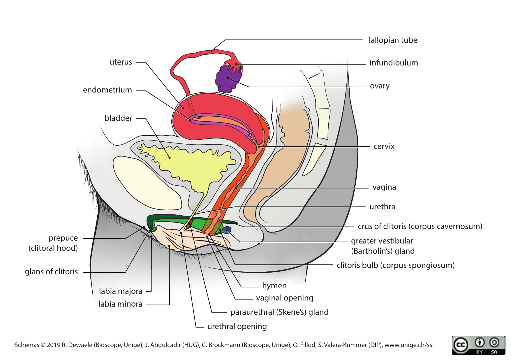
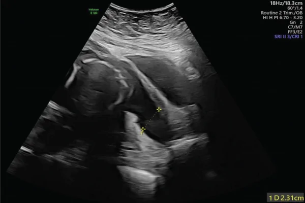
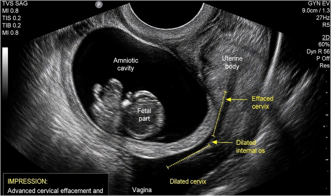
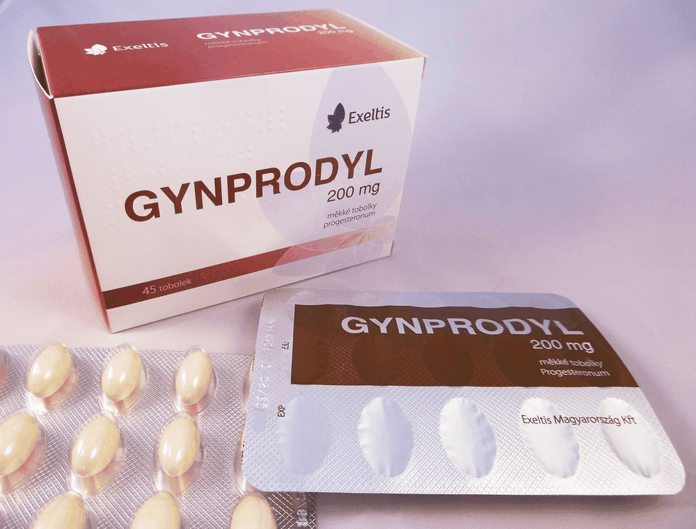
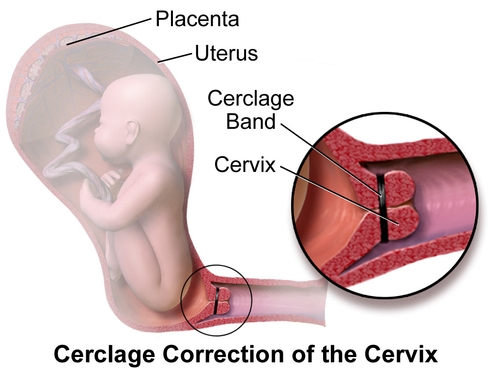
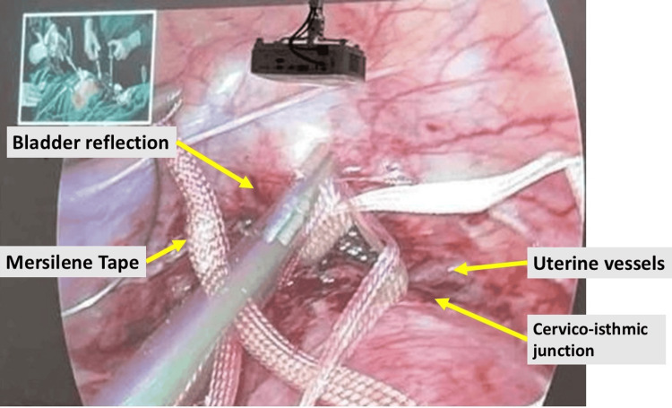
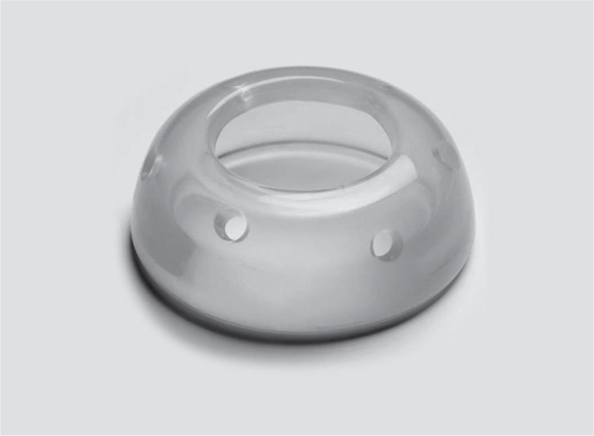
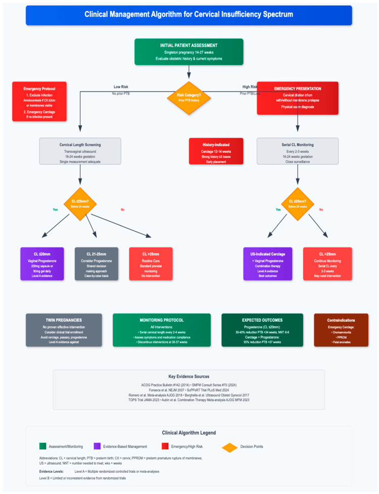
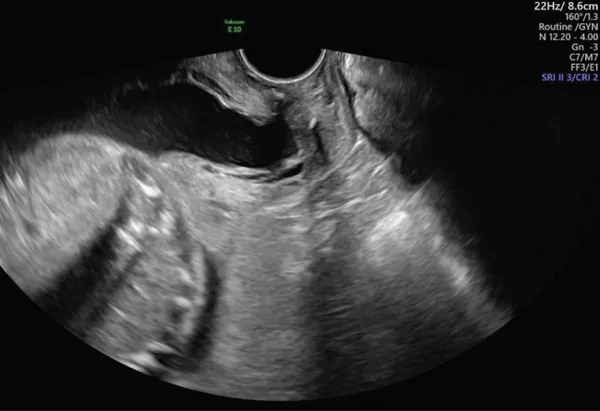

# BÀI HỌC Y KHOA: HỞ EO CỔ TỬ CUNG & DỰ PHÒNG SINH NON (PROGESTERONE, CERCLAGE, PESSARY)
**Ngày:** 2026-11-14 | **Chuyên khoa:** Sản phụ khoa — Dự phòng sinh non | **Đối tượng:** Bác sĩ, học viên sau đại học và người học mất gốc cần học từ nền tảng

---

## 0. TỔNG QUAN — VÌ SAO BÀI NÀY QUAN TRỌNG? [CỐT LÕI]

&emsp;Sinh non là nguyên nhân hàng đầu gây tử vong chu sinh trên toàn cầu.
Ước tính toàn cầu năm 2020 có 13,4 triệu trẻ sinh non, chiếm 9,9% tổng số sinh [DATA VERIFIED].
Phần lớn các ca sinh non là sinh non tự phát, tức là chuyển dạ tự khởi phát hoặc vỡ ối sớm mà không có chỉ định y khoa phải lấy thai ra.

&emsp;Trong số các cơ chế gây sinh non tự phát, hở eo cổ tử cung là cơ chế đặc biệt nguy hiểm vì nó diễn ra âm thầm.
Cổ tử cung mở dần mà không có cơn co, không đau, thai phụ thường không biết cho tới khi màng ối lộ ra ngoài hoặc vỡ ối.
Khi đã tới giai đoạn đó, cơ hội giữ thai còn rất ít.

&emsp;Bài này dạy cách CHỌN người cần dự phòng và CHỌN biện pháp nào.
Ba biện pháp dự phòng chính là progesterone đặt âm đạo, khâu vòng cổ tử cung (cerclage) và đặt vòng nâng cổ tử cung (pessary).
Ba biện pháp này không thay thế nhau một cách tùy tiện.
Mỗi biện pháp chỉ có lợi ở một nhóm thai phụ xác định, chọn sai nhóm thì không những vô ích mà còn có thể gây hại.
Toàn bộ bài học xoay quanh một câu hỏi duy nhất: thai phụ này thuộc nhóm nào, và với nhóm đó thì biện pháp nào đã được chứng minh là có lợi.

**Mục tiêu của bài:**
- Giải thích được hở eo cổ tử cung là gì, phân biệt được với sinh non do cơn co.
- Đọc được chiều dài cổ tử cung và biết ngưỡng nào cần can thiệp, ngưỡng nào chỉ cần theo dõi.
- Chọn đúng giữa progesterone đặt âm đạo, cerclage và pessary theo tiền sử và chiều dài cổ tử cung.
- Biết khi nào KHÔNG được dùng một biện pháp, đặc biệt là 17-OHPC tiêm đã bị rút phê duyệt.
- Ra được quyết định cấp cứu khi cổ tử cung đã mở và màng ối đã lộ.

> **TIÊU CHUẨN BẮT BUỘC — DẠY TỪ GỐC, KHÔNG GIỚI HẠN ĐỘ DÀI:** Viết để một người học mất gốc vẫn theo được. Trước khi dùng một thuật ngữ, chữ viết tắt, chỉ số, cơ quan, cơ chế, thủ thuật hoặc quyết định điều trị lần đầu, phải giải thích bằng tiếng Việt đơn giản: **nó là gì → bình thường hoạt động ra sao → vì sao bất thường này quan trọng → nhận ra bằng cách nào → làm gì tiếp theo**. Sau lần giải thích đầu tiên, mới dùng viết tắt/thuật ngữ ngắn. Không dùng "rõ ràng", "thường quy", "theo protocol" hoặc danh sách bước trần nếu chưa giải thích lý do và ý nghĩa của hành động. Độ dài không có giới hạn tối đa: tiếp tục viết khi còn một mắt xích cần thiết để người học hiểu hoặc ra quyết định an toàn; ưu tiên chia nhỏ bằng tiêu đề, ví dụ và checkpoint thay vì cắt bỏ nền tảng.

### 0.1. Nền tảng tối thiểu cần dùng ngay [CỐT LÕI]

&emsp;**Cổ tử cung (cervix)** là đoạn cuối của tử cung, nối buồng tử cung với âm đạo.
Trong thai kỳ, cổ tử cung đóng vai trò như một cái nắp van giữ thai trong tử cung.
Cổ tử cung dài khoảng 30–50 mm, cấu tạo chủ yếu là mô liên kết với collagen, chỉ có một phần nhỏ là cơ trơn.
**Chiều dài cổ tử cung (cervical length, CL)** là khoảng cách từ lỗ trong cổ tử cung tới lỗ ngoài, đo bằng siêu âm qua ngã âm đạo.
CL càng ngắn thì nguy cơ sinh non tự phát càng cao, và mối liên hệ này đã được đo đếm chính xác trong các phân tích gộp lớn.

&emsp;**Sinh non (preterm birth, PTB)** là sinh trước 37 tuần thai.
Phân loại theo tuổi thai gồm cực non (dưới 28 tuần), rất non (28 tới dưới 32 tuần) và non vừa tới muộn (32 tới dưới 37 tuần).
**Sinh non tự phát (spontaneous preterm birth, SPTB)** là sinh non khởi phát tự nhiên, khác với sinh non do chỉ định y khoa (ví dụ phải mổ lấy thai sớm vì tiền sản giật nặng).
Bài này chỉ bàn sinh non tự phát, không bàn sinh non do chỉ định.

&emsp;**Đơn thai (singleton)** là thai kỳ chỉ có 1 thai.
**Song thai (twin)** là thai kỳ có 2 thai.
Sự phân biệt này rất quan trọng vì nhiều biện pháp dự phòng có hiệu quả ở đơn thai nhưng không có hiệu quả, thậm chí có hại, ở song thai.
Bài này dạy chủ yếu cho đơn thai, phần song thai được tách riêng và dạy rõ ở §4, §5 và §8.

&emsp;**Sảy thai quý 2 (second-trimester loss)** là mất thai ở 3 tháng giữa thai kỳ, thường sau tuần 14.
**Mở cổ tử cung không đau (painless cervical dilation)** là cổ tử cung mở ra mà thai phụ không cảm thấy cơn co hay đau bụng.
Đây là dấu hiệu đặc trưng của hở eo cổ tử cung, khác hẳn với chuyển dạ thật vốn luôn đi kèm cơn co đều và đau tăng dần.

&emsp;Bài này lấy ngưỡng chiều dài cổ tử cung từ bài siêu âm **FUS-09A (Chiều dài cổ tử cung trong sàng lọc sinh non)**.
Bài này không dạy lại kỹ thuật đo CL, cách đặt đầu dò hay cách đọc hình ảnh siêu âm.
Khi thai phụ chuyển sang giai đoạn doạ đẻ non, việc quản lý thuộc bài **OB40 (Quản lý dự phòng đẻ non, doạ đẻ non)**.
Bài này không dạy lại thuốc giảm co, corticosteroid, magie sulfat hay kháng sinh trong doạ đẻ non.
Hai bài gắn chéo đó là ranh giới của bài này, người học cần đọc đủ cả 3 bài để có bức tranh trọn vẹn.

### 0.2. Ba biện pháp dự phòng — nhìn một lượt trước khi đi vào chi tiết [CỐT LÕI]

&emsp;Ba biện pháp dự phòng sinh non trong bài này tác động vào 3 khâu khác nhau của cùng một quá trình.
Progesterone đặt âm đạo là thuốc nội tiết, tác động lên sinh học của cổ tử cung để giữ nó chưa chín.
Cerclage là một mũi khâu cơ học, giữ cổ tử cung đóng lại bằng lực nâng đỡ.
Pessary là một vòng silicon đặt quanh cổ tử cung, đổi hướng trục của cổ tử cung để giảm áp lực lên lỗ trong.
Ba biện pháp không có thứ bậc cố định, việc chọn biện pháp nào phụ thuộc vào tiền sử thai phụ và chiều dài cổ tử cung tại thời điểm đo.

| Biện pháp | Bản chất | Nhóm có lợi đã chứng minh |
|---|---|---|
| Progesterone đặt âm đạo | Thuốc nội tiết, đặt tại chỗ | Đơn thai, cổ tử cung ngắn |
| Cerclage | Khâu cơ học quanh cổ tử cung | Có tiền sử mất thai hoặc sinh non kèm cổ tử cung ngắn |
| Pessary Arabin | Vòng silicon đổi trục cổ tử cung | Không còn được khuyến cáo thường quy |

&emsp;Bảng trên chỉ là khung nhìn nhanh.
Chi tiết ai được dùng, ai không được dùng, bắt đầu khi nào và dừng khi nào nằm ở §3, §4 và §5.
Riêng pessary cần nói ngay từ đầu: bằng chứng mới nhất đã lật ngược vị trí của nó.
Trial PECEP năm 2012 từng cho kết quả rất tốt, nhưng trial TOPS năm 2023 cho thấy pessary không giảm sinh non và còn liên quan tử vong thai cao hơn.
Vì vậy các guideline mới nhất khuyến cáo không dùng pessary cho đơn thai có cổ tử cung ngắn.

### 0.3. Nguồn gốc bài này và những gì đã sửa [CỐT LÕI]

&emsp;Bài này được xây dựng từ tài liệu nguồn **FUS-09A (Chiều dài cổ tử cung trong sàng lọc sinh non)**, là tài liệu người học sẽ thi.
Theo quy tắc cứng của bài thi, toàn bộ chi tiết trong nguồn gốc được giữ nguyên, chỉ sắp xếp và giải thích lại cho dễ hiểu.
Mọi điểm nguồn sai hoặc lệch đều được sửa bằng khối riêng gắn nhãn 🆕 CẬP NHẬT MỚI, đặt ngay cạnh nội dung liên quan, không lặng lẽ sửa chữ gốc và không bỏ qua im lặng.
Người học đọc bài này sẽ thấy cả chữ gốc đã được dạy lại và khối vá mới, phân biệt rõ ràng với nhau.

> 🆕 **CẬP NHẬT MỚI — Mã số PubMed và tên trial trong nguồn gốc: chỉ 2 trong 8 mã là đúng.**
>
> &emsp;Tài liệu nguồn liệt kê 8 mã số PubMed cho các trial chính, nhưng khi đối chiếu lại chỉ có 2 mã trỏ đúng bài (trial pessary so với progesterone ở song thai năm 2025 và phân tích gộp Hughes năm 2026).
> &emsp;5 mã còn lại trỏ sang bài hoàn toàn khác chủ đề: một bài về lao, một bài về phẫu thuật khớp vai, một bài về phẫu thuật ung thư trong đại dịch, một bài về mạch máu và một bài về băng cổ chân.
> &emsp;1 mã không tồn tại trên PubMed.
> &emsp;Ngoài ra nguồn còn bịa tên trial "PROM-PROM", ghi sai năm của trial Fonseca và trial ProTWIN, ghi sai tên trial OPPTIMUM thành trial khác.
> &emsp;Bài này đã đối chiếu lại toàn bộ và dạy đúng tên trial, đúng năm, đúng tạp chí cho từng nghiên cứu.
> &emsp;Mã số PubMed đúng của từng trial được ghi đầy đủ ở §14 tài liệu tham khảo.
> &emsp;Trong thân bài không ghi mã số, chỉ ghi tên tác giả, năm và tạp chí để người học đối chiếu.

&emsp;Hai điểm bắt buộc phải sửa trong bài này được tách thành 2 khối 🆕 lớn.
Khối thứ nhất nằm ở §3, về thuốc tiêm 17-OHPC đã bị rút phê duyệt.
Khối thứ hai nằm ở §4, về ngưỡng cerclage theo tiền sử.
Cả 2 khối đều là những điểm nếu học sai sẽ trả lời sai trong thi và xử trí sai trên lâm sàng.

---

## 1. HỞ EO CỔ TỬ CUNG — ĐỊNH NGHĨA VÀ CƠ CHẾ [CỐT LÕI]

### 1.1. Định nghĩa — cổ tử cung không giữ được thai [CỐT LÕI]

&emsp;**Hở eo cổ tử cung (cervical insufficiency)** là tình trạng cổ tử cung không giữ được thai trong tử cung khi chưa có dấu hiệu chuyển dạ ở quý 2 thai kỳ [NGOÀI ABSTRACT].
Định nghĩa này của ACOG nhấn mạnh 2 yếu tố: thai vẫn còn trong tử cung đáng lẽ phải được giữ, và không hề có cơn co hay dấu hiệu chuyển dạ nào.
Nói cách khác, cổ tử cung tự mở ra trong khi tử cung vẫn yên lặng.
Đây chính là điểm khác biệt căn bản với sinh non do cơn co, nơi tử cung co bóp mạnh và cổ tử cung mở ra vì bị cơn co đẩy.

&emsp;Trong thực hành, hở eo cổ tử cung được chẩn đoán bằng 1 trong 2 cách.
Cách thứ nhất là chẩn đoán theo tiền sử kinh điển: thai phụ đã có từ 2 lần sảy thai quý 2 liên tiếp trở lên, hoặc sinh cực non trước 28 tuần, mà không có hoặc chỉ có triệu chứng rất nhẹ [NGOÀI ABSTRACT].

&emsp;Cách thứ hai là chẩn đoán theo khám và siêu âm: cổ tử cung ngắn dần trên siêu âm, hoặc cổ tử cung đã mở khi thăm khám mà không có cơn co.
Hai cách này bổ sung cho nhau, không thay thế nhau.
Một thai phụ có thể chưa từng sảy thai nhưng siêu âm đã thấy cổ tử cung ngắn nhanh, và ngược lại một thai phụ có tiền sử sảy thai điển hình thì không cần đợi siêu âm mới nghĩ tới hở eo.



Nguồn ảnh: Wikimedia Commons (UNIGE 2019, CC BY-SA 4.0) — sơ đồ mặt cắt dọc giữa hệ sinh dục nữ, cổ tử cung không mang thai, nhãn tiếng Anh.

&emsp;**Ví dụ:** thai phụ 30 tuổi, mang thai lần 3, 2 lần trước đều sảy ở tuần 19 và tuần 21 mà không đau bụng, không ra máu nhiều, chỉ thấy nặng vùng chậu rồi vỡ ối.
Tiền sử này rất điển hình cho hở eo cổ tử cung.
Người học gặp tiền sử như vậy phải nghĩ tới hở eo ngay từ lần khám thai đầu tiên, không chờ tới khi siêu âm thấy cổ tử cung ngắn mới hành động.

> ⚠️ HỌC VIÊN HAY NHẦM: Hở eo cổ tử cung không phải là "cổ tử cung yếu" theo nghĩa cơ bắp yếu như cơ tay yếu. Cổ tử cung không phải một cơ vòng co bóp mạnh, nó chủ yếu là mô liên kết collagen. "Yếu" ở đây có nghĩa là cấu trúc collagen không chịu được áp lực của thai đang lớn dần, nên cổ tử cung ngắn lại và mở ra từ từ. Hiểu sai điểm này sẽ dẫn tới hiểu sai cơ chế của cả 3 biện pháp dự phòng.

### 1.2. Cổ tử cung bình thường — 4 giai đoạn chín trong thai kỳ [CỐT LÕI]

&emsp;Để hiểu vì sao cổ tử cung mở sớm, phải hiểu trước cổ tử cung bình thường thay đổi ra sao trong thai kỳ.
Cổ tử cung trải qua quá trình "chín" (remodeling) theo 4 giai đoạn.
Giai đoạn 1 là mềm hóa, bắt đầu từ tháng đầu thai kỳ, tỉ lệ proteoglycan tăng lên và liên kết chéo của collagen giảm đi.
Giai đoạn 2 là chín thực sự, từ tháng 6 tới tháng 7, tỉ lệ hyaluronan và elastin tăng, tế bào viêm tập trung về cổ tử cung.

&emsp;Giai đoạn 3 là mở, xảy ra khi chuyển dạ thật sự, men COX-2 tăng và prostaglandin được sản xuất mạnh.
Giai đoạn 4 là phục hồi sau sinh.
Bốn giai đoạn này bình thường diễn ra đúng trình tự và đúng thời điểm.
Hở eo cổ tử cung chính là khi giai đoạn mềm hóa và chín xảy ra quá sớm, khi thai chưa đủ tháng.

&emsp;Cấu tạo của cổ tử cung giải thích vì sao nó có thể "chín" sớm như vậy.
Khoảng 80% cổ tử cung là mô liên kết với collagen type I và type III.
Khoảng 15% là cơ trơn.
Khoảng 5% còn lại là biểu mô.
Sức bền của cổ tử cung phụ thuộc chủ yếu vào mạng lưới collagen, không phụ thuộc vào cơ trơn.
Khi collagen bị phá vỡ sớm hoặc tổng hợp kém, cổ tử cung mất sức bền và bắt đầu ngắn lại dưới áp lực của thai.

### 1.3. Chuỗi cơ chế 1 — Từ chín sớm tới sinh non [CỐT LÕI]

&emsp;**Tầng 1 — Phân tử:** Progesterone là hormone giữ cổ tử cung đóng trong thai kỳ.
Khi progesterone giảm tác dụng tại chỗ, hoặc khi viêm kích hoạt men COX-2, prostaglandin tăng lên.
Prostaglandin kích hoạt các men phân hủy collagen (matrix metalloproteinase, MMP).
Đồng thời các cytokine viêm như TNFα, IL-1β, IL-6 và IL-8 tăng cao trong dịch âm đạo của thai phụ có nguy cơ sinh non.

&emsp;**Tầng 2 — Tế bào và mô:** Collagen bị cắt đứt, liên kết chéo giữa các sợi collagen giảm.
Tỉ lệ proteoglycan và hyaluronan tăng, mô cổ tử cung mềm ra và giữ nước.
Tế bào viêm xâm nhập làm quá trình này nhanh hơn.
Cổ tử cung mất sức bền cơ học dù tử cung chưa hề co bóp.

&emsp;**Tầng 3 — Cơ quan:** Cổ tử cung ngắn dần trên siêu âm, lỗ trong bắt đầu mở tạo hình phễu (funneling).
Màng ối lồi dần qua lỗ trong đã mở, tiếp xúc với âm đạo và vi khuẩn âm đạo.
Áp lực của thai đè lên màng ối đã lộ làm màng ối càng lồi thêm, tạo thành một vòng luẩn quẩn.

&emsp;**Tầng 4 — Lâm sàng:** Thai phụ thường không đau, không có cơn co.
Triệu chứng duy nhất có thể chỉ là nặng vùng chậu, tăng tiết dịch âm đạo hoặc ra máu ít.
Nhiều thai phụ không có triệu chứng gì cho tới khi vỡ ối hoặc sảy thai.
Đây là lý do hở eo được gọi là "âm thầm" và vì sao tiền sử là manh mối quan trọng nhất.

&emsp;**Tầng 5 — Quyết định và hậu quả:** Nếu phát hiện sớm khi cổ tử cung mới ngắn, còn kịp dùng progesterone hoặc cerclage dự phòng.
Nếu phát hiện muộn khi cổ tử cung đã mở và màng ối đã lộ, chỉ còn cerclage cấp cứu với tỉ lệ thành công thấp hơn nhiều.
Nếu không can thiệp, vòng luẩn quẩn màng ối lộ, nhiễm trùng và vỡ ối sẽ dẫn tới sảy thai quý 2 hoặc sinh cực non.

```text
Sơ đồ 1 — Chuỗi chín sớm của cổ tử cung (tuyến tính):
Progesterone giảm tác dụng ──→ COX-2 tăng ──→ Prostaglandin tăng ──→ MMP phân hủy collagen ──→ Cổ tử cung ngắn lại ──→ Lỗ trong mở ──→ Màng ối lộ ──→ Vỡ ối / Sinh non
```

```text
Sơ đồ 2 — Vòng luẩn quẩn khi màng ối đã lộ (vòng lặp):
Màng ối lộ qua lỗ trong ──→ Tiếp xúc vi khuẩn âm đạo ──→ Viêm màng ối ──→ Prostaglandin tăng thêm ──→ Cổ tử cung mở thêm ──→ Màng ối lộ nhiều hơn ──→ Quay lại đầu vòng
                                          ✗ Progesterone hoặc cerclage đặt đúng lúc cắt đứt vòng này
```

### 1.4. Các cơ chế dẫn tới cổ tử cung ngắn [CỐT LÕI]

&emsp;Không phải mọi cổ tử cung ngắn đều do cùng một cơ chế.
Hiểu đúng cơ chế giúp chọn đúng biện pháp, vì cerclage chỉ sửa được khâu cơ học, còn progesterone chỉ sửa được khâu nội tiết và viêm.
Bảng dưới đây liệt kê các cơ chế đã biết, mỗi cơ chế đi kèm bằng chứng và ý nghĩa khi chọn biện pháp.

| Cơ chế | Bằng chứng đã biết | Ý nghĩa khi chọn biện pháp |
|---|---|---|
| Viêm và hoạt hóa màng rụng | Cytokine TNFα, IL-1β, IL-6, IL-8 tăng trong dịch âm đạo | Progesterone có tác dụng chống viêm tại chỗ |
| Thiếu progesterone | Progesterone duy trì cổ tử cung đóng, thiếu thì chín sớm | Progesterone đặt âm đạo là biện pháp trực tiếp nhất |
| Cấu trúc collagen | Đa hình gen COL1A1, COL5A1 làm collagen yếu | Cerclage hỗ trợ cơ học có thể bù đắp |

&emsp;Yếu tố cơ học cũng góp phần quan trọng.
Đa thai, đa ối, khối u tử cung hoặc dị tật tử cung làm tăng áp lực đè lên cổ tử cung.
Áp lực càng lớn thì cổ tử cung vốn đã yếu càng ngắn nhanh.
Tiền sử can thiệp cổ tử cung như khoét chóp (cone biopsy) hoặc cắt vòng điện (LEEP) làm mô sợi bình thường bị thay bằng mô sẹo yếu hơn.

&emsp;Phân tích gộp Hughes năm 2026 cho thấy ở nhóm có tiền sử phẫu thuật cổ tử cung, giá trị tiên lượng của chiều dài cổ tử cung mạnh hơn khi CL dưới 28 mm [FULL TEXT VERIFIED].
Điều này có nghĩa là cùng một độ dài cổ tử cung, người có tiền sử phẫu thuật cổ tử cung có nguy cơ cao hơn người không có tiền sử.
Yếu tố di truyền như đa hình thụ thể beta-2 adrenergic và tiền sử phơi nhiễm DES hoặc dị tật Müllerian bẩm sinh cũng được ghi nhận, nhưng bằng chứng còn ít và không thay đổi quyết định điều trị trong bài này.



Nguồn ảnh: Zagdon Keidar và cộng sự, Case Reports in Obstetrics and Gynecology 2026, Hình 1 (PMC, CC-BY 4.0) — siêu âm màng ối lồi tới lỗ ngoài, đo 2,31 cm.

### 1.5. Phân biệt hở eo với sinh non do cơn co [CỐT LÕI]

&emsp;Đây là phân biệt quan trọng nhất của cả bài, vì 2 cơ chế này điều trị hoàn toàn khác nhau.
Sinh non do cơn co bắt đầu từ tử cung: tử cung co bóp đều, đau tăng dần, cổ tử cung mở ra vì bị cơn co đẩy.
Hở eo bắt đầu từ cổ tử cung: cổ tử cung tự mở trong khi tử cung yên lặng, không có cơn co.
Thai phụ bị hở eo thường kể rằng thai "tự tuột ra" mà không đau, hoặc chỉ thấy nặng bụng rồi vỡ ối.
Thai phụ chuyển dạ sinh non thì kể đau bụng từng cơn, đều đặn, càng lúc càng mạnh.

| Đặc điểm | Hở eo cổ tử cung | Sinh non do cơn co |
|---|---|---|
| Cơn co tử cung | Không có hoặc rất ít | Có, đều, đau tăng dần |
| Triệu chứng chính | Nặng vùng chậu, ra dịch, không đau | Đau bụng từng cơn |
| Cổ tử cung mở | Tự mở, không đau | Mở do cơn co đẩy |

&emsp;**Ví dụ:** thai phụ 27 tuổi, thai 23 tuần, vào viện vì ra dịch âm đạo nhiều, không đau bụng, thăm khám thấy cổ tử cung mở 2 cm, màng ối còn nguyên và lồi qua lỗ trong.
Đây là hở eo, không phải chuyển dạ sinh non.
Nếu cho thuốc giảm co trong trường hợp này thì không giải quyết được vấn đề, vì tử cung vốn không co.

&emsp;Biện pháp đúng là cerclage cấp cứu sau khi loại trừ nhiễm trùng, vỡ ối và cơn co thật sự.
Ngược lại, thai phụ đau bụng từng cơn 10 phút 1 lần, cổ tử cung mở 3 cm, đó là chuyển dạ sinh non và thuộc quản lý của bài OB40.

### 1.6. Hỏi bệnh sử là xét nghiệm chẩn đoán [CỐT LÕI]

&emsp;Trong hở eo cổ tử cung, hỏi bệnh sử không chỉ là bước đầu khám mà chính là xét nghiệm chẩn đoán quan trọng nhất.
Không có xét nghiệm máu hay xét nghiệm nào khác thay thế được một bệnh sử sảy thai quý 2 điển hình.
Người học phải hỏi đủ 5 nhóm câu hỏi sau ở mọi thai phụ có nguy cơ.
Nhóm 1 là tiền sử sảy thai: sảy mấy lần, ở tuần thai nào, có đau bụng hay ra máu trước khi sảy không.

&emsp;Nhóm 2 là tiền sử sinh non: sinh ở tuần nào, có cơn co trước khi sinh không, cân nặng trẻ bao nhiêu.
Nhóm 3 là tiền sử can thiệp cổ tử cung: đã từng khoét chóp, cắt vòng điện, nong cổ tử cung hay đốt cổ tử cung chưa.
Nhóm 4 là tiền sử phẫu thuật tử cung và dị tật tử cung đã biết.
Nhóm 5 là diễn biến thai kỳ hiện tại: có nặng vùng chậu, ra dịch, ra máu hay cảm giác thai tụt xuống không.

&emsp;Một bệnh sử sảy thai quý 2 "không đau" phải được hỏi kỹ tới từng chi tiết.
Hỏi xem thai phụ có cảm thấy cơn co không, có đau lưng không, vỡ ối xảy ra trước hay sau khi thai ra.
Trong hở eo điển hình, vỡ ối thường xảy ra trước hoặc cùng lúc thai ra, mà không có cơn co báo trước.
Trong sảy thai do nguyên nhân khác như bất thường nhiễm sắc thể, thai thường đã ngừng phát triển trước khi sảy.
Phân biệt này quyết định thai phụ có được xếp vào nhóm hở eo để dự phòng bằng cerclage hay không.

### 🛑 DỪNG 1 PHÚT — TỰ KIỂM TRA

> 1. Thai phụ sảy 2 lần ở tuần 20, cả 2 lần đều không đau bụng, vỡ ối rồi thai tự ra — chẩn đoán nghĩ tới đầu tiên là gì?
> 2. Vì sao hở eo cổ tử cung thường không có triệu chứng cho tới khi đã muộn?
>
> *(Đáp án: 1. Hở eo cổ tử cung, chẩn đoán theo tiền sử kinh điển từ 2 lần sảy thai quý 2 liên tiếp không đau. 2. Vì quá trình chín sớm của cổ tử cung diễn ra mà không có cơn co tử cung, thai phụ không đau nên không biết cổ tử cung đang mở dần.)*

---

## 2. CHẨN ĐOÁN VÀ TIÊN LƯỢNG THEO CHIỀU DÀI CỔ TỬ CUNG [CỐT LÕI]

### 2.1. Ngưỡng chiều dài cổ tử cung lấy từ bài FUS-09A [CỐT LÕI]

&emsp;Bài này không dạy lại kỹ thuật đo chiều dài cổ tử cung.
Kỹ thuật đo, cách đặt đầu dò, các mốc hình ảnh và lỗi thường gặp thuộc bài siêu âm **FUS-09A**.
Bài này chỉ lấy các ngưỡng đã được FUS-09A dạy và dùng chúng làm mốc quyết định điều trị.
Người học chưa nắm kỹ thuật đo phải quay lại đọc FUS-09A trước, vì một số đo sai có thể dẫn tới quyết định sai hoàn toàn.

&emsp;Ngưỡng quan trọng nhất là **25 mm**.
Cổ tử cung dưới 25 mm ở tuổi thai 18–24 tuần được coi là "cổ tử cung ngắn" (short cervix), và đây là ngưỡng can thiệp [GUIDELINE VERIFIED].
Cổ tử cung dưới 15 mm là nguy cơ rất cao, cần can thiệp ngay và theo dõi sát.

&emsp;Cổ tử cung từ 25 tới 34 mm là vùng trung gian, quyết định phụ thuộc vào tiền sử của thai phụ.
Cổ tử cung từ 35 mm trở lên thường được coi là bình thường, nguy cơ sinh non thấp.
Cổ tử cung từ 40 mm trở lên gần như không còn giá trị tiên lượng thêm, nghĩa là dài hơn 40 mm cũng không giảm nguy cơ thêm bao nhiêu.



Nguồn ảnh: Malik và cộng sự, Clinical Case Reports 2026, Hình 1 (PMC, CC BY-NC-ND 4.0, chỉ dùng phi thương mại) — siêu âm lỗ trong giãn (phễu hóa), không có vạch đo chiều dài.

&emsp;**Ví dụ:** thai phụ 26 tuổi, con so, siêu âm hình thái lúc 20 tuần đo CL 32 mm.
Con số này nằm trong vùng trung gian, chưa đủ để can thiệp ngay.
Nếu thai phụ không có tiền sử sinh non hay sảy thai, chỉ cần theo dõi và đo lại sau 2 tới 4 tuần.
Nếu lần đo sau CL giảm xuống dưới 25 mm thì bắt đầu progesterone.
Ngược lại, thai phụ khác cũng 20 tuần nhưng CL chỉ 18 mm thì can thiệp ngay, không chờ đo lại.

### 2.2. Tiên lượng theo chiều dài — phân tích gộp Hughes 2026 [CỐT LÕI]

&emsp;Bằng chứng mạnh nhất về giá trị tiên lượng của chiều dài cổ tử cung là phân tích gộp dữ liệu từng thai phụ Hughes năm 2026.
Phân tích này gộp dữ liệu của 27 nghiên cứu, với 91.404 thai phụ đơn thai không triệu chứng [DATA VERIFIED].
Chiều dài cổ tử cung trung bình là 40 mm, độ lệch chuẩn 9 mm, đo lúc khoảng 20 tuần.
Sinh non tự phát trước 37 tuần xảy ra ở 4.442 người, chiếm 5,2% tổng số.

&emsp;Kết quả chính cho thấy mối liên hệ hình chữ L giữa chiều dài cổ tử cung và nguy cơ sinh non.
So với thai phụ có CL 40 mm, thai phụ có CL 20 mm có tỉ số odds sinh non cao hơn 6,22 lần, khoảng tin cậy 95% từ 4,76 tới 8,13 [DATA VERIFIED].

&emsp;Thai phụ có CL 30 mm có tỉ số odds cao hơn 2,10 lần, khoảng tin cậy 95% từ 1,85 tới 2,38 [DATA VERIFIED].
Hình chữ L có nghĩa là nguy cơ tăng rất dốc khi CL giảm từ 40 mm xuống 20 mm, nhưng khi CL đã trên 40 mm thì nguy cơ gần như không đổi.
Đây là cơ sở cho ngưỡng "bình thường" mới là 40 mm, thay vì chỉ nhìn ngưỡng 25 mm như trước đây.

&emsp;Phân tích phân nhóm của Hughes cho thấy giá trị tiên lượng của CL thay đổi theo tiền sử.
Ở thai phụ có tiền sử phẫu thuật cổ tử cung như khoét chóp hoặc cắt vòng điện, CL có giá trị tiên lượng mạnh hơn khi CL dưới 28 mm [FULL TEXT VERIFIED].
Ở thai phụ có tiền sử sinh non, giá trị tiên lượng của CL yếu hơn khi CL dưới 25 mm, vì nhóm này vốn đã có nguy cơ nền cao [FULL TEXT VERIFIED].
Dị tật tử cung, tiền sử sinh đủ tháng và con so không cho thấy bằng chứng tương tác với giá trị tiên lượng của CL.

> 🆕 **CẬP NHẬT MỚI — Sửa số liệu phân tích gộp Hughes 2026 trong nguồn gốc.**
>
> &emsp;Nguồn gốc ghi mẫu nghiên cứu là 91.204 thai phụ, nhưng abstract của bài Hughes ghi rõ mẫu phân tích là 91.404 thai phụ.
> &emsp;Con số 91.204 xuất hiện ở phần thảo luận của bài báo với mẫu số ước tính khác, và 2 mẫu số ước tính trong bài cũng không khớp nhau.
> &emsp;Bài này dạy mẫu phân tích là 91.404 thai phụ theo abstract.
> &emsp;Nguồn gốc cũng ghi nghiên cứu từ 12 quốc gia trong giai đoạn 2001–2019, nhưng thông tin này không có trong abstract và chưa kiểm chứng được.
> &emsp;Bài này không dạy "12 quốc gia, 2001–2019".
> &emsp;Bảng tỉ số odds theo từng mốc CL trong nguồn (35 mm khoảng 1,4; 25 mm khoảng 3,5; 15 mm khoảng 10; 10 mm khoảng 18) là số ước tính từ hình đường cong, không phải số trong abstract.
> &emsp;Bài này chỉ dạy 2 số đã kiểm chứng từ abstract là CL 20 mm (tỉ số odds 6,22) và CL 30 mm (tỉ số odds 2,10), cả 2 đều so với CL 40 mm.

&emsp;Ở song thai, mối liên hệ giữa CL và sinh non có hình dạng khác hẳn.
Phân tích gộp Hughes song thai năm 2025 gộp 17 nghiên cứu với 6.437 thai phụ song thai [DATA VERIFIED].
Tỉ lệ sinh non trước 37 tuần ở song thai là 44,9%, và trước 34 tuần là 14,9%.
Mỗi 1 mm CL tăng lên làm giảm 4,0% tỉ lệ sinh non tự phát trước 37 tuần, tỉ số hazard 0,96 [DATA VERIFIED].
Mỗi 1 mm CL tăng lên làm giảm 6,8% tỉ lệ sinh non tự phát trước 34 tuần, tỉ số hazard 0,93 [DATA VERIFIED].

&emsp;Mối liên hệ ở song thai là tuyến tính, không có hình chữ L và không có ngưỡng cắt rõ ràng nào.
Kết luận của tác giả là không có một độ dài cổ tử cung cụ thể nào dự báo hay loại trừ được mọi ca sinh non tự phát ở song thai.
Điều này giải thích vì sao các biện pháp dự phòng theo ngưỡng CL không áp dụng được cho song thai như cho đơn thai.

### 2.3. Nền lịch sử — nghiên cứu Iams 1996 [CỐT LÕI]

&emsp;Trước Hughes 2026, nghiên cứu nền tảng về CL là Iams năm 1996.
Nghiên cứu này đo CL qua ngã âm đạo ở 2.915 thai phụ đơn thai lúc khoảng 24 tuần và 2.531 thai phụ lúc khoảng 28 tuần [DATA VERIFIED].
Chiều dài cổ tử cung trung bình lúc 24 tuần là 35,2 mm, độ lệch chuẩn 8,3 mm.
Sinh tự phát trước 35 tuần xảy ra ở 126 người, chiếm 4,3%.

&emsp;Nguy cơ tương đối của sinh non tăng dần theo từng phân vị CL.
Ở phân vị 75 tương ứng CL 40 mm, nguy cơ tương đối là 1,98.
Khi CL từ 35 mm trở xuống, tức phân vị 50, nguy cơ tương đối là 2,35.
Ở mốc phân vị 25 với CL 30 mm, nguy cơ tương đối tăng lên 3,79.
Phân vị 10 có CL 26 mm, nguy cơ tương đối là 6,19.
CL 22 mm ở phân vị 5 đi kèm nguy cơ tương đối 9,49.
Ở phân vị 1, CL chỉ còn 13 mm, nguy cơ tương đối lên tới 13,99 [DATA VERIFIED].

> 🆕 **CẬP NHẬT MỚI — Sửa phân vị 10 của Iams 1996.**
>
> &emsp;Nguồn gốc ghi phân vị 10 của CL là khoảng 25 mm, nhưng abstract của Iams ghi rõ phân vị 10 là 26 mm với nguy cơ tương đối 6,19.
> &emsp;Bài này dạy 26 mm.
> &emsp;Sai số 1 mm nghe thì nhỏ, nhưng ở vùng ngưỡng quyết định thì 1 mm có thể đổi cả hướng xử trí.

&emsp;**Ví dụ:** thai phụ có CL 26 mm lúc 24 tuần thuộc đúng phân vị 10, nghĩa là nguy cơ sinh non của thai phụ này cao gấp khoảng 6 lần so với nhóm chung.
Con số này giúp người học hiểu vì sao ngưỡng 25 mm được chọn làm ngưỡng can thiệp: nó nằm ngay quanh phân vị 10, nơi nguy cơ bắt đầu tăng dốc.

> 🆕 **CẬP NHẬT MỚI — Sửa tỉ lệ sinh non toàn cầu trong nguồn gốc.**
>
> &emsp;Nguồn gốc ghi tỉ lệ sinh non toàn cầu khoảng 10,5% và gắn mã số PubMed của một bài khảo sát phẫu thuật.
> &emsp;Số liệu đúng là của Ohuma và cộng sự, Lancet 2023: ước tính 13,4 triệu trẻ sinh non năm 2020, chiếm 9,9% tổng số sinh [DATA VERIFIED].
> &emsp;Bài này dạy 9,9%, không dạy 10,5%.
> &emsp;Con số khoảng 1 triệu tử vong do sinh non mỗi năm không có trong abstract của Ohuma, bài này không dạy kèm số đó.

### 2.4. Dịch tễ toàn cầu và ý nghĩa của ngưỡng 40 mm [CỐT LÕI]

&emsp;Ước tính toàn cầu năm 2020 có 13,4 triệu trẻ sinh non, chiếm 9,9% tổng số sinh, so với 13,8 triệu ca năm 2010 chiếm 9,8% [DATA VERIFIED].
Tỉ lệ sinh non toàn cầu gần như không giảm trong 10 năm, dù y học đã tiến bộ nhiều.
Điều này cho thấy dự phòng sinh non vẫn là thách thức lớn, và việc chọn đúng người để can thiệp là khâu quan trọng nhất.

&emsp;Phân tích Hughes 2026 gợi ý ngưỡng "bình thường" mới nên là 40 mm thay vì 25 mm.
Thai phụ có CL trên 40 mm gần như không còn giá trị tiên lượng thêm, nghĩa là không cần theo dõi sát hay can thiệp.
Thai phụ có CL từ 25 tới 35 mm nằm trong vùng xám, cần đánh giá nguy cơ nền và cân nhắc theo dõi sát.
Thai phụ có CL dưới 25 mm cần can thiệp, và càng ngắn thì can thiệp càng khẩn.

> 🚨 **BOX ĐỎ — AN TOÀN TRƯỚC KHI QUYẾT ĐỊNH DỰ PHÒNG:** Trước khi chọn bất kỳ biện pháp dự phòng nào, phải loại trừ các dấu hiệu cấp cứu sau: ra máu âm đạo nhiều, vỡ ối, cơn co tử cung đều và đau, sốt hoặc dấu hiệu nhiễm trùng, thai suy. Nếu có bất kỳ dấu hiệu nào trong số này, đây không còn là dự phòng nữa mà là tình huống cấp cứu hoặc doạ đẻ non, phải xử trí theo bài OB40 và chuyển tuyến ngay. Không được đặt cerclage hay pessary khi đang có nhiễm trùng, chảy máu nhiều hoặc cơn co thật sự. Không được trì hoãn chuyển viện để chờ đo lại chiều dài cổ tử cung.

### 🛑 DỪNG 1 PHÚT — TỰ KIỂM TRA

> 1. Thai phụ đơn thai 21 tuần, CL 19 mm, không tiền sử sinh non — ngưỡng này thuộc nhóm nào và cần làm gì?
> 2. Vì sao cùng CL 30 mm nhưng thai phụ có tiền sử phẫu thuật cổ tử cung lại nguy cơ cao hơn thai phụ không có tiền sử?
>
> *(Đáp án: 1. CL 19 mm là cổ tử cung ngắn, dưới ngưỡng 20 mm, cần bắt đầu progesterone đặt âm đạo theo khuyến cáo mạnh của SMFM. 2. Vì phân tích Hughes cho thấy CL có giá trị tiên lượng mạnh hơn ở nhóm có tiền sử phẫu thuật cổ tử cung khi CL dưới 28 mm, cùng một độ dài thì nguy cơ thực tế cao hơn.)*

---

## 3. ĐIỀU TRỊ DỰ PHÒNG — PROGESTERONE ĐẶT ÂM ĐẠO [CỐT LÕI]

### 3.1. Chuỗi cơ chế 2 — Progesterone giữ cổ tử cung chưa chín [CỐT LÕI]

&emsp;**Tầng 1 — Phân tử:** Progesterone gắn thụ thể progesterone (PR) trên tế bào cổ tử cung.
Thụ thể đã gắn progesterone ức chế yếu tố phiên mã NF-κB, làm giảm sản xuất cytokine viêm.
Đồng thời progesterone ức chế men COX-2, làm giảm tổng hợp prostaglandin.
Progesterone cũng ức chế các men phân hủy collagen, giữ mạng lưới collagen nguyên vẹn.

&emsp;**Tầng 2 — Tế bào và mô:** Tế bào viêm ít xâm nhập cổ tử cung hơn.
Collagen không bị cắt đứt, liên kết chéo giữa các sợi collagen được duy trì.
Tỉ lệ proteoglycan và hyaluronan không tăng sớm, cổ tử cung giữ được độ cứng.
Cơ trơn tử cung cũng được ức chế co bóp, giảm nguy cơ khởi phát chuyển dạ.

&emsp;**Tầng 3 — Cơ quan:** Cổ tử cung không ngắn thêm trên siêu âm, lỗ trong không mở thêm.
Màng ối không lồi thêm qua lỗ trong, giảm nguy cơ vỡ ối sớm.
Thai tiếp tục được giữ trong tử cung tới gần đủ tháng.

&emsp;**Tầng 4 — Quyết định:** Progesterone đặt âm đạo được chọn khi cổ tử cung đã ngắn nhưng chưa mở, và khi thai phụ chưa có cơn co.
Thuốc đặt tại chỗ nên nồng độ tại cổ tử cung cao mà tác dụng toàn thân thấp.
Bắt đầu càng sớm trong cửa sổ 16 tới 24 tuần thì càng có thời gian phát huy tác dụng.

&emsp;**Tầng 5 — Phản chứng và hậu quả nếu chọn sai:** Nếu dùng progesterone khi cổ tử cung đã mở và màng ối đã lộ, thuốc không thể đóng cổ tử cung lại được.
Nếu dùng progesterone khi cổ tử cung không ngắn, thuốc không chứng minh được lợi ích và chỉ làm thai phụ tốn chi phí và mất thời gian.
Nếu dùng dạng tiêm 17-OHPC thay cho dạng đặt âm đạo, thai phụ nhận một thuốc đã bị rút phê duyệt mà không có lợi ích đã chứng minh.

```text
Sơ đồ 3 — Chuỗi progesterone ức chế chín cổ tử cung (tuyến tính):
Progesterone gắn thụ thể PR ──→ Ức chế NF-κB ──→ Cytokine viêm giảm ──→ COX-2 giảm ──→ Prostaglandin giảm ──→ MMP giảm ──→ Collagen được giữ ──→ Cổ tử cung không ngắn thêm
```

```text
Sơ đồ 4 — Điểm progesterone can thiệp trong chuỗi chín sớm (điểm đứt):
Chín sớm ──→ Collagen bị phân hủy ──→ Cổ tử cung ngắn lại
                          ✗ Progesterone chặn tại đây: ức chế MMP và COX-2
Cổ tử cung ngắn lại ──→ Lỗ trong mở ──→ Màng ối lộ
                          ✗ Progesterone KHÔNG sửa được giai đoạn này
```

### 3.2. Chỉ định — ai được dùng, ai không được dùng [CỐT LÕI]

&emsp;Chỉ định progesterone đặt âm đạo được chuẩn hóa rõ nhất trong khuyến cáo SMFM Consult Series số 70 năm 2024.
Khuyến cáo này chỉ áp cho thai phụ KHÔNG có tiền sử sinh non tự phát, và mọi khuyến cáo dưới đây đều nằm trong phạm vi đó [ABSTRACT VERIFIED].
Nhóm có tiền sử sinh non hoặc sảy thai thì theo ACOG và NICE, được dạy ở §3.3 và §4.

&emsp;Khuyến cáo mạnh nhất của SMFM là với đơn thai, không tiền sử sinh non, CL từ 20 mm trở xuống được chẩn đoán trước 24 tuần thì kê progesterone đặt âm đạo để giảm nguy cơ sinh non, mức khuyến cáo 1A [ABSTRACT VERIFIED].
Với CL từ 21 tới 25 mm, SMFM khuyến cáo cân nhắc điều trị bằng progesterone dựa trên quyết định chung với thai phụ, mức khuyến cáo 1B [ABSTRACT VERIFIED].

&emsp;SMFM cũng khuyến cáo dùng CL từ 25 mm trở xuống để chẩn đoán cổ tử cung ngắn ở đơn thai không có tiền sử sinh non, mức 1C [ABSTRACT VERIFIED].
Mọi phép đo CL dùng để ra quyết định điều trị phải được thực hiện qua ngã âm đạo và theo quy trình chuẩn, mức 1C [ABSTRACT VERIFIED].

&emsp;NICE NG25 cho phép rộng hơn một chút.
NICE khuyến cáo cân nhắc progesterone đặt âm đạo cho thai phụ có tiền sử sinh non tự phát tới 34+0 tuần hoặc mất thai từ 16+0 tuần trở đi, HOẶC có CL từ 25 mm trở xuống lúc 16+0 tới 24+0 tuần [GUIDELINE VERIFIED].
Nghĩa là theo NICE, chỉ cần có 1 trong 2 yếu tố (tiền sử hoặc CL ngắn) là đã có thể cân nhắc progesterone.
NICE cũng khuyến cáo bắt đầu điều trị lúc 16+0 tới 24+0 tuần và tiếp tục ít nhất tới 34 tuần [GUIDELINE VERIFIED].
Điểm này của NICE mâu thuẫn với ACOG, được dạy đầy đủ ở §8 (mâu thuẫn K8).

&emsp;**Ví dụ:** thai phụ 24 tuổi, con so, CL 17 mm lúc 22 tuần, không tiền sử sinh non.
Thai phụ này thuộc nhóm khuyến cáo mạnh của SMFM (CL từ 20 mm trở xuống, trước 24 tuần).
Bắt đầu progesterone đặt âm đạo ngay, không cần chờ thêm.
**Ví dụ khác:** thai phụ 31 tuổi, con so, CL 23 mm lúc 21 tuần, không tiền sử.
Thai phụ này thuộc nhóm cân nhắc (CL 21 tới 25 mm), cần giải thích lợi ích và bất tiện rồi quyết định chung.
Không có đáp án duy nhất đúng cho nhóm này, quyết định chung là chính xác.



Nguồn ảnh: Wikimedia Commons (CC BY-SA 4.0) — hộp và vỉ viên nang mềm progesterone vi hạt 200 mg (nhãn hiệu Hungary, dạng bào chế giống loại dùng ở Việt Nam).

### 3.3. Bằng chứng — Fonseca, Hassan, OPPTIMUM và EPPPIC [CỐT LÕI]

&emsp;Bằng chứng gốc cho progesterone đặt âm đạo là trial Fonseca năm 2007.
Trial này sàng lọc 24.620 thai phụ bằng siêu âm CL qua ngã âm đạo ở trung vị 22 tuần [DATA VERIFIED].
CL từ 15 mm trở xuống gặp ở 413 người, chiếm 1,7%.
Trong số đó, 250 người được random nhận progesterone đặt âm đạo 200 mg mỗi tối hoặc giả dược từ 24 tới 34 tuần.

&emsp;Sinh tự phát trước 34 tuần ít hơn ở nhóm progesterone: 19,2% so với 34,4%, tỉ số nguy cơ 0,56, khoảng tin cậy 95% từ 0,36 tới 0,86 [DATA VERIFIED].
Bệnh suất sơ sinh là 8,1% so với 13,8%, tỉ số nguy cơ 0,59, khoảng tin cậy 95% từ 0,26 tới 1,25, p bằng 0,17, không có ý nghĩa thống kê [DATA VERIFIED].
Không có tác dụng phụ nghiêm trọng nào liên quan tới progesterone được ghi nhận.

&emsp;Trial Hassan năm 2011, còn gọi là trial PREGNANT, dùng dạng gel progesterone đặt âm đạo.
Trial này tuyển đơn thai không triệu chứng, CL từ 10 tới 20 mm lúc 19+0 tới 23+6 tuần [DATA VERIFIED].
Gel progesterone được dùng mỗi ngày từ 20 tới 23+6 tuần cho tới 36+6 tuần, vỡ ối hoặc sinh.
Tổng số 465 người được random, 458 người được phân tích (235 progesterone, 223 giả dược).

&emsp;Đẻ trước 33 tuần là 8,9% so với 16,1%, tỉ số nguy cơ 0,55, khoảng tin cậy 95% từ 0,33 tới 0,92, p bằng 0,02 [DATA VERIFIED].
Sau hiệu chỉnh, tỉ số nguy cơ là 0,52, khoảng tin cậy 95% từ 0,31 tới 0,91.
Đẻ trước 28 tuần là 5,1% so với 10,3%, tỉ số nguy cơ 0,50.
Đẻ trước 35 tuần là 14,5% so với 23,3%, tỉ số nguy cơ 0,62.
Hội chứng suy hô hấp sơ sinh là 3,0% so với 7,6%, tỉ số nguy cơ 0,39 [DATA VERIFIED].

&emsp;Trial OPPTIMUM năm 2016 cho kết quả âm tính, và đây là mâu thuẫn chính của cả bài.
Trial này dùng progesterone đặt âm đạo 200 mg mỗi ngày từ 22 tới 24 tuần tới 34 tuần, so với giả dược [DATA VERIFIED].
Quần thể là nguy cơ cao hỗn hợp: tiền sử sinh tự phát tới 34+0, hoặc CL từ 25 mm trở xuống, hoặc fibronectin dương kèm yếu tố nguy cơ khác.

&emsp;Tổng số 1.228 người (618 progesterone, 610 giả dược).
Sau hiệu chỉnh cho nhiều kết cục, progesterone không có tác dụng có ý nghĩa trên kết cục sản khoa chính: tỉ số odds hiệu chỉnh 0,86, khoảng tin cậy 95% từ 0,61 tới 1,22 [DATA VERIFIED].
Kết cục sơ sinh cũng không có ý nghĩa: tỉ số odds 0,62, khoảng tin cậy 95% từ 0,38 tới 1,03.

&emsp;Điểm nhận thức của trẻ lúc 2 tuổi là 97,3 so với 97,7, chênh lệch trung bình âm 0,48.
Kết luận của tác giả là progesterone đặt âm đạo không làm giảm nguy cơ sinh non hay kết cục xấu gộp ở trẻ sơ sinh, và không có lợi hay hại dài hạn trên trẻ lúc 2 tuổi.
Cách giải thích mâu thuẫn này nằm ở §8 (mâu thuẫn K7): lợi ích của progesterone tập trung ở nhóm cổ tử cung ngắn, còn OPPTIMUM tuyển cả người không có cổ tử cung ngắn nên hiệu quả bị pha loãng.

&emsp;Tổng hợp cao nhất hiện nay là phân tích gộp dữ liệu từng thai phụ EPPPIC năm 2021.
Phân tích này gộp 31 trial với 11.644 phụ nữ và 16.185 trẻ [DATA VERIFIED].
Ở đơn thai nguy cơ cao, progesterone đặt âm đạo làm giảm sinh non trước 34 tuần: 9 trial, 3.769 phụ nữ, tỉ số nguy cơ 0,78, khoảng tin cậy 95% từ 0,68 tới 0,90 [DATA VERIFIED].

&emsp;Ở song thai, progesterone đặt âm đạo không giảm sinh non trước 34 tuần: 8 trial, 2.046 phụ nữ, tỉ số nguy cơ 1,01, khoảng tin cậy 95% từ 0,84 tới 1,20 [DATA VERIFIED].
Kết luận của tác giả là progesterone đặt âm đạo có lợi nhất ở thai phụ có cổ tử cung ngắn, vì mức giảm nguy cơ tuyệt đối lớn nhất ở nhóm này.

> 🆕 **CẬP NHẬT MỚI — Sửa tên trial và dạng bào chế trong nguồn gốc.**
>
> &emsp;Nguồn gốc gọi trial Fonseca 2007 là "PROM-PROM 2011".
> &emsp;Tên này không tồn tại trong y văn, và cả năm lẫn tên đều sai.
> &emsp;Trial thật là Fonseca và cộng sự, N Engl J Med 2007, sàng lọc 24.620 thai phụ, progesterone viên vi hạt 200 mg mỗi tối, tỉ số nguy cơ 0,56 cho sinh tự phát trước 34 tuần.
> &emsp;Nguồn gốc cũng bịa một trial "Hassan 2021" với 1.582 phụ nữ, CL 20–28 mm, tỉ số nguy cơ 0,79.
> &emsp;Trial này không tồn tại sau 3 lần tìm kiếm PubMed và Europe PMC.
> &emsp;Trial Hassan thật là trial PREGNANT 2011, 465 người, CL 10–20 mm, dùng dạng gel progesterone chứ không phải viên 200 mg.
> &emsp;Con số gần nhất với 0,79 là tỉ số nguy cơ 0,78 của EPPPIC 2021, nhiều khả năng nguồn đã trộn Hassan 2011 với EPPPIC 2021.
> &emsp;Bài này không dạy "Hassan 2021, 1.582 phụ nữ, tỉ số nguy cơ 0,79".
> &emsp;Nguồn gốc cũng ghi sai số của OPPTIMUM là tỉ số nguy cơ 0,97.
> &emsp;Con số này không có trong abstract, số đúng là tỉ số odds hiệu chỉnh 0,86 cho kết cục sản khoa chính.
> &emsp;Khẳng định OPPTIMUM "có xu hướng giảm ở phân nhóm CL dưới 25 mm" cũng không có trong abstract và chưa kiểm chứng được, bài này không dạy khẳng định đó.

### 3.4. Liều dùng và thời gian điều trị [CỐT LÕI]

&emsp;Liều đã được kiểm chứng qua các trial là progesterone vi hạt 200 mg đặt âm đạo mỗi tối [DATA VERIFIED].
Bắt đầu lúc 16 tới 24 tuần và tiếp tục ít nhất tới 34 tuần theo NICE, hoặc tới 36 tuần theo tóm tắt thứ cấp của ISUOG [NGOÀI ABSTRACT].
Trong trial Fonseca, thuốc được dùng từ 24 tới 34 tuần.
Trong trial OPPTIMUM, thuốc được dùng từ 22 tới 24 tuần tới 34 tuần.

&emsp;Trong thực hành, mốc bắt đầu thường là ngay khi phát hiện cổ tử cung ngắn, miễn là còn trong cửa sổ 16 tới 24 tuần.
Dạng gel progesterone là một lựa chọn khác, liều trong thực hành là 90 mg mỗi ngày, nhưng con số 90 mg không có trong abstract của Hassan nên bài này ghi nhãn [NGOÀI ABSTRACT] khi dạy liều gel.
Tác dụng phụ của progesterone đặt âm đạo nhìn chung ít, chủ yếu là tăng tiết dịch âm đạo.
Trial Fonseca ghi nhận không có tác dụng phụ nghiêm trọng nào liên quan tới thuốc.

### 3.5. Phác đồ mẫu — 2 tình huống điển hình [CỐT LÕI]

#### Phác đồ 1: Đơn thai, không tiền sử, cổ tử cung 18 mm lúc 21 tuần

**Đơn thuốc:**

1. Progesterone vi hạt 200 mg — đặt âm đạo — mỗi tối trước khi ngủ — từ lúc phát hiện tới 34–36 tuần.

**Giải thích đơn:**

- **Tại sao chọn progesterone đặt âm đạo:** Thai phụ thuộc nhóm khuyến cáo mạnh của SMFM, CL từ 20 mm trở xuống trước 24 tuần, không có tiền sử sinh non.
- **Tại sao không chọn cerclage:** SMFM khuyến cáo chống cerclage khi không có tiền sử sinh non và cổ tử cung chưa mở, dù CL ngắn.
- **Dặn thai phụ:** Đặt thuốc vào buổi tối, nằm nghỉ sau khi đặt, báo ngay nếu ra máu, vỡ ối, đau bụng từng cơn hoặc sốt.
- **Mốc đánh giá đáp ứng:** Đo lại CL sau 2 tới 4 tuần, nếu CL tiếp tục ngắn dưới 10 mm dù đang dùng thuốc thì cân nhắc thêm cerclage theo §6.

#### Phác đồ 2: Đơn thai, có tiền sử sinh non, cổ tử cung 22 mm lúc 19 tuần

**Đơn thuốc:**

1. Progesterone vi hạt 200 mg — đặt âm đạo — mỗi tối trước khi ngủ — từ lúc phát hiện tới 34–36 tuần, HOẶC cerclage theo siêu âm (chọn 1 trong 2, quyết định chung với thai phụ).

**Giải thích đơn:**

- **Tại sao có 2 lựa chọn ngang nhau:** Thai phụ có cả tiền sử sinh non tự phát và CL từ 25 mm trở xuống, NICE cho phép chọn progesterone hoặc cerclage, ACOG 2026 cũng coi 2 biện pháp là ngang hàng.
- **Tại sao không bắt đầu cả 2 cùng lúc:** ACOG 2026 khuyến cáo không bắt đầu đồng thời progesterone và cerclage khi chọn theo siêu âm.
- **Dặn thai phụ:** Giải thích lợi ích và bất tiện của từng biện pháp, bao gồm việc cerclage là thủ thuật cần gây tê và có nguy cơ vỡ ối, còn progesterone cần đặt thuốc mỗi tối trong nhiều tuần.
- **Mốc đánh giá đáp ứng:** Nếu chọn progesterone, đo lại CL sau 2 tới 4 tuần; nếu CL tiếp tục ngắn thì chuyển sang cân nhắc thêm cerclage như biện pháp cứu vãn.

> 🆕 **CẬP NHẬT MỚI — Thuốc tiêm 17-OHPC (Makena) đã bị rút phê duyệt, CẤM dạy như chuẩn.**
>
> &emsp;Ngày 06/04/2023, Cục Quản lý Thực phẩm và Dược phẩm Hoa Kỳ (FDA) công bố quyết định cuối cùng rút phê duyệt Makena, tức 17-alpha hydroxyprogesterone caproate (17-OHPC), có hiệu lực ngay [FULL TEXT VERIFIED].
> &emsp;Thông báo của FDA viết nguyên văn rằng Makena và các thuốc generic của nó không còn được phê duyệt và không được phân phối hợp pháp trong thương mại liên bang.
> &emsp;Lý do rút là thuốc không còn cho thấy hiệu quả và lợi ích không vượt trội rủi ro cho chỉ định đã phê duyệt.
> &emsp;Makena được phê duyệt tăng tốc năm 2011 dựa trên 1 trial duy nhất, kèm yêu cầu phải làm trial xác nhận sau lưu hành.
> &emsp;Trial xác nhận PROLONG đã không chứng minh được lợi ích lâm sàng, trung tâm đánh giá thuốc của FDA đề xuất rút từ năm 2020, và phiên điều trần diễn ra tháng 10/2022 trước khi có quyết định cuối.
>
> &emsp;Trial PROLONG tuyển 1.708 thai phụ đơn thai có tiền sử sinh non tự phát, 1.130 người nhận 17-OHPC và 578 người nhận giả dược [DATA VERIFIED].
> &emsp;Sinh non trước 35 tuần là 11,0% ở nhóm 17-OHPC so với 11,5% ở nhóm giả dược, tỉ số nguy cơ 0,95, khoảng tin cậy 95% từ 0,71 tới 1,26, không có khác biệt có ý nghĩa [DATA VERIFIED].
> &emsp;Chỉ số bệnh suất sơ sinh gộp là 5,6% so với 5,0%, tỉ số nguy cơ 1,12, khoảng tin cậy 95% từ 0,68 tới 1,61 [DATA VERIFIED].
> &emsp;Tử vong thai và tử vong sơ sinh sớm là 1,7% so với 1,9%, tỉ số nguy cơ 0,87 [DATA VERIFIED].
> &emsp;Kết luận của tác giả là 17-OHPC không làm giảm sinh non tái phát trong quần thể nghiên cứu này.
>
> &emsp;Hội Sản phụ khoa bà mẹ và thai nhi Hoa Kỳ (SMFM) đồng ý với quyết định của FDA và khuyên không tiếp tục kê 17-OHPC, kể cả dạng bào chế tại nhà thuốc [ABSTRACT VERIFIED].
> &emsp;ACOG trong Practice Advisory tháng 04/2023, cập nhật 11/04/2025, viết rõ rằng 17-OHPC tiêm bắp không được khuyến cáo để dự phòng sinh non tái phát lần đầu [GUIDELINE VERIFIED].
> &emsp;ACOG cũng nói rõ progesterone đặt âm đạo chưa được chứng minh hiệu quả khi không có cổ tử cung ngắn, và không nên coi nó là thuốc thay thế 17-OHPC.
> &emsp;Việc rút 17-OHPC không thay đổi chỉ định cerclage, không thay đổi chỉ định progesterone đặt âm đạo khi cổ tử cung ngắn, và không thay đổi khuyến cáo chống hạn chế vận động.
>
> &emsp;Tài liệu nguồn không nhắc tới 17-OHPC, đây là khoảng trống lớn vì trong thực hành cũ thuốc tiêm hàng tuần này từng là chuẩn ở Mỹ.
> &emsp;Người học đọc nguồn gốc sẽ tưởng progesterone chỉ có dạng đặt âm đạo, và không biết dạng tiêm đã bị rút.
> &emsp;Bài này lấp khoảng trống đó bằng khối cập nhật này.
> &emsp;Quy tắc nhớ: progesterone đặt âm đạo khi cổ tử cung ngắn thì vẫn dùng, progesterone tiêm 17-OHPC thì không dùng nữa, dù thai phụ có tiền sử sinh non tái phát.

### 🛑 DỪNG 1 PHÚT — TỰ KIỂM TRA

> 1. Thai phụ đơn thai, không tiền sử, CL 24 mm lúc 20 tuần — khuyến cáo của SMFM là gì?
> 2. Vì sao không được dùng kết quả EPPPIC về 17-OHPC để bênh vực thuốc tiêm này sau khi FDA rút phê duyệt?
>
> *(Đáp án: 1. CL 21 tới 25 mm thuộc nhóm cân nhắc, quyết định chung với thai phụ, mức khuyến cáo 1B. 2. Vì tỉ số nguy cơ 0,83 của EPPPIC cho 17-OHPC có khoảng tin cậy chạm 1, không có ý nghĩa thống kê, và phân tích này gộp các trial trước PROLONG, trong khi PROLONG là trial xác nhận đã cho kết quả âm tính.)*

---

## 4. ĐIỀU TRỊ DỰ PHÒNG — CERCLAGE [CỐT LÕI]

### 4.1. Chuỗi cơ chế 3 — Khâu cơ học giữ cổ tử cung đóng [CỐT LÕI]

&emsp;**Tầng 1 — Phân tử và mô:** Mũi khâu cerclage là một vòng chỉ khâu quanh cổ tử cung, không tác động lên phân tử hay thụ thể nào.
Tác dụng của nó hoàn toàn là cơ học: vòng chỉ tạo ra lực giữ hướng vào trong, chống lại áp lực từ buồng tử cung đè xuống.
Khác với progesterone sửa sinh học của cổ tử cung, cerclage không làm collagen chắc hơn, nó chỉ giữ cấu trúc đã yếu không mở thêm.

&emsp;**Tầng 2 — Tế bào và mô:** Lực giữ của mũi khâu phân bổ lại áp lực lên toàn bộ chu vi cổ tử cung.
Lỗ trong không bị kéo mở thêm khi thai lớn dần và áp lực trong tử cung tăng.
Mô cổ tử cung xung quanh mũi khâu có thể phản ứng viêm nhẹ, nhưng đây không phải cơ chế chính của hiệu quả.

&emsp;**Tầng 3 — Cơ quan:** Cổ tử cung giữ được độ dài còn lại, lỗ trong đóng kín.
Màng ối không lồi qua lỗ trong, không tiếp xúc với vi khuẩn âm đạo.
Vòng luẩn quẩn màng ối lộ, viêm màng ối và vỡ ối bị chặn lại ở khâu cơ học.

&emsp;**Tầng 4 — Quyết định:** Cerclage được chọn khi cơ chế chính là yếu cơ học, tức là thai phụ có tiền sử mất thai do cổ tử cung tự mở, hoặc siêu âm đã thấy cổ tử cung ngắn ở người có tiền sử sinh non.
Cerclage không được chọn khi cổ tử cung ngắn mà không có tiền sử, vì khi đó cơ chế chính có thể là viêm hoặc nội tiết, và khâu cơ học không sửa được các cơ chế đó.
Đây là lý do SMFM khuyến cáo chống cerclage ở người không có tiền sử sinh non dù CL ngắn.

&emsp;**Tầng 5 — Phản chứng và hậu quả nếu chọn sai:** Nếu đặt cerclage khi đang có nhiễm trùng trong tử cung, mũi khâu giữ lại ổ nhiễm trùng và làm nhiễm trùng nặng thêm.
Nếu đặt cerclage khi màng ối đã vỡ, mũi khâu không còn gì để giữ và chỉ làm tăng nguy cơ nhiễm trùng.
Nếu đặt cerclage ở song thai chỉ vì siêu âm thấy cổ tử cung ngắn mà chưa mở, dữ liệu cũ cho thấy sinh non còn tăng lên thay vì giảm.

```text
Sơ đồ 5 — Chuỗi cerclage nâng đỡ cơ học (tuyến tính):
Mũi khâu quanh cổ tử cung ──→ Lực giữ hướng vào trong ──→ Lỗ trong không mở thêm ──→ Màng ối không lộ ──→ Không tiếp xúc vi khuẩn ──→ Không viêm màng ối ──→ Thai được giữ lâu hơn
```

```text
Sơ đồ 6 — Cerclage chặn vòng luẩn quẩn ở khâu cơ học (điểm đứt):
Áp lực thai đè xuống ──→ Cổ tử cung mở dần ──→ Màng ối lộ ──→ Viêm ──→ Vỡ ối
                          ✗ Mũi khâu chặn tại đây: giữ lỗ trong đóng kín
Progesterone chặn ở khâu sinh học (ức chế MMP và COX-2) ──→ Cerclage chặn ở khâu cơ học (giữ lỗ trong)
                          Hai biện pháp chặn 2 khâu khác nhau, vì vậy không bắt đầu cả 2 cùng lúc khi chọn theo siêu âm
```

### 4.2. Ba chỉ định — theo tiền sử, theo siêu âm, cấp cứu [CỐT LÕI]

&emsp;Cerclage có 3 loại chỉ định, phân biệt bằng thời điểm đặt và bằng chứng dùng để quyết định.
Loại 1 là cerclage theo tiền sử (history-indicated), đặt theo kế hoạch lúc 12 tới 14 tuần, dựa hoàn toàn vào tiền sử mà không cần siêu âm.
Loại 2 là cerclage theo siêu âm (ultrasound-indicated), đặt khi siêu âm thấy cổ tử cung ngắn ở thai phụ đã có tiền sử.

&emsp;Loại 3 là cerclage cấp cứu (exam-indicated hay rescue), đặt khi thăm khám đã thấy cổ tử cung mở và màng ối lộ.
Ba loại này khác nhau về thời điểm, về bằng chứng và về tỉ lệ thành công, không được gộp chung thành một chỉ định duy nhất.

> 🆕 **CẬP NHẬT MỚI — Ngưỡng cerclage theo tiền sử: ACOG 2026 dùng từ 1 lần, không phải từ 3 lần.**
>
> &emsp;Theo ACOG Clinical Practice Guideline số 12 năm 2026, cerclage theo tiền sử được đặt khi thai phụ có từ 1 lần sảy thai quý 2 trở lên do mở cổ tử cung không đau, hoặc đã từng đặt cerclage vì mở cổ tử cung không đau ở quý 2 [NGOÀI ABSTRACT].
> &emsp;Thời điểm đặt là 12 0/7 tới 14 6/7 tuần, khuyến cáo mạnh, chất lượng bằng chứng trung bình.
> &emsp;Toàn văn của guideline này chưa lấy được vì trang tạp chí trả lỗi truy cập, nên tiêu chí từ 1 lần này được ghi nhãn ngoài abstract và được củng cố bởi 4 nguồn thứ cấp độc lập cùng khớp với nguyên văn của Practice Bulletin số 142 năm 2014.
> &emsp;Tiêu chí "một hoặc nhiều lần" đã có từ năm 2014 và được giữ nguyên trong guideline 2026.
>
> &emsp;RCOG Green-top Guideline số 75 năm 2022 dùng ngưỡng chặt hơn: từ 3 lần sinh non trước đó trở lên mới đề nghị cerclage theo tiền sử, mức khuyến cáo B [GUIDELINE VERIFIED].
> &emsp;RCOG cũng nói không nên đề nghị cerclage theo tiền sử thường quy cho thai phụ có dưới 3 lần sinh non hoặc sảy thai quý 2 mà không có yếu tố nguy cơ thêm.
> &emsp;Bài này dạy theo ACOG 2026 vì đây là chuẩn mới nhất và được SMFM xác nhận.
> &emsp;RCOG 2022 được dạy như chuẩn đối chiếu của Anh, cũ hơn và chặt hơn.
>
> &emsp;Tài liệu nguồn ghi "từ 3 lần sinh non hoặc sảy thai muộn theo ACOG 2024 và RCOG 2022" là SAI.
> &emsp;ACOG chưa bao giờ dùng ngưỡng từ 3 lần, số từ 3 lần là của riêng RCOG 2022.
> &emsp;Nguồn cũng ghi "ACOG 2024", nhưng không có guideline ACOG nào về cerclage năm 2024; Practice Bulletin số 234 là năm 2021 và Clinical Practice Guideline số 12 là năm 2026.
>
> &emsp;Phân biệt bắt buộc phải nhớ: chẩn đoán hở eo cổ tử cung theo kinh điển cần từ 2 lần sảy thai quý 2 liên tiếp trở lên, nhưng chỉ định cerclage theo tiền sử của ACOG chỉ cần từ 1 lần.
> &emsp;Hai con số phục vụ 2 mục đích khác nhau, một bên là chẩn đoán, một bên là chỉ định can thiệp.
> &emsp;Nhầm 2 con số này là bẫy thi loại 1 của bài này.

&emsp;Cerclage theo siêu âm được đặt khi thai phụ đơn thai có tiền sử sinh non tự phát và siêu âm thấy CL dưới 25 mm lúc 16 0/7 tới 24 0/7 tuần [NGOÀI ABSTRACT].
Theo ACOG 2026, ngưỡng tiền sử sinh non không còn giới hạn dưới 34 tuần nữa, tức là tiền sử sinh non ở bất kỳ tuổi thai nào cũng được tính.
Đây là thay đổi so với trước đây, khi các trial gốc và NICE đều ghi tiền sử sinh non tới 34+0 tuần.

&emsp;NICE NG25 vẫn ghi "tiền sử sinh non tự phát tới 34+0 tuần hoặc mất thai từ 16+0 tuần trở đi" kèm CL từ 25 mm trở xuống [GUIDELINE VERIFIED].
Khi làm bài thi theo NICE thì trả lời "tới 34+0", khi làm bài theo ACOG 2026 thì trả lời "không còn giới hạn dưới 34 tuần".
Số cần nhớ để ngăn 1 ca sinh non trước 35 tuần là 8 thai phụ cần đặt cerclage theo siêu âm [NGOÀI ABSTRACT].
Không có lợi ích đã chứng minh của cerclage theo siêu âm ở tuổi thai từ 24 tuần trở đi.

&emsp;Cerclage cấp cứu được đặt khi cổ tử cung đã mở và màng ối đã lộ mà chưa vỡ.
Cửa sổ tuổi thai của cerclage cấp cứu là điểm mâu thuẫn giữa 2 chuẩn lớn, dạy đầy đủ ở §8 (mâu thuẫn K2).
ACOG 2026 đặt cửa sổ tới 24 0/7 tuần [NGOÀI ABSTRACT].

&emsp;NICE NG25 và RCOG 2022 cho phép cân nhắc cerclage cấp cứu từ 16+0 tới 27+6 tuần, với lưu ý lợi ích lớn hơn khi tuổi thai càng sớm [GUIDELINE VERIFIED].
Phạm vi bài này dùng cửa sổ 16+0 tới 27+6 tuần theo NICE và RCOG, và chú thích rõ ACOG 2026 dừng ở 24 tuần.
NICE cũng yêu cầu thảo luận với bác sĩ sản khoa tư vấn và bác sĩ nhi tư vấn trước khi đặt cerclage cấp cứu.

### 4.3. Kỹ thuật McDonald, Shirodkar và cerclage bụng [CỐT LÕI]

&emsp;Hai kỹ thuật cerclage đường âm đạo chính là McDonald và Shirodkar.
Kỹ thuật McDonald đơn giản hơn: khâu mũi túi quanh cổ tử cung ở 4 vị trí, không cần bóc tách bàng quang hay trực tràng.
Kỹ thuật Shirodkar khó hơn: bóc tách bàng quang và trực tràng trước, khâu cao hơn qua ngách trước, có thể khâu kín cổ tử cung.

&emsp;ACOG 2026 và RCOG 2022 đều để lựa chọn kỹ thuật tùy thuộc vào phẫu thuật viên và giải phẫu của thai phụ, nhưng cerclage nên được đặt càng cao càng tốt trong giới hạn thực tế [NGOÀI ABSTRACT].
Trial C-STICH cho thấy chỉ monofilament và chỉ bện cho kết quả tương đương nhau.
Một mũi khâu là chuẩn, không có lợi ích nhất quán từ việc khâu 2 mũi.
Không khâu tăng cường (reinforcing cerclage) sau khi đã đặt 1 mũi.



Nguồn ảnh: Wikimedia Commons (BruceBlaus, CC BY-SA 4.0) — hình chỉ vẽ 1 vòng khâu chung quanh cổ tử cung (nguyên lý McDonald), không so sánh với Shirodkar; điểm khác nhau giữa 2 kỹ thuật nằm trong chữ của bài.

&emsp;Cerclage bụng (transabdominal cerclage, TAC) là lựa chọn khi cerclage đường âm đạo đã thất bại.
Theo ACOG 2026, sau 1 lần cerclage đường âm đạo (theo tiền sử hoặc theo siêu âm) kết thúc bằng sinh trước 28 tuần thì cerclage bụng được khuyến cáo mạnh, chất lượng bằng chứng cao [NGOÀI ABSTRACT].
Trial MAVRIC cho thấy cerclage bụng làm giảm sinh trước 32 tuần từ 33% xuống 8%, tỉ số nguy cơ 0,23 [NGOÀI ABSTRACT].

&emsp;Đường đặt cerclage bụng ưu tiên xâm lấn tối thiểu (nội soi) hơn mổ mở.
RCOG 2022 cũng nói rằng ở thai phụ đã thất bại cerclage đường âm đạo trước đó, có thể thảo luận và cân nhắc cerclage bụng, mức khuyến cáo A [GUIDELINE VERIFIED].
Khác với cerclage đường âm đạo, cerclage bụng thường được giữ nguyên tới lúc sinh mổ, không tháo ra trước sinh.



Nguồn ảnh: Vijay, Cureus 2026, Hình 1 (PMC, CC-BY 4.0) — nội soi băng Mersilene ở chỗ nối cổ–eo tử cung.

### 4.4. Bằng chứng — Owen và 2 phân tích gộp Berghella [CỐT LÕI]

&emsp;Bằng chứng gốc cho cerclage theo siêu âm là trial Owen năm 2009.
Trial này là thử nghiệm ngẫu nhiên có đối chứng, không phải phân tích gộp như nguồn gốc ghi [DATA VERIFIED].
Trial tuyển thai phụ có tiền sử sinh non tự phát trước 34 tuần, sàng lọc 1.014 người và random 302 người khi CL dưới 25 mm.
Sinh trước 35 tuần là 42% ở nhóm không được phân cerclage so với 32% ở nhóm cerclage, p bằng 0,09, không có ý nghĩa thống kê [DATA VERIFIED].

&emsp;Sinh trước 24 tuần ít hơn có ý nghĩa ở nhóm cerclage, p bằng 0,03.
Tử vong chu sinh cũng ít hơn ở nhóm cerclage, p bằng 0,046.
Có tương tác có ý nghĩa giữa chiều dài cổ tử cung và cerclage: sinh trước 35 tuần giảm ở tầng CL dưới 15 mm với p bằng 0,006, nhưng không có tác dụng ở tầng 15 tới 24 mm.
Kết luận của tác giả là cerclage làm giảm sinh trước tuổi thai có khả năng sống và tử vong chu sinh, nhưng không ngăn được sinh trước 35 tuần trừ khi CL dưới 15 mm.

&emsp;Phân tích gộp Berghella năm 2005 gộp dữ liệu từng thai phụ của 4 trial.
Sinh trước 35 tuần toàn thể là 29,2% ở nhóm cerclage so với 34,8% ở nhóm không cerclage, tỉ số nguy cơ 0,84, khoảng tin cậy 95% từ 0,67 tới 1,06, không có ý nghĩa [DATA VERIFIED].
Phân nhóm đơn thai cho tỉ số nguy cơ 0,74, khoảng tin cậy 95% từ 0,57 tới 0,96.
Phân nhóm đơn thai kèm tiền sử sinh non cho tỉ số nguy cơ 0,61, khoảng tin cậy 95% từ 0,40 tới 0,92.

&emsp;Phân nhóm đơn thai kèm tiền sử sảy thai quý 2 cho tỉ số nguy cơ 0,57, khoảng tin cậy 95% từ 0,33 tới 0,99.
Ở song thai, cerclage làm tăng sinh trước 35 tuần: tỉ số nguy cơ 2,15, khoảng tin cậy 95% từ 1,15 tới 4,01 [DATA VERIFIED].
Con số 2,15 này chính là gốc của khuyến cáo chống cerclage theo siêu âm ở song thai trong ACOG 2026.

&emsp;Phân tích gộp Berghella năm 2011 chỉ gồm đơn thai có tiền sử sinh non và CL dưới 25 mm trước 24 tuần.
Phân tích này gộp 5 trial.
Sinh trước 35 tuần là 28,4% ở nhóm cerclage so với 41,3% ở nhóm không cerclage, tỉ số nguy cơ 0,70, khoảng tin cậy 95% từ 0,55 tới 0,89 [DATA VERIFIED].
Cerclage cũng làm giảm có ý nghĩa sinh non trước 37, 32, 28 và 24 tuần.
Tử vong và bệnh suất chu sinh gộp là 15,6% so với 24,8%, tỉ số nguy cơ 0,64, khoảng tin cậy 95% từ 0,45 tới 0,91 [DATA VERIFIED].

> 🆕 **CẬP NHẬT MỚI — Sửa nguồn gốc của 2 con số cerclage trong nguồn gốc.**
>
> &emsp;Nguồn gốc ghi "Owen 2009 meta-analysis, tỉ số nguy cơ 0,61 và 0,64" và gắn một mã số PubMed không tồn tại.
> &emsp;Ba điểm trong câu này đều sai.
> &emsp;Thứ nhất, Owen 2009 là thử nghiệm ngẫu nhiên, không phải phân tích gộp.
> &emsp;Thứ hai, con số 0,61 là của Berghella 2005, phân nhóm đơn thai kèm tiền sử sinh non, không phải của Owen.
> &emsp;Thứ ba, con số 0,64 là của Berghella 2011, và đó là tỉ số nguy cơ của tử vong và bệnh suất chu sinh GỘP, không phải tử vong chu sinh đơn thuần như nguồn ghi.
> &emsp;Bài này dạy đúng nguồn của từng con số và đúng ý nghĩa của từng kết cục.
> &emsp;Cỡ mẫu thật của các nghiên cứu này cũng khác hẳn bảng của nguồn: Berghella 2005 gộp 4 trial với 607 phụ nữ, Berghella 2011 gộp 5 trial với 504 phụ nữ, Owen 2009 random 302 người.
> &emsp;Các con số khoảng 3.000, 3.500 và 1.500 bệnh nhân trong bảng của nguồn không khớp với bất kỳ trial nào đã xác minh, bài này không dạy các con số đó.

### 4.5. Chống chỉ định, tháo chỉ và theo dõi sau đặt [CỐT LÕI]

&emsp;Cerclage cấp cứu tuyệt đối không được đặt khi có dấu hiệu nhiễm trùng, chảy máu âm đạo đang diễn ra, hoặc cơn co tử cung [GUIDELINE VERIFIED].
Đây là khuyến cáo 1.6.1 của NICE NG25.
Các chống chỉ định khác gồm vỡ ối, thai dị tật nặng không sống được, thai đã chết lưu và ra máu nhiều không rõ nguyên nhân.
Trước khi đặt cerclage cấp cứu phải làm đủ xét nghiệm loại trừ nhiễm trùng, siêu âm xác nhận thai còn sống và màng ối chưa vỡ, và đo cơn co tử cung.

> 🚨 **BOX ĐỎ — KHÔNG ĐẶT CERCLAGE CẤP CỨU KHI CÓ 3 DẤU HIỆU NÀY:** Nhiễm trùng (sốt, bạch cầu tăng, dịch âm đạo hôi, đau tử cung khi ấn), chảy máu âm đạo đang diễn ra, hoặc cơn co tử cung đều và đau. Nếu có bất kỳ dấu hiệu nào trong 3 dấu hiệu này, cerclage cấp cứu bị chống chỉ định. Đặt cerclage trong tình huống này giữ lại ổ nhiễm trùng, làm nhiễm trùng lan nhanh và đe dọa tính mạng thai phụ. Hành động đúng là điều trị nhiễm trùng, đánh giá doạ đẻ non theo bài OB40 và chuyển tuyến sản khoa tuyến trên ngay.

&emsp;Tháo chỉ cerclage được lên kế hoạch trước khi đặt, theo khuyến cáo 1.2.5 của NICE.
Theo ACOG 2026, tháo chỉ đề xuất lúc 36 0/7 tới 37 6/7 tuần, cho phép tới 39 6/7 tuần nếu sinh có kế hoạch [NGOÀI ABSTRACT].
Theo tóm tắt thứ cấp của RCOG 2022, tháo chỉ theo kế hoạch lúc 36+1 tới 37 tuần [NGOÀI ABSTRACT].
Nếu chuyển dạ thật sự thì tháo chỉ ngay, không chờ tới lịch.

&emsp;Nếu vỡ ối sớm lúc 24 tới 34 tuần mà không có nhiễm trùng thì được phép trì hoãn tháo chỉ 48 giờ để cho corticosteroid [NGOÀI ABSTRACT].
Sau tháo chỉ theo kế hoạch, thời gian trung bình tới sinh khoảng 13 ngày, chỉ 11% thai phụ sinh trong 48 giờ [NGOÀI ABSTRACT].
Con số này quan trọng khi tư vấn: tháo chỉ không có nghĩa là sinh ngay, thai phụ không cần hoảng sợ.

&emsp;Sau khi đặt cerclage, ACOG 2026 khuyến cáo không theo dõi chiều dài cổ tử cung thường quy [NGOÀI ABSTRACT].
Lý do là đo CL sau khi khâu có thể tiên lượng được nguy cơ, nhưng thay đổi xử trí dựa trên số đo đó chưa chứng minh cải thiện kết cục.
Khi vỡ ối sớm mà chỉ khâu còn nguyên, giữ hay tháo là quyết định cá thể hóa.

&emsp;Tháo chỉ làm ngắn thời gian chờ sinh, với tỉ số odds kéo dài trên 48 giờ là 0,15.
Giữ chỉ làm tăng viêm màng ối, với tỉ số odds 1,78 [NGOÀI ABSTRACT].
Kháng sinh dự phòng quanh thủ thuật cho cerclage cấp cứu gồm indomethacin và cefazolin có thể kéo dài thời gian chờ mà không cải thiện kết cục sơ sinh, mức khuyến cáo có điều kiện, bằng chứng thấp [NGOÀI ABSTRACT].
Thêm azithromycin không cho thêm lợi ích.

### 4.6. Phác đồ mẫu — 2 tình huống cerclage [CỐT LÕI]

#### Phác đồ 1: Cerclage theo tiền sử lúc 12 tới 14 tuần

**Quy trình:**

1. Xác nhận thai sống bằng siêu âm và sàng lọc quý 1 bình thường trước khi đặt.
2. Đặt cerclage McDonald hoặc Shirodkar lúc 12 0/7 tới 14 6/7 tuần, dưới gây tê tại chỗ hoặc gây tê tủy sống.
3. Ghi kế hoạch tháo chỉ vào hồ sơ: tháo lúc 36 0/7 tới 37 6/7 tuần, hoặc tháo ngay nếu chuyển dạ thật.
4. Theo dõi sau đặt: nghỉ ngơi 24 giờ, kháng sinh dự phòng theo phác đồ của cơ sở, tái khám sau 1 tuần.

**Giải thích quy trình đặt theo tiền sử:**

- **Tại sao đặt lúc 12 tới 14 tuần:** Thai đã qua giai đoạn sảy thai sớm do bất thường nhiễm sắc thể, và sàng lọc quý 1 đã loại trừ dị tật nặng.
- **Tại sao không cần siêu âm CL trước khi đặt:** Chỉ định này dựa hoàn toàn vào tiền sử, không cần đợi CL ngắn mới đặt.
- **Dặn thai phụ:** Báo ngay nếu ra máu, vỡ ối, đau bụng từng cơn hoặc sốt sau khi đặt chỉ.
- **Mốc đánh giá:** Không đo CL thường quy sau đặt, theo dõi lâm sàng và siêu âm thai định kỳ.

#### Phác đồ 2: Cerclage cấp cứu khi cổ tử cung đã mở

**Quy trình:**

1. Loại trừ chống chỉ định: không nhiễm trùng, không chảy máu nhiều, không cơn co, màng ối chưa vỡ, thai còn sống.
2. Hội chẩn bác sĩ sản khoa tư vấn và bác sĩ nhi tư vấn, giải thích lợi ích và rủi ro cho thai phụ và gia đình.
3. Đặt cerclage cấp cứu, cân nhắc indomethacin và cefazolin quanh thủ thuật theo ACOG 2026.
4. Sau đặt: corticosteroid theo bài OB40 nếu tuổi thai phù hợp, theo dõi nhiễm trùng và cơn co sát sao.
5. Ghi kế hoạch tháo chỉ vào hồ sơ ngay sau khi đặt.

**Giải thích quy trình đặt cấp cứu:**

- **Tại sao phải hội chẩn trước:** Cerclage cấp cứu có tỉ lệ thành công thấp hơn và rủi ro cao hơn cerclage dự phòng, thai phụ cần hiểu rõ trước khi đồng ý.
- **Tại sao dùng indomethacin và cefazolin:** Theo ACOG 2026, phối hợp này có thể kéo dài thời gian chờ sinh, dù chưa chứng minh cải thiện kết cục sơ sinh.
- **Dặn thai phụ:** Nằm nghỉ tuyệt đối trong 24 giờ đầu, báo ngay nếu sốt, đau bụng tăng hoặc ra dịch hôi.
- **Mốc đánh giá:** Nếu sau đặt vẫn có cơn co hoặc dấu hiệu nhiễm trùng thì tháo chỉ và chuyển sang quản lý doạ đẻ non theo OB40.

### 🛑 DỪNG 1 PHÚT — TỰ KIỂM TRA

> 1. Thai phụ có 1 lần sảy thai quý 2 do mở cổ tử cung không đau, đang thai 13 tuần — theo ACOG 2026 có đặt cerclage theo tiền sử được không?
> 2. Vì sao không đặt cerclage cho thai phụ đơn thai, không tiền sử sinh non, CL 18 mm?
>
> *(Đáp án: 1. Được, ACOG 2026 chỉ cần từ 1 lần sảy thai quý 2 do mở không đau, đặt lúc 12 0/7 tới 14 6/7 tuần; thay vào đó theo dõi CL từ 16 tới 24 tuần cũng là lựa chọn được chấp nhận. 2. Vì SMFM khuyến cáo chống cerclage khi không có tiền sử sinh non và cổ tử cung chưa mở, và trial Owen cho thấy cerclage không có lợi ở nhóm không có tiền sử.)*

---

## 5. ĐIỀU TRỊ DỰ PHÒNG — PESSARY ARABIN [CỐT LÕI]

### 5.1. Chuỗi cơ chế 4 — Đổi trục cổ tử cung để giảm áp lực [CỐT LÕI]

&emsp;**Tầng 1 — Vật lý:** Pessary Arabin là một vòng silicon đặt quanh cổ tử cung, ôm lấy cổ tử cung từ phía âm đạo.
Vòng này không chứa thuốc, không tác động lên thụ thể hay men nào.
Tác dụng duy nhất của nó là cơ học: nâng đỡ cổ tử cung và đổi hướng trục của cổ tử cung.

&emsp;**Tầng 2 — Mô và cơ quan:** Khi trục cổ tử cung đổi hướng, áp lực của thai không còn đè trực tiếp lên lỗ trong nữa mà được phân tán sang thành âm đạo và các cấu trúc xung quanh.
Lỗ trong bớt bị kéo mở, màng ối bớt lồi xuống.
Trên lý thuyết, điều này giống như đổi hướng của một cái phễu để nước không dồn vào một điểm.

&emsp;**Tầng 3 — Lâm sàng:** Thai phụ có thể cảm thấy đỡ nặng vùng chậu sau khi đặt pessary.
Việc đặt pessary không cần phẫu thuật, không cần gây mê, có thể làm ngoại trú và tháo ra dễ dàng.
Đây là những ưu điểm khiến pessary từng được kỳ vọng nhiều.

&emsp;**Tầng 4 — Quyết định:** Pessary được cân nhắc khi thai phụ từ chối hoặc không thể dùng progesterone và cerclage.
Tuy nhiên quyết định này phải dựa trên bằng chứng, không dựa trên sự tiện lợi của thủ thuật.

&emsp;**Tầng 5 — Phản chứng:** Cơ chế nghe hợp lý không đồng nghĩa với hiệu quả thực tế.
Trial TOPS 2023 cho thấy dù cơ chế đổi trục là đúng về mặt vật lý, pessary vẫn không làm giảm sinh non ở đơn thai và còn liên quan tử vong thai cao hơn.
Đây là bài học kinh điển rằng cơ chế phải được kiểm chứng bằng trial ngẫu nhiên, không được suy từ lý thuyết ra thực hành.

```text
Sơ đồ 7 — Chuỗi pessary đổi trục cổ tử cung (tuyến tính):
Vòng silicon quanh cổ tử cung ──→ Trục cổ tử cung đổi hướng ──→ Áp lực rời khỏi lỗ trong ──→ Lỗ trong bớt mở ──→ Màng ối bớt lộ ──→ Thai được giữ lâu hơn (trên lý thuyết)
```

```text
Sơ đồ 8 — Vì sao cơ chế đúng mà kết quả trial lại âm tính (điểm đứt):
Đổi trục giảm áp lực lên lỗ trong ──→ Lỗ trong bớt mở
                          ✗ Nhưng sinh non còn do viêm, nhiễm trùng và cơn co — pessary không chặn được các khâu này
Viêm màng ối ──→ Prostaglandin tăng ──→ Cơn co xuất hiện ──→ Sinh non
                          Pessary không có tác dụng chống viêm hay ức chế co
```

### 5.2. Bằng chứng — PECEP dương tính đối đầu TOPS âm tính [CỐT LÕI]

&emsp;Trial PECEP năm 2012 là bằng chứng dương tính duy nhất về pessary ở đơn thai.
Trial này làm ở 5 bệnh viện Tây Ban Nha, tuyển thai phụ CL từ 25 mm trở xuống lúc 20 tới 23 tuần [DATA VERIFIED].
Pessary được so sánh với theo dõi chờ đợi, không dùng pessary.
Tổng số 385 người (192 pessary, 193 chờ đợi).
Sinh tự phát trước 34 tuần là 6% ở nhóm pessary so với 27% ở nhóm chờ đợi, tỉ số odds 0,18, khoảng tin cậy 95% từ 0,08 tới 0,37, p nhỏ hơn 0,0001 [DATA VERIFIED].
Không có tác dụng phụ nghiêm trọng nào liên quan tới pessary được báo cáo.

&emsp;Trial TOPS năm 2023 cho kết quả ngược lại hoàn toàn, và đây là trial quan trọng nhất về pessary hiện nay.
Trial này làm ở 12 trung tâm tại Mỹ, tuyển đơn thai không chuyển dạ, CL từ 20 mm trở xuống lúc 16+0 tới 23+6 tuần [DATA VERIFIED].
Trial loại trừ thai phụ có tiền sử sinh non tự phát.

&emsp;Tổng số 544 người được tuyển trong kế hoạch 850 người, trial dừng sớm sau phân tích giữa kỳ lần 3 vì lo ngại tử vong thai và sơ sinh kèm vô ích.
Pessary 280 người so với chăm sóc thường 264 người, và 98,9% cả 2 nhóm đều dùng progesterone đặt âm đạo.

&emsp;Kết cục chính là sinh hoặc thai chết trước 37 tuần: 45,5% ở nhóm pessary so với 45,6% ở nhóm chăm sóc thường, tỉ số nguy cơ 1,00, khoảng tin cậy 95% từ 0,83 tới 1,20 [DATA VERIFIED].
Tử vong thai hoặc tử vong sơ sinh và trẻ nhỏ là 13,3% ở nhóm pessary so với 6,8% ở nhóm chăm sóc thường, tỉ số nguy cơ 1,94, khoảng tin cậy 95% từ 1,13 tới 3,32 [DATA VERIFIED].
Kết luận của tác giả là pessary không làm giảm nguy cơ sinh non và liên quan tỉ lệ tử vong thai hoặc sơ sinh cao hơn.

&emsp;Điểm khác biệt then chốt giữa 2 trial nằm ở nhóm đối chứng.
PECEP so sánh pessary với theo dõi chờ đợi, trong đó thai phụ không dùng progesterone thường quy.
TOPS so sánh pessary thêm vào progesterone với progesterone đơn thuần, vì gần như mọi thai phụ trong trial đều dùng progesterone.
TOPS phản ánh thực hành hiện nay tốt hơn, khi progesterone đã là điều trị nền cho cổ tử cung ngắn.
PECEP là trial mở nhãn, chỉ làm ở 5 trung tâm Tây Ban Nha, và kết quả của nó chưa từng được lặp lại ở trial lớn nào sau đó.

> 🆕 **CẬP NHẬT MỚI — Sửa số liệu PECEP và thêm trial TOPS 2023.**
>
> &emsp;Nguồn gốc ghi PECEP 2012 có tỉ số nguy cơ 0,18 với khoảng tin cậy 0,04 tới 0,78.
> &emsp;Cả thước đo lẫn khoảng tin cậy đều sai.
> &emsp;Số đúng là tỉ số odds 0,18, khoảng tin cậy 95% từ 0,08 tới 0,37, cho sinh tự phát trước 34 tuần là 6% so với 27%.
> &emsp;Nguồn gốc cũng không nhắc tới trial TOPS 2023, đây là bằng chứng âm tính quan trọng nhất về pessary ở đơn thai.
> &emsp;TOPS cho thấy pessary không giảm sinh non trước 37 tuần và tử vong thai hoặc sơ sinh cao gần gấp đôi.
> &emsp;Bài này thêm TOPS vào vì không có nó, người học sẽ tưởng pessary là biện pháp hiệu quả dựa trên PECEP đơn độc.

> 🚨 **BOX ĐỎ — PESSARY KHÔNG GIẢM SINH NON Ở ĐƠN THAI CÓ CỔ TỬ CUNG NGẮN:** Trial TOPS 2023 dừng sớm vì pessary không giảm sinh non trước 37 tuần (tỉ số nguy cơ 1,00) và tử vong thai hoặc sơ sinh cao hơn gần gấp đôi (13,3% so với 6,8%). SMFM 2024 khuyến cáo không đặt pessary cho đơn thai có cổ tử cung ngắn, mức 1B. ACOG 2026 khuyến cáo mạnh chống pessary, bằng chứng chất lượng cao. Không được dùng PECEP 2012 để bênh vực pessary khi TOPS 2023 và 2 guideline mới nhất đều chống lại nó.

### 5.3. Pessary ở song thai — ProTWIN và van Dijk 2025 [CỐT LÕI]

&emsp;Ở song thai, bằng chứng về pessary cũng âm tính.
Trial ProTWIN năm 2013 làm ở 40 bệnh viện Hà Lan, tuyển đa thai lúc 12 tới 20 tuần, đặt pessary lúc 16 tới 20 tuần so với đối chứng [DATA VERIFIED].
Tổng số 813 người được random, 808 người được phân tích (401 pessary, 407 đối chứng).
Kết cục chính là kết cục xấu chu sinh gộp, bao gồm thai chết, tổn thương chất trắng quanh não thất, suy hô hấp nặng, loạn sản phế quản phổi, xuất huyết não thất, viêm ruột hoại tử, nhiễm trùng huyết đã chứng minh và tử vong sơ sinh.

&emsp;Kết cục xấu gộp xảy ra ở ít nhất 1 trẻ của 13% thai phụ nhóm pessary so với 14% nhóm đối chứng, tỉ số nguy cơ 0,98, khoảng tin cậy 95% từ 0,69 tới 1,39 [DATA VERIFIED].
Kết luận là dùng pessary dự phòng ở đa thai không chọn lọc không làm giảm kết cục xấu chu sinh.
Nguồn gốc ghi kết cục chính của ProTWIN là sinh non tự phát là sai, kết cục chính là kết cục xấu chu sinh gộp.

&emsp;Trial van Dijk năm 2025 so sánh pessary với progesterone đặt âm đạo ở song thai có cổ tử cung ngắn.
Trial này tuyển đa thai khỏe mạnh, không tiền sử sinh non tự phát trước 34 tuần, CL dưới 38 mm lúc 16 tới 22 tuần, ở 20 bệnh viện Hà Lan [DATA VERIFIED].
Trial dừng sớm vì vô ích sau phân tích giữa kỳ, tổng số 276 người random (138 pessary Arabin, 138 progesterone đặt âm đạo 200 mg mỗi ngày tới 36 tuần).

&emsp;Kết cục xấu chu sinh gộp ở 531 trẻ sơ sinh là 19,7% ở nhóm pessary so với 13,7% ở nhóm progesterone, tỉ số nguy cơ thô 1,43, khoảng tin cậy 95% từ 0,85 tới 2,4, p bằng 0,18, không có ý nghĩa [DATA VERIFIED].
Tỉ lệ sinh non tự phát không khác nhau có ý nghĩa giữa 2 nhóm.
Ở phân nhóm CL từ 25 mm trở xuống, kết cục gộp là 41,1% so với 34,7%, tỉ số nguy cơ 1,18, khoảng tin cậy 95% từ 0,60 tới 2,33, không có tương tác có ý nghĩa.

> 🆕 **CẬP NHẬT MỚI — Sửa ngưỡng tuyển của trial van Dijk 2025.**
>
> &emsp;Nguồn gốc viết trial van Dijk tuyển "song thai có cổ tử cung ngắn" mà không ghi ngưỡng tuyển.
> &emsp;Ngưỡng tuyển thật là CL dưới 38 mm, không phải từ 25 mm trở xuống.
> &emsp;Phân nhóm CL từ 25 mm trở xuống chỉ là phân nhóm phụ với cỡ mẫu nhỏ và kết quả không có ý nghĩa.
> &emsp;Bài này ghi rõ ngưỡng dưới 38 mm khi dạy trial này.
> &emsp;Một điểm khác cần lưu ý là phân nhóm con so trong trial cho thấy kết cục gộp cao hơn ở nhóm pessary, nhưng kiểm định tương tác không có ý nghĩa nên không được diễn giải là pessary gây hại cho con so.

&emsp;Kết luận chung cho song thai là pessary không có vai trò ngoài trial lâm sàng.
Điều này khớp với khuyến cáo số 8 của SMFM 2024: không dùng thường quy progesterone, pessary hay cerclage cho song thai có cổ tử cung ngắn ngoài bối cảnh trial lâm sàng, mức 1B [ABSTRACT VERIFIED].
Nguồn gốc viết pessary ở song thai "hiệu quả không rõ, không thay progesterone" là đúng hướng nhưng chưa đủ mạnh.
Bài này nâng lên thành không khuyến cáo, theo đúng SMFM và ACOG 2026.



Nguồn ảnh: Garg và cộng sự, J South Asian Feder Obst Gynae 2020, Hình 6 (CC BY-NC 4.0, chỉ dùng phi thương mại) — vòng pessary silicon có lỗ Arabin, chụp rời chưa đặt.

### 5.4. Vị trí của pessary trong thực hành hiện nay [CỐT LÕI]

&emsp;Pessary không thay thế progesterone và không thay thế cerclage.
Ở đơn thai có cổ tử cung ngắn, SMFM 2024 khuyến cáo không đặt pessary, mức 1B [ABSTRACT VERIFIED].
ACOG 2026 khuyến cáo mạnh chống pessary, bằng chứng chất lượng cao [NGOÀI ABSTRACT].
NICE NG25 không khuyến cáo pessary ở bất kỳ chỗ nào trong guideline.
ISUOG 2022 qua tóm tắt thứ cấp cũng chỉ cho pessary trong nghiên cứu [NGOÀI ABSTRACT].
Pessary chỉ còn vai trò khi thai phụ từ chối cả progesterone và cerclage, hoặc khi cả 2 biện pháp đều không khả thi, và thai phụ đã được giải thích đầy đủ bằng chứng mâu thuẫn.

&emsp;**Ví dụ:** thai phụ 28 tuổi, đơn thai, CL 16 mm lúc 21 tuần, không tiền sử, từ chối dùng thuốc đặt âm đạo mỗi tối vì khó chịu và từ chối thủ thuật khâu vì sợ đau.
Sau khi giải thích PECEP và TOPS, thai phụ vẫn muốn thử pessary.
Đây là trường hợp duy nhất có thể cân nhắc pessary, với ghi chú rõ trong hồ sơ rằng thai phụ đã được tư vấn đầy đủ và tự nguyện lựa chọn.

---

## 6. THUẬT TOÁN CHỌN THEO TÌNH HUỐNG VÀ LƯU ĐỒ QUYẾT ĐỊNH [CỐT LÕI]

### 6.1. Thuật toán chọn — bảng quyết định theo tình huống [CỐT LÕI]

&emsp;Bảng dưới đây là thuật toán chọn biện pháp theo tình huống, tổng hợp từ SMFM 2024, NICE NG25 và ACOG 2026.
Mỗi hàng là một tình huống lâm sàng cụ thể, cột giữa là biện pháp được chọn, cột cuối là ghi chú quan trọng nhất.
Người học nên thuộc bảng này trước khi đi vào lưu đồ, vì lưu đồ chỉ là cách trình bày lại bảng dưới dạng câu hỏi phân nhánh.

| Tình huống | Biện pháp được chọn | Ghi chú quan trọng |
|---|---|---|
| Đơn thai, không tiền sử, CL từ 20 mm trở xuống | Progesterone đặt âm đạo | Khuyến cáo mạnh SMFM 1A |
| Đơn thai, không tiền sử, CL 21 tới 25 mm | Cân nhắc progesterone | Quyết định chung, SMFM 1B |
| Đơn thai, có tiền sử sinh non, CL từ 25 mm trở xuống | Progesterone hoặc cerclage | 2 lựa chọn ngang nhau |
| Đơn thai, tiền sử sảy quý 2 từ 1 lần do mở không đau | Cerclage theo tiền sử lúc 12 tới 14 tuần | Hoặc theo dõi CL 16 tới 24 tuần |
| Đơn thai, cổ tử cung đã mở, màng ối lộ | Cerclage cấp cứu | Loại trừ nhiễm trùng, vỡ ối, cơn co |
| Song thai, cổ tử cung ngắn, chưa mở | Không can thiệp thường quy | Chỉ trong trial lâm sàng |

&emsp;Nguyên tắc xuyên suốt bảng là chọn 1 biện pháp trước, không bắt đầu 2 biện pháp cùng lúc.
ACOG 2026 coi progesterone đặt âm đạo là lựa chọn ngang hàng với cerclage theo siêu âm, và khuyến cáo không bắt đầu cả 2 cùng lúc [NGOÀI ABSTRACT].
Phối hợp cerclage và progesterone được bàn tới trong guideline nhưng không đưa vào khuyến cáo, dù dữ liệu cohort gợi ý tỉ số nguy cơ 0,51 cho sinh trước 37 tuần.

&emsp;Lý do là chất lượng nghiên cứu chưa đủ để thành khuyến cáo.
Việc thêm biện pháp thứ 2 khi CL tiếp tục ngắn dù đang dùng progesterone là chiến lược cứu vãn theo từng trường hợp, theo ISUOG mức C [NGOÀI ABSTRACT].
Chiến lược cứu vãn này khác với việc bắt đầu 2 biện pháp cùng lúc ngay từ đầu, người học phải tách rõ 2 bước này.

> 🆕 **CẬP NHẬT MỚI — Sửa thuật toán của nguồn gốc ở 2 điểm.**
>
> &emsp;Điểm thứ nhất, nguồn gốc ghi "progesterone và cerclage nếu CL tiếp tục ngắn lại" và "phối hợp progesterone đặt âm đạo với cerclage nếu CL vẫn từ 25 mm trở xuống".
> &emsp;Cách ghi này làm người học tưởng phối hợp 2 biện pháp là bước đầu tiên.
> &emsp;Theo ACOG 2026, bước đầu tiên là chọn 1 trong 2 biện pháp, không bắt đầu cả 2 cùng lúc.
> &emsp;Việc thêm biện pháp thứ 2 chỉ là chiến lược cứu vãn khi CL tiếp tục ngắn dù đang dùng biện pháp đầu tiên, và đây không phải khuyến cáo mạnh của ACOG.
> &emsp;Điểm thứ hai, nguồn gốc ghi tiền sử "giữa 16 tới 34 tuần" cho cerclage theo tiền sử.
> &emsp;Cách ghi này trộn 2 cửa sổ khác nhau của NICE thành 1 khoảng.
> &emsp;NICE dùng 2 cửa sổ riêng: mất thai từ 16+0 tuần trở đi, và sinh non tự phát tới 34+0 tuần.
> &emsp;Bài này dạy tách 2 cửa sổ, không dạy gộp thành "giữa 16 tới 34 tuần".



Nguồn ảnh: Baroutis và cộng sự, J Clin Med 2025, Hình 1 (PMC, CC-BY 4.0) — thuật toán quản lý phổ hở eo; lưu ý ô cerclage theo tiền sử trong hình ghi từ 2 lần sảy thai theo chuẩn cũ, bài dạy theo ACOG 2026 là từ 1 lần.

### 6.2. Lưu đồ quyết định lâm sàng [CỐT LÕI]

```text
Thai phụ đơn thai, 16 tới 24 tuần, đã đo CL qua ngã âm đạo
│
├── CÓ dấu hiệu cấp cứu? (ra máu nhiều / vỡ ối / cơn co đều / sốt / thai suy)
│     ├── CÓ → 🛑 DỪNG dự phòng → Xử trí cấp cứu / doạ đẻ non theo OB40 → Chuyển tuyến ngay
│     └── KHÔNG → Hỏi tiền sử sinh non và sảy thai quý 2
│           │
│           ├── Tiền sử sảy quý 2 do mở không đau từ 1 lần trở lên, đang 12 tới 14 tuần
│           │     ├── Plan A: Cerclage theo tiền sử lúc 12 0/7 tới 14 6/7 tuần
│           │     └── Plan B: Theo dõi CL mỗi 1 tới 2 tuần từ 16 tới 24 tuần, đặt cerclage theo siêu âm nếu CL dưới 25 mm
│           │
│           ├── CL từ 20 mm trở xuống, không tiền sử sinh non
│           │     ├── Plan A: Progesterone đặt âm đạo 200 mg mỗi tối tới 34 tới 36 tuần
│           │     └── Plan B: Nếu không dùng được thuốc đặt → tư vấn pessary (đã giải thích TOPS) hoặc theo dõi sát
│           │
│           ├── CL 21 tới 25 mm, không tiền sử sinh non
│           │     ├── Plan A: Cân nhắc progesterone, quyết định chung với thai phụ
│           │     └── Plan B: Theo dõi CL mỗi 2 tới 4 tuần, bắt đầu progesterone nếu CL giảm dưới 20 mm
│           │
│           ├── CL từ 25 mm trở xuống kèm tiền sử sinh non tự phát
│           │     ├── Plan A: Progesterone đặt âm đạo HOẶC cerclage theo siêu âm (ngang nhau, quyết định chung)
│           │     └── Plan B: Nếu CL tiếp tục ngắn dưới 10 mm dù đang dùng biện pháp đầu → thêm biện pháp thứ 2 như cứu vãn
│           │
│           ├── Cổ tử cung đã mở, màng ối lộ, chưa vỡ ối
│           │     ├── Plan A: Cerclage cấp cứu sau khi loại trừ nhiễm trùng, vỡ ối và cơn co (cửa sổ 16+0 tới 27+6 theo NICE)
│           │     └── Plan B: Nếu không đủ điều kiện đặt cerclage → nằm nghỉ, corticosteroid và kháng sinh theo OB40, chuyển tuyến trên
│           │
│           └── Song thai, cổ tử cung ngắn, chưa mở
│                 ├── Plan A: Không can thiệp thường quy ngoài trial lâm sàng
│                 └── Plan B: Theo dõi sát, tư vấn nguy cơ, chỉ đặt cerclage cấp cứu khi đã mở và không nhiễm trùng
```

&emsp;**Giải thích từng bước của lưu đồ:**
1. **Bước 1 — Có dấu hiệu cấp cứu không:** Đây là câu hỏi đầu tiên vì nó đổi toàn bộ hướng xử trí. Nếu có dấu hiệu cấp cứu thì không còn là dự phòng nữa, phải xử trí theo bài OB40 và chuyển tuyến ngay.

2. **Bước 2 — Hỏi tiền sử:** Tiền sử quyết định thai phụ thuộc nhóm nào. Tiền sử sảy quý 2 do mở không đau dẫn tới nhánh cerclage theo tiền sử, tiền sử sinh non dẫn tới nhánh lựa chọn ngang nhau, không có tiền sử thì chỉ dựa vào CL.

3. **Bước 3 — Đọc CL:** CL là con số quyết định biện pháp và thời điểm. Dưới 20 mm thì khuyến cáo mạnh, 21 tới 25 mm thì cân nhắc, trên 25 mm kèm tiền sử thì chọn giữa 2 biện pháp.

4. **Bước 4 — Cổ tử cung đã mở chưa:** Nếu đã mở và màng ối lộ thì đây là nhánh cấp cứu, không còn là dự phòng thường quy nữa.

5. **Bước 5 — Song thai hay đơn thai:** Song thai đi nhánh riêng, không áp dụng các ngưỡng và biện pháp của đơn thai.

### 🛑 DỪNG 1 PHÚT — TỰ KIỂM TRA

> 1. Thai phụ đơn thai, tiền sử 1 lần sinh non lúc 32 tuần, CL 22 mm lúc 19 tuần — chọn biện pháp nào?
> 2. Thai phụ đang dùng progesterone, CL giảm từ 22 mm xuống 9 mm sau 3 tuần — làm gì tiếp theo?
>
> *(Đáp án: 1. Progesterone đặt âm đạo hoặc cerclage theo siêu âm, 2 lựa chọn ngang nhau, quyết định chung với thai phụ; không bắt đầu cả 2 cùng lúc. 2. Cân nhắc thêm cerclage như biện pháp cứu vãn theo ISUOG mức C, vì CL tiếp tục ngắn dưới 10 mm dù đang dùng progesterone; đây là bước cứu vãn, không phải bước chọn ban đầu.)*

---

## 7. THEO DÕI SAU CAN THIỆP VÀ CHUYỂN SANG QUẢN LÝ DOẠ ĐẺ NON [CỐT LÕI]

### 7.1. Theo dõi sau progesterone [CỐT LÕI]

&emsp;Sau khi bắt đầu progesterone đặt âm đạo, thai phụ được tái khám mỗi 2 tới 4 tuần.
Mỗi lần tái khám cần hỏi về tuân thủ đặt thuốc, tác dụng phụ như tăng tiết dịch, và dấu hiệu báo động như ra máu, vỡ ối, đau bụng từng cơn hoặc sốt.
Đo lại CL mỗi 2 tới 4 tuần nếu CL ban đầu từ 20 tới 30 mm, để phát hiện sớm trường hợp CL tiếp tục ngắn.

&emsp;Nếu CL ổn định hoặc dài ra thì tiếp tục progesterone tới 34 tới 36 tuần rồi dừng.
Nếu CL giảm xuống dưới 10 mm dù đang dùng thuốc thì cân nhắc thêm cerclage như biện pháp cứu vãn.
Không cần xét nghiệm máu đặc hiệu nào để theo dõi progesterone đặt âm đạo.
Thai phụ cần được dặn rõ rằng progesterone không ngăn được mọi ca sinh non, và việc xuất hiện cơn co hay vỡ ối vẫn cần vào viện ngay dù đang dùng thuốc.

### 7.2. Theo dõi sau cerclage [CỐT LÕI]

&emsp;Sau khi đặt cerclage, thai phụ nằm nghỉ 24 giờ đầu và được theo dõi dấu hiệu nhiễm trùng, chảy máu và cơn co.
Tái khám sau 1 tuần để kiểm tra vị trí chỉ khâu và loại trừ biến chứng sớm.
Sau đó tái khám định kỳ như thai kỳ nguy cơ cao, siêu âm thai định kỳ và theo dõi chiều dài cổ tử cung khi cần.

&emsp;ACOG 2026 khuyến cáo không đo CL thường quy sau khi đặt cerclage, vì số đo sau khâu chưa chứng minh giúp cải thiện kết cục dù có tiên lượng được nguy cơ [NGOÀI ABSTRACT].
Kế hoạch tháo chỉ đã được ghi vào hồ sơ từ lúc đặt, tháo lúc 36 0/7 tới 37 6/7 tuần hoặc tháo ngay nếu chuyển dạ thật.
Thai phụ cần biết rằng sau tháo chỉ theo kế hoạch, trung bình khoảng 13 ngày mới sinh và chỉ 11% sinh trong 48 giờ, nên không cần hoảng sợ khi tháo chỉ [NGOÀI ABSTRACT].



Nguồn ảnh: Zagdon Keidar và cộng sự, Case Reports in Obstetrics and Gynecology 2026, Hình 4 (PMC, CC-BY 4.0) — siêu âm theo dõi 23+3 tuần, chỉ khâu tại chỗ.

### 7.3. Theo dõi sau pessary [CỐT LÕI]

&emsp;Sau khi đặt pessary, thai phụ được hướng dẫn cách nhận biết vòng bị lệch hoặc rơi ra.
Tái khám sau 1 tới 2 tuần để kiểm tra vị trí vòng và loại trừ viêm âm đạo.
Tăng tiết dịch âm đạo là tác dụng phụ thường gặp nhất của pessary, cần phân biệt với vỡ ối.
Nếu nghi ngờ vỡ ối thì phải làm xét nghiệm chẩn đoán vỡ ối, không được kết luận vội là dịch do pessary.
Pessary thường được tháo ra lúc 36 tới 37 tuần hoặc sớm hơn nếu có cơn co, vỡ ối hoặc nhiễm trùng.
Việc tháo pessary đơn giản, không cần gây mê, có thể làm ngoại trú.

### 7.4. Khi nào chuyển sang quản lý doạ đẻ non — gắn chéo bài OB40 [CỐT LÕI]

&emsp;Dự phòng sinh non và quản lý doạ đẻ non là 2 giai đoạn nối tiếp nhau.
Bài này dừng ở khâu dự phòng, khi thai phụ chuyển sang doạ đẻ non thì quản lý thuộc bài **OB40 (Quản lý dự phòng đẻ non, doạ đẻ non)**.
Bài OB40 dạy đầy đủ thuốc giảm co, corticosteroid, magie sulfat, kháng sinh và chuyển viện.
Bài này không dạy lại liều hay chỉ định của các thuốc đó, chỉ nêu dấu hiệu chuyển giai đoạn.

&emsp;Thai phụ đang dự phòng được coi là chuyển sang doạ đẻ non khi xuất hiện cơn co tử cung đều và đau kèm cổ tử cung thay đổi, hoặc khi vỡ ối sớm.
Khi đó, việc đầu tiên là đánh giá tuổi thai, tình trạng thai, dấu hiệu nhiễm trùng và mức độ mở cổ tử cung.
Nếu cerclage còn nguyên mà xuất hiện cơn co thật sự thì tháo chỉ ngay, vì giữ chỉ khi tử cung đang co có thể gây rách cổ tử cung.

&emsp;Nếu vỡ ối sớm mà chỉ khâu còn nguyên thì quyết định giữ hay tháo chỉ được cá thể hóa theo ACOG 2026, như đã dạy ở §4.5.
Sau khi chuyển sang quản lý doạ đẻ non, mọi quyết định về thuốc giảm co, corticosteroid, magie sulfat, kháng sinh và chuyển viện đều theo bài OB40.
Bài OB40 cũng đã ghi rõ ranh giới này: bài đó không dạy siêu âm cổ tử cung, không dạy progesterone, cerclage hay pessary, mà chỉ gắn chéo sang bài siêu âm FUS-09A và chuyên đề OB-GAP-04 này.

---

## 8. BẰNG CHỨNG MÂU THUẪN TRONG Y VĂN — DẠY CẢ 2 PHÍA [NÂNG CAO]

### 8.1. Mâu thuẫn K1 — Ngưỡng cerclage theo tiền sử: ACOG từ 1 lần đối đầu RCOG từ 3 lần [NÂNG CAO]

&emsp;Phía ACOG: Clinical Practice Guideline số 12 năm 2026 dùng ngưỡng từ 1 lần sảy thai quý 2 do mở cổ tử cung không đau, đặt lúc 12 0/7 tới 14 6/7 tuần, khuyến cáo mạnh [NGOÀI ABSTRACT].
Phía RCOG: Green-top Guideline số 75 năm 2022 dùng ngưỡng từ 3 lần sinh non trước đó, mức khuyến cáo B [GUIDELINE VERIFIED].

&emsp;Kết luận: dạy theo ACOG 2026 vì đây là chuẩn mới nhất và được SMFM xác nhận.
RCOG 2022 được ghi rõ là chuẩn Anh chặt hơn và cũ hơn.
Điểm khác thực chất chỉ là ngưỡng số lần, vì RCOG cũng mở cửa cho theo dõi CL nối tiếp thay cho cerclage theo tiền sử, giống hướng của ACOG.

### 8.2. Mâu thuẫn K2 — Cửa sổ cerclage cấp cứu: ACOG tới 24 tuần đối đầu NICE và RCOG tới 27+6 tuần [NÂNG CAO]

&emsp;Phía ACOG: CPG 12 năm 2026 đặt cửa sổ cerclage cấp cứu tới 24 0/7 tuần, và không có lợi ích đã chứng minh ở tuổi thai từ 24 tuần trở đi cho cerclage theo siêu âm [NGOÀI ABSTRACT].
Phía NICE và RCOG: NICE NG25 1.6.2 và RCOG GTG 75 cho phép cân nhắc cerclage cấp cứu từ 16+0 tới 27+6 tuần, lợi ích lớn hơn khi tuổi thai càng sớm [GUIDELINE VERIFIED].

&emsp;Kết luận: dạy cả 2 con số, ghi rõ nguồn của từng con số.
Phạm vi bài này dùng cửa sổ 16+0 tới 27+6 tuần theo NICE và RCOG như lệnh nghiên cứu đã ghi, và chú thích ACOG 2026 dừng ở 24 tuần.
Đây là mâu thuẫn thật giữa 2 chuẩn, không gộp thành 1 con số.

### 8.3. Mâu thuẫn K3 — Ngưỡng tiền sử sinh non cho cerclage theo siêu âm: có giới hạn dưới 34 tuần hay không [NÂNG CAO]

&emsp;Phía ACOG: CPG 12 năm 2026 bỏ ngưỡng dưới 34 tuần, tiền sử sinh non tự phát ở bất kỳ tuổi thai nào kèm CL dưới 25 mm trước 24 tuần thì đặt cerclage [NGOÀI ABSTRACT].
Phía NICE và các trial gốc: NICE NG25 1.2.1 ghi "tiền sử sinh non tự phát tới 34+0 tuần", các trial Owen 2009 và Berghella 2011 đều tuyển tiền sử sinh non trước 34 tuần [GUIDELINE VERIFIED].
Kết luận: dạy theo ACOG 2026 là bỏ ngưỡng, và chú thích NICE 2019 và 2022 cùng các trial vẫn ghi dưới 34 tuần.
Khi làm bài thi theo NICE thì trả lời "tới 34+0".

### 8.4. Mâu thuẫn K4 — Phối hợp progesterone và cerclage cùng lúc [NÂNG CAO]

&emsp;Phía nguồn gốc: thuật toán của nguồn ghi phối hợp progesterone đặt âm đạo với cerclage nếu CL vẫn từ 25 mm trở xuống.
Phía ACOG: CPG 12 năm 2026 coi progesterone đặt âm đạo là lựa chọn ngang hàng với cerclage theo siêu âm, và khuyến cáo không bắt đầu cả 2 cùng lúc [NGOÀI ABSTRACT].
Phía trung gian: ISUOG 2022 qua tóm tắt thứ cấp cho phép thêm cerclage khi cổ tử cung tiếp tục ngắn dù đang dùng progesterone, mức C [NGOÀI ABSTRACT].

&emsp;Kết luận: dạy "chọn 1 trong 2 trước" theo ACOG 2026 và SMFM.
Việc thêm biện pháp thứ 2 khi CL tiếp tục ngắn là chiến lược cứu vãn theo từng trường hợp, không phải khuyến cáo mạnh của ACOG.
Người học phải tách rõ bước chọn ban đầu (chọn 1 trong 2) với bước cứu vãn (thêm biện pháp thứ 2).

### 8.5. Mâu thuẫn K5 — Pessary ở đơn thai: PECEP dương tính đối đầu TOPS và 2 guideline âm tính [NÂNG CAO]

&emsp;Phía PECEP: trial năm 2012, 385 người, sinh tự phát trước 34 tuần 6% so với 27%, tỉ số odds 0,18, khoảng tin cậy 95% từ 0,08 tới 0,37 [DATA VERIFIED].
Phía TOPS: trial năm 2023, 544 người, không giảm sinh trước 37 tuần với tỉ số nguy cơ 1,00, và tử vong thai hoặc sơ sinh cao hơn với tỉ số nguy cơ 1,94 [DATA VERIFIED].

&emsp;Phía guideline: SMFM 2024 khuyến cáo không đặt pessary cho đơn thai có cổ tử cung ngắn, mức 1B; ACOG 2026 khuyến cáo mạnh chống pessary, bằng chứng chất lượng cao.
Kết luận: dạy pessary không được khuyến cáo cho đơn thai có cổ tử cung ngắn.
PECEP là ngoại lệ vì trial mở nhãn, nhóm đối chứng là theo dõi chờ đợi không dùng progesterone thường quy, và chỉ làm ở 5 trung tâm Tây Ban Nha.
TOPS phản ánh thực hành hiện nay tốt hơn vì gần như mọi thai phụ trong trial đều dùng progesterone.

### 8.6. Mâu thuẫn K6 — Pessary ở song thai: ProTWIN và van Dijk 2025 đều âm tính [NÂNG CAO]

&emsp;ProTWIN 2013 với 808 người phân tích cho thấy kết cục xấu chu sinh gộp là 13% so với 14%, tỉ số nguy cơ 0,98, không giảm [DATA VERIFIED].
Van Dijk 2025 với 276 người cho thấy kết cục xấu chu sinh gộp là 19,7% so với 13,7%, tỉ số nguy cơ 1,43, không có ý nghĩa, và trial dừng sớm vì vô ích [DATA VERIFIED].
Kết luận: pessary không có vai trò ở song thai ngoài trial lâm sàng, khớp với khuyến cáo số 8 của SMFM 2024.

### 8.7. Mâu thuẫn K7 — Hiệu quả progesterone: Fonseca, Hassan và EPPPIC dương tính đối đầu OPPTIMUM âm tính [NÂNG CAO]

&emsp;Phía dương tính: Fonseca 2007 với CL từ 15 mm trở xuống cho tỉ số nguy cơ 0,56; Hassan 2011 với CL 10 tới 20 mm cho tỉ số nguy cơ 0,55 cho đẻ trước 33 tuần; EPPPIC 2021 gộp 31 trial cho tỉ số nguy cơ 0,78 ở đơn thai nguy cơ cao [DATA VERIFIED].
Phía âm tính: OPPTIMUM 2016 với 1.228 người cho tỉ số odds hiệu chỉnh 0,86, không có ý nghĩa [DATA VERIFIED].

&emsp;Kết luận: lợi ích của progesterone tập trung ở nhóm cổ tử cung ngắn.
Fonseca, Hassan và EPPPIC đều cho thấy hiệu quả lớn nhất ở nhóm CL ngắn.
OPPTIMUM pha loãng hiệu quả vì tuyển quần thể nguy cơ cao hỗn hợp, gồm cả người không có cổ tử cung ngắn.
Dạy theo SMFM 2024: CL từ 20 mm trở xuống thì khuyến cáo dùng, mức 1A; CL 21 tới 25 mm thì cân nhắc và quyết định chung, mức 1B.

### 8.8. Mâu thuẫn K8 — Progesterone khi có tiền sử sinh non nhưng không có cổ tử cung ngắn: NICE đối đầu ACOG [NÂNG CAO]

&emsp;Phía NICE: NG25 1.2.2 cho phép cân nhắc progesterone khi chỉ có tiền sử sinh non mà không cần cổ tử cung ngắn [GUIDELINE VERIFIED].
Phía ACOG: Practice Advisory tháng 04/2023, cập nhật 11/04/2025, nói progesterone đặt âm đạo chưa được chứng minh hiệu quả khi không có cổ tử cung ngắn và không nên dùng trong trường hợp này [GUIDELINE VERIFIED].

&emsp;SMFM 2023 cũng chỉ nói nên thảo luận bằng quyết định chung nếu dùng, không khuyến cáo mạnh.
Kết luận: dạy theo ACOG 2023 và 2025 vì mới hơn, không dùng progesterone khi không có cổ tử cung ngắn.
Ghi chú NICE 2019 và 2022 cho phép cân nhắc là chuẩn cũ hơn, chưa cập nhật sau PROLONG và Practice Advisory của ACOG.

### 8.9. Mâu thuẫn K9 — Sàng lọc CL đại trà: ACOG ủng hộ, tuyên bố USPSTF chưa tìm thấy [NÂNG CAO]

&emsp;Phía ACOG: Practice Bulletin số 234 năm 2021 ủng hộ đo CL qua ngã âm đạo cho đơn thai không tiền sử, theo tóm tắt thứ cấp [NGOÀI ABSTRACT].
Phía nguồn gốc: nguồn ghi "USPSTF 2023 I-statement" chống sàng lọc đại trà, nhưng tìm kiếm ngày 2026-11-14 không tìm thấy tuyên bố nào như vậy.
Kết luận: chỉ ghi "đang tranh cãi".
Phần sàng lọc thuộc bài FUS-09A, bài OB-GAP-04 này chỉ nhắc 1 dòng.
Không dạy tuyên bố USPSTF 2023 I-statement cho tới khi tìm được văn bản gốc.

---

## 9. ÁP DỤNG TẠI VIỆT NAM [CỐT LÕI]

&emsp;Số liệu dịch tễ sinh non của Việt Nam còn rất hạn chế.
Số duy nhất đã kiểm chứng được là cohort Bệnh viện Phụ sản Hà Nội năm 2002 với 1.709 thai phụ, tỉ lệ sinh non 11,8% [DATA VERIFIED].
Đây là số của 1 trung tâm duy nhất, đã cũ hơn 20 năm, và không phải tỉ lệ quốc gia.
Bài này dùng số này vì đó là số duy nhất đã kiểm chứng, lấy chung từ bài OB40.

> 🆕 **CẬP NHẬT MỚI — Tỉ lệ sinh non Việt Nam 7 tới 9% trong nguồn gốc chưa kiểm chứng được.**
>
> &emsp;Nguồn gốc ghi tỉ lệ sinh non Việt Nam khoảng 7 tới 9% theo số liệu Bộ Y tế 2022, tương đương khoảng 100.000 tới 130.000 ca mỗi năm.
> &emsp;Khi tra cứu ngày 2026-11-14, không tìm thấy số liệu này trong nguồn chính thức.
> &emsp;Bài này không dạy "7 tới 9% Bộ Y tế 2022" và không dạy số ca mỗi năm đi kèm.
> &emsp;Người học chỉ dùng cohort Hà Nội 2002 với tỉ lệ 11,8%, và ghi rõ đó là số đơn trung tâm, cũ, không phải tỉ lệ quốc gia.

&emsp;Về thuốc và thủ thuật, progesterone đặt âm đạo dạng viên vi hạt 200 mg có sẵn tại Việt Nam ở các bệnh viện sản khoa lớn.
Dạng gel progesterone ít phổ biến hơn dạng viên.
Thuốc tiêm 17-OHPC không còn được phê duyệt tại Mỹ, và bài này khuyến cáo không dùng, dù thai phụ có hỏi về dạng tiêm.

&emsp;Căn dặn này quan trọng vì nhiều thai phụ Việt Nam từng được nghe về "thuốc tiêm giữ thai" từ người quen hoặc mạng xã hội.
Cerclage đường âm đạo kỹ thuật McDonald được thực hiện thường quy tại các bệnh viện sản khoa tuyến tỉnh trở lên.
Kỹ thuật Shirodkar và cerclage bụng cần phẫu thuật viên có kinh nghiệm, thường chỉ có ở tuyến trung ương.
Pessary Arabin có bán tại Việt Nam nhưng không nằm trong danh mục khuyến cáo thường quy, và bài này không khuyến cáo dùng thường quy.

&emsp;Siêu âm đo CL qua ngã âm đạo có sẵn ở hầu hết bệnh viện sản khoa, nhưng chất lượng đo phụ thuộc nhiều vào đào tạo của người đo.
Bài FUS-09A đã dạy rằng chỉ 35 tới 55% hình ảnh CL trong thực hành đạt chuẩn, nên đào tạo lại là khâu cần đầu tư.

&emsp;**Plan A và Plan B cho bối cảnh Việt Nam:**

- **Plan A (đủ nguồn lực):** Đo CL qua ngã âm đạo lúc 18 tới 22 tuần cho thai phụ có tiền sử, bắt đầu progesterone hoặc cerclage đúng chỉ định, theo dõi CL mỗi 2 tới 4 tuần.
- **Plan B (thiếu nguồn lực):** Nếu không đo được CL qua ngã âm đạo thì đo qua thành bụng để sàng lọc, nếu qua thành bụng thấy CL ngắn thì chuyển tuyến trên để xác nhận bằng siêu âm qua ngã âm đạo, không tự quyết định điều trị dựa trên số đo qua thành bụng.
- **Ngưỡng chuyển tuyến:** Chuyển lên tuyến trung ương khi thai phụ cần cerclage cấp cứu, cần cerclage bụng, hoặc song thai có cổ tử cung ngắn kèm dấu hiệu doạ sinh non.

---

## 10. BẪY THI — NHỮNG ĐIỂM NGUỒN GỐC SAI [CỐT LÕI]

&emsp;Mục này tập hợp toàn bộ bẫy thi của bài, gồm các điểm nguồn gốc sai và các điểm học viên hay nhầm.
Mỗi bẫy đều nêu rõ nguồn gốc sai ở đâu, số đúng là gì và vì sao hay nhầm.
Người học nên đọc mục này sau khi đã nắm toàn bộ bài, dùng như danh sách kiểm tra trước khi thi.

### 10.1. Bẫy 1 — Chẩn đoán hở eo cần từ 2 lần, chỉ định cerclage chỉ cần từ 1 lần [CỐT LÕI]

&emsp;**Bẫy:** Nhầm lẫn 2 con số với nhau, trả lời rằng cần từ 2 lần sảy thai mới được đặt cerclage theo tiền sử.
**Hậu quả:** Bỏ sót thai phụ đủ điều kiện đặt cerclage, hoặc trả lời sai câu hỏi thi về ngưỡng ACOG.
**Cách tránh:** Nhớ tách bạch 2 mục đích: chẩn đoán hở eo theo kinh điển cần từ 2 lần sảy thai quý 2 liên tiếp, còn chỉ định cerclage theo tiền sử của ACOG 2026 chỉ cần từ 1 lần sảy thai quý 2 do mở cổ tử cung không đau.

### 10.2. Bẫy 2 — Tên trial "PROM-PROM" không tồn tại [CỐT LÕI]

&emsp;**Bẫy:** Học thuộc tên "PROM-PROM 2011" và "PROM-PROM 2021" từ nguồn gốc rồi ghi vào bài thi.
**Hậu quả:** Ghi tên trial không tồn tại, mất điểm câu hỏi về bằng chứng.
**Cách tránh:** Nhớ tên thật là Fonseca 2007 và Hassan 2011 (trial PREGNANT), không có trial nào tên PROM-PROM trong y văn.

### 10.3. Bẫy 3 — Hassan dùng gel, không phải viên 200 mg [CỐT LÕI]

&emsp;**Bẫy:** Gộp 2 dạng bào chế thành 1 liều, nói Hassan dùng progesterone 200 mg.
**Hậu quả:** Sai dạng bào chế, sai liều khi thi hỏi về trial PREGNANT.
**Cách tránh:** Nhớ Fonseca dùng viên vi hạt 200 mg mỗi tối, Hassan dùng gel progesterone đặt âm đạo, liều gel trong thực hành là 90 mg mỗi ngày và không có trong abstract.

### 10.4. Bẫy 4 — Số OPPTIMUM 0,97 là sai, số đúng là odds 0,86 [CỐT LÕI]

&emsp;**Bẫy:** Ghi OPPTIMUM có tỉ số nguy cơ 0,97 và kết luận thuốc "gần có hiệu quả".
**Hậu quả:** Sai cả thước đo lẫn con số, hiểu sai kết quả trial âm tính.
**Cách tránh:** Nhớ OPPTIMUM báo cáo tỉ số odds hiệu chỉnh 0,86 với khoảng tin cậy 0,61 tới 1,22, không có ý nghĩa thống kê, và khẳng định "có xu hướng giảm ở phân nhóm CL dưới 25 mm" không có trong abstract.

### 10.5. Bẫy 5 — PECEP dùng odds, không phải nguy cơ, khoảng tin cậy cũng sai [CỐT LÕI]

&emsp;**Bẫy:** Ghi PECEP có tỉ số nguy cơ 0,18 với khoảng tin cậy 0,04 tới 0,78.
**Hậu quả:** Sai thước đo và sai khoảng tin cậy, mất điểm câu hỏi về pessary.
**Cách tránh:** Nhớ PECEP báo cáo tỉ số odds 0,18 với khoảng tin cậy 95% từ 0,08 tới 0,37 cho sinh tự phát trước 34 tuần.

### 10.6. Bẫy 6 — Tỉ số nguy cơ 0,61 và 0,64 thuộc về Berghella, không phải Owen [CỐT LÕI]

&emsp;**Bẫy:** Gán 2 con số này cho Owen 2009 và gọi Owen là phân tích gộp.
**Hậu quả:** Sai tác giả, sai loại nghiên cứu, sai ý nghĩa kết cục.
**Cách tránh:** Nhớ Owen 2009 là thử nghiệm ngẫu nhiên với 302 người được random, 0,61 là của Berghella 2005 cho đơn thai kèm tiền sử sinh non, 0,64 là của Berghella 2011 cho tử vong và bệnh suất chu sinh gộp chứ không phải tử vong đơn thuần.

### 10.7. Bẫy 7 — 17-OHPC tiêm đã bị rút, không còn là chuẩn [CỐT LÕI]

&emsp;**Bẫy:** Dạy 17-OHPC tiêm hàng tuần như một lựa chọn dự phòng sinh non tái phát.
**Hậu quả:** Kê thuốc đã bị rút phê duyệt, vi phạm chuẩn hiện hành.
**Cách tránh:** Nhớ FDA rút phê duyệt Makena ngày 06/04/2023, trial PROLONG âm tính, SMFM và ACOG đều không còn khuyến cáo dạng tiêm này.

### 10.8. Bẫy 8 — Dùng PECEP để bênh pessary mà quên TOPS [CỐT LÕI]

&emsp;**Bẫy:** Chỉ nhớ PECEP 2012 dương tính rồi kết luận pessary hiệu quả.
**Hậu quả:** Bỏ qua trial TOPS 2023 âm tính và khuyến cáo chống pessary của SMFM và ACOG.
**Cách tránh:** Nhớ TOPS 2023 với 544 người cho thấy pessary không giảm sinh non và tử vong thai cao gần gấp đôi, và đây là bằng chứng mới nhất quyết định vị trí của pessary.

### 10.9. Bẫy 9 — NICE cho progesterone khi không có cổ tử cung ngắn, ACOG thì không [CỐT LÕI]

&emsp;**Bẫy:** Áp dụng khuyến cáo NICE 1.2.2 mà không biết ACOG 2023 và 2025 đã đi ngược lại.
**Hậu quả:** Dùng progesterone cho thai phụ có tiền sử nhưng cổ tử cung không ngắn, trong khi bằng chứng mới nói không có lợi.
**Cách tránh:** Nhớ dạy theo ACOG mới hơn, chỉ dùng progesterone khi có cổ tử cung ngắn, và ghi chú NICE là chuẩn cũ hơn.

### 10.10. Bẫy 10 — Ngưỡng từ 3 lần là của RCOG, không phải của ACOG [CỐT LÕI]

&emsp;**Bẫy:** Ghi "từ 3 lần theo ACOG 2024 và RCOG 2022" như nguồn gốc.
**Hậu quả:** Sai cả nguồn lẫn năm, vì ACOG chưa bao giờ dùng ngưỡng từ 3 lần và không có guideline ACOG nào về cerclage năm 2024.
**Cách tránh:** Nhớ ACOG dùng từ 1 lần từ năm 2014 tới nay, số từ 3 lần là của riêng RCOG 2022, và guideline ACOG mới nhất là CPG số 12 năm 2026.

### 10.11. Bẫy 11 — Cửa sổ cerclage cấp cứu có 2 con số khác nhau [CỐT LÕI]

&emsp;**Bẫy:** Gộp 2 cửa sổ thành 1 con số duy nhất, hoặc dạy cửa sổ tới 27+6 tuần mà không biết ACOG dừng ở 24 tuần.
**Hậu quả:** Trả lời thiếu khi thi hỏi về mâu thuẫn giữa các guideline.
**Cách tránh:** Nhớ ACOG 2026 tới 24 0/7 tuần, NICE và RCOG tới 27+6 tuần, và ghi rõ nguồn của từng con số.

### 10.12. Bẫy 12 — Số liệu Hughes 2026: mẫu 91.404, chỉ 2 số odds đã kiểm chứng [CỐT LÕI]

&emsp;**Bẫy:** Dạy mẫu 91.204 thai phụ, dạy bảng odds ước tính từ hình đường cong như số trong abstract, dạy "12 quốc gia, 2001–2019" như thông tin đã kiểm chứng.
**Hậu quả:** Sai số liệu của phân tích gộp lớn nhất về CL.
**Cách tránh:** Nhớ mẫu phân tích là 91.404 thai phụ, chỉ 2 số odds đã kiểm chứng là CL 20 mm (6,22) và CL 30 mm (2,10) so với CL 40 mm, và không dạy metadata chưa kiểm chứng.

### 10.13. Bẫy 13 — Tỉ lệ sinh non Việt Nam 7 tới 9% chưa kiểm chứng [CỐT LÕI]

&emsp;**Bẫy:** Dạy tỉ lệ Việt Nam 7 tới 9% theo Bộ Y tế 2022 như số liệu chính thức.
**Hậu quả:** Trích số liệu không tìm thấy nguồn.
**Cách tránh:** Chỉ dùng cohort Bệnh viện Phụ sản Hà Nội 2002 với tỉ lệ 11,8%, ghi rõ đơn trung tâm, cũ, không phải tỉ lệ quốc gia.

### 10.14. Bẫy 14 — Tuyên bố USPSTF 2023 về sàng lọc CL không tìm thấy [CỐT LÕI]

&emsp;**Bẫy:** Dạy "USPSTF 2023 I-statement" như một tuyên bố có thật.
**Hậu quả:** Trích guideline không tồn tại.
**Cách tránh:** Chỉ ghi sàng lọc đại trà "đang tranh cãi", không dạy tuyên bố USPSTF cho tới khi tìm được văn bản gốc.

### 10.15. Bẫy 15 — Cerclage chỉ có lợi rõ ở tầng CL dưới 15 mm trong trial Owen [CỐT LÕI]

&emsp;**Bẫy:** Nói Owen 2009 chứng minh cerclage giảm sinh trước 35 tuần nói chung.
**Hậu quả:** Hiểu sai kết quả trial, vì kết cục chính toàn thể không có ý nghĩa với p bằng 0,09.
**Cách tránh:** Nhớ cerclage trong Owen chỉ giảm sinh trước 35 tuần ở tầng CL dưới 15 mm, còn tầng 15 tới 24 mm không có tác dụng.

### 10.16. Bẫy 16 — Van Dijk tuyển CL dưới 38 mm, không phải từ 25 mm trở xuống [CỐT LÕI]

&emsp;**Bẫy:** Dạy trial van Dijk tuyển song thai có CL từ 25 mm trở xuống.
**Hậu quả:** Sai tiêu chí tuyển, hiểu sai phân nhóm.
**Cách tránh:** Nhớ ngưỡng tuyển là CL dưới 38 mm, phân nhóm từ 25 mm trở xuống chỉ là phân nhóm phụ với kết quả không có ý nghĩa, và phân nhóm con so có kiểm định tương tác không có ý nghĩa nên không được diễn giải là pessary gây hại cho con so.

### 10.17. Bẫy 17 — Cỡ mẫu trong bảng so sánh của nguồn là sai [CỐT LÕI]

&emsp;**Bẫy:** Dạy cỡ mẫu tổng khoảng 3.000 cho progesterone, khoảng 3.500 cho cerclage và khoảng 1.500 cho pessary theo bảng của nguồn.
**Hậu quả:** Dạy số không khớp với bất kỳ trial nào đã xác minh.
**Cách tránh:** Nhớ cỡ mẫu thật: Berghella 2005 gộp 4 trial với 607 phụ nữ, Berghella 2011 gộp 5 trial với 504 phụ nữ, Owen 2009 random 302 người, Fonseca 250 người, Hassan 465 người, PECEP 385 người, TOPS 544 người.

### 10.18. Bẫy 18 — Các số không nguồn khác trong nguồn gốc không được dạy [CỐT LÕI]

&emsp;**Bẫy:** Dạy các con số sau như sự thật: "10 tới 25% sinh non do hở eo", "vỡ ối sau cerclage 5 tới 10%, viêm nội mạc 1 tới 5%", "nguy cơ tuyệt đối theo dải CL là 1 tới 2%, 5 tới 10%, 20 tới 40%, 40 tới 60%".
**Hậu quả:** Dạy số không có nguồn, không kiểm chứng được.
**Cách tránh:** Nhớ toàn bộ các số này đều chưa kiểm chứng, bài này không dạy chúng.
Người học muốn dùng các số này phải tự tìm nguồn gốc và kiểm chứng trước.

> 🆕 **CẬP NHẬT MỚI — Tóm tắt các điểm nguồn gốc sai đã sửa trong bài này.**
>
> &emsp;Bài này đã sửa 26 điểm sai hoặc lệch của nguồn gốc, từ mã số PubMed sai chủ đề, tên trial bịa, năm guideline sai, số liệu sai, tới các con số không có nguồn.
> &emsp;Danh sách đầy đủ nằm ở dossier nghiên cứu của bài, mục E1 tới E26.
> &emsp;Người học thi theo bài này sẽ dùng tên trial đúng, năm đúng, số đúng và ngưỡng đúng.
> &emsp;Mọi khối cập nhật trong bài đều ghi rõ nguồn gốc sai ở đâu và số đúng là gì, để người học đối chiếu lại với tài liệu nguồn khi cần.

---

## 11. CASE LÂM SÀNG [NÂNG CAO]

### Case 1: Đơn thai, con so, cổ tử cung 18 mm lúc 21 tuần [NÂNG CAO]

**Bệnh nhân:** Thai phụ 29 tuổi, mang thai lần đầu, đơn thai 21 tuần, siêu âm hình thái đo CL 18 mm, không tiền sử sảy thai hay sinh non, không đau bụng, không ra máu.
**Câu hỏi:** Biện pháp dự phòng nào được khuyến cáo, và vì sao không chọn cerclage?

**Lời giải 5 bước:**
- **Bước 1 — Nhận diện nguy cơ ở thai phụ con so có CL 18 mm:** Thai phụ thuộc nhóm cổ tử cung ngắn dưới ngưỡng 20 mm, nguy cơ sinh non tự phát tăng cao theo phân tích Hughes, nhưng chưa có dấu hiệu cấp cứu.

- **Bước 2 — Dữ kiện thay đổi quyết định ở thai phụ này:** Không có tiền sử sinh non tự phát, cổ tử cung chưa mở, không có cơn co, tuổi thai 21 tuần còn trong cửa sổ bắt đầu progesterone.

- **Bước 3 — Hành động ngay cho thai phụ con so này:** Bắt đầu progesterone đặt âm đạo 200 mg mỗi tối ngay, giải thích cách đặt thuốc và dấu hiệu cần vào viện sớm.

- **Bước 4, hướng xử trí: tiếp tục progesterone tới 34 tới 36 tuần và đo lại CL sau 2 tới 4 tuần để theo dõi đáp ứng.**

- **Bước 5 — Vì sao không chọn cerclage hay pessary cho thai phụ này:** Cerclage bị SMFM khuyến cáo chống khi không có tiền sử sinh non và cổ tử cung chưa mở, trial Owen cũng cho thấy không có lợi ở nhóm này; pessary bị SMFM và ACOG khuyến cáo chống ở đơn thai có cổ tử cung ngắn sau trial TOPS.

### Case 2: Tiền sử 1 lần sảy thai quý 2 do mở không đau, đang thai 13 tuần [NÂNG CAO]

**Bệnh nhân:** Thai phụ 33 tuổi, mang thai lần 2, lần trước sảy ở tuần 20 do cổ tử cung mở không đau, thai tự ra sau vỡ ối mà không có cơn co, hiện thai 12 tuần 5 ngày, siêu âm thai sống bình thường.
**Câu hỏi:** Có đặt cerclage theo tiền sử được không, và lựa chọn thay thế là gì?

**Lời giải 5 bước:**
- **Bước 1 — Nhận diện nguy cơ ở thai phụ có tiền sử sảy quý 2 điển hình:** Tiền sử sảy thai quý 2 do mở cổ tử cung không đau là tiền sử kinh điển của hở eo, nguy cơ tái phát cao nếu không dự phòng.

- **Bước 2 — Dữ kiện thay đổi quyết định ở thai phụ 33 tuổi này:** Chỉ có 1 lần sảy thai quý 2, nhưng ACOG 2026 chỉ cần từ 1 lần là đủ chỉ định cerclage theo tiền sử; tuổi thai 12 tuần 5 ngày đang trong cửa sổ đặt 12 0/7 tới 14 6/7 tuần.

- **Bước 3 — Hành động ngay cho thai phụ này:** Tư vấn cả 2 lựa chọn là đặt cerclage theo tiền sử ngay trong cửa sổ 12 tới 14 tuần, hoặc theo dõi CL mỗi 1 tới 2 tuần từ 16 tới 24 tuần rồi đặt cerclage theo siêu âm nếu CL dưới 25 mm.

- **Bước 4, hướng xử trí: nếu thai phụ chọn cerclage thì đặt McDonald hoặc Shirodkar trong cửa sổ 12 tới 14 tuần và ghi kế hoạch tháo chỉ lúc 36 tới 37 tuần vào hồ sơ.**

- **Bước 5 — Vì sao không áp ngưỡng từ 3 lần cho thai phụ này:** Ngưỡng từ 3 lần là của RCOG 2022, không phải của ACOG; ACOG dùng ngưỡng từ 1 lần từ năm 2014 tới nay, và thai phụ này đã đủ điều kiện theo chuẩn mới nhất.

### Case 3: Cổ tử cung mở 2 cm, màng ối lộ lúc 22 tuần [NÂNG CAO]

**Bệnh nhân:** Thai phụ 26 tuổi, mang thai lần 2, đơn thai 22 tuần, vào viện vì nặng vùng chậu và ra dịch âm đạo nhiều, không đau bụng, thăm khám thấy cổ tử cung mở 2 cm, màng ối còn nguyên và lồi qua lỗ trong, không sốt, không ra máu.
**Câu hỏi:** Đây là tình huống nào, và xử trí cấp cứu ra sao?

**Lời giải 5 bước:**
- **Bước 1 — Nhận diện nguy cơ ở thai phụ có màng ối lộ:** Đây là hở eo đã tới giai đoạn muộn, cổ tử cung đã mở và màng ối đã lộ, nguy cơ vỡ ối và nhiễm trùng rất cao, cần xử trí trong giờ chứ không phải trong ngày.

- **Bước 2 — Dữ kiện thay đổi quyết định ở thai phụ 26 tuổi này:** Không có dấu hiệu nhiễm trùng, không chảy máu nhiều, không có cơn co thật sự, màng ối chưa vỡ, thai còn sống, tuổi thai 22 tuần còn trong cửa sổ cerclage cấp cứu của cả NICE và ACOG.

- **Bước 3 — Hành động ngay cho thai phụ có màng ối lộ này:** Làm xét nghiệm loại trừ nhiễm trùng, siêu âm xác nhận thai sống và màng ối chưa vỡ, đo cơn co tử cung, hội chẩn bác sĩ sản khoa tư vấn và bác sĩ nhi tư vấn.

- **Bước 4, hướng xử trí: đặt cerclage cấp cứu sau khi loại trừ chống chỉ định, cân nhắc indomethacin và cefazolin quanh thủ thuật, cho corticosteroid theo bài OB40 và theo dõi sát nhiễm trùng cùng cơn co.**

- **Bước 5 — Vì sao không cho thuốc giảm co đơn thuần hay chờ đợi cho thai phụ này:** Thuốc giảm co không giải quyết được cổ tử cung đã mở vì tử cung vốn không co, và chờ đợi sẽ để màng ối lộ tiếp xúc vi khuẩn âm đạo dẫn tới viêm màng ối rồi vỡ ối; pessary cũng không thay thế được cerclage cấp cứu trong tình huống này.

### Case 4: Song thai 20 tuần, cổ tử cung 30 mm [NÂNG CAO]

**Bệnh nhân:** Thai phụ 30 tuổi, song thai 20 tuần, siêu âm đo CL 30 mm, không tiền sử sinh non, không đau bụng, không ra máu.
**Câu hỏi:** Có cần dự phòng bằng progesterone, cerclage hay pessary không?

**Lời giải 5 bước:**
- **Bước 1 — Nhận diện nguy cơ ở thai phụ song thai có CL 30 mm:** Song thai vốn có tỉ lệ sinh non nền rất cao, nhưng CL 30 mm ở song thai không có ngưỡng cắt rõ ràng vì mối liên hệ giữa CL và sinh non ở song thai là tuyến tính.

- **Bước 2 — Dữ kiện thay đổi quyết định ở thai phụ song thai này:** Không có tiền sử sinh non, cổ tử cung chưa mở, không có cơn co, và bằng chứng cho thấy progesterone không giảm sinh non ở song thai trong phân tích EPPPIC.

- **Bước 3 — Hành động ngay cho thai phụ song thai này:** Tư vấn nguy cơ sinh non của song thai, theo dõi thai kỳ sát như song thai nguy cơ cao, siêu âm định kỳ, dặn dấu hiệu cần vào viện sớm.

- **Bước 4, hướng xử trí: không dùng thường quy progesterone, pessary hay cerclage ngoài bối cảnh trial lâm sàng, theo khuyến cáo số 8 của SMFM 2024.**

- **Bước 5 — Vì sao không can thiệp dự phòng cho thai phụ này:** Progesterone không hiệu quả ở song thai theo EPPPIC, pessary không giảm kết cục xấu theo ProTWIN và van Dijk, cerclage theo siêu âm ở song thai còn làm tăng sinh non theo Berghella 2005; chỉ đặt cerclage cấp cứu khi cổ tử cung đã mở và không có nhiễm trùng, theo ACOG 2026.

---

## 12. TIPS THỰC HÀNH VÀ TÓM TẮT [CỐT LÕI]

### 12.1. TIPS THỰC HÀNH (CLINICAL PEARLS) [THAM KHẢO]

- Tip 1: Hỏi bệnh sử sảy thai quý 2 không đau là xét nghiệm chẩn đoán quan trọng nhất của hở eo, đừng chỉ trông chờ vào siêu âm.
- Tip 2: CL 18 mm ở thai phụ không tiền sử thì bắt đầu progesterone ngay, đừng chờ đo lại mới quyết định.
- Tip 3: CL 23 mm ở thai phụ không tiền sử thì ngồi lại quyết định chung, đừng ép 1 đáp án duy nhất.
- Tip 4: Nhớ tách 2 con số: chẩn đoán hở eo cần từ 2 lần sảy quý 2, chỉ định cerclage của ACOG chỉ cần từ 1 lần.
- Tip 5: Thai phụ hỏi về thuốc tiêm giữ thai thì giải thích 17-OHPC đã bị rút phê duyệt từ tháng 04/2023.
- Tip 6: Đừng đặt cerclage khi đang sốt, ra máu nhiều hay có cơn co thật sự, dù cổ tử cung đã mở.
- Tip 7: Sau tháo chỉ theo kế hoạch, thai phụ thường chưa sinh ngay, trung bình khoảng 13 ngày mới sinh.
- Tip 8: Pessary không thay progesterone và không thay cerclage, đừng dùng PECEP để bênh vực pessary khi TOPS đã ngược lại.
- Tip 9: Ở song thai, đừng áp ngưỡng CL của đơn thai, vì mối liên hệ ở song thai là tuyến tính và không có ngưỡng cắt rõ ràng.
- Tip 10: Khi CL tiếp tục ngắn dưới 10 mm dù đang dùng progesterone thì cân nhắc thêm cerclage như cứu vãn, đừng đổi thuốc vô tội vạ.
- Tip 11: Ghi kế hoạch tháo chỉ vào hồ sơ ngay lúc đặt cerclage, đừng để tới lúc chuyển dạ mới hỏi tháo khi nào.
- Tip 12: Progesterone đặt âm đạo chỉ có lợi khi cổ tử cung ngắn, đừng dùng cho thai phụ có tiền sử mà CL bình thường.
- Tip 13: Cerclage theo siêu âm chỉ có lợi rõ ở tầng CL dưới 15 mm trong trial Owen, đừng kỳ vọng quá mức ở tầng 15 tới 24 mm.
- Tip 14: Khi thai phụ chuyển sang doạ đẻ non thì chuyển sang quản lý theo bài OB40, đừng cố giữ ở khâu dự phòng.

### 12.2. TỔNG KẾT — 10 ĐIỂM CẦN NHỚ [CỐT LÕI]

1. **Hở eo cổ tử cung là cổ tử cung tự mở mà không có cơn co, thường âm thầm tới khi màng ối lộ hoặc vỡ ối.**
2. **Chẩn đoán dựa vào tiền sử sảy thai quý 2 không đau từ 2 lần trở lên, hoặc siêu âm thấy cổ tử cung ngắn dần.**
3. **Ngưỡng can thiệp chính là CL dưới 25 mm, với CL từ 20 mm trở xuống là nhóm khuyến cáo mạnh dùng progesterone.**
4. **Progesterone đặt âm đạo 200 mg mỗi tối là biện pháp đầu tay cho đơn thai có cổ tử cung ngắn.**
5. **Thuốc tiêm 17-OHPC đã bị FDA rút phê duyệt tháng 04/2023, không còn được khuyến cáo.**
6. **Cerclage theo tiền sử của ACOG 2026 chỉ cần từ 1 lần sảy thai quý 2 do mở không đau, đặt lúc 12 tới 14 tuần.**
7. **Cerclage và progesterone là 2 lựa chọn ngang nhau khi có tiền sử sinh non kèm CL từ 25 mm trở xuống, không bắt đầu cả 2 cùng lúc.**
8. **Pessary không được khuyến cáo cho đơn thai có cổ tử cung ngắn sau trial TOPS 2023.**
9. **Ở song thai, không dùng thường quy progesterone, pessary hay cerclage ngoài trial lâm sàng, trừ cerclage cấp cứu khi đã mở.**
10. **Khi cổ tử cung đã mở và màng ối lộ mà không có nhiễm trùng, vỡ ối hay cơn co thì đặt cerclage cấp cứu, cửa sổ 16+0 tới 27+6 tuần theo NICE.**

### 🛑 TỰ KIỂM TRA CUỐI BÀI

> 1. Thai phụ đơn thai, không tiền sử, CL 19 mm lúc 20 tuần — chọn biện pháp nào và vì sao không chọn cerclage?
> 2. Thai phụ có 1 lần sảy thai quý 2 do mở không đau, đang thai 13 tuần — theo ACOG 2026 xử trí ra sao?
> 3. Thai phụ song thai, CL 28 mm, không tiền sử — có dùng progesterone thường quy không?
>
> *(Đáp án: 1. Progesterone đặt âm đạo 200 mg mỗi tối, vì thuộc nhóm khuyến cáo mạnh của SMFM và cerclage bị chống khi không có tiền sử sinh non. 2. Đủ điều kiện cerclage theo tiền sử lúc 12 tới 14 tuần, hoặc theo dõi CL từ 16 tới 24 tuần thay cho khâu ngay. 3. Không, SMFM khuyến cáo không dùng thường quy progesterone, pessary hay cerclage cho song thai ngoài trial lâm sàng.)*

---

## 13. GIỚI HẠN BẰNG CHỨNG [CỐT LÕI]

&emsp;Mục này ghi rõ mọi giới hạn bằng chứng của bài, để người học biết phần nào đã đọc toàn văn, phần nào chỉ đọc abstract, và phần nào chưa đối chiếu được.
Mọi khuyến cáo chi tiết của ACOG Clinical Practice Guideline số 12 năm 2026 trong bài này đều ghi nhãn ngoài abstract, vì toàn văn không lấy được do trang tạp chí trả lỗi truy cập ngày 2026-11-14.
Tiêu chí cerclage theo tiền sử từ 1 lần được củng cố bởi 4 nguồn thứ cấp độc lập và khớp nguyên văn với Practice Bulletin số 142 năm 2014, nhưng vẫn không phải trích nguyên văn từ toàn văn guideline 2026.

&emsp;Mọi điểm của ISUOG Practice Guidelines 2022 trong bài cũng ghi nhãn ngoài abstract, vì toàn văn không mở truy cập và abstract trên PubMed có 0 ký tự, mọi điểm đều qua tóm tắt thứ cấp.
Khuyến cáo chính của RCOG Green-top Guideline số 75 năm 2022 được đọc qua bản sao PDF của guideline, chi tiết tháo chỉ qua tóm tắt thứ cấp.

&emsp;Toàn văn ACOG Practice Bulletin số 234 năm 2021 chưa được đọc, bài này chỉ trích dẫn qua Practice Advisory và tóm tắt thứ cấp.
Khuyến cáo FIGO về progestogen năm 2021 chưa được tra cứu, bài này không dạy điểm nào từ FIGO.
Liều gel progesterone 90 mg mỗi ngày trong thực hành không có trong abstract của Hassan, bài này ghi nhãn ngoài abstract khi dạy liều này.

&emsp;Kết quả kiểm tra trích dẫn của bài này có 4 cảnh báo, tất cả đều là tạp chí chưa có trong bảng phân hạng của hệ thống kiểm tra, không phải lỗi về chủ đề hay số liệu.

&emsp;Danh sách đầy đủ 4 cảnh báo:
- Cảnh báo 1: Hughes và cộng sự, PLoS Medicine 2026 — WARN (Unknown journal - verify relevance).
- Cảnh báo 2: Hughes và cộng sự, BMJ Medicine 2025 — WARN (Unknown journal - verify relevance).
- Cảnh báo 3: van Dijk và cộng sự, PLoS Medicine 2025 — WARN (Unknown journal - verify relevance).
- Cảnh báo 4: Blackwell và cộng sự, American Journal of Perinatology 2020 — WARN (Unknown journal - verify relevance).
&emsp;Cả 4 bài đều đã được xác minh đúng chủ đề và đúng số liệu qua abstract, chỉ là tên tạp chí chưa có trong bảng phân hạng nên hệ thống kiểm tra gắn cảnh báo.

&emsp;Không có cảnh báo nào ở mức chặn, và không có mã số PubMed nào trong bài trỏ sai chủ đề hay không tồn tại.

&emsp;Các mục sau đây chưa kiểm chứng được và bài này không dạy số hay liều từ chúng.
U1: Toàn văn ACOG CPG 12 năm 2026.
U2: Toàn văn ISUOG Practice Guidelines 2022.
U3: Toàn văn RCOG GTG 75 năm 2022, chi tiết tháo chỉ qua tóm tắt thứ cấp.

&emsp;U4: Toàn văn ACOG PB 234 năm 2021.

&emsp;U5: FIGO Good Practice Recommendations về progestogen năm 2021.
U6: Trial "Hassan 2021" với cỡ mẫu lớn và cổ tử cung 20 tới 28 mm, không tìm thấy sau nhiều lần tìm kiếm.
U7: Tỉ lệ sinh non quốc gia của Việt Nam, chỉ có cohort Hà Nội 2002.
U8: Số tử vong do sinh non mỗi năm trên toàn cầu, không có trong abstract của Ohuma 2023.
U9: Tuyên bố USPSTF 2023 về sàng lọc chiều dài cổ tử cung, không tìm thấy.

&emsp;U10: Phân nhóm CL dưới 25 mm của OPPTIMUM, khẳng định siêu âm qua thành bụng sau 24 tuần dự báo mạnh hơn, và các số liệu mới năm 2026 về AI đo CL.
U11: Các số không nguồn trong nguồn gốc, gồm tỉ lệ sinh non do hở eo, biến chứng cerclage và nguy cơ tuyệt đối theo dải CL.
U12: Thông tin EMA đình chỉ 17-OHPC tháng 06/2024, chưa kiểm chứng độc lập.
U13: Liều gel progesterone trong thực hành (xem §3.4) và liều progesterone trong thực hành Việt Nam, không có dữ liệu Việt Nam về progesterone, cerclage hay pessary.

---

## 14. TÀI LIỆU THAM KHẢO

1. **Fonseca EB et al. (2007)** "Progesterone and the risk of preterm birth among women with a short cervix." *N Engl J Med.* PMID: 17671254. [DATA VERIFIED]
- Tóm tắt: thử nghiệm ngẫu nhiên cho thấy progesterone đặt âm đạo làm giảm sinh tự phát trước khi đủ tháng ở thai phụ đơn thai có cổ tử cung ngắn, không ghi nhận tác dụng phụ nghiêm trọng.
2. **Hassan SS et al. (2011)** "Vaginal progesterone reduces the rate of preterm birth in women with a sonographic short cervix: a multicenter, randomized, double-blind, placebo-controlled trial." *Ultrasound Obstet Gynecol.* PMID: 21472815. [DATA VERIFIED]
- Tóm tắt: thử nghiệm PREGNANT cho thấy gel progesterone đặt âm đạo làm giảm sinh non ở thai phụ đơn thai có cổ tử cung ngắn, đồng thời làm giảm suy hô hấp ở trẻ sơ sinh.
3. **Norman JE et al. (2016)** "Vaginal progesterone prophylaxis for preterm birth (the OPPTIMUM study): a multicentre, randomised, double-blind trial." *Lancet.* PMID: 26921136. [DATA VERIFIED]
- Tóm tắt: thử nghiệm OPPTIMUM cho thấy progesterone đặt âm đạo không làm giảm sinh non hay kết cục xấu gộp ở trẻ sơ sinh trong quần thể nguy cơ cao hỗn hợp, và không có lợi hay hại dài hạn trên trẻ nhỏ.
4. **EPPPIC Collaborative (2021)** "Evaluating Progestogens for Preventing Preterm birth International Collaborative (EPPPIC): meta-analysis of individual participant data from randomised controlled trials." *Lancet.* PMID: 33773630. [DATA VERIFIED]
- Tóm tắt: phân tích gộp dữ liệu từng thai phụ cho thấy progesterone đặt âm đạo làm giảm sinh non ở đơn thai nguy cơ cao, lợi nhất ở nhóm cổ tử cung ngắn, và không hiệu quả ở song thai.
5. **Goya M et al. (2012)** "Cervical pessary in pregnant women with a short cervix (PECEP): an open-label randomised controlled trial." *Lancet.* PMID: 22475493. [DATA VERIFIED]
- Tóm tắt: thử nghiệm PECEP cho thấy pessary làm giảm sinh tự phát ở thai phụ đơn thai có cổ tử cung ngắn so với theo dõi chờ đợi, không ghi nhận tác dụng phụ nghiêm trọng.
6. **Hoffman MK et al. (2023)** "Cervical Pessary for Prevention of Preterm Birth in Individuals With a Short Cervix: The TOPS Randomized Clinical Trial." *JAMA.* PMID: 37490086. [DATA VERIFIED]
- Tóm tắt: thử nghiệm TOPS cho thấy pessary không làm giảm sinh non ở thai phụ đơn thai có cổ tử cung ngắn và liên quan tử vong thai hoặc sơ sinh cao hơn, nên trial dừng sớm.
7. **Liem S et al. (2013)** "Cervical pessaries for prevention of preterm birth in women with a multiple pregnancy (ProTWIN): a multicentre, open-label randomised controlled trial." *Lancet.* PMID: 23924878. [DATA VERIFIED]
- Tóm tắt: thử nghiệm ProTWIN cho thấy dùng pessary dự phòng ở đa thai không chọn lọc không làm giảm kết cục xấu chu sinh gộp.
8. **van Dijk CE et al. (2025)** "Cervical pessary versus vaginal progesterone in women with a multiple pregnancy and a short cervix: A randomised controlled trial." *PLoS Med.* PMID: 41183078. [DATA VERIFIED]
- Tóm tắt: thử nghiệm so sánh pessary với progesterone đặt âm đạo ở song thai có cổ tử cung ngắn cho thấy pessary không vượt trội, và trial dừng sớm vì vô ích.
9. **Owen J et al. (2009)** "Multicenter randomized trial of cerclage for preterm birth prevention in high-risk women with shortened midtrimester cervical length." *Am J Obstet Gynecol.* PMID: 19788970. [DATA VERIFIED]
- Tóm tắt: thử nghiệm ngẫu nhiên cho thấy cerclage làm giảm sinh trước tuổi thai có khả năng sống và tử vong chu sinh ở thai phụ có tiền sử sinh non kèm cổ tử cung ngắn, hiệu quả tập trung ở tầng cổ tử cung rất ngắn.
10. **Berghella V et al. (2005)** "Cerclage for short cervix on ultrasonography: meta-analysis of trials using individual patient-level data." *Obstet Gynecol.* PMID: 15994635. [DATA VERIFIED]
- Tóm tắt: phân tích gộp dữ liệu từng thai phụ cho thấy cerclage làm giảm sinh non ở đơn thai có tiền sử sinh non, nhưng làm tăng sinh non ở song thai.
11. **Berghella V et al. (2011)** "Cerclage for short cervix on ultrasonography in women with singleton gestations and previous preterm birth: a meta-analysis." *Obstet Gynecol.* PMID: 21446209. [DATA VERIFIED]
- Tóm tắt: phân tích gộp cho thấy cerclage làm giảm sinh non và tử vong kèm bệnh suất chu sinh gộp ở thai phụ đơn thai có tiền sử sinh non và cổ tử cung ngắn.
12. **Blackwell SC et al. (2020)** "17-OHPC to Prevent Recurrent Preterm Birth in Singleton Gestations (PROLONG Study): A Multicenter, International, Randomized Double-Blind Trial." *Am J Perinatol.* PMID: 31652479. [DATA VERIFIED]
- Tóm tắt: thử nghiệm PROLONG cho thấy thuốc tiêm 17-OHPC không làm giảm sinh non tái phát và không làm tăng tử vong thai hay sơ sinh sớm.
13. **Society for Maternal-Fetal Medicine (2023)** "SMFM Statement: Response to the Food and Drug Administration's withdrawal of 17-alpha hydroxyprogesterone caproate." *Am J Obstet Gynecol.* PMID: 37061078. [ABSTRACT VERIFIED]
- Tóm tắt: tuyên bố đồng ý với quyết định rút phê duyệt 17-OHPC của FDA và khuyên không tiếp tục kê thuốc này, kể cả dạng bào chế tại nhà thuốc.
14. **Biggio JR et al. (2024)** "SMFM Consult Series #70: Management of short cervix in individuals without a history of spontaneous preterm birth." *Am J Obstet Gynecol.* PMID: 38754603. [ABSTRACT VERIFIED]
- Tóm tắt: tài liệu tư vấn của SMFM đưa ra khuyến cáo về quản lý cổ tử cung ngắn ở thai phụ đơn thai không có tiền sử sinh non tự phát.
15. **Hughes K et al. (2026)** "Prognostic value of cervical length for spontaneous preterm birth in asymptomatic women with singleton pregnancy: An individual participant data meta-analysis." *PLoS Med.* PMID: 42228679. [DATA VERIFIED]
- Tóm tắt: phân tích gộp dữ liệu từng thai phụ cho thấy mối liên hệ hình chữ L giữa chiều dài cổ tử cung và sinh non tự phát ở thai phụ đơn thai không triệu chứng.
16. **Hughes K et al. (2025)** "Prognostic value of cervical length for spontaneous preterm birth in asymptomatic women with twin pregnancy: meta-analysis of individual participant data." *BMJ Med.* PMID: 40336574. [DATA VERIFIED]
- Tóm tắt: phân tích gộp dữ liệu từng thai phụ cho thấy mối liên hệ tuyến tính giữa chiều dài cổ tử cung và sinh non tự phát ở song thai, không có ngưỡng cắt rõ ràng.
17. **Iams JD et al. (1996)** "The length of the cervix and the risk of spontaneous premature delivery. National Institute of Child Health and Human Development Maternal Fetal Medicine Unit Network." *N Engl J Med.* PMID: 8569824. [DATA VERIFIED]
- Tóm tắt: nghiên cứu đoàn hệ đa trung tâm cho thấy nguy cơ sinh non tăng dần theo từng phân vị chiều dài cổ tử cung đo lúc giữa thai kỳ.
18. **Ohuma EO et al. (2023)** "National, regional, and global estimates of preterm birth in 2020, with trends from 2010: a systematic analysis." *Lancet.* PMID: 37805217. [DATA VERIFIED]
- Tóm tắt: phân tích hệ thống toàn cầu ước tính số ca sinh non và tỉ lệ sinh non trên toàn cầu cùng xu hướng thay đổi theo thời gian.
19. **American College of Obstetricians and Gynecologists (2026)** "Obstetric Cerclage. Clinical Practice Guideline No. 12." *Obstet Gynecol.* PMID: 42623688. [ABSTRACT VERIFIED]
- Tóm tắt: guideline về cerclage thay thế Practice Bulletin cũ và được SMFM xác nhận; abstract chỉ có mục đích và phương pháp nên mọi khuyến cáo chi tiết trong bài ghi nhãn ngoài abstract.
