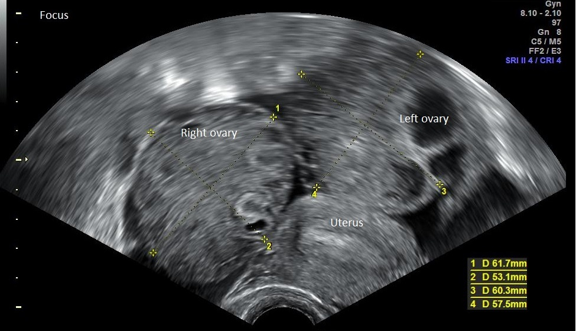
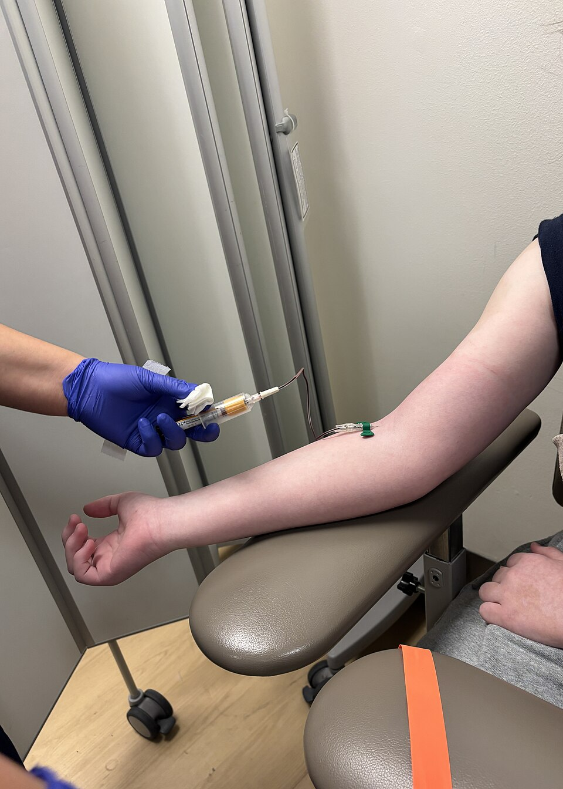
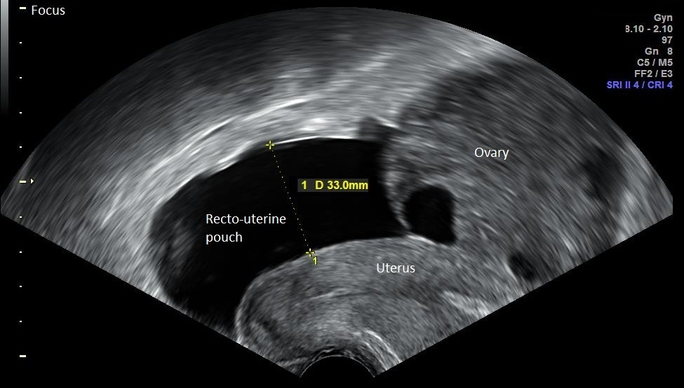
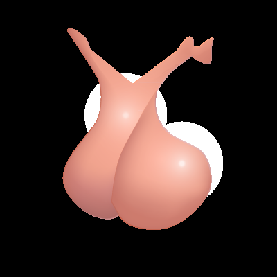
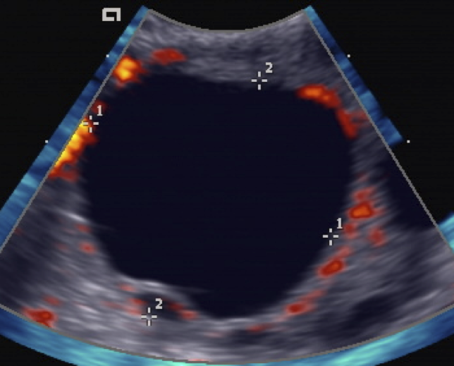
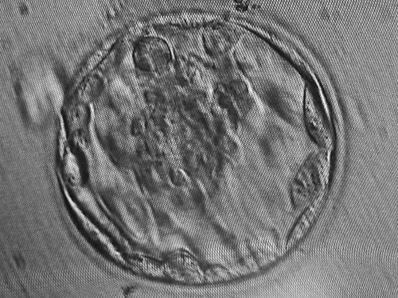
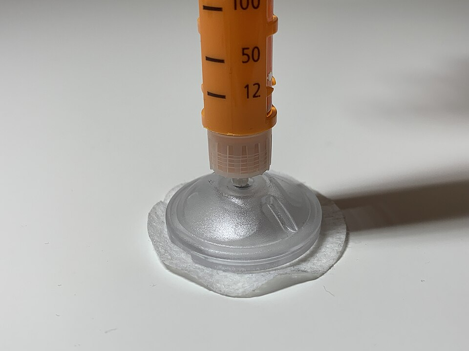
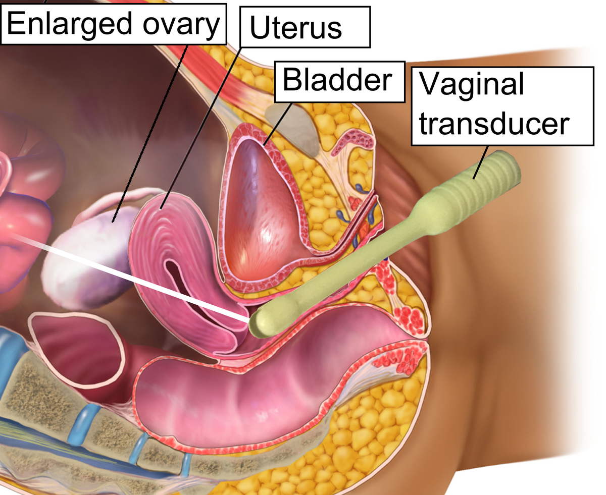

# XÉT NGHIỆM NỘI TIẾT CHU KÌ IVF (KÍCH TRỨNG → CHỌC HÚT)
**Ngày:** 2026-11-15 | **Chuyên khoa:** Hỗ trợ sinh sản (ART) | **Đối tượng:** Bác sĩ, học viên sau đại học và người học mất gốc cần học từ nền tảng

---

## 0. TỔNG QUAN — VÌ SAO BÀI NÀY QUAN TRỌNG? [CỐT LÕI]

&emsp;Xét nghiệm nội tiết trong chu kì kích trứng thụ tinh trong ống nghiệm (IVF) không phải là xét nghiệm để chẩn đoán vô sinh.

&emsp;Xét nghiệm nội tiết trong chu kì này là xét nghiệm để ra quyết định ngay trong chu kì đang chạy.

&emsp;Mỗi kết quả đều phải trả lời một câu hỏi quyết định: có kích trứng tiếp không, có tăng hay giảm liều không, có trigger hôm nay không, có chuyển tươi hay phải đông toàn bộ, có hủy chu kì không.

&emsp;Một kết quả đọc sai có thể làm mất cả chu kì: trigger quá sớm thì noãn chưa trưởng thành, trigger quá muộn thì đỉnh hormone hoàng thể hóa (LH) đã qua, chuyển tươi khi progesterone (P4) đã tăng sớm thì phôi tốt vẫn khó làm tổ.

&emsp;Bài này dạy đúng 4 thời điểm xét nghiệm trong một chu kì kích trứng, và cách mỗi kết quả đổi quyết định.

&emsp;Bốn thời điểm đó là baseline đầu chu kì, theo dõi trong kích trứng, ngày trigger, và sau chọc hút.

&emsp;Bài này không dạy lại ý nghĩa và ngưỡng cơ bản của từng chỉ số nội tiết.

&emsp;Ý nghĩa và ngưỡng cơ bản của hormone kháng Müller (AMH), hormone kích thích nang trứng (FSH), estradiol (E2), P4 và LH xem bài ART-43.

&emsp;Bài này cũng không dạy lại các bước phác đồ đối kháng hormone giải phóng gonadotropin (GnRH).

&emsp;Các bước phác đồ đối kháng xem bài ART-GAP-02.

&emsp;Bài này chỉ dạy việc xét nghiệm trong chu kì: khi nào xét nghiệm, kết quả đổi quyết định ra sao.

**Mục tiêu của bài:**
- Đọc được bộ xét nghiệm baseline đầu chu kì và biết kết quả nào thì hoãn kích trứng
- Theo dõi E2, LH và P4 trong kích trứng và biết khi nào cần đổi liều, đổi thời điểm trigger hoặc hủy chu kì
- Chọn trigger hormone hCG, chất đồng vận GnRH hay dual trigger dựa trên kết quả nội tiết ngày trigger
- Quyết định chuyển tươi hay đông toàn bộ phôi dựa trên P4 và nguy cơ hội chứng quá kích buồng trứng (OHSS)
- Theo dõi P4 và E2 sau chọc hút để hỗ trợ hoàng thể đúng cách



*Hình 1: Siêu âm qua ngã âm đạo trong chu kì kích trứng: hai buồng trứng to (53–62 mm) [NGOÀI ABSTRACT] với nhiều nang noãn đang phát triển — xét nghiệm nội tiết luôn được đọc cùng siêu âm, không đọc một mình. Nguồn: Wikimedia Commons, Mikael Häggström, CC0.*

> **TIÊU CHUẨN BẮT BUỘC — DẠY TỪ GỐC, KHÔNG GIỚI HẠN ĐỘ DÀI:** Viết để một người học mất gốc vẫn theo được. Trước khi dùng một thuật ngữ, chữ viết tắt, chỉ số, cơ quan, cơ chế, thủ thuật hoặc quyết định điều trị lần đầu, phải giải thích bằng tiếng Việt đơn giản: **nó là gì → bình thường hoạt động ra sao → vì sao bất thường này quan trọng → nhận ra bằng cách nào → làm gì tiếp theo**. Sau lần giải thích đầu tiên, mới dùng viết tắt/thuật ngữ ngắn. Không dùng “rõ ràng”, “thường quy”, “theo protocol” hoặc danh sách bước trần nếu chưa giải thích lý do và ý nghĩa của hành động. Độ dài không có giới hạn tối đa: tiếp tục viết khi còn một mắt xích cần thiết để người học hiểu hoặc ra quyết định an toàn; ưu tiên chia nhỏ bằng tiêu đề, ví dụ và checkpoint thay vì cắt bỏ nền tảng.

> **CÁCH GIẢI THÍCH BẮT BUỘC CHO MỖI QUY TRÌNH:** Mỗi xét nghiệm, thang điểm, thuốc, thủ thuật hoặc algorithm phải ghi theo thứ tự: **mục tiêu → khi nào dùng/không dùng → cần chuẩn bị/đầu vào gì → làm hoặc đọc kết quả như thế nào → kết quả thay đổi quyết định ra sao → bẫy/an toàn → khi nào chuyển tuyến**. Chi tiết liều, đường dùng, trình tự và thời điểm phải có nguồn xác minh; không lấp chỗ trống bằng suy đoán.

### 0.1. Nền tảng tối thiểu cần dùng ngay

&emsp;Để hiểu bài này, người học cần nắm 9 khái niệm nền dưới đây.

&emsp;Mỗi khái niệm được dạy đủ để đọc tiếp bài, không cần học trước bài khác.

**Chu kì kinh nguyệt (menstrual cycle)** là chu kì thay đổi của buồng trứng và tử cung, tính từ ngày đầu tiên ra máu kinh của chu kì này đến ngày đầu tiên ra máu kinh của chu kì sau.

&emsp;Chu kì kinh nguyệt dài trung bình khoảng 28 ngày, với ngày đầu tiên ra máu kinh được gọi là ngày 1 của chu kì [NGOÀI ABSTRACT].

**Kích thích buồng trứng (ovarian stimulation)** là quá trình dùng thuốc gonadotropin để làm nhiều nang noãn cùng phát triển trong một chu kì, thay vì chỉ 1 nang trội như chu kì tự nhiên [NGOÀI ABSTRACT].

&emsp;Mục tiêu của kích thích buồng trứng là thu được nhiều noãn trưởng thành trong một lần chọc hút, để có nhiều phôi để chọn.

**Thụ tinh trong ống nghiệm (in vitro fertilization, IVF)** là phương pháp lấy noãn ra khỏi buồng trứng, cho thụ tinh với tinh trùng trong phòng thí nghiệm, rồi chuyển phôi trở lại tử cung.

&emsp;Thụ tinh trong ống nghiệm là tên chung của cả quy trình, gồm kích trứng, chọc hút noãn, thụ tinh, nuôi phôi và chuyển phôi.

**Nang noãn (follicle)** là cấu trúc hình túi trong buồng trứng, chứa noãn và được lót bởi tế bào hạt tiết hormone.

&emsp;Nang noãn phát triển nhờ FSH, và khi nang đủ lớn thì LH làm noãn trưởng thành cuối cùng rồi rụng trứng.

**Gonadotropin** là nhóm hormone kích thích tuyến sinh dục, gồm FSH và LH.

&emsp;FSH làm nang noãn phát triển, LH làm noãn trưởng thành cuối cùng và gây rụng trứng.

&emsp;Trong IVF, gonadotropin được dùng dưới dạng thuốc tiêm để kích thích buồng trứng.

**Hormone giải phóng gonadotropin (gonadotropin-releasing hormone, GnRH)** là hormone của vùng hạ đồi, điều khiển tuyến yên tiết FSH và LH.

&emsp;Chất đối kháng GnRH chặn thụ thể GnRH ở tuyến yên, làm LH không tăng vọt giữa chu kì.

&emsp;Chất đồng vận GnRH lúc đầu kích thích tuyến yên tiết nhiều FSH và LH, sau đó làm tuyến yên mất nhạy và ngừng tiết.

**Trigger (triggering of final oocyte maturation)** là mũi thuốc cuối cùng làm noãn trưởng thành hoàn toàn, để chọc hút được noãn đã sẵn sàng thụ tinh.

&emsp;Trigger thường là hCG, chất đồng vận GnRH, hoặc cả 2 cùng lúc (dual trigger).

&emsp;Chọc hút noãn thường làm khoảng 36 giờ sau mũi trigger [NGOÀI ABSTRACT].

**Hoàng thể (corpus luteum)** là phần còn lại của nang noãn sau khi rụng trứng, tiết P4 để chuẩn bị nội mạc tử cung đón phôi.

&emsp;Hỗ trợ hoàng thể (luteal phase support) là việc bổ sung P4 sau chọc hút hoặc sau chuyển phôi, vì hoàng thể sau kích trứng thường hoạt động yếu.

&emsp;Nếu hoàng thể suy mà không được hỗ trợ, nội mạc tử cung không đủ P4 để duy trì làm tổ.

**Hội chứng quá kích buồng trứng (ovarian hyperstimulation syndrome, OHSS)** là biến chứng của kích trứng, khi buồng trứng đáp ứng quá mức: buồng trứng to, dịch thoát ra ổ bụng, máu cô đặc.

&emsp;Hội chứng quá kích buồng trứng nặng có thể gây suy thận, huyết khối và suy hô hấp, nên phòng ngừa OHSS là một trong những lý do chính để xét nghiệm nội tiết trong chu kì.

> **Không được chặn việc học vì thiếu prerequisite.** Nếu bài tiên quyết chưa tồn tại hoặc người học chưa nắm, mục `### 0.1 Nền tảng tối thiểu cần dùng ngay` dạy đủ khái niệm nền để hiểu bài hiện tại; link bài tiên quyết chỉ là đường học sâu hơn.

### 0.2. Ba nguyên tắc xuyên suốt bài

&emsp;Nguyên tắc thứ nhất: xét nghiệm nội tiết trong chu kì IVF luôn đi cùng siêu âm.

&emsp;E2 cao mà siêu âm chỉ thấy ít nang nhỏ thì ý nghĩa khác với E2 cao kèm nhiều nang lớn.

&emsp;Không bao giờ ra quyết định chỉ từ một con số xét nghiệm đơn độc.

&emsp;Nguyên tắc thứ hai: cùng một con số P4 có thể đổi quyết định theo hướng khác nhau tùy kế hoạch chuyển phôi.

&emsp;P4 tăng sớm làm hại chuyển tươi, nhưng không làm hại phôi đông lạnh.

&emsp;Vì vậy câu hỏi đầu tiên khi thấy P4 tăng sớm không phải là "hủy chu kì", mà là "có chuyển tươi nữa không".

&emsp;Nguyên tắc thứ ba: mọi ngưỡng trong bài này đều là ngưỡng để bàn, không phải luật cứng.

&emsp;Ngưỡng P4 1,5 ng/mL được trích nhiều nhất, nhưng tác hại đã đo được từ ngưỡng 0,8 ng/mL [ABSTRACT VERIFIED].

&emsp;Ngưỡng P4 ngày chuyển phôi trong chu kì FET cũng đang tranh luận giữa 5 ng/mL và 10 ng/mL, xem bài FET song song [NGOÀI ABSTRACT].

&emsp;Người đọc cần nhớ khoảng giá trị và hướng tác hại, không nhớ một con số duy nhất rồi áp máy móc.

### 🛑 DỪNG 1 PHÚT — TỰ KIỂM TRA

> 1. Xét nghiệm nội tiết trong chu kì IVF khác xét nghiệm chẩn đoán vô sinh ở điểm nào?
> 2. Vì sao P4 tăng sớm làm hại chuyển tươi nhưng không làm hại phôi đông lạnh?
>
> *(Đáp án: Xét nghiệm trong chu kì để ra quyết định ngay trong chu kì đang chạy, không phải để chẩn đoán nguyên nhân vô sinh. P4 tăng sớm làm nội mạc tử cung trưởng thành sớm, lệch khỏi thời điểm phôi đến, nên phôi tươi khó làm tổ; phôi đông lạnh được chuyển ở chu kì sau, khi nội mạc đã làm lại từ đầu, nên không bị ảnh hưởng.)*

---

## 1. ĐỊNH NGHĨA VÀ PHẠM VI — XÉT NGHIỆM TRONG CHU KÌ LÀ GÌ [CỐT LÕI]

### 1.1. Xét nghiệm trong chu kì khác xét nghiệm chẩn đoán ở 4 điểm

&emsp;Xét nghiệm chẩn đoán vô sinh làm một lần, trước khi bắt đầu điều trị, để tìm nguyên nhân.

&emsp;Xét nghiệm trong chu kì làm nhiều lần, trong lúc điều trị đang chạy, để đổi quyết định ngay.

&emsp;Xét nghiệm chẩn đoán trả lời câu hỏi "vì sao vô sinh".

&emsp;Xét nghiệm trong chu kì trả lời câu hỏi "hôm nay làm gì tiếp".

&emsp;Xét nghiệm chẩn đoán có thể chờ kết quả chậm, vì chưa bắt đầu điều trị.

&emsp;Xét nghiệm trong chu kì phải có kết quả nhanh, vì quyết định trigger hay hủy chu kì không chờ được qua ngày hôm sau.

&emsp;Xét nghiệm chẩn đoán thường làm đủ bộ một lần.

&emsp;Xét nghiệm trong chu kì chỉ làm những chỉ số đổi được quyết định ở thời điểm đó, tránh xét nghiệm thừa.

### 1.2. Bốn thời điểm xét nghiệm trong một chu kì kích trứng

&emsp;Thời điểm thứ nhất là baseline đầu chu kì, thường vào ngày 2–3 của chu kì kinh [NGOÀI ABSTRACT].

&emsp;Baseline gồm FSH, LH, E2, P4, AMH, prolactin và hormone kích thích tuyến giáp (TSH).

&emsp;Mục tiêu của baseline là xác nhận chu kì trước đã "sạch", phát hiện bất thường cần hoãn kích trứng, và chọn liều khởi đầu.

&emsp;Thời điểm thứ hai là theo dõi trong kích trứng, thường bắt đầu từ ngày 5–6 của kích trứng và lặp lại mỗi 2–3 ngày [NGOÀI ABSTRACT].

&emsp;Theo dõi trong kích trứng gồm E2, LH và P4, đọc cùng siêu âm đếm nang và đo kích thước nang.

&emsp;Mục tiêu là điều chỉnh liều gonadotropin, phát hiện đỉnh LH sớm và P4 tăng sớm, và chọn ngày trigger.

&emsp;Thời điểm thứ ba là ngày trigger, tức ngày quyết định làm noãn trưởng thành cuối cùng.

&emsp;Ngày trigger xét nghiệm E2, LH và P4, rồi chọn loại trigger và chọn chuyển tươi hay đông toàn bộ.

&emsp;Thời điểm thứ tư là sau chọc hút, tức giai đoạn hậu hoàng thể.

&emsp;Sau chọc hút theo dõi P4 và E2 để hỗ trợ hoàng thể, và phát hiện sớm OHSS.

### 1.3. Ranh giới với bài ART-43 và bài ART-GAP-02

&emsp;Bài ART-43 dạy ý nghĩa và ngưỡng cơ bản của từng chỉ số: AMH nói lên dự trữ buồng trứng ra sao, FSH cao nghĩa là gì, E2 và P4 thay đổi thế nào trong chu kì tự nhiên.

&emsp;Bài này không dạy lại những nội dung đó.

&emsp;Mỗi chỉ số trong bài này chỉ được nhắc lại tối đa 1–2 dòng khi cần dùng trong chu kì, rồi gắn chéo về ART-43.

&emsp;Bài ART-GAP-02 dạy các bước phác đồ đối kháng GnRH: khi nào bắt đầu đối kháng, liều bao nhiêu, ngày nào dừng.

&emsp;Bài này không dạy lại các bước đó.

&emsp;Bài này chỉ nhắc nơi kết quả nội tiết làm đổi phác đồ: đỉnh LH sớm thì tăng đối kháng hoặc trigger sớm, P4 tăng sớm thì đổi sang đông toàn bộ.

&emsp;Bài FET song song dạy theo dõi nội tiết trong chu kì chuyển phôi trữ.

&emsp;Quyết định đông toàn bộ ở bài này chỉ dạy ở mức vì sao phải đông; theo dõi nội tiết sau khi đông, trong chu kì FET, xem bài FET.

### 1.4. Bảng tóm tắt 4 thời điểm xét nghiệm

| Thời điểm | Xét nghiệm chính | Quyết định đổi được |
|---|---|---|
| Baseline ngày 2–3 [NGOÀI ABSTRACT] | FSH, LH, E2, P4, AMH, prolactin, TSH | Hoãn hay bắt đầu kích trứng; liều khởi đầu |
| Theo dõi trong kích trứng | E2, LH, P4 + siêu âm | Tăng hay giảm liều; phát hiện đỉnh LH sớm; phát hiện P4 tăng sớm |
| Ngày trigger | E2, LH, P4 | Chọn trigger hCG, đồng vận GnRH hay dual; chuyển tươi hay đông toàn bộ |
| Sau chọc hút | P4, E2 | Hỗ trợ hoàng thể; phát hiện sớm OHSS |

> ⚠️ HỌC VIÊN HAY NHẦM: Xét nghiệm baseline ngày 2–3 không phải [NGOÀI ABSTRACT] xét nghiệm chẩn đoán dự trữ buồng trứng để tiên lượng chung. Baseline ngày 2–3 là xét nghiệm [NGOÀI ABSTRACT] kiểm tra điều kiện bắt đầu chu kì này: E2 và P4 phải thấp thì mới chắc chu kì trước đã sạch, LH phải thấp thì mới chắc chưa rụng trứng sớm. AMH thì không thay đổi theo ngày chu kì, nên AMH baseline không phải để kiểm tra "sạch" mà để chọn liều khởi đầu.



*Hình 2: Lấy máu xét nghiệm hormone tại phòng xét nghiệm — xét nghiệm nội tiết trong chu kì IVF phải có kết quả nhanh, quyết định trigger hay hủy chu kì không chờ được qua ngày hôm sau. Nguồn: Wikimedia Commons, Jengod, CC BY-SA 4.0.*

### 🛑 DỪNG 1 PHÚT — TỰ KIỂM TRA

> 1. Baseline ngày 2–3 gồm [NGOÀI ABSTRACT] những xét nghiệm nào, và xét nghiệm nào trong đó không dùng để kiểm tra "chu kì đã sạch"?
> 2. Vì sao xét nghiệm trong chu kì phải có kết quả nhanh?
>
> *(Đáp án: Baseline gồm FSH, LH, E2, P4, AMH, prolactin, TSH. AMH không thay đổi theo ngày chu kì nên không dùng để kiểm tra "sạch", mà để chọn liều khởi đầu. Xét nghiệm trong chu kì phải nhanh vì quyết định trigger, đổi liều hay hủy chu kì đều cần ra trong ngày.)*

---

## 2. CƠ CHẾ — TRỤC HẠ ĐỒI–TUYẾN YÊN–BUỒNG TRỨNG TRONG CHU KÌ KÍCH TRỨNG [CỐT LÕI]

### 2.1. Chuỗi cơ chế 1: GnRH → FSH/LH → nang noãn → estradiol

&emsp;Chuỗi này là nền tảng để hiểu mọi xét nghiệm trong chu kì kích trứng.

&emsp;Vùng hạ đồi tiết GnRH theo từng xung nhịp nhàng.

&emsp;GnRH gắn vào thụ thể ở tuyến yên trước, làm tuyến yên tiết FSH và LH.

&emsp;FSH đi theo máu đến buồng trứng, gắn vào thụ thể ở tế bào hạt của nang noãn, làm nang phát triển và làm tế bào hạt tiết E2.

&emsp;E2 đi theo máu, vừa làm nội mạc tử cung dày lên, vừa phản hồi ngược lên vùng hạ đồi và tuyến yên.

&emsp;Khi nang đủ lớn, E2 đạt đỉnh cao và chuyển phản hồi ngược từ ức chế sang kích thích, làm tuyến yên tiết một đợt LH lớn: đó là đỉnh LH.

&emsp;Trong chu kì tự nhiên, đỉnh LH làm noãn trưởng thành cuối cùng và gây rụng trứng khoảng 36 giờ sau đó [NGOÀI ABSTRACT].

&emsp;Trong IVF, bác sĩ dùng thuốc để bắt chước và kiểm soát chuỗi này: gonadotropin thay FSH, chất đối kháng GnRH chặn đỉnh LH tự phát, và mũi trigger thay đỉnh LH.

```text
Hạ đồi tiết GnRH theo xung
  → Tuyến yên tiết FSH và LH
  → FSH làm nang noãn phát triển
  → Tế bào hạt tiết estradiol (E2)
  → E2 làm nội mạc dày lên và phản hồi lên hạ đồi–tuyến yên
  → Đỉnh LH → Noãn trưởng thành → Rụng trứng
```

&emsp;Chỗ đứt thứ nhất: chất đối kháng GnRH chặn thụ thể GnRH ở tuyến yên, nên tuyến yên không tiết LH vọt dù E2 đã cao.

&emsp;Nhờ chỗ chặn này mà nang không rụng tự phát giữa chu kì kích trứng.

&emsp;Chỗ đứt thứ hai: khi noãn đã trưởng thành, mũi trigger (hCG hoặc chất đồng vận GnRH) thay thế đỉnh LH tự nhiên.

&emsp;Hormone hCG gắn vào thụ thể LH, còn chất đồng vận GnRH làm tuyến yên tiết một đợt LH nội sinh.

```text
Gonadotropin tiêm ngoài (FSH)
  → Nhiều nang cùng phát triển
  → E2 tăng dần theo số nang và kích thước nang
  → ✗ Chất đối kháng GnRH chặn đỉnh LH tự phát
  → Nang không rụng sớm
  → Mũi trigger thay đỉnh LH → Chọc hút noãn sau khoảng 36 giờ [NGOÀI ABSTRACT]
```

&emsp;Ví dụ: một bệnh nhân ngày 6 kích trứng có E2 tăng gấp đôi mỗi 2 ngày và siêu âm thấy 10 nang 10–12 mm [NGOÀI ABSTRACT].

&emsp;Diễn biến này đúng chuỗi: FSH làm nang phát triển, nang tiết E2, E2 tăng theo tổng khối nang.

&emsp;Bác sĩ tiếp tục liều cũ và hẹn xét nghiệm lại sau 2 ngày [NGOÀI ABSTRACT].

&emsp;Ví dụ ngược: E2 không tăng dù đã tăng liều gonadotropin, siêu âm thấy nang không lớn.

&emsp;Diễn biến này lệch chuỗi: nang không đáp ứng FSH, có thể do dự trữ buồng trứng kém hoặc liều chưa đủ.

&emsp;Bác sĩ cần xét lại liều, tiền sử đáp ứng và kế hoạch chu kì, thay vì chỉ tăng liều máy móc.

### 2.2. Chuỗi cơ chế 2: Đỉnh LH sớm — vì sao LH vọt lên giữa chu kì kích trứng

&emsp;Đỉnh LH sớm là hiện tượng LH tăng vọt trước thời điểm bác sĩ định trigger.

&emsp;Trong chu kì tự nhiên, đỉnh LH là tín hiệu rụng trứng.

&emsp;Trong chu kì kích trứng, đỉnh LH sớm là tai biến, vì nang chưa đủ lớn mà noãn đã bị đẩy trưởng thành sớm, hoặc nang rụng tự phát trước ngày chọc hút.

&emsp;Cơ chế: khi nhiều nang cùng tiết E2, E2 đạt mức cao sớm hơn chu kì tự nhiên.

&emsp;E2 cao chuyển phản hồi ngược thành kích thích, làm tuyến yên tiết LH.

&emsp;Nếu chất đối kháng GnRH chưa đủ liều, chưa đủ thời gian, hoặc bắt đầu quá muộn, tuyến yên vẫn đáp ứng với E2 và tiết LH vọt lên.

&emsp;Nghiên cứu Nasatzky 2024 cho thấy đỉnh LH sớm có thể dự báo được.

&emsp;Các yếu tố dự báo gồm tuổi, chỉ số khối cơ thể (BMI), LH lúc bắt đầu kích trứng, LH ngày bắt đầu dùng đối kháng, và tổng số ngày kích trứng.

&emsp;Mô hình dự báo mạnh nhất ở nhóm trẻ 25–30 tuổi, với R² = 0,88 [ABSTRACT VERIFIED].

&emsp;Mô hình dự báo yếu nhất ở nhóm trên 41 tuổi, với R² = 0,23 [ABSTRACT VERIFIED].

&emsp;Vì vậy người trẻ có LH nền cao và LH ngày bắt đầu đối kháng cao là nhóm cần theo dõi LH sát nhất.

```text
Nhiều nang cùng tiết E2
  → E2 đạt mức cao sớm
  → Phản hồi ngược chuyển từ ức chế sang kích thích
  → Tuyến yên tiết LH vọt lên (đỉnh LH sớm)
  → Noãn trưởng thành sớm hoặc rụng tự phát
  → Chọc hút được ít noãn hoặc không còn noãn
```

&emsp;Chỗ đứt: chất đối kháng GnRH bắt đầu đúng ngày và đủ liều sẽ chặn tuyến yên đáp ứng với E2.

&emsp;Nếu đối kháng bắt đầu muộn, E2 đã cao trước khi tuyến yên bị chặn, thì đỉnh LH sớm vẫn xảy ra.

&emsp;Chỗ đứt thứ hai: trigger sớm ngay khi phát hiện LH bắt đầu tăng có thể cứu chu kì, vì noãn chưa kịp rụng tự phát.

```text
LH nền cao + LH ngày bắt đầu đối kháng cao
  → Nguy cơ đỉnh LH sớm cao
  → ✗ Bắt đầu đối kháng sớm và theo dõi LH mỗi 2 ngày [NGOÀI ABSTRACT]
  → Phát hiện LH bắt đầu tăng → Trigger sớm
  → Cứu chu kì thay vì hủy chu kì
```

### 2.3. Chuỗi cơ chế 3: Progesterone tăng sớm — vì sao P4 cao làm hại chuyển tươi

&emsp;Chuỗi này giải thích quyết định quan trọng nhất ngày trigger: chuyển tươi hay đông toàn bộ.

&emsp;Trong chu kì kích trứng, P4 phải thấp cho đến ngày trigger.

&emsp;P4 thấp nghĩa là nang chưa hoàng thể hóa, nội mạc tử cung chưa bước vào giai đoạn chế tiết.

&emsp;Khi FSH liều cao kích thích nhiều nang, tế bào hạt của nang tiết P4 sớm hơn bình thường.

&emsp;P4 tăng sớm làm nội mạc tử cung trưởng thành sớm, mở cửa sổ làm tổ sớm hơn lịch trình của phôi.

&emsp;Phôi tươi chuyển vào ngày 3 hoặc ngày 5 sẽ [NGOÀI ABSTRACT] đến tử cung khi cửa sổ làm tổ đã mở sớm và sắp đóng, nên tỉ lệ làm tổ giảm.

&emsp;Nghiên cứu Bosch 2010 trên 4.032 chu kì cho thấy P4 ngày hCG tỉ lệ nghịch với tỉ lệ có thai tiếp diễn [ABSTRACT VERIFIED].

&emsp;Nhóm P4 từ 1,5 ng/mL trở xuống có thai tiếp diễn 31,0%, nhóm P4 trên 1,5 ng/mL chỉ 19,1% [ABSTRACT VERIFIED].

&emsp;Phân tích gộp Venetis 2013 trên hơn 60.000 chu kì khẳng định tác hại của P4 tăng sớm trong chu kì tươi, nhưng không thấy tác hại trong chu kì đông lạnh–rã đông hay chu kì cho và nhận noãn [ABSTRACT VERIFIED].

&emsp;Lý do: phôi đông lạnh được chuyển ở chu kì sau, khi nội mạc đã làm lại từ đầu và không còn chịu ảnh hưởng của P4 tăng sớm ở chu kì kích trứng.

```text
FSH liều cao kích thích nhiều nang
  → Tế bào hạt tiết progesterone (P4) sớm
  → P4 tăng trước ngày trigger
  → Nội mạc tử cung trưởng thành sớm
  → Cửa sổ làm tổ mở sớm và lệch khỏi ngày phôi đến
  → Phôi tươi khó làm tổ → Tỉ lệ có thai tiếp diễn giảm
```

&emsp;Chỗ đứt: đông toàn bộ phôi và chuyển ở chu kì sau.

&emsp;Chu kì sau không còn P4 tăng sớm, nội mạc được chuẩn bị lại từ đầu, nên cửa sổ làm tổ trở lại đúng lịch.

```text
P4 tăng sớm ngày trigger
  → ✗ Không chuyển tươi
  → Đông toàn bộ phôi
  → Chu kì sau chuẩn bị nội mạc mới → Chuyển phôi đông lạnh đúng cửa sổ làm tổ
  → Tỉ lệ có thai không còn chịu tác hại của P4 tăng sớm
```

&emsp;Ví dụ: bệnh nhân ngày trigger có P4 1,9 ng/mL, E2 cao, 12 nang lớn [NGOÀI ABSTRACT].

&emsp;Chuyển tươi lúc này có nguy cơ làm tổ thấp, dù phôi tốt.

&emsp;Quyết định đúng là đông toàn bộ phôi, không phải hủy chu kì.

&emsp;Bệnh nhân vẫn giữ được toàn bộ phôi, chỉ dời ngày chuyển sang chu kì sau.

### 2.4. Chuỗi cơ chế 4: OHSS — vì sao E2 cao và nhiều nang dẫn đến quá kích

&emsp;OHSS là biến chứng nguy hiểm nhất của kích trứng, và xét nghiệm nội tiết là một trong những công cụ dự báo nó.

&emsp;Khi buồng trứng đáp ứng quá mức, nhiều nang lớn cùng tiết E2 và các yếu tố tăng trưởng mạch máu, trong đó quan trọng nhất là yếu tố tăng trưởng nội mô mạch máu (VEGF).

&emsp;VEGF làm mạch máu tăng tính thấm, dịch thoát ra khỏi lòng mạch vào ổ bụng và khoang màng phổi.

&emsp;Dịch thoát ra ngoài làm máu cô đặc, giảm thể tích máu lưu thông, giảm tưới máu thận, tăng nguy cơ huyết khối.

&emsp;Hormone hCG làm tình trạng nặng thêm, vì hCG kích thích hoàng thể tiết thêm VEGF và duy trì hoàng thể lâu.

&emsp;Vì vậy trigger hCG ở bệnh nhân đáp ứng quá mức là yếu tố thúc đẩy OHSS, còn trigger bằng chất đồng vận GnRH thì hoàng thể suy nhanh và OHSS ít xảy ra hơn.

&emsp;Tổng quan Humaidan 2011 cho thấy sau trigger đồng vận GnRH, không có ca OHSS nào trong 9 thử nghiệm ngẫu nhiên ở chu kì tươi có chuyển phôi [ABSTRACT VERIFIED].

&emsp;Đông toàn bộ phôi sau trigger đồng vận càng giảm nguy cơ, vì không có thai làm hCG nội sinh tiếp tục kích thích hoàng thể.

```text
Đáp ứng buồng trứng quá mức
  → Nhiều nang lớn tiết E2 và VEGF cao
  → VEGF làm mạch máu tăng tính thấm
  → Dịch thoát ra ổ bụng → Bụng chướng, máu cô đặc
  → hCG duy trì hoàng thể → VEGF tiếp tục cao → OHSS nặng thêm
```

&emsp;Chỗ đứt thứ nhất: trigger bằng chất đồng vận GnRH thay hCG.

&emsp;Chất đồng vận GnRH chỉ gây một đợt LH ngắn, hoàng thể suy nhanh, VEGF giảm, OHSS ít xảy ra.

&emsp;Chỗ đứt thứ hai: đông toàn bộ phôi.

&emsp;Không có thai thì không có hCG nội sinh, hoàng thể không được duy trì, OHSS không bị thúc đẩy thêm.

```text
E2 cao + nhiều nang lớn ngày trigger
  → Nguy cơ OHSS cao
  → ✗ Trigger hCG liều đầy đủ
  → Trigger đồng vận GnRH + Đông toàn bộ phôi
  → Hoàng thể suy nhanh, không có hCG nội sinh → Nguy cơ OHSS giảm mạnh
```

> ⚠️ HỌC VIÊN HAY NHẦM: E2 cao không đồng nghĩa OHSS chắc chắn xảy ra, và E2 thấp không đồng nghĩa không có OHSS. E2 là một trong các tín hiệu nguy cơ, phải đọc cùng số nang, kích thước nang, tuổi, chỉ số khối cơ thể và tiền sử đáp ứng. Quyết định phòng OHSS dựa trên tổng thể nguy cơ, không dựa trên một con số E2 đơn độc.



*Hình 3: Siêu âm trong hội chứng quá kích buồng trứng nhẹ: dịch tự do 33 mm [NGOÀI ABSTRACT] ở túi cùng sau tử cung, buồng trứng to — E2 cao kèm nhiều nang lớn là tín hiệu nguy cơ OHSS, cần đổi trigger và cân nhắc đông toàn bộ. Nguồn: Wikimedia Commons, Mikael Häggström, CC0.*

### 🛑 DỪNG 1 PHÚT — TỰ KIỂM TRA

> 1. Vì sao P4 tăng sớm làm hại chuyển tươi nhưng không làm hại phôi đông lạnh?
> 2. Vì sao trigger hCG thúc đẩy OHSS còn trigger đồng vận GnRH thì ít hơn?
>
> *(Đáp án: P4 tăng sớm làm nội mạc trưởng thành sớm, lệch cửa sổ làm tổ với phôi tươi; phôi đông lạnh chuyển ở chu kì sau nên không bị ảnh hưởng. hCG duy trì hoàng thể và làm VEGF tiếp tục cao, còn trigger đồng vận GnRH chỉ gây đợt LH ngắn, hoàng thể suy nhanh.)*

---

## 3. CHẨN ĐOÁN VÀ ĐÁNH GIÁ — BASELINE ĐẦU CHU KÌ [CỐT LÕI]

### 3.1. Mục tiêu của xét nghiệm baseline

&emsp;Baseline đầu chu kì có 3 mục tiêu.

&emsp;Mục tiêu thứ nhất là xác nhận chu kì trước đã "sạch".

&emsp;Chu kì "sạch" nghĩa là không còn nang tồn dư, không còn hoàng thể cũ, E2 và P4 đã về thấp.

&emsp;Mục tiêu thứ hai là phát hiện bất thường cần hoãn kích trứng.

&emsp;Bất thường gồm nang tồn dư, E2 cao, P4 cao, LH cao, prolactin cao, hoặc TSH bất thường.

&emsp;Mục tiêu thứ ba là chọn liều khởi đầu gonadotropin.

&emsp;Liều khởi đầu dựa trên AMH, số nang noãn thứ cấp (AFC) trên siêu âm, tuổi và tiền sử đáp ứng chu kì trước.

&emsp;Hướng dẫn ESHRE 2020 khuyến cáo mạnh dùng AFC hoặc AMH, thay các xét nghiệm dự trữ buồng trứng khác, để dự báo đáp ứng cao và đáp ứng kém với kích trứng.

&emsp;Hướng dẫn này có 84 khuyến cáo, trong đó 11 khuyến cáo về theo dõi trong kích trứng, 18 khuyến cáo về trigger và hỗ trợ hoàng thể, và 8 khuyến cáo về phòng ngừa OHSS [ABSTRACT VERIFIED].

&emsp;Bản cập nhật ESHRE 2025 mở rộng lên 121 khuyến cáo, với 17 khuyến cáo về theo dõi, 18 khuyến cáo về trigger và hỗ trợ hoàng thể, và 8 khuyến cáo về phòng OHSS [ABSTRACT VERIFIED].

### 3.2. Từng xét nghiệm baseline dùng để làm gì trong chu kì này

**FSH baseline** là FSH máu ngày 2–3 của chu kì [NGOÀI ABSTRACT].

&emsp;FSH baseline cao gợi ý dự trữ buồng trứng thấp, vì tuyến yên phải tiết nhiều FSH hơn để kích thích nang.

&emsp;FSH baseline không dùng một mình để quyết định liều, mà đọc cùng AMH, AFC, tuổi và tiền sử đáp ứng.

&emsp;Chi tiết ý nghĩa và ngưỡng FSH xem bài ART-43.

**LH baseline** là LH máu ngày 2–3 [NGOÀI ABSTRACT].

&emsp;LH baseline cao gợi ý có thể đã rụng trứng sớm ở chu kì trước, hoặc có nang đang hoạt động.

&emsp;LH baseline còn là mốc để so sánh với LH trong kích trứng: LH tăng vọt so với mốc baseline mới gọi là đỉnh LH sớm.

**E2 baseline** là E2 máu ngày 2–3 [NGOÀI ABSTRACT].

&emsp;E2 baseline phải thấp.

&emsp;E2 baseline cao gợi ý có nang tồn dư đang tiết estrogen, hoặc có nang đã phát triển sớm.

&emsp;Kích trứng khi E2 baseline cao thì khó đánh giá tốc độ tăng E2, và nang tồn dư có thể lấn át nang mới.

**P4 baseline** là P4 máu ngày 2–3 [NGOÀI ABSTRACT].

&emsp;P4 baseline phải thấp.

&emsp;P4 baseline cao gợi ý hoàng thể cũ chưa thoái triển hết, hoặc đã rụng trứng sớm.

&emsp;Kích trứng khi P4 baseline cao thì nội mạc đã bước vào giai đoạn chế tiết, lệch khỏi lịch trình của phôi sau này.

**AMH baseline** là AMH máu, có thể lấy bất kì ngày nào trong chu kì vì AMH ít thay đổi theo ngày.

&emsp;AMH dùng để dự báo đáp ứng: AMH cao thì nguy cơ đáp ứng quá mức và OHSS cao, AMH thấp thì nguy cơ đáp ứng kém cao.

&emsp;AMH không dùng để kiểm tra chu kì đã "sạch", vì AMH không thay đổi khi hoàng thể chưa thoái triển.

&emsp;Chi tiết ý nghĩa và ngưỡng AMH xem bài ART-43.

**Prolactin baseline** là prolactin máu ngày 2–3 [NGOÀI ABSTRACT].

&emsp;Prolactin cao ức chế trục hạ đồi–tuyến yên, làm nang phát triển kém và rụng trứng không đều.

&emsp;Prolactin cao cần tìm nguyên nhân và điều trị trước khi kích trứng, thay vì kích trứng ngay.

**TSH baseline** là TSH máu ngày 2–3 [NGOÀI ABSTRACT].

&emsp;TSH bất thường ảnh hưởng đến rụng trứng và kết cục thai kì.

&emsp;TSH cần được điều chỉnh về mục tiêu trước khi bắt đầu chu kì, vì suy giáp hoặc cường giáp không kiểm soát đều làm giảm tỉ lệ thành công và tăng nguy cơ sảy thai.

### 3.3. Khi nào hoãn kích trứng vì baseline bất thường

&emsp;Hoãn kích trứng khi E2 baseline cao kèm nang tồn dư trên siêu âm.

&emsp;Hoãn kích trứng khi P4 baseline cao, gợi ý hoàng thể chưa thoái triển hoặc đã rụng trứng sớm.

&emsp;Hoãn kích trứng khi LH baseline tăng vọt, gợi ý đỉnh LH đã xảy ra hoặc sắp xảy ra.

&emsp;Hoãn kích trứng khi prolactin cao chưa rõ nguyên nhân, hoặc TSH ngoài mục tiêu điều trị.

&emsp;Hoãn không có nghĩa là hủy điều trị.

&emsp;Hoãn nghĩa là chờ một chu kì, điều trị nguyên nhân, rồi bắt đầu lại với baseline sạch.

&emsp;Kích trứng trên nền baseline bẩn thì mọi xét nghiệm theo dõi sau đó đều khó đọc, và nguy cơ lệch lịch trình phôi–nội mạc tăng lên.

> 🚨 **BOX ĐỎ — AN TOÀN TRƯỚC KHI BẮT ĐẦU KÍCH TRỨNG:** Dấu hiệu → nguy cơ đang bỏ sót → hành động ngay → nơi chuyển đến. **E2 baseline cao kèm đau bụng và buồn nôn sau chu kì kích trứng trước** → có thể là OHSS muộn chưa hồi phục → dừng kích trứng, siêu âm buồng trứng và ổ bụng, xét nghiệm công thức máu và điện giải, chuyển tuyến nội trú nếu có bụng chướng nhanh, khó thở hoặc lượng nước tiểu giảm. **P4 baseline cao kèm ra máu bất thường** → có thể là thai ngoài tử cung hoặc hoàng thể tồn tại → thử thai hCG máu, siêu âm, không kích trứng, hội chẩn cấp cứu nếu đau bụng dữ dội hoặc ra máu nhiều. **TSH rất cao kèm mệt mỏi nặng, phù, nhịp tim chậm** → suy giáp nặng chưa kiểm soát → không kích trứng, chuyển nội tiết điều trị trước.

### 3.4. Lưu đồ baseline đầu chu kì

```text
Ngày 2–3 chu kì: xét nghiệm FSH, LH, E2, P4, AMH, prolactin, TSH + siêu âm [NGOÀI ABSTRACT]
  │
  ├─ E2 cao + nang tồn dư? ── CÓ → 🛑 Hoãn kích trứng, theo dõi nang tồn dư
  │                              → Hẹn baseline lại chu kì sau
  │
  ├─ P4 cao hoặc LH tăng vọt? ── CÓ → 🛑 Hoãn kích trứng, kiểm tra đã rụng trứng sớm chưa
  │                                  → Hẹn baseline lại chu kì sau
  │
  ├─ Prolactin cao / TSH ngoài mục tiêu? ── CÓ → ⚠️ Điều trị nguyên nhân trước
  │                                              → Bắt đầu kích trứng khi đã kiểm soát
  │
  └─ Tất cả thấp, AMH/AFC đã có ── KHÔNG bất thường → ✅ Bắt đầu kích trứng
                                                     → Chọn liều khởi đầu theo AMH, AFC, tuổi
                                                     → Plan B: nếu không có AMH, dùng AFC + tuổi + tiền sử đáp ứng
```

**Giải thích từng bước:**
1. **Bước 1 — Baseline ngày 2–3: [NGOÀI ABSTRACT]** E2 và P4 phải thấp mới chắc chu kì trước đã sạch, LH phải thấp mới chắc chưa rụng trứng sớm.

2. **Bước 2 — Nang tồn dư:** E2 cao kèm nang trên siêu âm là lý do hoãn phổ biến nhất, vì nang tồn dư tiết estrogen và lấn át nang mới.

3. **Bước 3 — Prolactin và TSH:** 2 xét nghiệm này không đổi theo ngày chu kì, nhưng bất thường thì phải điều trị trước, không kích trứng ngay.

4. **Bước 4 — Chọn liều:** AMH và AFC là 2 công cụ dự báo đáp ứng mà ESHRE khuyến cáo mạnh; nếu thiếu AMH thì dùng AFC cùng tuổi và tiền sử đáp ứng.



*Hình 4: Minh họa tuyến yên — tuyến yên tiết FSH và LH theo lệnh của GnRH từ vùng hạ đồi, mọi xét nghiệm baseline đều đọc xoay quanh trục này. Nguồn: Wikimedia Commons, DataBase Center for Life Science (DBCLS), CC BY 4.0.*

---

## 4. THEO DÕI TRONG KÍCH TRỨNG — ESTRADIOL [CỐT LÕI]

### 4.1. Tốc độ tăng E2 nói lên điều gì

&emsp;E2 trong kích trứng tăng dần theo tổng khối nang đang phát triển.

&emsp;Mỗi nang lớn tiết một lượng E2, nên E2 toàn thân phản ánh tổng số nang và kích thước nang.

&emsp;Tốc độ tăng E2 bình thường là tăng gấp đôi sau mỗi 2–3 ngày trong giai đoạn đầu kích trứng [NGOÀI ABSTRACT].

&emsp;Tốc độ tăng này là kiến thức sinh lý consensus, dùng để đọc xu hướng, không phải ngưỡng cứng từ một nghiên cứu đơn lẻ.

&emsp;E2 tăng đều và tăng gấp đôi mỗi 2–3 ngày là dấu hiệu nang đang phát triển đồng đều [NGOÀI ABSTRACT].

&emsp;E2 tăng chậm hoặc đi ngang gợi ý nang đáp ứng kém với liều gonadotropin hiện tại.

&emsp;E2 tăng vọt quá nhanh gợi ý đáp ứng quá mức, cần cảnh giác OHSS.

&emsp;E2 giảm giữa chu kì kích trứng là dấu hiệu xấu, gợi ý nang thoái triển hoặc liều chưa đủ.

&emsp;E2 phải luôn đọc cùng siêu âm: E2 tăng mà siêu âm thấy nang lớn đều là đáp ứng tốt, E2 tăng mà siêu âm thấy ít nang thì phải xem lại có nang tồn dư hay u tiết estrogen không.

### 4.2. E2 và quyết định đổi liều

&emsp;E2 thấp và nang nhỏ sau 5–6 ngày kích trứng thì cân nhắc tăng liều gonadotropin [NGOÀI ABSTRACT].

&emsp;Tăng liều không phải là phản xạ tự động: phải xem tuổi, AMH, AFC và tiền sử đáp ứng chu kì trước.

&emsp;Bệnh nhân trẻ, AMH cao mà E2 thấp có thể do liều khởi đầu quá thấp, tăng liều thường có tác dụng.

&emsp;Bệnh nhân lớn tuổi, AMH thấp mà E2 thấp thì tăng liều thường ít tác dụng, vì buồng trứng đã ít nang đáp ứng.

&emsp;Trong trường hợp này, tăng liều mạnh tay không làm tăng số noãn bao nhiêu mà chỉ tăng chi phí và nguy cơ P4 tăng sớm.

&emsp;E2 cao và nhiều nang lớn thì cân nhắc giảm liều gonadotropin để hãm đáp ứng quá mức.

&emsp;Giảm liều không làm nang đang lớn teo đi ngay, nhưng làm chậm tốc độ tăng E2 và giảm nguy cơ OHSS.

&emsp;E2 rất cao kèm hàng loạt nang lớn thì phải bàn phương án "coasting" (ngừng gonadotropin vài ngày, giữ đối kháng GnRH) hoặc trigger sớm — 2 chiến lược này thuộc phác đồ ART-GAP-02, bài này chỉ nhắc vị trí của E2 trong quyết định.

&emsp;Hướng dẫn ESHRE 2020 dành 11 khuyến cáo cho theo dõi trong kích trứng, và bản cập nhật 2025 tăng lên 17 khuyến cáo về theo dõi, cho thấy theo dõi là phần được cập nhật nhiều nhất [NGOÀI ABSTRACT].

&emsp;Nội dung cụ thể của từng khuyến cáo theo dõi không nằm trong abstract của guideline, nên bài này không dạy chi tiết từng khuyến cáo mà chỉ dạy nguyên tắc đọc E2 cùng siêu âm [NGOÀI ABSTRACT].

### 4.3. Khi nào E2 báo nguy cơ OHSS

&emsp;E2 cao tuyệt đối không phải là chẩn đoán OHSS.

&emsp;OHSS là chẩn đoán lâm sàng: buồng trứng to, bụng chướng, dịch ổ bụng, máu cô đặc.

&emsp;E2 chỉ là một trong các tín hiệu nguy cơ, cùng với số nang, kích thước nang, tuổi trẻ, chỉ số khối cơ thể thấp và tiền sử OHSS.

&emsp;Không có ngưỡng E2 tuyệt đối nào đã được verify trong các nghiên cứu của bài này để dự báo OHSS, nên bài này không dạy một con số E2 nào làm ngưỡng hủy chu kì.

&emsp;Tín hiệu nguy cơ gồm E2 tăng nhanh, E2 đạt mức rất cao, và số nang trung bình và lớn đếm được trên siêu âm tăng nhanh.

&emsp;Khi thấy tín hiệu nguy cơ, bác sĩ đổi trigger sang chất đồng vận GnRH, cân nhắc đông toàn bộ phôi, và dặn bệnh nhân theo dõi cân nặng, lượng nước tiểu và mức độ chướng bụng mỗi ngày.

&emsp;Ví dụ: bệnh nhân 28 tuổi, AMH cao, ngày 8 kích trứng có E2 tăng gấp 3 lần sau 2 ngày và siêu âm thấy 20 nang 12–16 mm [NGOÀI ABSTRACT].

&emsp;Đây là nhóm nguy cơ OHSS cao, dù bệnh nhân chưa có triệu chứng gì.

&emsp;Quyết định đúng là giảm liều, theo dõi sát, chuẩn bị trigger đồng vận GnRH và đông toàn bộ phôi, thay vì chờ đến khi bụng đã chướng mới xử trí.

> ⚠️ HỌC VIÊN HAY NHẦM: E2 tăng gấp đôi mỗi 2–3 ngày là xu hướng [NGOÀI ABSTRACT] tham khảo, không phải tiêu chuẩn bắt buộc. Một chu kì E2 tăng chậm hơn nhưng nang lớn đều vẫn có thể cho noãn tốt. Ngược lại, E2 tăng nhanh không phải lúc nào cũng tốt, vì có thể là đáp ứng quá mức. Đọc E2 là đọc xu hướng và đọc cùng siêu âm, không phải so một con số với một ngưỡng cứng.



*Hình 5: Nang noãn trưởng thành trên siêu âm Doppler — nang lớn chứa dịch đen với dòng máu quanh nang; kích thước nang cùng với E2, LH và P4 quyết định thời điểm trigger. Nguồn: Wikimedia Commons, Luis F. Goncalves, CC BY-SA 3.0.*

---

## 5. THEO DÕI TRONG KÍCH TRỨNG — LH VÀ PROGESTERONE [CỐT LÕI]

### 5.1. Đỉnh LH sớm: phát hiện và dự báo

&emsp;Đỉnh LH sớm là LH tăng vọt trước ngày trigger dự kiến, dù đang dùng chất đối kháng GnRH.

&emsp;Đỉnh LH sớm nguy hiểm vì noãn có thể trưởng thành sớm hoặc nang rụng tự phát trước ngày chọc hút.

&emsp;Chọc hút sau đỉnh LH sớm thường được ít noãn, hoặc không còn noãn vì đã rụng.

&emsp;Nghiên cứu Nasatzky 2024 trên 382 bệnh nhân cho thấy đỉnh LH sớm có thể dự báo được từ các yếu tố lâm sàng [ABSTRACT VERIFIED].

&emsp;Các yếu tố dự báo có ý nghĩa gồm tuổi, BMI, LH lúc bắt đầu kích trứng, LH ngày bắt đầu dùng đối kháng, và tổng số ngày kích trứng.

&emsp;Đỉnh LH sớm được định nghĩa là chênh lệch giữa LH trước trigger và LH nền.

&emsp;Mô hình dự báo mạnh nhất ở nhóm trẻ 25–30 tuổi, với R² = 0,88 và P < 0,001 [ABSTRACT VERIFIED].

&emsp;Mô hình dự báo yếu nhất ở nhóm trên 41 tuổi, với R² = 0,23 và P = 0,003 [ABSTRACT VERIFIED].

&emsp;Vì vậy nhóm trẻ có LH nền cao là nhóm cần theo dõi LH sát nhất, dù trực giác thường nghĩ người trẻ ít rủi ro hơn.

&emsp;Theo dõi LH thực hành: đo LH cùng mỗi lần đo E2, và so với LH baseline.

&emsp;LH tăng gấp đôi trở lên so với baseline, hoặc LH bắt đầu tăng kèm E2 đạt đỉnh, là tín hiệu cần hành động trong ngày.

&emsp;Hành động khi phát hiện LH bắt đầu tăng: trigger sớm ngay trong ngày, thay vì chờ nang lớn thêm.

&emsp;Trigger sớm cứu được noãn chưa rụng, dù nang hơi nhỏ hơn dự kiến.

&emsp;Chờ thêm 1 ngày sau khi LH đã tăng thì nang có thể đã rụng, chọc hút sẽ trễ [NGOÀI ABSTRACT].

### 5.2. P4 tăng sớm: ngưỡng nào và quyết định gì

&emsp;P4 tăng sớm là P4 máu tăng trước ngày trigger, khi nang chưa được trigger.

&emsp;P4 tăng sớm không làm hại noãn hay phôi.

&emsp;P4 tăng sớm làm hại nội mạc tử cung, vì nội mạc trưởng thành sớm và lệch khỏi lịch trình của phôi.

&emsp;Nghiên cứu Bosch 2010 trên 4.032 chu kì cho thấy P4 ngày hCG tỉ lệ nghịch với tỉ lệ có thai tiếp diễn, với P < 0,001 cho xu hướng chung [ABSTRACT VERIFIED].

&emsp;Ở nhóm P4 thấp, tỉ lệ có thai tiếp diễn đạt 31,0%, trong khi nhóm P4 cao chỉ đạt 19,1% [ABSTRACT VERIFIED].

&emsp;Tỉ số odds là 0,53, với khoảng tin cậy 95% từ 0,38 đến 0,72 [ABSTRACT VERIFIED].

&emsp;Mối liên quan này đúng bất kể dùng chất đối kháng hay chất đồng vận GnRH.

&emsp;Bosch 2010 cũng cho thấy P4 cao hơn ở nhóm dùng chất đồng vận GnRH so với nhóm đối kháng: 0,84 ng/mL so với 0,75 ng/mL [ABSTRACT VERIFIED].

&emsp;Liều FSH hằng ngày, số noãn và E2 ngày hCG đều tương quan thuận với P4, với P < 0,0001 cho cả 3 yếu tố [ABSTRACT VERIFIED].

&emsp;Phân tích gộp Venetis 2013 trên hơn 60.000 chu kì cho thấy tác hại đã xuất hiện từ ngưỡng 0,8 ng/mL [ABSTRACT VERIFIED].

&emsp;Tỉ số odds theo từng dải ngưỡng: 0,8–1,1 ng/mL là 0,79; 1,2–1,4 ng/mL là 0,67; 1,5–1,75 ng/mL là 0,64; 1,9–3,0 ng/mL là 0,68 [ABSTRACT VERIFIED].

&emsp;Tất cả các dải đều có P < 0,05, tức tác hại có ý nghĩa thống kê ở mọi dải ngưỡng [ABSTRACT VERIFIED].

&emsp;Phân tích gộp này cũng cho thấy không có tác hại của P4 tăng sớm trong chu kì đông lạnh–rã đông và chu kì cho và nhận noãn.

&emsp;Kết luận thực hành: P4 tăng sớm thì đổi sang đông toàn bộ phôi, không hủy chu kì.

&emsp;Ngưỡng 1,5 ng/mL là ngưỡng hay được trích nhất trong thực hành, nhưng tác hại đã đo được từ 0,8 ng/mL [ABSTRACT VERIFIED].

&emsp;Vì vậy không nên dạy một ngưỡng duy nhất làm luật cứng, mà dạy khoảng giá trị và hướng tác hại.

&emsp;Khi P4 đã vượt 1,5 ng/mL thì chuyển tươi có tỉ lệ thành công thấp rõ rệt, và đông toàn bộ là lựa chọn hợp lý [ABSTRACT VERIFIED].

&emsp;Khi P4 ở khoảng 0,8–1,5 ng/mL thì cần bàn với bệnh nhân: chuyển tươi vẫn có thể thành công nhưng tỉ lệ thấp hơn, đông toàn bộ thì an toàn hơn về tỉ lệ làm tổ [ABSTRACT VERIFIED].

### 5.3. Phối hợp E2, LH, P4 và siêu âm — đọc bộ 4 cùng lúc

&emsp;Không có xét nghiệm nào đứng một mình ra quyết định trigger.

&emsp;Bộ 4 dữ kiện ngày nào cũng đọc cùng nhau: E2, LH, P4 và siêu âm.

&emsp;E2 nói nang đang phát triển ra sao.

&emsp;LH nói noãn có sắp rụng tự phát không.

&emsp;P4 nói nội mạc đã trưởng thành sớm chưa.

&emsp;Siêu âm nói nang lớn đến đâu và có bao nhiêu nang đủ lớn.

&emsp;Ví dụ: E2 tăng tốt, LH thấp, P4 thấp, siêu âm thấy 3 nang trên 17 mm [NGOÀI ABSTRACT].

&emsp;Đây là thời điểm trigger tốt: nang đủ lớn, chưa có đỉnh LH sớm, chưa có P4 tăng sớm.

&emsp;Ví dụ ngược: E2 tăng tốt, LH bắt đầu tăng, P4 1,2 ng/mL, siêu âm thấy 2 nang 16 mm [NGOÀI ABSTRACT].

&emsp;Đây là thời điểm phải trigger ngay, vì LH đã bắt đầu tăng và P4 đã nhích lên.

&emsp;Chờ thêm 1 ngày để nang lớn thêm thì có thể mất noãn vì rụng tự phát, và P4 tăng thêm làm chuyển tươi khó thành công [NGOÀI ABSTRACT].

&emsp;Ví dụ thứ ba: E2 rất cao, LH thấp, P4 thấp, siêu âm thấy 25 nang 12–18 mm [NGOÀI ABSTRACT].

&emsp;Đây là nhóm nguy cơ OHSS cao, LH và P4 chưa phải vấn đề, vấn đề là chọn trigger đồng vận GnRH và đông toàn bộ.

> ⚠️ HỌC VIÊN HAY NHẦM: P4 tăng sớm không có nghĩa là noãn kém chất lượng. Nhiều học viên thấy P4 cao thì nghĩ noãn đã hỏng và muốn hủy chu kì. Thực tế P4 tăng sớm làm hại nội mạc, không làm hại noãn hay phôi. Phân tích gộp Venetis 2013 chứng minh chu kì đông lạnh không bị tác hại của P4 tăng sớm. Quyết định đúng là đông toàn bộ phôi, không phải hủy chu kì.



*Hình 6: Phôi nang ngày 5 — P4 tăng sớm làm hại nội mạc chứ không làm hại phôi, nên phôi vẫn được đông toàn bộ và chuyển ở chu kì sau. Nguồn: Wikimedia Commons, Harimiao, CC BY-SA 3.0.*

---

## 6. NGÀY TRIGGER — CHỌN TRIGGER VÀ CHỌN CHUYỂN TƯƠI HAY ĐÔNG TOÀN BỘ [CỐT LÕI]

### 6.1. Ba loại trigger: hCG, đồng vận GnRH và dual trigger

&emsp;Trigger hCG là mũi hCG liều đầy đủ, gắn vào thụ thể LH và làm noãn trưởng thành cuối cùng.

&emsp;Trigger hCG cho hoàng thể hoạt động tốt sau chọc hút, nên chuyển tươi sau trigger hCG thường có hỗ trợ hoàng thể thuận lợi.

&emsp;Nhược điểm của trigger hCG là duy trì hoàng thể lâu, làm VEGF tiếp tục cao và thúc đẩy OHSS.

&emsp;Trigger đồng vận GnRH là một mũi chất đồng vận GnRH, làm tuyến yên tiết một đợt LH nội sinh ngắn.

&emsp;Trigger đồng vận GnRH làm hoàng thể suy nhanh, nên OHSS ít xảy ra.

&emsp;Nhược điểm của trigger đồng vận GnRH là hoàng thể suy, nên chuyển tươi sau trigger này cần hỗ trợ hoàng thể điều chỉnh mới đạt kết cục tương đương.

&emsp;Trong tổng quan Humaidan 2011, các thử nghiệm ngẫu nhiên ở chu kì tươi có chuyển phôi ghi nhận tỉ lệ OHSS bằng 0 sau trigger đồng vận GnRH [ABSTRACT VERIFIED].

&emsp;Tổng quan này cũng cho thấy chênh lệch tỉ lệ sinh sau hỗ trợ hoàng thể điều chỉnh chỉ còn 6% nghiêng về nhóm hCG, so với 18% khi dùng hỗ trợ hoàng thể thường quy [ABSTRACT VERIFIED].

&emsp;Dual trigger là phối hợp chất đồng vận GnRH với hCG liều thấp trong cùng ngày trigger.

&emsp;Dual trigger lấy ưu điểm của cả 2 loại: đợt LH nội sinh từ đồng vận GnRH cộng thêm tác dụng kéo dài của hCG liều thấp, giúp noãn trưởng thành tốt hơn và hoàng thể hoạt động tốt hơn so với đồng vận đơn độc.

### 6.2. Dual trigger ở phụ nữ lớn tuổi — thử nghiệm Zhou 2022

&emsp;Thử nghiệm Zhou 2022 so sánh 3 loại trigger ở phụ nữ từ 35 tuổi trở lên, nguy cơ OHSS thấp, trong phác đồ không hạ điều hòa tuyến yên [ABSTRACT VERIFIED].

&emsp;Thử nghiệm gồm 510 người, thực hiện từ tháng 01/2019 đến tháng 12/2021 tại 1 trung tâm [ABSTRACT VERIFIED].

&emsp;Nhóm hCG đơn độc dùng hCG 6.000 IU [ABSTRACT VERIFIED].

&emsp;Nhóm đồng vận đơn độc dùng triptorelin 0,2 mg [ABSTRACT VERIFIED].

&emsp;Nhóm dual trigger dùng triptorelin 0,2 mg cộng hCG 2.000 IU [ABSTRACT VERIFIED].

&emsp;Tỉ lệ lấy được noãn ở nhóm dual là 87,9%, cao hơn nhóm hCG 84,1% và nhóm đồng vận 83,6% [ABSTRACT VERIFIED].

&emsp;Số noãn lấy được tương đương giữa 3 nhóm: dual 4,08, hCG 3,60, đồng vận 3,81 [ABSTRACT VERIFIED].

&emsp;Số phôi chất lượng tốt ở nhóm dual là 1,74, cao hơn nhóm hCG 1,19 và nhóm đồng vận 1,20 [ABSTRACT VERIFIED].

&emsp;Sinh sống sau chuyển phôi đông lạnh ở nhóm dual là 32,6%, cao hơn nhóm đồng vận 14,1%, nhưng không khác biệt với nhóm hCG 27,9% [ABSTRACT VERIFIED].

&emsp;Kết luận của thử nghiệm: ở phụ nữ lớn tuổi nguy cơ OHSS thấp, dual trigger hoặc hCG đơn độc là lựa chọn tốt hơn đồng vận đơn độc.

&emsp;Hạn chế của thử nghiệm: không mù đôi, và dân số từ 35 tuổi trở lên không đồng nhất, chồng lấn với nhóm đáp ứng kém [ABSTRACT VERIFIED].

### 6.3. Freeze-all hay chuyển tươi: bằng chứng sinh sống và biến chứng

&emsp;Quyết định freeze-all hay chuyển tươi ngày trigger dựa trên 2 câu hỏi: P4 có tăng sớm không, và nguy cơ OHSS có cao không.

&emsp;Nếu P4 tăng sớm thì chuyển tươi có tỉ lệ làm tổ thấp, nên đông toàn bộ.

&emsp;Nếu nguy cơ OHSS cao thì chuyển tươi kèm thai sẽ làm OHSS nặng thêm, nên đông toàn bộ.

&emsp;Nếu P4 thấp và nguy cơ OHSS thấp thì chuyển tươi là lựa chọn hợp lý, vì chuyển tươi nhanh hơn và ít tốn kém hơn.

&emsp;Thử nghiệm Chen 2016 trên 1.508 phụ nữ có hội chứng buồng trứng đa nang cho thấy chuyển phôi đông lạnh cho sinh sống cao hơn chuyển tươi: 49,3% so với 42,0% [ABSTRACT VERIFIED].

&emsp;Tỉ số nguy cơ là 1,17, với khoảng tin cậy 95% từ 1,05 đến 1,31 [ABSTRACT VERIFIED].

&emsp;OHSS ở nhóm đông lạnh là 1,3%, so với 7,1% ở nhóm tươi [ABSTRACT VERIFIED].

&emsp;Sảy thai ở nhóm đông lạnh là 22,0%, so với 32,7% ở nhóm tươi [ABSTRACT VERIFIED].

&emsp;Nhưng tiền sản giật ở nhóm đông lạnh là 4,4%, so với 1,4% ở nhóm tươi, với tỉ số nguy cơ 3,12 [ABSTRACT VERIFIED].

&emsp;Thử nghiệm Shi 2019 trên 1.650 phụ nữ rụng trứng bình thường cho thấy chuyển đơn phôi nang đông lạnh cho sinh sống đơn thai cao hơn: 50% so với 40% [ABSTRACT VERIFIED].

&emsp;Tỉ số nguy cơ là 1,26, với khoảng tin cậy 95% từ 1,14 đến 1,41 [ABSTRACT VERIFIED].

&emsp;OHSS trung bình và nặng tương đương giữa 2 nhóm: 0,5% so với 1,1% [ABSTRACT VERIFIED].

&emsp;Tiền sản giật ở nhóm đông lạnh cũng cao hơn: 3,1% so với 1,0%, với tỉ số nguy cơ 3,13 [ABSTRACT VERIFIED].

&emsp;Cả 2 thử nghiệm đều cho thấy đông lạnh tăng sinh sống và giảm OHSS, nhưng đổi lại tăng nguy cơ tiền sản giật.

&emsp;Vì vậy freeze-all không phải lựa chọn mặc định cho mọi bệnh nhân, mà là lựa chọn theo chỉ định: P4 tăng sớm, nguy cơ OHSS cao, hoặc cần xét nghiệm di truyền phôi trước chuyển.

### 6.4. Lưu đồ ngày trigger

```text
Ngày trigger: xét nghiệm E2, LH, P4 + siêu âm đếm nang
  │
  ├─ LH tăng vọt (đỉnh LH sớm đã xảy ra)? ── CÓ → 🛑 Trigger ngay trong ngày
  │                                              → Chọc hút sau khoảng 36 giờ [NGOÀI ABSTRACT]
  │                                              → Không chờ nang lớn thêm
  │
  ├─ P4 trên 1,5 ng/mL? [ABSTRACT VERIFIED] ── CÓ → ⚠️ Đông toàn bộ phôi (Plan A)
  │                            → Không chuyển tươi
  │                            → Plan B: nếu P4 0,8–1,5 ng/mL, [ABSTRACT VERIFIED] bàn với bệnh nhân
  │                              chuyển tươi với tỉ lệ thấp hơn hay đông toàn bộ
  │
  ├─ E2 rất cao + nhiều nang lớn (nguy cơ OHSS cao)? ── CÓ → 🛑 Trigger đồng vận GnRH
  │                                                         → Đông toàn bộ phôi
  │                                                         → Theo dõi OHSS sau chọc hút
  │
  └─ P4 thấp + E2 vừa + LH thấp ── KHÔNG bất thường → ✅ Trigger hCG hoặc dual trigger
                                                        → Chuyển tươi nếu phôi tốt
                                                        → Plan B: nếu bệnh nhân lớn tuổi,
                                                          ưu tiên dual trigger theo Zhou 2022
```

**Giải thích từng nhánh của lưu đồ:**
1. **Bước 1 — LH:** LH tăng vọt là cấp cứu của chu kì kích trứng, vì nang có thể rụng tự phát; trigger ngay trong ngày là ưu tiên cao nhất.

2. **Bước 2 — P4:** P4 trên 1,5 ng/mL làm hại chuyển tươi nhưng không hại phôi đông lạnh, nên đông toàn bộ là Plan A; khoảng 0,8–1,5 ng/mL thì bàn với bệnh nhân [ABSTRACT VERIFIED].

3. **Bước 3 — Nguy cơ OHSS:** E2 rất cao kèm nhiều nang lớn thì trigger đồng vận GnRH và đông toàn bộ để phòng OHSS.

4. **Bước 4 — Bình thường:** P4 thấp, E2 vừa, LH thấp thì trigger hCG hoặc dual trigger và chuyển tươi; bệnh nhân lớn tuổi ưu tiên dual trigger.



*Hình 7: Bút tiêm gắn vào cổng tiêm dưới da — minh họa đường tiêm dưới da dùng cho thuốc kích trứng và thuốc trigger; hCG, chất đồng vận GnRH hay dual trigger đều làm noãn trưởng thành, nhưng khác nhau về hoàng thể sau đó và nguy cơ OHSS. Nguồn: Wikimedia Commons, Marius Vassnes, CC BY-SA 4.0.*

---

## 7. ĐIỀU TRỊ — PHÁC ĐỒ MẪU [CỐT LÕI]

### 7.1. Phác đồ mẫu 1: Dual trigger ở phụ nữ lớn tuổi, P4 thấp, chuyển tươi

&emsp;Tình huống: bệnh nhân 38 tuổi, nguy cơ OHSS thấp, ngày trigger có P4 0,9 ng/mL, E2 vừa, LH thấp, siêu âm thấy 5 nang 17–19 mm [NGOÀI ABSTRACT].

&emsp;Phác đồ này dùng liều đã verify trong thử nghiệm Zhou 2022.

**Đơn thuốc:**
1. Triptorelin 0,2 mg — tiêm dưới da — 1 liều duy nhất ngày trigger [ABSTRACT VERIFIED]
2. hCG 2.000 IU — tiêm dưới da — 1 liều duy nhất cùng ngày trigger [ABSTRACT VERIFIED]
3. Progesterone đặt âm đạo vi hạt 400 mg — đặt âm đạo — mỗi 12 giờ một lần, bắt đầu ngày chọc hút [NGOÀI ABSTRACT]

**Giải thích đơn:**
- **Tại sao chọn dual trigger:** Thử nghiệm Zhou 2022 cho thấy dual trigger ở phụ nữ từ 35 tuổi trở lên cho nhiều phôi chất lượng tốt hơn so với hCG đơn độc hay đồng vận đơn độc, và sinh sống sau chuyển phôi đông lạnh cao hơn so với đồng vận đơn độc [ABSTRACT VERIFIED].

- **Tại sao kèm progesterone đặt âm đạo 400 mg mỗi 12 giờ:** Liều này đã verify trong nghiên cứu Labarta 2017 ở chu kì chuẩn bị nội mạc nhân tạo, dùng để hỗ trợ hoàng thể sau chọc hút; áp dụng cho hỗ trợ hoàng thể sau kích trứng theo thực hành của trung tâm, cần đối chiếu phác đồ nội bộ [NGOÀI ABSTRACT].

- **Dặn bệnh nhân:** Chọc hút sau khoảng 36 giờ kể từ [NGOÀI ABSTRACT] mũi trigger; không tự ý dùng thêm thuốc nội tiết; báo ngay nếu đau bụng tăng dần hoặc bụng chướng nhanh.

- **Mốc đánh giá đáp ứng:** Số noãn lấy được và số phôi chất lượng tốt ngày 3 và ngày 5; P4 và E2 sau chọc hút để kiểm tra hoàng thể [NGOÀI ABSTRACT].

### 7.2. Phác đồ mẫu 2: Trigger đồng vận GnRH và đông toàn bộ ở nhóm nguy cơ OHSS cao

&emsp;Tình huống: bệnh nhân 27 tuổi, hội chứng buồng trứng đa nang, ngày trigger có P4 1,1 ng/mL, E2 rất cao, siêu âm thấy 22 nang 12–18 mm [NGOÀI ABSTRACT].

&emsp;Phác đồ này dùng trigger đồng vận GnRH đã verify trong tổng quan Humaidan 2011 và chiến lược đông toàn bộ đã verify trong thử nghiệm Chen 2016.

**Đơn thuốc:**
1. Triptorelin 0,2 mg — tiêm dưới da — dùng 1 lần vào ngày trigger [ABSTRACT VERIFIED]
2. Không dùng hCG trigger
3. Không hỗ trợ hoàng thể bằng progesterone liều cao sau chọc hút, vì không chuyển tươi trong chu kì này
4. Đông toàn bộ phôi đạt chất lượng, chuyển phôi ở chu kì sau

**Giải thích đơn:**
- **Tại sao không dùng hCG trigger:** Tổng quan Humaidan 2011 cho thấy trigger đồng vận GnRH làm tỉ lệ OHSS bằng 0 trong các thử nghiệm ngẫu nhiên, còn hCG duy trì hoàng thể và thúc đẩy OHSS [ABSTRACT VERIFIED].

- **Tại sao đông toàn bộ:** Thử nghiệm Chen 2016 cho thấy ở nhóm hội chứng buồng trứng đa nang, chuyển phôi đông lạnh cho sinh sống cao hơn và OHSS thấp hơn nhiều so với chuyển tươi.

- **Dặn bệnh nhân:** Theo dõi cân nặng mỗi sáng, lượng nước tiểu mỗi ngày, mức độ chướng bụng; tái khám ngay nếu tăng cân nhanh, tiểu ít hoặc khó thở.

- **Mốc đánh giá đáp ứng:** Siêu âm buồng trứng sau chọc hút 2–3 ngày; xét nghiệm E2 và P4 để theo dõi hoàng thể suy và phát hiện OHSS sớm [NGOÀI ABSTRACT].

### 7.3. Hỗ trợ hoàng thể sau trigger đồng vận — vì sao phải khác

&emsp;Sau trigger đồng vận GnRH, hoàng thể suy nhanh vì chỉ có một đợt LH ngắn.

&emsp;Hỗ trợ hoàng thể thường quy sau trigger hCG không đủ cho chu kì trigger đồng vận.

&emsp;Tổng quan Humaidan 2011 cho thấy sau hỗ trợ hoàng thể điều chỉnh, chênh lệch tỉ lệ sinh chỉ còn 6% nghiêng về nhóm hCG, so với 18% khi dùng hỗ trợ hoàng thể thường quy [ABSTRACT VERIFIED].

&emsp;Hỗ trợ hoàng thể điều chỉnh có thể gồm progesterone liều cao, bổ sung hCG liều thấp sau chọc hút, hoặc phối hợp cả 2 — lựa chọn cụ thể theo phác đồ của trung tâm và cần đối chiếu phác đồ nội bộ [NGOÀI ABSTRACT].

&emsp;Nội dung chi tiết của hỗ trợ hoàng thể điều chỉnh không nằm trong abstract của tổng quan Humaidan 2011, nên bài này không dạy công thức liều cụ thể cho chiến lược này.

&emsp;Nguyên tắc thực hành: nếu đã trigger đồng vận GnRH mà vẫn muốn chuyển tươi, phải dùng hỗ trợ hoàng thể mạnh hơn thường quy và theo dõi P4 sau chọc hút sát hơn.

&emsp;Nếu không muốn dùng hỗ trợ hoàng thể mạnh, lựa chọn an toàn hơn là đông toàn bộ phôi và chuyển ở chu kì sau.

---

## 8. THEO DÕI VÀ QUẢN LÝ SAU CHỌC HÚT [CỐT LÕI]

### 8.1. P4 và E2 sau chọc hút dùng để theo dõi điều gì

&emsp;Sau chọc hút, P4 và E2 phản ánh hoạt động của hoàng thể.

&emsp;P4 sau chọc hút phải đủ cao để duy trì nội mạc tử cung cho phôi làm tổ, nếu có chuyển tươi.

&emsp;P4 sau chọc hút thấp gợi ý hoàng thể suy, đặc biệt sau trigger đồng vận GnRH.

&emsp;E2 sau chọc hút cao và tiếp tục tăng gợi ý buồng trứng vẫn hoạt động mạnh, cần cảnh giác OHSS muộn.

&emsp;E2 sau chọc hút giảm nhanh cùng P4 thấp gợi ý hoàng thể suy nhanh, cần tăng hỗ trợ hoàng thể nếu có chuyển tươi.

&emsp;Theo dõi sau chọc hút không có lịch xét nghiệm cứng đã verify trong các nghiên cứu của bài này.

&emsp;Thực hành thường là xét nghiệm P4 và E2 vào ngày chọc hút, ngày chuyển phôi và ngày thử thai, kết hợp siêu âm nếu nghi OHSS [NGOÀI ABSTRACT].

&emsp;Lịch xét nghiệm cụ thể này là thực hành lâm sàng chung, không trích từ abstract nào trong bundle, nên bài này ghi rõ là nguyên tắc thực hành chứ không phải khuyến cáo có số liệu.

### 8.2. Dấu hiệu OHSS sớm sau chọc hút

&emsp;OHSS sớm xuất hiện trong 3–7 ngày sau trigger hCG [NGOÀI ABSTRACT].

&emsp;OHSS muộn xuất hiện sau khi có thai, do hCG nội sinh của thai duy trì hoàng thể.

&emsp;Dấu hiệu sớm gồm tăng cân nhanh, bụng chướng, buồn nôn, tiểu ít.

&emsp;Dấu hiệu nặng gồm khó thở, đau bụng dữ dội, lượng nước tiểu giảm mạnh, xét nghiệm máu cô đặc.

&emsp;Bệnh nhân sau trigger đồng vận GnRH và đông toàn bộ phôi ít có OHSS muộn, vì không có thai làm hCG nội sinh tăng.

&emsp;Bệnh nhân sau trigger hCG và chuyển tươi có nguy cơ OHSS muộn cao nhất, vì thai làm hCG tiếp tục tăng.

&emsp;Vì vậy quyết định đông toàn bộ không chỉ bảo vệ tỉ lệ làm tổ khi P4 tăng sớm, mà còn bảo vệ bệnh nhân khỏi OHSS muộn.

### 8.3. Khi nào nhập viện sau chọc hút

&emsp;Nhập viện khi bụng chướng nhanh kèm khó thở, vì có thể có dịch màng phổi.

&emsp;Nhập viện khi lượng nước tiểu giảm mạnh hoặc xét nghiệm cho thấy máu cô đặc và chức năng thận xấu đi.

&emsp;Nhập viện khi đau bụng dữ dội, vì cần loại trừ xoắn buồng trứng hoặc vỡ nang.

&emsp;Bệnh nhân ngoại trú cần được dặn theo dõi cân nặng mỗi sáng, đo lượng nước tiểu, và tái khám ngay khi tăng hơn 1 kg trong 1 ngày hoặc tiểu ít hẳn [NGOÀI ABSTRACT].

&emsp;Plan A khi nguồn lực đầy đủ: siêu âm ổ bụng, xét nghiệm công thức máu, điện giải, chức năng thận, theo dõi nội trú và truyền dịch theo phác đồ OHSS.

&emsp;Plan B khi nguồn lực hạn chế: theo dõi cân nặng, lượng nước tiểu và triệu chứng tại nhà, hẹn tái khám sớm, chuyển tuyến ngay khi có dấu hiệu nặng.

> ⚠️ HỌC VIÊN HAY NHẦM: OHSS sau trigger đồng vận GnRH không phải là không bao giờ xảy ra. Tổng quan Humaidan 2011 ghi nhận 0 ca OHSS trong các thử nghiệm ngẫu nhiên, [ABSTRACT VERIFIED] nhưng trong thực hành vẫn có ca OHSS hiếm sau trigger đồng vận, đặc biệt khi có thai. Vì vậy bệnh nhân sau trigger đồng vận vẫn cần được dặn theo dõi triệu chứng, không được nói "chắc chắn không sao".



*Hình 8: Minh họa đầu dò siêu âm qua ngã âm đạo bên cạnh tử cung và buồng trứng to — chọc hút noãn thực hiện dưới hướng dẫn siêu âm qua ngã âm đạo, khoảng 36 giờ sau mũi trigger [NGOÀI ABSTRACT]. Nguồn: Wikimedia Commons, BruceBlaus, CC BY 3.0.*

---

## 9. TÌNH HUỐNG ĐẶC BIỆT — ĐÁP ỨNG KÉM, PCOS VÀ TUỔI CAO [NÂNG CAO]

### 9.1. Đáp ứng kém và phân tầng POSEIDON

&emsp;Đáp ứng kém là khi kích trứng chỉ thu được ít noãn, dù đã dùng liều gonadotropin cao.

&emsp;Phân tầng POSEIDON 2016 chia nhóm đáp ứng kém chi tiết hơn theo tuổi, dự trữ buồng trứng và số noãn thu được ở chu kì trước.

&emsp;Phân tầng POSEIDON giúp chọn phác đồ và liều cho chu kì sau, thay vì gọi chung là "đáp ứng kém".

&emsp;Bài báo gốc POSEIDON 2016 không có abstract trên PubMed hay Europe PMC, nên bài này chỉ nhắc tên phân tầng và năm công bố ở dạng prose-only, không dạy số liệu từ bài này.

&emsp;Nguyên tắc xét nghiệm ở nhóm đáp ứng kém: theo dõi E2 và siêu âm sát, vì nang ít nên mỗi nang đều quan trọng.

&emsp;P4 tăng sớm ở nhóm đáp ứng kém vẫn làm hại chuyển tươi như ở nhóm đáp ứng bình thường, nên vẫn cần đông toàn bộ khi P4 cao.

&emsp;Dual trigger ở nhóm lớn tuổi và đáp ứng kém đã được nghiên cứu trong thử nghiệm Zhou 2022, với kết quả tốt hơn đồng vận đơn độc.

### 9.2. Hội chứng buồng trứng đa nang và nguy cơ OHSS

&emsp;Hội chứng buồng trứng đa nang (PCOS) là nhóm nguy cơ OHSS cao nhất, vì buồng trứng có nhiều nang nhỏ sẵn sàng đáp ứng.

&emsp;Xét nghiệm ở nhóm PCOS cần theo dõi E2 sát từ ngày 5–6 của kích trứng, vì E2 có thể tăng vọt nhanh [NGOÀI ABSTRACT].

&emsp;Phác đồ đối kháng GnRH là lựa chọn ưu tiên ở nhóm PCOS, theo khuyến cáo mạnh của ESHRE 2020 về dùng đối kháng thay đồng vận ở dân số IVF chung.

&emsp;Trigger đồng vận GnRH và đông toàn bộ phôi là chiến lược phòng OHSS chuẩn ở nhóm PCOS.

&emsp;Thử nghiệm Chen 2016 chứng minh chiến lược này ở 1.508 phụ nữ PCOS: sinh sống cao hơn và OHSS thấp hơn nhiều ở nhóm đông lạnh [ABSTRACT VERIFIED].

&emsp;Nhưng tiền sản giật cao hơn ở nhóm đông lạnh, nên bệnh nhân PCOS chuyển phôi đông lạnh cần được theo dõi huyết áp thai kì chặt chẽ.

### 9.3. Tuổi cao và đỉnh LH sớm

&emsp;Phụ nữ lớn tuổi có dự trữ buồng trứng thấp và đáp ứng kém hơn, nhưng đỉnh LH sớm vẫn có thể xảy ra.

&emsp;Nghiên cứu Nasatzky 2024 cho thấy mô hình dự báo đỉnh LH sớm yếu nhất ở nhóm trên 41 tuổi, với R² = 0,23 [ABSTRACT VERIFIED].

&emsp;Vì vậy ở nhóm lớn tuổi, không thể dựa vào mô hình dự báo mà phải theo dõi LH thực tế mỗi lần xét nghiệm.

&emsp;Thử nghiệm Zhou 2022 cho thấy ở phụ nữ từ 35 tuổi trở lên, dual trigger cho kết cục tốt hơn đồng vận đơn độc [ABSTRACT VERIFIED].

&emsp;Nguyên tắc: tuổi cao không phải lý do bỏ qua theo dõi LH, mà là lý do theo dõi sát hơn vì mô hình dự báo kém chính xác ở nhóm này.

---

## 10. QUYẾT ĐỊNH HỦY CHU KÌ — KHI NÀO DỪNG LẠI [CỐT LÕI]

### 10.1. Hủy chu kì vì đáp ứng kém

&emsp;Hủy chu kì vì đáp ứng kém là khi nang không phát triển dù đã tăng liều, hoặc chỉ có 1–2 nang sau nhiều ngày kích trứng [NGOÀI ABSTRACT].

&emsp;Không có ngưỡng E2 hay số nang cứng nào đã verify trong các nghiên cứu của bài này để quyết định hủy chu kì vì đáp ứng kém.

&emsp;Quyết định hủy dựa trên tổng thể: E2 không tăng, siêu âm thấy ít nang, tuổi cao, AMH thấp, tiền sử đáp ứng kém ở chu kì trước.

&emsp;Hủy chu kì không có nghĩa là thất bại điều trị.

&emsp;Hủy chu kì có nghĩa là dừng một chu kì không hiệu quả để dành nguồn lực cho chu kì sau với phác đồ khác.

&emsp;Bệnh nhân cần được tư vấn trước về khả năng hủy chu kì, để khi xảy ra không bị bất ngờ và mất niềm tin.

### 10.2. Hủy chu kì vì nguy cơ OHSS

&emsp;Hủy chu kì vì nguy cơ OHSS là khi E2 rất cao và số nang quá nhiều, đến mức trigger cũng nguy hiểm.

&emsp;Trong thực hành hiện nay, hủy chu kì vì OHSS đã hiếm hơn, vì có chiến lược trigger đồng vận GnRH và đông toàn bộ phôi.

&emsp;Thay vì hủy chu kì, bác sĩ thường trigger bằng đồng vận GnRH, chọc hút noãn, đông toàn bộ phôi và chờ buồng trứng hồi phục.

&emsp;Chiến lược này giữ được noãn và phôi, chỉ dời ngày chuyển sang chu kì sau.

&emsp;Hủy chu kì chỉ còn cân nhắc khi bệnh nhân đã có triệu chứng OHSS trước ngày trigger, hoặc có bệnh lý đi kèm làm OHSS nguy hiểm hơn.

### 10.3. Hủy chu kì vì đỉnh LH sớm và rụng tự phát

&emsp;Đỉnh LH sớm đã xảy ra và nang đã rụng tự phát thì chọc hút không còn noãn để lấy.

&emsp;Phát hiện LH tăng sớm và trigger ngay trong ngày có thể cứu chu kì.

&emsp;Nếu LH đã tăng cao và siêu âm thấy nang đã vỡ, thì hủy chu kì là quyết định đúng.

&emsp;Phòng ngừa tốt hơn cứu chữa: theo dõi LH từ sớm ở nhóm nguy cơ cao, bắt đầu đối kháng đúng ngày, và không để khoảng cách giữa các lần xét nghiệm quá dài.

> ⚠️ HỌC VIÊN HAY NHẦM: Hủy chu kì vì P4 tăng sớm là sai lầm. P4 tăng sớm làm hại chuyển tươi nhưng không làm hại noãn hay phôi, nên quyết định đúng là đông toàn bộ phôi. Hủy chu kì chỉ đúng khi không còn noãn để lấy, hoặc nguy cơ OHSS quá cao đến mức chọc hút cũng nguy hiểm.

---

## 11. ÁP DỤNG TẠI VIỆT NAM [CỐT LÕI]

### 11.1. Dữ liệu Việt Nam duy nhất đã verify trong bài này

&emsp;Thử nghiệm Ho 2024 tại Việt Nam so sánh 3 loại chu kì chuẩn bị nội mạc cho chuyển phôi đông lạnh, với sinh sống tương đương giữa các nhóm [NGOÀI ABSTRACT].

&emsp;Thử nghiệm này thuộc bài FET song song, không thuộc bài này, nhưng nó cho thấy Việt Nam đã có thử nghiệm ngẫu nhiên lớn được đăng trên tạp chí y khoa hàng đầu.

&emsp;Bài này không có thử nghiệm Việt Nam nào về xét nghiệm nội tiết trong chu kì kích trứng đã verify trong bundle.

&emsp;Các khuyến cáo trong bài này dựa trên guideline ESHRE và các nghiên cứu quốc tế.

### 11.2. Cân nhắc thực tế trong bối cảnh Việt Nam

- **Xét nghiệm nhanh:** Xét nghiệm E2, LH và P4 trong chu kì kích trứng cần có kết quả trong ngày, vì quyết định trigger không chờ được. Trung tâm nào chưa có xét nghiệm hormone trả kết quả trong ngày thì cần sắp xếp gửi mẫu sớm và hẹn bệnh nhân quay lại lấy quyết định trong ngày.
- **Chi phí xét nghiệm:** Xét nghiệm lặp lại mỗi 2–3 ngày làm tăng chi phí chu kì. Cần giải thích cho bệnh nhân vì sao phải xét nghiệm nhiều lần, và xét nghiệm nào là bắt buộc ở thời điểm nào [NGOÀI ABSTRACT].
- **Thuốc sẵn có:** Gonadotropin, chất đối kháng GnRH, hCG và chất đồng vận GnRH đều sẵn có tại Việt Nam. Triptorelin và hCG các hàm lượng dùng trong phác đồ mẫu đều có trên thị trường.
- **Bảo hiểm y tế:** Điều trị IVF hiện chưa được bảo hiểm y tế chi trả, nên mọi quyết định đổi phác đồ hay đông toàn bộ phôi đều cần tư vấn chi phí kèm theo.
- **Plan A / Plan B:** Plan A là xét nghiệm đầy đủ E2, LH, P4 mỗi 2–3 ngày kèm siêu âm [NGOÀI ABSTRACT]. Plan B khi không xét nghiệm được thường xuyên là siêu âm sát hơn và xét nghiệm vào các mốc quyết định: baseline, ngày 5–6 kích trứng, [NGOÀI ABSTRACT] và ngày trigger. Plan B không được suy diễn E2 từ siêu âm một mình, và ngưỡng chuyển tuyến là khi có dấu hiệu OHSS hoặc đau bụng dữ dội.

> **Plan A / Plan B:** Với mọi quyết định phụ thuộc xét nghiệm, hình ảnh, thuốc hoặc chuyên khoa có thể không sẵn có, ghi Plan A khi nguồn lực đầy đủ và Plan B an toàn khi không có. Plan B phải nêu điều vẫn làm được ngay, điều không được suy diễn/thay thế, và ngưỡng chuyển tuyến; không dùng xét nghiệm kém phù hợp chỉ để tạo cảm giác yên tâm.

---

## 12. MÂU THUẪN VÀ BẪY LÂM SÀNG [CỐT LÕI]

### 12.1. Mâu thuẫn cần dạy cả hai phía

**Mâu thuẫn 1: Ngưỡng P4 tăng sớm — 0,8 hay 1,5 ng/mL? [ABSTRACT VERIFIED]**

- Bằng chứng ủng hộ ngưỡng 1,5 ng/mL: Nghiên cứu Bosch 2010 trên hơn 4.000 chu kì, nhóm P4 từ 1,5 ng/mL trở xuống có thai tiếp diễn cao hơn rõ rệt so với nhóm trên 1,5 ng/mL [ABSTRACT VERIFIED].
- Bằng chứng ủng hộ ngưỡng thấp hơn: Phân tích gộp Venetis 2013 cho thấy tác hại đã xuất hiện từ ngưỡng 0,8 ng/mL, với tỉ số odds 0,79 [ABSTRACT VERIFIED].
- Quan điểm hiện tại: Không có ngưỡng duy nhất được đồng thuận. Ngưỡng 1,5 ng/mL là ngưỡng hay trích nhất, nhưng tác hại đã đo được từ 0,8 ng/mL. Dạy [ABSTRACT VERIFIED] khoảng giá trị và hướng tác hại, không dạy một số duy nhất làm luật.

**Mâu thuẫn 2: Freeze-all có thực sự tốt hơn chuyển tươi ở mọi nhóm?**

- Bằng chứng ủng hộ freeze-all: Thử nghiệm Chen 2016 ở nhóm PCOS và thử nghiệm Shi 2019 ở phụ nữ rụng trứng bình thường đều cho sinh sống cao hơn ở nhóm đông lạnh.
- Bằng chứng phản đối: Cả 2 thử nghiệm đều thấy tiền sản giật cao hơn ở nhóm đông lạnh, với tỉ số nguy cơ khoảng 3,1. Thử [ABSTRACT VERIFIED] nghiệm Chen 2016 ghi nhận 5 ca tử vong sơ sinh ở nhóm đông lạnh so với 0 ca ở nhóm tươi [ABSTRACT VERIFIED].
- Quan điểm hiện tại: Freeze-all tăng sinh sống và giảm OHSS, nhưng đổi lại tăng nguy cơ tiền sản giật. Không phải lựa chọn mặc định cho mọi bệnh nhân, mà là lựa chọn theo chỉ định.

**Mâu thuẫn 3: Trigger đồng vận GnRH đơn độc có đủ an toàn cho chuyển tươi?**

- Bằng chứng ủng hộ: Tổng quan Humaidan 2011 cho thấy trigger đồng vận GnRH loại bỏ OHSS, và sau hỗ trợ hoàng thể điều chỉnh, chênh lệch tỉ lệ sinh chỉ còn 6% nghiêng về nhóm hCG [ABSTRACT VERIFIED].
- Bằng chứng phản đối: Thử nghiệm Zhou 2022 ở phụ nữ từ 35 tuổi trở lên cho thấy dual trigger hoặc hCG đơn độc cho kết cục tốt hơn đồng vận đơn độc [ABSTRACT VERIFIED].
- Quan điểm hiện tại: Chọn trigger theo nguy cơ OHSS và kế hoạch chuyển tươi hay đông toàn bộ, không chọn theo thói quen.

### 12.2. Bẫy lâm sàng

| # | Bẫy | Hậu quả | Cách tránh |
|---|---|---|---|
| 1 | Đọc E2 một mình, không đọc cùng siêu âm | Tăng hoặc giảm liều sai | Luôn đọc E2 cùng số nang và kích thước nang |
| 2 | Thấy P4 cao thì hủy chu kì | Mất cả chu kì trong khi phôi vẫn tốt | P4 cao thì đông toàn bộ phôi, không hủy chu kì |
| 3 | Chờ nang lớn thêm khi LH đã tăng | Nang rụng tự phát, chọc hút không còn noãn | LH tăng thì trigger ngay trong ngày |
| 4 | Dùng một ngưỡng E2 tuyệt đối để chẩn đoán OHSS | Bỏ sót OHSS hoặc hoảng sợ không cần thiết | OHSS là chẩn đoán lâm sàng, E2 chỉ là một tín hiệu nguy cơ |
| 5 | Chuyển tươi sau trigger đồng vận với hỗ trợ hoàng thể thường quy | Hoàng thể suy, tỉ lệ làm tổ thấp | Hỗ trợ hoàng thể điều chỉnh, hoặc đông toàn bộ phôi |
| 6 | Bỏ qua LH baseline rồi không biết LH có tăng sớm không | Không phát hiện đỉnh LH sớm | Luôn có LH baseline ngày 2–3 để so sánh [NGOÀI ABSTRACT] |
| 7 | Tăng liều mạnh tay ở nhóm AMH thấp, tuổi cao | Tốn chi phí, P4 tăng sớm, không tăng được số noãn | Tăng liều có giới hạn, tư vấn thực tế và bàn phương án khác |
| 8 | Không dặn bệnh nhân theo dõi triệu chứng OHSS sau trigger đồng vận | Bỏ sót OHSS hiếm nhưng vẫn xảy ra | Dặn theo dõi cân nặng, lượng nước tiểu và chướng bụng dù đã phòng ngừa |

### 🛑 DỪNG 1 PHÚT — TỰ KIỂM TRA

> 1. P4 ngày trigger 1,9 ng/mL thì [NGOÀI ABSTRACT] chuyển tươi hay đông toàn bộ, và vì sao?
> 2. Vì sao freeze-all không phải lựa chọn mặc định cho mọi bệnh nhân?
>
> *(Đáp án: Đông toàn bộ, vì P4 cao làm hại chuyển tươi nhưng không hại phôi đông lạnh. Freeze-all tăng sinh sống và giảm OHSS nhưng tăng nguy cơ tiền sản giật, nên chỉ dùng khi có chỉ định.)*

---

## 13. CASE LÂM SÀNG — GIẢI 5 BƯỚC [CỐT LÕI]

### Case 1: P4 tăng sớm ngày trigger, phôi tốt — chuyển tươi hay đông toàn bộ?

&emsp;Bệnh nhân 32 tuổi, vô sinh nguyên phát 3 năm, chu kì kích trứng đầu tiên với phác đồ đối kháng GnRH [NGOÀI ABSTRACT].

&emsp;Ngày trigger: P4 1,9 ng/mL, E2 cao, LH thấp, siêu âm thấy 11 nang 16–19 mm [NGOÀI ABSTRACT].

&emsp;Bệnh nhân hỏi có nên chuyển tươi ngay để đỡ tốn thời gian chờ chu kì sau không.

**Bước 1, tóm tắt ca:** Bệnh nhân 32 tuổi, kích trứng lần đầu, ngày trigger P4 1,9 ng/mL, E2 cao, LH thấp, 11 nang đủ lớn [NGOÀI ABSTRACT].

**Bước 2, chẩn đoán và phân tầng:** P4 tăng sớm rõ rệt, vượt ngưỡng 1,5 ng/mL; không có đỉnh LH sớm; không có nguy cơ OHSS quá cao vì số nang vừa phải [ABSTRACT VERIFIED].

**Bước 3, phân tích cơ chế:** P4 tăng sớm làm nội mạc tử cung trưởng thành sớm, lệch cửa sổ làm tổ với phôi tươi chuyển vào ngày 3 hoặc ngày 5. Noãn [NGOÀI ABSTRACT] và phôi không bị hại, chỉ nội mạc bị lệch lịch.

**Bước 4, hướng xử trí:** Không chuyển tươi.

&emsp;Trigger bằng hCG hoặc dual trigger, chọc hút noãn sau khoảng 36 giờ, nuôi phôi và đông toàn bộ phôi đạt chất lượng [NGOÀI ABSTRACT].

&emsp;Hẹn chu kì sau để chuẩn bị nội mạc mới và chuyển phôi đông lạnh đúng cửa sổ làm tổ.

&emsp;Giải thích cho bệnh nhân rằng đông toàn bộ không làm mất phôi, chỉ dời ngày chuyển, và tỉ lệ thành công không bị ảnh hưởng bởi P4 tăng sớm ở chu kì này.

**Bước 5, lời giải và bài học:** Bài học là phân biệt tác hại trên nội mạc với tác hại trên phôi.

&emsp;P4 tăng sớm làm hại nội mạc, không làm hại phôi, nên đáp án đúng là đông toàn bộ chứ không phải hủy chu kì hay chuyển tươi bất chấp.

&emsp;Phương án chuyển tươi sai vì bỏ qua cơ chế lệch cửa sổ làm tổ; phương án hủy chu kì sai vì vứt bỏ phôi tốt không cần thiết.

### Case 2: Đỉnh LH sớm ngày 7 kích trứng, nang chưa đủ lớn [NGOÀI ABSTRACT]

&emsp;Bệnh nhân 28 tuổi, AMH cao, LH baseline 8 IU/L, ngày 7 kích trứng LH tăng lên 18 IU/L, E2 tăng gấp đôi sau 2 ngày, siêu âm thấy nang lớn nhất 15 mm [NGOÀI ABSTRACT].

&emsp;Bệnh nhân chưa bắt đầu dùng đối kháng GnRH vì kế hoạch bắt đầu đối kháng vào ngày 8 [NGOÀI ABSTRACT].

**Bước 1, tóm tắt ca:** Bệnh nhân 28 tuổi, AMH cao, LH baseline cao, ngày 7 kích trứng LH tăng gấp đôi, nang lớn nhất mới 15 mm, chưa dùng đối kháng [NGOÀI ABSTRACT].

**Bước 2, chẩn đoán và phân tầng:** Đỉnh LH sớm đang diễn ra, do đối kháng bắt đầu muộn và LH nền cao; nang chưa đủ lớn nên chọc hút ngay sẽ được noãn chưa trưởng thành.

**Bước 3, phân tích cơ chế:** E2 tăng nhanh do nhiều nang cùng tiết, chuyển phản hồi ngược thành kích thích, tuyến yên chưa bị chặn nên tiết LH vọt lên. Nếu chờ thêm thì nang có thể rụng tự phát.

**Bước 4, hướng xử trí:** Trigger ngay trong ngày bằng hCG hoặc dual trigger, chọc hút sau khoảng 36 giờ [NGOÀI ABSTRACT].

&emsp;Bắt đầu đối kháng GnRH ngay để hãm LH tiếp tục tăng, đồng thời trigger luôn trong ngày.

&emsp;Không chờ thêm 1 ngày để nang lớn thêm, vì nguy cơ rụng tự phát cao hơn lợi ích của nang lớn thêm 1 mm [NGOÀI ABSTRACT].

&emsp;Chu kì sau rút kinh nghiệm: bắt đầu đối kháng sớm hơn ở bệnh nhân LH nền cao, theo dõi LH mỗi 2 ngày từ ngày 5 [NGOÀI ABSTRACT].

**Bước 5, lời giải và bài học:** Bài học là LH tăng thì thời gian là yếu tố quyết định, không phải kích thước nang.

&emsp;Phương án chờ thêm sai vì đánh đổi nguy cơ mất noãn lấy nang lớn thêm chút ít; phương án hủy chu kì sai vì trigger ngay vẫn cứu được noãn.

### Case 3: Nguy cơ OHSS cao, PCOS, ngày trigger E2 rất cao

&emsp;Bệnh nhân 26 tuổi, hội chứng buồng trứng đa nang, AMH rất cao, ngày trigger E2 rất cao, siêu âm thấy 24 nang 12–18 mm, P4 1,0 ng/mL, LH thấp [NGOÀI ABSTRACT].

&emsp;Bệnh nhân chưa có triệu chứng gì, bụng chưa chướng, tiểu bình thường.

**Bước 1, tóm tắt ca:** Bệnh nhân 26 tuổi, PCOS, AMH rất cao, ngày trigger E2 rất cao, 24 nang lớn, P4 và LH bình thường, chưa có triệu chứng OHSS [NGOÀI ABSTRACT].

**Bước 2, chẩn đoán và phân tầng:** Nguy cơ OHSS cao, dù chưa có triệu chứng; P4 chưa tăng sớm nên nội mạc chưa phải vấn đề; vấn đề chính là phòng OHSS.

**Bước 3, phân tích cơ chế:** Nhiều nang tiết E2 và VEGF cao, mạch máu tăng tính thấm, dịch sẽ thoát ra ổ bụng sau trigger; hCG sẽ duy trì hoàng thể và làm OHSS nặng thêm, còn trigger đồng vận GnRH làm hoàng thể suy nhanh.

**Bước 4, hướng xử trí:** Trigger bằng triptorelin 0,2 mg, không dùng hCG trigger [ABSTRACT VERIFIED].

&emsp;Chọc hút noãn sau khoảng 36 giờ, đông toàn bộ phôi đạt chất lượng, không chuyển tươi trong chu kì này [NGOÀI ABSTRACT].

&emsp;Dặn bệnh nhân theo dõi cân nặng mỗi sáng, lượng nước tiểu mỗi ngày, mức độ chướng bụng, tái khám sau chọc hút 2–3 ngày [NGOÀI ABSTRACT].

&emsp;Chuyển phôi đông lạnh ở chu kì sau, khi buồng trứng đã hồi phục và không còn nguy cơ OHSS.

**Bước 5, lời giải và bài học:** Bài học là phòng OHSS trước khi triệu chứng xuất hiện.

&emsp;Phương án trigger hCG và chuyển tươi sai vì hCG thúc đẩy OHSS và thai làm OHSS muộn nặng thêm; phương án hủy chu kì sai vì trigger đồng vận và đông toàn bộ giữ được noãn và phôi.

&emsp;Bệnh nhân cần được dặn theo dõi dù đã phòng ngừa, vì OHSS hiếm vẫn có thể xảy ra sau trigger đồng vận.

---

## 14. TIPS, CHECKPOINT VÀ CHECKLIST [CỐT LÕI]

### 14.1. Tips — những điểm cần nhớ khi đi buồng

1. **Luôn đọc bộ 4 cùng lúc:** E2, LH, P4 và siêu âm phải đọc cùng nhau, không bao giờ ra quyết định từ một con số đơn độc.
2. **Baseline sạch là điều kiện bắt đầu:** E2 và P4 baseline phải thấp, LH baseline phải thấp, có nang tồn dư thì hoãn một chu kì.
3. **LH nền cao là tín hiệu cảnh báo sớm:** Bệnh nhân trẻ có LH nền cao cần theo dõi LH sát từ ngày đầu kích trứng.
4. **P4 tăng sớm thì đông toàn bộ:** Không hủy chu kì, không chuyển tươi bất chấp, mà đông phôi và chuyển ở chu kì sau.
5. **Ngưỡng P4 là khoảng, không phải luật:** Tác hại đã đo được từ ngưỡng thấp, ngưỡng hay trích nhất chỉ là mốc bàn luận thuận tiện.
6. **LH tăng thì trigger ngay:** Không chờ nang lớn thêm khi LH đã tăng, vì noãn có thể rụng tự phát.
7. **Nguy cơ OHSS thì đổi trigger:** E2 rất cao kèm nhiều nang lớn thì trigger đồng vận và đông toàn bộ, đừng chờ triệu chứng xuất hiện.
8. **Trigger đồng vận cần hỗ trợ hoàng thể khác:** Chuyển tươi sau trigger đồng vận phải dùng hỗ trợ hoàng thể điều chỉnh, hoặc đông toàn bộ.
9. **Dual trigger cho nhóm lớn tuổi:** Phụ nữ lớn tuổi nguy cơ OHSS thấp có thể hưởng lợi từ dual trigger hơn đồng vận đơn độc.
10. **Dặn bệnh nhân theo dõi OHSS:** Cân nặng mỗi sáng, lượng nước tiểu, mức độ chướng bụng là 3 điều bệnh nhân tự theo dõi được.
11. **Tư vấn hủy chu kì từ trước:** Bệnh nhân biết trước khả năng hủy chu kì thì khi xảy ra sẽ chấp nhận và hợp tác hơn.
12. **Ghi rõ lý do đổi quyết định:** Mỗi lần đổi liều, đổi trigger hay đông toàn bộ đều ghi rõ xét nghiệm nào đã đổi quyết định, để chu kì sau có dữ liệu.

### 14.2. Checklist — 10 điểm kiểm tra trước ngày trigger

- [ ] Baseline ngày đầu chu kì đã sạch: E2 và P4 thấp, LH thấp, không có nang tồn dư
- [ ] AMH và số nang noãn thứ cấp đã có để chọn liều khởi đầu
- [ ] E2 tăng đều theo xu hướng, đã đọc cùng siêu âm
- [ ] LH đã so với LH baseline, chưa có đỉnh LH sớm
- [ ] P4 chưa tăng sớm, còn trong khoảng an toàn để chuyển tươi nếu muốn
- [ ] Siêu âm đếm đủ nang và đo kích thước nang lớn nhất
- [ ] Nguy cơ OHSS đã đánh giá: tuổi, chỉ số khối cơ thể, AMH, số nang, tiền sử
- [ ] Loại trigger đã chọn theo P4, nguy cơ OHSS và kế hoạch chuyển tươi hay đông toàn bộ
- [ ] Bệnh nhân đã được tư vấn về khả năng đông toàn bộ và chi phí đi kèm
- [ ] Kế hoạch theo dõi sau chọc hút đã dặn: cân nặng, nước tiểu, chướng bụng, tái khám

### 🛑 TỰ KIỂM TRA CUỐI BÀI

> 1. Bệnh nhân P4 ngày trigger cao thì làm gì với phôi, và vì sao không hủy chu kì?
> 2. Bệnh nhân nguy cơ OHSS cao thì chọn trigger nào, và vì sao?
>
> *(Đáp án: Đông toàn bộ phôi, vì P4 cao hại nội mạc chứ không hại phôi. Trigger đồng vận GnRH, vì hCG duy trì hoàng thể và thúc đẩy OHSS.)*

---

## 15. TÓM TẮT, BẰNG CHỨNG VÀ TÀI LIỆU THAM KHẢO [CỐT LÕI]

### 15.1. Tóm tắt

Xét nghiệm nội tiết trong chu kì IVF là xét nghiệm để ra quyết định ngay trong chu kì đang chạy, không phải để chẩn đoán nguyên nhân vô sinh.

Baseline đầu chu kì gồm đầy đủ các hormone sinh sản và hormone tuyến giáp, dùng để xác nhận chu kì trước đã sạch, phát hiện bất thường cần hoãn kích trứng, và chọn liều khởi đầu.

Trong kích trứng, E2 nói nang đang phát triển ra sao, LH nói noãn có sắp rụng tự phát không, P4 nói nội mạc đã trưởng thành sớm chưa, và siêu âm nói nang lớn đến đâu.

P4 tăng sớm làm hại chuyển tươi nhưng không làm hại phôi đông lạnh, nên quyết định đúng là đông toàn bộ phôi chứ không phải hủy chu kì.

Ngưỡng P4 là khoảng giá trị để bàn, không phải luật cứng, và tác hại đã đo được từ ngưỡng thấp.

Trigger hCG, đồng vận GnRH và dual trigger khác nhau về hoàng thể sau đó và nguy cơ OHSS, nên chọn theo nguy cơ OHSS và kế hoạch chuyển tươi hay đông toàn bộ.

Đông toàn bộ phôi tăng sinh sống và giảm OHSS, nhưng đổi lại tăng nguy cơ tiền sản giật, nên không phải lựa chọn mặc định cho mọi bệnh nhân.

Sau chọc hút, P4 và E2 dùng để theo dõi hoàng thể và phát hiện sớm OHSS, và bệnh nhân cần được dặn tự theo dõi cân nặng, lượng nước tiểu và chướng bụng.

### 15.2. Bằng chứng cốt lõi — 9 PMID

**Human Reproduction Open**

Hướng dẫn của Hội Sinh sản và Phôi học châu Âu về kích thích buồng trứng cho thụ tinh trong ống nghiệm, với khuyến cáo mạnh dùng số nang noãn thứ cấp hoặc hormone kháng Müller để dự báo đáp ứng, ưu tiên phác đồ đối kháng hormone giải phóng gonadotropin, và nhiều khuyến cáo về theo dõi trong kích trứng, trigger trưởng thành noãn và hỗ trợ hoàng thể.

PMID: 32395637

**Human Reproduction**

Bản cập nhật hướng dẫn của Hội Sinh sản và Phôi học châu Âu về kích thích buồng trứng cho thụ tinh trong ống nghiệm, bổ sung nhiều khuyến cáo mới về đánh giá trước kích trứng, ức chế tuyến yên, theo dõi trong kích trứng, trigger trưởng thành noãn và phòng ngừa hội chứng quá kích buồng trứng.

PMID: 41732035

**Human Reproduction**

Nghiên cứu đoàn hệ cho thấy progesterone huyết thanh ngày dùng hormone hCG tỉ lệ nghịch với tỉ lệ có thai tiếp diễn trong chu kì kích trứng, và ngưỡng progesterone cao hơn liên quan tới tỉ lệ có thai thấp hơn.

PMID: 20539042

**Human Reproduction Update**

Phân tích gộp cho thấy progesterone tăng sớm ngày dùng hormone hCG làm giảm xác suất có thai trong chu kì tươi, nhưng không thấy tác hại trong chu kì đông lạnh rã đông hay chu kì cho và nhận noãn.

PMID: 23827986

**New England Journal of Medicine**

Thử nghiệm ngẫu nhiên ở phụ nữ có hội chứng buồng trứng đa nang cho thấy chuyển phôi đông lạnh cho tỉ lệ sinh sống cao hơn và hội chứng quá kích buồng trứng thấp hơn so với chuyển phôi tươi, nhưng tiền sản giật cao hơn.

PMID: 27509101

**The Lancet**

Thử nghiệm ngẫu nhiên ở phụ nữ rụng trứng bình thường cho thấy chuyển đơn phôi nang đông lạnh cho tỉ lệ sinh sống đơn thai cao hơn so với chuyển phôi tươi, nhưng tiền sản giật cao hơn.

PMID: 30827784

**Human Reproduction Update — tổng quan trigger**

Tổng quan cho thấy trigger bằng chất đồng vận hormone giải phóng gonadotropin loại bỏ hội chứng quá kích buồng trứng, nhưng chuyển phôi tươi sau trigger này cần hỗ trợ hoàng thể điều chỉnh mới đạt kết cục tương đương.

PMID: 21450755

**Human Reproduction**

Thử nghiệm ngẫu nhiên ở phụ nữ lớn tuổi cho thấy dual trigger bằng chất đồng vận hormone giải phóng gonadotropin kết hợp hormone hCG cho nhiều phôi chất lượng tốt hơn và sinh sống sau chuyển phôi đông lạnh cao hơn so với trigger đồng vận đơn độc.

PMID: 35595223

**Gynecological Endocrinology**

Nghiên cứu hồi cứu cho thấy tuổi, chỉ số khối cơ thể, hormone hoàng thể hóa lúc bắt đầu kích trứng và ngày bắt đầu dùng đối kháng, cùng tổng số ngày kích trứng, có thể dự báo đỉnh hormone hoàng thể hóa sớm trong chu kì kích trứng.

PMID: 38946245

### 15.3. Tài liệu tham khảo và nguồn prose-only

Guideline ESHRE về kích thích buồng trứng cho thụ tinh trong ống nghiệm, bản gốc và bản cập nhật, chỉ đọc được abstract qua PubMed.

Khuyến cáo liên quan: dùng số nang noãn thứ cấp hoặc hormone kháng Müller để dự báo đáp ứng; ưu tiên phác đồ đối kháng hormone giải phóng gonadotropin ở dân số chung; dành nhiều khuyến cáo cho theo dõi trong kích trứng, trigger và phòng ngừa hội chứng quá kích buồng trứng.

Phân tầng POSEIDON về đáp ứng kém với kích thích buồng trứng, chỉ nhắc tên và năm công bố ở dạng prose-only, vì bài báo gốc không có abstract trên PubMed hay Europe PMC.

Khung tham chiếu của Hội Y học Sinh sản Hoa Kỳ về kích thích buồng trứng, nhắc tên ở mức khung chung, không trích khuyến cáo cụ thể.

Các nguồn prose-only khác được trích dẫn trong thân bài theo tên tạp chí và năm công bố, không liệt kê PMID trong bài này.

Danh sách đầy đủ các PMID đã verify, kèm abstract và số liệu, có trong dossier nghiên cứu của bài.

Nguồn chính của bài: dossier nghiên cứu xét nghiệm nội tiết chu kì IVF, ngày 15/11/2026, với các mục đã verify và khoảng trống chưa kiểm chứng được ghi rõ.

### 15.4. Giới hạn bằng chứng

Bài này dạy các nhận định không ghi rõ trong abstract kèm nhãn [NGOÀI ABSTRACT], và không dạy số cụ thể khi chưa đối chiếu được với toàn văn hay abstract.

Lịch xét nghiệm P4 và E2 sau chọc hút, lịch xét nghiệm cụ thể theo ngày trong kích trứng, và nội dung chi tiết của hỗ trợ hoàng thể điều chỉnh sau trigger đồng vận GnRH đều thuộc nhóm này.

Ngưỡng E2 tuyệt đối dự báo hội chứng quá kích buồng trứng, liều khởi đầu gonadotropin theo AMH và AFC, và ngưỡng hủy chu kì vì đáp ứng kém đều chưa kiểm chứng được trong các nghiên cứu của bài này, nên bài chỉ dạy nguyên tắc chứ không dạy số cứng.

Kết quả kiểm chứng trích dẫn của bài: xem báo cáo kiểm chứng đi kèm bài học.
