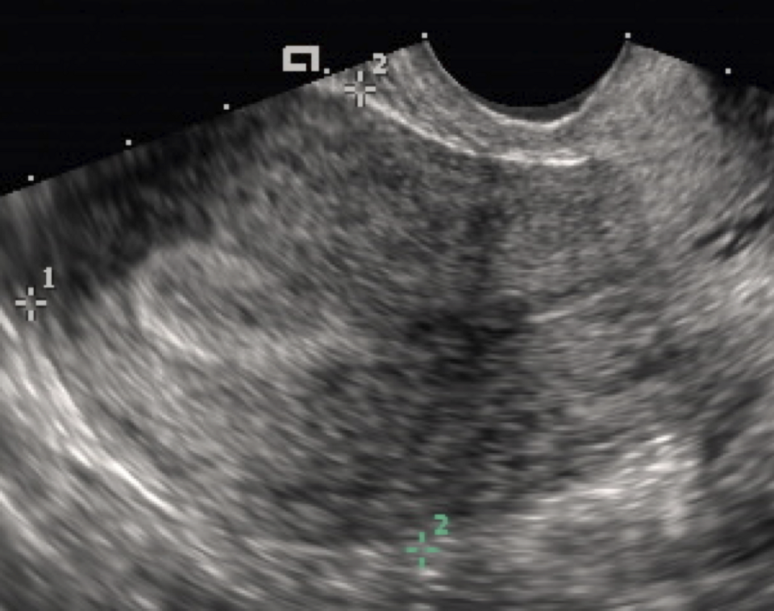
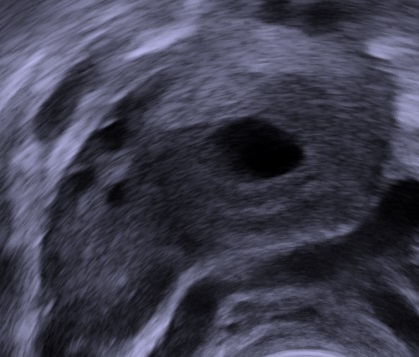
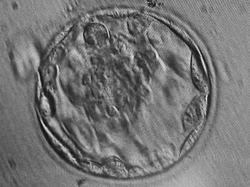
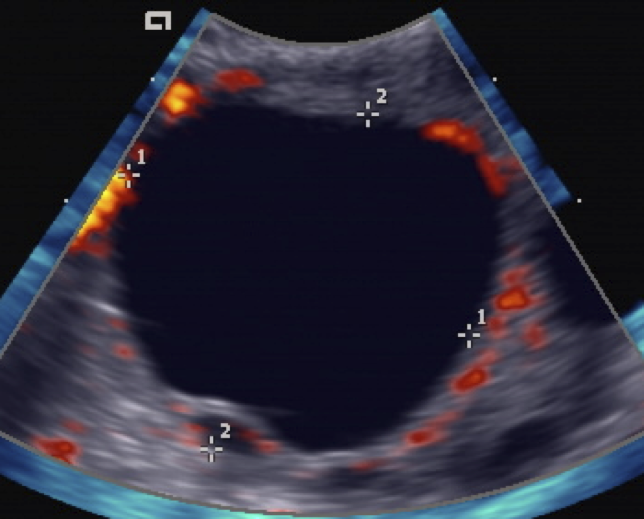
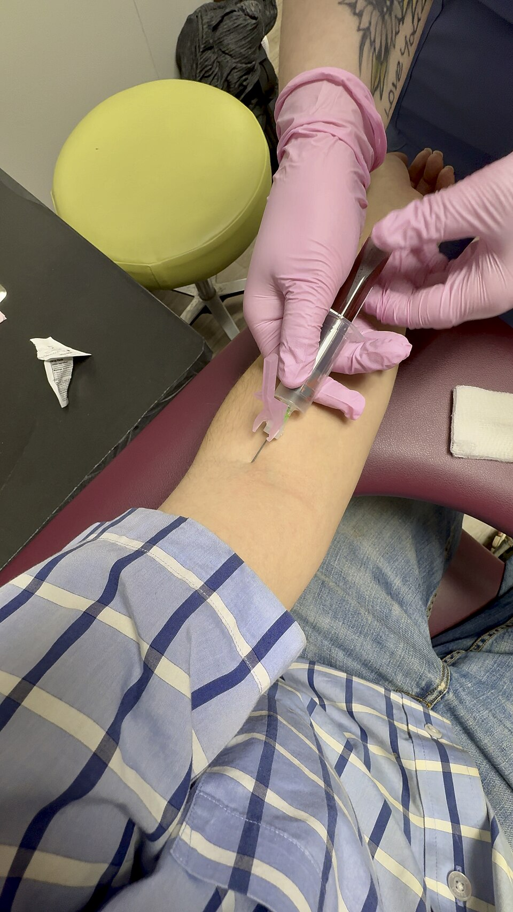
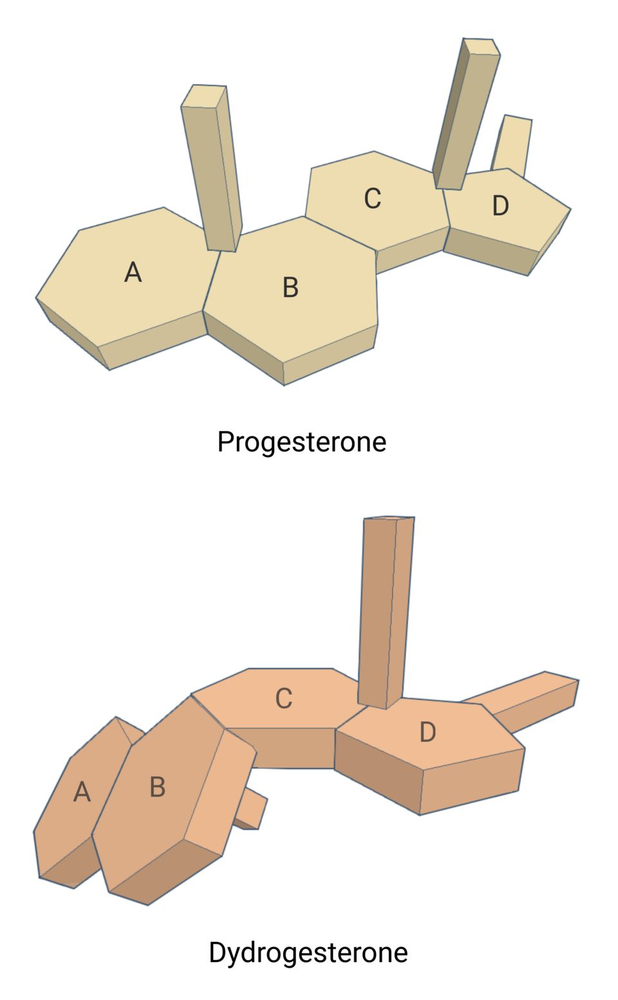
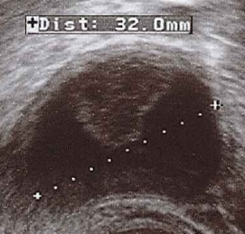
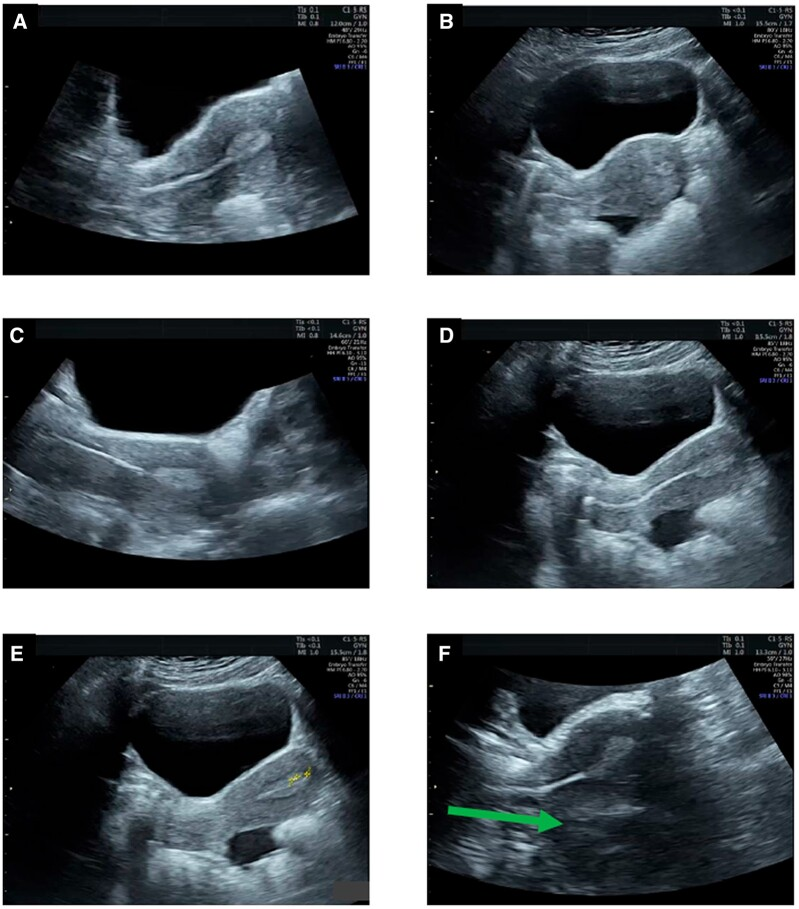

# XÉT NGHIỆM NỘI TIẾT CHU KÌ FET (CHUYỂN PHÔI TRỮ)
**Ngày:** 2026-11-15 | **Chuyên khoa:** Hỗ trợ sinh sản (ART) | **Đối tượng:** Bác sĩ, học viên sau đại học và người học mất gốc cần học từ nền tảng

---

## 0. TỔNG QUAN — VÌ SAO BÀI NÀY QUAN TRỌNG? [CỐT LÕI]

&emsp;Chuyển phôi trữ (frozen embryo transfer, FET) là chuyển một phôi đã đông lạnh ở chu kì trước vào tử cung ở chu kì hiện tại.

&emsp;Phôi đã đông thì việc còn lại là chuẩn bị nội mạc tử cung và chọn đúng ngày chuyển.

&emsp;Chọn đúng ngày chuyển nghĩa là phôi đến tử cung đúng lúc cửa sổ làm tổ mở ra.

&emsp;Xét nghiệm nội tiết trong chu kì FET là công cụ để biết cửa sổ làm tổ mở khi nào.

&emsp;Trong chu kì tự nhiên, xét nghiệm đỉnh hormone hoàng thể hóa (LH) và progesterone (P4) tăng sau rụng trứng cho biết trứng đã rụng hay chưa, và phôi nên chuyển vào ngày nào.

&emsp;Trong chu kì nhân tạo, xét nghiệm P4 ngày chuyển phôi cho biết nội mạc đã nhận đủ progesterone hay chưa, và có cần bổ sung thêm không.

&emsp;Một kết quả đọc sai có thể làm mất cả chu kì: chuyển quá sớm thì nội mạc chưa sẵn sàng, chuyển quá muộn thì cửa sổ làm tổ đã đóng, P4 thấp mà không bổ sung thì phôi tốt vẫn khó làm tổ.

&emsp;Bài này dạy đúng 3 loại chu kì FET, và cách xét nghiệm nội tiết đổi quyết định trong từng loại.

&emsp;Ba loại chu kì đó là chu kì tự nhiên, chu kì tự nhiên cải biên, và chu kì nhân tạo hay lập trình.

&emsp;Bài này không dạy lại chuẩn bị nội mạc cho FET.

&emsp;Chuẩn bị nội mạc gồm liều estrogen đa đường, sildenafil, hormone kích thích tạo bạch cầu hạt (G-CSF), huyết tương giàu tiểu cầu (PRP) và xử trí niêm mạc mỏng, xem bài ART-GAP-03.

&emsp;Bài này cũng không dạy lại ý nghĩa và ngưỡng cơ bản của từng chỉ số nội tiết.

&emsp;Ý nghĩa và ngưỡng cơ bản của hormone kháng Müller (AMH), hormone kích thích nang trứng (FSH), estradiol (E2), P4 và LH xem bài ART-43.

&emsp;Bài này chỉ dạy việc theo dõi nội tiết trong chu kì FET: khi nào xét nghiệm, kết quả đổi quyết định ra sao.

**Mục tiêu của bài:**
- Đọc được đỉnh LH trong chu kì tự nhiên và biết chuyển phôi vào ngày nào sau rụng trứng
- Dùng P4 tăng sau rụng trứng để định thời chuyển phôi khi bắt đỉnh LH khó
- Theo dõi E2 và P4 trong chu kì nhân tạo, biết khi nào bắt đầu P4 và khi nào P4 ngày chuyển phôi là thấp
- Dạy cả 2 phía của tranh luận về ngưỡng P4 ngày chuyển phôi, không chọn một số duy nhất làm luật
- Biết khi nào bổ sung P4, đổi đường dùng P4, hoặc hủy và dời lịch chuyển phôi



*Hình 1: Siêu âm qua ngã âm đạo đo độ dày nội mạc tử cung — dấu cộng đánh dấu hai bờ nội mạc; xét nghiệm nội tiết luôn được đọc cùng siêu âm nội mạc, không đọc một mình. Nguồn: Wikimedia Commons, Luis F. Goncalves, CC BY-SA 3.0.*

> **TIÊU CHUẨN BẮT BUỘC — DẠY TỪ GỐC, KHÔNG GIỚI HẠN ĐỘ DÀI:** Viết để một người học mất gốc vẫn theo được. Trước khi dùng một thuật ngữ, chữ viết tắt, chỉ số, cơ quan, cơ chế, thủ thuật hoặc quyết định điều trị lần đầu, phải giải thích bằng tiếng Việt đơn giản: **nó là gì → bình thường hoạt động ra sao → vì sao bất thường này quan trọng → nhận ra bằng cách nào → làm gì tiếp theo**. Sau lần giải thích đầu tiên, mới dùng viết tắt/thuật ngữ ngắn. Không dùng “rõ ràng”, “thường quy”, “theo protocol” hoặc danh sách bước trần nếu chưa giải thích lý do và ý nghĩa của hành động. Độ dài không có giới hạn tối đa: tiếp tục viết khi còn một mắt xích cần thiết để người học hiểu hoặc ra quyết định an toàn; ưu tiên chia nhỏ bằng tiêu đề, ví dụ và checkpoint thay vì cắt bỏ nền tảng.

> **CÁCH GIẢI THÍCH BẮT BUỘC CHO MỖI QUY TRÌNH:** Mỗi xét nghiệm, thang điểm, thuốc, thủ thuật hoặc algorithm phải ghi theo thứ tự: **mục tiêu → khi nào dùng/không dùng → cần chuẩn bị/đầu vào gì → làm hoặc đọc kết quả như thế nào → kết quả thay đổi quyết định ra sao → bẫy/an toàn → khi nào chuyển tuyến**. Chi tiết liều, đường dùng, trình tự và thời điểm phải có nguồn xác minh; không lấp chỗ trống bằng suy đoán.

### 0.1. Nền tảng tối thiểu cần dùng ngay

&emsp;Để hiểu bài này, người học cần nắm 8 khái niệm nền dưới đây.

&emsp;Mỗi khái niệm được dạy đủ để đọc tiếp bài, không cần học trước bài khác.

**Chuyển phôi trữ (frozen embryo transfer, FET)** là chuyển một phôi đã được đông lạnh ở chu kì trước vào tử cung ở chu kì hiện tại.

&emsp;Phôi được đông lạnh bằng kỹ thuật thủy tinh hóa, rã đông rồi chuyển vào tử cung khi nội mạc đã sẵn sàng.

&emsp;Chuyển phôi trữ khác chuyển phôi tươi ở chỗ buồng trứng không bị kích thích trong chu kì chuyển, nên nội mạc được chuẩn bị riêng.

**Cửa sổ làm tổ (window of implantation)** là khoảng thời gian ngắn mà nội mạc tử cung sẵn sàng đón phôi làm tổ.

&emsp;Cửa sổ làm tổ chỉ mở vài ngày trong mỗi chu kì.

&emsp;Phôi đến trước khi cửa sổ mở thì chưa làm tổ được, phôi đến sau khi cửa sổ đóng thì cũng không làm tổ được.

**Chu kì tự nhiên (natural cycle)** là chu kì FET không dùng thuốc nội tiết, để buồng trứng tự rụng trứng rồi chuyển phôi theo lịch rụng trứng tự nhiên.

&emsp;Chu kì tự nhiên có hoàng thể thật, tự tiết P4 sau rụng trứng.

&emsp;Chu kì tự nhiên cần theo dõi sát bằng siêu âm và xét nghiệm máu, vì không biết trước ngày rụng trứng.

**Chu kì tự nhiên cải biên (modified natural cycle)** là chu kì tự nhiên có thêm một mũi hormone hCG để kích thích rụng trứng đúng ngày đã định.

&emsp;Mũi hCG giúp biết trước ngày rụng trứng, nên lịch chuyển phôi dễ sắp xếp hơn chu kì tự nhiên thật.

&emsp;Chu kì tự nhiên cải biên vẫn có hoàng thể thật sau rụng trứng.

**Chu kì nhân tạo hay lập trình (artificial cycle, programmed cycle, hormone replacement therapy cycle)** là chu kì FET dùng estrogen rồi progesterone để chuẩn bị nội mạc, không có rụng trứng và không có hoàng thể thật.

&emsp;Chu kì nhân tạo còn được gọi là chu kì thay thế hormone, vì estrogen và progesterone đều do thuốc cung cấp.

&emsp;Chu kì nhân tạo dễ sắp xếp lịch, nhưng hoàn toàn phụ thuộc vào progesterone thuốc.

**Hoàng thể (corpus luteum)** là phần còn lại của nang noãn sau khi rụng trứng, tiết P4 để chuẩn bị nội mạc tử cung đón phôi.

&emsp;Hoàng thể thật chỉ có trong chu kì tự nhiên và chu kì tự nhiên cải biên.

&emsp;Chu kì nhân tạo không có hoàng thể, nên P4 hoàn toàn do thuốc cung cấp và phải theo dõi P4 máu sát hơn.

**Hỗ trợ hoàng thể (luteal phase support)** là việc bổ sung P4 sau rụng trứng hoặc sau khi bắt đầu P4 trong chu kì nhân tạo, để nội mạc đủ P4 cho phôi làm tổ và duy trì thai sớm.

&emsp;Hỗ trợ hoàng thể có thể dùng đường đặt âm đạo, uống, tiêm bắp hoặc tiêm dưới da.

&emsp;Đường dùng khác nhau cho P4 máu khác nhau, nên đổi đường dùng là một cách xử trí khi P4 máu thấp.

**Progesterone huyết thanh (serum progesterone)** là nồng độ P4 đo trong máu, dùng để kiểm tra nội mạc đã nhận đủ P4 hay chưa.

&emsp;Progesterone huyết thanh phản ánh P4 toàn thân, không phản ánh trực tiếp P4 tại nội mạc tử cung.

&emsp;Sự khác nhau giữa P4 máu và P4 tại nội mạc là một trong những lý do ngưỡng P4 ngày chuyển phôi vẫn đang tranh luận.

> **Không được chặn việc học vì thiếu prerequisite.** Nếu bài tiên quyết chưa tồn tại hoặc người học chưa nắm, mục `### 0.1 Nền tảng tối thiểu cần dùng ngay` dạy đủ khái niệm nền để hiểu bài hiện tại; link bài tiên quyết chỉ là đường học sâu hơn.

### 0.2. Ba nguyên tắc xuyên suốt bài

&emsp;Nguyên tắc thứ nhất: xét nghiệm nội tiết trong chu kì FET luôn đi cùng siêu âm.

&emsp;Trong chu kì tự nhiên, siêu âm thấy nang trội và nội mạc là dữ kiện đi cùng LH và P4.

&emsp;Trong chu kì nhân tạo, siêu âm đo độ dày nội mạc là dữ kiện đi cùng E2 và P4.

&emsp;Không bao giờ ra quyết định chỉ từ một con số xét nghiệm đơn độc.

&emsp;Nguyên tắc thứ hai: cùng một con số P4 có ý nghĩa khác nhau ở chu kì tự nhiên và chu kì nhân tạo.

&emsp;Chu kì nhân tạo không có hoàng thể thật, nên P4 thấp nghĩa là thuốc chưa đủ, và bổ sung thêm có thể cứu được chu kì.

&emsp;Chu kì tự nhiên có hoàng thể thật, nên P4 thấp có thể chỉ là thời điểm lấy máu chưa đúng, hoặc hoàng thể yếu.

&emsp;Không áp ngưỡng P4 của chu kì nhân tạo sang chu kì tự nhiên.

&emsp;Nguyên tắc thứ ba: ngưỡng P4 ngày chuyển phôi là khoảng tranh luận, không phải luật cứng.

&emsp;Khoảng 9–10 ng/mL là ngưỡng hay dùng để quyết định bổ sung, khoảng 5 ng/mL là mốc báo tiên lượng xấu [ABSTRACT VERIFIED].

&emsp;Người đọc cần nhớ cả 2 mốc và bằng chứng 2 phía, không nhớ một con số duy nhất rồi áp máy móc.

### 🛑 DỪNG 1 PHÚT — TỰ KIỂM TRA

> 1. Vì sao chu kì nhân tạo phải theo dõi P4 máu sát hơn chu kì tự nhiên?
> 2. Vì sao không áp ngưỡng P4 của chu kì nhân tạo sang chu kì tự nhiên?
>
> *(Đáp án: Chu kì nhân tạo không có hoàng thể thật nên P4 hoàn toàn do thuốc cung cấp, thiếu thuốc là thiếu P4 ngay. Chu kì tự nhiên có hoàng thể thật tiết P4, nên P4 máu thấp có thể do thời điểm lấy máu hoặc hoàng thể yếu, không đồng nghĩa thuốc thiếu.)*

---

## 1. ĐỊNH NGHĨA VÀ PHẠM VI — THEO DÕI NỘI TIẾT TRONG CHU KÌ FET LÀ GÌ [CỐT LÕI]

### 1.1. Ba loại chu kì FET và xét nghiệm quyết định của từng loại

&emsp;Chu kì tự nhiên không dùng thuốc nội tiết.

&emsp;Xét nghiệm quyết định trong chu kì tự nhiên là LH, E2 và P4, để xác định đỉnh LH và ngày rụng trứng.

&emsp;Chuyển phôi trong chu kì tự nhiên được định thời theo ngày rụng trứng: phôi ngày 3 chuyển sau rụng trứng 3 ngày, phôi nang ngày 5 chuyển sau rụng trứng 5 ngày [NGOÀI ABSTRACT].

&emsp;Chu kì tự nhiên cải biên thêm một mũi hCG để trigger rụng trứng.

&emsp;Xét nghiệm quyết định trong chu kì cải biên vẫn là LH, E2 và P4, nhưng lịch chuyển phôi tính từ ngày tiêm hCG thay vì ngày đỉnh LH tự nhiên.

&emsp;Chu kì nhân tạo dùng estrogen để làm dày nội mạc, rồi dùng P4 để mở cửa sổ làm tổ.

&emsp;Xét nghiệm quyết định trong chu kì nhân tạo là E2 trong giai đoạn chuẩn bị nội mạc, và P4 huyết thanh ngày chuyển phôi.

&emsp;Chuyển phôi trong chu kì nhân tạo được định thời theo ngày bắt đầu P4: phôi ngày 3 chuyển sau 3 ngày dùng P4, phôi nang ngày 5 chuyển sau 5 ngày dùng P4 [NGOÀI ABSTRACT].

### 1.2. Ranh giới với bài ART-GAP-03 và bài ART-43

&emsp;Bài ART-GAP-03 dạy chuẩn bị nội mạc cho FET: liều estrogen đa đường, sildenafil, G-CSF, PRP, xử trí niêm mạc mỏng, và tối ưu cửa sổ làm tổ.

&emsp;Bài này không dạy lại những nội dung đó.

&emsp;Bài này chỉ dạy theo dõi nội tiết trong chu kì FET, tức là xét nghiệm nào, khi nào, kết quả đổi quyết định ra sao.

&emsp;Bài ART-43 dạy ý nghĩa và ngưỡng cơ bản của từng chỉ số: AMH, FSH, E2, P4 và LH trong sinh lý chu kì tự nhiên.

&emsp;Những nội dung cơ bản về chỉ số nội tiết thuộc về bài ART-43, không thuộc bài này.

&emsp;Mỗi chỉ số trong bài này chỉ được nhắc lại tối đa 1–2 dòng khi cần dùng trong chu kì FET, rồi gắn chéo về ART-43.

&emsp;Bài IVF song song dạy xét nghiệm nội tiết trong chu kì kích trứng, và quyết định đông toàn bộ phôi.

&emsp;Bài này bắt đầu từ khi phôi đã đông, không dạy lại quyết định đông toàn bộ.

### 1.3. Bảng so sánh 3 loại chu kì FET

| Tiêu chí | Tự nhiên | Tự nhiên cải biên | Nhân tạo |
|---|---|---|---|
| Thuốc nội tiết | Không | hCG trigger | Estrogen rồi progesterone |
| Hoàng thể | Thật | Thật | Không có |
| Xét nghiệm chính | LH, E2, P4 | LH, E2, P4 + ngày hCG | E2 chuẩn bị, P4 ngày chuyển |
| Định thời chuyển | Theo ngày rụng trứng | Theo ngày tiêm hCG | Theo ngày bắt đầu P4 |

> ⚠️ HỌC VIÊN HAY NHẦM: Chu kì nhân tạo không có rụng trứng nên không có đỉnh LH để theo dõi. Nhiều học viên quen theo dõi đỉnh LH ở chu kì tự nhiên rồi áp sang chu kì nhân tạo, đi tìm đỉnh LH không tồn tại. Trong chu kì nhân tạo, "ngày rụng trứng" được thay bằng "ngày bắt đầu P4", và mọi lịch chuyển phôi đều tính từ ngày này.



*Hình 2: Hoàng thể sau rụng trứng tiết progesterone — chu kì tự nhiên có hoàng thể thật, chu kì nhân tạo không có. Nguồn: Wikimedia Commons, Mikael Häggström, CC0.*

### 🛑 DỪNG 1 PHÚT — TỰ KIỂM TRA

> 1. Trong chu kì nhân tạo, lịch chuyển phôi tính từ ngày nào thay cho ngày rụng trứng?
> 2. Vì sao chu kì tự nhiên hủy chu kì nhiều hơn chu kì nhân tạo?
>
> *(Đáp án: Tính từ ngày bắt đầu dùng progesterone. Chu kì tự nhiên hủy nhiều hơn vì có thể không rụng trứng, rụng trứng sớm hoặc nang không phát triển, trong khi chu kì nhân tạo chủ động hoàn toàn bằng thuốc.)*

---

## 2. CƠ CHẾ — ESTROGEN, PROGESTERONE VÀ CỬA SỔ LÀM TỔ [CỐT LÕI]

### 2.1. Chuỗi cơ chế 1: Estrogen chuẩn bị nội mạc, progesterone mở cửa sổ

&emsp;Chuỗi này là nền tảng để hiểu mọi xét nghiệm trong chu kì FET.

&emsp;Trong nửa đầu chu kì, estrogen làm nội mạc tử cung dày lên và làm tế bào nội mạc tăng thụ thể progesterone.

&emsp;Nội mạc dày lên nhưng chưa sẵn sàng đón phôi, vì chưa có progesterone.

&emsp;Sau rụng trứng, hoàng thể tiết progesterone.

&emsp;Progesterone gắn vào thụ thể đã được estrogen chuẩn bị sẵn, làm nội mạc chuyển sang giai đoạn chế tiết.

&emsp;Nội mạc chế tiết là nội mạc đã sẵn sàng đón phôi làm tổ.

&emsp;Cửa sổ làm tổ mở ra khoảng vài ngày sau khi progesterone bắt đầu tác dụng, rồi đóng lại.

&emsp;Trong chu kì nhân tạo, estrogen và progesterone đều do thuốc cung cấp, nên bác sĩ kiểm soát được ngày mở cửa sổ bằng ngày bắt đầu progesterone.

```text
Estrogen làm nội mạc dày lên
  → Tế bào nội mạc tăng thụ thể progesterone
  → Rụng trứng → Hoàng thể tiết progesterone
  → Progesterone gắn thụ thể → Nội mạc chuyển sang giai đoạn chế tiết
  → Cửa sổ làm tổ mở ra → Phôi đến đúng lúc → Làm tổ
```

&emsp;Chỗ đứt thứ nhất: không có estrogen thì nội mạc mỏng và ít thụ thể progesterone, nên progesterone đến cũng không mở được cửa sổ tốt.

&emsp;Chỗ đứt thứ hai: progesterone đến quá sớm thì cửa sổ mở sớm và đóng trước khi phôi đến.

&emsp;Chỗ đứt thứ ba: progesterone đến quá muộn thì phôi đến khi cửa sổ chưa mở.

```text
Ngày bắt đầu progesterone quyết định ngày mở cửa sổ
  → Phôi ngày 3 chuyển sau 3 ngày dùng progesterone [NGOÀI ABSTRACT]
  → Phôi nang ngày 5 chuyển sau 5 ngày dùng progesterone [NGOÀI ABSTRACT]
  → ✗ Progesterone bắt đầu sai ngày → Cửa sổ lệch khỏi ngày phôi đến
  → Phôi không làm tổ dù phôi tốt và nội mạc đủ dày
```

&emsp;Ví dụ: phôi nang ngày 5 được chuyển sau 5 ngày dùng progesterone trong chu kì nhân tạo [NGOÀI ABSTRACT].

&emsp;Lịch này đúng chuỗi: progesterone đã tác dụng đủ 5 ngày, nội mạc đang trong cửa sổ làm tổ của phôi nang [NGOÀI ABSTRACT].

&emsp;Ví dụ ngược: phôi nang ngày 5 nhưng chỉ mới dùng progesterone 3 ngày [NGOÀI ABSTRACT].

&emsp;Lịch này lệch chuỗi: nội mạc chưa đến giai đoạn của phôi nang, cửa sổ chưa mở hết.

### 2.2. Chuỗi cơ chế 2: Đỉnh LH và rụng trứng trong chu kì tự nhiên

&emsp;Trong chu kì tự nhiên, đỉnh LH là tín hiệu báo rụng trứng sắp xảy ra.

&emsp;Nang trội tiết estradiol tăng dần, khi estradiol đạt đỉnh cao thì phản hồi ngược chuyển từ ức chế sang kích thích.

&emsp;Tuyến yên tiết một đợt LH lớn: đó là đỉnh LH.

&emsp;Rụng trứng xảy ra khoảng 36 giờ sau đỉnh LH bắt đầu [NGOÀI ABSTRACT].

&emsp;Sau rụng trứng, hoàng thể tiết progesterone, và progesterone máu tăng dần.

&emsp;Vì vậy theo dõi chu kì tự nhiên phải đọc 3 hormone cùng lúc: LH tăng báo rụng trứng sắp xảy ra, estradiol giảm báo nang đã rụng, progesterone tăng báo hoàng thể đã hình thành.

&emsp;Nghiên cứu Orvieto 2025 cho thấy đọc một con số LH đơn độc là chưa đủ.

&emsp;Nghiên cứu này phân tích 668 chu kì FET tự nhiên, với tỉ lệ có thai 52% mỗi chu kì [ABSTRACT VERIFIED].

&emsp;Nhóm có thai và nhóm không có thai không khác biệt về LH, estradiol và progesterone tuyệt đối.

&emsp;Điểm khác biệt là mức thay đổi progesterone tính theo % từ 2 ngày trước rụng trứng sang 1 ngày trước rụng trứng, cao hơn ở nhóm có thai [ABSTRACT VERIFIED].

&emsp;Nghiên cứu đề xuất xác định đỉnh LH bằng bộ 3 dấu hiệu: LH tăng kèm estradiol giảm và progesterone tăng gấp 3 lần từ 2 ngày trước rụng trứng sang 1 ngày trước rụng trứng [ABSTRACT VERIFIED].

```text
Nang trội tiết estradiol tăng dần
  → Estradiol đạt đỉnh → Phản hồi ngược chuyển sang kích thích
  → Tuyến yên tiết đợt LH lớn (đỉnh LH)
  → Rụng trứng sau khoảng 36 giờ [NGOÀI ABSTRACT]
  → Hoàng thể tiết progesterone → Progesterone máu tăng
  → Nội mạc bước vào giai đoạn chế tiết
```

&emsp;Chỗ đứt: xét nghiệm máu lấy thưa quá thì bỏ qua đỉnh LH, vì đỉnh LH chỉ kéo dài khoảng 1 ngày [NGOÀI ABSTRACT].

&emsp;Chỗ đứt thứ hai: chỉ đọc LH mà không đọc estradiol và progesterone thì dễ nhầm LH tăng nhẹ với đỉnh LH thật.

```text
Theo dõi thưa (cách 3–4 ngày mới xét nghiệm 1 lần) [NGOÀI ABSTRACT]
  → ✗ Bỏ qua đỉnh LH
  → Không biết ngày rụng trứng → Chuyển phôi sai ngày
  → Theo dõi sát: siêu âm + xét nghiệm mỗi 2 ngày khi nang gần trưởng thành [NGOÀI ABSTRACT]
  → Bắt được đỉnh LH → Định thời chuyển phôi đúng
```

### 2.3. Chuỗi cơ chế 3: Hoàng thể thật so với hoàng thể nhân tạo

&emsp;Chuỗi này giải thích vì sao P4 máu thấp có ý nghĩa khác nhau ở 2 loại chu kì.

&emsp;Trong chu kì tự nhiên, hoàng thể thật tiết progesterone theo nhịp sinh lý.

&emsp;Progesterone máu phản ánh hoạt động của hoàng thể, và hoàng thể còn tiết các chất khác như relaxin và estrogen.

&emsp;Trong chu kì nhân tạo, không có hoàng thể, nên mọi progesterone đều do thuốc cung cấp.

&emsp;Progesterone đặt âm đạo cho nồng độ cao tại nội mạc tử cung nhưng nồng độ máu thấp hơn đường tiêm.

&emsp;Progesterone tiêm bắp cho nồng độ máu cao và ổn định, nhưng nồng độ tại nội mạc thấp hơn đường đặt âm đạo.

&emsp;Vì vậy cùng một con số P4 máu thấp có thể có ý nghĩa khác nhau tùy đường dùng progesterone.

&emsp;Bệnh nhân đặt âm đạo có P4 máu 8 ng/mL có thể vẫn đủ progesterone tại nội mạc, vì thuốc đặt tác dụng tại chỗ [NGOÀI ABSTRACT].

&emsp;Bệnh nhân uống progesterone có P4 máu thấp thì đáng lo hơn, vì progesterone uống chuyển hóa nhiều qua gan và ít đến được tử cung.

&emsp;Tổng quan Labarta 2026 nhấn mạnh chu kì thay thế hormone đặc biệt nhạy cảm với thiếu progesterone, vì không có hoàng thể thật bù trừ.

&emsp;Tổng quan này cũng ủng hộ hỗ trợ hoàng thể cá thể hóa: điều chỉnh theo P4 huyết thanh hoặc đổi đường dùng khi P4 dưới tối ưu.

```text
Chu kì tự nhiên: Hoàng thể thật
  → Tiết progesterone + estrogen + relaxin theo nhịp sinh lý
  → P4 máu phản ánh hoạt động hoàng thể
  → Nội mạc nhận progesterone từ máu hoàng thể
```

&emsp;Chỗ đứt ở chu kì nhân tạo: không có hoàng thể thật.

&emsp;Mọi progesterone đều do thuốc cung cấp, nên thiếu thuốc là thiếu progesterone ngay, không có nguồn bù trừ.

```text
Chu kì nhân tạo: Không có hoàng thể
  → Progesterone hoàn toàn do thuốc cung cấp
  → ✗ Thuốc không đủ hoặc hấp thu kém → P4 máu thấp
  → Nội mạc thiếu progesterone → Cửa sổ làm tổ không mở tốt
  → Bổ sung thêm progesterone hoặc đổi đường dùng → Cứu chu kì
```

### 2.4. Chuỗi cơ chế 4: Progesterone thấp và làm tổ thất bại

&emsp;Progesterone thấp ngày chuyển phôi làm giảm tỉ lệ làm tổ qua 2 đường.

&emsp;Đường thứ nhất: nội mạc thiếu progesterone thì chưa chuyển sang giai đoạn chế tiết đầy đủ, cửa sổ làm tổ mở không tốt.

&emsp;Đường thứ hai: progesterone thấp làm co bóp tử cung tăng lên, phôi dễ bị đẩy ra khỏi vị trí làm tổ.

&emsp;Nghiên cứu Labarta 2017 trên 244 bệnh nhân cho noãn cho thấy P4 ngày chuyển phôi thấp liên quan tới tỉ lệ có thai tiếp diễn thấp hơn [ABSTRACT VERIFIED].

&emsp;P4 huyết thanh trung bình ngày chuyển phôi là 12,7 ng/mL [ABSTRACT VERIFIED].

&emsp;Nhóm P4 thấp nhất có thai tiếp diễn 32,7%, trong khi các nhóm cao hơn đạt 52,8% [ABSTRACT VERIFIED].

&emsp;Hồi quy logistic điều chỉnh cho thấy P4 dưới ngưỡng thấp nhất làm giảm odds có thai tiếp diễn, với tỉ số odds 0,297 [ABSTRACT VERIFIED].

&emsp;Đường cong ROC cho thấy khả năng dự báo của P4 là yếu, với diện tích dưới đường cong 0,59 [ABSTRACT VERIFIED].

&emsp;Vì vậy P4 thấp ngày chuyển phôi là tín hiệu nguy cơ, không phải là chẩn đoán chắc chắn thất bại.

&emsp;Nghiên cứu Goc 2026 trên 917 chu kì thay thế hormone cho thấy P4 trước chuyển dưới 5 ng/mL thì tiên lượng xấu dù đã rescue 1 liều progesterone tiêm bắp [ABSTRACT VERIFIED].

&emsp;Nhóm P4 dưới 5 ng/mL có sinh sống 19,2%, so với 43,8% ở nhóm 5–7,49 ng/mL và 39,0% ở nhóm 7,5–9,99 ng/mL [ABSTRACT VERIFIED].

&emsp;Sảy thai trong số có thai lâm sàng là 46,7% khi P4 dưới 5 ng/mL, so với 9,9% khi P4 từ 5 ng/mL trở lên [ABSTRACT VERIFIED].

```text
Progesterone ngày chuyển phôi thấp
  → Nội mạc chưa chế tiết đầy đủ
  → Cửa sổ làm tổ mở không tốt
  → Co bóp tử cung tăng → Phôi khó bám
  → Tỉ lệ làm tổ và sinh sống giảm
```

&emsp;Chỗ đứt: bổ sung progesterone cứu vãn (rescue) trước chuyển phôi.

&emsp;Rescue làm P4 máu tăng lên, nội mạc nhận thêm progesterone, cửa sổ làm tổ mở tốt hơn.

&emsp;Nhưng rescue 1 liều có thể không đủ khi P4 quá thấp, như nhóm dưới 5 ng/mL trong nghiên cứu Goc 2026 vẫn xấu dù đã rescue [ABSTRACT VERIFIED].

```text
P4 ngày chuyển phôi thấp
  → ✗ Chuyển phôi ngay không bổ sung
  → Bổ sung progesterone (rescue) → P4 máu tăng
  → Nội mạc nhận đủ progesterone → Cửa sổ làm tổ mở tốt hơn
  → Nhưng nếu P4 quá thấp thì rescue 1 liều có thể không đủ → Bàn hoãn chuyển [ABSTRACT VERIFIED]
```

> ⚠️ HỌC VIÊN HAY NHẦM: P4 máu thấp không đồng nghĩa P4 tại nội mạc thấp, đặc biệt khi dùng đường đặt âm đạo. Nhiều học viên thấy P4 máu 8 ng/mL ở bệnh nhân đặt âm đạo thì hoảng sợ và muốn hủy chuyển [NGOÀI ABSTRACT]. Thực tế progesterone đặt âm đạo cho nồng độ tại nội mạc cao dù nồng độ máu thấp hơn đường tiêm. Quyết định phải dựa trên đường dùng, thời điểm lấy máu và xu hướng, không dựa trên một con số đơn độc.



*Hình 3: Phôi nang ngày 5 dưới kính hiển vi — giai đoạn phôi được chuyển trong FET; phôi chỉ làm tổ được khi đến đúng lúc cửa sổ làm tổ mở ra. Nguồn: Wikimedia Commons, Harimiao, CC BY-SA 3.0.*

### 🛑 DỪNG 1 PHÚT — TỰ KIỂM TRA

> 1. Vì sao progesterone đặt âm đạo cho P4 máu thấp hơn đường tiêm nhưng vẫn có tác dụng tốt tại nội mạc?
> 2. Vì sao P4 thấp ngày chuyển phôi làm giảm tỉ lệ làm tổ?
>
> *(Đáp án: Progesterone đặt âm đạo tác dụng tại chỗ ở tử cung nên nồng độ tại nội mạc cao dù nồng độ máu thấp. P4 thấp làm nội mạc chưa chế tiết đầy đủ và làm co bóp tử cung tăng, phôi khó bám.)*

---

## 3. CHẨN ĐOÁN VÀ ĐÁNH GIÁ — CHU KÌ TỰ NHIÊN [CỐT LÕI]

### 3.1. Theo dõi nang trội và đỉnh LH: đọc bộ 3 hormone

&emsp;Theo dõi chu kì tự nhiên bắt đầu từ ngày 8–10 của chu kì kinh, bằng siêu âm và xét nghiệm máu [NGOÀI ABSTRACT].

&emsp;Siêu âm theo dõi nang trội: nang lớn dần mỗi ngày, nội mạc dày dần.

&emsp;Xét nghiệm máu theo dõi LH, E2 và P4.

&emsp;Khi nang đạt khoảng 16–18 mm thì tăng tần suất theo dõi lên mỗi ngày hoặc cách ngày, vì rụng trứng có thể xảy ra bất cứ lúc nào [NGOÀI ABSTRACT].

&emsp;Khoảng kích thước nang này là thực hành lâm sàng chung, không nằm trong abstract nào của bundle, nên bài này ghi rõ là nguyên tắc thực hành.

&emsp;Đỉnh LH được xác định bằng bộ 3 dấu hiệu theo nghiên cứu Orvieto 2025: LH tăng kèm E2 giảm và P4 tăng gấp 3 lần từ 2 ngày trước rụng trứng sang 1 ngày trước rụng trứng [ABSTRACT VERIFIED].

&emsp;Đọc LH đơn độc dễ nhầm: LH có thể tăng nhẹ do dao động sinh lý, hoặc tăng sớm do nang chưa trưởng thành.

&emsp;Đọc bộ 3 thì chắc chắn hơn: LH tăng thật sự phải đi kèm E2 bắt đầu giảm và P4 bắt đầu tăng.

&emsp;Nghiên cứu Orvieto 2025 phân tích 668 chu kì, với tỉ lệ có thai 52% mỗi chu kì khi dùng định nghĩa bộ 3, cao hơn mức 46% trước đây khi chỉ dùng LH tăng [ABSTRACT VERIFIED].

### 3.2. P4 tăng sau rụng trứng: mốc xác nhận đã rụng trứng

&emsp;P4 tăng sau rụng trứng là bằng chứng hoàng thể đã hình thành.

&emsp;P4 máu tăng dần trong vài ngày sau rụng trứng, đạt đỉnh vào giữa hoàng thể.

&emsp;Xét nghiệm P4 sau đỉnh LH giúp xác nhận rụng trứng đã thực sự xảy ra, chứ không phải chỉ là đỉnh LH giả.

&emsp;Đỉnh LH giả là khi LH tăng nhưng nang không vỡ, thường gặp ở hội chứng buồng trứng đa nang hoặc khi nang chưa trưởng thành.

&emsp;Siêu âm sau đỉnh LH thấy nang đã vỡ và có dịch túi cùng sau tử cung, cộng với P4 tăng, thì chắc chắn đã rụng trứng.

&emsp;Siêu âm thấy nang vẫn còn nguyên và P4 không tăng thì chưa rụng trứng, cần theo dõi tiếp.

### 3.3. Định thời chuyển phôi theo ngày rụng trứng

&emsp;Ngày rụng trứng là ngày 0 của lịch chuyển phôi trong chu kì tự nhiên.

&emsp;Phôi ngày 3 chuyển vào ngày thứ 3 sau rụng trứng [NGOÀI ABSTRACT].

&emsp;Phôi nang ngày 5 chuyển vào ngày thứ 5 sau rụng trứng [NGOÀI ABSTRACT].

&emsp;Lịch này khớp với sinh lý: phôi ngày 3 vào tử cung ngày thứ 3 sau rụng trứng, khi nội mạc đã nhận progesterone được 3 ngày; phôi nang vào ngày thứ 5, khi nội mạc đã nhận progesterone được 5 ngày [NGOÀI ABSTRACT].

&emsp;Lệch 1 ngày có thể làm giảm tỉ lệ làm tổ, vì cửa sổ làm tổ chỉ mở vài ngày [NGOÀI ABSTRACT].

&emsp;Ví dụ: phôi nang ngày 5 được chuyển vào ngày thứ 5 sau rụng trứng, khi nội mạc đã nhận progesterone đủ 5 ngày và cửa sổ làm tổ đang mở rộng nhất [NGOÀI ABSTRACT].

&emsp;Vì vậy theo dõi chu kì tự nhiên cần chính xác về ngày, không ước lượng.

### 3.4. Định thời bằng P4 thay đỉnh LH — nghiên cứu Aydin 2026

&emsp;Bắt đỉnh LH có thể khó, vì đỉnh LH chỉ kéo dài khoảng 1 ngày và xét nghiệm máu lấy thưa thì bỏ qua [NGOÀI ABSTRACT].

&emsp;Nghiên cứu Aydin 2026 thử dùng P4 tăng để định thời chuyển phôi thay cho đỉnh LH.

&emsp;Nghiên cứu gồm 490 chu kì FET tự nhiên thật tại 1 trung tâm, từ 2022 đến 2025 [ABSTRACT VERIFIED].

&emsp;Nhóm định thời theo P4 gồm 286 chu kì, nhóm định thời theo đỉnh LH gồm 204 chu kì [ABSTRACT VERIFIED].

&emsp;Sinh sống ở nhóm P4 là 56,6%, nhóm LH là 52,0% [ABSTRACT VERIFIED].

&emsp;Sau điều chỉnh, tỉ số nguy cơ là 1,09, với khoảng tin cậy 95% từ 0,93 đến 1,30, và P = 0,264, tức không có bằng chứng về liên quan độc lập giữa chiến lược định thời và sinh sống [ABSTRACT VERIFIED].

&emsp;Có thai lâm sàng, hCG dương tính và sảy thai tương đương giữa 2 nhóm.

&emsp;Hạn chế: thiết kế quan sát, không ngẫu nhiên; ngưỡng P4 rút ra trong 1 trung tâm và 1 nền tảng xét nghiệm, nên khái quát hóa sang xét nghiệm khác còn hạn chế [ABSTRACT VERIFIED].

&emsp;Dạy trong bài: P4 là phương án thay thế khả thi khi bắt đỉnh LH khó, nhưng chưa có thử nghiệm ngẫu nhiên, nên không dạy là chuẩn mới.

> 🚨 **BOX ĐỎ — AN TOÀN TRƯỚC KHI CHUYỂN PHÔI TRONG CHU KÌ TỰ NHIÊN:** Dấu hiệu → nguy cơ đang bỏ sót → hành động ngay → nơi chuyển đến. **Đau bụng dữ dội kèm siêu âm thấy nang vỡ và dịch ổ bụng nhiều** → có thể là vỡ nang buồng trứng hoặc xuất huyết trong → dừng lịch chuyển phôi, siêu âm ổ bụng, xét nghiệm công thức máu, chuyển tuyến cấp cứu nếu huyết động không ổn định. **Thử thai dương tính ngoài ý muốn trong chu kì theo dõi FET** → có thể đã có thai tự nhiên trước ngày chuyển phôi → không chuyển thêm phôi, siêu âm xác định vị trí thai, hội chẩn ngay. **Ra máu âm đạo nhiều kèm đau bụng trong chu kì tự nhiên** → có thể là sảy thai sớm hoặc thai ngoài tử cung → thử thai hCG máu, siêu âm, chuyển tuyến cấp cứu nếu đau tăng hoặc ra máu nhiều.

### 3.5. Lưu đồ theo dõi chu kì tự nhiên

```text
Ngày 8–10 chu kì: siêu âm + xét nghiệm LH, E2, P4 [NGOÀI ABSTRACT]
  │
  ├─ Nang chưa đủ lớn? ── CÓ → Theo dõi mỗi 2–3 ngày [NGOÀI ABSTRACT]
  │                         → Tăng tần suất khi nang gần trưởng thành
  │
  ├─ Nang đủ lớn + LH bắt đầu tăng? ── CÓ → ⚠️ Xét nghiệm lại sau 1 ngày [ABSTRACT VERIFIED]
  │                                        → Đọc bộ 3: LH tăng + E2 giảm + P4 tăng gấp 3 lần? [ABSTRACT VERIFIED]
  │                                        → Đủ bộ 3 → Xác định ngày rụng trứng
  │
  ├─ LH tăng vọt + P4 không tăng + nang còn nguyên? ── CÓ → 🛑 Đỉnh LH giả
  │                                                       → Theo dõi tiếp, chưa định ngày chuyển
  │
  └─ Đã rụng trứng (P4 tăng + nang đã vỡ) → ✅ Định ngày chuyển phôi
                                             → Phôi ngày 3: sau rụng trứng 3 ngày [NGOÀI ABSTRACT]
                                             → Phôi nang: sau rụng trứng 5 ngày [NGOÀI ABSTRACT]
                                             → Plan B: nếu bắt đỉnh LH khó, dùng P4 tăng để định thời
```

**Giải thích từng nhánh của lưu đồ này:**
1. **Bước 1 — Theo dõi từ ngày 8–10:** Siêu âm và xét nghiệm máu đi cùng nhau, tần suất tăng dần khi nang gần trưởng thành [NGOÀI ABSTRACT].

2. **Bước 2 — Bộ 3 đỉnh LH:** LH tăng kèm E2 giảm và P4 tăng gấp 3 lần mới chắc chắn là đỉnh LH thật, theo nghiên cứu Orvieto 2025 [ABSTRACT VERIFIED].

3. **Bước 3 — Đỉnh LH giả:** LH tăng nhưng P4 không tăng và nang còn nguyên thì chưa rụng trứng, cần theo dõi tiếp.

4. **Bước 4 — Định thời:** Ngày rụng trứng là ngày 0, phôi ngày 3 chuyển sau 3 ngày, phôi nang chuyển sau 5 ngày; nếu bắt đỉnh LH khó thì dùng P4 tăng để định thời theo nghiên cứu Aydin 2026 [NGOÀI ABSTRACT].



*Hình 4: Nang trội trên siêu âm Doppler — nang lớn chứa dịch đen với dòng máu quanh nang, sẵn sàng rụng trứng; theo dõi chu kì tự nhiên cần siêu âm và xét nghiệm đi cùng nhau. Nguồn: Wikimedia Commons, Luis F. Goncalves, CC BY-SA 3.0.*

---

## 4. CHẨN ĐOÁN VÀ ĐÁNH GIÁ — CHU KÌ TỰ NHIÊN CẢI BIÊN [CỐT LÕI]

### 4.1. hCG trigger rụng trứng: khi nào và để làm gì

&emsp;Chu kì tự nhiên cải biên thêm một mũi hCG khi nang đã đủ lớn.

&emsp;Mũi hCG làm nang rụng trứng đúng ngày đã định, thay vì chờ đỉnh LH tự nhiên.

&emsp;Ưu điểm là lịch chuyển phôi biết trước, dễ sắp xếp phòng thí nghiệm và bệnh nhân không phải xét nghiệm máu mỗi ngày.

&emsp;Nhược điểm là hCG ngoại sinh làm xét nghiệm hCG sau đó khó đọc, và hoàng thể sau hCG trigger hoạt động khác hoàng thể sau đỉnh LH tự nhiên.

&emsp;Thời điểm tiêm hCG là khi nang đủ lớn và nội mạc đủ dày trên siêu âm, E2 đạt mức phù hợp và LH chưa tăng vọt.

&emsp;Nếu LH đã tăng vọt thì không cần hCG nữa, vì rụng trứng tự nhiên đã bắt đầu.

&emsp;Sau tiêm hCG, rụng trứng xảy ra sau khoảng 36 giờ, giống như sau đỉnh LH tự nhiên [NGOÀI ABSTRACT].

&emsp;Lịch chuyển phôi tính từ ngày tiêm hCG: phôi ngày 3 chuyển sau 3 ngày, phôi nang chuyển sau 5 ngày [NGOÀI ABSTRACT].

&emsp;Cụ thể ngày chuyển tính từ hCG trigger là thực hành lâm sàng chung, không nằm trong abstract nào của bundle, nên bài này ghi rõ là nguyên tắc thực hành.

### 4.2. Xét nghiệm sau hCG trigger

&emsp;Sau tiêm hCG, xét nghiệm P4 giúp xác nhận rụng trứng đã xảy ra và hoàng thể đã hình thành.

&emsp;P4 tăng sau hCG trigger là dấu hiệu tốt.

&emsp;P4 không tăng sau hCG trigger gợi ý nang chưa vỡ, cần siêu âm lại.

&emsp;Xét nghiệm LH sau hCG trigger ít giá trị, vì hCG ngoại sinh không làm LH tăng.

&emsp;Xét nghiệm E2 sau hCG trigger giúp đánh giá nang và nội mạc, nhưng không quyết định ngày chuyển.

### 4.3. Khi nào chu kì tự nhiên cải biên thất bại

&emsp;Chu kì cải biên thất bại khi nang không phát triển dù đã chờ lâu, gọi là không rụng trứng.

&emsp;Chu kì cải biên thất bại khi LH tăng vọt trước ngày định tiêm hCG, làm lịch trình đảo lộn.

&emsp;Chu kì cải biên thất bại khi nang vỡ trước ngày tiêm hCG, làm ngày chuyển không còn đúng lịch.

&emsp;Thử nghiệm Ho 2024 tại Việt Nam ghi nhận 99 chu kì bị hủy ở mỗi nhóm tự nhiên và tự nhiên cải biên, so với 0 chu kì bị hủy ở nhóm nhân tạo [ABSTRACT VERIFIED].

&emsp;Hủy chu kì tự nhiên và cải biên cao hơn là giá phải trả của việc dựa vào rụng trứng tự nhiên.

&emsp;Khi chu kì cải biên thất bại, lựa chọn là chờ chu kì sau làm lại, hoặc chuyển sang chu kì nhân tạo ở chu kì sau.

> ⚠️ HỌC VIÊN HAY NHẦM: Mũi hCG trong chu kì tự nhiên cải biên không phải là mũi trigger của chu kì kích trứng IVF. Mũi hCG ở đây chỉ làm rụng 1 nang trội duy nhất, liều và mục tiêu khác với trigger trưởng thành nhiều noãn trong chu kì kích trứng. Đừng áp liều trigger IVF sang chu kì FET cải biên.

---

## 5. CHẨN ĐOÁN VÀ ĐÁNH GIÁ — CHU KÌ NHÂN TẠO [CỐT LÕI]

### 5.1. E2 chuẩn bị nội mạc: theo dõi gì và khi nào đủ điều kiện bắt đầu P4

&emsp;Chu kì nhân tạo bắt đầu bằng estrogen để làm dày nội mạc.

&emsp;Estrogen dùng đường uống, đặt âm đạo hoặc dán qua da.

&emsp;Xét nghiệm E2 trong giai đoạn chuẩn bị giúp kiểm tra thuốc estrogen có được hấp thu không.

&emsp;E2 tăng chứng tỏ thuốc đang có tác dụng; E2 không tăng gợi ý bệnh nhân quên thuốc hoặc hấp thu kém.

&emsp;Nhưng E2 máu không tương quan chặt với độ dày nội mạc, nên E2 chỉ là xét nghiệm hỗ trợ, siêu âm đo độ dày nội mạc mới là xét nghiệm quyết định.

&emsp;Điều kiện bắt đầu P4 gồm nội mạc đủ dày trên siêu âm và đã dùng estrogen đủ ngày.

&emsp;Thử nghiệm Ho 2024 tại Việt Nam dùng điều kiện nội mạc từ 7 mm trở lên để bắt đầu progesterone đặt âm đạo [ABSTRACT VERIFIED].

&emsp;Không có ngưỡng E2 tuyệt đối nào đã verify trong các nghiên cứu của bài này để bắt đầu P4, nên bài này không dạy ngưỡng E2 cứng.

&emsp;Bài này dạy phối hợp E2, độ dày nội mạc và số ngày dùng estrogen để quyết định.

&emsp;Ví dụ: bệnh nhân dùng estrogen đủ ngày, siêu âm thấy nội mạc dày tốt nhưng E2 máu không tăng, thì vẫn bắt đầu progesterone theo siêu âm, vì E2 máu chỉ hỗ trợ kiểm tra hấp thu chứ không quyết định ngày bắt đầu.

### 5.2. Thời điểm bắt đầu P4: ngày 0 của lịch chuyển phôi

&emsp;Ngày bắt đầu P4 là ngày 0 của lịch chuyển phôi trong chu kì nhân tạo.

&emsp;Phôi ngày 3 chuyển sau 3 ngày dùng P4, phôi nang ngày 5 chuyển sau 5 ngày dùng P4 [NGOÀI ABSTRACT].

&emsp;Bắt đầu P4 quá sớm thì cửa sổ làm tổ mở sớm, phôi đến thì cửa sổ sắp đóng.

&emsp;Bắt đầu P4 quá muộn thì cửa sổ chưa mở khi phôi đến.

&emsp;Vì vậy ngày bắt đầu P4 phải tính cẩn thận, và không được đổi ngày bắt đầu P4 sau khi đã bắt đầu.

&emsp;Tổng quan Cochrane 2020 so sánh ngày bắt đầu P4 ở chu kì cho noãn đồng bộ và thấy bắt đầu P4 vào ngày lấy noãn hoặc ngày sau lấy noãn có lẽ làm tăng có thai lâm sàng so với bắt đầu ngày trước lấy noãn.

&emsp;Kết quả này ở chu kì cho noãn, không phải chu kì FET nhân tạo, nên bài này chỉ nhắc ở mức tham chiếu, không áp trực tiếp sang FET nhân tạo.

### 5.3. P4 huyết thanh ngày chuyển phôi: xét nghiệm quyết định

&emsp;P4 huyết thanh ngày chuyển phôi là xét nghiệm quyết định nhất trong chu kì nhân tạo.

&emsp;Xét nghiệm làm vào sáng ngày chuyển phôi, trước khi chuyển.

&emsp;Kết quả có sau vài giờ, đủ nhanh để quyết định bổ sung thêm P4 trước khi chuyển hoặc dời lịch chuyển.

&emsp;P4 ngày chuyển phôi thấp là tín hiệu nội mạc chưa nhận đủ progesterone.

&emsp;P4 ngày chuyển phôi đủ là tín hiệu nội mạc đã nhận đủ progesterone và cửa sổ làm tổ đang mở.

&emsp;Vấn đề là "đủ" là bao nhiêu, và đây là tranh luận lớn nhất của bài, được dạy chi tiết ở §6.

&emsp;Ngoài P4, E2 ngày chuyển phôi cũng được đo ở một số trung tâm, nhưng E2 ngày chuyển không có ngưỡng đã verify trong các nghiên cứu của bài này, nên bài này không dạy ngưỡng E2 ngày chuyển.



*Hình 5: Lấy máu tĩnh mạch đo progesterone vào buổi sáng ngày chuyển phôi — kết quả phải có trước giờ chuyển để kịp bổ sung hoặc dời lịch. Nguồn: Wikimedia Commons, Harrison Keely, CC BY 4.0.*

### 5.4. Lưu đồ theo dõi chu kì nhân tạo

```text
Ngày 2–4 chu kì: bắt đầu estrogen [ABSTRACT VERIFIED]
  │
  ├─ Siêu âm nội mạc sau 10–14 ngày estrogen [NGOÀI ABSTRACT]
  │   ├─ Nội mạc đủ dày? ── KHÔNG → Tăng liều hoặc đổi đường estrogen, siêu âm lại
  │   └─ Nội mạc đủ dày? ── CÓ → ✅ Bắt đầu progesterone (ngày 0)
  │
  ├─ Ngày chuyển phôi: xét nghiệm P4 huyết thanh buổi sáng
  │   ├─ P4 đủ? ── CÓ → ✅ Chuyển phôi đúng lịch
  │   └─ P4 thấp? ── CÓ → ⚠️ Bổ sung progesterone cứu vãn (rescue)
  │                       → Hoặc dời lịch chuyển sang chu kì sau
  │
  └─ Sau chuyển phôi: theo dõi P4 và E2 để hỗ trợ hoàng thể
```

**Giải thích từng bước của lưu đồ nhân tạo:**
1. **Bước 1 — Estrogen chuẩn bị:** Siêu âm đo độ dày nội mạc là xét nghiệm quyết định, E2 máu chỉ hỗ trợ kiểm tra hấp thu thuốc.

2. **Bước 2 — Bắt đầu P4:** Ngày bắt đầu P4 là ngày 0 của lịch chuyển, không được đổi sau khi đã bắt đầu.

3. **Bước 3 — P4 ngày chuyển:** Xét nghiệm buổi sáng ngày chuyển, P4 đủ thì chuyển đúng lịch, P4 thấp thì rescue hoặc dời lịch.

4. **Bước 4 — Sau chuyển:** Theo dõi P4 và E2 để hỗ trợ hoàng thể, vì chu kì nhân tạo không có hoàng thể thật.

---

## 6. NGƯỠNG P4 NGÀY CHUYỂN PHÔI — TRANH LUẬN 2 PHÍA [CỐT LÕI]

### 6.1. Nghiên cứu Labarta 2017: ngưỡng 9,2 ng/mL

&emsp;Nghiên cứu Labarta 2017 là nghiên cứu đặt ra ngưỡng P4 ngày chuyển phôi được trích dẫn nhiều nhất.

&emsp;Nghiên cứu gồm 244 bệnh nhân cho noãn, dùng estradiol valerate và progesterone đặt âm đạo vi hạt 400 mg mỗi 12 giờ [ABSTRACT VERIFIED].

&emsp;211 bệnh nhân đủ tiêu chí được phân tích [ABSTRACT VERIFIED].

&emsp;Giá trị P4 trung bình ngày chuyển phôi trong nghiên cứu này là 12,7 ng/mL [ABSTRACT VERIFIED].

&emsp;Bách phân vị 25 của P4 là 9,2 ng/mL, bách phân vị 50 là 11,8 ng/mL, bách phân vị 75 là 15,8 ng/mL [ABSTRACT VERIFIED].

&emsp;Tỉ lệ có thai tiếp diễn theo tứ phân vị P4: nhóm thấp nhất 32,7%, các nhóm cao hơn lần lượt là 49,1%, 58,5% và 50,9% [ABSTRACT VERIFIED].

&emsp;Nhóm thấp nhất so với các nhóm còn lại: 32,7% so với 52,8%, với P = 0,016 [ABSTRACT VERIFIED].

&emsp;Tỉ số nguy cơ là 0,62, với khoảng tin cậy 95% từ 0,41 đến 0,94 [ABSTRACT VERIFIED].

&emsp;Hồi quy logistic điều chỉnh cho thấy P4 dưới 9,2 ng/mL so với từ 9,2 ng/mL trở lên làm giảm odds có thai tiếp diễn, với tỉ số odds 0,297 [ABSTRACT VERIFIED].

&emsp;Khả năng dự báo của P4 theo đường cong ROC là yếu, với diện tích dưới đường cong 0,59 [ABSTRACT VERIFIED].

&emsp;Nghiên cứu không xác định được ngưỡng trên, chỉ xác định ngưỡng dưới.

&emsp;Hạn chế: chỉ áp dụng cho quần thể đã chọn, gồm buồng tử cung bình thường, nội mạc đủ dày và phôi nang tốt; ngoại suy sang đường dùng hay liều P4 khác cần kiểm chứng.

&emsp;Nghiên cứu này có một corrigendum đăng năm sau, nhưng số liệu chính không đổi.

### 6.2. Nghiên cứu Goc 2026: ngưỡng can thiệp 10 ng/mL và ngưỡng Youden 5,3 ng/mL

&emsp;Nghiên cứu Goc 2026 dùng ngưỡng can thiệp 10 ng/mL trong thực hành của trung tâm: P4 trước chuyển dưới 10 ng/mL thì rescue 1 liều progesterone tiêm bắp 50 mg [ABSTRACT VERIFIED].

&emsp;Nghiên cứu gồm 917 chu kì thay thế hormone, trong đó 650 chu kì không rescue và 267 chu kì rescue [ABSTRACT VERIFIED].

&emsp;Không chu kì nào bị hoãn trong nghiên cứu này.

&emsp;Trong nhóm rescue, sinh sống thấp hơn khi P4 trước chuyển dưới 5 ng/mL: 19,2% so với 43,8% ở nhóm 5–7,49 ng/mL và 39,0% ở nhóm 7,5–9,99 ng/mL [ABSTRACT VERIFIED].

&emsp;Nhóm dưới 5 ng/mL so với từ 5 ng/mL trở lên có tỉ số odds 0,33, với khoảng tin cậy 95% từ 0,17 đến 0,62 [ABSTRACT VERIFIED].

&emsp;Trong số có thai lâm sàng, tỉ lệ sảy thai là 46,7% ở nhóm P4 dưới 5 ng/mL, so với 9,9% ở nhóm P4 từ 5 ng/mL trở lên [ABSTRACT VERIFIED].

&emsp;Nhóm rescue có P4 từ 5 ng/mL trở lên đạt sinh sống 41,8%, tương đương nhóm không rescue 39,2% [ABSTRACT VERIFIED].

&emsp;Nhóm biên 9,1–9,9 ng/mL có sinh sống cao hơn về số học khi có rescue, 57,1% so với 40,0%, nhưng thiếu lực thống kê với P = 0,28 [ABSTRACT VERIFIED].

&emsp;Đường cong ROC cho diện tích 0,609, ngưỡng Youden là 5,3 ng/mL, bootstrap 1.000 lần cho trung vị ngưỡng 5,4 ng/mL [ABSTRACT VERIFIED].

&emsp;Hạn chế: tín hiệu thăm dò, đặc hiệu theo xét nghiệm Cobas e411 ECLIA, không phải quy tắc hoãn đã kiểm chứng, cần hiệu chuẩn lại cho nền tảng xét nghiệm khác.

&emsp;Nghiên cứu này cũng không tách được hiệu quả rescue, vì không hoãn chu kì nào và nhóm biên quá nhỏ.

### 6.3. Tổng quan Labarta 2026: chưa có ngưỡng chung

&emsp;Tổng quan Labarta 2026 cập nhật toàn bộ bằng chứng về P4 huyết thanh trong FET.

&emsp;Tổng quan này khẳng định P4 huyết thanh dưới tối ưu giữa hoàng thể liên quan tới tỉ lệ làm tổ và sinh sống thấp hơn.

&emsp;Tổng quan này nhấn mạnh nhu cầu bổ sung khác nhau theo loại chuẩn bị nội mạc, và chu kì thay thế hormone đặc biệt nhạy cảm với thiếu progesterone.

&emsp;Tổng quan này ủng hộ hỗ trợ hoàng thể cá thể hóa theo ngưỡng huyết thanh.

&emsp;Nhưng tổng quan này cũng kết luận cần nghiên cứu thêm để xác định ngưỡng cắt được chấp nhận chung.

&emsp;Tổng quan này cũng đặt câu hỏi về vai trò của progesterone tại nội mạc so với progesterone toàn thân, vì P4 máu không phản ánh trực tiếp P4 tại nội mạc.

### 6.4. Cách dạy ngưỡng P4: 2 mốc, không một số duy nhất

&emsp;Dạy ngưỡng P4 ngày chuyển phôi bằng 2 mốc, không dạy một số duy nhất.

&emsp;Mốc thứ nhất là khoảng 9–10 ng/mL, là ngưỡng hay dùng để quyết định bổ sung progesterone [ABSTRACT VERIFIED].

&emsp;Mốc này đến từ nghiên cứu Labarta 2017 với ngưỡng 9,2 ng/mL, và từ thực hành dùng ngưỡng can thiệp 10 ng/mL trong nghiên cứu Goc 2026 [ABSTRACT VERIFIED].

&emsp;Mốc thứ hai là khoảng 5 ng/mL, là mốc báo tiên lượng xấu [ABSTRACT VERIFIED].

&emsp;Mốc này đến từ nghiên cứu Goc 2026, với ngưỡng Youden 5,3 ng/mL và sinh sống chỉ 19,2% khi P4 dưới 5 ng/mL dù đã rescue [ABSTRACT VERIFIED].

&emsp;Giữa 2 mốc là vùng xám: P4 từ 5 đến 9 ng/mL thì rescue 1 liều có thể đủ, như nhóm P4 từ 5 ng/mL trở lên trong nghiên cứu Goc 2026 đạt sinh sống tương đương nhóm không rescue [ABSTRACT VERIFIED].

&emsp;Dưới 5 ng/mL thì rescue 1 liều có thể không đủ, cần bàn hoãn chu kì hoặc rescue mạnh hơn, nhưng chưa có bằng chứng thử nghiệm ngẫu nhiên cho lựa chọn này [NGOÀI ABSTRACT].

&emsp;Trên 10 ng/mL thì không có bằng chứng cho thấy P4 càng cao càng tốt, và nghiên cứu Labarta 2017 không xác định được ngưỡng trên [ABSTRACT VERIFIED].

&emsp;Ngưỡng P4 cũng phụ thuộc nền tảng xét nghiệm, vì mỗi máy xét nghiệm cho kết quả khác nhau ở cùng một mẫu máu.

&emsp;Nghiên cứu Goc 2026 nhấn mạnh ngưỡng của họ đặc hiệu theo xét nghiệm Cobas e411 ECLIA và cần hiệu chuẩn lại cho nền tảng khác.

> ⚠️ HỌC VIÊN HAY NHẦM: Ngưỡng P4 10 ng/mL không phải là luật. Nhiều học viên nhớ số 10 rồi áp máy móc cho mọi bệnh nhân và mọi xét nghiệm. Thực tế ngưỡng Youden trong nghiên cứu Goc 2026 chỉ là 5,3 ng/mL, ngưỡng Labarta 2017 là 9,2 ng/mL, và cả 2 đều đặc hiệu theo nền tảng xét nghiệm và đường dùng progesterone. Dạy 2 mốc và vùng xám giữa 2 mốc, không dạy một số duy nhất [ABSTRACT VERIFIED].



*Hình 6: Cấu trúc 3D của progesterone (trên) và dydrogesterone (dưới) — 4 vòng steroid A–D; các dạng progesterone khác nhau về đường dùng và chuyển hóa, và đổi đường dùng là một cách xử trí khi P4 máu thấp. Nguồn: Wikimedia Commons, Medgirl131, CC BY-SA 4.0.*

---

## 7. ĐIỀU TRỊ — PHÁC ĐỒ MẪU [CỐT LÕI]

### 7.1. Phác đồ mẫu 1: Chu kì nhân tạo chuẩn theo thử nghiệm Ho 2024

&emsp;Tình huống: bệnh nhân 34 tuổi, rụng trứng đều, chuẩn bị FET lần đầu với 1 phôi nang đông lạnh, nội mạc ban đầu mỏng chưa đủ điều kiện.

&emsp;Phác đồ này dùng liều đã verify trong thử nghiệm Ho 2024 tại Việt Nam.

**Đơn thuốc:**
1. Estradiol valerate 8 mg — uống — mỗi ngày 1 lần, bắt đầu từ ngày 2–4 của chu kì kinh [ABSTRACT VERIFIED]
2. Progesterone đặt âm đạo 800 mg — đặt âm đạo — mỗi ngày 1 lần, bắt đầu khi nội mạc từ 7 mm trở lên [ABSTRACT VERIFIED]
3. Siêu âm đo nội mạc trước khi bắt đầu progesterone, xét nghiệm P4 huyết thanh vào sáng ngày chuyển phôi

**Giải thích đơn:**
- **Tại sao chọn estradiol valerate uống 8 mg mỗi ngày:** Đây là liều trong thử nghiệm Ho 2024, dùng từ ngày 2–4 của kinh đến khi nội mạc đủ điều kiện [ABSTRACT VERIFIED].

- **Tại sao chọn progesterone đặt âm đạo 800 mg mỗi ngày:** Đây là liều trong thử nghiệm Ho 2024, bắt đầu khi nội mạc từ 7 mm trở lên; chuyển phôi nang sau 5 ngày dùng progesterone [ABSTRACT VERIFIED].

- **Dặn bệnh nhân:** Uống estrogen đều mỗi ngày, không tự ý tăng liều khi nội mạc chậm dày; báo ngay nếu ra máu âm đạo bất thường trong lúc chuẩn bị.

- **Mốc đánh giá đáp ứng:** Siêu âm nội mạc trước progesterone; P4 huyết thanh sáng ngày chuyển phôi để quyết định có cần rescue không.

### 7.2. Phác đồ mẫu 2: Chu kì nhân tạo với P4 đặt âm đạo 400 mg mỗi 12 giờ theo Labarta 2017

&emsp;Tình huống: bệnh nhân 38 tuổi, chu kì cho noãn, chuẩn bị nội mạc nhân tạo, nội mạc đủ dày, cần theo dõi P4 ngày chuyển phôi sát.

&emsp;Phác đồ này dùng liều đã verify trong nghiên cứu Labarta 2017.

**Đơn thuốc:**
1. Estradiol valerate — uống — mỗi ngày 1 lần, liều theo phác đồ của trung tâm [NGOÀI ABSTRACT]
2. Progesterone đặt âm đạo vi hạt 400 mg — đặt âm đạo — mỗi 12 giờ một lần [ABSTRACT VERIFIED]
3. Xét nghiệm P4 huyết thanh vào sáng ngày chuyển phôi; nếu P4 thấp thì bổ sung progesterone tiêm bắp rescue

**Giải thích đơn:**
- **Tại sao chọn progesterone đặt âm đạo 400 mg mỗi 12 giờ:** Đây là liều trong nghiên cứu Labarta 2017, nghiên cứu đã xác định ngưỡng P4 thấp ngày chuyển phôi liên quan tới có thai tiếp diễn thấp hơn [ABSTRACT VERIFIED].

- **Tại sao xét nghiệm P4 sáng ngày chuyển:** P4 ngày chuyển là xét nghiệm quyết định trong chu kì nhân tạo, và kết quả có kịp để rescue trước giờ chuyển.

- **Dặn bệnh nhân:** Đặt thuốc đúng giờ mỗi 12 giờ, không bỏ liều; báo ngay nếu ra khí hư bất thường hoặc đau bụng [ABSTRACT VERIFIED].

- **Mốc đánh giá đáp ứng:** P4 huyết thanh ngày chuyển phôi so với 2 mốc đã dạy ở §6; siêu âm nội mạc trước progesterone.

### 7.3. Rescue P4 khi P4 ngày chuyển phôi thấp

&emsp;Rescue là bổ sung thêm progesterone khi P4 huyết thanh thấp quanh thời điểm chuyển phôi.

&emsp;Rescue có thể là 1 liều progesterone tiêm bắp 50 mg, như trong nghiên cứu Goc 2026 [ABSTRACT VERIFIED].

&emsp;Rescue có thể là tăng liều đặt âm đạo, hoặc đổi đường dùng từ đặt âm đạo sang tiêm bắp.

&emsp;Tổng quan hệ thống và phân tích gộp mạng lưới Etrusco 2026 trên hơn 7.500 người cho thấy rescue cải thiện kết cục sinh sản về gần nhóm P4 đủ [ABSTRACT VERIFIED].

&emsp;Phân tích này gồm 12 nghiên cứu quan sát, với các đường dùng gồm tiêm bắp, đặt âm đạo, uống, tiêm dưới da và đặt trực tràng [ABSTRACT VERIFIED].

&emsp;Đường tiêm bắp và đặt âm đạo thường xếp hạng cao nhất, nhưng không phác đồ nào chứng minh vượt trội rõ ràng.

&emsp;Không đồng nhất đáng kể giữa các nghiên cứu, đặc biệt về giá trị ngưỡng P4.

&emsp;Kết luận của phân tích: rescue có vẻ hứa hẹn, nhưng cần thử nghiệm ngẫu nhiên với ngưỡng và phác đồ chuẩn hóa.

&emsp;Thực hành rescue: P4 từ 5 đến 9 ng/mL thì rescue 1 liều tiêm bắp 50 mg thường đủ, như nhóm P4 từ 5 ng/mL trở lên trong nghiên cứu Goc 2026 đạt sinh sống tương đương nhóm không rescue [ABSTRACT VERIFIED].

&emsp;P4 dưới 5 ng/mL thì rescue 1 liều có thể không đủ, cần bàn hoãn chu kì hoặc rescue mạnh hơn, nhưng chưa có bằng chứng thử nghiệm ngẫu nhiên cho lựa chọn này [NGOÀI ABSTRACT].

&emsp;Khuyến cáo bàn hoãn khi P4 dưới 5 ng/mL là suy luận lâm sàng từ dữ liệu quan sát, không phải khuyến cáo đã verify bằng thử nghiệm ngẫu nhiên [NGOÀI ABSTRACT].

### 7.4. Lưu đồ xử trí P4 thấp ngày chuyển phôi

```text
Sáng ngày chuyển phôi: xét nghiệm P4 huyết thanh
  │
  ├─ P4 từ 10 ng/mL trở lên? ── CÓ → ✅ Chuyển phôi đúng lịch [ABSTRACT VERIFIED]
  │                                → Tiếp tục hỗ trợ hoàng thể như cũ
  │
  ├─ P4 từ 5 đến dưới 10 ng/mL? ── CÓ → ⚠️ Rescue 1 liều progesterone tiêm bắp 50 mg [ABSTRACT VERIFIED]
  │                                     → Chuyển phôi đúng lịch sau rescue
  │                                     → Theo dõi P4 lại sau chuyển
  │
  ├─ P4 dưới 5 ng/mL? ── CÓ → 🛑 Cân nhắc hoãn chuyển phôi [ABSTRACT VERIFIED]
  │                          → Bàn với bệnh nhân: rescue mạnh hơn hay dời sang chu kì sau
  │                          → Không có quy tắc cứng đã verify bằng thử nghiệm ngẫu nhiên
  │
  └─ Plan B khi không xét nghiệm được P4 sáng ngày chuyển → Chuyển phôi đúng lịch
                                                           → Tăng hỗ trợ hoàng thể theo kinh nghiệm
                                                           → Không được suy diễn P4 từ triệu chứng
```

**Giải thích từng nhánh của lưu đồ rescue:**
1. **Bước 1 — P4 đủ:** P4 từ 10 ng/mL trở lên thì chuyển đúng lịch, không cần rescue [ABSTRACT VERIFIED].

2. **Bước 2 — P4 thấp vừa:** P4 từ 5 đến dưới 10 ng/mL thì rescue 1 liều tiêm bắp 50 mg rồi chuyển đúng lịch, theo bằng chứng quan sát [ABSTRACT VERIFIED].

3. **Bước 3 — P4 rất thấp:** P4 dưới 5 ng/mL thì tiên lượng xấu dù đã rescue, nên bàn hoãn chuyển với bệnh nhân [ABSTRACT VERIFIED].

4. **Bước 4 — Plan B:** Không xét nghiệm được thì chuyển đúng lịch và tăng hỗ trợ hoàng thể, không suy diễn P4 từ triệu chứng.

---

## 8. THEO DÕI VÀ QUẢN LÝ SAU CHUYỂN PHÔI [CỐT LÕI]

### 8.1. Theo dõi hỗ trợ hoàng thể sau chuyển phôi

&emsp;Sau chuyển phôi, hỗ trợ hoàng thể tiếp tục cho đến khi có thai và hoàng thể thai kì đủ hoạt động.

&emsp;Trong chu kì nhân tạo, hỗ trợ hoàng thể là progesterone thuốc duy nhất, nên không được ngừng sớm.

&emsp;Trong chu kì tự nhiên, hoàng thể thật tiết progesterone, nhưng hỗ trợ hoàng thể bằng thuốc vẫn thường được dùng thêm.

&emsp;Theo dõi P4 sau chuyển phôi giúp kiểm tra hỗ trợ hoàng thể có đủ không.

&emsp;Không có lịch xét nghiệm P4 sau chuyển phôi nào đã verify trong các nghiên cứu của bài này, nên bài này chỉ dạy nguyên tắc theo dõi chứ không dạy lịch cứng [NGOÀI ABSTRACT].

&emsp;Nguyên tắc: xét nghiệm P4 và E2 vào ngày thử thai, và xét nghiệm lại nếu có ra máu âm đạo hoặc triệu chứng dọa sảy.

&emsp;E2 sau chuyển phôi giúp đánh giá nội mạc và hoàng thể, nhưng không có ngưỡng đã verify trong các nghiên cứu của bài này.

### 8.2. Khi nào bổ sung P4, đổi đường dùng, hoặc dời lịch chuyển

&emsp;Bổ sung P4 khi P4 huyết thanh ngày chuyển phôi thấp, theo lưu đồ ở §7.4.

&emsp;Đổi đường dùng khi P4 máu thấp dù đã dùng đủ liều một đường.

&emsp;Đổi từ đặt âm đạo sang tiêm bắp làm P4 máu tăng lên, vì tiêm bắp cho nồng độ máu cao và ổn định hơn.

&emsp;Đổi từ uống sang đặt âm đạo hoặc tiêm bắp làm P4 tại nội mạc tăng lên, vì progesterone uống chuyển hóa nhiều qua gan.

&emsp;Ví dụ: bệnh nhân đặt âm đạo có P4 máu thấp nhưng nội mạc vẫn đủ điều kiện, thì đổi sang tiêm bắp sẽ làm P4 máu tăng lên rõ rệt và giúp quyết định chuyển phôi dễ dàng hơn.

&emsp;Dời lịch chuyển khi P4 quá thấp và rescue không đủ, hoặc khi nội mạc chưa đủ điều kiện vào ngày dự kiến chuyển.

&emsp;Dời lịch chuyển không có nghĩa là hủy phôi.

&emsp;Dời lịch chuyển có nghĩa là giữ phôi đông lạnh và chuyển ở chu kì sau với chuẩn bị tốt hơn.

### 8.3. Khi nào hủy chu kì FET

&emsp;Hủy chu kì FET khi không rụng trứng trong chu kì tự nhiên dù đã theo dõi lâu.

&emsp;Hủy chu kì FET khi nội mạc không dày lên dù đã tăng liều estrogen và đổi đường dùng.

&emsp;Hủy chu kì FET khi P4 ngày chuyển quá thấp và bệnh nhân chọn hoãn thay vì rescue.

&emsp;Hủy chu kì FET khi có dịch trong buồng tử cung vào ngày chuyển phôi, vì dịch làm giảm có thai — nội dung này thuộc bài ART-GAP-03, bài này chỉ nhắc ở mức gắn chéo.

&emsp;Thử nghiệm Ho 2024 ghi nhận hủy chu kì ở nhóm tự nhiên cao hơn hẳn nhóm nhân tạo, với 99 chu kì bị hủy ở mỗi nhóm tự nhiên so với 0 ở nhóm nhân tạo [ABSTRACT VERIFIED].

&emsp;Thử nghiệm Wei 2026 ghi nhận hủy chu kì ở nhóm tự nhiên là 16,2% so với 11,5% ở nhóm programmed [ABSTRACT VERIFIED].

&emsp;Hủy chu kì FET không phải thất bại điều trị, mà là quyết định bảo vệ phôi khỏi một chu kì chưa sẵn sàng.



*Hình 8: Siêu âm qua ngã âm đạo — nang hoàng thể có chảy máu (đo 32,0 mm): máu tươi hiện đen (không vang), khối máu đông nhô lên phía trên. Đây là nang hoàng thể có chảy máu (biến thể thường gặp), không phải hoàng thể bình thường. Hoàng thể trên siêu âm là cấu trúc tạo progesterone trong chu kì tự nhiên. Nguồn: Wikimedia Commons, Mikael Häggström, CC0.*

> ⚠️ HỌC VIÊN HAY NHẦM: Ngừng progesterone ngay khi thử thai dương tính là sai lầm nguy hiểm. Thai sớm chưa tự tiết đủ progesterone, hoàng thể thai kì cần thời gian mới hoạt động đủ. Ngừng progesterone sớm có thể gây sảy thai. Hỗ trợ hoàng thể phải tiếp tục theo hướng dẫn của bác sĩ, thường đến tuần thai 8–10, tùy phác đồ của trung tâm [NGOÀI ABSTRACT].



*Hình 7: Siêu âm qua thành bụng hướng dẫn chuyển phôi: (A) cửa sổ phóng đại tập trung vào buồng tử cung; (B) chuyển phôi trong lúc đưa ống thông; (C) chuyển phôi khi tử cung ngả sau; (D) đầu ống thông tiến về phía đáy nội mạc; (E) đo khoảng cách từ đầu ống thông tới nội mạc đáy và từ bọt khí phôi tới nội mạc; (F) artefact hình ảnh gương. Kỹ thuật chuyển phôi dưới siêu âm giống nhau ở IVF tươi và FET. Nguồn: D'Angelo và cộng sự, Human Reproduction Open 2022, CC BY 4.0.*

---

## 9. TÌNH HUỐNG ĐẶC BIỆT — P4 THẤP, NANG TRỘI LỌT VÀ KHÔNG RỤNG TRỨNG [NÂNG CAO]

### 9.1. P4 thấp dù đã dùng đủ liều

&emsp;P4 thấp dù đã dùng đủ liều có thể do hấp thu kém qua đường đặt âm đạo, do quên thuốc, hoặc do chuyển hóa nhanh.

&emsp;Xử trí: kiểm tra bệnh nhân có dùng thuốc đúng giờ không, có đặt thuốc đúng kỹ thuật không.

&emsp;Nếu dùng thuốc đúng mà P4 vẫn thấp, đổi đường dùng sang tiêm bắp.

&emsp;Nếu đổi đường dùng mà P4 vẫn thấp, cân nhắc hoãn chuyển và tìm nguyên nhân chuyển hóa.

&emsp;Không tăng liều đặt âm đạo vô hạn, vì hấp thu qua niêm mạc âm đạo có giới hạn.

### 9.2. Nang trội "lọt" trong chu kì nhân tạo

&emsp;Nang trội "lọt" là nang phát triển dù đang dùng estrogen liều cao để ức chế rụng trứng.

&emsp;Nang lọt tiết estrogen và có thể gây đỉnh LH, làm lịch trình chu kì nhân tạo đảo lộn.

&emsp;Phát hiện nang lọt bằng siêu âm và xét nghiệm LH, E2.

&emsp;Không có nghiên cứu nào trong bundle của bài này về nang lọt, nên bài này chỉ dạy ở mức nguyên tắc: siêu âm thấy nang lọt kèm LH tăng thì hủy chu kì nhân tạo này và làm lại chu kì sau [NGOÀI ABSTRACT].

### 9.3. Không rụng trứng trong chu kì tự nhiên

&emsp;Không rụng trứng là khi nang không vỡ dù đã theo dõi lâu, hoặc nang thoái triển.

&emsp;Nguyên nhân gồm nang chưa trưởng thành, rối loạn phóng noãn, hoặc đỉnh LH giả.

&emsp;Xử trí: theo dõi thêm vài ngày, nếu vẫn không rụng thì hủy chu kì và làm lại chu kì sau.

&emsp;Chu kì sau có thể chuyển sang chu kì cải biên với hCG trigger, hoặc chu kì nhân tạo để chủ động lịch trình.

&emsp;Người có tiền sử không rụng trứng nhiều lần thì nên cân nhắc chu kì nhân tạo ngay từ đầu, thay vì lặp lại chu kì tự nhiên thất bại.

---

## 10. QUYẾT ĐỊNH CHỌN LOẠI CHU KÌ [CỐT LÕI]

### 10.1. So sánh sinh sống và biến chứng giữa các loại chu kì

&emsp;Tổng quan Cochrane 2020 với 31 thử nghiệm ngẫu nhiên và 5.426 phụ nữ kết luận không đủ bằng chứng để khuyến cáo một phác đồ chuẩn bị nội mạc cụ thể nào [ABSTRACT VERIFIED].

&emsp;So sánh chu kì tự nhiên với chu kì programmed cho sinh sống với tỉ số odds 0,97, tức không chắc chắn về khác biệt [ABSTRACT VERIFIED].

&emsp;Chu kì tự nhiên có lẽ giảm tỉ lệ hủy chu kì, với tỉ số odds 0,60 [ABSTRACT VERIFIED].

&emsp;Thử nghiệm Ho 2024 tại Việt Nam trên 1.428 phụ nữ cho thấy sinh sống tương đương giữa 3 nhóm: tự nhiên 37%, tự nhiên cải biên 33%, nhân tạo 34% [ABSTRACT VERIFIED].

&emsp;Tỉ số nguy cơ của nhóm tự nhiên so với nhóm nhân tạo là 1,07, của nhóm cải biên so với nhóm nhân tạo là 0,98 [ABSTRACT VERIFIED].

&emsp;Thử nghiệm Wei 2026 trên 4.376 phụ nữ cho thấy sinh sống khỏe mạnh tương đương: tự nhiên 41,6% so với programmed 40,6% [ABSTRACT VERIFIED].

&emsp;Tỉ số nguy cơ là 1,03, với P = 0,49 [ABSTRACT VERIFIED].

&emsp;Nhưng biến chứng sản khoa thấp hơn ở nhóm tự nhiên: tiền sản giật 2,9% so với 4,6%, sảy thai sớm 12,1% so với 15,2%, băng huyết sau sinh 2,0% so với 6,1% [ABSTRACT VERIFIED].

&emsp;Đổi lại, hủy chu kì cao hơn ở nhóm tự nhiên: 16,2% so với 11,5% [ABSTRACT VERIFIED].

### 10.2. Lưu đồ chọn loại chu kì FET

```text
Bệnh nhân chuẩn bị FET, đã có phôi đông lạnh
  │
  ├─ Rụng trứng đều + muốn tránh thuốc + chấp nhận hủy chu kì? ── CÓ → ✅ Chu kì tự nhiên
  │                                                              → Theo dõi LH, E2, P4 sát
  │                                                              → Plan B: không bắt được đỉnh LH
  │                                                                thì chuyển sang cải biên
  │
  ├─ Rụng trứng đều + muốn lịch biết trước? ── CÓ → ✅ Chu kì tự nhiên cải biên
  │                                             → hCG trigger khi nang đủ lớn
  │
  ├─ Rụng trứng không đều / tiền sử không rụng trứng / muốn chủ động lịch? ── CÓ → ✅ Chu kì nhân tạo
  │                                                                          → Theo dõi E2 và P4 ngày chuyển
  │
  └─ Có thai lần trước bị tiền sản giật? ── CÓ → ⚠️ Ưu tiên chu kì tự nhiên
                                            → Vì biến chứng sản khoa thấp hơn ở nhóm tự nhiên
```

**Giải thích từng bước của lưu đồ chọn chu kì:**
1. **Bước 1 — Rụng trứng đều:** Rụng trứng đều là điều kiện tiên quyết cho chu kì tự nhiên, vì không rụng trứng thì không có hoàng thể và không định thời được.

2. **Bước 2 — Lịch biết trước:** Chu kì cải biên cho lịch biết trước nhờ hCG trigger, phù hợp bệnh nhân ở xa hoặc cần sắp xếp.

3. **Bước 3 — Chủ động:** Chu kì nhân tạo chủ động hoàn toàn bằng thuốc, phù hợp rụng trứng không đều hoặc tiền sử không rụng trứng.

4. **Bước 4 — Tiền sản giật:** Tiền sử tiền sản giật là lý do ưu tiên chu kì tự nhiên, vì biến chứng sản khoa thấp hơn theo thử nghiệm Wei 2026.

> ⚠️ HỌC VIÊN HAY NHẦM: Chu kì tự nhiên không phải lúc nào cũng "tự nhiên hơn nên tốt hơn". Chu kì tự nhiên hủy nhiều hơn, cần theo dõi sát hơn, và bệnh nhân ở xa khó theo dõi mỗi 2 ngày. [NGOÀI ABSTRACT] Chu kì nhân tạo dễ sắp xếp lịch và hủy ít hơn, nhưng phụ thuộc hoàn toàn vào thuốc và cần theo dõi P4 ngày chuyển. Chọn chu kì theo bệnh nhân, không theo khẩu hiệu.

---

## 11. ÁP DỤNG TẠI VIỆT NAM [CỐT LÕI]

### 11.1. Dữ liệu Việt Nam duy nhất đã verify trong bài này

&emsp;Thử nghiệm Ho 2024 tại Việt Nam là dữ liệu Việt Nam duy nhất đã verify trong bài này.

&emsp;Thử nghiệm này so sánh 3 loại chu kì chuẩn bị nội mạc cho chuyển phôi đông lạnh, với sinh sống tương đương giữa các nhóm.

&emsp;Thử nghiệm này thực hiện tại một bệnh viện ở TP. Hồ Chí Minh, trên phụ nữ rụng trứng.

&emsp;Thử nghiệm này chứng minh Việt Nam đã có thử nghiệm ngẫu nhiên lớn về FET được đăng trên tạp chí y khoa hàng đầu.

### 11.2. Cân nhắc thực tế trong bối cảnh Việt Nam

- **Xét nghiệm nhanh:** Xét nghiệm P4 ngày chuyển phôi cần có kết quả trước giờ chuyển, nên trung tâm cần xét nghiệm trả kết quả trong buổi sáng. Trung tâm nào gửi mẫu đi xa thì cần sắp xếp lấy máu sớm và hẹn giờ chuyển muộn hơn.
- **Theo dõi chu kì tự nhiên:** Chu kì tự nhiên cần bệnh nhân quay lại xét nghiệm máu và siêu âm nhiều lần, khó khăn cho bệnh nhân ở xa. Trung tâm cần tư vấn trước về số lần tái khám, để bệnh nhân ở xa cân nhắc chu kì nhân tạo thay thế.
- **Thuốc sẵn có:** Estradiol valerate uống, progesterone đặt âm đạo và progesterone tiêm bắp đều sẵn có tại Việt Nam. Liều dùng trong phác đồ mẫu đều có trên thị trường.
- **Bảo hiểm y tế:** Điều trị IVF hiện chưa được bảo hiểm y tế chi trả, nên mọi quyết định đổi đường dùng hay dời lịch chuyển đều cần tư vấn chi phí kèm theo.
- **Plan A:** Xét nghiệm đầy đủ LH, E2, P4 mỗi 2 ngày kèm siêu âm trong chu kì tự nhiên, và xét nghiệm P4 sáng ngày chuyển trong chu kì nhân tạo [NGOÀI ABSTRACT].
- **Plan B:** Khi không xét nghiệm được thường xuyên thì siêu âm sát hơn và xét nghiệm vào các mốc quyết định: ngày rụng trứng dự kiến và sáng ngày chuyển. Plan B không được suy diễn đỉnh LH hay P4 từ triệu chứng, và ngưỡng chuyển tuyến là khi đau bụng dữ dội hoặc ra máu nhiều.

> **Plan A / Plan B:** Với mọi quyết định phụ thuộc xét nghiệm, hình ảnh, thuốc hoặc chuyên khoa có thể không sẵn có, ghi Plan A khi nguồn lực đầy đủ và Plan B an toàn khi không có. Plan B phải nêu điều vẫn làm được ngay, điều không được suy diễn/thay thế, và ngưỡng chuyển tuyến; không dùng xét nghiệm kém phù hợp chỉ để tạo cảm giác yên tâm.

---

## 12. MÂU THUẪN VÀ BẪY LÂM SÀNG [CỐT LÕI]

### 12.1. Mâu thuẫn cần dạy cả hai phía

**Mâu thuẫn 1: Ngưỡng P4 ngày chuyển phôi — 9,2 hay 10 hay 5,3 ng/mL?**

- Bằng chứng ủng hộ ngưỡng 9,2 ng/mL: Nghiên cứu Labarta 2017, nhóm P4 thấp nhất có thai tiếp diễn thấp hơn rõ rệt so với các nhóm cao hơn, với tỉ số odds 0,297 sau điều chỉnh [ABSTRACT VERIFIED].
- Bằng chứng ủng hộ ngưỡng thấp hơn: Nghiên cứu Goc 2026, ngưỡng Youden tìm được là 5,3 ng/mL, và nhóm P4 dưới 5 ng/mL mới thực sự xấu dù đã rescue, trong khi nhóm từ 5 ng/mL trở lên đạt sinh sống tương đương nhóm không rescue [ABSTRACT VERIFIED].
- Bằng chứng ủng hộ ngưỡng can thiệp 10 ng/mL: Thực hành của trung tâm trong nghiên cứu Goc 2026 dùng ngưỡng 10 ng/mL để quyết định rescue, và nhóm biên 9,1–9,9 ng/mL có sinh sống cao hơn về số học khi có rescue [ABSTRACT VERIFIED].
- Quan điểm hiện tại: Chưa có ngưỡng cắt được chấp nhận chung, theo tổng quan Labarta 2026. Dạy 2 mốc và vùng xám giữa 2 mốc, không dạy một số duy nhất làm luật.

**Mâu thuẫn 2: Chu kì tự nhiên có tốt hơn chu kì nhân tạo không?**

- Bằng chứng ủng hộ chu kì tự nhiên: Thử nghiệm Wei 2026 cho thấy biến chứng sản khoa thấp hơn ở nhóm tự nhiên, gồm tiền sản giật, sảy thai sớm và băng huyết sau sinh.
- Bằng chứng ủng hộ chu kì nhân tạo: Thử nghiệm Ho 2024 và Wei 2026 đều cho thấy hủy chu kì thấp hơn ở nhóm nhân tạo, và sinh sống tương đương giữa các nhóm.
- Bằng chứng trung lập: Tổng quan Cochrane 2020 kết luận không đủ bằng chứng để khuyến cáo một phác đồ cụ thể nào, vì bằng chứng mức thấp đến rất thấp.
- Quan điểm hiện tại: Chọn chu kì theo bệnh nhân, gồm rụng trứng đều hay không, muốn tránh thuốc hay muốn chủ động lịch, chấp nhận hủy chu kì hay không, và tiền sử tiền sản giật.

**Mâu thuẫn 3: Định thời bằng P4 thay đỉnh LH — đủ tin chưa?**

- Bằng chứng ủng hộ: Nghiên cứu Aydin 2026 cho thấy sinh sống tương đương giữa định thời bằng P4 và định thời bằng đỉnh LH, với tỉ số nguy cơ 1,09 sau điều chỉnh [ABSTRACT VERIFIED].
- Bằng chứng phản đối: Nghiên cứu Aydin 2026 là đoàn hệ quan sát, không ngẫu nhiên, 1 trung tâm, và ngưỡng P4 đặc hiệu theo nền tảng xét nghiệm của trung tâm đó [ABSTRACT VERIFIED].
- Quan điểm hiện tại: P4 là phương án thay thế khả thi khi bắt đỉnh LH khó, nhưng chưa có thử nghiệm ngẫu nhiên, nên không dạy là chuẩn mới.

**Mâu thuẫn 4: Rescue P4 có cứu được chu kì P4 thấp không?**

- Bằng chứng ủng hộ: Phân tích gộp mạng lưới Etrusco 2026 trên hơn 7.500 người cho thấy rescue cải thiện kết cục về gần nhóm P4 đủ, và nghiên cứu Goc 2026 cho thấy nhóm P4 từ 5 ng/mL trở lên sau rescue đạt sinh sống tương đương nhóm không rescue [ABSTRACT VERIFIED].
- Bằng chứng phản đối: Toàn bộ bằng chứng rescue đều là nghiên cứu quan sát, không có thử nghiệm ngẫu nhiên; nhóm P4 dưới 5 ng/mL trong nghiên cứu Goc 2026 vẫn xấu dù đã rescue 1 liều [ABSTRACT VERIFIED].
- Quan điểm hiện tại: Rescue 1 liều có thể đủ khi P4 chỉ thấp vừa; P4 rất thấp thì rescue 1 liều có thể không đủ, cần bàn hoãn chu kì hoặc rescue mạnh hơn, nhưng chưa có bằng chứng thử nghiệm ngẫu nhiên cho lựa chọn này [ABSTRACT VERIFIED].

### 12.2. Bẫy lâm sàng

| # | Bẫy | Hậu quả | Cách tránh |
|---|---|---|---|
| 1 | Đọc LH đơn độc để xác định đỉnh LH | Nhầm LH tăng nhẹ với đỉnh LH thật | Đọc bộ 3: LH tăng kèm E2 giảm và P4 tăng |
| 2 | Áp ngưỡng P4 chu kì nhân tạo sang chu kì tự nhiên | Hủy chu kì tự nhiên không cần thiết | Ngưỡng P4 chỉ áp cho chu kì nhân tạo, chu kì tự nhiên có hoàng thể thật |
| 3 | Chuyển phôi khi P4 ngày chuyển thấp mà không rescue | Tỉ lệ làm tổ thấp | Xét nghiệm P4 sáng ngày chuyển, rescue khi thấp |
| 4 | Ngừng progesterone ngay khi thử thai dương tính | Sảy thai do thiếu progesterone | Tiếp tục hỗ trợ hoàng thể theo hướng dẫn của bác sĩ |
| 5 | Đo P4 máu thấp ở bệnh nhân đặt âm đạo rồi hoảng sợ | Hủy chuyển không cần thiết | P4 máu thấp khi đặt âm đạo chưa chắc P4 tại nội mạc thấp |
| 6 | Theo dõi chu kì tự nhiên quá thưa | Bỏ qua đỉnh LH, chuyển phôi sai ngày | Tăng tần suất khi nang gần trưởng thành |
| 7 | Dùng một số P4 duy nhất làm luật cho mọi máy xét nghiệm | Quyết định sai vì ngưỡng đặc hiệu theo nền tảng xét nghiệm | Dạy 2 mốc và vùng xám, hiệu chuẩn theo máy của trung tâm |
| 8 | Chọn chu kì theo khẩu hiệu "tự nhiên tốt hơn" | Hủy chu kì nhiều, bệnh nhân ở xa đi lại khó | Chọn chu kì theo rụng trứng, khoảng cách và tiền sử bệnh nhân |

### 🛑 DỪNG 1 PHÚT — TỰ KIỂM TRA

> 1. P4 ngày chuyển phôi ở mức thấp vừa thì làm gì, và P4 rất thấp thì làm gì khác?
> 2. Vì sao ngưỡng P4 ngày chuyển phôi chưa có một con số chung?
>
> *(Đáp án: P4 thấp vừa thì rescue 1 liều progesterone tiêm bắp rồi chuyển đúng lịch [ABSTRACT VERIFIED]; P4 rất thấp thì bàn hoãn chuyển với bệnh nhân. Ngưỡng P4 chưa có con số chung vì mỗi nghiên cứu dùng ngưỡng khác nhau và mỗi máy xét nghiệm cho kết quả khác nhau.)*

---

## 13. CASE LÂM SÀNG — GIẢI 5 BƯỚC [CỐT LÕI]

### Case 1: P4 ngày chuyển phôi thấp trong chu kì nhân tạo — rescue hay hoãn?

&emsp;Bệnh nhân 34 tuổi, chu kì nhân tạo lần đầu, dùng estradiol valerate uống và progesterone đặt âm đạo, nội mạc đủ dày trước khi bắt đầu progesterone.

&emsp;Sáng ngày chuyển phôi nang, P4 huyết thanh ở mức thấp vừa, trong vùng xám giữa 2 mốc đã dạy.

&emsp;Bệnh nhân hỏi có nên chuyển luôn hay hoãn sang chu kì sau.

**Bước 1, tóm tắt ca:** Bệnh nhân 34 tuổi, chu kì nhân tạo lần đầu, nội mạc đủ dày, P4 sáng ngày chuyển ở mức thấp vừa.

**Bước 2, chẩn đoán và phân tầng:** P4 thấp vừa, chưa đến mức rất thấp; nội mạc đủ điều kiện; phôi nang chất lượng tốt đang chờ chuyển.

**Bước 3, phân tích cơ chế:** P4 thấp vừa nghĩa là nội mạc chưa nhận đủ progesterone, cửa sổ làm tổ mở chưa tốt; nhưng rescue 1 liều tiêm bắp có thể đưa P4 máu lên đủ trước giờ chuyển [ABSTRACT VERIFIED].

**Bước 4, hướng xử trí:** Rescue 1 liều progesterone tiêm bắp rồi chuyển phôi đúng lịch trong ngày [ABSTRACT VERIFIED].

&emsp;Không hoãn chuyển, vì P4 chưa đến mức rất thấp và rescue có bằng chứng quan sát ủng hộ.

&emsp;Theo dõi P4 lại sau chuyển, tiếp tục hỗ trợ hoàng thể đầy đủ.

&emsp;Giải thích cho bệnh nhân rằng rescue không đảm bảo chắc chắn, nhưng bằng chứng hiện có cho thấy nhóm P4 thấp vừa sau rescue đạt kết cục gần nhóm P4 đủ.

**Bước 5, lời giải và bài học:** Bài học là phân biệt P4 thấp vừa với P4 rất thấp.

&emsp;P4 thấp vừa thì rescue rồi chuyển; P4 rất thấp thì bàn hoãn.

&emsp;Phương án chuyển luôn không rescue sai vì bỏ qua tín hiệu P4 thấp; phương án hoãn ngay sai vì P4 chưa đến mức phải hoãn và rescue có thể đủ.

### Case 2: Không bắt được đỉnh LH trong chu kì tự nhiên, nang đã vỡ

&emsp;Bệnh nhân 30 tuổi, chu kì tự nhiên, nang trội phát triển tốt, xét nghiệm máu cách nhau 3 ngày do bệnh nhân ở xa.

&emsp;Lần xét nghiệm gần nhất cho thấy LH đã giảm, P4 bắt đầu tăng, siêu âm thấy nang đã vỡ.

&emsp;Ngày rụng trứng chính xác không xác định được, chỉ biết rụng trong khoảng 3 ngày qua.

**Bước 1, tóm tắt ca:** Bệnh nhân 30 tuổi, chu kì tự nhiên, theo dõi thưa do ở xa, nang đã vỡ nhưng không biết chính xác ngày rụng trứng.

**Bước 2, chẩn đoán và phân tầng:** Đã rụng trứng nhưng ngày rụng không chắc chắn, nên ngày chuyển phôi không định thời chính xác được.

**Bước 3, phân tích cơ chế:** Cửa sổ làm tổ chỉ mở vài ngày, lệch 1 ngày có thể làm giảm tỉ lệ làm tổ [NGOÀI ABSTRACT]; không biết ngày rụng thì không biết cửa sổ đang ở đâu.

**Bước 4, hướng xử trí:** Không chuyển phôi trong chu kì này.

&emsp;Hủy chu kì tự nhiên này, giữ phôi đông lạnh, làm lại chu kì sau với theo dõi sát hơn hoặc chuyển sang chu kì nhân tạo để chủ động lịch.

&emsp;Tư vấn bệnh nhân ở xa nên chọn chu kì nhân tạo, vì chu kì tự nhiên cần xét nghiệm mỗi 2 ngày khi nang gần trưởng thành [NGOÀI ABSTRACT].

**Bước 5, lời giải và bài học:** Bài học là theo dõi thưa có giá phải trả.

&emsp;Phương án ước lượng ngày rụng rồi chuyển sai vì đánh cược cửa sổ làm tổ; phương án hủy chu kì là đúng vì bảo vệ phôi khỏi một chu kì không định thời được.

### Case 3: P4 rất thấp ngày chuyển phôi dù đã đặt thuốc đúng giờ

&emsp;Bệnh nhân 37 tuổi, chu kì nhân tạo, dùng progesterone đặt âm đạo đúng giờ mỗi 12 giờ, nội mạc đủ dày [ABSTRACT VERIFIED].

&emsp;Sáng ngày chuyển phôi, P4 huyết thanh ở mức rất thấp, dưới mốc báo tiên lượng xấu đã dạy.

&emsp;Bệnh nhân đã chuẩn bị tâm lý chuyển phôi hôm nay và không muốn hoãn.

**Bước 1, tóm tắt ca:** Bệnh nhân 37 tuổi, chu kì nhân tạo, dùng thuốc đúng giờ, nội mạc đủ dày, P4 sáng ngày chuyển ở mức rất thấp.

**Bước 2, chẩn đoán và phân tầng:** P4 rất thấp dù dùng thuốc đúng, gợi ý hấp thu kém hoặc chuyển hóa nhanh; tiên lượng xấu dù đã rescue 1 liều theo bằng chứng quan sát [ABSTRACT VERIFIED].

**Bước 3, phân tích cơ chế:** P4 rất thấp nghĩa là nội mạc thiếu progesterone nặng, cửa sổ làm tổ mở không tốt, và rescue 1 liều có thể không đưa P4 lên đủ trước giờ chuyển [ABSTRACT VERIFIED].

**Bước 4, hướng xử trí:** Bàn với bệnh nhân 2 lựa chọn, không quyết định một mình.

&emsp;Lựa chọn thứ nhất: rescue mạnh hơn rồi chuyển trong ngày, với tư vấn rõ rằng bằng chứng quan sát cho thấy nhóm P4 rất thấp vẫn xấu dù đã rescue.

&emsp;Lựa chọn thứ hai: hoãn chuyển sang chu kì sau, đổi đường dùng progesterone sang tiêm bắp ngay từ đầu chu kì sau.

&emsp;Bệnh nhân 37 tuổi còn phôi đông lạnh, nên cả 2 lựa chọn đều hợp lý; quyết định thuộc về bệnh nhân sau tư vấn đầy đủ.

**Bước 5, lời giải và bài học:** Bài học là P4 rất thấp khác P4 thấp vừa, và quyết định phải có bệnh nhân cùng bàn.

&emsp;Phương án chuyển luôn không rescue sai vì bỏ qua tín hiệu nguy cơ mạnh; phương án hoãn ngay không bàn sai vì tước quyền quyết định của bệnh nhân khi bằng chứng chưa có thử nghiệm ngẫu nhiên.

---

## 14. TIPS, CHECKPOINT VÀ CHECKLIST [CỐT LÕI]

### 14.1. Tips — những điểm cần nhớ khi đi buồng

1. **Luôn đọc bộ 3 hormone trong chu kì tự nhiên:** LH tăng kèm E2 giảm và P4 tăng mới chắc chắn là đỉnh LH thật.
2. **Ngày rụng trứng là ngày 0:** Phôi ngày 3 chuyển sau rụng trứng 3 ngày, phôi nang chuyển sau rụng trứng 5 ngày.
3. **Ngày bắt đầu P4 là ngày 0 trong chu kì nhân tạo:** Mọi lịch chuyển đều tính từ ngày này, không được đổi sau khi đã bắt đầu.
4. **Xét nghiệm P4 sáng ngày chuyển:** Kết quả phải có trước giờ chuyển để kịp rescue hoặc dời lịch.
5. **Nhớ 2 mốc P4, không nhớ một số:** Khoảng ngưỡng hay dùng để quyết định bổ sung và khoảng mốc báo tiên lượng xấu là 2 mốc khác nhau.
6. **P4 thấp vừa thì rescue, P4 rất thấp thì bàn hoãn:** Phân biệt 2 mức độ, đừng áp cùng một cách xử trí.
7. **Đổi đường dùng khi P4 thấp:** Đặt âm đạo sang tiêm bắp làm P4 máu tăng lên rõ rệt.
8. **Đừng ngừng progesterone khi thử thai dương tính:** Thai sớm chưa tự tiết đủ progesterone, phải tiếp tục hỗ trợ hoàng thể theo hướng dẫn.
9. **Chu kì tự nhiên cần theo dõi sát:** Tăng tần suất xét nghiệm khi nang gần trưởng thành, đừng để cách nhau nhiều ngày.
10. **Chọn chu kì theo bệnh nhân:** Rụng trứng đều, khoảng cách, tiền sử tiền sản giật và khả năng theo dõi quyết định loại chu kì, không phải khẩu hiệu.
11. **Nang lọt và đỉnh LH giả đều làm lệch lịch:** Siêu âm thấy nang còn nguyên và P4 không tăng thì chưa rụng trứng, cần theo dõi tiếp.
12. **Ghi rõ lý do đổi quyết định:** Mỗi lần rescue, đổi đường dùng hay dời lịch đều ghi rõ xét nghiệm nào đã đổi quyết định, để chu kì sau có dữ liệu.

### 14.2. Checklist — 10 điểm kiểm tra trước ngày chuyển phôi

- [ ] Loại chu kì đã xác định: tự nhiên, tự nhiên cải biên hay nhân tạo
- [ ] Ngày rụng trứng hoặc ngày bắt đầu P4 đã xác định chắc chắn, không ước lượng
- [ ] Nội mạc đủ dày trên siêu âm trước khi bắt đầu P4 trong chu kì nhân tạo
- [ ] LH đã đọc bộ 3 trong chu kì tự nhiên, không đọc LH đơn độc
- [ ] P4 huyết thanh sáng ngày chuyển đã có kết quả trước giờ chuyển
- [ ] Kế hoạch rescue đã chuẩn bị sẵn khi P4 thấp: thuốc tiêm bắp và liều dùng
- [ ] Bệnh nhân đã được tư vấn về khả năng dời lịch chuyển khi P4 rất thấp
- [ ] Hỗ trợ hoàng thể sau chuyển đã kê đủ, không thiếu thuốc
- [ ] Bệnh nhân đã được dặn tiếp tục progesterone sau khi thử thai dương tính
- [ ] Lịch tái khám và xét nghiệm sau chuyển đã hẹn rõ

### 🛑 TỰ KIỂM TRA CUỐI BÀI

> 1. Vì sao ngày bắt đầu P4 là ngày 0 trong chu kì nhân tạo?
> 2. Bệnh nhân đặt âm đạo có P4 máu thấp thì xử trí đầu tiên là gì?
>
> *(Đáp án: Mọi lịch chuyển phôi đều tính từ ngày bắt đầu P4, vì ngày này quyết định ngày cửa sổ làm tổ mở ra. Xử trí đầu tiên là rescue bằng progesterone tiêm bắp hoặc đổi đường dùng, vì P4 máu thấp khi đặt âm đạo chưa chắc P4 tại nội mạc đã thấp.)*

---

## 15. TÓM TẮT, BẰNG CHỨNG VÀ TÀI LIỆU THAM KHẢO [CỐT LÕI]

### 15.1. Tóm tắt

Xét nghiệm nội tiết trong chu kì FET là xét nghiệm để định thời chuyển phôi và kiểm tra nội mạc đã nhận đủ progesterone hay chưa.

Trong chu kì tự nhiên, đỉnh LH được xác định bằng bộ 3 hormone, và ngày rụng trứng là ngày 0 của lịch chuyển phôi.

Progesterone tăng sau rụng trứng có thể dùng để định thời chuyển phôi khi bắt đỉnh LH khó, nhưng chưa có thử nghiệm ngẫu nhiên chứng minh.

Trong chu kì nhân tạo, ngày bắt đầu progesterone là ngày 0 của lịch chuyển, và progesterone huyết thanh sáng ngày chuyển là xét nghiệm quyết định nhất.

Ngưỡng progesterone ngày chuyển phôi được dạy bằng 2 mốc và vùng xám giữa 2 mốc, không dạy một số duy nhất làm luật.

Progesterone thấp vừa thì rescue một liều tiêm bắp rồi chuyển đúng lịch; progesterone rất thấp thì bàn hoãn chuyển với bệnh nhân.

Chu kì tự nhiên và chu kì nhân tạo cho sinh sống tương đương, nhưng chu kì tự nhiên giảm biến chứng sản khoa và tăng tỉ lệ hủy chu kì.

Hỗ trợ hoàng thể phải tiếp tục sau chuyển phôi, không ngừng ngay khi thử thai dương tính.

### 15.2. Bằng chứng cốt lõi — 9 PMID

**Cochrane Database of Systematic Reviews**

Tổng quan hệ thống Cochrane về chuẩn bị nội mạc cho chuyển phôi đông lạnh hoặc phôi từ trứng hiến, so sánh các phác đồ chuẩn bị nội mạc với nhau, kết luận không đủ bằng chứng để khuyến cáo phác đồ cụ thể nào.

PMID: 33112418

**Human Reproduction — P4 ngày chuyển phôi**

Nghiên cứu tiền cứu cho thấy progesterone huyết thanh thấp ngày chuyển phôi liên quan tới tỉ lệ có thai tiếp diễn thấp hơn trong chu kì chuẩn bị nội mạc nhân tạo, và đề xuất một ngưỡng dưới cần đạt để tối ưu kết cục.

PMID: 29040638

**The Lancet**

Thử nghiệm ngẫu nhiên tại Việt Nam so sánh chu kỳ tự nhiên, chu kỳ tự nhiên cải biên và chu kỳ nhân tạo trong chuẩn bị nội mạc cho chuyển phôi đông lạnh, kết quả sinh sống tương đương giữa các nhóm, tỉ lệ hủy chu kỳ cao hơn ở nhóm tự nhiên.

PMID: 38944045

**BMJ**

Thử nghiệm ngẫu nhiên so sánh chu kỳ rụng trứng tự nhiên với chu kỳ programmed trước chuyển phôi đông lạnh, kết quả sinh sống khỏe mạnh tương đương, biến chứng sản khoa thấp hơn ở nhóm tự nhiên.

PMID: 41565309

**Human Reproduction — định thời bằng P4**

Nghiên cứu đoàn hệ tiền cứu cho thấy định thời chuyển phôi theo progesterone tăng cho tỉ lệ sinh sống tương đương với định thời theo đỉnh hormone hoàng thể hóa trong chu kì tự nhiên thật trước chuyển phôi đông lạnh.

PMID: 42449543

**Journal of Ovarian Research**

Nghiên cứu quan sát đề xuất xác định đỉnh hormone hoàng thể hóa trong chu kì tự nhiên bằng bộ ba hormone hoàng thể hóa tăng kèm estradiol giảm và progesterone tăng gấp ba lần, thay vì chỉ dựa vào một con số hormone hoàng thể hóa đơn độc.

PMID: 40229881

**International Journal of Gynecology and Obstetrics**

Tổng quan hệ thống và phân tích gộp mạng lưới cho thấy bổ sung progesterone cứu vãn khi progesterone huyết thanh thấp quanh thời điểm chuyển phôi đông lạnh trong chu kì nhân tạo có thể cải thiện kết cục sinh sản về gần nhóm progesterone đủ.

PMID: 42087457

**Frontiers in Endocrinology**

Nghiên cứu đoàn hệ cho thấy progesterone huyết thanh rất thấp trước chuyển phôi trong chu kì thay thế hormone liên quan tới tiên lượng xấu dù đã rescue một liều progesterone tiêm bắp, và cần bàn chung với bệnh nhân thay vì áp một quy tắc hoãn cứng.

PMID: 42305268

**Current Opinion in Obstetrics and Gynecology**

Tổng quan cập nhật cho thấy progesterone huyết thanh dưới tối ưu giữa hoàng thể liên quan tới tỉ lệ làm tổ và sinh sống thấp hơn trong chuyển phôi đông lạnh, và ủng hộ hỗ trợ hoàng thể cá thể hóa theo ngưỡng huyết thanh.

PMID: 41766293

### 15.3. Tài liệu tham khảo và nguồn prose-only

Tổng quan Cochrane về chuẩn bị nội mạc cho chuyển phôi đông lạnh, đọc được abstract đầy đủ qua PubMed.

Khuyến cáo liên quan: không đủ bằng chứng để khuyến cáo một phác đồ chuẩn bị nội mạc cụ thể nào; chu kì tự nhiên có lẽ giảm tỉ lệ hủy chu kì.

Khung tham chiếu của Hội Sinh sản và Phôi học châu Âu và Hội Y học Sinh sản Hoa Kỳ về chuẩn bị nội mạc và chuyển phôi đông lạnh, nhắc tên ở mức khung chung, không trích khuyến cáo cụ thể.

Chuẩn bị nội mạc cho FET gồm liều estrogen đa đường, sildenafil, hormone kích thích tạo bạch cầu hạt, huyết tương giàu tiểu cầu và xử trí niêm mạc mỏng xem bài ART-GAP-03.

Các nguồn prose-only khác được trích dẫn trong thân bài theo tên tạp chí và năm công bố, không liệt kê PMID trong bài này.

Danh sách đầy đủ các PMID đã verify, kèm abstract và số liệu, có trong dossier nghiên cứu của bài.

Nguồn chính của bài: dossier nghiên cứu xét nghiệm nội tiết chu kì FET, ngày 15/11/2026, với các mục đã verify và khoảng trống chưa kiểm chứng được ghi rõ.

### 15.4. Giới hạn bằng chứng

Bài này dạy các nhận định không ghi rõ trong abstract kèm nhãn [NGOÀI ABSTRACT], và không dạy số cụ thể khi chưa đối chiếu được với toàn văn hay abstract.

Lịch xét nghiệm progesterone và estradiol sau chuyển phôi, kích thước nang đủ lớn để tiêm hormone hCG trong chu kì cải biên, và lịch chuyển phôi tính từ ngày tiêm hormone hCG đều thuộc nhóm này.

Ngưỡng estradiol tuyệt đối để bắt đầu progesterone trong chu kì nhân tạo, liều rescue tối ưu, và xử trí nang trội lọt trong chu kì nhân tạo đều chưa kiểm chứng được trong các nghiên cứu của bài này, nên bài chỉ dạy nguyên tắc chứ không dạy số cứng.

Kết quả kiểm chứng trích dẫn của bài: xem báo cáo kiểm chứng đi kèm bài học.
