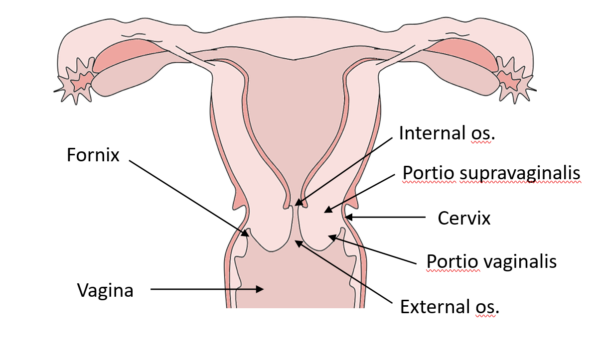
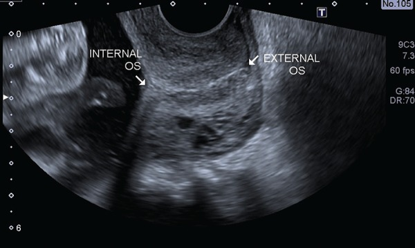
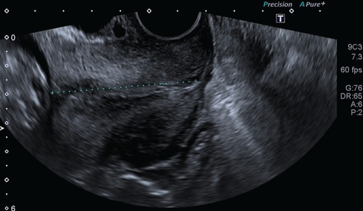
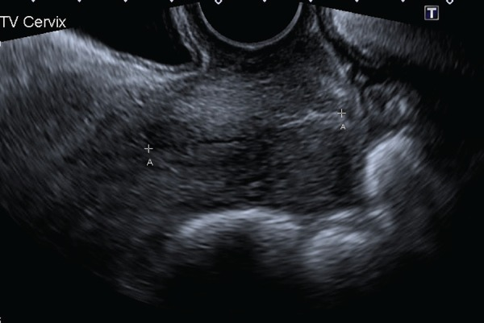
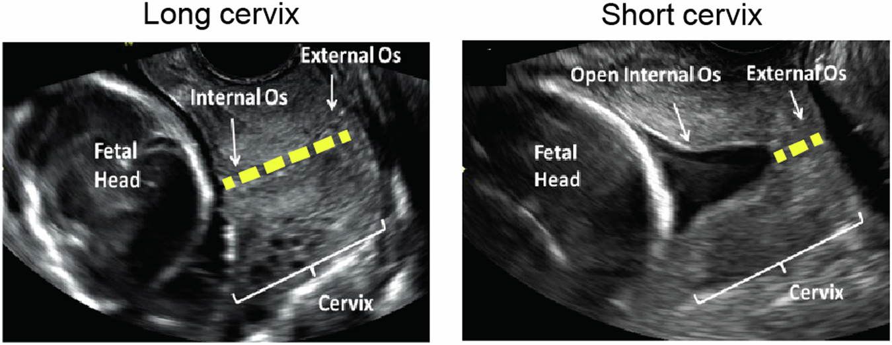
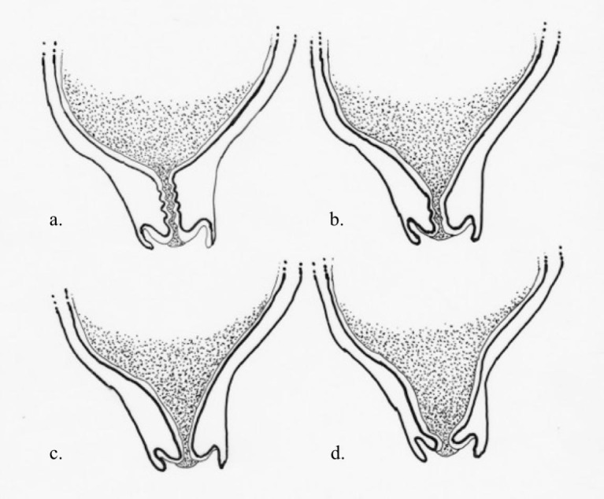
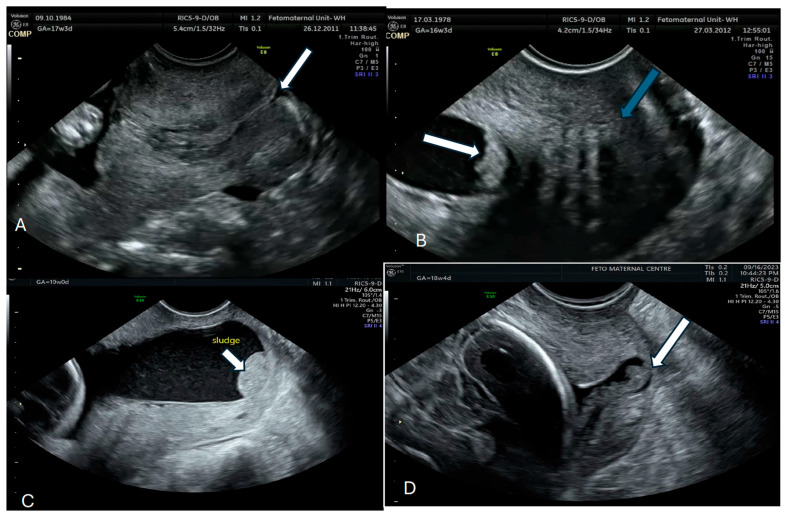
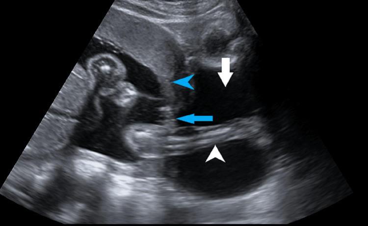
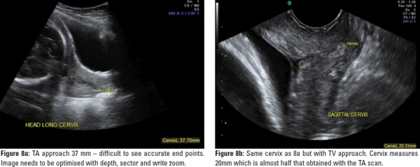

# BÀI HỌC Y KHOA: ĐO CHIỀU DÀI CỔ TỬ CUNG (TVS CL) TRONG SÀNG LỌC SINH NON
**Ngày:** 2026-11-14 | **Chuyên khoa:** Siêu âm thai — Sàng lọc sinh non | **Đối tượng:** Bác sĩ, học viên sau đại học và người học mất gốc cần học từ nền tảng

---

## 0. TỔNG QUAN — VÌ SAO BÀI NÀY QUAN TRỌNG? [CỐT LÕI]

&emsp;Sinh non là nguyên nhân hàng đầu gây tử vong chu sinh trên toàn cầu, và chiều dài cổ tử cung đo bằng siêu âm qua âm đạo là dấu hiệu dự báo mạnh nhất ở thai đơn không triệu chứng trong quý 2.

&emsp;Bài này dạy đúng một kỹ năng: đo chiều dài cổ tử cung (cervical length, CL) bằng đầu dò âm đạo (transvaginal ultrasound, TVS) cho chuẩn, đọc đúng số đo, và biết số đó dùng để sàng lọc ai, khi nào.

&emsp;Đo sai vài milimét có thể đổi hẳn quyết định: một cổ tử cung ngắn bị đo dài giả sẽ bị bỏ sót, thai phụ mất cơ hội dự phòng; một cổ tử cung bình thường bị đo ngắn giả sẽ bị can thiệp thừa.

&emsp;Bài này không dạy sâu điều trị: progesterone âm đạo, khâu vòng cổ tử cung (cerclage) và vòng nâng cổ tử cung (pessary) chỉ được nhắc tên khi cần cho diễn giải ngưỡng, chi tiết chỉ định và liều thuộc bài OB40 (Quản lý dự phòng đẻ non, doạ đẻ non) và bài OB-GAP-04 (Chọn biện pháp dự phòng sinh non).

**Mục tiêu của bài:**
- Đo đúng kỹ thuật TVS theo bảng chuẩn ISUOG: bàng quang rỗng, mặt cắt dọc giữa, đo 3 lần lấy số ngắn nhất.
- Đọc đúng ngưỡng: sàng lọc 25 mm, chẩn đoán 15 mm, tiên lượng 40 mm — và biết 3 ngưỡng này khác mục đích.
- Nhận ra phễu hóa, bùn ối và hở eo trong, biết dấu hiệu nào làm thay đổi quyết định.
- Biết sàng lọc ai, khi nào, đo lại khi nào, và khi nào phải chuyển tuyến.

&emsp;Bài này được viết từ tài liệu gốc ngày 17/06/2026 về đo chiều dài cổ tử cung trong sàng lọc sinh non, tài liệu sẽ thi.

&emsp;Mọi chi tiết đúng của tài liệu gốc đều được giữ nguyên, chỉ sắp xếp và giải thích lại cho dễ hiểu.

&emsp;Tài liệu gốc có nhiều điểm sai và lệch, từ PMID sai chủ đề tới diễn giải đảo ngược kết luận nghiên cứu.

&emsp;Mọi điểm sai đều được sửa bằng khối riêng gắn nhãn 🆕 CẬP NHẬT MỚI, tách khỏi chữ gốc, không lặng lẽ sửa chữ gốc.

&emsp;Mọi PMID sai của tài liệu gốc đã được thay bằng PMID đã xác minh, liệt kê đầy đủ ở §14.

> **TIÊU CHUẨN BẮT BUỘC — DẠY TỪ GỐC, KHÔNG GIỚI HẠN ĐỘ DÀI:** Viết để một người học mất gốc vẫn theo được. Trước khi dùng một thuật ngữ, chữ viết tắt, chỉ số, cơ quan, cơ chế, thủ thuật hoặc quyết định điều trị lần đầu, phải giải thích bằng tiếng Việt đơn giản: **nó là gì → bình thường hoạt động ra sao → vì sao bất thường này quan trọng → nhận ra bằng cách nào → làm gì tiếp theo**. Sau lần giải thích đầu tiên, mới dùng viết tắt/thuật ngữ ngắn.

### 0.1 Nền tảng tối thiểu cần dùng ngay

**Sinh non (preterm birth, PTB):** trẻ sinh trước 37 tuần thai.

**Sinh non tự phát (spontaneous preterm birth, SPTB):** sinh non khởi phát bằng chuyển dạ tự phát hoặc vỡ ối sớm, không do chỉ định y khoa.

**Cổ tử cung (cervix):** đoạn dưới của tử cung, nối buồng tử cung với âm đạo, dài khoảng 30–50 mm.

**Chiều dài cổ tử cung (cervical length, CL):** khoảng cách đo được trên siêu âm từ lỗ trong tới lỗ ngoài của cổ tử cung, tính bằng milimét.

**Lỗ trong (internal os):** đầu trên của ống cổ tử cung, nơi ống cổ tử cung gặp buồng tử cung.

**Lỗ ngoài (external os):** đầu dưới của ống cổ tử cung, nơi ống cổ tử cung mở vào âm đạo.

**Ống cổ tử cung (endocervical canal):** ống nối lỗ trong với lỗ ngoài, lót bằng niêm mạc tiết chất nhầy.

**Siêu âm qua âm đạo (transvaginal ultrasound, TVS):** siêu âm bằng đầu dò đặt trong âm đạo, cho hình cổ tử cung rõ nhất.

**Siêu âm qua bụng (transabdominal ultrasound, TA):** siêu âm bằng đầu dò đặt trên thành bụng, dùng làm bước sàng lọc sơ bộ.

**Phễu hóa (funneling):** màng ối sa vào ống cổ tử cung trên, tạo hình phễu trên siêu âm.

**Bùn ối (sludge):** chất tăng âm lơ lửng trong khoang ối gần lỗ trong, có thể là mủ, vi sinh vật, cục máu đông, vernix hoặc phân su.

**Hở eo trong:** lỗ trong mở ra khi chưa chuyển dạ, dấu hiệu của suy cổ tử cung.

**Fetal fibronectin (fFN):** một protein ở màng ối, đo trong dịch âm đạo để hỗ trợ chẩn đoán doạ đẻ non.

**Progesterone âm đạo:** hormone đặt âm đạo để dự phòng sinh non ở cổ tử cung ngắn.

**Khâu vòng cổ tử cung (cerclage):** mũi khâu quanh cổ tử cung để giữ cổ tử cung đóng.

**Vòng nâng cổ tử cung (pessary):** vòng silicon đặt quanh cổ tử cung để nâng đỡ và đổi trục cổ tử cung.

**Suy cổ tử cung (cervical insufficiency):** cổ tử cung mở ra không đau, không co, thường ở quý 2, dẫn tới sảy muộn hoặc sinh non.

### 0.2 Gánh nặng sinh non toàn cầu

&emsp;Ước tính có 13,4 triệu trẻ sinh non trong năm 2020, chiếm 9,9% tổng số ca sinh trên toàn cầu [DATA VERIFIED].

&emsp;Con số này gần như không đổi so với năm 2010, khi có 13,8 triệu trẻ sinh non, chiếm 9,8% tổng số ca sinh [DATA VERIFIED].

&emsp;Báo cáo Born Too Soon 2023 của WHO, UNICEF và PMNCH ước tính gần 1 triệu trẻ tử vong mỗi năm do biến chứng của sinh non.

&emsp;Sinh non tự phát là thể sinh non mà bài này nhắm tới: chuyển dạ tự phát hoặc vỡ ối sớm, không phải sinh non do bác sĩ chủ động lấy thai vì bệnh lý mẹ hoặc thai.

**🆕 CẬP NHẬT MỚI — Sửa số liệu dịch tễ toàn cầu của tài liệu gốc.**

&emsp;Tài liệu gốc ghi "WHO 2023, 13,4 triệu/năm, tỉ lệ khoảng 10,5%, khoảng 1 triệu tử vong" kèm một PMID sai chủ đề.

&emsp;PMID mà tài liệu gốc gắn vào đây thực tế là một bài khảo sát về phẫu thuật, đăng trên tạp chí Journal of Surgical Research năm 2023, hoàn toàn sai chủ đề.

&emsp;Số liệu đúng: 13,4 triệu ca sinh non trong năm 2020, tỉ lệ 9,9%, không phải 10,5%.

&emsp;Trích dẫn đúng là Ohuma và cộng sự 2023, đăng trên The Lancet, liệt kê ở §14.

&emsp;Con số gần 1 triệu tử vong là đúng, nhưng nguồn đúng là báo cáo Born Too Soon 2023, không phải bài báo Ohuma 2023.

### 0.3 Phân loại sinh non và vị trí của cổ tử cung ngắn

&emsp;Tổ chức Y tế Thế giới (World Health Organization, WHO) phân sinh non theo tuổi thai thành 3 nhóm.

- **Cực non (extreme preterm):** sinh trước 28 tuần.
- **Rất non (very preterm):** sinh từ 28 tuần đến trước 32 tuần.
- **Non vừa và muộn (moderate to late preterm):** sinh từ 32 tuần đến trước 37 tuần.

&emsp;Sinh non tự phát bao gồm 3 cơ chế chính, thường chồng lấp lên nhau chứ không tách biệt rạch ròi.

- **Chuyển dạ tự phát:** tử cung co và cổ tử cung mở dần mà không có nguyên nhân rõ ràng.
- **Vỡ ối sớm (preterm prelabour rupture of membranes, PPROM):** màng ối vỡ trước khi chuyển dạ.
- **Cổ tử cung ngắn hoặc suy cổ tử cung:** cổ tử cung mềm và mở sớm, không đau, không co.

&emsp;Ba cơ chế này không loại trừ nhau: một thai phụ có thể vừa cổ tử cung ngắn, vừa vỡ ối sớm, vừa có viêm trong ối.

&emsp;Mức đóng góp của từng cơ chế trong tổng số sinh non tự phát chưa được đối chiếu chắc chắn trong đợt nghiên cứu này, nên bài này không dạy các tỉ lệ đó thành số liệu.

&emsp;Điều cần nhớ là cổ tử cung ngắn không phải là toàn bộ câu chuyện sinh non, mà là mắt xích đo được sớm nhất và can thiệp được sớm nhất.

### 0.4 Sinh non ở Việt Nam

&emsp;Tỉ lệ sinh non ở Việt Nam ước tính khoảng 8–10% theo một bài báo Việt Nam công bố năm 2026.

&emsp;Báo cáo tại hội nghị của Bộ Y tế nhân ngày Thế giới Sinh non 2026 ghi nhận hơn 100.000 ca sinh non mỗi năm tại Việt Nam.

&emsp;Hai con số này là các số độc lập đã kiểm chứng được trong đợt nghiên cứu, nhưng chúng đến từ các nguồn khác nhau nên không nên gộp thành một khoảng duy nhất.

**🆕 CẬP NHẬT MỚI — Sửa quy kết số liệu Việt Nam của tài liệu gốc.**

&emsp;Tài liệu gốc ghi "tỉ lệ sinh non khoảng 7–9% theo số liệu Bộ Y tế 2022, tương đương khoảng 100.000–130.000 ca mỗi năm".

&emsp;Quy kết "Bộ Y tế 2022" chưa kiểm chứng được, và mốc trên 130.000 ca cũng chưa kiểm chứng được.

&emsp;Khoảng 7–9% là hợp lý về mặt số học, nhưng bài này chỉ dạy các số đã đối chiếu được: 8–10% theo bài báo Việt Nam 2026, và hơn 100.000 ca mỗi năm theo báo cáo hội nghị Bộ Y tế 2026.

---

## 1. GIẢI PHẪU, SINH LÝ VÀ ĐỊNH NGHĨA CỔ TỬ CUNG NGẮN [CỐT LÕI]

### 1.1 Cổ tử cung bình thường: cấu tạo và vai trò

&emsp;Cổ tử cung là một cấu trúc cơ–sợi dài khoảng 30–50 mm, nằm giữa buồng tử cung và âm đạo, đóng vai trò như một chiếc "nắp van" giữ thai trong tử cung suốt thai kỳ.

&emsp;Về thành phần, cổ tử cung gồm khoảng 80% mô liên kết, 15% cơ trơn và 5% biểu mô.

&emsp;Mô liên kết chủ yếu là collagen type I và type III, tạo độ chắc và độ đàn hồi cho cổ tử cung.

&emsp;Cơ trơn tập trung nhiều ở phần trên cổ tử cung, gần lỗ trong, giúp cổ tử cung đóng kín.

&emsp;Biểu mô lót ống cổ tử cung tiết chất nhầy, tạo nút nhầy cổ tử cung (mucus plug) ngăn vi khuẩn từ âm đạo đi lên buồng ối.

&emsp;Khi mang thai, cổ tử cung phải làm 2 việc trái ngược nhau: giữ thật chặt trong nhiều tháng, rồi mở hoàn toàn trong vài giờ khi chuyển dạ.

&emsp;Chính vì vậy, cổ tử cung không phải là một ống cứng cố định, mà là một cấu trúc sống, liên tục thay đổi thành phần mô trong suốt thai kỳ.



*Chú thích: sơ đồ giải phẫu cổ tử cung không mang thai (Geeky Medics, © Geeky Medics, chỉ dùng nội bộ) — không vẽ nút nhầy, đoạn dưới tử cung hay túi ối; phần chữ của bài dạy các cấu trúc này bằng lời.*

### 1.2 Bốn giai đoạn remodeling theo Word 2007

&emsp;Quá trình thay đổi mô liên kết của cổ tử cung trong thai kỳ diễn ra theo 4 giai đoạn: mềm hóa, chín, mở và phục hồi [ABSTRACT VERIFIED].

&emsp;Giai đoạn 1 là mềm hóa (softening): bắt đầu từ tháng đầu thai kỳ, tỉ lệ proteoglycan tăng lên, liên kết chéo collagen giảm xuống.

&emsp;Giai đoạn 2 là chín (ripening): bắt đầu từ tháng 6–7, tỉ lệ hyaluronan và elastin tăng, tế bào viêm tập trung về cổ tử cung.

&emsp;Giai đoạn 3 là mở (dilation): xảy ra khi chuyển dạ thực sự, men COX-2 tăng, prostaglandin tăng.

&emsp;Giai đoạn 4 là phục hồi (repair): xảy ra sau sinh, cổ tử cung tái tạo lại mô liên kết.

&emsp;Điểm mấu chốt là chín cổ tử cung xảy ra trước cơn co tử cung của chuyển dạ nhiều tuần, vì vậy sinh non ở người là một quá trình kéo dài, còn cơn co chỉ là sự kiện muộn trong quá trình đó [ABSTRACT VERIFIED].

> "Cervical ripening precedes myometrial contractions of labor by several weeks, suggesting that parturition in women is a process of long duration and that uterine contractions of labor are late events in the parturition process."

&emsp;Câu trích trên giải thích vì sao đo chiều dài cổ tử cung có giá trị dự báo: cổ tử cung bắt đầu ngắn lại từ nhiều tuần trước khi cơn co xuất hiện, nên đo sớm sẽ bắt được quá trình này khi vẫn còn thời gian can thiệp.

&emsp;Ngược lại, nếu chờ tới khi có cơn co mới đo thì đã muộn: cổ tử cung đã mở, quyết định lúc đó chỉ còn là xử trí cấp cứu, không còn là dự phòng.

### 1.3 Định nghĩa cổ tử cung ngắn

&emsp;Cổ tử cung ngắn (short cervix) được định nghĩa là chiều dài cổ tử cung từ 25 mm trở xuống ở tuổi thai 18–24 tuần, đo bằng siêu âm qua âm đạo [GUIDELINE VERIFIED].

&emsp;Ngưỡng này là ngưỡng sàng lọc và can thiệp, không phải ngưỡng chẩn đoán bệnh: dưới 25 mm nghĩa là cần hành động, không có nghĩa là thai phụ chắc chắn sẽ sinh non.

&emsp;Cổ tử cung dưới 15 mm được coi là nguy cơ rất cao, vì nhóm này tập trung phần lớn ca sinh non sớm.

&emsp;Cổ tử cung từ 35 mm trở lên thường được coi là bình thường, nguy cơ sinh non thấp.

&emsp;Cổ tử cung 25–34 mm là vùng trung gian: không đủ ngắn để can thiệp ngay, nhưng cũng không đủ dài để yên tâm hoàn toàn, cần đánh giá nguy cơ nền và theo dõi.

&emsp;Cách phân tầng này là cách dạy của tài liệu gốc, giữ nguyên dạng định tính, vì các tỉ lệ nguy cơ gắn với từng tầng chưa được đối chiếu trong đợt nghiên cứu này.

### 1.4 Chuỗi cơ chế A — Remodeling sớm dẫn tới cổ tử cung ngắn rồi sinh non

&emsp;Chuỗi này giải thích vì sao một cổ tử cung bình thường lại ngắn dần và mở sớm, dù thai phụ không hề đau bụng hay ra máu.

- **Tầng 1 — Phân tử:** Proteoglycan và hyaluronan tăng sớm, liên kết chéo collagen giảm sớm, men phân hủy mô liên kết (matrix metalloproteinase, MMP) hoạt hóa sớm.
- **Tầng 2 — Tế bào và mô:** Sợi collagen bị cắt ngắn và sắp xếp lộn xộn, tế bào viêm xâm nhập mô cổ tử cung, mô liên kết mất độ chắc.
- **Tầng 3 — Cơ quan:** Cổ tử cung mềm ra, ngắn lại và mở dần từ lỗ trong xuống lỗ ngoài, nút nhầy mất dần.
- **Tầng 4 — Quyết định:** Đo TVS thấy chiều dài cổ tử cung giảm dần qua các lần đo, hoặc đã dưới 25 mm ở lần đo đầu tiên.
- **Tầng 5 — Hậu quả nếu bỏ sót:** Màng ối sa xuống, vỡ ối sớm hoặc chuyển dạ tự phát, trẻ sinh non với biến chứng hô hấp và thần kinh.

```text
Collagen chắc + ít proteoglycan ──→ proteoglycan tăng sớm ──→ MMP hoạt hóa ──→ collagen bị cắt ngắn ──→ cổ tử cung mềm
```

```text
Cổ tử cung mềm ──→ ngắn dần trên siêu âm ──→ lỗ trong mở ──→ màng ối sa xuống ──→ vỡ ối sớm hoặc chuyển dạ tự phát
```

&emsp;Chuỗi này cho thấy đo chiều dài cổ tử cung không phải là đo một con số tĩnh, mà là chụp lại một quá trình đang diễn ra.

&emsp;Một lần đo duy nhất chỉ cho biết cổ tử cung đang ở đâu trên đường đi xuống, còn đo nối tiếp mới cho biết nó đang đi xuống nhanh hay chậm.

**Ví dụ 1:** Thai phụ 20 tuần, lần đo đầu 30 mm, 2 tuần sau đo lại còn 24 mm.

&emsp;Tốc độ ngắn 6 mm trong 2 tuần cho thấy quá trình remodeling đang chạy nhanh, dù con số 24 mm mới chỉ vừa chạm ngưỡng.

&emsp;Trường hợp này cần đo lại sớm hơn lịch thường và chuyển tuyến sớm hơn một thai phụ có chiều dài cổ tử cung ổn định 24 mm qua nhiều lần đo.

### 1.5 Chuỗi cơ chế B — Viêm và kích hoạt màng rụng làm chín cổ tử cung sớm

&emsp;Chuỗi này giải thích con đường viêm, là con đường phổ biến nhất dẫn tới sinh non tự phát.

- **Tầng 1 — Phân tử:** Vi khuẩn hoặc tín hiệu nguy hiểm kích hoạt tế bào miễn dịch, giải phóng các cytokine viêm như TNFα, IL-1β, IL-6 và IL-8 trong dịch âm đạo và màng rụng.
- **Tầng 2 — Tế bào và mô:** Cytokine kích hoạt men COX-2, tăng tổng hợp prostaglandin, đồng thời kích hoạt MMP phân hủy collagen cổ tử cung.
- **Tầng 3 — Cơ quan:** Cổ tử cung chín sớm và ngắn lại, màng ối yếu đi, tử cung bắt đầu co.
- **Tầng 4 — Quyết định:** Đo TVS thấy cổ tử cung ngắn kèm bùn ối, hoặc cổ tử cung ngắn kèm tiền sử sảy quý 2, gợi ý có nhiễm trùng trong ối đi kèm.
- **Tầng 5 — Hậu quả nếu bỏ sót:** Nhiễm trùng lan lên buồng ối, vỡ ối sớm, sinh non, trẻ nhiễm trùng huyết sơ sinh.

```text
Vi khuẩn hoặc tín hiệu nguy hiểm ──→ cytokine viêm tăng ──→ COX-2 tăng ──→ prostaglandin tăng ──→ cổ tử cung chín sớm
```

```text
Cổ tử cung chín sớm ──→ ngắn lại trên siêu âm ──→ màng ối yếu ──→ vỡ ối sớm ──→ sinh non kèm nhiễm trùng
```

&emsp;Chuỗi viêm giải thích vì sao bùn ối là dấu hiệu quan trọng đi kèm cổ tử cung ngắn, và vì sao nhiễm trùng trong ối làm tiên lượng xấu hơn nhiều so với cổ tử cung ngắn đơn thuần.

&emsp;Các cytokine kể trên được ghi nhận tăng cao trong dịch âm đạo của thai phụ sinh non theo một tổng quan về viêm trong sinh non, tuy nhiên bài này dạy ở mức cơ chế định tính, không gắn số liệu cụ thể vì chưa đối chiếu từng số trong đợt nghiên cứu này.

### 1.6 Yếu tố làm cổ tử cung ngắn

&emsp;Yếu tố cơ học là nhóm rõ ràng nhất: đa thai, đa ối, u xơ tử cung to hoặc dị tật tử cung đều làm tăng áp lực lên cổ tử cung từ phía trên.

&emsp;Tiền sử can thiệp cổ tử cung cũng làm yếu cấu trúc: khoét chóp (LEEP), cắt hình nón (cone biopsy) hoặc nong cổ tử cung nhiều lần đều thay mô sợi chắc bằng mô sẹo yếu.

&emsp;Tiền sử phơi nhiễm diethylstilbestrol (DES) từ thời bào thai và dị tật tử cung bẩm sinh thuộc nhóm cổ tử cung ngắn bẩm sinh, ít gặp nhưng nguy cơ cao.

&emsp;Đa hình gen collagen như COL1A1 và COL5A1 đang được nghiên cứu như yếu tố nguy cơ di truyền, chưa có gen đơn nào được xác nhận là nguyên nhân chắc chắn.

&emsp;Progesterone duy trì cổ tử cung đóng trong thai kỳ, nên thiếu progesterone hoặc giảm đáp ứng với progesterone được cho là một cơ chế góp phần làm chín cổ tử cung sớm.

**🆕 CẬP NHẬT MỚI — Đa hình thụ thể beta-2 không phải yếu tố nguy cơ.**

&emsp;Tài liệu gốc liệt kê đa hình gen thụ thể beta-2 adrenergic (beta-2 adrenoceptor polymorphism) như một yếu tố nguy cơ di truyền của cổ tử cung ngắn.

&emsp;Nghiên cứu Miller 2015 là một nghiên cứu âm tính: kiểu gen thụ thể beta-2 không liên quan tới cổ tử cung ngắn, cũng không liên quan tới sinh non sau khi đã xác định cổ tử cung ngắn.

&emsp;Nghiên cứu này so sánh 315 thai phụ cổ tử cung ngắn với 124 thai phụ cổ tử cung bình thường, và không thấy khác biệt có ý nghĩa ở cả 2 vị trí acid amin được xét nghiệm.

&emsp;Kết luận đúng là không nên dạy đa hình thụ thể beta-2 như một yếu tố nguy cơ, và không dùng nó để giải thích vì sao một thai phụ có cổ tử cung ngắn.

### Checkpoint 1 — Tự kiểm tra: giải phẫu và sinh lý

- Câu 1: Thành phần chính của cổ tử cung là gì, và thành phần này có vai trò gì?
- Câu 2: Vì sao chín cổ tử cung xảy ra trước cơn co nhiều tuần lại làm cho đo chiều dài cổ tử cung có giá trị dự báo?

*(Đáp án: Câu 1 — khoảng 80% mô liên kết, chủ yếu là collagen type I và type III, tạo độ chắc và độ đàn hồi. Câu 2 — vì cổ tử cung bắt đầu ngắn lại từ nhiều tuần trước khi cơn co xuất hiện, nên đo sớm sẽ bắt được quá trình này khi vẫn còn thời gian can thiệp.)*

---

## 2. KỸ THUẬT ĐO TVS CHUẨN [CỐT LÕI]

### 2.1 Chuẩn bị

&emsp;Bàng quang phải rỗng trước khi đo, vì bàng quang đầy làm cổ tử cung dài giả tạo và che khuất lỗ trong.

&emsp;Thai phụ nằm nửa ngồi, chân dạng ra, tư thế này giúp đầu dò vào đúng trục âm đạo mà không phải ép mạnh.

&emsp;Dùng đầu dò âm đạo tần số cao, thường 5–9 MHz, bọc bằng bao dùng một lần, bôi gel cả 2 mặt của bao và chú ý loại hết bọt khí.

&emsp;Bọt khí trong gel tạo vệt tăng âm giả, có thể che mất đường đi của ống cổ tử cung.

&emsp;Đặt đầu dò nhẹ nhàng vào cùng đồ trước, dùng áp lực nhẹ vừa đủ để nhận diện cấu trúc, rồi giảm áp lực xuống mức tối thiểu trước khi đo.

&emsp;Ép đầu dò quá mạnh là một trong những lỗi phổ biến nhất, vì áp lực làm cổ tử cung dài ra giả tạo.

**🆕 CẬP NHẬT MỚI — "Chờ 30 giây" chưa kiểm chứng được.**

&emsp;Tài liệu gốc ghi "đặt nhẹ vào âm đạo, chờ 30 giây để cổ tử cung không bị ép".

&emsp;Con số 30 giây không có trong bảng kỹ thuật chuẩn của ISUOG 2022.

&emsp;ISUOG chỉ yêu cầu dùng áp lực nhẹ để nhận diện cấu trúc rồi giảm tối thiểu, và dành đủ thời gian để quan sát thay đổi động của cổ tử cung.

&emsp;Bài này không dạy "chờ 30 giây" như một bước chuẩn, mà dạy nguyên tắc: đặt nhẹ, giảm áp lực, quan sát đủ lâu trước khi đo.

### 2.2 Mặt cắt dọc giữa và cấu trúc bắt buộc thấy

&emsp;Mặt cắt chuẩn là mặt cắt dọc giữa (sagittal) của cổ tử cung, trong đó thấy đồng thời ống cổ tử cung, lỗ trong và lỗ ngoài.

&emsp;Bốn cấu trúc bắt buộc phải thấy rõ là bờ dưới bàng quang, lỗ ngoài, ống cổ tử cung cùng niêm mạc, và lỗ trong được giới hạn bởi mép niêm mạc.

&emsp;Hai môi cổ tử cung phải có độ rộng bằng nhau, nếu một môi dày hơn hẳn môi còn lại thì mặt cắt đang bị chéo, chưa phải mặt cắt dọc giữa thật sự.

&emsp;Cổ tử cung phải chiếm 50–75% màn hình, đủ lớn để đặt caliper chính xác nhưng vẫn thấy được bối cảnh xung quanh [FULL TEXT VERIFIED].

**🆕 CẬP NHẬT MỚI — Phóng to để cổ tử cung chiếm 50–75% màn hình, không phải khoảng 75%.**

&emsp;Tài liệu gốc ghi "phóng to để cổ tử cung chiếm khoảng 75% màn hình".

&emsp;Bảng kỹ thuật chuẩn của ISUOG 2022 ghi cổ tử cung chiếm 50–75% màn hình.

&emsp;Con số 75% chỉ là mốc trên của khoảng, dùng một mình nó làm chuẩn sẽ khiến người đo phóng quá to và mất bối cảnh.



*Chú thích: siêu âm TVS mặt cắt dọc giữa chuẩn, lỗ trong và lỗ ngoài có nhãn (AJUM 2013, PMC5029998, Hình 1, © ASUM, chỉ dùng nội bộ) — không có đường caliper đo, đường đo ở ảnh số 3.*

### 2.3 Đặt caliper và đo 3 lần lấy số ngắn nhất

&emsp;Caliper được đặt giữa lỗ trong chức năng và lỗ ngoài, theo một đường thẳng duy nhất.

&emsp;Lỗ trong chức năng là điểm mà màng ối bắt đầu tách khỏi thành ống cổ tử cung, khác với lỗ trong giải phẫu khi có phễu hóa.

&emsp;Đo 3 lần riêng biệt, mỗi lần đặt lại caliper từ đầu, rồi lấy số ngắn nhất trong 3 lần đo đúng kỹ thuật [FULL TEXT VERIFIED].

&emsp;Quy tắc lấy số ngắn nhất có lý do rõ ràng: cổ tử cung chỉ có thể bị đo dài giả do ép đầu dò hoặc bàng quang đầy, chứ không thể bị đo ngắn giả nếu kỹ thuật đúng.

&emsp;Vì vậy số ngắn nhất là số gần với chiều dài thật nhất, còn số dài nhất thường là số bị nhiễu.

&emsp;Dành đủ thời gian để quan sát thay đổi động của cổ tử cung, thường khoảng 3–5 phút cho một lần đo hoàn chỉnh, vì cổ tử cung có thể ngắn lại tạm thời khi có cơn co.



*Chú thích: siêu âm TVS với caliper đo từ lỗ trong tới lỗ ngoài (AJUM 2013, PMC5029998, Hình 7, © ASUM, chỉ dùng nội bộ) — ảnh chỉ thể hiện 1 lần đo, quy tắc đo 3 lần lấy ngắn nhất nằm trong chữ của bài.*

### 2.4 Ghi nhận thêm ngoài chiều dài

&emsp;Ngoài con số chiều dài, người đo phải ghi nhận phễu hóa nếu có, vì phễu hóa làm thay đổi diễn giải và theo dõi.

&emsp;Ghi nhận mảnh vụn trong ối (debris) và bùn ối (sludge), vì 2 dấu hiệu này gợi ý nhiễm trùng trong ối đi kèm.

&emsp;Ghi nhận tách màng ối, vì tách màng làm tăng nguy cơ vỡ ối sớm và sinh non.

&emsp;Ghi nhận vasa previa, nhau bám thấp và nhau cài răng lược bất thường, vì đây là các phát hiện tình cờ quan trọng trong cùng một lần siêu âm.

&emsp;Ghi nhận đầy đủ các dấu hiệu kèm giúp lần đo sau có cái để so sánh, thay vì chỉ so sánh một con số chiều dài đơn độc.

### 2.5 Phân biệt cổ tử cung thật với đoạn dưới tử cung

&emsp;Bẫy lớn nhất khi đo là nhầm đoạn dưới tử cung với cổ tử cung thật, vì đoạn dưới tử cung khi dày lên trông rất giống ống cổ tử cung trên siêu âm.

&emsp;Đoạn dưới tử cung dày hoặc một cơn co tử cung có thể tạo hình giả phễu hóa, khiến người đo tưởng lỗ trong đã mở trong khi thực tế chưa mở.

&emsp;Cách tránh là nhận diện đúng niêm mạc cổ tử cung: ống cổ tử cung thật có niêm mạc tăng âm rõ, chạy liên tục từ lỗ trong tới lỗ ngoài.

&emsp;Đừng nhầm chất nhầy cổ tử cung với phễu hóa: chất nhầy là vệt tăng âm nằm trong ống, còn phễu hóa là màng ối sa vào ống từ phía trên.

&emsp;Muốn phân biệt, hãy vạch rõ đường đi của màng ối ở mức lỗ trong: màng ối sa xuống tạo thành phễu, chất nhầy thì không làm màng ối di chuyển.



*Chú thích: siêu âm TVS co thắt đoạn dưới tử cung, lỗ trong xác định nhờ mô tuyến cổ tử cung (AJUM 2013, PMC5029998, Hình 10, © ASUM, chỉ dùng nội bộ).*

### 2.6 Chất lượng hình ảnh theo CLEAR

&emsp;Chương trình Cervical Length Education and Review (CLEAR) là một trong 2 khóa chuẩn được ISUOG công nhận, cùng với chứng chỉ của Fetal Medicine Foundation [FULL TEXT VERIFIED].

&emsp;CLEAR chấm hình ảnh theo 9 tiêu chí, không phải 4 tiêu chí như tài liệu gốc ghi.

&emsp;Một loạt ảnh được coi là đạt khi thỏa ít nhất 7 trong 9 tiêu chí, điểm tổng từ 80% trở lên, đặt caliper đúng ở mọi ảnh, và không bỏ sót cùng một tiêu chí lặp lại [ABSTRACT VERIFIED].

&emsp;Nghiên cứu Boelig 2017 đánh giá dữ liệu chương trình CLEAR từ 687 ứng viên nộp 3.748 ảnh, trong đó 85% là kỹ thuật viên siêu âm [ABSTRACT VERIFIED].

&emsp;Kết quả cho thấy 105 trong 687 loạt ảnh đầu, tức 15%, không đạt chuẩn.

&emsp;Trong tổng số ảnh, 837 ảnh, tức 22%, trượt ít nhất 1 tiêu chí.

&emsp;Lỗi thường gặp nhất là chiều rộng môi trước bằng môi sau chiếm 33%, không thấy được lỗ trong hoặc lỗ ngoài chiếm 29%, cổ tử cung chiếm 75% màn hình kèm vùng bàng quang chiếm 33%, và đặt caliper sai chiếm 24% [ABSTRACT VERIFIED].

&emsp;Ngoài ra, 256 ảnh, tức 7%, không đạt tiêu chí thu nhận hình đầy đủ.

&emsp;Kết luận quan trọng là 15% người đo đã qua đào tạo vẫn không thu được hình đạt chuẩn, nhấn mạnh vai trò của đào tạo và chứng nhận chuẩn hóa.

**🆕 CẬP NHẬT MỚI — Sửa tiêu chí và tỉ lệ đạt chuẩn của CLEAR.**

&emsp;Tài liệu gốc ghi 4 tiêu chí và kết luận "chỉ 35–55% hình ảnh đạt chuẩn".

&emsp;CLEAR có 9 tiêu chí, và con số 35–55% không có trong bản tóm tắt của nghiên cứu Boelig 2017.

&emsp;Số đúng từ bản tóm tắt là 15% ứng viên trượt loạt ảnh đầu, 22% ảnh trượt ít nhất 1 tiêu chí, và 7% ảnh không đạt tiêu chí thu nhận hình đầy đủ.

### 2.7 Chuỗi cơ chế C — Đo sai kỹ thuật dẫn tới quyết định sai

&emsp;Chuỗi này cho thấy một lỗi kỹ thuật nhỏ ở đầu dò có thể lan thành một quyết định lâm sàng sai ở cuối đường.

- **Tầng 1 — Kỹ thuật:** Bàng quang đầy hoặc đầu dò ép quá mạnh, mặt cắt bị chéo, caliper đặt sai vị trí lỗ trong.
- **Tầng 2 — Hình ảnh:** Cổ tử cung hiện dài hơn thật, hoặc lỗ trong giả tạo, hoặc phễu hóa giả do đoạn dưới tử cung dày.
- **Tầng 3 — Số đo:** Chiều dài cổ tử cung ghi nhận cao hơn chiều dài thật, có khi chênh tới vài milimét.
- **Tầng 4 — Quyết định:** Thai phụ có cổ tử cung ngắn thật bị xếp vào nhóm bình thường, không được dự phòng, không được đo lại sớm.
- **Tầng 5 — Hậu quả nếu bỏ sót:** Quá trình ngắn cổ tử cung tiếp tục âm thầm, vỡ ối sớm hoặc chuyển dạ tự phát xảy ra mà không ai can thiệp trước.

```text
Bàng quang đầy hoặc ép đầu dò ──→ cổ tử cung dài giả ──→ số đo cao hơn thật ──→ xếp nhầm nhóm bình thường ──→ bỏ sót dự phòng
```

```text
Mặt cắt chéo hoặc caliper sai ──→ lỗ trong giả ──→ phễu hóa giả ──→ can thiệp thừa ──→ lo lắng và chi phí không cần thiết
```

&emsp;Chuỗi này có 2 hướng sai đối ngược nhau: đo dài giả gây bỏ sót, đo ngắn giả gây can thiệp thừa.

&emsp;Cả 2 hướng đều bắt đầu từ kỹ thuật, nên cách phòng tránh duy nhất là đo đúng ngay từ đầu, chứ không phải sửa số đo sau khi đã đo sai.

**Ví dụ 2:** Thai phụ 22 tuần, lần đo đầu 28 mm khi bàng quang đầy, sau khi đi tiểu đo lại còn 23 mm.

&emsp;Chênh lệch 5 mm này đủ để đổi nhóm từ trung gian sang nhóm cần can thiệp, và nguyên nhân chỉ là bàng quang.

&emsp;Ví dụ này cho thấy vì sao bàng quang rỗng là bước chuẩn bị bắt buộc, không phải bước tùy chọn.

### 2.8 Chứng nhận và người đo

&emsp;ISUOG yêu cầu chỉ đo chiều dài cổ tử cung khi người đo đã quen thuộc với kỹ thuật được khuyến cáo [FULL TEXT VERIFIED].

&emsp;Hai khóa chuẩn được công nhận là chứng chỉ năng lực đánh giá cổ tử cung của Fetal Medicine Foundation và chương trình CLEAR.

&emsp;NICE NG25 cũng yêu cầu siêu âm đo chiều dài cổ tử cung phải do nhân viên y tế được đào tạo và có kinh nghiệm về đo chiều dài cổ tử cung qua âm đạo thực hiện [FULL TEXT VERIFIED].

&emsp;Tỉ lệ chấp nhận siêu âm qua âm đạo rất cao khi được tư vấn tốt: 99,9% trong một nghiên cứu quần thể 17.609 ca [FULL TEXT VERIFIED].

&emsp;Con số này quan trọng khi tư vấn thai phụ từ chối đo qua âm đạo: đa số thai phụ chấp nhận sau khi được giải thích, và từ chối thường xuất phát từ lo lắng chứ không phải từ trải nghiệm thực tế.

### Checkpoint 2 — Tự kiểm tra: kỹ thuật đo

- Câu 1: Vì sao phải đo 3 lần và lấy số ngắn nhất, thay vì lấy trung bình 3 lần đo?
- Câu 2: Bàng quang đầy làm chiều dài cổ tử cung dài giả hay ngắn giả, và vì sao?

*(Đáp án: Câu 1 — vì cổ tử cung chỉ có thể bị đo dài giả do ép đầu dò hoặc bàng quang đầy, nên số ngắn nhất gần với chiều dài thật nhất. Câu 2 — dài giả, vì bàng quang đầy chèn ép và kéo dài cổ tử cung trên hình siêu âm.)*

---

## 3. NGƯỠNG, DIỄN GIẢI VÀ CHẨN ĐOÁN CỔ TỬ CUNG NGẮN [CỐT LÕI]

> 🚨 **BOX ĐỎ — ĐỪNG NHẦM 3 NGƯỠNG VỚI NHAU:** Cổ tử cung từ 25 mm trở xuống trước 24 tuần là ngưỡng sàng lọc và can thiệp, phải hành động. Ngưỡng 15 mm chỉ dùng để chẩn đoán doạ đẻ non từ 30 tuần trở lên, không dùng để sàng lọc ở 18–24 tuần. Ngưỡng 40 mm là điểm bão hòa tiên lượng, không phải ngưỡng can thiệp. Nhầm 3 ngưỡng này với nhau là lỗi nguy hiểm nhất của bài này.

### 3.1 Ngưỡng sàng lọc 25 mm

&emsp;ISUOG 2022 nêu rõ chiều dài cổ tử cung từ 25 mm trở xuống có thể dùng làm ngưỡng bắt đầu các biện pháp dự phòng sinh non ở thai đơn không triệu chứng, bất kể yếu tố nguy cơ [GUIDELINE VERIFIED].

&emsp;SMFM Consult Series #70 năm 2024 cũng dùng chiều dài cổ tử cung giữa quý 2 từ 25 mm trở xuống để chẩn đoán cổ tử cung ngắn ở thai đơn không có tiền sử sinh non tự phát [ABSTRACT VERIFIED].

&emsp;ISUOG phân tích tỉ lệ lợi và nguy cơ và kết luận ngưỡng 25 mm tốt hơn ngưỡng 20 mm hoặc 15 mm, vì bỏ lỡ cơ hội can thiệp nguy hiểm hơn điều trị thừa progesterone tự nhiên, vốn ít hoặc không có nguy cơ [FULL TEXT VERIFIED].

&emsp;Ngưỡng 25 mm không phải là ranh giới sinh học tuyệt đối: nguy cơ tăng dần theo từng milimét, và 25 mm chỉ là điểm mà lợi ích can thiệp bắt đầu vượt rõ chi phí và nguy cơ.

&emsp;Vì vậy, một thai phụ có chiều dài cổ tử cung 26 mm không phải là "an toàn tuyệt đối", và một thai phụ có chiều dài 24 mm cũng không phải là "chắc chắn sinh non".

### 3.2 Tách tầng theo SMFM: 20 mm và 21–25 mm

&emsp;SMFM #70 tách riêng 2 tầng trong nhóm cổ tử cung ngắn, vì lợi ích của progesterone khác nhau giữa 2 tầng này.

&emsp;Thai đơn không triệu chứng, chiều dài cổ tử cung qua âm đạo từ 20 mm trở xuống trước 24 tuần thì kê progesterone âm đạo, mức khuyến cáo GRADE 1A, tức khuyến cáo mạnh với bằng chứng chất lượng cao [ABSTRACT VERIFIED].

&emsp;Chiều dài cổ tử cung 21–25 mm thì cân nhắc progesterone theo quyết định chia sẻ với thai phụ, mức khuyến cáo GRADE 1B [ABSTRACT VERIFIED].

&emsp;Sự khác biệt giữa 2 tầng này phản ánh bằng chứng: lợi ích rõ nhất ở tầng dưới 20 mm, còn tầng 21–25 mm lợi ích nhỏ hơn và cần cân nhắc nguyện vọng thai phụ.

&emsp;Bài này chỉ dạy ngưỡng và mức khuyến cáo, còn liều dùng và chỉ định chi tiết của progesterone thuộc bài OB40 và OB-GAP-04.

**🆕 CẬP NHẬT MỚI — Bảng nguy cơ theo tầng của tài liệu gốc chưa kiểm chứng được.**

&emsp;Tài liệu gốc ghi bảng nguy cơ sinh non theo tầng chiều dài cổ tử cung: từ 35–40 mm trở lên 1–2%, 25–34 mm 5–10%, 15–24 mm 20–40%, dưới 15 mm 40–60%.

&emsp;Bảng này không gắn PMID nào, và chưa đối chiếu được trong đợt nghiên cứu này.

&emsp;Bài này không dạy các tỉ lệ đó thành số liệu đã kiểm chứng, mà chỉ dạy phân tầng định tính: thấp, trung bình, cao và rất cao.

&emsp;Người học cần nhớ các tầng này là công cụ dạy học, không phải xác suất cá nhân của từng thai phụ.



*Chú thích: 2 panel cùng 1 hình, cổ tử cung dài và cổ tử cung ngắn (npj Women's Health 2025, Hình 1, CC BY-NC-ND 4.0, dùng nguyên trạng) — panel ngắn đồng thời bị phễu hóa, không in số mm.*

### 3.3 Đường cong L-shape Hughes 2026: ngưỡng tiên lượng 40 mm

&emsp;Nghiên cứu Hughes 2026 là phân tích gộp dữ liệu cá nhân (individual participant data meta-analysis, IPDMA) lớn nhất về chiều dài cổ tử cung và sinh non tự phát ở thai đơn.

&emsp;Nghiên cứu thu thập dữ liệu cá nhân của 27 nghiên cứu đủ điều kiện, tổng cộng 91.404 thai phụ đơn thai, từ 12 quốc gia, giai đoạn 2001–2019 [FULL TEXT VERIFIED].

**🆕 CẬP NHẬT MỚI — Sửa cỡ mẫu IPDMA đơn thai: 91.404, không phải 91.204.**

&emsp;Tài liệu gốc ghi "27 datasets, 91.204 singleton".

&emsp;Cỡ mẫu phân tích đúng là 91.404 thai phụ, ghi rõ trong bản tóm tắt của nghiên cứu.

&emsp;Con số 91.204 là tử số trong câu "50,7% (91.204/179.886)" ở phần thảo luận của bài báo, không phải cỡ mẫu phân tích.

&emsp;Tài liệu gốc còn viết "(179.886 từ 183.903 tổng)" là gộp 2 mẫu số khác nhau từ 2 đoạn khác nhau của bài báo, nên bài này không dạy câu đó.

&emsp;Chiều dài cổ tử cung trung bình là 40 mm, độ lệch chuẩn 9 mm, đo ở khoảng 20 tuần thai.

&emsp;Sinh non tự phát trước 37 tuần xảy ra ở 4.442 ca, chiếm 5,2%, và trước 34 tuần ở 1.420 ca, chiếm 1,6%.

&emsp;Tuổi thai đo trung bình là 20,3 tuần, độ lệch chuẩn 1,6 tuần, và 55% thai phụ là con so, tương đương 46.195 người.

&emsp;Tối đa 12,2% thai phụ, tương đương 11.128 người, đã nhận điều trị dự phòng trước khi đo.

&emsp;Kết quả chính so với chiều dài cổ tử cung 40 mm: ở 20 mm, tỉ số odds (odds ratio, OR) là 6,22, khoảng tin cậy 95% từ 4,76 đến 8,13; ở 30 mm, OR là 2,10, khoảng tin cậy 95% từ 1,85 đến 2,38 [DATA VERIFIED].

&emsp;Trích nguyên văn từ bản tóm tắt: cổ tử cung càng dài thì odds sinh non tự phát càng giảm mạnh cho tới khi đạt 40 mm, sau đó odds trở nên ổn định.

&emsp;Hạn chế quan trọng mà tài liệu gốc không nhắc: nghiên cứu chỉ thu được 50,7% dữ liệu cá nhân đủ điều kiện, chỉ 3 trong 27 nghiên cứu được đánh giá nguy cơ bias thấp tổng thể, và 11 trong 26 nghiên cứu có nguy cơ bias cao [FULL TEXT VERIFIED].

&emsp;Kết luận của tác giả là cổ tử cung càng ngắn thì nguy cơ sinh non tự phát càng tăng dần khi chiều dài dưới 40 mm, nhưng khả năng sinh đủ tháng là cao khi chiều dài cổ tử cung trên 40 mm.

```text
CL 40 mm: điểm bão hòa ──→ trên 40 mm, nguy cơ gần như không đổi
CL 30 mm: OR 2,10 ──→ nguy cơ tăng gấp đôi so với 40 mm
CL 20 mm: OR 6,22 ──→ nguy cơ tăng hơn 6 lần so với 40 mm
CL 10 mm: nguy cơ tăng rất mạnh ──→ đường cong dựng đứng
```

&emsp;Các số OR ở các mốc khác trên đường cong chỉ được đọc từ hình đường cong spline, chưa đối chiếu từ bản tóm tắt, nên bài này ghi rõ nhãn [NGOÀI ABSTRACT].

&emsp;Theo đường cong spline, OR khoảng 1,4 ở 35 mm, khoảng 3,5 ở 25 mm, khoảng 10 ở 15 mm và khoảng 18 ở 10 mm, tất cả đều là số đọc ước lượng từ hình, không phải số trích từ bản tóm tắt [NGOÀI ABSTRACT].

&emsp;Các số này chỉ dùng để hình dung độ dốc của đường cong, không dùng để tính xác suất cá nhân cho từng thai phụ.

**🆕 CẬP NHẬT MỚI — 40 mm là ngưỡng tiên lượng, không phải ngưỡng "bình thường" mới.**

&emsp;Tài liệu gốc viết "ngưỡng bình thường từ 25 mm trở lên thành 35–40 mm theo Hughes 2026" và "ngưỡng bình thường mới nên là 40 mm".

&emsp;Hughes 2026 chỉ mô tả quan hệ tiên lượng: dưới 40 mm nguy cơ tăng dần, trên 40 mm nguy cơ ổn định.

&emsp;Nghiên cứu này không khuyến cáo đổi ngưỡng "bình thường" hay ngưỡng can thiệp, và không khuyến cáo can thiệp ở nhóm 25–40 mm.

&emsp;Dạy "dưới 40 mm là bệnh" là diễn giải quá đà, vì đa số thai phụ có chiều dài cổ tử cung 25–40 mm vẫn sinh đủ tháng.

**🆕 CẬP NHẬT MỚI — Số liệu phân nhóm và kết cục phụ của Hughes chưa đối chiếu được.**

&emsp;Tài liệu gốc ghi phân nhóm tiền sử phẫu thuật cổ tử cung "chiều dài cổ tử cung dưới 28 mm mạnh hơn" và kết cục phụ "sinh non tự phát trước 34 tuần OR cao hơn đáng kể, trước 30 tuần OR cỡ 12–20".

&emsp;Toàn văn chính văn chỉ xác nhận tương tác dưới 25 mm ở nhóm tiền sử phẫu thuật cổ tử cung, trên 25 mm không kết luận được, và con số 28 mm chưa đối chiếu được.

&emsp;Các số OR chi tiết cho kết cục phụ nằm ở phụ lục của bài báo, chưa đối chiếu trong đợt nghiên cứu này, nên bài này không dạy các số đó.

### 3.4 Đơn thai khác đa thai: đường cong chữ L so với đường thẳng

&emsp;Ở thai đơn, quan hệ giữa chiều dài cổ tử cung và sinh non tự phát có dạng đường cong chữ L: nguy cơ tăng dốc khi cổ tử cung ngắn dần, rồi phẳng lại trên 40 mm.

&emsp;Ở song thai, quan hệ này hoàn toàn tuyến tính, không có điểm bão hòa và không có ngưỡng cắt đáng tin [FULL TEXT VERIFIED].

&emsp;Nghiên cứu Hughes song thai 2025 thu thập dữ liệu cá nhân của 6.437 thai phụ song thai từ 17 trong 29 nghiên cứu, chiếm 69,1% dữ liệu đủ điều kiện, từ 8 quốc gia, giai đoạn 2001–2018 [FULL TEXT VERIFIED].

&emsp;Chiều dài cổ tử cung trung bình ở song thai là 39 mm, độ lệch chuẩn 9 mm, khoảng từ 1 đến 74 mm.

&emsp;Sinh non tự phát trước 37 tuần xảy ra ở 2.889 ca, chiếm 44,9%, và trước 34 tuần ở 934 ca, chiếm 14,9%.

&emsp;Mỗi 1 mm chiều dài cổ tử cung tăng thêm làm tỉ lệ sinh non tự phát trước 37 tuần giảm 4,0%, tỉ số nguy cơ (hazard ratio, HR) 0,96, khoảng tin cậy 95% từ 0,95 đến 0,97 [DATA VERIFIED].

&emsp;Trước 34 tuần, mỗi 1 mm tăng thêm làm tỉ lệ sinh non giảm 6,8%, HR 0,93, khoảng tin cậy 95% từ 0,92 đến 0,95 [DATA VERIFIED].

&emsp;Trích nguyên văn từ bản tóm tắt: giá trị tiên lượng của chiều dài cổ tử cung đối với sinh non tự phát ở song thai nằm trên thang liên tục, không có chiều dài cổ tử cung cụ thể nào được xác định là có thể dự đoán hoặc loại trừ đáng tin cậy mọi ca sinh non tự phát.

&emsp;Toàn văn nhấn mạnh thêm rằng các phát hiện này khuyến cáo không dùng một ngưỡng cắt duy nhất, vốn truyền thống là 25 mm, để phân biệt thai kỳ nguy cơ cao với thai kỳ nguy cơ thấp hoặc bình thường.

**🆕 CẬP NHẬT MỚI — IPDMA song thai là bài báo riêng, không dùng chung PMID với IPDMA đơn thai.**

&emsp;Tài liệu gốc dùng cùng một PMID cho cả IPDMA đơn thai và IPDMA song thai, kèm ghi chú "PMID đã công bố trước".

&emsp;IPDMA song thai là bài báo riêng: Hughes và cộng sự 2025, đăng trên BMJ Medicine, PMID đúng được liệt kê ở §14.

&emsp;PMID của IPDMA đơn thai chỉ thuộc về bài báo đơn thai, đăng trên PLoS Medicine năm 2026.

&emsp;ISUOG 2022 vẫn dùng 25 mm làm ngưỡng thực dụng cho song thai ở 18–24 tuần, với mức khuyến cáo GOOD PRACTICE POINT, và cho rằng progesterone dự phòng có thể cân nhắc ở song thai có chiều dài cổ tử cung từ 25 mm trở xuống, mức GRADE C [FULL TEXT VERIFIED].

&emsp;Mâu thuẫn giữa guideline 2022 và IPDMA 2025 được dạy đầy đủ ở §7.6, còn bài này dạy đo: ở song thai, diễn giải chiều dài cổ tử cung theo thang tuyến tính, không coi 25 mm là ranh giới cứng.

### 3.5 Ngưỡng chẩn đoán 15 mm từ 30 tuần trở lên

&emsp;Ngưỡng 15 mm thuộc về chẩn đoán doạ đẻ non, không thuộc về sàng lọc, và chỉ áp dụng từ 30 tuần trở lên theo NICE NG25 [FULL TEXT VERIFIED].

&emsp;Từ 30 tuần trở lên, chiều dài cổ tử cung trên 15 mm thì khó là đẻ non, còn từ 15 mm trở xuống thì coi là đẻ non đã chẩn đoán.

&emsp;Ngưỡng này đã được dạy đầy đủ ở bài OB40 §3.3, bài này chỉ nhắc lại để phân biệt với ngưỡng sàng lọc 25 mm.

&emsp;Lỗi thường gặp là lấy ngưỡng 15 mm của chẩn đoán cấp cứu áp vào sàng lọc 18–24 tuần, khiến thai phụ có chiều dài cổ tử cung 20 mm bị bỏ qua vì "chưa tới 15 mm".

&emsp;Ngược lại, lấy ngưỡng 25 mm của sàng lọc áp vào chẩn đoán cấp cứu từ 30 tuần trở lên sẽ khiến thai phụ có chiều dài cổ tử cung 20 mm bị điều trị như đẻ non đã chẩn đoán, dù NICE coi trên 15 mm là khó phải đẻ non.

### 3.6 Chiều dài cổ tử cung sau 24 tuần vẫn có giá trị

&emsp;Tổng quan hệ thống và phân tích gộp Cheung 2026 cho thấy đo chiều dài cổ tử cung sau 24 tuần vẫn có giá trị tiên lượng sinh non tự phát.

&emsp;Nghiên cứu tổng hợp 16 nghiên cứu với 26.776 thai kỳ, tìm kiếm PubMed, MEDLINE và Cochrane tới tháng 06/2025 [ABSTRACT VERIFIED].

&emsp;Ở cửa sổ 24+0 đến 28+6 tuần, nhóm sinh non tự phát có chiều dài cổ tử cung ngắn hơn có ý nghĩa: sinh non trước 37 tuần chênh lệch trung bình −5,47 mm, khoảng tin cậy 95% từ −7,52 đến −3,43; sinh non trước 34 tuần chênh lệch trung bình −7,85 mm, khoảng tin cậy 95% từ −10,33 đến −5,37 [DATA VERIFIED].

&emsp;Ở cửa sổ 27+0 đến 32+6 tuần, chênh lệch vẫn có ý nghĩa, nhưng ở cửa sổ 31+0 đến 36+6 tuần thì không còn khác biệt, chênh lệch trung bình −4,71 mm với p = 0,09 [DATA VERIFIED].

&emsp;Ngưỡng 25,5–26,0 mm sau 24+0 tuần có tỉ số likelihood dương cao nhất là 7,75, với độ nhạy 0,74, độ đặc hiệu 0,92, tỉ số likelihood âm 0,31 và tỉ số odds chẩn đoán 28,1 [DATA VERIFIED].

&emsp;Kết quả nhất quán ở cả nhóm có và không có yếu tố nguy cơ, và không phụ thuộc phương pháp đo.

**🆕 CẬP NHẬT MỚI — Sửa nhấn mạnh sai về Cheung 2026.**

&emsp;Tài liệu gốc ghi Cheung 2026 "đặc biệt ở nhóm không có yếu tố nguy cơ" và "giá trị dự đoán dương tính thấp hơn so với đo 18–24 tuần".

&emsp;Bản tóm tắt ghi kết quả nhất quán ở cả nhóm có và không có yếu tố nguy cơ, không nhấn mạnh nhóm nào hơn.

&emsp;Giá trị dự đoán dương tính không được báo cáo trong bản tóm tắt, và không có so sánh nào với đo 18–24 tuần, nên cả 2 khẳng định của tài liệu gốc đều không dạy được.

### 3.7 Nghiên cứu nền tảng Iams 1996

&emsp;Nghiên cứu Iams 1996 là nghiên cứu nền tảng về chiều dài cổ tử cung và sinh non tự phát, thiết kế tiền cứu đa trung tâm tại 10 phòng khám, siêu âm qua âm đạo ở khoảng 24 và khoảng 28 tuần, trên thai đơn.

&emsp;Nghiên cứu gồm 2.915 phụ nữ đo ở khoảng 24 tuần, trong đó 2.531 người được đo lại ở khoảng 28 tuần, và sinh non tự phát trước 35 tuần xảy ra ở 126 ca, chiếm 4,3% [DATA VERIFIED].

&emsp;Chiều dài cổ tử cung trung bình là 35,2 mm, độ lệch chuẩn 8,3 mm ở 24 tuần, và 33,7 mm, độ lệch chuẩn 8,5 mm ở 28 tuần [DATA VERIFIED].

&emsp;Nguy cơ sinh non tự phát tăng dần theo từng phân vị chiều dài cổ tử cung, so với nhóm trên phân vị 75.

| Phân vị chiều dài cổ tử cung | Chiều dài (mm) | RR sinh non tự phát |
|---|---|---|
| Trên phân vị 75 (tham chiếu) | Trên 40 | 1,00 |
| Dưới phân vị 75 — tăng nhẹ | 40 | 1,98 |
| Dưới phân vị 50 — tăng vừa | 35 | 2,35 |
| Dưới phân vị 25 — tăng rõ | 30 | 3,79 |
| Dưới phân vị 10 — tăng mạnh | 26 | 6,19 |
| Dưới phân vị 5 — tăng rất mạnh | 22 | 9,49 |
| Dưới phân vị 1 — tăng cực mạnh | 13 | 13,99 |

&emsp;Bảng trên cho thấy nguy cơ không tăng tuyến tính mà tăng dốc ở đuôi dưới của phân phối, đúng với hình dạng đường cong chữ L mà Hughes 2026 mô tả lại 30 năm sau đó.

**🆕 CẬP NHẬT MỚI — Sửa phân vị 10 và PMID của Iams 1996.**

&emsp;Tài liệu gốc ghi "phân vị 10 của chiều dài cổ tử cung khoảng 25 mm (Iams 1996, n = 2.915)" kèm một PMID sai chủ đề.

&emsp;PMID mà tài liệu gốc gắn vào đây thực tế là một bài báo về methotrexate và misoprostol, đăng cùng số báo NEJM 1996, hoàn toàn sai chủ đề.

&emsp;PMID đúng của Iams 1996 được liệt kê ở §14, và phân vị 10 đúng là 26 mm, không phải khoảng 25 mm.

**Ví dụ 3:** Thai phụ 24 tuần, chiều dài cổ tử cung 26 mm.

&emsp;Theo bảng phân vị Iams 1996, 26 mm nằm ở phân vị 10, tức chỉ khoảng 10% thai phụ có cổ tử cung ngắn hơn hoặc bằng mức này.

&emsp;Nguy cơ sinh non tự phát của nhóm này cao gấp khoảng 6 lần nhóm trên phân vị 75, nhưng đây là nguy cơ tương đối, không phải xác suất tuyệt đối của riêng thai phụ này.

&emsp;Vì vậy con số 26 mm phải được đọc cùng tiền sử, tuổi thai và các dấu hiệu kèm, chứ không được đọc như một chẩn đoán.

### Checkpoint 3 — Tự kiểm tra: ngưỡng và diễn giải

- Câu 1: Phân biệt 3 ngưỡng 25 mm, 15 mm và 40 mm theo mục đích sử dụng.
- Câu 2: Vì sao ở song thai không nên dùng 25 mm làm ranh giới cứng như ở thai đơn?

*(Đáp án: Câu 1 — 25 mm là ngưỡng sàng lọc và can thiệp trước 24 tuần; 15 mm là ngưỡng chẩn đoán doạ đẻ non từ 30 tuần trở lên; 40 mm là điểm bão hòa tiên lượng, không phải ngưỡng can thiệp. Câu 2 — vì quan hệ ở song thai là tuyến tính hoàn toàn, không có điểm bão hòa hay ngưỡng cắt đáng tin, mỗi milimét tăng thêm đều giảm nguy cơ một lượng tương tự.)*

---

## 4. DẤU HIỆU KÈM: PHỄU HÓA, BÙN ỐI, HỞ EO TRONG [CỐT LÕI]

### 4.1 Phễu hóa (funneling)

&emsp;Phễu hóa là màng ối sa vào ống cổ tử cung trên, tạo hình phễu trên siêu âm khi lỗ trong bắt đầu mở ra.

&emsp;Phễu hóa tiến triển theo 4 hình dạng: T, Y, V rồi U, với câu gợi nhớ bằng tiếng Anh "Trust Your Vaginal Ultrasound" [FULL TEXT VERIFIED].

&emsp;Hình T là cổ tử cung còn đóng hoàn toàn, hình Y là lỗ trong vừa mở, hình V là phễu sâu hơn, hình U là phễu rộng và sâu nhất.

&emsp;Quy tắc quan trọng nhất là nếu có phễu hóa thì không tính độ dài phễu vào chiều dài cổ tử cung: chiều dài cổ tử cung chỉ tính phần ống còn đóng, từ lỗ trong chức năng tới lỗ ngoài [FULL TEXT VERIFIED].

&emsp;Chưa có cách đo phễu hóa nào được chứng minh là yếu tố nguy cơ độc lập chính xác cho sinh non, nên phễu hóa được ghi nhận như một dấu hiệu kèm, không phải một con số thay thế chiều dài cổ tử cung [FULL TEXT VERIFIED].

&emsp;Phễu hóa đơn thuần, ngay cả khi chiều dài cổ tử cung còn trên 25 mm, vẫn là dấu hiệu cảnh báo cần theo dõi sát hơn.



*Chú thích: sơ đồ 4 giai đoạn phễu hóa T, Y, V, U (Cureus 2017, PMC5669533, Hình 2, CC-BY) — đây là sơ đồ, không phải ảnh siêu âm thật; các panel chỉ ghi a tới d.*

### 4.2 Bùn ối (sludge)

&emsp;Bùn ối (sludge) là chất tăng âm tập trung gần lỗ trong hoặc rải rác trong khoang ối trên siêu âm.

&emsp;Chất này có thể chứa mủ, vi sinh vật, cục máu đông, vernix hoặc phân su, nên không thể biết chắc thành phần chỉ bằng siêu âm [FULL TEXT VERIFIED].

&emsp;Bùn ối liên quan tới nhiễm trùng trong ối và làm tăng nguy cơ sinh non tự phát, nhất là khi đi kèm cổ tử cung ngắn và tiền sử sảy quý 2 [FULL TEXT VERIFIED].

&emsp;Hiện chưa có đồng thuận về xét nghiệm thêm hay thuốc thêm khi phát hiện bùn ối, nên dấu hiệu này chủ yếu làm thay đổi mức độ theo dõi và ngưỡng chuyển tuyến.



*Chú thích: hình 4 panel, cổ tử cung bình thường và bùn ối (Diagnostics MDPI 2025, PMC12385205, Hình 1, CC BY 4.0) — 4 panel là 4 thai phụ khác nhau.*

### 4.3 Hở eo trong

&emsp;Hở eo trong là lỗ trong mở ra khi chưa có chuyển dạ, là dấu hiệu chính của suy cổ tử cung.

&emsp;Trên siêu âm, hở eo trong thấy rõ nhất khi màng ối phòng qua lỗ trong đã mở, khác với phễu hóa ở chỗ ống cổ tử cung dưới vẫn còn đóng một phần.

&emsp;Hở eo trong thường không đau và không co, nên thai phụ không tự phát hiện được, chỉ phát hiện qua siêu âm hoặc khám âm đạo.

&emsp;Khi đã thấy màng ối phòng qua lỗ trong, tình huống chuyển từ sàng lọc sang cấp cứu: cần loại trừ nhiễm trùng, cơn co và vỡ ối trước khi nghĩ tới bất kỳ can thiệp giữ thai nào.

&emsp;Chi tiết xử trí hở eo trong thuộc bài OB40, bài này chỉ dạy nhận diện dấu hiệu trên siêu âm.



*Chú thích: siêu âm qua bụng (không phải qua âm đạo), lỗ trong mở hình chữ U với màng ối phồng (Cureus 2022, PMC9649718, Hình 1, CC-BY) — trong khung còn bàn chân thai và nhau tiền đạo của ca bệnh.*

### 4.4 Chỉ số cổ tử cung (cervical index)

&emsp;Chỉ số cổ tử cung (cervical index, CI) là một chỉ số kết hợp cả độ dài và độ mở của cổ tử cung, dùng để bổ sung cho chiều dài cổ tử cung đơn độc.

&emsp;Công thức đúng trong nghiên cứu Song 2026 là CI bằng chiều dài phễu cộng 1, rồi chia cho chiều dài cổ tử cung [ABSTRACT VERIFIED].

&emsp;Nghiên cứu Song 2026 theo dõi 644 thai phụ con so đơn thai, đo siêu âm qua âm đạo ở 3 thời điểm: 16–20 tuần, 20–24 tuần và 24–28 tuần.

&emsp;Sinh non xảy ra ở 64 trong 644 ca, chiếm 9,9%.

&emsp;Nhóm sinh non có chiều dài cổ tử cung ngắn hơn ở mọi thời điểm, ở thời điểm 20–24 tuần là 28,4 mm, độ lệch chuẩn 7,2 mm, so với 36,6 mm, độ lệch chuẩn 4,3 mm ở nhóm sinh đủ tháng, với p nhỏ hơn 0,001 [DATA VERIFIED].

&emsp;Nhóm sinh non cũng ngắn nhanh hơn: tốc độ ngắn trung bình −1,12 mm mỗi tuần, độ lệch chuẩn 0,58 mm, so với −0,55 mm mỗi tuần, độ lệch chuẩn 0,28 mm ở nhóm sinh đủ tháng, với p nhỏ hơn 0,001 [DATA VERIFIED].

&emsp;Mô hình kết hợp chiều dài cổ tử cung, chỉ số cổ tử cung và tốc độ thay đổi có diện tích dưới đường cong ROC (area under the curve, AUC) là 0,892, khoảng tin cậy 95% từ 0,849 đến 0,935, so với chiều dài cổ tử cung đơn lẻ ở 20–24 tuần có AUC 0,762, khoảng tin cậy 95% từ 0,698 đến 0,826, với p nhỏ hơn 0,001 [DATA VERIFIED].

&emsp;Các yếu tố dự đoán độc lập gồm chiều dài cổ tử cung ở 20–24 tuần với OR 1,86 cho mỗi 5 mm giảm, tốc độ ngắn với OR 2,34 cho mỗi 0,5 mm mỗi tuần tăng thêm, chỉ số cổ tử cung tối đa với OR 1,42, phễu hóa với OR 2,89 và vỡ ối sớm với OR 4,28 [DATA VERIFIED].

**🆕 CẬP NHẬT MỚI — Sửa công thức chỉ số cổ tử cung và gán nhầm OR.**

&emsp;Tài liệu gốc ghi công thức "chỉ số cổ tử cung bằng chiều dài cổ tử cung nhân với 1 cộng tỉ lệ phễu hóa chia 100" và khẳng định "chỉ số trên 0,5 ở 18–24 tuần làm tăng nguy cơ 2–3 lần".

&emsp;Cả 2 đều sai: công thức đúng trong nghiên cứu Song 2026 là chỉ số bằng chiều dài phễu cộng 1 rồi chia cho chiều dài cổ tử cung.

&emsp;Ngưỡng "chỉ số trên 0,5" không có trong bản tóm tắt của nghiên cứu, và OR 2,89 là OR của phễu hóa, không phải OR của chỉ số trên 0,5.

&emsp;OR của chỉ số cổ tử cung tối đa là 1,42, thấp hơn nhiều so với con số mà tài liệu gốc gán nhầm.

&emsp;Ngoài ra, y văn còn có một định nghĩa cổ điển khác của chỉ số cổ tử cung, bằng chiều dài phễu chia cho tổng chiều dài phễu cộng chiều dài cổ tử cung còn chức năng, khác với công thức của Song 2026.

&emsp;Người học phải ghi rõ đang dùng định nghĩa nào khi đọc hoặc viết về chỉ số cổ tử cung, vì 2 định nghĩa cho ra 2 con số khác nhau trên cùng một bệnh nhân.

### 4.5 Dấu ấn sinh học kèm: IGFBP-3

&emsp;IGFBP-3 là một protein gắn yếu tố tăng trưởng giống insulin (insulin-like growth factor binding protein-3), đo trong huyết thanh thai phụ để bổ sung cho đo chiều dài cổ tử cung.

&emsp;Nghiên cứu Mhernchan 2026 đo IGFBP-3 huyết thanh và chiều dài cổ tử cung qua âm đạo ở 176 thai phụ đơn thai, tại 18 đến 23 tuần 6 ngày.

&emsp;Sinh non xảy ra ở 12 ca, chiếm 6,8%.

&emsp;Ngưỡng IGFBP-3 trên 6,9 ng/mL, tức CAO chứ không phải thấp, cho độ nhạy 75%, độ đặc hiệu 61,5%, giá trị dự đoán dương tính 12,3% và giá trị dự đoán âm tính 97,1% [DATA VERIFIED].

&emsp;Chiều dài cổ tử cung dưới 37 mm cho độ nhạy 66,7%, độ đặc hiệu 44,6%, giá trị dự đoán dương tính 8% và giá trị dự đoán âm tính 94,9% [DATA VERIFIED].

&emsp;Kết hợp "IGFBP-3 dương tính HOẶC chiều dài cổ tử cung dương tính" cho độ nhạy 83,3%, độ đặc hiệu 27,1%, giá trị dự đoán dương tính 7,6% và giá trị dự đoán âm tính 95,7% [DATA VERIFIED].

&emsp;Tác giả kết luận kết hợp IGFBP-3 với chiều dài cổ tử cung có độ nhạy tốt nhưng giá trị dự đoán dương tính thấp, nên hạn chế dùng đơn độc.

**🆕 CẬP NHẬT MỚI — IGFBP-3 CAO, không phải thấp, mới dự đoán sinh non.**

&emsp;Tài liệu gốc ghi "IGFBP-3 thấp cộng chiều dài cổ tử cung ngắn bằng nguy cơ cộng hợp".

&emsp;Nghiên cứu Mhernchan 2026 dùng IGFBP-3 CAO trên 6,9 ng/mL làm yếu tố dự đoán, hướng hoàn toàn ngược với tài liệu gốc.

&emsp;Dạy "IGFBP-3 thấp" không chỉ sai số mà sai hướng sinh học, vì vậy khối này sửa dứt điểm hướng của dấu ấn này.

### 4.6 Chuỗi cơ chế D — Phễu hóa và bùn ối dẫn tới vỡ ối sớm

&emsp;Chuỗi này nối các dấu hiệu kèm trên siêu âm với kết cục sinh non, qua trung gian nhiễm trùng trong ối.

- **Tầng 1 — Phân tử:** Vi sinh vật từ âm đạo đi lên qua cổ tử cung đã mở, kích hoạt cytokine viêm trong màng ối và nước ối.
- **Tầng 2 — Tế bào và mô:** Tế bào viêm xâm nhập màng ối, men MMP phân hủy collagen màng ối, màng ối mỏng và yếu dần.
- **Tầng 3 — Cơ quan:** Phễu hóa sâu dần, bùn ối xuất hiện trong khoang ối, màng ối phòng qua lỗ trong.
- **Tầng 4 — Quyết định:** Đo TVS thấy cổ tử cung ngắn kèm phễu hóa và bùn ối, cần chuyển tuyến sớm và đánh giá nhiễm trùng, thay vì hẹn đo lại theo lịch thường.
- **Tầng 5 — Hậu quả nếu bỏ sót:** Màng ối vỡ sớm, nhiễm trùng lan lên thai, sinh non kèm nhiễm trùng huyết sơ sinh.

```text
Vi sinh vật đi lên ──→ cytokine viêm tăng ──→ MMP phân hủy màng ối ──→ màng ối mỏng ──→ vỡ ối sớm
```

```text
Cổ tử cung ngắn ──→ phễu hóa ──→ bùn ối xuất hiện ──→ màng ối phòng ──→ chuyển dạ tự phát
```

&emsp;Chuỗi này giải thích vì sao một cổ tử cung ngắn kèm bùn ối đáng lo hơn nhiều so với một cổ tử cung ngắn đơn thuần có cùng chiều dài.

&emsp;Bùn ối là dấu hiệu duy nhất trong 3 dấu hiệu kèm gợi ý trực tiếp có nhiễm trùng, nên khi thấy bùn ối thì ngưỡng chuyển tuyến phải thấp hơn.

**Ví dụ 4:** Thai phụ 21 tuần, chiều dài cổ tử cung 22 mm, kèm phễu hóa hình V và bùn ối gần lỗ trong.

&emsp;Con số 22 mm một mình đã đủ để xếp vào nhóm cần can thiệp, nhưng phễu hóa và bùn ối làm tình huống nặng thêm một bậc.

&emsp;Trường hợp này không nên hẹn đo lại 2 tuần sau theo lịch thường, mà cần chuyển tuyến ngay trong ngày để đánh giá nhiễm trùng và bàn can thiệp.

---

## 5. ĐỐI TƯỢNG SÀNG LỌC VÀ THỜI ĐIỂM ĐO — THEO DÕI NỐI TIẾP [CỐT LÕI]

### 5.1 Nhóm nguy cơ cao: đo nối tiếp từ 14–16 tuần tới 24 tuần

&emsp;Thai phụ có tiền sử sinh non tự phát, sảy muộn hoặc phẫu thuật cổ tử cung cần đo chiều dài cổ tử cung nối tiếp, không chỉ đo một lần ở lần khám hình thái.

&emsp;ISUOG 2022 khuyến cáo đo nối tiếp ở bệnh nhân đang dùng progesterone có tiền sử sinh non tự phát, từ đầu quý 2, tức 14–16 tuần, đến 24 tuần [FULL TEXT VERIFIED].

&emsp;Khoảng cách giữa các lần đo phụ thuộc vào số đo hiện tại: lặp mỗi 2 tuần nếu chiều dài cổ tử cung từ 30 mm trở lên, có thể mỗi tuần khi chiều dài cổ tử cung 26–29 mm [FULL TEXT VERIFIED].

&emsp;Nếu chiều dài cổ tử cung từ 25 mm trở xuống trước 24 tuần thì thảo luận can thiệp, chi tiết thuộc bài OB40 và OB-GAP-04.

&emsp;Đo nối tiếp có giá trị vì nó bắt được tốc độ ngắn lại, là thông tin mà một lần đo duy nhất không cho được.

&emsp;Một cổ tử cung ngắn dần 3 mm mỗi tuần đáng lo hơn một cổ tử cung ổn định ở cùng một con số qua nhiều lần đo.

### 5.2 Sàng lọc đại trà 18–24 tuần

&emsp;Sàng lọc đại trà là đo chiều dài cổ tử cung cho mọi thai phụ đơn thai không triệu chứng ở lần siêu âm quý 2, thường 18–24 tuần, bất kể có yếu tố nguy cơ hay không.

&emsp;ISUOG 2022 khuyến cáo sàng lọc đại trà bằng TVS cho thai đơn không triệu chứng ở 18–24 tuần, với mức khuyến cáo GRADE C, và chỉ khi phân tích khả thi tại địa phương cùng với sẵn có của biện pháp dự phòng cho thấy đủ kinh phí, kỹ năng và thiết bị [FULL TEXT VERIFIED].

&emsp;Khuyến cáo cụ thể là khi khả thi, nên đo chiều dài cổ tử cung bằng TVS ở lần siêu âm quý 2 để sàng lọc sinh non, mức khuyến cáo GRADE C [FULL TEXT VERIFIED].

&emsp;Mức GRADE C là mức thấp, nghĩa là khuyến cáo có điều kiện, không phải khuyến cáo mạnh áp dụng cho mọi nơi.

&emsp;Điều kiện "đủ kinh phí, kỹ năng và thiết bị" là một phần của khuyến cáo, không phải ghi chú thêm: nơi nào chưa đủ người đo được đào tạo hoặc chưa có biện pháp dự phòng thì sàng lọc đại trà chưa mang lại lợi ích.

**🆕 CẬP NHẬT MỚI — Sửa quy kết guideline về sàng lọc đại trà.**

&emsp;Tài liệu gốc ghi "ACOG 2024, ISUOG 2023, SMFM 2024" cùng ủng hộ sàng lọc đại trà.

&emsp;ISUOG là ấn bản 2022, không phải 2023, và khuyến cáo sàng lọc đại trà CÓ ĐIỀU KIỆN, mức GRADE C, không phải khuyến cáo mạnh.

&emsp;ACOG Practice Bulletin 234 là ấn bản 2021, không phải 2024.

&emsp;SMFM Consult Series #70 năm 2024 bàn về quản lý cổ tử cung ngắn ở người không có tiền sử sinh non tự phát, không bàn về sàng lọc đại trà, nên quy kết "SMFM 2024 ủng hộ sàng lọc đại trà" là sai quy kết.

### 5.3 Tranh luận: sàng lọc đại trà có đáng làm không

&emsp;Tranh luận về sàng lọc đại trà là tranh luận thật, cả 2 phía đều có bằng chứng, và bài này dạy cả 2 phía.

&emsp;Phía ủng hộ có điều kiện là ISUOG 2022, với khuyến cáo GRADE C như đã nêu ở §5.2, dựa trên lý luận rằng bỏ lỡ cơ hội can thiệp nguy hiểm hơn điều trị thừa progesterone tự nhiên.

&emsp;Phía phản đối mạnh nhất là nghiên cứu Esplin 2017, đăng trên JAMA, thực hiện trên thai phụ con so đơn thai không triệu chứng tại 8 trung tâm Hoa Kỳ.

&emsp;Nghiên cứu Esplin 2017 gồm 9.410 phụ nữ, trong đó sinh non tự phát xảy ra ở 474 ca, chiếm 5,0% [DATA VERIFIED].

&emsp;Trong số ca sinh non tự phát, chiều dài cổ tử cung từ 25 mm trở xuống chỉ gặp ở 35 trong 439 ca, tức 8,0%, ở 16–22 tuần, và 94 trong 403 ca, tức 23,3%, ở 22–30 tuần [DATA VERIFIED].

&emsp;Fetal fibronectin từ 50 ng/mL trở lên chỉ phát hiện được 30 trong 410 ca, tức 7,3%, ở 16–22 tuần, và 31 trong 384 ca, tức 8,1%, ở 22–30 tuần [DATA VERIFIED].

&emsp;Diện tích dưới đường cong ROC ở 22–30 tuần là 0,59 cho fetal fibronectin đơn độc, 0,67 cho chiều dài cổ tử cung đơn độc, và 0,67 cho kết hợp cả 2, tức kết hợp không cải thiện so với chiều dài cổ tử cung đơn độc [DATA VERIFIED].

&emsp;Tác giả kết luận fetal fibronectin định lượng và chiều dài cổ tử cung qua âm đạo đo nối tiếp có độ chính xác dự đoán thấp đối với sinh non tự phát, và các phát hiện này không ủng hộ dùng thường quy các test này ở nhóm phụ nữ này [ABSTRACT VERIFIED].

&emsp;Nói cách khác, ở thai phụ con so không có tiền sử, đo chiều dài cổ tử cung đại trà chỉ bắt được một phần nhỏ ca sinh non tự phát, vì đa số ca sinh non xảy ra ở thai phụ có chiều dài cổ tử cung bình thường.

**🆕 CẬP NHẬT MỚI — Esplin 2017 kết luận NGƯỢC với tài liệu gốc.**

&emsp;Tài liệu gốc ghi "kết hợp chiều dài cổ tử cung và fetal fibronectin cải thiện dự đoán sinh non tự phát (Esplin 2017, JAMA)".

&emsp;Nghiên cứu Esplin 2017 kết luận ngược lại: kết hợp cho AUC 0,67, bằng đúng chiều dài cổ tử cung đơn độc, và tác giả viết rõ các phát hiện không ủng hộ dùng thường quy các test này.

&emsp;Đây là bằng chứng phản biện mạnh nhất cho sàng lọc đại trà, và bài này dùng nó làm phía phản đối, thay cho tài liệu tham khảo không tìm thấy ở khối dưới đây.

**🆕 CẬP NHẬT MỚI — "USPSTF 2023 I-statement" không tìm thấy, không dạy.**

&emsp;Tài liệu gốc dùng "USPSTF 2023 I-statement" về sàng lọc suy cổ tử cung làm phía phản đối sàng lọc đại trà.

&emsp;Khuyến cáo này không tìm thấy trong PubMed, Europe PMC và tìm kiếm web sau nhiều lần tra, khả năng cao là bịa hoặc nhầm với khuyến cáo USPSTF 2020 về sàng lọc vi khuẩn âm đạo ở thai kỳ, là một chủ đề khác.

&emsp;Bài này không dạy "USPSTF 2023 I-statement" như một sự thật, mà dùng nghiên cứu Esplin 2017 làm phía phản đối vì đã kiểm chứng được.

### 5.4 Đo qua bụng làm bước sàng lọc đầu

&emsp;Đo qua bụng (transabdominal, TA) có thể dùng làm bước sàng lọc đầu tiên, rồi chuyển sang đo qua âm đạo để xác nhận khi nghi ngờ.

&emsp;Nghiên cứu ANZJOG 2025 thực hiện trên 9.355 thai đơn tại 13 trung tâm, đo qua bụng trước, chuyển sang đo qua âm đạo nếu chiều dài qua bụng dưới 35 mm, không đo được chính xác, hoặc có yếu tố nguy cơ [ABSTRACT VERIFIED].

&emsp;Đo qua bụng dùng được ở 9.006 ca, chiếm 96,3%, và 682 ca được đo cả qua bụng lẫn qua âm đạo.

&emsp;Chiều dài qua bụng trung vị là 40 mm, so với chiều dài qua âm đạo trung vị là 38 mm.

&emsp;Ngưỡng qua bụng dưới 35 mm phát hiện đúng 96,2% ca có chiều dài qua âm đạo dưới 25 mm, so với chỉ 65,4% khi dùng ngưỡng qua bụng dưới 30 mm [DATA VERIFIED].

&emsp;Chiều dài qua âm đạo dưới 25 mm gặp ở 59 ca, chiếm 0,6%.

&emsp;Chiều dài qua bụng dưới 35 mm liên quan tới sinh trước 37 tuần ở 12,1% và sinh trước 32 tuần ở 3,9% ca [DATA VERIFIED].

&emsp;Tác giả kết luận sàng lọc đại trà bằng chiều dài qua bụng là khả thi, và chuyển sang đo qua âm đạo nếu chiều dài qua bụng dưới 35 mm hoặc không đo được chính xác.

**🆕 CẬP NHẬT MỚI — Sửa PMID cho khẳng định đo qua bụng loại trừ cổ tử cung ngắn.**

&emsp;Tài liệu gốc ghi "nếu đo qua bụng thấy chiều dài cổ tử cung từ 35 mm trở lên thì thường an toàn để loại trừ cổ tử cung ngắn" kèm một PMID sai chủ đề.

&emsp;PMID mà tài liệu gốc gắn vào đây thực tế là một bài báo về suy yếu ở bệnh nhân bệnh phổi tắc nghẽn mạn tính, đăng trên BMJ Open Respiratory Research năm 2022, hoàn toàn sai chủ đề.

&emsp;Khẳng định đúng về thực chất, nhưng trích dẫn đúng là nghiên cứu ANZJOG 2025, trong đó ngưỡng qua bụng dưới 35 mm phát hiện đúng 96,2% ca có chiều dài qua âm đạo dưới 25 mm.

&emsp;Nghiên cứu Med J Malaysia 2026 so sánh trực tiếp đo qua bụng và đo qua âm đạo trên 266 thai phụ đủ điều kiện, trong đó 6,0% từ chối đo qua âm đạo.

&emsp;Đo qua bụng sau khi đi tiểu trung bình 35,7 mm, trước khi đi tiểu trung bình 35,6 mm, so với đo qua âm đạo 39,3 mm, tức đo qua bụng đọc ngắn hơn đo qua âm đạo khoảng 3,7 mm [DATA VERIFIED].

&emsp;Đo qua bụng sau khi đi tiểu đồng thuận tốt hơn với đo qua âm đạo, hệ số tương quan nội bộ ICC bằng 0,818, nhưng tỉ lệ không nhìn thấy cao hơn, 10,0% so với 6,4% trước khi đi tiểu [DATA VERIFIED].

&emsp;Chỉ số khối cơ thể (body mass index, BMI) và sẹo mổ lấy thai trước không ảnh hưởng đáng kể khả năng nhìn thấy và độ chính xác.

&emsp;ISUOG 2022 nêu rõ đo qua âm đạo được khuyến cáo vì chính xác và lặp lại tốt hơn, đo qua bụng cần ngưỡng cao hơn là từ 36 mm trở xuống, và vẫn cần đo qua âm đạo ở hơn 60% trường hợp [FULL TEXT VERIFIED].

&emsp;Mọi thử nghiệm ngẫu nhiên chứng minh lợi ích can thiệp đều dùng đo qua âm đạo, và không có guideline hội nào ủng hộ dùng thường quy đo qua bụng để sàng lọc chiều dài cổ tử cung [FULL TEXT VERIFIED].

&emsp;Tóm lại, đo qua bụng là bước sàng lọc sơ bộ chấp nhận được với ngưỡng dưới 35–36 mm rồi chuyển qua âm đạo xác nhận, còn đo qua bụng từ 35 mm trở lên loại trừ cổ tử cung ngắn với độ nhạy khoảng 96%, không phải 100%.

**Ví dụ 5:** Thai phụ 20 tuần, đo qua bụng được 33 mm ở lần siêu âm hình thái.

&emsp;Con số 33 mm nằm dưới ngưỡng chuyển sang đo qua âm đạo là 35 mm, nên thai phụ này cần đo qua âm đạo xác nhận.

&emsp;Nếu đo qua âm đạo được 27 mm thì kết luận là cổ tử cung bình thường và kết thúc sàng lọc, còn nếu đo được 23 mm thì chuyển sang tầng can thiệp theo SMFM.



*Chú thích: cùng 1 cổ tử cung, đo qua bụng 37 mm và đo qua âm đạo 20 mm (Campbell, AJUM 2015, PMC5024954, Hình 8, © ASUM, chỉ dùng nội bộ).*

### 5.5 Tư vấn thai phụ trước khi đo

&emsp;Trước khi đo qua âm đạo, cần giải thích cho thai phụ vì sao phải đo, đầu dò đặt ở đâu, đo mất bao lâu và có đau hay không.

&emsp;Giải thích rõ đầu dò qua âm đạo khác với khám âm đạo bằng tay: đầu dò nhỏ, có bao dùng một lần, bôi gel, thai phụ có thể tự đưa đầu dò vào nếu muốn.

&emsp;Hỏi thai phụ có tiền sử chấn thương vùng chậu, phẫu thuật âm đạo hoặc lo lắng đặc biệt nào không, vì các yếu tố này ảnh hưởng tới sự chấp nhận và thoải mái khi đo.

&emsp;Cho thai phụ quyền từ chối đo qua âm đạo mà không bị phán xét, và chuẩn bị sẵn phương án đo qua bụng làm bước đầu nếu thai phụ từ chối.

&emsp;Ghi lại sự đồng ý và phương pháp đo đã dùng trong hồ sơ, vì phương pháp đo ảnh hưởng trực tiếp tới diễn giải ngưỡng ở §3.

### Checkpoint 4 — Tự kiểm tra: sàng lọc

- Câu 1: Vì sao ISUOG chỉ khuyến cáo sàng lọc đại trà ở mức GRADE C và có điều kiện, thay vì khuyến cáo mạnh?
- Câu 2: Đo qua bụng 36 mm có loại trừ được cổ tử cung ngắn không, và bước tiếp theo là gì?

*(Đáp án: Câu 1 — vì bằng chứng lợi ích còn hạn chế và khuyến cáo phụ thuộc vào đủ kinh phí, kỹ năng và thiết bị cùng sẵn có của biện pháp dự phòng tại địa phương. Câu 2 — không loại trừ tuyệt đối, vì ngưỡng qua bụng dưới 35 mm mới bắt được khoảng 96% ca ngắn, nên 36 mm vẫn cần đo qua âm đạo xác nhận khi có nghi ngờ.)*

---

## 6. BẪY VÀ SAI SỐ KHI ĐO [CỐT LÕI]

### 6.1 Mười ba bẫy thường gặp

**Bẫy 1 — Dùng đo qua bụng để quyết định điều trị.**

&emsp;Đo qua bụng đọc ngắn hơn đo qua âm đạo khoảng 3,7 mm và không nhìn thấy được ở một số thai phụ, nên không dùng số qua bụng để quyết định bắt đầu progesterone hay đặt vòng nâng.

&emsp;Đo qua bụng chỉ là bước sàng lọc đầu: khi nghi ngờ thì đo qua âm đạo xác nhận rồi mới quyết định.

**Bẫy 2 — Bàng quang đầy làm chiều dài cổ tử cung dài giả.**

&emsp;Bàng quang đầy đẩy cổ tử cung dài ra và che khuất lỗ trong, làm số đo dài hơn thực tế.

&emsp;Một cổ tử cung 23 mm đo khi bàng quang đầy có thể đọc thành 28 mm, đủ để bỏ sót một ca cần can thiệp.

&emsp;Giải pháp là cho thai phụ đi tiểu hết trước khi đo, rồi đo lại.

**Bẫy 3 — Cơn co hoặc đoạn dưới tử cung dày tạo phễu hóa giả.**

&emsp;Cơn co tử cung làm đoạn dưới tử cung dày lên và trông giống như phễu hóa, trong khi cổ tử cung thật vẫn đóng.

&emsp;Cách phân biệt là xác định niêm mạc cổ tử cung: nếu thấy rõ niêm mạc thì đó là cổ tử cung thật, còn đoạn dày không có niêm mạc là đoạn dưới tử cung đang co.

&emsp;Khi nghi ngờ cơn co, đợi cơn co qua rồi đo lại thay vì ghi ngay số đo đầu tiên.

**Bẫy 4 — Nhầm chất nhầy cổ tử cung với phễu hóa.**

&emsp;Chất nhầy trong ống cổ tử cung có thể trông giống màng ối sa vào ống, nhất là khi chất nhầy nhiều và tăng âm nhẹ.

&emsp;Cách phân biệt là theo dõi màng ối tại lỗ trong: nếu màng ối không sa xuống thì đó là chất nhầy, không phải phễu hóa.

**Bẫy 5 — Đo một lần rồi kết luận.**

&emsp;Chiều dài cổ tử cung thay đổi theo thời gian trong cùng một lần khám, vì cơn co, áp lực đầu dò và vị trí thai thay đổi.

&emsp;Chuẩn là đo 3 lần riêng biệt, mỗi lần đặt lại đầu dò, rồi lấy số ngắn nhất trong 3 lần đo kỹ thuật đúng.

&emsp;Một lần đo duy nhất có thể bắt đúng lúc cổ tử cung đang bị đè dài ra hoặc đang co ngắn lại, đều sai.

**Bẫy 6 — Dùng ngưỡng 15 mm để sàng lọc ở 18–24 tuần.**

&emsp;Ngưỡng 15 mm là ngưỡng chẩn đoán doạ đẻ non từ 30 tuần trở đi, không phải ngưỡng sàng lọc ở quý 2.

&emsp;Dùng 15 mm để sàng lọc sẽ bỏ sót gần hết ca cổ tử cung ngắn, vì đa số ca cần can thiệp nằm trong khoảng 15–25 mm.

&emsp;Ngưỡng sàng lọc ở 18–24 tuần là 25 mm, ngưỡng 15 mm chỉ dùng khi đã có triệu chứng từ 30 tuần trở đi.

**Bẫy 7 — Dùng ngưỡng 25 mm cứng cho song thai.**

&emsp;Ở song thai, nguy cơ sinh non tăng dần theo từng mm ngắn lại, không có điểm cắt nào phân biệt được chắc chắn ca nào sinh non và ca nào không.

&emsp;Dùng 25 mm như một ngưỡng cứng cho song thai sẽ bỏ sót ca có chiều dài 26–30 mm nhưng vẫn sinh non, và làm thai phụ có chiều dài 24 mm lo lắng quá mức.

&emsp;ISUOG gọi 25 mm ở song thai là ngưỡng thực dụng, không phải ngưỡng chẩn đoán, và quyết định can thiệp ở song thai cần bàn riêng từng ca.

**Bẫy 8 — Kết hợp chiều dài cổ tử cung và fetal fibronectin để chẩn đoán.**

&emsp;Kết hợp 2 test không cải thiện khả năng dự đoán so với chiều dài cổ tử cung đơn độc, như nghiên cứu Esplin 2017 đã chứng minh với AUC 0,67 cho cả 2 cách.

&emsp;NICE NG25 cấm kết hợp 2 test để chẩn đoán doạ đẻ non từ 30 tuần trở đi.

&emsp;Fetal fibronectin có thể hữu ích kết hợp với chiều dài cổ tử cung ở phụ nữ CÓ triệu chứng doạ đẻ non, theo tổng quan Son 2017, nhưng bằng chứng còn hạn chế và ngữ cảnh hoàn toàn khác với sàng lọc không triệu chứng.

**Bẫy 9 — "Chờ 30 giây" trước khi đo.**

&emsp;Tài liệu gốc dặn chờ 30 giây sau khi đặt đầu dò mới đo, nhưng chỉ dẫn này không có trong bảng kỹ thuật ISUOG 2022.

&emsp;Điều ISUOG yêu cầu là dành đủ thời gian để phát hiện thay đổi động, không phải một con số 30 giây cố định.

&emsp;Người học không nên dạy "30 giây" như một chuẩn kỹ thuật, mà dạy nguyên tắc chờ đủ lâu để thấy cổ tử cung thay đổi theo thời gian.

**Bẫy 10 — Tin trí tuệ nhân tạo "chính xác trên 90%".**

&emsp;Nghiên cứu Tai 2026 dùng mạng nơ-ron ResUNet đo chiều dài cổ tử cung trên 1.664 ảnh siêu âm đã lưu, với 3 phương pháp đo khác nhau.

&emsp;Phương pháp đường thẳng AI cho diện tích dưới đường cong ROC là 0,676, khoảng tin cậy 95% từ 0,616 đến 0,735, đối với sinh non tự phát trước 37 tuần, so với 0,537 cho phương pháp một đường thẳng và 0,54 cho phương pháp hai đường thẳng [DATA VERIFIED].

&emsp;Đối với sinh non tự phát trước 32 tuần, diện tích dưới đường cong ROC của phương pháp AI là 0,777, khoảng tin cậy 95% từ 0,703 đến 0,850 [DATA VERIFIED].

&emsp;Các số này cho thấy AI đo tốt hơn đo tay một đường thẳng, nhưng vẫn còn xa mức chính xác để thay thế người đo, nhất là ở ngưỡng sinh non trước 37 tuần.

**🆕 CẬP NHẬT MỚI — Trí tuệ nhân tạo không "chính xác trên 90%".**

&emsp;Tài liệu gốc ghi "trí tuệ nhân tạo cho độ chính xác trên 90%" khi đo chiều dài cổ tử cung.

&emsp;Nghiên cứu Tai 2026 báo cáo diện tích dưới đường cong ROC là 0,676 đối với sinh non trước 37 tuần và 0,777 đối với sinh non trước 32 tuần, không báo cáo độ chính xác trên 90%.

&emsp;Diện tích dưới đường cong ROC 0,676 là mức phân biệt trung bình, không phải mức xuất sắc, nên bài này dạy đúng con số đã kiểm chứng.

**Bẫy 11 — Dùng đa hình gen β2AR làm yếu tố nguy cơ.**

&emsp;Nghiên cứu Miller 2015 trên 439 thai phụ, gồm 315 ca cổ tử cung ngắn và 124 ca cổ tử cung bình thường, cho thấy kiểu gen β2AR không liên quan tới cổ tử cung ngắn hay sinh non.

&emsp;Kết quả âm tính này đã được dạy ở §1.6, và người học không nên dùng đa hình gen β2AR để giải thích cổ tử cung ngắn.

**Bẫy 12 — Trích "USPSTF 2023 I-statement" làm bằng chứng phản đối.**

&emsp;Khuyến cáo này không tìm thấy trong PubMed, Europe PMC và tìm kiếm web, nên không được trích như một nguồn.

&emsp;Phía phản đối sàng lọc đại trà có bằng chứng thật là nghiên cứu Esplin 2017, đã dạy ở §5.3.

**Bẫy 13 — Đo chiều dài cổ tử cung khi có triệu chứng rồi dùng ngưỡng sàng lọc.**

&emsp;Khi thai phụ đã có cơn co, ra huyết hoặc vỡ ối, chiều dài cổ tử cung không còn là test sàng lọc nữa mà là một phần của chẩn đoán doạ đẻ non.

&emsp;Ngưỡng lúc này là 15 mm từ 30 tuần trở đi theo NICE, kèm fetal fibronectin 50 ng/mL khi cần, không phải ngưỡng 25 mm của sàng lọc.

&emsp;Dùng nhầm ngưỡng sàng lọc cho bệnh nhân có triệu chứng sẽ làm chậm chẩn đoán doạ đẻ non.

> **HỌC VIÊN HAY NHẦM — Ngưỡng 25 mm và ngưỡng 15 mm.**
>
> Ngưỡng 25 mm dùng để sàng lọc ở 18–24 tuần, còn ngưỡng 15 mm dùng để chẩn đoán doạ đẻ non từ 30 tuần trở đi.
>
> 2 ngưỡng này thuộc 2 ngữ cảnh khác nhau, không thay thế cho nhau, và nhầm lẫn giữa chúng là lỗi phổ biến nhất khi học bài này.

> **HỌC VIÊN HAY NHẦM — Cổ tử cung dài là an toàn tuyệt đối.**
>
> Cổ tử cung dài trên 40 mm làm nguy cơ sinh non tự phát thấp, nhưng không bằng 0: đường cong Hughes cho thấy nguy cơ ổn định ở mức thấp khi trên 40 mm, không phải biến mất hoàn toàn.
>
> Một thai phụ có chiều dài cổ tử cung 42 mm vẫn có thể sinh non vì các nguyên nhân khác như nhiễm trùng, vỡ ối sớm hoặc đa thai.

---

## 7. EVIDENCE VÀ GUIDELINE [CỐT LÕI]

### 7.1 ISUOG Practice Guidelines 2022 — guideline chính của bài

&emsp;ISUOG Practice Guidelines 2022 là guideline quốc tế về vai trò của siêu âm trong dự đoán sinh non tự phát, đăng trên tạp chí Ultrasound in Obstetrics and Gynecology năm 2022, bản toàn văn đã đọc trực tiếp trong đợt nghiên cứu này [FULL TEXT VERIFIED].

&emsp;Bảng 1 của guideline quy định kỹ thuật đo chuẩn: bàng quang rỗng, tư thế nửa nằm, đầu dò qua âm đạo tần số cao, bao dùng một lần, gel cả 2 mặt đầu dò, chú ý bọt khí.

&emsp;Đầu dò đặt ở túi cùng trước, mặt cắt dọc giữa, dùng áp lực nhẹ để xác định rồi giảm tối thiểu, các cấu trúc bắt buộc gồm mép dưới bàng quang, lỗ ngoài, ống cổ tử cung và niêm mạc, lỗ trong.

&emsp;2 môi cổ tử cung phải rộng bằng nhau, cổ tử cung chiếm 50–75% màn hình, caliper đặt giữa lỗ trong chức năng và lỗ ngoài, đo đường thẳng.

&emsp;Đo 3 lần riêng biệt, lấy số ngắn nhất trong các lần đo kỹ thuật đúng, dành đủ thời gian để phát hiện thay đổi động, ghi nhận phễu hóa, mảnh vụn, bùn ối, màng ối tách, mạch máu tiền đạo, nhau bám thấp và nhau cài răng lược bất thường.

&emsp;Ngưỡng sàng lọc là chiều dài cổ tử cung từ 25 mm trở xuống để bắt đầu các biện pháp dự phòng sinh non ở thai đơn không triệu chứng, bất kể yếu tố nguy cơ, ở mức GOOD PRACTICE POINT.

&emsp;Sàng lọc đại trà ở 18–24 tuần được khuyến cáo ở mức GRADE C, có điều kiện về khả thi, kinh phí, kỹ năng và thiết bị.

&emsp;Đối với song thai, guideline nêu chiều dài cổ tử cung trung vị là 38 mm, 11% song thai có chiều dài dưới 25 mm, 4% dưới 15 mm, và 25 mm là ngưỡng thực dụng ở 18–24 tuần, ở mức GOOD PRACTICE POINT.

**🆕 CẬP NHẬT MỚI — ISUOG là ấn bản 2022, không phải 2023.**

&emsp;Tài liệu gốc ghi "ISUOG 2023, Cervical assessment at 18–22 weeks".

&emsp;Guideline đúng là ISUOG Practice Guidelines 2022, với tựa đề về vai trò của siêu âm trong dự đoán sinh non tự phát, đăng trên Ultrasound in Obstetrics and Gynecology năm 2022, và PMID đúng được liệt kê ở §14.

&emsp;Năm ấn bản sai làm người học tìm nhầm tài liệu, vì vậy khối này sửa dứt điểm năm và tựa đề của guideline.

### 7.2 NICE NG25 — chẩn đoán doạ đẻ non từ 30 tuần

&emsp;NICE NG25 là guideline của Viện Sức khỏe và Chăm sóc Lâm sàng Quốc gia Anh về sinh non và đẻ non, bản toàn văn đã đọc trực tiếp trong đợt nghiên cứu này [FULL TEXT VERIFIED].

&emsp;Về dự phòng 16+0 đến 24+0 tuần, NICE khuyến cáo cân nhắc progesterone âm đạo HOẶC khâu vòng cổ tử cung dự phòng khi đo qua âm đạo thấy chiều dài cổ tử cung từ 25 mm trở xuống kèm tiền sử sảy muộn hoặc sinh non trước đó, khuyến cáo từ 2019, sửa đổi 2022.

&emsp;Về chẩn đoán từ 30+0 tuần, NICE khuyến cáo cân nhắc đo chiều dài cổ tử cung qua âm đạo: trên 15 mm thì ít khả năng đẻ non, từ 15 mm trở xuống thì chẩn đoán đẻ non, khuyến cáo từ 2015.

&emsp;Fetal fibronectin chỉ dùng khi đo qua âm đạo được chỉ định nhưng không có sẵn hoặc không được chấp nhận, với ngưỡng 50 ng/mL.

&emsp;NICE cấm dùng kết hợp đo chiều dài cổ tử cung qua âm đạo và xét nghiệm fetal fibronectin để chẩn đoán đẻ non, khuyến cáo từ 2015.

&emsp;Người đo phải là người được đào tạo và có kinh nghiệm, khuyến cáo từ 2015.

&emsp;NICE không khuyến cáo sàng lọc đại trà chiều dài cổ tử cung.

### 7.3 ACOG Practice Bulletin 234 (2021) và Practice Advisory

&emsp;ACOG Practice Bulletin 234 năm 2021 là tài liệu của Hội Sản phụ khoa Hoa Kỳ về dự đoán và dự phòng sinh non, đăng trên Obstetetrics and Gynecology năm 2021, thay thế Practice Bulletin 130 năm 2012, được SMFM tán thành [GUIDELINE VERIFIED].

&emsp;Sau khi Cơ quan Quản lý Thực phẩm và Dược phẩm Hoa Kỳ rút Makena và các dạng 17-hydroxyprogesterone caproate (17-OHPC) tiêm bắp khỏi thị trường ngày 6 tháng 4 năm 2023, ACOG ban hành Practice Advisory tháng 4 năm 2023, cập nhật ngày 11 tháng 4 năm 2025 [GUIDELINE VERIFIED].

&emsp;Practice Advisory nêu không khuyến cáo dùng 17-OHPC tiêm bắp để dự phòng lần đầu sinh non tái phát, progesterone âm đạo có thể cân nhắc khi có tiền sử kèm cổ tử cung ngắn, chưa chứng minh hiệu quả khi không có cổ tử cung ngắn, và không phải thuốc thay thế cho 17-OHPC.

&emsp;Thai đơn có tiền sử sinh non tự phát nhưng không có cổ tử cung ngắn thì không dùng progesterone âm đạo để dự phòng.

&emsp;Chi tiết khuyến cáo sàng lọc của ACOG ở mức Level B chưa đối chiếu được với bản toàn văn trong đợt nghiên cứu này, nên bài này không dạy chi tiết đó.

**🆕 CẬP NHẬT MỚI — ACOG PB 234 là ấn bản 2021, không phải 2024.**

&emsp;Tài liệu gốc ghi "ACOG PB 234 (2024)".

&emsp;Practice Bulletin 234 là ấn bản 2021, và tài liệu gốc bỏ sót Practice Advisory 2023, cập nhật 2025, về việc rút 17-OHPC khỏi thị trường.

&emsp;Người học cần biết 17-OHPC đã bị rút, vì đây là thay đổi lớn nhất trong dự phòng sinh non kể từ khi Practice Bulletin 234 ra đời.

### 7.4 SMFM Consult Series #70 (2024) — quản lý cổ tử cung ngắn

&emsp;SMFM Consult Series #70 năm 2024 là tài liệu của Hội Y học Mẹ và Thai nhi Hoa Kỳ về quản lý cổ tử cung ngắn ở thai đơn không có tiền sử sinh non tự phát, đăng trên American Journal of Obstetrics and Gynecology năm 2024 [GUIDELINE VERIFIED].

&emsp;Tài liệu đưa ra 8 khuyến cáo, tất cả đều liên quan tới quản lý sau khi đã phát hiện cổ tử cung ngắn, không bàn về sàng lọc đại trà.

1. Mọi đo chiều dài cổ tử cung dùng để hướng dẫn điều trị phải bằng siêu âm qua âm đạo, theo kỹ thuật chuẩn hóa, mức GRADE 1C.
2. Chiều dài cổ tử cung qua âm đạo từ 25 mm trở xuống ở giữa quý 2 chẩn đoán cổ tử cung ngắn ở thai đơn không có tiền sử sinh non tự phát, mức GRADE 1C.
3. Thai đơn không triệu chứng, đo qua âm đạo thấy chiều dài cổ tử cung từ 20 mm trở xuống trước 24 tuần thì dùng progesterone âm đạo, mức GRADE 1A.
4. Chiều dài cổ tử cung 21–25 mm thì cân nhắc progesterone, quyết định chung với thai phụ, mức GRADE 1B.
5. Không dùng 17-OHPC, kể cả dạng pha chế, cho cổ tử cung ngắn, mức GRADE 1B.
6. Không có tiền sử sinh non tự phát và cổ tử cung ngắn 10–25 mm thì khuyến cáo KHÔNG khâu vòng cổ tử cung khi chưa có giãn mở, mức GRADE 1B.
7. Không dùng vòng nâng cổ tử cung (pessary) để dự phòng sinh non ở thai đơn cổ tử cung ngắn, mức GRADE 1B.
8. Khuyến cáo KHÔNG dùng thường quy progesterone, vòng nâng hay khâu vòng cho cổ tử cung ngắn ở song thai ngoài thử nghiệm lâm sàng, mức GRADE 1B.

&emsp;Khuyến cáo số 3 là khuyến cáo mạnh duy nhất trong 8 khuyến cáo, với mức GRADE 1A, dựa trên bằng chứng progesterone âm đạo giảm sinh non ở nhóm cổ tử cung từ 20 mm trở xuống.

&emsp;Khuyến cáo số 6 và số 7 là 2 khuyến cáo "không làm" quan trọng nhất, vì chúng đi ngược với thói quen khâu vòng và đặt vòng nâng mà nhiều người vẫn làm.

### 7.5 Các thử nghiệm then chốt

&emsp;Bảng dưới đây tóm tắt các thử nghiệm then chốt của bài, đã dạy chi tiết ở các mục trước.

| Nghiên cứu | Quần thể và can thiệp | Kết quả chính |
| Iams 1996 | 2.915 thai đơn, đo ở 24 và 28 tuần | Nguy cơ tăng dần theo phân vị, cao nhất ở phân vị 1 |
| Fonseca 2007 | 24.620 thai sàng lọc, 250 ca CL từ 15 mm trở xuống ngẫu nhiên | Progesterone giảm sinh non trước 34 tuần, RR 0,56 |
| PECEP 2012 | 385 thai đơn, CL từ 25 mm trở xuống ở 20–23 tuần | Vòng nâng giảm sinh non trước 34 tuần, OR 0,18 |
| ProTWIN 2013 | 813 thai đa, ngẫu nhiên không chọn theo CL | Kết cục bất lợi chu sinh không khác biệt, RR 0,98 |
| OPPTIMUM 2016 | 1.228 thai nguy cơ cao, progesterone tới 34 tuần | Kết cục sản khoa chính không khác biệt, OR 0,86 |
| Owen 2009 | 1.014 thai sàng lọc, 302 ca CL 15–25 mm ngẫu nhiên | Khâu vòng chỉ giảm sinh non trước 35 tuần ở nhóm dưới 15 mm |
| Esplin 2017 | 9.410 thai con so không triệu chứng | CL và fetal fibronectin dự đoán kém, không ủng hộ dùng thường quy |
| Hughes 2026, đơn thai | 91.404 thai đơn, gộp dữ liệu cá thể 27 nghiên cứu | Nguy cơ tăng dần dưới 40 mm, OR 6,22 ở 20 mm |
| Hughes 2025, song thai | 6.437 thai song, gộp dữ liệu cá thể | Nguy cơ tăng liên tục theo từng mm, không có điểm cắt |
| Cheung 2026 | 26.776 thai, tổng quan 16 nghiên cứu | Ngưỡng 25,5–26,0 mm sau 24 tuần, LR dương 7,75 |
| Song 2026 | 644 thai con so, đo 3 thời điểm | Mô hình kết hợp AUC 0,892, cao hơn CL đơn lẻ 0,762 |
| Mhernchan 2026 | 176 thai đơn, IGFBP-3 và CL ở 18–23 tuần 6 ngày | IGFBP-3 cao trên 6,9 ng/mL, kết hợp tăng độ nhạy |
| Tai 2026 | 1.664 ảnh siêu âm đã lưu, đo bằng AI | AI cho AUC 0,676 trước 37 tuần, 0,777 trước 32 tuần |
| van Dijk 2025 | 276 thai song, CL dưới 38 mm, vòng nâng so với progesterone | Kết cục bất lợi không khác biệt, dừng sớm vì vô ích |
| Boelig 2017, CLEAR | 687 ứng viên, 3.748 ảnh siêu âm | 15% ứng viên trượt, 22% ảnh trượt ít nhất 1 tiêu chí |

**🆕 CẬP NHẬT MỚI — Sửa tên và PMID của thử nghiệm Fonseca 2007.**

&emsp;Tài liệu gốc ghi thử nghiệm "PROM-PROM 2011 (Fonseca)" kèm một PMID sai chủ đề.

&emsp;PMID mà tài liệu gốc gắn vào đây thực tế là một bài báo sinh học cấu trúc về lao, đăng trên tạp chí Tuberculosis năm 2011, hoàn toàn sai chủ đề.

&emsp;Thử nghiệm đúng là Fonseca 2007, đăng trên New England Journal of Medicine năm 2007, và tên thử nghiệm "PROM-PROM" không tồn tại trong y văn.

&emsp;PMID đúng của Fonseca 2007 được liệt kê ở §14.

**🆕 CẬP NHẬT MỚI — Sửa PMID của thử nghiệm PECEP 2012.**

&emsp;Tài liệu gốc gắn cho thử nghiệm PECEP một PMID sai chủ đề.

&emsp;PMID mà tài liệu gốc gắn vào đây thực tế là một bài báo về bệnh mạch máu, đăng trên tạp chí Vascular năm 2012, hoàn toàn sai chủ đề.

&emsp;Thử nghiệm đúng là PECEP 2012, đăng trên The Lancet năm 2012, và PMID đúng được liệt kê ở §14.

**🆕 CẬP NHẬT MỚI — Sửa năm, quần thể và kết cục của thử nghiệm ProTWIN.**

&emsp;Tài liệu gốc ghi "ProTWIN 2015" kèm một PMID sai chủ đề.

&emsp;PMID mà tài liệu gốc gắn vào đây thực tế là một bài báo về khớp cổ chân, đăng trên tạp chí Foot and Ankle International năm 2015, hoàn toàn sai chủ đề.

&emsp;Thử nghiệm đúng là ProTWIN 2013, đăng trên The Lancet năm 2013, thực hiện trên thai đa KHÔNG chọn theo chiều dài cổ tử cung, và kết cục chính là kết cục bất lợi chu sinh gộp, không phải tỉ lệ sinh non.

&emsp;PMID đúng của ProTWIN 2013 được liệt kê ở §14.

**🆕 CẬP NHẬT MỚI — Sửa PMID của thử nghiệm OPPTIMUM 2016.**

&emsp;Tài liệu gốc gắn cho thử nghiệm OPPTIMUM một PMID sai chủ đề.

&emsp;PMID mà tài liệu gốc gắn vào đây thực tế là một bài báo về khớp vai, đăng trên tạp chí Journal of Shoulder and Elbow Surgery năm 2016, hoàn toàn sai chủ đề.

&emsp;Thử nghiệm đúng là OPPTIMUM 2016, đăng trên The Lancet năm 2016, và PMID đúng được liệt kê ở §14.

**🆕 CẬP NHẬT MỚI — Thử nghiệm "PROM-PROM 2021 (Hassan)" không tìm thấy.**

&emsp;Tài liệu gốc ghi thử nghiệm "PROM-PROM 2021 (Hassan)" trên 1.582 thai phụ có chiều dài cổ tử cung 20–28 mm, với RR 0,79, kèm một PMID sai chủ đề.

&emsp;PMID mà tài liệu gốc gắn vào đây thực tế là một bài báo phẫu thuật ung thư trong đại dịch COVID-19 viết bằng tiếng Nga, hoàn toàn sai chủ đề.

&emsp;Sau nhiều lần tra cứu PubMed, Europe PMC và tìm kiếm web, không tìm thấy thử nghiệm nào khớp với mô tả trên, nên bài này không dạy thử nghiệm này như một sự thật.

**🆕 CẬP NHẬT MỚI — PMID của Owen 2009 không tồn tại, Owen 2009 là thử nghiệm ngẫu nhiên.**

&emsp;Tài liệu gốc ghi "Owen 2009 meta-analysis" kèm một PMID mà khi tra cứu không tồn tại trong PubMed.

&emsp;Owen 2009 là một thử nghiệm ngẫu nhiên có đối chứng, không phải tổng quan hệ thống, đăng trên American Journal of Obstetrics and Gynecology năm 2009, và PMID đúng được liệt kê ở §14.

&emsp;Các tỉ lệ nguy cơ 0,61 và 0,64 mà tài liệu gốc ghi cho Owen 2009 không có trong bản tóm tắt của thử nghiệm, nên bài này không dạy các số đó.

**🆕 CẬP NHẬT MỚI — PECEP báo cáo OR, không phải RR.**

&emsp;Tài liệu gốc ghi PECEP cho "RR 0,18, khoảng tin cậy 95% từ 0,04 đến 0,78".

&emsp;Thử nghiệm PECEP báo cáo OR 0,18, khoảng tin cậy 95% từ 0,08 đến 0,37, với p nhỏ hơn 0,0001.

&emsp;Sai loại tỉ lệ và sai khoảng tin cậy cùng lúc, nên khối này sửa cả 2.

**🆕 CẬP NHẬT MỚI — ProTWIN báo cáo RR 0,98 cho kết cục gộp, không phải RR 0,97 cho sinh non.**

&emsp;Tài liệu gốc ghi ProTWIN cho "RR 0,97" đối với sinh non.

&emsp;Thử nghiệm ProTWIN báo cáo RR 0,98, khoảng tin cậy 95% từ 0,69 đến 1,39, cho kết cục bất lợi chu sinh gộp, không phải cho tỉ lệ sinh non.

&emsp;Sai con số và sai kết cục cùng lúc, nên khối này sửa cả 2.

**🆕 CẬP NHẬT MỚI — Số OPPTIMUM trong tài liệu gốc không có trong bản tóm tắt.**

&emsp;Tài liệu gốc ghi OPPTIMUM cho "RR 0,97, khoảng tin cậy 95% từ 0,74 đến 1,27" và "xu hướng có lợi ở nhóm cổ tử cung dưới 25 mm".

&emsp;Cả 2 đều không có trong bản tóm tắt của thử nghiệm OPPTIMUM.

&emsp;Kết cục chính của OPPTIMUM là OR đã hiệu chỉnh 0,86, khoảng tin cậy 95% từ 0,61 đến 1,22, không có ý nghĩa thống kê, và bài này dạy đúng con số đã kiểm chứng.

**🆕 CẬP NHẬT MỚI — Van Dijk 2025 tuyển song thai CL dưới 38 mm, không phải dưới 25 mm.**

&emsp;Tài liệu gốc ghi van Dijk 2025 thực hiện trên song thai có chiều dài cổ tử cung từ 25 mm trở xuống.

&emsp;Thử nghiệm van Dijk 2025 tuyển song thai có chiều dài cổ tử cung dưới 38 mm ở 16–22 tuần, và nhóm từ 25 mm trở xuống chỉ là một phân nhóm trong đó.

&emsp;Thử nghiệm dừng sớm vì vô ích, chỉ tuyển được 276 trong 332 thai phụ mục tiêu, và kết cục chính không khác biệt giữa vòng nâng và progesterone.

### 7.6 Mâu thuẫn K1–K10 — dạy cả 2 phía

&emsp;Bài này có 10 mâu thuẫn đã kiểm chứng, mỗi mâu thuẫn dạy cả 2 phía để người học tự cân nhắc.

1. **K1 — Sàng lọc đại trà:** phía ủng hộ là ISUOG 2022, khuyến cáo GRADE C có điều kiện; phía phản đối là Esplin 2017, kết luận không ủng hộ dùng thường quy vì độ chính xác thấp.
2. **K2 — 40 mm là tiên lượng, không phải ngưỡng can thiệp:** đường cong Hughes cho thấy nguy cơ ổn định trên 40 mm, nhưng ngưỡng can thiệp vẫn là 25 mm; dạy "bình thường là 40 mm" là diễn giải quá mức.
3. **K3 — Progesterone hiệu quả ở quần thể hẹp, không hiệu quả ở quần thể rộng:** Fonseca 2007 giảm sinh non ở thai đơn cổ tử cung từ 15 mm trở xuống, RR 0,56; OPPTIMUM 2016 không giảm kết cục sản khoa chính ở thai nguy cơ cao nói chung, OR 0,86 không có ý nghĩa thống kê.
4. **K4 — Vòng nâng cổ tử cung:** PECEP 2012 dương tính ở thai đơn cổ tử cung từ 25 mm trở xuống, OR 0,18; ProTWIN 2013 trung tính ở thai đa không chọn theo chiều dài, RR 0,98; van Dijk 2025 trung tính, có xu hướng bất lợi; SMFM #70 khuyến cáo không dùng ở thai đơn, mức GRADE 1B.
5. **K5 — Khâu vòng cổ tử cung:** Owen 2009 cho thấy lợi ích chỉ ở nhóm cổ tử cung dưới 15 mm; SMFM #70 khuyến cáo không khâu vòng khi chưa có giãn mở ở người không có tiền sử sinh non, mức GRADE 1B; ISUOG cân nhắc khâu vòng khi chiều dài dưới 10 mm không có tiền sử; NICE cân nhắc khâu vòng dự phòng khi chiều dài từ 25 mm trở xuống kèm tiền sử.
6. **K6 — Song thai:** ISUOG dùng 25 mm làm ngưỡng thực dụng; Hughes song thai cho thấy nguy cơ tăng liên tục, không có điểm cắt; SMFM #70 khuyến cáo không dùng thường quy các biện pháp ngoài thử nghiệm lâm sàng, mức GRADE 1B.
7. **K7 — Đo qua bụng:** ANZJOG 2025 và Med J Malaysia 2026 cho thấy đo qua bụng khả thi làm bước sàng lọc đầu; ISUOG 2022 nêu không có guideline hội nào ủng hộ dùng thường quy đo qua bụng, và mọi thử nghiệm chứng minh lợi ích can thiệp đều dùng đo qua âm đạo.
8. **K8 — Chiều dài cổ tử cung cộng fetal fibronectin:** Son 2017 cho rằng fetal fibronectin định tính có thể hữu ích kết hợp với chiều dài cổ tử cung ở phụ nữ có triệu chứng, nhưng bằng chứng còn hạn chế; Esplin 2017 cho thấy kết hợp không cải thiện so với chiều dài đơn độc ở phụ nữ không triệu chứng; NICE NG25 cấm kết hợp để chẩn đoán từ 30 tuần trở đi.
9. **K9 — Progesterone ở song thai cổ tử cung ngắn:** ISUOG 2022 cho rằng có thể cân nhắc, mức GRADE C; SMFM #70 khuyến cáo không dùng ngoài thử nghiệm lâm sàng, mức GRADE 1B; van Dijk 2025 không cho thấy vòng nâng hơn progesterone ở song thai cổ tử cung ngắn.
10. **K10 — 17-OHPC:** Cơ quan Quản lý Thực phẩm và Dược phẩm Hoa Kỳ rút Makena khỏi thị trường ngày 6 tháng 4 năm 2023; ACOG Practice Advisory 2023, cập nhật 2025, và SMFM #70 đều khuyến cáo không dùng 17-OHPC cho cổ tử cung ngắn, mức GRADE 1B; tài liệu gốc không nhắc tới sự thay đổi này.

### 7.7 Giới hạn bằng chứng của bài này

&emsp;Bài này dạy đúng những gì đã kiểm chứng được, và ghi rõ những gì chưa kiểm chứng được để người học không tưởng chúng là sự thật.

&emsp;Các điểm sau đây chưa kiểm chứng được trong đợt nghiên cứu này, nên bài này không dạy chúng thành sự thật.

- Khuyến cáo "USPSTF 2023 I-statement" về sàng lọc suy cổ tử cung không tìm thấy sau nhiều lần tra, khả năng cao là bịa hoặc nhầm chủ đề.
- Thử nghiệm "PROM-PROM 2021 (Hassan)" không tìm thấy sau nhiều lần tra, khả năng cao là bịa hoặc nhầm với thử nghiệm khác.
- Số liệu Boelig "35–55%" không có trong bản tóm tắt của nghiên cứu CLEAR.
- Số liệu fetal fibronectin "giá trị dự đoán âm tính 99% trong 14 ngày, giá trị dự đoán dương tính khoảng 15–20%" không có trong bản tóm tắt của tổng quan Son 2017.
- Chỉ dẫn "chờ 30 giây" trước khi đo không có trong bảng kỹ thuật ISUOG 2022.
- Tỉ lệ biến chứng khâu vòng "vỡ ối sớm 5–10%, viêm nội mạc tử cung 1–5%" không có trong bản tóm tắt của Owen 2009.
- Tỉ lệ các phân nhóm sinh non tự phát "10–25% do nhiễm trùng, 70–80% do chuyển dạ tự phát, 30% do vỡ ối sớm" chưa kiểm chứng được.
- Số liệu dịch tễ Việt Nam "7–9% theo Bộ Y tế 2022, khoảng 100.000–130.000 ca mỗi năm" chưa kiểm chứng được nguồn gốc và giới hạn trên; bài này dạy các con số thay thế đã kiểm chứng ở §0.4.
- Các số đường cong Hughes ngoài 2 OR trong bản tóm tắt chỉ có trong toàn văn và phụ lục, chưa đối chiếu trực tiếp trong đợt này, nên bài này gắn nhãn [NGOÀI ABSTRACT] và không dạy số cụ thể cho các điểm cong khác.
- Số liệu tổng quan gộp dữ liệu cá thể Romero 2018 về progesterone chỉ được biết qua trích dẫn trong tài liệu khác, chưa đối chiếu trực tiếp trong đợt này, nên bài này không dạy số của nó.
- Khuyến cáo sàng lọc đại trà của ACOG ở mức Level B chưa đối chiếu được với bản toàn văn trong đợt này, nên bài này không dạy chi tiết đó.
- Bảng nguy cơ theo chiều dài cổ tử cung của tài liệu gốc, với các khoảng 1–2%, 5–10%, 20–40% và 40–60%, không gắn với PMID nào và chưa kiểm chứng được, nên bài này không dạy bảng đó.

&emsp;Kết quả kiểm tra trích dẫn của bài này: 22 trích dẫn, 15 đạt, 7 cảnh báo, 0 chặn.

&emsp;7 cảnh báo đều là tạp chí chưa có trong bảng phân hạng của hệ thống kiểm tra, không phải bài báo không tồn tại hay sai chủ đề, và không có trích dẫn nào trong số này gắn với khẳng định số liệu cụ thể.

- Hughes 2026, PLoS Medicine: cảnh báo tạp chí chưa phân hạng.
- Hughes 2025, BMJ Medicine: cảnh báo tạp chí chưa phân hạng.
- van Dijk 2025, PLoS Medicine: cảnh báo tạp chí chưa phân hạng.
- Son 2017, Seminars in Perinatology: cảnh báo tạp chí chưa phân hạng.
- Word 2007, Seminars in Reproductive Medicine: cảnh báo tạp chí chưa phân hạng.
- Pedretti 2025, Australian and New Zealand Journal of Obstetrics and Gynaecology: cảnh báo tạp chí chưa phân hạng.
- Sii 2026, Medical Journal of Malaysia: cảnh báo tạp chí chưa phân hạng.

### Checkpoint 5 — Tự kiểm tra: bằng chứng

- Câu 1: Vì sao SMFM khuyến cáo không khâu vòng ở thai đơn cổ tử cung ngắn không có tiền sử sinh non, trong khi NICE lại cân nhắc khâu vòng dự phòng ở nhóm có tiền sử?
- Câu 2: PECEP dương tính nhưng ProTWIN trung tính — 2 thử nghiệm này khác nhau ở điểm nào khiến kết quả khác nhau?

*(Đáp án: Câu 1 — vì 2 quần thể khác nhau: SMFM #70 bàn nhóm không có tiền sử sinh non, nơi bằng chứng khâu vòng không cho thấy lợi ích khi chưa có giãn mở; NICE bàn nhóm có tiền sử sảy muộn hoặc sinh non, nơi khâu vòng dự phòng có cơ sở hơn. Câu 2 — PECEP tuyển thai đơn có chiều dài cổ tử cung từ 25 mm trở xuống, còn ProTWIN tuyển thai đa không chọn theo chiều dài, và kết cục chính của ProTWIN là kết cục bất lợi chu sinh gộp, không phải tỉ lệ sinh non.)*

---

## 8. SAU KHI ĐO: THEO DÕI, CHUYỂN TUYẾN VÀ GẮN CHÉO ĐIỀU TRỊ [CỐT LÕI]

### 8.1 Bảng diễn giải theo tầng

&emsp;Bảng dưới đây diễn giải kết quả đo theo tầng, chỉ nêu hướng xử trí định tính, không nêu liều hay chỉ định chi tiết vì các nội dung đó thuộc bài OB40 và OB-GAP-04.

| Tầng | Kết quả đo | Hướng xử trí |
| Bình thường | Trên 25 mm | Theo dõi thường quy, tư vấn dấu hiệu doạ đẻ non |
| Ngắn | 21–25 mm | Cân nhắc progesterone, quyết định chung, đo lại 1–2 tuần |
| Rất ngắn | Từ 20 mm trở xuống | Progesterone, đo lại sát, bàn can thiệp tại tuyến chuyên sâu |
| Cực ngắn | Dưới 10 mm | Chuyển tuyến ngay để bàn khâu vòng tại trung tâm chuyên sâu |
| Kèm dấu hiệu nặng | Ngắn kèm phễu hóa, bùn ối hoặc hở eo trong | Chuyển tuyến ngay, đánh giá nhiễm trùng và cơn co |

&emsp;Bảng này áp dụng cho thai đơn không triệu chứng ở 18–24 tuần, không áp dụng cho song thai hay thai phụ đã có triệu chứng.

&emsp;Ở song thai, cùng một con số mang ý nghĩa khác vì nguy cơ tăng liên tục, nên cần bàn riêng từng ca thay vì áp dụng máy móc bảng trên.

### 8.2 Đo lại và theo dõi nối tiếp

&emsp;Một lần đo không bao giờ là đủ khi kết quả nằm gần ngưỡng hoặc đang thay đổi nhanh.

&emsp;ISUOG 2022 khuyến cáo đo lại mỗi 2 tuần nếu chiều dài cổ tử cung từ 30 mm trở lên, mỗi tuần nếu chiều dài cổ tử cung 26–29 mm, ở nhóm nguy cơ cao đang theo dõi nối tiếp [FULL TEXT VERIFIED].

&emsp;Khi chiều dài cổ tử cung đã từ 25 mm trở xuống trước 24 tuần thì đo lại mỗi 1–2 tuần tới 24 tuần, theo lưu đồ ISUOG hình 11 [FULL TEXT VERIFIED].

&emsp;Đo lại phải dùng cùng kỹ thuật chuẩn, cùng người đo hoặc người đo đã chuẩn hóa, và ghi rõ phương pháp đo để so sánh được giữa các lần.

&emsp;Nếu số đo tăng lên sau khi đã ngắn, cần xem lại kỹ thuật đo lần trước: bàng quang đầy, cơn co hay áp lực đầu dò đều có thể làm số đo lần trước sai.

**Ví dụ 6:** Thai phụ 19 tuần, lần đo đầu được 26 mm, đo lại sau 2 tuần được 24 mm.

&emsp;Hai lần đo cho thấy cổ tử cung ngắn dần với tốc độ khoảng 1 mm mỗi tuần, và đã vượt qua ngưỡng 25 mm.

&emsp;Trường hợp này cần chuyển từ theo dõi thường quy sang tầng 21–25 mm, cân nhắc progesterone và đo lại sau 1–2 tuần.

### 8.3 Chuyển tuyến

&emsp;Chuyển tuyến khi chiều dài cổ tử cung từ 20 mm trở xuống, khi có phễu hóa kèm bùn ối, khi hở eo trong, hoặc khi chiều dài ngắn dần nhanh qua các lần đo.

&emsp;Chuyển tuyến không có nghĩa là chuyển trách nhiệm: tuyến dưới vẫn theo dõi thai phụ và chuẩn bị sẵn hồ sơ đo, gồm cả 3 số đo và hình ảnh lưu.

&emsp;Khi chuyển tuyến, ghi rõ tuổi thai, tiền sử sinh non, phương pháp đo, 3 số đo, dấu hiệu kèm và thuốc đang dùng, để tuyến trên không phải đo lại từ đầu trong lúc cấp cứu.

&emsp;Thai phụ cần được tư vấn trước khi chuyển tuyến về lý do chuyển, nơi đến và những gì có thể xảy ra tại tuyến trên, để giảm lo lắng và tăng hợp tác.

### 8.4 Gắn chéo điều trị — chỉ nhắc tên, không dạy chỉ định sâu

&emsp;Bài này chỉ nhắc tên các biện pháp khi cần cho diễn giải ngưỡng, còn chỉ định, liều và kỹ thuật chi tiết thuộc bài OB40 về đẻ non và doạ đẻ non, và bài OB-GAP-04 về chọn biện pháp.

&emsp;Các biện pháp gồm progesterone âm đạo, khâu vòng cổ tử cung, vòng nâng cổ tử cung và nghỉ ngơi hạn chế hoạt động, mỗi biện pháp có chỉ định riêng theo tuổi thai, tiền sử và chiều dài cổ tử cung.

&emsp;Progesterone âm đạo là biện pháp được khuyến cáo mạnh nhất ở thai đơn cổ tử cung từ 20 mm trở xuống trước 24 tuần, mức GRADE 1A theo SMFM #70.

&emsp;Khâu vòng cổ tử cung được cân nhắc ở nhóm có tiền sử khi chiều dài từ 25 mm trở xuống, hoặc ở nhóm không có tiền sử khi chiều dài dưới 10 mm theo ISUOG, nhưng SMFM khuyến cáo không khâu vòng khi chưa có giãn mở ở nhóm không có tiền sử.

&emsp;Vòng nâng cổ tử cung không được khuyến cáo thường quy ở thai đơn cổ tử cung ngắn, mức GRADE 1B theo SMFM #70.

&emsp;17-OHPC tiêm bắp đã bị rút khỏi thị trường Hoa Kỳ ngày 6 tháng 4 năm 2023, và không được dùng cho cổ tử cung ngắn theo SMFM #70 và ACOG Practice Advisory.

**🆕 CẬP NHẬT MỚI — Sửa lưu đồ xử trí của tài liệu gốc.**

&emsp;Tài liệu gốc ghi lưu đồ "chiều dài cổ tử cung dưới 15 mm thì dùng progesterone cộng khâu vòng nếu có tiền sử, đặt vòng nâng thường quy".

&emsp;Lưu đồ này mâu thuẫn với SMFM #70: SMFM khuyến cáo không khâu vòng khi chưa có giãn mở ở người không có tiền sử sinh non, mức GRADE 1B, và không dùng vòng nâng ở thai đơn cổ tử cung ngắn, mức GRADE 1B.

&emsp;ISUOG cân nhắc khâu vòng khi chiều dài cổ tử cung dưới 10 mm ở người không có tiền sử, không phải dưới 15 mm.

&emsp;Ngưỡng 15 mm là ngưỡng chẩn đoán doạ đẻ non từ 30 tuần trở đi, không phải ngưỡng bắt đầu khâu vòng ở quý 2.

---

## 9. LƯU ĐỒ QUYẾT ĐỊNH [CỐT LÕI]

### 9.1 Lưu đồ sàng lọc và xử trí chiều dài cổ tử cung

&emsp;Lưu đồ dưới đây áp dụng cho thai đơn không triệu chứng ở 18–24 tuần, có nhánh cấp cứu và 2 phương án A và B.

```text
Thai đơn 18–24 tuần, siêu âm hình thái
        │
        ├── Có dấu hiệu cấp cứu? (màng ối phòng, hở eo trong, ra huyết, vỡ ối)
        │         │
        │         YES ──→ NHÁNH CẤP CỨU: dừng sàng lọc ──→ chuyển tuyến ngay
        │                     đánh giá nhiễm trùng + cơn co ──→ xử trí theo OB40
        │
        └── Không có dấu hiệu cấp cứu
                    │
                    ├── PLAN A: có đầu dò TV
                    │         │
                    │         ├── Đo TVS chuẩn (bàng quang rỗng, 3 lần, lấy ngắn nhất)
                    │         │
                    │         ├── CL trên 25 mm ──→ theo dõi thường quy
                    │         │         đo lại theo nguy cơ, tư vấn dấu hiệu doạ đẻ non
                    │         │
                    │         ├── CL 21–25 mm ──→ cân nhắc progesterone
                    │         │         quyết định chung, đo lại 1–2 tuần
                    │         │
                    │         ├── CL từ 20 mm trở xuống ──→ progesterone
                    │         │         đo lại sát, bàn can thiệp tại tuyến chuyên sâu
                    │         │
                    │         └── CL dưới 10 mm ──→ chuyển tuyến ngay
                    │                   bàn khâu vòng tại trung tâm chuyên sâu
                    │
                    └── PLAN B: không có đầu dò TV
                              │
                              ├── Đo qua bụng (TA) làm bước sàng lọc đầu
                              │
                              ├── TA từ 35 mm trở lên ──→ kết thúc sàng lọc
                              │         hẹn đo lại nếu nguy cơ cao
                              │
                              └── TA dưới 35 mm ──→ chuyển đo TV xác nhận
                                        gửi tuyến trên hoặc hẹn đo TV
```

### 9.2 Giải thích các nhánh

&emsp;Nhánh cấp cứu đứng đầu lưu đồ vì màng ối phòng và hở eo trong không còn là tình huống sàng lọc nữa, mà là tình huống cần xử trí ngay.

&emsp;Trong nhánh cấp cứu, không đo thêm chiều dài cổ tử cung để "xác nhận", mà chuyển tuyến ngay và đánh giá nhiễm trùng, cơn co và vỡ ối trước.

&emsp;Plan A là phương án chuẩn khi có đầu dò qua âm đạo, vì mọi thử nghiệm chứng minh lợi ích can thiệp đều dùng đo qua âm đạo.

&emsp;Plan B là phương án dự phòng khi không có đầu dò qua âm đạo: đo qua bụng với ngưỡng dưới 35 mm để chuyển sang đo qua âm đạo xác nhận, không dùng số qua bụng để quyết định điều trị.

&emsp;Ngưỡng 35 mm của Plan B lấy từ nghiên cứu ANZJOG 2025, trong đó ngưỡng này bắt được 96,2% ca có chiều dài qua âm đạo dưới 25 mm.

&emsp;Nhánh dưới 10 mm dẫn tới chuyển tuyến ngay vì đây là nhóm nguy cơ cao nhất, cần bàn khâu vòng tại trung tâm chuyên sâu thay vì quyết định tại tuyến cơ sở.

---

## 10. ÁP DỤNG TẠI VIỆT NAM [CỐT LÕI]

### 10.1 Bối cảnh Việt Nam

&emsp;Tỉ lệ sinh non ở Việt Nam khoảng 8–10% theo một bài báo Việt Nam năm 2026, và hơn 100.000 ca mỗi năm theo báo cáo hội nghị của Bộ Y tế nhân Ngày Sinh non Thế giới 2026, như đã nêu ở §0.4.

&emsp;Với tỉ lệ này, sàng lọc chiều dài cổ tử cung ở lần siêu âm hình thái quý 2 có thể bắt được một phần đáng kể ca nguy cơ, nếu kỹ thuật đo được chuẩn hóa.

&emsp;Siêu âm hình thái 18–22 tuần đã là thường quy ở hầu hết tuyến tỉnh và tuyến trung ương, nên đây là thời điểm tự nhiên nhất để gắn thêm đo chiều dài cổ tử cung, không cần thêm một lần hẹn riêng.

&emsp;Ở tuyến huyện và tuyến xã, siêu âm qua âm đạo chưa phổ biến bằng siêu âm qua bụng, nên Plan B trong lưu đồ §9 là phương án thực tế cho các tuyến này.

### 10.2 Khoảng trống đào tạo và chuẩn hóa

&emsp;Chứng chỉ đo chiều dài cổ tử cung của Fetal Medicine Foundation (FMF) và chương trình CLEAR chưa phổ biến ở Việt Nam, trong khi nghiên cứu Boelig 2017 cho thấy 15% ứng viên trượt ngay từ loạt đo đầu tiên khi chưa được chuẩn hóa.

&emsp;Khoảng trống lớn nhất không phải là máy siêu âm, mà là người đo được đào tạo theo một bảng kỹ thuật thống nhất, với kiểm tra chất lượng ảnh định kỳ.

&emsp;Một buổi tập huấn ngắn theo bảng kỹ thuật ISUOG, kèm kiểm tra 9 tiêu chí CLEAR trên ảnh lưu, có thể cải thiện đáng kể chất lượng đo mà không cần đầu tư máy mới.

&emsp;Các bệnh viện tuyến trung ương có thể làm đầu mối đào tạo và kiểm tra chất lượng cho tuyến dưới, theo mô hình đào tạo siêu âm hình thái đã có sẵn.

### 10.3 Plan A và Plan B cho Việt Nam

&emsp;Plan A áp dụng tại các bệnh viện có đầu dò qua âm đạo và người đo được đào tạo: đo TVS chuẩn ở lần siêu âm hình thái 18–22 tuần cho thai đơn, đo nối tiếp cho nhóm nguy cơ cao từ 14–16 tuần tới 24 tuần.

&emsp;Plan B áp dụng tại các cơ sở chưa có đầu dò qua âm đạo: đo qua bụng ở lần siêu âm hình thái, chuyển tuyến trên để đo qua âm đạo xác nhận khi chiều dài qua bụng dưới 35 mm hoặc không đo được chính xác.

&emsp;Plan B không phải là giải pháp tạm bợ kém chất lượng, mà là cách ISUOG và nghiên cứu ANZJOG 2025 đã xác nhận là khả thi, với điều kiện phải chuyển sang đo qua âm đạo để xác nhận trước khi quyết định điều trị.

&emsp;Chi phí đo thêm chiều dài cổ tử cung ở lần siêu âm hình thái là thấp vì không cần thêm lần hẹn, chỉ cần thêm vài phút đo và ghi nhận, nhưng bài này không dạy con số chi phí cụ thể vì chưa có số liệu Việt Nam đã kiểm chứng.

### 10.4 Gắn chéo với bài OB40 và OB-GAP-04

&emsp;Bài này chỉ dạy đo và diễn giải, còn điều trị thuộc bài OB40 về đẻ non và doạ đẻ non, và bài OB-GAP-04 về chọn biện pháp can thiệp.

&emsp;Bài OB40 đã dạy ngưỡng chẩn đoán 15 mm từ 30 tuần trở đi, ngưỡng fetal fibronectin 50 ng/mL, lệnh cấm kết hợp 2 test, và ngưỡng khâu vòng dự phòng 25 mm kèm tiền sử.

&emsp;Bài này bổ sung cho OB40 kỹ thuật đo chuẩn ISUOG, ngưỡng sàng lọc 25 mm ở 18–24 tuần, các tầng SMFM 20 mm và 21–25 mm, đường cong Hughes, dấu hiệu kèm và các bẫy đo.

&emsp;Người học nên đọc 2 bài nối tiếp nhau: bài này để biết đo và diễn giải, bài OB40 để biết điều trị sau khi đã đo.

---

## 11. CASE LÂM SÀNG [NÂNG CAO]

### Case 1 — Thai phụ con so, 20 tuần, chiều dài cổ tử cung 23 mm

&emsp;Thai phụ 28 tuổi, con so, thai đơn 20 tuần, không tiền sử sinh non hay sảy muộn, không có triệu chứng, tới siêu âm hình thái quý 2.

&emsp;Đo qua âm đạo theo kỹ thuật chuẩn, bàng quang rỗng, đo 3 lần được 24 mm, 23 mm và 25 mm, lấy số ngắn nhất là 23 mm, không có phễu hóa hay bùn ối.

**Bước 1, tóm tắt ca:** Thai đơn 20 tuần, con so, không tiền sử, không triệu chứng, chiều dài cổ tử cung 23 mm.

**Bước 2, phân tích:** Chiều dài 23 mm nằm trong tầng 21–25 mm theo SMFM, tức cổ tử cung ngắn ở mức vừa, chưa phải mức rất ngắn.

&emsp;Thai phụ không có tiền sử sinh non, nên đây là cổ tử cung ngắn phát hiện qua sàng lọc, không phải cổ tử cung ngắn ở nhóm nguy cơ cao đã biết trước.

&emsp;Không có phễu hóa hay bùn ối, nên chưa có dấu hiệu kèm làm nặng thêm tình huống.

**Bước 3, chẩn đoán và diễn giải:** Cổ tử cung ngắn, tầng 21–25 mm, thai đơn không triệu chứng ở 20 tuần.

&emsp;Nguy cơ sinh non tự phát tăng so với thai phụ có chiều dài trên 25 mm, nhưng chưa phải nhóm nguy cơ cao nhất.

**Bước 4, hướng xử trí:** Cân nhắc progesterone âm đạo, quyết định chung với thai phụ theo mức GRADE 1B của SMFM #70, và đo lại sau 1–2 tuần.

&emsp;Không khâu vòng cổ tử cung ở ca này, vì SMFM khuyến cáo không khâu vòng khi chưa có giãn mở ở người không có tiền sử sinh non.

&emsp;Không đặt vòng nâng, vì SMFM khuyến cáo không dùng vòng nâng ở thai đơn cổ tử cung ngắn.

**Bước 5, theo dõi và tư vấn:** Đo lại chiều dài cổ tử cung sau 1–2 tuần để xem tốc độ ngắn lại, tư vấn dấu hiệu doạ đẻ non và số điện thoại liên hệ khẩn cấp.

&emsp;Nếu chiều dài tiếp tục ngắn xuống dưới 20 mm thì chuyển sang tầng xử trí cao hơn, gồm progesterone chắc chắn và bàn can thiệp tại tuyến chuyên sâu.

### Case 2 — Tiền sử sinh non 32 tuần, 18 tuần, chiều dài cổ tử cung 18 mm

&emsp;Thai phụ 32 tuổi, thai đơn 18 tuần, tiền sử sinh non tự phát ở 32 tuần trong lần mang thai trước, không có triệu chứng, đang đo nối tiếp theo lịch từ 16 tuần.

&emsp;Lần đo trước ở 16 tuần được 26 mm, lần này đo 3 lần được 18 mm, 19 mm và 20 mm, lấy số ngắn nhất là 18 mm, có phễu hóa hình Y nhưng không có bùn ối.

**Bước 1, tóm tắt ca:** Thai đơn 18 tuần, có tiền sử sinh non 32 tuần, chiều dài cổ tử cung ngắn dần từ 26 mm xuống 18 mm trong 2 tuần, kèm phễu hóa hình Y.

**Bước 2, phân tích:** Chiều dài 18 mm nằm trong tầng từ 20 mm trở xuống theo SMFM, tức cổ tử cung rất ngắn, và đang ngắn nhanh với tốc độ khoảng 4 mm mỗi tuần.

&emsp;Tiền sử sinh non làm nguy cơ cơ bản cao hơn nhiều so với ca không có tiền sử, và phễu hóa hình Y cho thấy lỗ trong đã bắt đầu mở.

&emsp;Tốc độ ngắn nhanh là thông tin quan trọng nhất của ca này, vì một lần đo duy nhất không cho thấy được diễn biến.

**Bước 3, chẩn đoán và diễn giải:** Cổ tử cung rất ngắn, đang ngắn nhanh, ở thai đơn có tiền sử sinh non tự phát, kèm phễu hóa hình Y.

&emsp;Đây là nhóm nguy cơ cao nhất trong các ca sàng lọc, cần xử trí tích cực và theo dõi sát.

**Bước 4, hướng xử trí:** Dùng progesterone âm đạo theo mức GRADE 1A của SMFM #70, và bàn khâu vòng cổ tử cung dự phòng vì có tiền sử sinh non kèm chiều dài từ 25 mm trở xuống theo NICE NG25.

&emsp;Chuyển tuyến chuyên sâu ngay trong tuần để bàn khâu vòng, vì quyết định này cần đánh giá thêm về nhiễm trùng, cơn co và tình trạng màng ối.

&emsp;Không dùng 17-OHPC, vì thuốc này đã bị rút khỏi thị trường và không được khuyến cáo cho cổ tử cung ngắn.

**Bước 5, theo dõi và tư vấn:** Đo lại chiều dài cổ tử cung sau 1 tuần, theo dõi dấu hiệu nhiễm trùng và cơn co, tư vấn thai phụ về khâu vòng và các dấu hiệu cần tới viện ngay.

&emsp;Nếu khâu vòng được thực hiện thì tiếp tục đo nối tiếp để đánh giá hiệu quả, và nếu chiều dài tiếp tục ngắn thì bàn lại phương án tại tuyến chuyên sâu.

### Case 3 — Song thai, 20 tuần, chiều dài cổ tử cung 22 mm

&emsp;Thai phụ 30 tuổi, song thai 2 buồng ối 2 bánh nhau, 20 tuần, không tiền sử sinh non, không có triệu chứng, tới siêu âm hình thái.

&emsp;Đo qua âm đạo theo kỹ thuật chuẩn, đo 3 lần được 22 mm, 23 mm và 24 mm, lấy số ngắn nhất là 22 mm, không có phễu hóa hay bùn ối.

**Bước 1, tóm tắt ca:** Song thai 20 tuần, không tiền sử, không triệu chứng, chiều dài cổ tử cung 22 mm.

**Bước 2, phân tích:** Chiều dài 22 mm nằm dưới ngưỡng thực dụng 25 mm của ISUOG cho song thai, nhưng nghiên cứu Hughes song thai cho thấy nguy cơ tăng liên tục theo từng mm, không có điểm cắt nào phân biệt chắc chắn.

&emsp;Song thai có nguy cơ sinh non cơ bản cao hơn thai đơn, với gần một nửa song thai sinh trước 37 tuần, nên cùng một con số 22 mm mang ý nghĩa khác với thai đơn.

&emsp;Không có phễu hóa hay bùn ối, nên chưa có dấu hiệu kèm làm nặng thêm.

**Bước 3, chẩn đoán và diễn giải:** Cổ tử cung ngắn ở song thai, dưới ngưỡng thực dụng 25 mm, nhưng không có điểm cắt chẩn đoán chắc chắn.

&emsp;Nguy cơ sinh non tự phát tăng, nhưng mức tăng không thể định lượng chính xác bằng một con số duy nhất.

**Bước 4, hướng xử trí:** Chuyển tuyến chuyên sâu để bàn phương án, không dùng thường quy progesterone, vòng nâng hay khâu vòng ngoài thử nghiệm lâm sàng theo mức GRADE 1B của SMFM #70.

&emsp;ISUOG cho rằng progesterone có thể cân nhắc ở song thai có chiều dài từ 25 mm trở xuống, mức GRADE C, nên quyết định cuối cùng là quyết định chung với thai phụ tại tuyến chuyên sâu sau khi đã bàn cả 2 phía.

&emsp;Không đặt vòng nâng thường quy, vì thử nghiệm van Dijk 2025 không cho thấy vòng nâng hơn progesterone ở song thai cổ tử cung ngắn.

**Bước 5, theo dõi và tư vấn:** Đo lại chiều dài cổ tử cung mỗi 1–2 tuần tới 24 tuần, theo dõi dấu hiệu doạ đẻ non, tư vấn thai phụ rằng không có ngưỡng nào cho song thai là tuyệt đối.

&emsp;Nếu chiều dài tiếp tục ngắn nhanh hoặc xuất hiện phễu hóa thì bàn lại phương án tại tuyến chuyên sâu, vì diễn biến theo thời gian có giá trị hơn một lần đo duy nhất.

---

## 12. TIPS THỰC HÀNH [THAM KHẢO]

- Tip 1: Luôn cho thai phụ đi tiểu hết trước khi đo qua âm đạo, vì bàng quang đầy làm chiều dài cổ tử cung dài giả.
- Tip 2: Đo 3 lần riêng biệt, mỗi lần đặt lại đầu dò, rồi lấy số ngắn nhất trong 3 lần đo kỹ thuật đúng.
- Tip 3: Dùng áp lực đầu dò tối thiểu sau khi đã xác định được cổ tử cung, vì đè mạnh làm cổ tử cung dài giả.
- Tip 4: Xác định niêm mạc cổ tử cung trước khi đo, vì niêm mạc là dấu hiệu phân biệt cổ tử cung thật với đoạn dưới tử cung đang co.
- Tip 5: Không tính độ dài phễu vào chiều dài cổ tử cung, chỉ đo phần ống còn đóng từ lỗ trong chức năng tới lỗ ngoài.
- Tip 6: Ghi nhận phễu hóa, bùn ối và hở eo trong trong mọi lần đo, vì 3 dấu hiệu kèm này thay đổi mức độ theo dõi.
- Tip 7: Nhớ 2 ngưỡng khác nhau: 25 mm để sàng lọc ở 18–24 tuần, 15 mm để chẩn đoán doạ đẻ non từ 30 tuần trở đi.
- Tip 8: Ở song thai, không dùng 25 mm như một ngưỡng cứng, mà bàn riêng từng ca vì nguy cơ tăng liên tục theo từng mm.
- Tip 9: Khi đo qua bụng dưới 35 mm thì chuyển sang đo qua âm đạo xác nhận, không dùng số qua bụng để quyết định điều trị.
- Tip 10: Khi số đo nằm gần ngưỡng 25 mm thì đo lại sau 1–2 tuần thay vì kết luận ngay, vì một lần đo có thể sai do cơn co hay áp lực đầu dò.
- Tip 11: Lưu ảnh siêu âm của mỗi lần đo để kiểm tra chất lượng sau, theo 9 tiêu chí CLEAR.
- Tip 12: Giải thích trước cho thai phụ vì sao phải đo qua âm đạo, và cho thai phụ quyền từ chối mà không bị phán xét.
- Tip 13: Khi nghi ngờ cơn co làm ngắn giả thì đợi cơn co qua rồi đo lại, thay vì ghi ngay số đo đầu tiên.
- Tip 14: Trước khi bắt đầu bất kỳ biện pháp điều trị nào thì đối chiếu lại với bài OB40, vì bài này chỉ dạy đo và diễn giải, không dạy chỉ định điều trị sâu.

---

## 13. TÓM TẮT — 10 ĐIỂM CẦN NHỚ [CỐT LÕI]

1. Chiều dài cổ tử cung ngắn là yếu tố dự đoán sinh non tự phát mạnh nhất đo được bằng siêu âm, và nguy cơ tăng dần theo từng mm ngắn lại, không phải tăng đột ngột tại một ngưỡng.
2. Kỹ thuật chuẩn là đo qua âm đạo, bàng quang rỗng, mặt cắt dọc giữa, đo 3 lần lấy ngắn nhất, không đè đầu dò, xác định rõ niêm mạc cổ tử cung.
3. Ngưỡng sàng lọc ở 18–24 tuần là 25 mm, với 2 tầng SMFM: từ 20 mm trở xuống thì dùng progesterone mức GRADE 1A, 21–25 mm thì cân nhắc progesterone mức GRADE 1B.
4. Ngưỡng 40 mm là điểm nguy cơ ổn định trên đường cong Hughes, không phải ngưỡng can thiệp, và không được dạy "bình thường là 40 mm".
5. Ngưỡng chẩn đoán doạ đẻ non từ 30 tuần trở đi là 15 mm theo NICE, hoàn toàn khác với ngưỡng sàng lọc 25 mm ở quý 2.
6. Phễu hóa, bùn ối và hở eo trong là 3 dấu hiệu kèm làm nặng thêm tình huống, trong đó bùn ối gợi ý nhiễm trùng trong ối.
7. Ở song thai, nguy cơ tăng liên tục theo từng mm và không có điểm cắt chắc chắn, nên 25 mm chỉ là ngưỡng thực dụng để bàn, không phải ngưỡng chẩn đoán.
8. Đo qua bụng chỉ là bước sàng lọc đầu với ngưỡng dưới 35 mm, mọi quyết định điều trị đều cần đo qua âm đạo xác nhận.
9. Sàng lọc đại trà còn tranh luận: ISUOG ủng hộ có điều kiện mức GRADE C, Esplin 2017 phản đối vì độ chính xác thấp, và không có khuyến cáo USPSTF 2023 nào về chủ đề này.
10. 17-OHPC đã bị rút khỏi thị trường, SMFM khuyến cáo không khâu vòng khi chưa có giãn mở ở người không có tiền sử, và không dùng vòng nâng ở thai đơn cổ tử cung ngắn.

### Tự kiểm tra cuối bài

- Câu 1: Thai phụ 22 tuần, chiều dài cổ tử cung 24 mm, không tiền sử, không triệu chứng — xử trí theo tầng nào và vì sao?
- Câu 2: Vì sao cùng một con số 22 mm lại dẫn tới xử trí khác nhau giữa thai đơn và song thai?

*(Đáp án: Câu 1 — tầng 21–25 mm, cân nhắc progesterone theo quyết định chung mức GRADE 1B, đo lại sau 1–2 tuần, không khâu vòng vì không có tiền sử và chưa có giãn mở. Câu 2 — vì ở thai đơn có ngưỡng can thiệp rõ theo SMFM, còn ở song thai nguy cơ tăng liên tục không có điểm cắt và SMFM khuyến cáo không dùng thường quy các biện pháp ngoài thử nghiệm lâm sàng, nên quyết định phải bàn riêng từng ca tại tuyến chuyên sâu.)*

---

## 14. TÀI LIỆU THAM KHẢO

&emsp;Phần này liệt kê các nghiên cứu và guideline đã kiểm chứng mà bài học dựa vào. Mỗi mục chỉ ghi tác giả, tựa đề, tạp chí và mã định danh PubMed, kèm một dòng tóm tắt định tính về vai trò của nghiên cứu trong bài. Bài học không trích dẫn thêm bất kỳ tài liệu nào ngoài danh sách này, và mọi con số trong thân bài đều lấy từ các nguồn liệt kê dưới đây hoặc từ bản toàn văn của guideline đã đọc trực tiếp. Người học muốn tra cứu sâu hơn có thể dùng mã định danh PubMed để tìm bản tóm tắt hoặc bản toàn văn của từng nghiên cứu.

1. **Hughes K et al.** "Prognostic value of cervical length for spontaneous preterm birth in asymptomatic women with singleton pregnancy: An individual participant data meta-analysis." *PLoS Med.* PMID: 42228679. [FULL TEXT VERIFIED]

&emsp;Nghiên cứu gộp dữ liệu cá thể lớn nhất về chiều dài cổ tử cung ở thai đơn, cho thấy nguy cơ sinh non tự phát tăng dần khi cổ tử cung ngắn lại và ổn định khi cổ tử cung dài, làm cơ sở cho đường cong hình chữ L trong bài.

2. **Hughes KM et al.** "Prognostic value of cervical length for spontaneous preterm birth in asymptomatic women with twin pregnancy: meta-analysis of individual participant data." *BMJ Med.* PMID: 40336574. [FULL TEXT VERIFIED]

&emsp;Nghiên cứu gộp dữ liệu cá thể về song thai, cho thấy nguy cơ sinh non tăng liên tục theo từng mức ngắn lại và không có điểm cắt nào phân biệt chắc chắn, làm cơ sở cho phần song thai trong bài.

3. **Iams JD et al.** "The length of the cervix and the risk of spontaneous premature delivery. National Institute of Child Health and Human Development Maternal Fetal Medicine Unit Network." *N Engl J Med.* PMID: 8569824. [ABSTRACT VERIFIED]

&emsp;Nghiên cứu nền tảng cho thấy chiều dài cổ tử cung càng ngắn thì nguy cơ sinh non tự phát càng cao, với nguy cơ tăng dần qua các phân vị.

4. **Fonseca EB et al.** "Progesterone and the risk of preterm birth among women with a short cervix." *N Engl J Med.* PMID: 17671254. [ABSTRACT VERIFIED]

&emsp;Thử nghiệm ngẫu nhiên cho thấy progesterone âm đạo giảm sinh non ở thai đơn có cổ tử cung rất ngắn, làm cơ sở cho tầng can thiệp mạnh nhất trong bài.

5. **Goya M et al.** "Cervical pessary in pregnant women with a short cervix (PECEP): an open-label randomised controlled trial." *Lancet.* PMID: 22475493. [ABSTRACT VERIFIED]

&emsp;Thử nghiệm ngẫu nhiên cho thấy vòng nâng cổ tử cung giảm sinh non ở thai đơn có cổ tử cung ngắn, nhưng kết quả này chưa được các thử nghiệm sau lặp lại.

6. **Liem S et al.** "Cervical pessaries for prevention of preterm birth in women with a multiple pregnancy (ProTWIN): a multicentre, open-label randomised controlled trial." *Lancet.* PMID: 23924878. [ABSTRACT VERIFIED]

&emsp;Thử nghiệm ngẫu nhiên trên thai đa cho thấy vòng nâng không cải thiện kết cục chu sinh, làm cơ sở cho phía phản biện về vòng nâng trong bài.

7. **Norman JE et al.** "Vaginal progesterone prophylaxis for preterm birth (the OPPTIMUM study): a multicentre, randomised, double-blind trial." *Lancet.* PMID: 26921136. [ABSTRACT VERIFIED]

&emsp;Thử nghiệm ngẫu nhiên trên quần thể nguy cơ cao rộng cho thấy progesterone không cải thiện kết cục sản khoa chính, làm cơ sở cho phía phản biện về progesterone ở quần thể rộng.

8. **Owen J et al.** "Multicenter randomized trial of cerclage for preterm birth prevention in high-risk women with shortened midtrimester cervical length." *Am J Obstet Gynecol.* PMID: 19788970. [ABSTRACT VERIFIED]

&emsp;Thử nghiệm ngẫu nhiên cho thấy khâu vòng cổ tử cung chỉ giảm sinh non ở nhóm có chiều dài cổ tử cung rất ngắn, không có lợi ở nhóm ngắn vừa.

9. **Esplin MS et al.** "Predictive Accuracy of Serial Transvaginal Cervical Lengths and Quantitative Vaginal Fetal Fibronectin Levels for Spontaneous Preterm Birth Among Nulliparous Women." *JAMA.* PMID: 28291893. [ABSTRACT VERIFIED]

&emsp;Nghiên cứu đoàn hệ lớn trên thai phụ con so không triệu chứng cho thấy chiều dài cổ tử cung và fetal fibronectin dự đoán sinh non kém, làm cơ sở cho phía phản đối sàng lọc đại trà.

10. **Boelig RC et al.** "Assessment of Transvaginal Ultrasound Cervical Length Image Quality." *Obstet Gynecol.* PMID: 28178045. [ABSTRACT VERIFIED]

&emsp;Nghiên cứu đánh giá chất lượng hình ảnh cho thấy nhiều ảnh đo không đạt chuẩn, làm cơ sở cho phần kiểm soát chất lượng và chứng chỉ trong bài.

11. **Cheung KW et al.** "Predictive value of cervical length measured after 24 weeks for spontaneous preterm birth: systematic review and meta-analysis." *Am J Obstet Gynecol.* PMID: 41548631. [ABSTRACT VERIFIED]

&emsp;Tổng quan hệ thống cho thấy chiều dài cổ tử cung đo sau giữa thai kỳ vẫn có giá trị dự đoán sinh non, với ngưỡng quanh mức sàng lọc quen thuộc.

12. **Song WJ et al.** "Predictive value of transvaginal ultrasound cervical length combined with cervical index dynamic monitoring for preterm birth risk in nulliparous women: a retrospective cohort study." *J Matern Fetal Neonatal Med.* PMID: 42136256. [ABSTRACT VERIFIED]

&emsp;Nghiên cứu đoàn hệ cho thấy kết hợp chiều dài cổ tử cung với chỉ số cổ tử cung và tốc độ ngắn lại dự đoán tốt hơn chiều dài đơn lẻ.

13. **Mhernchan S et al.** "Predictive value of serum IGFBP-3 and transvaginal cervical length measurement for spontaneous preterm birth in singleton pregnancies: a prospective study." *J Matern Fetal Neonatal Med.* PMID: 41543242. [ABSTRACT VERIFIED]

&emsp;Nghiên cứu tiền cứu cho thấy dấu ấn sinh học trong huyết thanh kết hợp với chiều dài cổ tử cung làm tăng độ nhạy phát hiện, nhưng giá trị dự đoán dương tính còn thấp.

14. **Tai YY et al.** "Artificial intelligence application in the prediction of spontaneous preterm birth by cervical length in the first trimester of pregnancy: Comparison of three measurement methods." *Int J Gynaecol Obstet.* PMID: 41510574. [ABSTRACT VERIFIED]

&emsp;Nghiên cứu ứng dụng trí tuệ nhân tạo cho thấy đo tự động tốt hơn đo tay một đường thẳng, nhưng độ phân biệt còn ở mức trung bình, chưa thay thế được người đo.

15. **van Dijk CE et al.** "Cervical pessary versus vaginal progesterone in women with a multiple pregnancy and a short cervix: A randomised controlled trial." *PLoS Med.* PMID: 41183078. [ABSTRACT VERIFIED]

&emsp;Thử nghiệm ngẫu nhiên trên song thai có cổ tử cung ngắn cho thấy vòng nâng không hơn progesterone, và thử nghiệm dừng sớm vì vô ích.

16. **Son M et al.** "Predicting preterm birth: Cervical length and fetal fibronectin." *Semin Perinatol.* PMID: 28935263. [ABSTRACT VERIFIED]

&emsp;Tổng quan cho thấy chiều dài cổ tử cung qua âm đạo dự đoán sinh non, còn fetal fibronectin định tính có thể hữu ích khi kết hợp ở phụ nữ có triệu chứng, với bằng chứng còn hạn chế.

17. **Miller R et al.** "The association of beta-2 adrenoceptor genotype with short-cervix mediated preterm birth: a case-control study." *BJOG.* PMID: 25600430. [ABSTRACT VERIFIED]

&emsp;Nghiên cứu bệnh chứng cho thấy kiểu gen thụ thể giao cảm beta không liên quan tới cổ tử cung ngắn hay sinh non, làm cơ sở cho bẫy về yếu tố di truyền trong bài.

18. **Society for Maternal-Fetal Medicine.** "SMFM Consult Series #70: Management of short cervix in individuals without a history of spontaneous preterm birth." *Am J Obstet Gynecol.* PMID: 38754603. [ABSTRACT VERIFIED]

&emsp;Tài liệu đồng thuận về quản lý cổ tử cung ngắn ở người không có tiền sử sinh non, với các tầng can thiệp theo chiều dài và các khuyến cáo không làm.

19. **Ohuma EO et al.** "National, regional, and global estimates of preterm birth in 2020, with trends from 2010: a systematic analysis." *Lancet.* PMID: 37805217. [ABSTRACT VERIFIED]

&emsp;Phân tích hệ thống ước tính gánh nặng sinh non toàn cầu và xu hướng theo thời gian, làm cơ sở cho phần tổng quan của bài.

20. **Word RA et al.** "Dynamics of cervical remodeling during pregnancy and parturition: mechanisms and current concepts." *Semin Reprod Med.* PMID: 17205425. [ABSTRACT VERIFIED]

&emsp;Bài tổng quan về các giai đoạn tái cấu trúc cổ tử cung trong thai kỳ, làm cơ sở cho phần sinh lý và chuỗi cơ chế trong bài.

21. **Pedretti MK et al.** "Routine transabdominal cervical length screening in mid-pregnancy for the prevention of preterm birth: Is it good enough to use as a screening test?" *Aust N Z J Obstet Gynaecol.* PMID: 38982861. [ABSTRACT VERIFIED]

&emsp;Nghiên cứu đoàn hệ lớn cho thấy sàng lọc bằng đo qua bụng là khả thi, với ngưỡng chuyển sang đo qua âm đạo bắt được phần lớn ca cổ tử cung ngắn.

22. **Sii LP et al.** "Transabdominal cervical length measurement as primary screening method for short cervix in the mid-trimester: A prospective observational cohort diagnostic accuracy study." *Med J Malaysia.* PMID: 42584432. [ABSTRACT VERIFIED]

&emsp;Nghiên cứu đoàn hệ so sánh trực tiếp cho thấy đo qua bụng đọc ngắn hơn đo qua âm đạo và đồng thuận tốt sau khi đi tiểu, làm cơ sở cho Plan B trong bài.

&emsp;Các guideline dưới đây được trích theo tên và năm ấn bản, vì bài học đã đọc bản toàn văn của ISUOG và NICE, còn ACOG và SMFM được trích theo bản tóm tắt và tài liệu tư vấn đã kiểm chứng. Người học nên đọc bản toàn văn của ISUOG khi muốn nắm kỹ thuật đo chuẩn, và đối chiếu bài OB40 khi muốn biết chi tiết điều trị sau khi đã đo. Bài học này chỉ dạy đo và diễn giải, mọi quyết định điều trị đều thuộc về các bài chuyên về đẻ non và chọn biện pháp can thiệp.

- ISUOG Practice Guidelines, Ultrasound in Obstetrics and Gynecology, 2022.
- NICE NG25, Preterm labour and birth.
- ACOG Practice Bulletin 234, Obstetrics and Gynecology, 2021.
- SMFM Consult Series #70, American Journal of Obstetrics and Gynecology, 2024.
