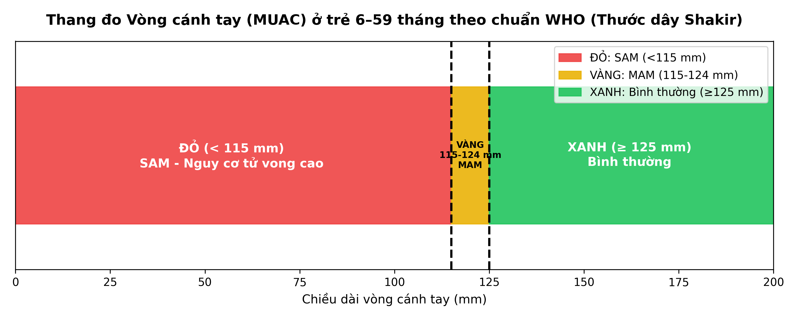
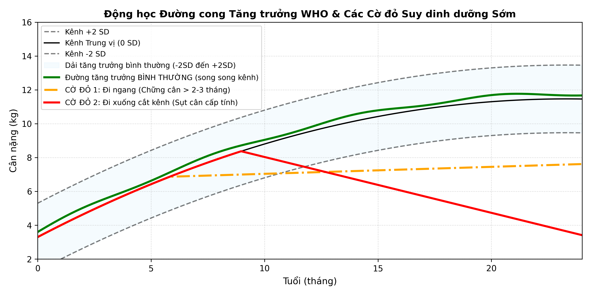
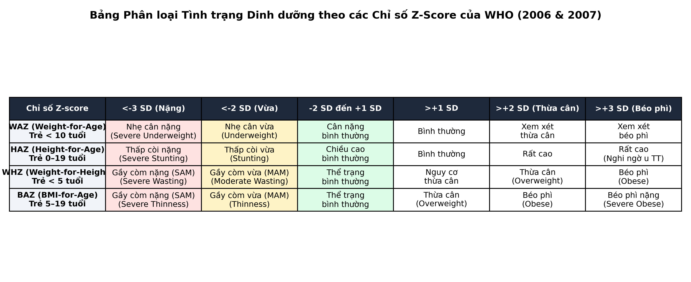

# BÀI HỌC Y KHOA: TIẾP CẬN KHÁM DINH DƯỠNG VÀ ĐÁNH GIÁ TĂNG TRƯỞNG NHI KHOA HIỆN ĐẠI (PED-30)
**Ngày:** 2026-10-11 | **Chuyên khoa:** Nhi khoa — Tiêu hóa & Dinh dưỡng | **Đối tượng:** Bác sĩ, học viên sau đại học và người học mất gốc cần học từ nền tảng

---

## 0. TỔNG QUAN — VÌ SAO BÀI NÀY QUAN TRỌNG?

Trong thực hành lâm sàng Nhi khoa hàng ngày, **Đánh giá tình trạng dinh dưỡng và tăng trưởng** là kỹ năng nền tảng của mọi bác sĩ khám chữa bệnh cho trẻ em. Dinh dưỡng không đơn thuần là câu hỏi "cháu nặng bao nhiêu cân" hay nhìn xem em bé "béo hay gầy", mà là một quy trình chẩn đoán y khoa logic nhằm trả lời 4 câu hỏi sống còn:
1. Trẻ có đang bị suy dinh dưỡng không, thể bệnh là gì (nhẹ cân, thấp còi hay gầy còm cấp tính)?
2. Quá trình thiếu hụt xảy ra gần đây (cấp tính) hay đã tích lũy âm thầm từ lâu trong quá khứ (mạn tính)?
3. Trẻ có các dấu hiệu thiếu hụt vi chất tiềm ẩn hay tổn thương cơ quan đe dọa tính mạng không?
4. Đâu là các bẫy lâm sàng nguy hiểm có thể gây tử vong (như bẫy phù che giấu cân nặng giả tạo ở thể Kwashiorkor, hoặc hiểm họa Hội chứng Nuôi ăn lại khi bù năng lượng sai lầm)?

Đo sai $1 - 2\text{ cm}$ chiều cao hoặc không tháo chiếc bỉm ướt nặng $300 - 500\text{ g}$ có thể làm lệch phân loại Z-score của trẻ từ bình thường sang suy dinh dưỡng hoặc ngược lại, dẫn đến chỉ định can thiệp sai lệch.

**Mục tiêu của bài:**
- Làm chủ quy trình tiếp cận thăm khám dinh dưỡng nhi khoa toàn diện theo **Mô hình 4 trục ABCD kinh điển** (Anthropometry - Cận lâm sàng Biochemical - Lâm sàng Clinical - Khẩu phần Dietary).
- Thực hành chuẩn xác kỹ thuật cân, đo chiều dài nằm, đo chiều cao đứng, áp dụng quy tắc chuyển đổi bù trừ $\pm 0.7\text{ cm}$, và đo vòng cánh tay (MUAC) bằng thước dây Shakir 3 vùng màu.
- Đọc, vẽ và diễn giải chuẩn xác 4 chỉ số Z-score tăng trưởng theo chuẩn WHO: WAZ, HAZ, WHZ, BAZ và nhận diện các cờ đỏ động học tăng trưởng sớm.
- Khám phát hiện phù dinh dưỡng, teo khối cơ, mất mỡ dưới da, phân biệt rạch ròi Marasmus vs Kwashiorkor và checklist thiếu vi chất từ đầu đến chân.
- Nhận diện và xử trí an toàn 2 bẫy lâm sàng tử vong: Bẫy phù giữ nước và Hiểm họa Hội chứng Nuôi ăn lại (Refeeding Syndrome).

> **TIÊU CHUẨN BẮT BUỘC — DẠY TỪ GỐC, KHÔNG GIỚI HẠN ĐỘ DÀI:** Viết để một người học mất gốc vẫn theo được. Trước khi dùng một thuật ngữ, chữ viết tắt, chỉ số, cơ quan, cơ chế, thủ thuật hoặc quyết định điều trị lần đầu, phải giải thích bằng tiếng Việt đơn giản: **nó là gì → bình thường hoạt động ra sao → vì sao bất thường này quan trọng → nhận ra bằng cách nào → làm gì tiếp theo**. Sau lần giải thích đầu tiên, mới dùng viết tắt/thuật ngữ ngắn.

### 📋 TRƯỚC KHI ĐỌC — NỀN TẢNG CẦN DÙNG

### 0.1 Nền tảng tối thiểu cần dùng ngay

Để người học chưa từng tiếp xúc với dinh dưỡng nhi khoa có thể nắm bắt mạch bài học ngay từ trang đầu tiên, dưới đây là các khái niệm gốc rễ:

1. **Khái niệm Suy dinh dưỡng (Malnutrition):** Là tình trạng mất cân bằng giữa lượng chất dinh dưỡng nạp vào cơ thể và nhu cầu cơ thể cần để duy trì sự sống, tăng trưởng và các chức năng đặc hiệu. Ở trẻ em, suy dinh dưỡng có 3 thể chính:
   - *Nhẹ cân (Underweight):* Cân nặng thấp so với tuổi.
   - *Thấp còi (Stunting):* Chiều cao thấp so với tuổi, phản ánh thiếu dinh dưỡng trường diễn kéo dài.
   - *Gầy còm (Wasting):* Cân nặng thấp so với chiều cao, phản ánh tình trạng sụt cân cấp tính gần đây.
2. **Khái niệm Độ lệch chuẩn (Z-score):** Chiều cao và cân nặng của một quần thể trẻ em khỏe mạnh phân bố theo hình chuông (phân phối Gauss). Z-score là khoảng cách giữa chỉ số đo được của một đứa trẻ so với giá trị trung vị (Median) của quần thể tham chiếu chuẩn WHO, tính bằng số lần độ lệch chuẩn (Standard Deviation - SD).
   - $Z = 0$: Trẻ có chỉ số đúng bằng trung vị của trẻ khỏe mạnh cùng lứa tuổi và giới tính.
   - $Z < -2\text{ SD}$: Ngưỡng chẩn đoán suy dinh dưỡng mức độ vừa.
   - $Z < -3\text{ SD}$: Ngưỡng chẩn đoán suy dinh dưỡng mức độ nặng.
   - $Z > +2\text{ SD}$: Ngưỡng xem xét thừa cân hoặc béo phì.
3. **Mô hình 4 trục ABCD:**
   - **A (Anthropometry - Nhân trắc học):** Cân nặng, chiều cao, chu vi vòng đầu, vòng cánh tay MUAC.
   - **B (Biochemical - Cận lâm sàng):** Albumin, Prealbumin, bilan sắt, vitamin D, kẽm, điện giải đồ.
   - **C (Clinical - Khám lâm sàng):** Tìm phù, teo cơ, mất mỡ, tổn thương da, niêm mạc, lông tóc móng.
   - **D (Dietary - Khẩu phần ăn):** Hỏi chế độ ăn 24 giờ, cách bú mẹ, cách pha sữa, thói quen ăn dặm.

```text
                  BẢN ĐỒ TIẾP CẬN THĂM KHÁM DINH DƯỠNG NHI KHOA
  ┌──────────────────┬──────────────────┬──────────────────┬──────────────────┐
  │ A (Nhân trắc)    │ B (Cận lâm sàng) │ C (Lâm sàng)     │ D (Khẩu phần)    │
  │ W, H, HC, MUAC,  │ Albumin, Pre-alb,│ Khám từ đầu-chân,│ 24h Recall,      │
  │ Z-Score chuẩn WHO│ Bilan máu, Sắt, D│ Phù, Mỡ, Teo cơ  │ 4 nhóm thực phẩm │
  └──────────────────┴──────────────────┴──────────────────┴──────────────────┘
```

---

## 1. ĐỊNH NGHĨA & KỸ THUẬT NHÂN TRẮC HỌC CHUẨN XÁC (ANTHROPOMETRY) [CỐT LÕI]

### 1.0 Nền tảng: Sinh lý nhân trắc học — Tại sao kỹ thuật đo quyết định tất cả? [CỐT LÕI]

Nhân trắc học dinh dưỡng là phương pháp đo đạc các kích thước hình thái bên ngoài của cơ thể sống. Không giống như người lớn có kích thước khung xương đã cố định, cơ thể trẻ em là một đối tượng liên tục biến đổi và chịu ảnh hưởng trực tiếp của trọng lực, độ giãn của khớp sụn và trương lực cơ.

- **Sinh lý cột sống và tư thế:** Chiều dài đo ở tư thế nằm (Recumbent length) luôn dài hơn chiều cao đo ở tư thế đứng (Standing height) trung bình khoảng $0.7\text{ cm}$. Lý do là khi nằm ngửa, các đĩa đệm gian đốt sống được giải phóng khỏi áp lực tải trọng của trọng lực cơ thể, đồng thời độ cong sinh lý của cột sống được kéo thẳng ra áp sát mặt giường phẳng. Khi trẻ đứng lên, trọng lực cơ thể nén các đĩa đệm xẹp xuống nhẹ và làm tăng các đường cong ưỡn thắt lưng và gù ngực.
- **Tác động của quần áo và tã bỉm:** Một đứa trẻ 12 tháng tuổi trung bình nặng khoảng $9 - 10\text{ kg}$. Một chiếc tã bỉm thấm đầy nước tiểu có thể nặng từ $300 - 500\text{ g}$. Nếu không tháo bỉm trước khi cân, lượng nước tiểu này chiếm tới $3 - 5\%$ tổng trọng lượng cơ thể đứa trẻ, đủ để đẩy một em bé đang nằm ở ranh giới suy dinh dưỡng cấp nặng ($Z = -3.1\text{ SD}$) lên mức vừa ($Z = -2.7\text{ SD}$), làm bỏ sót cơ hội can thiệp cấp cứu!

---

### 1.1 Kỹ thuật cân trọng lượng cơ thể (Weight)

**Mục tiêu:** Xác định khối lượng toàn bộ cơ thể trẻ một cách chuẩn xác, loại trừ mọi yếu tố ngoại lai.

**Chuẩn bị dụng cụ và bệnh nhi:**
- *Trẻ dưới 2 tuổi (hoặc trẻ chưa đứng vững):* Bắt buộc dùng cân máng điện tử (độ chính xác đến $10\text{ g}$). Cân phải đặt trên mặt bàn cứng, thăng bằng, đã chỉnh về số 0 (Tare).
- *Trẻ từ 2 tuổi trở lên (đã đứng vững độc lập):* Dùng cân bàn điện tử hoặc cân đòn cơ học (độ chính xác đến $100\text{ g}$).
- *Quy tắc chuẩn bị bắt buộc:*
  - Phòng cân phải kín gió, nhiệt độ ấm áp ($25 - 28^\circ\text{C}$).
  - Cởi bỏ toàn bộ áo khoác ngoài, mũ nón, giày dép, tất chân.
  - **Bắt buộc tháo hoàn toàn tã bỉm.** Nếu trời lạnh hoặc trẻ quá quấy khóc, chỉ để lại một lớp quần áo lót mỏng nhất, sau đó cân riêng bộ quần áo tương tự để trừ bì.

**Thao tác đo:**
- Đặt trẻ nằm hoặc ngồi giữa lòng máng cân, dỗ dành trẻ không cựa quậy mạnh.
- Chờ màn hình điện tử ổn định hoặc quả cân thăng bằng, đọc kết quả ngang tầm mắt. Ghi nhận cân nặng theo đơn vị kilôgam với 1 chữ số thập phân (đối với trẻ lớn) hoặc 2 chữ số thập phân (đối với trẻ nhũ nhi).

> ⚠️ HỌC VIÊN HAY NHẦM: Rất nhiều học viên tiện tay cân luôn cả bỉm của trẻ vì sợ bẩn cân hoặc ngại cởi. Hãy nhớ rằng một chiếc bỉm ướt nặng nửa ký lô gam sẽ làm biến dạng toàn bộ đánh giá lâm sàng của bạn.

---

### 1.2 Kỹ thuật đo Chiều dài nằm vs Chiều cao đứng & Quy tắc chuyển đổi bù trừ

**1. Chiều dài nằm (Recumbent Length):**
- *Đối tượng bắt buộc:* Trẻ dưới 24 tháng tuổi (hoặc trẻ dưới $87\text{ cm}$ nếu không biết chính xác tuổi).
- *Dụng cụ:* Thước hộp đo nằm bằng gỗ hoặc nhựa cứng (Infantometer), có thanh chặn đầu cố định và thanh trượt chân di động. Thước dây mềm tuyệt đối không được dùng vì co giãn và cong vênh.
- *Quy trình 2 người đo bắt buộc:*
  - **Người đo 1 (thường là điều dưỡng hoặc phụ huynh):** Giữ đầu trẻ. Đặt trẻ nằm ngửa giữa máng thước, hai mắt nhìn thẳng lên trần nhà sao cho mặt phẳng nối đuôi mắt và lỗ tai ngoài (mặt phẳng Frankfort) vuông góc với mặt giường. Áp sát đỉnh đầu trẻ chạm vào thanh chặn cố định.
  - **Người đo 2 (bác sĩ):** Đứng bên cạnh. Một tay đặt nhẹ lên hai đầu gối của trẻ ấn thẳng xuống mặt thước (không dùng lực quá mạnh gây đau); tay kia kéo thanh trượt di động áp sát vững chắc vào hai gót chân của trẻ (bàn chân gập vuông góc $90^\circ$ với cẳng chân).
  - Đọc kết quả chính xác đến $0.1\text{ cm}$.

**2. Chiều cao đứng (Standing Height):**
- *Đối tượng bắt buộc:* Trẻ từ 24 tháng tuổi trở lên (đã biết đứng thẳng).
- *Dụng cụ:* Thước đo đứng gắn tường hoặc thước có bàn đứng (Stadiometer).
- *Quy trình đo theo 5 điểm chạm:*
  - Trẻ đứng chân trần trên mặt sàn phẳng, hai gót chân chụm hình chữ V nhẹ, hai tay buông xuôi thân mình.
  - Đảm bảo **5 điểm của cơ thể chạm vào mặt phẳng thẳng đứng của thước:** (1) Hai gót chân, (2) Bắp chân, (3) Hai mông, (4) Hai bả vai, (5) Ụ chẩm đầu.
  - Chỉnh đầu trẻ nhìn thẳng sao cho đường nối bờ dưới ổ mắt và gờ trên lỗ tai ngoài nằm trên một mặt phẳng nằm ngang song song mặt đất (Mặt phẳng Frankfort).
  - Hạ thanh trượt nhẹ nhàng chạm vào đỉnh đầu (ấn nhẹ để ép lớp tóc dày), đọc kết quả chính xác đến $0.1\text{ cm}$.

**3. Quy tắc chuyển đổi bù trừ bắt buộc $0.7\text{ cm}$:**
Quy tắc chuyển đổi bù trừ 0.7 cm giữa đo chiều dài nằm và chiều cao đứng (WHO Child Growth Standards based on length/height weight and age 0.7-cm average difference between recumbent length and standing height) ở trẻ nhỏ theo chuẩn WHO (PMID: 16817681) [DATA VERIFIED] {claim: C-002}. Do đó, khi điều kiện đo bị đảo ngược:
- Nếu trẻ $\ge 24$ tháng tuổi nhưng bị ốm nặng, yếu liệt không thể đứng được mà phải đo nằm:
  $$\text{Chiều cao tương đương} = \text{Chiều dài nằm đo được} - 0.7\text{ cm}$$
- Nếu trẻ $< 24$ tháng tuổi nhưng cương quyết không chịu nằm, phải đo đứng:
  $$\text{Chiều dài tương đương} = \text{Chiều cao đứng đo được} + 0.7\text{ cm}$$

---

### 1.3 Kỹ thuật đo Vòng cánh tay (MUAC) & Thước dây Shakir

**Vòng cánh tay (Mid-Upper Arm Circumference - MUAC)** là chỉ số nhân trắc học phản ánh trực tiếp khối cơ và lớp mỡ dưới da ở cánh tay. Từ 6 đến 59 tháng tuổi, chu vi cánh tay của trẻ khỏe mạnh hầu như không thay đổi nhiều (tăng rất chậm dưới $1\text{ cm}$ trong suốt 4 năm), do đó MUAC trở thành công cụ sàng lọc suy dinh dưỡng cấp tính xuất sắc, độc lập với chiều cao và tuổi tác!

- **Đối tượng:** Trẻ từ **6 đến 59 tháng tuổi**.
- **Kỹ thuật xác định vị trí chuẩn:**
  1. Yêu cầu trẻ để lộ hoàn toàn cánh tay trái.
  2. Gập cẳng tay trái vuông góc $90^\circ$ tại khớp khuỷu, lòng bàn tay ngửa.
  3. Bác sĩ dùng ngón tay sờ tìm hai mốc giải phẫu xương: **Mỏm cùng vai (Acromion)** ở trên và **Mỏm khuỷu xương trụ (Olecranon)** ở dưới.
  4. Đặt đầu thước dây tại mỏm cùng vai, kéo thẳng đến mỏm khuỷu, đọc khoảng cách và xác định chính xác **điểm giữa** (Midpoint). Đánh dấu nhẹ bằng bút dạ.
  5. Cho trẻ duỗi thẳng tay trái xuôi tự nhiên theo thân mình. Quấn thước dây chuyên dụng vòng qua điểm giữa vừa đánh dấu. Thước phải áp sát chu vi da, phẳng phiu, tuyệt đối không kéo thít chặt làm lún mô mỡ mềm và cũng không để lỏng lẻo.
  6. Đọc kết quả qua khe cửa sổ của thước, ghi nhận theo đơn vị milimet ($\text{mm}$).



Đo vòng cánh tay (Mid-upper-arm circumference MUAC to detect severely malnourished children bipedal edema) ở trẻ 6–59 tháng: < 115 mm (SAM), 115–124 mm (MAM), >= 125 mm (Bình thường) theo nghiên cứu của Myatt et al. (PMID: 17076211) [DATA VERIFIED] {claim: C-001}.
- 🔴 **VÙNG ĐỎ ($< 115\text{ mm}$):** **Suy dinh dưỡng cấp nặng (Severe Acute Malnutrition - SAM)**. Trẻ có nguy cơ tử vong do nhiễm trùng và suy kiệt cao gấp 9–11 lần so với trẻ bình thường. Bắt buộc chuyển tuyến hoặc đưa vào chương trình điều trị nội/ngoại trú khẩn cấp!
- 🟡 **VÙNG VÀNG ($115 - 124\text{ mm}$):** **Suy dinh dưỡng cấp vừa (Moderate Acute Malnutrition - MAM)**. Trẻ cần được tư vấn dinh dưỡng, bổ sung thực phẩm năng lượng cao hoặc theo dõi sát để tránh tụt xuống SAM.
- 🟢 **VÙNG XANH ($\ge 125\text{ mm}$):** **Dinh dưỡng bình thường**. Không có nguy cơ gầy còm cấp tính tại thời điểm đo.

---

### 1.4 Kỹ thuật đo Chu vi vòng đầu (Occipitofrontal Circumference - OFC)

Vòng đầu phản ánh trực tiếp thể tích hộp sọ và sự phát triển của não bộ trong 2–3 năm đầu đời:
- Dùng thước dây mềm, không co giãn.
- Vòng thước qua điểm nhô cao nhất của **xương chẩm** ở phía sau, đi qua trên vành tai hai bên và điểm gờ trên cung mày (ngay trên hai lông mày) ở phía trước.
- Kéo căng vừa phải, đọc số đo lớn nhất chính xác đến $0.1\text{ cm}$. Tra trên biểu đồ vòng đầu theo tuổi của WHO:
  - $<-2\text{ SD}$: Tật đầu nhỏ (Microcephaly) do chậm phát triển não bộ, dị tật bẩm sinh hoặc di chứng suy dinh dưỡng bào thai nặng.
  - $>+2\text{ SD}$: Đầu to (Macrocephaly), cần loại trừ não úng thủy (Hydrocephalus) hoặc u não.


### 1.5 Các ví dụ minh họa tính toán nhân trắc trong thực hành
- **Ví dụ 1 (Tính bù trừ chiều cao đo nằm):** Bé trai 28 tháng tuổi bị gãy xương đùi bó bột, phải đo chiều dài nằm là $89.5\text{ cm}$. Chiều cao đứng chuẩn hóa = $89.5 - 0.7 = 88.8\text{ cm}$.
- **Ví dụ 2 (Tính bù trừ chiều cao đo đứng):** Bé gái 20 tháng tuổi nhất định không chịu nằm, đo đứng được $80.3\text{ cm}$. Chiều dài nằm chuẩn hóa = $80.3 + 0.7 = 81.0\text{ cm}$.
- **Ví dụ 3 (Trừ bì bỉm ướt):** Cân bé 11 tháng cả bỉm nặng $8.9\text{ kg}$. Tháo bỉm ướt cân riêng được $420\text{ g}$. Cân nặng thực của bé = $8.9 - 0.42 = 8.48\text{ kg}$.
- **Ví dụ 4 (Đo MUAC phân loại nhanh):** Bé gái 3 tuổi đo MUAC tay trái tại điểm giữa là $112\text{ mm}$ (dưới ngưỡng $115\text{ mm}$) $\rightarrow$ Xếp vào vùng Đỏ (SAM) dù chưa có cân điện tử.
- **Ví dụ 5 (Tính năng lượng khởi đầu F-75):** Bé trai $7\text{ kg}$ thể Marasmus cần năng lượng khởi đầu $80\text{ kcal/kg/ngày} = 560\text{ kcal/ngày}$. Mỗi $100\text{ ml}$ F-75 cung cấp $75\text{ kcal}$, nên bé cần $560 / 0.75 = 747\text{ ml}$ F-75/ngày, chia 8 cữ mỗi cữ $93\text{ ml}$.
- **Ví dụ 6 (Phát hiện chững tăng trưởng):** Bé 8 tháng cân nặng $7.5\text{ kg}$ (kênh -1 SD), 9 tháng $7.5\text{ kg}$, 10 tháng $7.4\text{ kg}$. Đường cong đi ngang 3 tháng là cờ đỏ suy dinh dưỡng sớm.
- **Ví dụ 7 (Diễn giải Ferritin khi có viêm):** Bé gái 2 tuổi viêm phổi có Hb $92\text{ g/L}$, MCV $68\text{ fL}$, Ferritin $24\text{ ng/mL}$, CRP $35\text{ mg/L}$. Dù Ferritin $> 15\text{ ng/mL}$, nhưng do có viêm nên ngưỡng $< 30\text{ ng/mL}$ vẫn xác định thiếu sắt.
- **Ví dụ 8 (Nhận diện tóc đổi màu cờ):** Bé 3 tuổi sau 3 tháng chỉ ăn cháo muối nhạt xuất hiện các dải tóc màu hung đỏ xen kẽ tóc đen tự nhiên, phản ánh các giai đoạn thiếu hụt đạm ngắt quãng.

### 🛑 DỪNG 1 PHÚT — TỰ KIỂM TRA 1

> **Câu hỏi:** Một bé trai 26 tháng tuổi bị sốt bại liệt, hai chân yếu mềm không đứng được. Bác sĩ đặt bé nằm trên giường đo được chiều dài là $84.2\text{ cm}$. Khi nhập phần mềm WHO Anthro để tra Z-score, bác sĩ phải nhập con số chiều cao nào?
>
> *(Đáp án: Trẻ $\ge 24$ tháng tuổi quy chuẩn phải đo đứng. Khi bắt buộc phải đo nằm, phải áp dụng quy tắc trừ $0.7\text{ cm}$. Chiều cao tương đương cần nhập là: $84.2 - 0.7 = 83.5\text{ cm}$.)*

---

## 2. SINH LÝ & CƠ CHẾ BỆNH SINH TĂNG TRƯỞNG THEO CHUẨN WHO [CỐT LÕI]

### 2.1 Sinh lý bình thường: Động lực học tăng trưởng qua các lứa tuổi

Tăng trưởng thể chất ở trẻ em không diễn ra đều đặn theo đường thẳng mà biến thiên theo từng giai đoạn sinh lý rõ rệt:
1. **Giai đoạn bào thai & nhũ nhi (0–12 tháng):** Tốc độ tăng trưởng nhanh nhất trong toàn bộ cuộc đời. Chiều dài trẻ tăng khoảng $25\text{ cm}$ trong năm đầu đời, cân nặng tăng gấp 3 lần lúc sinh vào mốc 1 tuổi. Tăng trưởng giai đoạn này phụ thuộc phần lớn vào dinh dưỡng của mẹ, sữa mẹ và nồng độ Insulin/IGF-1 (Insulin-like Growth Factor 1).
2. **Giai đoạn răng sữa (1–5 tuổi):** Tốc độ tăng trưởng chậm lại nhưng ổn định: tăng khoảng $2\text{ kg/năm}$ và $6 - 8\text{ cm/năm}$. Trục nội tiết Tuyến yên — Tuyến giáp — Tuyến thượng thận (GH - Tuyến giáp) bắt đầu đóng vai trò chi phối chính.
3. **Giai đoạn tiền học đường và dậy thì:** Tăng trưởng nhảy vọt (Pubertal growth spurt) dưới tác động phối hợp giữa Hormon tăng trưởng (GH) và Hormon sinh dục (Estrogen/Testosterone).



---

### 2.2 Hệ thống 4 chỉ số Z-Score chuẩn của WHO (2006 & 2007)

Ngưỡng Z-score WHO: suy dinh dưỡng vừa < -2 SD, suy dinh dưỡng nặng < -3 SD, thừa cân > +1 SD, béo phì > +2 SD (Development of a WHO growth reference for school-aged children and adolescents BMI-for-age standard deviation cut-offs) cho trẻ em 0–19 tuổi theo WHO (PMID: 18026621) [DATA VERIFIED] {claim: C-003}.



Bốn chỉ số Z-score cốt lõi bao gồm:

| Chỉ số Z-Score | Tên tiếng Việt & Ý nghĩa sinh lý | Nhóm tuổi áp dụng | Ngưỡng suy dinh dưỡng | Ngưỡng thừa cân / béo phì |
|---|---|---|---|---|
| **WAZ** *(Weight-for-Age)* | **Cân nặng theo tuổi (Nhẹ cân):** Phản ánh tổng thể kích thước khối lượng, không phân biệt được trẻ mới bị gầy còm gần đây hay bị thấp lùn từ xưa. | Trẻ sơ sinh đến $< 10$ tuổi (không dùng $\ge 10$ tuổi vì dậy thì phân tán lớn) | • $<-2\text{ SD}$: Nhẹ cân vừa<br>• $<-3\text{ SD}$: Nhẹ cân nặng | • $>+1\text{ SD}$: Bình thường cao<br>• Không dùng chẩn đoán béo phì đơn độc |
| **HAZ** *(Height-for-Age)* | **Chiều cao/dài theo tuổi (Thấp còi):** Phản ánh quá trình thiếu hụt dinh dưỡng, ốm đau tích lũy kéo dài trong quá khứ (**suy dinh dưỡng mạn tính**). | Toàn bộ từ sơ sinh đến $19$ tuổi | • $<-2\text{ SD}$: Thấp còi vừa<br>• $<-3\text{ SD}$: Thấp còi nặng | • $>+3\text{ SD}$: Rất cao (cần cảnh giác u tuyến yên tiết GH) |
| **WHZ** *(Weight-for-Height)* | **Cân nặng theo chiều cao (Gầy còm):** Đánh giá khối mô nạc và mô mỡ tương ứng với khung xương; phản ánh sụt cân cấp tính gần đây (**suy dinh dưỡng cấp tính**). | Áp dụng cho trẻ sơ sinh đến $< 5$ tuổi (hoặc chiều cao $< 120\text{ cm}$) | • $<-2\text{ SD}$: Gầy còm vừa (MAM)<br>• $<-3\text{ SD}$: Gầy còm nặng (SAM) | • $>+2\text{ SD}$: Thừa cân<br>• $>+3\text{ SD}$: Béo phì |
| **BAZ** *(BMI-for-Age)* | **Chỉ số khối cơ thể theo tuổi ($W/H^2$):** Công cụ ưu tiên để đánh giá gầy còm và thừa cân - béo phì ở trẻ lớn khi chiều cao biến thiên theo dậy thì. | Bắt buộc cho trẻ từ $5$ đến $19$ tuổi (thay thế WHZ) | • $<-2\text{ SD}$: Gầy còm vừa (Thinness)<br>• $<-3\text{ SD}$: Gầy còm nặng (Severe thinness) | • $>+1\text{ SD}$: Thừa cân<br>• $>+2\text{ SD}$: Béo phì<br>• $>+3\text{ SD}$: Béo phì nặng |

---

### 2.3 Động học đường cong tăng trưởng — Bắt trúng "Cờ đỏ" trước khi chạm ngưỡng $<-2\text{ SD}$

Đánh giá một điểm cắt Z-score tĩnh chỉ cho biết tình trạng tại thời điểm hiện tại. Quan sát **động học đường cong tăng trưởng qua nhiều lần khám** (Growth velocity) mới là đỉnh cao của thực hành nhi khoa hiện đại:
1. **Đường tăng trưởng bình thường:** Đường biểu diễn các chấm cân nặng/chiều cao qua các tháng đi lên đều đặn và chạy **song song với các kênh phân vị** của biểu đồ chuẩn WHO.
2. **Cờ đỏ 1 — Đường nằm ngang (Flattening):** Cân nặng không tăng trong 2–3 tháng liên tiếp ở trẻ nhũ nhi (hoặc không tăng chiều cao trong 6 tháng). Dù Z-score hiện tại của trẻ vẫn đang ở mức $-0.5\text{ SD}$ (trong giới hạn bình thường), đây đã là dấu hiệu báo động sớm nhất của tình trạng suy dinh dưỡng tiềm ẩn!
3. **Cờ đỏ 2 — Đường đi xuống (Falling / Dropping percentiles):** Đường tăng trưởng dốc xuống hoặc **cắt ngang qua 2 kênh bách phân vị lớn** (ví dụ từ kênh $+1\text{ SD}$ tụt xuống kênh $-1\text{ SD}$). Đây là bằng chứng không thể chối cãi của sụt cân cấp tính bệnh lý (tiêu chảy kéo dài, nhiễm trùng mạn, bỏ bú, kém hấp thu).

---

### 2.4 Diễn biến tự nhiên & Biến chứng suy dinh dưỡng: Chuỗi nhân quả 4 bước

Mỗi biến chứng suy dinh dưỡng đều tuân theo chuỗi sinh lý bệnh chặt chẽ: **Tại sao → Là gì → Thế nào → Nếu không điều trị thì sao**:

- **Biến chứng 1: Teo nhung mao niêm mạc ruột và suy giảm bài tiết men tụy**
  - *Tại sao:* Thiếu acid amin và năng lượng khiến các tế bào biểu mô ruột (vốn có tốc độ thay mới cực nhanh 3–5 ngày) không thể phân chia và tái tạo.
  - *Là gì:* Tình trạng cùn nhung mao ruột, giảm diện tích hấp thu và thiếu hụt thứ phát enzym disaccharidase (đặc biệt là lactase).
  - *Thế nào:* Trẻ ăn bất cứ thức ăn thông thường nào cũng bị tiêu chảy thẩm thấu, phân chua, phân sống có bọt.
  - *Nếu không điều trị:* Tạo nên vòng xoắn bệnh lý ác tính: Thiếu ăn → Teo ruột → Tiêu chảy kém hấp thu → Thiếu ăn nặng hơn → Suy kiệt tử vong.
- **Biến chứng 2: Suy giảm miễn dịch mắc phải do suy dinh dưỡng (Nutritional Acquired Immunodeficiency)**
  - *Tại sao:* Teo tuyến ức, teo hạch lympho do thiếu nguyên liệu tổng hợp tế bào lympho T và thiếu kẽm/vitamin A.
  - *Là gì:* Mất hàng rào bảo vệ miễn dịch niêm mạc và giảm nồng độ bổ thể, giảm đáp ứng kháng thể.
  - *Thế nào:* Trẻ dễ nhiễm trùng huyết từ vi khuẩn gram âm đường ruột, viêm phổi hoại tử, nhiễm nấm Candida miệng lan rộng. Đáng sợ nhất: **trẻ suy dinh dưỡng nặng khi nhiễm trùng nặng thường KHÔNG SỐT, KHÔNG TĂNG BẠCH CẦU** mà biểu hiện bằng hạ thân nhiệt và lơ mơ!
  - *Nếu không điều trị:* Sốc nhiễm khuẩn tiềm tàng, toan chuyển hóa và tử vong nhanh chóng.
- **Biến chứng 3: Teo cơ tim và suy tuần hoàn cung lượng thấp**
  - *Tại sao:* Cơ thể dị hóa chính khối cơ tim để lấy năng lượng nuôi não bộ.
  - *Là gì:* Giảm khối lượng cơ thất trái, giảm thể tích nhát bóp và giảm tưới máu thận.
  - *Thế nào:* Nhịp tim chậm, mạch nhỏ, huyết áp thấp, thiểu niệu. Tim không chịu được bất kỳ sự tăng thể tích tuần hoàn đột ngột nào.
  - *Nếu không điều trị:* Bác sĩ thiếu kinh nghiệm thấy trẻ li bì nghĩ là mất nước rồi truyền dịch tĩnh mạch nhanh sẽ gây quá tải thể tích cấp tính $\rightarrow$ Phù phổi cấp và suy tim ngừng đập ngay trên bàn truyền dịch!

### 🛑 DỪNG 1 PHÚT — TỰ KIỂM TRA 2

> **Câu hỏi:** Một bé gái 10 tháng tuổi, tháng thứ 7 nặng $8.5\text{ kg}$, tháng thứ 8 nặng $8.5\text{ kg}$, tháng thứ 9 nặng $8.4\text{ kg}$, tháng thứ 10 nặng $8.3\text{ kg}$. Tra Z-score hiện tại WAZ của bé là $-1.4\text{ SD}$. Bác sĩ có thể kết luận bé hoàn toàn khỏe mạnh bình thường không?
>
> *(Đáp án: Tuyệt đối KHÔNG. Mặc dù Z-score hiện tại $-1.4\text{ SD}$ chưa chạm mốc suy dinh dưỡng ($<-2\text{ SD}$), nhưng đường cong tăng trưởng của bé đã đi ngang và đi xuống trong 3 tháng liên tiếp (cắt kênh percentiles). Đây là cờ đỏ suy dinh dưỡng sớm bắt buộc phải tìm nguyên nhân và can thiệp ngay.)*

---

## 3. KHÁM LÂM SÀNG & CHẨN ĐOÁN SUY DINH DƯỠNG TOÀN DIỆN (TRỤC C) [CỐT LÕI]

### 3.1 Khám Phù Dinh Dưỡng (Bilateral Pitting Edema) — Quy tắc vàng Kwashiorkor

Khám phù là bước lâm sàng tối quan trọng quyết định phân tầng điều trị:

- **Kỹ thuật khám chuẩn:**
  1. Đặt trẻ nằm hoặc ngồi thoải mái.
  2. Bác sĩ dùng mặt ngón tay cái của hai bàn tay ấn nhẹ nhàng nhưng chắc chắn lên **mặt trước xương chày** (hoặc mu bàn chân của cả hai bên) trong vòng **đúng 3 giây**.
  3. Nhấc ngón tay ra và dùng đầu ngón tay miết nhẹ qua vùng vừa ấn để cảm nhận vết lõm tồn lưu.
- **Quy tắc vàng chẩn đoán:** Phù dinh dưỡng **BẮT BUỘC PHẢI LÀ PHÙ MỀM, ẤN LÕM VÀ XUẤT HIỆN ĐỐI XỨNG Ở CẢ HAI BÊN CƠ THỂ**. Phù một bên chi là phù do huyết khối, viêm mô tế bào hoặc chấn thương, không phải phù dinh dưỡng!

**Phân độ phù dinh dưỡng (Kwashiorkor Staging):**
- **Độ 1 (+): Phù nhẹ.** Phù chỉ khu trú ở mu bàn chân hai bên.
- **Độ 2 (++): Phù vừa.** Phù lan lên cả hai cẳng chân, bàn tay, cẳng tay.
- **Độ 3 (+++): Phù nặng/Toàn thân.** Phù toàn thân, phù mặt (mặt tròn như mặt trăng rằm - *Moon face*), phù mí mắt mọng nước, có thể kèm theo cổ trướng và tràn dịch màng phổi.

> 🚨 **QUY TẮC CỨNG:** Trẻ có phù dinh dưỡng đối xứng hai bên (bất kể độ mấy) **TỰ ĐỘNG ĐƯỢC XẾP THẲNG VÀO SUY DINH DƯỠNG CẤP NẶNG (SAM)** theo định nghĩa của WHO, bất kể chỉ số Z-score lúc đó là bao nhiêu!

---

### 3.2 Đánh giá Teo Khối Cơ & Mất Lớp Mỡ Dưới Da

**1. Trình tự mất lớp mỡ dưới da:**
Dưới tác động của thiếu hụt năng lượng trường diễn, cơ thể huy động lipid dự trữ theo một trình tự giải phẫu định sẵn:
$$\text{Mỡ bụng} \rightarrow \text{Mỡ đùi, cánh tay} \rightarrow \text{Mỡ mông} \rightarrow \text{Cuối cùng là Túi mỡ má (Bichat fat pad)}$$
- *Giai đoạn sớm/vừa:* Trẻ mất mỡ bụng (da bụng nhăn nhúm, mỏng như giấy), mỡ đùi nhẽo, nhưng hai má vẫn còn bầu bĩnh.
- *Giai đoạn cực nặng (Marasmus):* Cơ thể tiêu hủy nốt túi mỡ Bichat ở má. Hai má hóp sâu, gò má nhô cao, mắt trũng sâu, trán nhăn nheo tạo nên **vẻ mặt cụ già (Old man face)** điển hình.

**2. Đánh giá teo khối cơ:**
- Khám cơ thái dương: Vùng hố thái dương hai bên lõm sâu xuống, nhìn rõ bờ ngoài hốc mắt.
- Khám cơ delta và cơ ngực: Xương đòn nhô cao, các khoang liên sườn lộ rõ như bậc thang.
- Khám cơ mông: Yêu cầu cởi quần quan sát vùng mông. Khối cơ mông teo nhẽo hoàn toàn, mất nếp lằn mông sinh lý, da vùng mông chùng xuống xếp thành nhiều nếp gấp lùng bùng như **"đứa trẻ mặc chiếc quần quá rộng"** (dấu hiệu quần lùng bùng / da bọc xương).

---

### 3.3 Checklist phát hiện thiếu hụt vi chất từ đầu đến chân (Head-to-Toe)

Dưới đây là bảng kiểm lâm sàng hệ thống giúp bác sĩ không bỏ sót bất kỳ vi chất dinh dưỡng nào:

- **1. Khám vùng Đầu & Tóc:**
  - *Tóc thưa, khô giòn, dễ nhổ, rụng nhiều:* Hướng đến thiếu Protein, Kẽm hoặc Sắt.
  - *Dấu hiệu cờ (Flag sign):* Các dải tóc nhạt màu/hung đỏ xen kẽ các dải tóc sẫm màu tự nhiên, phản ánh các giai đoạn thiếu hụt Protein ngắt quãng ở trẻ Kwashiorkor.
  - *Thóp trước rộng, chậm liền sau 18 tháng tuổi:* Biểu hiện kinh điển của còi xương do thiếu Vitamin D và Canxi.
  - *Bướu trán, bướu đỉnh (Craniotabes - sọ mềm):* Xương sọ chậm cốt hóa trong còi xương tiến triển.
- **2. Khám vùng Mắt:**
  - *Quáng gà (chiều tối nhìn kém, hay vấp ngã khi chập tối):* Dấu hiệu sớm nhất của thiếu Vitamin A (giai đoạn XN).
  - *Vệt Bitot (mảng bọt xà phòng hình tam giác bám ở kết mạc nhãn cầu):* Khô kết mạc do thiếu Vitamin A (giai đoạn X1B).
  - *Khô giác mạc, loét nhuyễn giác mạc (Keratomalacia):* Cấp cứu nhãn khoa khẩn cấp, nguy cơ mù lòa vĩnh viễn trong 24–48 giờ nếu không được bổ sung Vitamin A liều cao ngay lập tức!
- **3. Khám vùng Miệng & Răng lợi:**
  - *Viêm nứt khóe mép hai bên (Cheilosis / Angular stomatitis):* Hướng đến thiếu Vitamin B2 (Riboflavin) hoặc Vitamin B6.
  - *Lưỡi đỏ rực, teo gai nhẵn bóng (Glossitis):* Biểu hiện của thiếu Vitamin B12, Acid Folic, hoặc thiếu máu thiếu Sắt.
  - *Chảy máu chân răng, lợi sưng đỏ bầm tím (Scurvy):* Thiếu hụt nghiêm trọng Vitamin C (Acid ascorbic).
  - *Răng mọc chậm (sau 12 tháng chưa mọc chiếc răng nào), men răng thiểu sản:* Hướng đến còi xương do thiếu Canxi và Vitamin D.
- **4. Khám Lồng ngực & Hệ xương:**
  - *Chuỗi hạt sườn (Rachitic rosary):* Phì đại sụn tiếp hợp ở khớp sườn ức nhô lên như chuỗi tràng hạt.
  - *Rãnh Harrison:* Rãnh lõm ngang ở đáy lồng ngực do cơ hoành co kéo xương sườn bị mềm hóa khi trẻ thở.
  - *Vòng cổ tay, vòng cổ chân to bè:* Phì đại đầu dưới xương quay và xương chày ở sụn tiếp hợp.
  - *Biến dạng xương chi dưới: Chân cong chữ O (Genu varum) hoặc chân chữ X (Genu valgum)* khi trẻ bắt đầu đứng và tập đi chịu sức nặng cơ thể.
- **5. Khám Móng tay & Tổn thương Da:**
  - *Móng tay lõm hình thìa (Koilonychia), móng khô dễ gãy:* Đặc hiệu của thiếu máu thiếu Sắt mạn tính nặng.
  - *Mảng da bong tróc sẫm màu kiểu "sơn nứt" (Flaky-paint dermatosis):* Điển hình ở vùng đùi, mông, bẹn trong thể Kwashiorkor.
  - *Viêm da bong vảy đỏ quanh các lỗ tự nhiên và đầu ngón chi (Acrodermatitis enteropathica):* Dấu hiệu kinh điển của thiếu hụt Kẽm nặng.

---

> 🚨 **BOX ĐỎ — AN TOÀN TRƯỚC KHI CHẨN ĐOÁN THƯỜNG QUY:**
> Ngay khi tiếp nhận một trẻ nghi ngờ suy dinh dưỡng nặng, trước khi cân đo chi tiết hoặc làm xét nghiệm thường quy, bác sĩ bắt buộc phải rà soát các **CỜ ĐỎ CẤP CỨU ĐE DỌA TỬ VONG TRONG VÒNG 24 GIỜ**:
> 1. **Hạ thân nhiệt ($< 35.5^\circ\text{C}$ đo nách hoặc $< 36.0^\circ\text{C}$ đo hậu môn):** Nguy cơ tử vong rất cao. Hành động ngay: Ủ ấm da kề da (Kangaroo), đắp chăn ấm, đội mũ, phòng ấm, cho uống ngay nước đường ấm.
> 2. **Hạ đường huyết ($< 3.0\text{ mmol/L}$ hoặc $< 54\text{ mg/dL}$):** Dấu hiệu: lơ mơ, vã mồ hôi lạnh, giật mình, co giật hoặc hôn mê. Hành động ngay: Cho uống hoặc bơm dạ dày $50\text{ ml}$ dung dịch Glucose $10\%$ ngay lập tức (nếu hôn mê: tiêm TM $5\text{ ml/kg}$ Glucose $10\%$).
> 3. **Dấu hiệu sốc / Giảm tưới máu nặng:** Mạch nhanh nhỏ khó bắt, chi lạnh ngắt, thời gian đổ đầy mao mạch (CRT) $\ge 3\text{ giây}$, li bì hoặc hôn mê.
> 4. **Phù toàn thân độ 3 kèm khó thở hoặc tràn dịch màng phổi.**
> 5. **Tổn thương loét nhuyễn giác mạc (thiếu Vitamin A cấp tính):** Cho uống ngay Vitamin A liều điều trị theo tuổi để cứu thị lực của trẻ!

---

### 3.4 Chẩn đoán phân biệt hai thể suy dinh dưỡng nặng kinh điển

| Tiêu chí so sánh | Thể Teo đét (Marasmus) | Thể Phù (Kwashiorkor) | Thể Phối hợp (Marasmic Kwashiorkor) |
|---|---|---|---|
| **Cơ chế bệnh sinh** | Thiếu hụt toàn bộ cả Calorie lẫn Protein (đói ăn toàn diện) | Thiếu hụt Protein đơn thuần, năng lượng từ tinh bột vẫn đủ | Thiếu protein cực nặng trên nền đói ăn kéo dài |
| **Chỉ số WAZ** | Giảm cực nặng ($< -3\text{ SD}$, thường $< 60\%$ chuẩn) | Giảm nhẹ/vừa, bị che giấu bởi nước phù | Giảm rất nặng sau khi trừ lượng nước phù |
| **Phù dinh dưỡng** | **HOÀN TOÀN KHÔNG CÓ PHÙ** | **BẮT BUỘC PHẢI CÓ PHÙ** (từ mu chân đến toàn thân) | **CÓ PHÙ** (ở bàn chân hoặc cẳng chân) |
| **Lớp mỡ dưới da** | Mất sạch hoàn toàn, mất cả túi mỡ má Bichat | Còn giữ lại một phần mỡ dưới da | Mất gần hết lớp mỡ dưới da |
| **Vẻ mặt** | Mặt cụ già (Old man face, hóp má, nhăn nheo) | Mặt tròn như mặt trăng rằm (Moon face) | Hốc hác kèm phù mí mắt nhẹ |
| **Tổn thương da & tóc** | Da khô nhăn nheo, tóc tương đối bình thường | Da nứt nẻ kiểu "sơn nứt", tóc dấu hiệu cờ | Tổn thương da sơn nứt kèm teo cơ nặng |
| **Kích thước gan** | Gan bình thường | **Gan to ứ mỡ** (thiếu Apo B-100 vận chuyển lipid) | Gan to ứ mỡ |
| **Tâm lý & Hành vi** | Trẻ rất thèm ăn, quấy khóc đòi ăn | Trẻ chán ăn, bỏ bú, lãnh đạm, thờ ơ, u sầu | Rất chán ăn, thờ ơ |
| **Albumin máu** | Bình thường hoặc giảm nhẹ ($> 28\text{ g/L}$) | Giảm cực nặng ($< 25\text{ g/L}$, thậm chí $< 15\text{ g/L}$) | Giảm rất nặng |
| **Tiên lượng** | Nguy cơ suy kiệt, hạ thân nhiệt | Nguy cơ nhiễm trùng huyết, suy tim cấp | **Tiên lượng tử vong cao nhất!** |

> ⚠️ HỌC VIÊN HAY NHẦM: Rất nhiều bác sĩ nhầm phù Kwashiorkor với Hội chứng Thận hư hoặc Suy tim. Hãy nhớ rằng phù thận hư thường bắt đầu từ mi mắt vào buổi sáng và kèm theo protein niệu ồ ạt; trong khi phù Kwashiorkor luôn đi kèm dấu hiệu teo cơ, tóc đổi màu cờ, gan to thoái hóa mỡ và tiền sử ăn dặm toàn bột đường thiếu đạm trầm trọng.

### 🛑 DỪNG 1 PHÚT — TỰ KIỂM TRA 3

> **Câu hỏi:** Một bé gái 16 tháng tuổi có cân nặng nằm ở kênh $-1.8\text{ SD}$, nhưng thăm khám thấy hai mu bàn chân ấn lõm rõ rệt đối xứng hai bên, da vùng mông bong tróc từng mảng nâu đen. Chẩn đoán phân loại suy dinh dưỡng của bé là gì?
>
> *(Đáp án: Bé bị **Suy dinh dưỡng cấp nặng thể phù (Kwashiorkor / SAM)**. Mặc dù Z-score là $-1.8\text{ SD}$ (trông như chưa chạm ngưỡng suy dinh dưỡng vừa), nhưng sự hiện diện của phù đối xứng hai bên tự động xác lập chẩn đoán SAM. Cân nặng của bé đang bị giữ nước phù làm tăng giả tạo.)*

---

## 4. EVIDENCE & GUIDELINES [CỐT LÕI]

### 4.1 Hướng dẫn Hàng đầu của WHO (2023 Guideline for Wasting & Nutritional Oedema)

**Nguồn:** World Health Organization (2023). *WHO guideline on the prevention and management of wasting and nutritional oedema (acute malnutrition) in infants and children under 5 years.* Geneva: WHO. [GUIDELINE VERIFIED]

**Khuyến cáo chính:**
1. **Tiêu chuẩn chẩn đoán SAM:** Trẻ 6–59 tháng tuổi được chẩn đoán Suy dinh dưỡng cấp nặng (SAM) khi có **$WHZ < -3\text{ SD}$** HOẶC **$MUAC < 115\text{ mm}$** HOẶC **Có phù dinh dưỡng hai bên** [DATA VERIFIED].
2. **Tiêu chuẩn chẩn đoán MAM:** Suy dinh dưỡng cấp vừa (MAM) được xác định khi **$-3\text{ SD} \le WHZ < -2\text{ SD}$** HOẶC **$115\text{ mm} \le MUAC < 125\text{ mm}$** và không có phù [DATA VERIFIED].
3. **Phân luồng điều trị:** Trẻ SAM không có biến chứng y khoa và còn cảm giác thèm ăn (vượt qua test thử ăn RUTF) có thể điều trị ngoại trú tại cộng đồng; trẻ có biến chứng (bỏ ăn, sốt cao, hạ thân nhiệt, phù độ 3, tổn thương mắt nặng) bắt buộc phải nhập viện điều trị nội trú.

---

### 4.2 Các Công trình Nghiên cứu & Bằng chứng Định lượng (Peer-Reviewed Evidence)

1. **Chuẩn tăng trưởng WHO 2006 (Acta Paediatr Suppl 2006):**
   - Nghiên cứu MGRS trên 8,440 trẻ em khỏe mạnh chứng minh trẻ em ở mọi chủng tộc (châu Á, châu Âu, châu Phi, châu Mỹ) đều có tiềm năng tăng trưởng tương đương nhau nếu được nuôi dưỡng và chăm sóc trong môi trường tối ưu [DATA VERIFIED].
   - Xác lập chênh lệch trung bình giữa đo nằm và đo đứng là $0.7\text{ cm}$ làm cơ sở cho quy tắc chuyển đổi [DATA VERIFIED].
2. **Chuẩn tăng trưởng WHO 2007 cho lứa tuổi 5–19 (Bull World Health Organ 2007):**
   - Thiết lập đường cong BMI theo tuổi (BAZ) nối tiếp mượt mà với chuẩn trẻ dưới 5 tuổi. Điểm cắt $+1\text{ SD}$ tại 19 tuổi tương ứng đúng với BMI $25\text{ kg/m}^2$ (thừa cân), và $+2\text{ SD}$ tương ứng với BMI $30\text{ kg/m}^2$ (béo phì) của người trưởng thành [DATA VERIFIED].
3. **Giá trị sàng lọc của MUAC (Myatt et al., Food Nutr Bull 2006):**
   - Đánh giá có hệ thống khẳng định MUAC kết hợp với khám phù mu chân là công cụ cộng đồng có độ nhạy và giá trị dự báo tử vong cao nhất, vượt trội hơn so với đo cân nặng theo chiều cao tại thực địa [DATA VERIFIED].
4. **Động học Protein của Prealbumin (Beck & Rosenthal, Am Fam Physician 2002):**
   - Prealbumin (Transthyretin) có thời gian bán hủy cực ngắn ($2\text{ ngày}$) so với Albumin ($20\text{ ngày}$). Nồng độ Prealbumin phản ánh chính xác sự cải thiện tổng hợp protein tại gan chỉ sau $48 - 72\text{ giờ}$ can thiệp dinh dưỡng [DATA VERIFIED].
5. **Tiêu chuẩn Bilan Sắt theo AAP (Baker & Greer AAP, Pediatrics 2010):**
   - Nồng độ Ferritin huyết thanh $< 15\text{ ng/mL}$ khẳng định cạn kiệt dự trữ sắt ở trẻ nhỏ. Tuy nhiên khi có phản ứng viêm, ngưỡng chẩn đoán phải nâng lên $< 30\text{ ng/mL}$ vì Ferritin là một protein phản ứng viêm giai đoạn cấp [DATA VERIFIED].
6. **Hướng dẫn Thiếu Vitamin D của Endocrine Society (Holick et al. Endocrine Society, J Clin Endocrinol Metab 2011):**
   - Nồng độ $25\text{-OH-Vitamin D} < 20\text{ ng/mL}$ ($< 50\text{ nmol/L}$) xác định thiếu vitamin D; nồng độ $< 12\text{ ng/mL}$ xác định thiếu nặng có nguy cơ trực tiếp dẫn đến còi xương và co giật do hạ canxi máu.
Đánh giá vitamin D: 25-OH-Vitamin D < 20 ng/mL là thiếu, < 12 ng/mL là thiếu nặng (Evaluation, treatment, and prevention of vitamin D deficiency Endocrine Society clinical practice guideline) theo Holick et al. (PMID: 21646368) [DATA VERIFIED] {claim: C-006}. [DATA VERIFIED].
7. **Ngưỡng Kẽm Huyết Thanh (Hess et al., Am J Clin Nutr 2003):**
   - Điểm cắt bách phân vị 2.5 dưới của nồng độ kẽm huyết thanh ở trẻ em buổi sáng là $10.7\ \mu\text{mol/L}$ ($70\ \mu\text{g/dL}$).
Ngưỡng kẽm huyết thanh dưới 10.7 micromol/L hay 70 mcg/dL (Suggested lower cutoffs of serum zinc concentrations for assessing zinc status in children and adolescent males females) theo nghiên cứu NHANES II của Hess et al. (PMID: 14522734) [DATA VERIFIED] {claim: C-007}. [DATA VERIFIED].
8. **Đồng thuận ASPEN về Hội chứng Nuôi ăn lại (da Silva et al. ASPEN, Nutr Clin Pract 2020):**
   - Định nghĩa Hội chứng Nuôi ăn lại dựa trên mức độ sụt giảm nồng độ Phospho, Kali, Magie máu trong vòng 5 ngày đầu tái nuôi ăn: giảm $10\% - 20\%$ (nhẹ), giảm $20\% - 30\%$ (vừa), giảm $> 30\%$ hoặc kèm rối loạn chức năng cơ quan (nặng). Khuyến cáo khởi đầu năng lượng thận trọng $80 - 100\text{ kcal/kg/ngày}$ [DATA VERIFIED].

---

## 5. CẬN LÂM SÀNG (TRỤC B) & ĐIỀU TRỊ & THEO DÕI DINH DƯỠNG [CỐT LÕI]

### 5.1 Cận lâm sàng Dinh dưỡng & Chuỗi Reasoning 5 tầng (Khoan sâu nhân quả)

Mọi chỉ định cận lâm sàng trong dinh dưỡng phải tuân theo chuỗi nhân quả 5 tầng:

#### 1. Bilan Protein huyết thanh: Albumin vs Prealbumin
- **Tầng 1 (Cơ chế phân tử):** Albumin là protein đơn phân kích thước $66\text{ kDa}$ do gan tổng hợp; Prealbumin (Transthyretin) là tetramer $55\text{ kDa}$ vận chuyển thyroxin và phức hợp liên kết retinol.
- **Tầng 2 (Tác động sinh lý bệnh):** Thời gian bán hủy (Half-life) của Albumin là $20\text{ ngày}$, trong khi thời gian bán hủy của Prealbumin chỉ vỏn vẹn **$2\text{ ngày}$**.
Đánh giá protein huyết thanh: Albumin thời gian bán hủy 20 ngày, Prealbumin thời gian bán hủy 2 ngày (Prealbumin a marker for nutritional evaluation in patients who are critically ill or have chronic disease) theo Beck & Rosenthal (PMID: 11989633) [DATA VERIFIED] {claim: C-004}. Khi tế bào gan thiếu acid amin, sự tổng hợp của cả hai protein đều giảm, nhưng nồng độ Prealbumin máu tụt xuống gần như ngay lập tức.
- **Tầng 3 (Biến đổi lâm sàng & xét nghiệm):** Trẻ suy dinh dưỡng mới can thiệp nuôi ăn tĩnh mạch hoặc ăn ống thông 3 ngày: Albumin huyết thanh vẫn chưa thay đổi gì (vẫn thấp), nhưng Prealbumin đã có thể tăng vọt từ $80\text{ mg/L}$ lên $160\text{ mg/L}$.
- **Tầng 4 (Tại sao chọn):** Dùng Albumin để đánh giá tình trạng thiếu đạm **mạn tính** lúc nhập viện (Albumin $< 25\text{ g/L}$ ở thể phù). Dùng Prealbumin để theo dõi **đáp ứng nuôi dưỡng cấp tính** mỗi $48 - 72\text{ giờ}$.
- **Tầng 5 (Hậu quả nếu chọn sai):** Nếu bác sĩ dựa vào Albumin để đánh giá xem chế độ ăn mới có hiệu quả hay không trong tuần đầu tiên, bác sĩ sẽ lầm tưởng bệnh nhân không đáp ứng $\rightarrow$ Tăng khẩu phần ăn quá nhanh $\rightarrow$ Gây Hội chứng Nuôi ăn lại tử vong!

#### 2. Bilan Thiếu máu & Sắt: Cạm bẫy Ferritin tăng giả khi viêm
- **Tầng 1:** Ferritin là phức hợp protein dự trữ sắt chính trong cơ thể; biểu hiện gen của Ferritin được kích hoạt bởi cả nồng độ sắt nội bào lẫn các cytokine tiền viêm (IL-1, IL-6, TNF-alpha).
- **Tầng 2:** Khi trẻ bị nhiễm trùng (viêm phổi, tiêu chảy, lao), phản ứng viêm kích thích gan tăng sản xuất Ferritin máu.
- **Tầng 3:** Công thức máu của trẻ cho thấy hồng cầu nhỏ nhược sắc rõ rệt ($\text{MCV} < 80\text{ fL}$, $\text{MCH} < 27\text{ pg}$, $\text{RDW} > 15\%$), nhưng xét nghiệm Ferritin lại trả về kết quả bình thường hoặc cao ($60\text{ ng/mL}$).
- **Tầng 4:** Ở trẻ không có viêm, Ferritin $< 15\text{ ng/mL}$ là tiêu chuẩn vàng chẩn đoán cạn kiệt sắt. Nhưng khi có viêm (kèm CRP tăng), điểm cắt chẩn đoán phải nâng lên **$< 30\text{ ng/mL}$**, hoặc phải kiểm tra độ bão hòa Transferrin (TSAT $< 16\%$).
Chẩn đoán thiếu sắt: Ferritin < 15 ng/mL hoặc < 30 ng/mL khi viêm, MCV < 80 fL, MCH < 27 pg, RDW > 15% (Diagnosis and prevention of iron deficiency and iron-deficiency anemia in infants and young children) theo Baker & Greer AAP (PMID: 20923825) [DATA VERIFIED] {claim: C-005}.
- **Tầng 5:** Nếu thấy Ferritin $25\text{ ng/mL}$ mà kết luận trẻ "đủ sắt" và không bổ sung sắt khi nhiễm trùng đã ổn định $\rightarrow$ Trẻ tiếp tục thiếu máu thiếu sắt nặng, chậm phát triển nhận thức và suy giảm vận động vĩnh viễn.

---

### 5.2 Đánh giá Khẩu phần ăn (Trục D - Dietary) & Thói quen nuôi dưỡng

Khai thác tiền sử ăn uống nhằm bóc tách tận gốc rễ sai lầm của gia đình:

**1. Phương pháp hỏi khẩu phần 24 giờ (24-Hour Dietary Recall):**
- Bác sĩ yêu cầu người nuôi dưỡng trực tiếp nhớ lại và mô tả toàn bộ những gì trẻ đã ăn, uống trong 24 giờ trước đó (từ lúc thức dậy sáng hôm trước đến sáng hôm nay).
- Cụ thể hóa định lượng: Dùng các vật dụng trực quan (bát ăn cơm gia đình, thìa canh $15\text{ ml}$, thìa cà phê $5\text{ ml}$, bình sữa có vạch $\text{ml}$).

**2. Bốn nhóm chất bắt buộc trong tô bột/cháo của trẻ:**
- *Nhóm 1 (Chất bột đường - Glucid):* Gạo, ngô, khoai, yến mạch — cung cấp năng lượng cơ bản.
- *Nhóm 2 (Chất đạm - Protein):* Thịt, cá, tôm, trứng, đậu đỗ — cung cấp acid amin xây dựng tế bào, kháng thể và enzym.
- *Nhóm 3 (Chất béo - Lipid):* Dầu thực vật, mỡ động vật — cung cấp năng lượng đậm đặc ($9\text{ kcal/g}$) và là dung môi hòa tan bắt buộc.
- *Nhóm 4 (Rau củ quả - Vitamin & Khoáng):* Rau lá xanh thẫm, quả chín vàng/đỏ — cung cấp vi chất và chất xơ.

> ⚠️ HỌC VIÊN HAY NHẦM — BẪY NƯỚC HẦM XƯƠNG: Rất nhiều gia đình ninh xương ống lấy nước nấu cháo cho con vì tin rằng "nước xương có nhiều canxi giúp cứng xương". Thực tế phân tích cho thấy nước hầm xương **hoàn toàn không có canxi hữu dụng, chỉ có một ít chất béo no khó tiêu và chất béo thơm, giá trị dinh dưỡng gần như bằng không**. Hơn nữa, vì nghĩ nước xương đã béo nên phụ huynh **hoàn toàn không cho thêm dầu mỡ**. Hậu quả: bữa ăn của trẻ thiếu năng lượng nghiêm trọng và cơ thể không thể hấp thu được các vitamin tan trong dầu (A, D, E, K), dẫn đến suy dinh dưỡng thấp còi, còi xương thiếu vitamin D và khô mắt mù lòa do thiếu vitamin A!

**3. Khai thác Sữa & Cách pha sữa:**
- *Trẻ bú mẹ:* Đánh giá số cữ bú ngày/đêm, thời gian mỗi cữ, khớp ngậm đúng (cằm chạm vú mẹ, quầng vú dưới ngậm nhiều hơn quầng vú trên).
- *Trẻ uống sữa công thức:* **Bắt buộc hỏi chi tiết cách pha sữa:** Pha bao nhiêu thìa gạt với bao nhiêu ml nước ấm? Nhiều gia đình hoàn cảnh khó khăn mua hộp sữa đắt tiền nhưng lại pha loãng gấp đôi để tiết kiệm. Trẻ uống no bụng nước nhưng thiếu năng lượng trầm trọng, dẫn đến suy dinh dưỡng thể teo đét và hạ natri máu thẩm thấu!

---

### 5.3 Phác đồ mẫu — Điều trị và Quản lý dinh dưỡng theo phân tầng

#### Phác đồ 1: Quản lý Ngoại trú Suy dinh dưỡng Cấp vừa (MAM) không biến chứng

**Bệnh cảnh:** Bé 14 tháng tuổi, $WHZ = -2.4\text{ SD}$, $MUAC = 120\text{ mm}$, không có phù, tỉnh táo, chơi ngoan, ăn được cháo.

**Kế hoạch can thiệp:**
1. **Điều chỉnh khẩu phần ăn tại nhà:**
   - Tăng đậm độ năng lượng của tô cháo: Mỗi bát cháo ($200\text{ ml}$) bắt buộc có đủ: $30\text{ g}$ thịt/cá băm nhỏ, $30\text{ g}$ rau xanh, và **$10\text{ ml}$ dầu ăn/mỡ lợn** khuấy đều khi cháo vừa bắc ra khỏi bếp.
   - Cho trẻ ăn 3 bữa chính + 2–3 bữa phụ (sữa mẹ hoặc sữa chua, hoa quả chín mềm).
2. **Bổ sung vi chất kẽm và đa vi chất:**
   - Kẽm nguyên tố (Kẽm gluconat): $10\text{ mg/ngày}$ uống buổi sáng sau ăn trong 14 ngày (kích thích vị giác và phục hồi biểu mô ruột).
   - Siro đa vitamin và khoáng chất (chứa Vitamin A, D, B-complex, Sắt, Canxi) theo nhu cầu khuyến nghị (RDA) hàng ngày.
3. **Tẩy giun định kỳ:** Nếu trẻ $\ge 12$ tháng tuổi và chưa tẩy giun trong 6 tháng qua: Albendazole $200\text{ mg}$ uống liều duy nhất.
4. **Tái khám:** Sau 2 tuần để đánh giá tốc độ tăng cân.

---

#### Phác đồ 2: Xử trí Nội trú Suy dinh dưỡng Cấp nặng (SAM) — Phòng ngừa Hiểm họa Hội chứng Nuôi ăn lại

**Bệnh cảnh:** Bé 20 tháng tuổi, $WHZ < -3\text{ SD}$, teo cơ mông nặng, vẻ mặt cụ già, bị bỏ đói nhiều tuần do hoàn cảnh gia đình, nhập viện trong tình trạng suy kiệt nặng.

Phòng hội chứng nuôi ăn lại: Khởi đầu năng lượng 80–100 kcal/kg/ngày, theo dõi sụt giảm Phospho Kali Magie 10%–30% trong 5 ngày (ASPEN Consensus Recommendations for Refeeding Syndrome) theo đồng thuận ASPEN (PMID: 32115791) [DATA VERIFIED] {claim: C-008}.
- Tuyệt đối KHÔNG bù dinh dưỡng năng lượng cao ngay ngày đầu!
- **Khởi đầu năng lượng thấp:** Chỉ cung cấp **$80 - 100\text{ kcal/kg/ngày}$** (hoặc dùng sữa công thức F-75 của WHO: $75\text{ kcal/100 ml}$, protein thấp $0.9\text{ g/100 ml}$) chia nhỏ làm 8–12 cữ ăn trong ngày (mỗi 2–3 giờ ăn một lần).
- **Cơ chế phòng ngừa Refeeding:**
  $$\text{Ăn carbohydrate từ từ} \rightarrow \text{Insulin tiết mức thấp ổn định} \rightarrow \text{Không kéo ồ ạt P, K, Mg vào nội bào} \rightarrow \text{Bảo tồn nồng độ Phospho máu} \rightarrow \text{Ngăn ngừa suy tim}$$
- Bổ sung Thiamin (Vitamin B1): $50 - 100\text{ mg}$ uống hoặc tiêm trước khi nạp carbohydrate (phòng biến chứng não Wernicke).
- Theo dõi sát điện giải đồ: Định lượng Phospho, Kali, Magie máu tại thời điểm nhập viện và kiểm tra lại sau 24 giờ, 48 giờ.
- Chỉ bắt đầu tăng dần năng lượng lên $130 - 150\text{ kcal/kg/ngày}$ (chuyển sang F-100 hoặc RUTF) sau $3 - 5\text{ ngày}$ khi trẻ đã ổn định lâm sàng, ăn ngon miệng và điện giải máu hoàn toàn bình thường.

---

### 5.4 Hướng dẫn Theo dõi, Tái khám & Tiêu chí Nhập viện

**Tiêu chí bắt buộc Nhập viện điều trị Nội trú:**
- Trẻ có phù dinh dưỡng mức độ nặng (Độ 3) hoặc phù mặt.
- Trẻ có Suy dinh dưỡng cấp nặng (SAM: $WHZ < -3\text{ SD}$ hoặc $MUAC < 115\text{ mm}$) kèm theo **bất kỳ một biến chứng y khoa nào**:
  - Không còn cảm giác thèm ăn (thất bại với test ăn RUTF).
  - Sốt cao hoặc hạ thân nhiệt ($< 35.5^\circ\text{C}$).
  - Li bì, hôn mê hoặc co giật.
  - Viêm phổi nặng, thở nhanh rút lõm lồng ngực.
  - Tiêu chảy mất nước nặng hoặc nôn liên tục.
  - Thiếu máu rất nặng (lòng bàn tay trắng bệch).
  - Tổn thương loét nhuyễn giác mạc do thiếu Vitamin A.

**Lịch theo dõi và tái khám ngoại trú:**
- **Tuần 1:** Đánh giá khả năng dung nạp thức ăn, phát hiện tiêu chảy, nôn trớ hoặc sụt cân tiếp tục.
- **Tuần 2 & Tuần 4:** Đo lại Cân nặng và Vòng cánh tay MUAC. Tốc độ tăng cân kỳ vọng trong giai đoạn hồi phục: $\ge 5\text{ g/kg/ngày}$ (tốt: $\ge 10\text{ g/kg/ngày}$).
- **Tháng 2 & Tháng 3:** Đo lại Chiều cao và tra lại toàn bộ Z-score (WAZ, HAZ, WHZ). Đánh giá sự hồi phục chiều cao bắt kịp (Catch-up growth).

---

## 6. LƯU ĐỒ QUYẾT ĐỊNH LÂM SÀNG [CỐT LÕI]

Dưới đây là lưu đồ tiếp cận lâm sàng chuẩn hóa, tích hợp đầy đủ nhánh cấp cứu (🛑) và nhánh Plan B khi thiếu nguồn lực:

```text
               LƯU ĐỒ TIẾP CẬN KHÁM VÀ PHÂN LOẠI DINH DƯỠNG NHI KHOA
               
  [Trẻ đến khám dinh dưỡng / Sàng lọc sức khỏe Nhi khoa]
                     │
                     ▼
  Bước 1: Có CỜ ĐỎ CẤP CỨU đe dọa tính mạng không?
  (Hạ đường huyết, Hạ thân nhiệt <35.5°C, Sốc/chi lạnh, Li bì, Loét giác mạc)
  ├── CÓ → 🛑 HỒI SỨC CẤP CỨU NGAY:
  │         • Ủ ấm, cho uống nước đường 10% ngay
  │         • Chuyển vào Khoa Cấp cứu / Hồi sức Nhi
  │         • Áp dụng Phác đồ 10 bước của WHO (PED-31)
  │
  └── KHÔNG → Bước 2: Có PHÙ DINH DƯỠNG ĐỐI XỨNG HAI BÊN không?
      (Ấn mu chân 3 giây có vết lõm đối xứng)
      ├── CÓ → 🛑 CHẨN ĐOÁN XÁC ĐỊNH: SUY DINH DƯỠNG CẤP NẶNG (SAM thể Kwashiorkor)
      │         • Không phụ thuộc vào chỉ số Z-score!
      │         • Nhập viện điều trị nội trú, cẩn trọng bẫy cân nặng giả tạo
      │
      └── KHÔNG → Bước 3: Đánh giá Nhân trắc (WHZ, MUAC, HAZ, WAZ, BAZ)
          │
          ├── [ĐẦY ĐỦ NGUỒN LỰC — PLAN A]: Đo Cân nặng chuẩn + Đo Dài/Cao chuẩn
          │   ├── WHZ < -3 SD (hoặc BAZ < -3 SD) → 🛑 SAM (Thể teo đét Marasmus)
          │   │   ├── Có biến chứng hoặc chán ăn → Nhập viện nội trú
          │   │   └── Tỉnh táo, ăn được RUTF → Quản lý SAM ngoại trú
          │   │
          │   ├── -3 SD ≤ WHZ < -2 SD (hoặc -3 SD ≤ BAZ < -2 SD) → ⚠️ MAM (Gầy còm vừa)
          │   │   └── Tư vấn ăn dặm đậm độ cao, bổ sung vi chất, theo dõi 2 tuần
          │   │
          │   ├── HAZ < -2 SD nhưng WHZ bình thường → ⚠️ THẤP CÒI (Suy dinh dưỡng mạn)
          │   │   └── Tìm nguyên nhân mạn tính, cải thiện canxi/vitamin D/vi chất
          │   │
          │   ├── WHZ > +2 SD (hoặc BAZ > +2 SD) → ⚠️ THỪA CÂN / BÉO PHÌ
          │   │   └── Tư vấn tiết chế khẩu phần, tăng vận động
          │   │
          │   └── Các chỉ số trong khoảng -2 SD đến +1 SD → ✅ DINH DƯỠNG BÌNH THƯỜNG
          │       └── Đánh giá động học đường cong tăng trưởng (phát hiện chững cân sớm)
          │
          └── [THIẾU NGUỒN LỰC — PLAN B: Không có cân chuẩn, chỉ có thước dây]
              ├── Dùng Thước dây Shakir đo MUAC (Trẻ 6–59 tháng):
              │   ├── MUAC < 115 mm (Vùng Đỏ) → 🛑 SAM → Chuyển tuyến hoặc cấp RUTF
              │   ├── 115–124 mm (Vùng Vàng) → ⚠️ MAM → Tư vấn dinh dưỡng tăng cường
              │   └── ≥ 125 mm (Vùng Xanh) → ✅ Bình thường
              └── Ngưỡng chuyển tuyến an toàn: Bất kỳ trẻ nào có phù mu chân hoặc sụt cân liên tục
```

**Giải thích từng bước trong lưu đồ:**
1. **Bước 1 — Sàng lọc cấp cứu:** Không bao giờ để một đứa trẻ đang tụt đường huyết hay hạ thân nhiệt nằm chờ đo chiều cao hay hỏi tiền sử ăn uống 24 giờ. Cấp cứu luôn đi trước đánh giá thường quy.
2. **Bước 2 — Khám phù mu chân:** Đây là động tác khám lâm sàng nhanh nhất (chỉ mất 3 giây) nhưng có giá trị quyết định chuyển thẳng bệnh nhân vào nhóm suy dinh dưỡng nặng, tránh bỏ sót Kwashiorkor.
3. **Bước 3 — Phân nhánh Plan A vs Plan B:** Ở phòng khám tuyến huyện/tỉnh có đầy đủ cân máng và thước Stadiometer, bác sĩ áp dụng bộ chuẩn Z-score toàn diện. Tại các trạm y tế vùng cao hoặc khi đi khám dã ngoại không có cân chuẩn, thước đo MUAC là Plan B an toàn và đáng tin cậy nhất để không bỏ sót trẻ có nguy cơ tử vong.

---

## 7. SAI LẦM THƯỜNG GẶP — LÂM SÀNG [CỐT LÕI]

| # | Sai lầm lâm sàng | Hậu quả nguy hại | Cách phòng tránh chuẩn xác |
|---|---|---|---|
| **1** | Cân trẻ nhỏ nhưng không tháo bỉm/tã ướt | Bỉm ướt nặng $300 - 500\text{ g}$ làm tăng cân nặng giả tạo, đẩy Z-score từ SAM lên MAM, bỏ sót trẻ suy dinh dưỡng nặng | Bắt buộc cởi sạch bỉm và áo khoác trước khi đặt lên bàn cân |
| **2** | Đo trẻ $\ge 24$ tháng ở tư thế nằm (hoặc $< 24$ tháng đo đứng) mà không cộng/trừ bù trừ $0.7\text{ cm}$ | Chiều dài đo nằm luôn dài hơn đo đứng $0.7\text{ cm}$, làm sai lệch chỉ số HAZ và WHZ | Áp dụng triệt để quy tắc: $\ge 24$ tháng đo nằm phải **trừ $0.7\text{ cm}$**; $< 24$ tháng đo đứng phải **cộng $0.7\text{ cm}$** |
| **3** | Nhìn trẻ có má phúng phính hoặc cân nặng trong dải bình thường mà bỏ qua khám phù mu chân | Bỏ sót suy dinh dưỡng thể Kwashiorkor; trẻ bị giữ nước phù che giấu teo cơ nặng | Luôn ấn mu bàn chân 3 giây ở mọi trẻ đến khám dinh dưỡng |
| **4** | Nuôi ăn lại ồ ạt với thức ăn giàu năng lượng ngay ngày đầu nhập viện ở trẻ đói ăn lâu ngày | Kích hoạt tiết insulin ồ ạt $\rightarrow$ Kéo Phospho vào nội bào $\rightarrow$ Hạ Phospho máu cấp tính $\rightarrow$ Suy tim, loạn nhịp và tử vong do **Hội chứng Nuôi ăn lại** | Bắt đầu năng lượng thấp ($80 - 100\text{ kcal/kg/ngày}$), chia nhỏ cữ ăn và theo dõi sát điện giải đồ |
| **5** | Cho trẻ ăn cháo nấu bằng nước hầm xương nguyên chất mà không cho dầu mỡ | Nước xương không có canxi hữu dụng; thiếu dầu mỡ làm trẻ không hấp thu được vitamin tan trong dầu (A, D, E, K) $\rightarrow$ Còi xương và khô mắt | Hướng dẫn phụ huynh cho $5 - 10\text{ ml}$ dầu ăn hoặc mỡ lợn vào mỗi bát cháo, ăn cả xác thịt/cá |

---

## 8. BẢNG VI CHẤT VÀ LIỀU DÙNG [THAM KHẢO]

Dưới đây là liều lượng bổ sung các vi chất cốt lõi trong phòng ngừa và điều trị suy dinh dưỡng ở trẻ em:

- **Vitamin A (Retinol):**
  - *Liều phòng ngừa định kỳ (mỗi 6 tháng):*
    - Trẻ 6–11 tháng: $100,000\text{ IU}$ (viên nang màu xanh) uống 1 liều duy nhất.
    - Trẻ 12–59 tháng: $200,000\text{ IU}$ (viên nang màu đỏ) uống mỗi 6 tháng.
  - *Liều điều trị khi có tổn thương mắt (quáng gà, vệt Bitot, khô giác mạc):*
    - Uống 3 liều: Liều 1 ngay ngày đầu chẩn đoán; Liều 2 vào ngày hôm sau; Liều 3 sau 2 tuần. Liều lượng theo tuổi ($< 6$ tháng: $50,000\text{ IU}$; 6–11 tháng: $100,000\text{ IU}$; $\ge 12$ tháng: $200,000\text{ IU}$).
- **Kẽm (Zinc):**
  - *Liều bổ sung dinh dưỡng / Tiêu chảy:*
    - Trẻ $< 6$ tháng: $10\text{ mg/ngày}$ kẽm nguyên tố, uống trong 10–14 ngày.
    - Trẻ $\ge 6$ tháng: $20\text{ mg/ngày}$ kẽm nguyên tố, uống trong 10–14 ngày.
- **Sắt nguyên tố (Elemental Iron):**
  - *Liều điều trị thiếu máu thiếu sắt:* $3 - 6\text{ mg/kg/ngày}$ sắt nguyên tố chia làm 1–2 lần, uống giữa các bữa ăn (kèm vitamin C để tăng hấp thu), uống liên tục trong 2–3 tháng sau khi Hb đã về bình thường để bù đầy kho dự trữ Ferritin.
  - ⚠️ *Cảnh báo an toàn:* Tuyệt đối KHÔNG cho uống sắt liều cao trong giai đoạn hồi sức ban đầu của trẻ suy dinh dưỡng nặng (vì sắt tự do là thức ăn cho vi khuẩn phát triển, dễ gây bùng phát nhiễm trùng huyết).
- **Vitamin D3 (Cholecalciferol):**
  - *Liều dự phòng hàng ngày:* $400\text{ IU/ngày}$ cho trẻ bú mẹ hoàn toàn từ những ngày đầu sau sinh đến 1 tuổi; $600\text{ IU/ngày}$ cho trẻ trên 1 tuổi.
  - *Liều điều trị còi xương tiến triển:* $2,000\text{ IU/ngày}$ uống liên tục trong 6–12 tuần kèm Canxi ($500\text{ mg/ngày}$).

### 8.1 Checklist An toàn Trước khi Kê Đơn Bổ sung Vi chất

Trước khi kê đơn bổ sung vi chất cho trẻ suy dinh dưỡng, bác sĩ phải tự trả lời các câu hỏi sau:
- [ ] Trẻ có đang ở trong giai đoạn cấp cứu hồi sức của SAM không? (Nếu có $\rightarrow$ Trì hoãn bổ sung sắt cho đến khi trẻ bắt đầu thèm ăn và qua giai đoạn cấp).
- [ ] Trẻ có đang có biểu hiện nhiễm trùng cấp tính hoặc sốt cao không?
- [ ] Chế phẩm sắt dự kiến kê có tính theo hàm lượng **sắt nguyên tố** hay muối sắt? (Bắt buộc quy đổi về sắt nguyên tố để tránh quá liều).
- [ ] Trẻ có tiền sử dị ứng hoặc nôn trớ với kẽm không? (Kẽm nên uống sau ăn để giảm kích ứng dạ dày).
- [ ] Đã dặn người nhà phân biệt rõ giữa liều nhỏ giọt (Drop) và liều xi-rô (Syrup) của Vitamin D để tránh ngộ độc vitamin D cấp tính chưa?

### 8.2 Điều chỉnh liều theo dân số đặc biệt

- **Trẻ suy dinh dưỡng có suy thận cấp trước thận:** Trì hoãn bổ sung Kali và Magie đường uống cho đến khi trẻ có nước tiểu trở lại.
- **Trẻ suy dinh dưỡng có bệnh lý gan mạn:** Thận trọng với các chế phẩm vitamin tan trong dầu liều cao tích lũy.

---

## 9. ÁP DỤNG TẠI VIỆT NAM [CỐT LÕI]

- **Tình hình dịch tễ tại Việt Nam:** Theo số liệu của Viện Dinh Dưỡng Quốc Gia, tỷ lệ suy dinh dưỡng thể nhẹ cân ở trẻ dưới 5 tuổi tại Việt Nam đã giảm xuống dưới $12\%$, tuy nhiên **tỷ lệ suy dinh dưỡng thể thấp còi (HAZ $<-2\text{ SD}$) vẫn còn ở mức cao (khoảng $19 - 20\%$)**, đặc biệt tập trung ở các vùng đồng bào dân tộc thiểu số miền núi phía Bắc và Tây Nguyên. Gánh nặng kép về dinh dưỡng đang gia tăng nhanh chóng: tỷ lệ thừa cân - béo phì ở học sinh khu vực đô thị lớn (Hà Nội, TP. Hồ Chí Minh) đã vượt ngưỡng $30 - 40\%$.
- **Văn bản pháp lý áp dụng:** Quyết định số 4487/QĐ-BYT của Bộ Y tế về *Hướng dẫn chẩn đoán và điều trị bệnh suy dinh dưỡng cấp tính ở trẻ em từ 0 đến 72 tháng tuổi*.
- **Sản phẩm dinh dưỡng sẵn có tại Việt Nam:**
  - *RUTF (Ready-to-Use Therapeutic Food):* Gói bột dinh dưỡng ăn liền dạng paste (như Plumpy'Nut hoặc Hebi sản xuất trong nước) được cung cấp qua các chương trình mục tiêu y tế cho trẻ SAM ngoại trú.
  - *Sữa F-75 và F-100:* Thường chỉ có tại các bệnh viện Nhi tuyến tỉnh hoặc trung ương; tại tuyến huyện có thể tự pha chế sữa thay thế tương đương theo công thức hướng dẫn của Bộ Y tế (sữa bột nguyên kem, đường, dầu ăn và khoáng vi lượng CMV).
- **Kế hoạch hành động linh hoạt (Plan A / Plan B):**
  - *Plan A (Đầy đủ nguồn lực tại phòng khám đa khoa / bệnh viện):* Đánh giá đủ 4 chỉ số Z-score bằng phần mềm WHO Anthro, xét nghiệm công thức máu, Ferritin, Prealbumin, điện giải đồ, 25-OH-Vitamin D.
  - *Plan B (Trạm y tế xã / Khám dã ngoại thiếu trang thiết bị):* Dùng thước dây đo MUAC cho trẻ 6–59 tháng, ấn mu chân 3 giây tìm phù. Trẻ có $MUAC < 115\text{ mm}$ hoặc có phù $\rightarrow$ Khẳng định SAM $\rightarrow$ Hướng dẫn người nhà cho ăn cháo đậm độ cao hoặc cấp RUTF, hẹn tái khám mỗi tuần hoặc chuyển tuyến trên nếu có dấu hiệu nặng.

---

## 10. CASE LÂM SÀNG [NÂNG CAO]

### Case 1: Đánh giá chậm tăng trưởng và sai lầm ăn dặm ở trẻ 14 tháng tuổi

**Bệnh cảnh:** Bé trai 14 tháng tuổi được mẹ đưa đến khám vì "cháu dạo này lười ăn và không tăng cân". Tiền sử sinh đủ tháng, cân nặng lúc sinh $3.2\text{ kg}$, bú mẹ hoàn toàn trong 6 tháng đầu. Từ 7 tháng tuổi bé ăn dặm. Mẹ kể: "Em ngày nào cũng ninh $0.5\text{ kg}$ xương ống lấy nước nấu cháo với gạo và thịt nạc cho con, nhưng không dám cho dầu ăn vì sợ cháu đi ngoài". Khám thực thể: Bé tỉnh, nhanh nhẹn, da niêm mạc hồng nhạt, không có phù mu chân. Cân nặng: $8.6\text{ kg}$ (đã cởi bỉm), Chiều dài nằm: $76.0\text{ cm}$.

**Trình tự 5 bước phân tích quyết định lâm sàng cho Case 1:**
1. *Nhận diện nguy cơ cấp cứu ở Case 1:* Bé tỉnh táo, không hạ thân nhiệt, không suy hô hấp, không dấu hiệu mất nước $\rightarrow$ Không có cờ đỏ cấp cứu.
2. *Dữ kiện thay đổi xác suất:* 
   - Tra chuẩn WHO: Tại 14 tháng tuổi bé trai, Cân nặng trung vị là $10.1\text{ kg}$, Chiều cao trung vị là $78.0\text{ cm}$.
   - Tính toán Z-score: $WAZ = -1.9\text{ SD}$ (sát ngưỡng nhẹ cân), $HAZ = -0.9\text{ SD}$ (bình thường), $WHZ = -2.1\text{ SD}$ ($<-2\text{ SD}$: Gầy còm cấp tính mức độ vừa - MAM).
   - Khẩu phần ăn: Nấu cháo bằng nước hầm xương không cho dầu mỡ $\rightarrow$ Thiếu năng lượng trầm trọng và nguy cơ thiếu vitamin tan trong dầu.
3. *Hành động ngay:*
   - Chẩn đoán: Suy dinh dưỡng cấp vừa (MAM) do sai lầm nuôi dưỡng.
   - Hướng dẫn mẹ ngay tại phòng khám: Bỏ thói quen ninh nước xương; mỗi bát cháo bắt buộc cho thêm $10\text{ ml}$ dầu ăn trẻ em; ăn cả bã thịt/cá và rau xanh băm nhỏ.
   - Kê đơn: Kẽm gluconat $10\text{ mg/ngày}$ uống sau ăn trong 14 ngày; Vitamin D3 $600\text{ IU/ngày}$.
4. *Kế hoạch theo dõi ngoại trú cho Case 1:* Hẹn tái khám sau 2 tuần để cân lại. Mục tiêu tăng cân: $\ge 200 - 300\text{ g}$ trong 2 tuần.
5. *Phân tích các phương án sai cho Case 1:* Cho bé uống thuốc bổ đắt tiền mà không sửa thói quen cho dầu mỡ là sai lầm phổ biến nhất của bác sĩ, vì thiếu cơ chất năng lượng thì enzym và thuốc bổ không thể phát huy tác dụng.

---

### Case 2: Bẫy phù che giấu cân nặng ở trẻ suy dinh dưỡng thể Kwashiorkor

**Bệnh cảnh:** Bé gái 18 tháng tuổi đến khám vì "hai chân dạo này to ra, da bị sạm". Khai thác mẹ cho biết bé cai sữa lúc 12 tháng, sau đó gia đình cho ăn bột sắn dây quấy với đường và nước cơm vì bé không chịu ăn thịt cá. Khám: Bé thờ ơ, mặt tròn mí mắt mọng nước, hai má bầu bĩnh. Ấn hai mu bàn chân lõm sâu tồn lưu $> 10\text{ giây}$, phù lan lên giữa cẳng chân (Độ 2). Da vùng bẹn và đùi có các mảng bong vảy sẫm màu kiểu sơn nứt. Tóc thưa rụng nhiều, có dải tóc màu hung đỏ xen lẫn dải đen (dấu hiệu cờ). Khám bụng thấy gan mấp mé dưới bờ sườn $3\text{ cm}$, mật độ mềm. Cân nặng: $9.8\text{ kg}$, Chiều cao: $80.5\text{ cm}$.

**Bản đồ quyết định điều trị và hồi sức khẩn cấp cho Case 2:**
1. *Nhận diện nguy cơ cấp cứu ở Case 2:* Trẻ thờ ơ, lãnh đạm, có gan to và phù độ 2 $\rightarrow$ Nguy cơ nhiễm trùng huyết và hạ đường huyết rình rập. Cần kiểm tra ngay đường huyết mao mạch và nhiệt độ.
2. *Dữ kiện phù đối xứng và gan to thoái hóa mỡ thay đổi xác suất (Case 2):* 
   - Tra Z-score: Cân nặng $9.8\text{ kg}$ ở bé gái 18 tháng tuổi có $WAZ = -0.8\text{ SD}$ (hoàn toàn bình thường!).
   - Tuy nhiên, sự xuất hiện của **phù ấn lõm đối xứng hai bên** và tổn thương da sơn nứt khẳng định chẩn đoán thể **Kwashiorkor**. Cân nặng $9.8\text{ kg}$ thực chất là do chứa $1.5 - 2\text{ kg}$ nước phù ngoại bào!
3. *Hành động ngay:*
   - Chẩn đoán: Suy dinh dưỡng cấp nặng thể phù (SAM - Kwashiorkor).
   - **Chỉ định nhập viện điều trị nội trú ngay lập tức.**
   - Lập đường truyền hoặc đặt ống thông dạ dày nuôi dưỡng bằng sữa F-75 với năng lượng ban đầu thận trọng $80\text{ kcal/kg/ngày}$.
   - Làm xét nghiệm khẩn: Albumin máu (dự kiến $< 20\text{ g/L}$), điện giải đồ (chú ý Kali và Phospho), công thức máu, đường huyết.
4. *Kế hoạch theo dõi nội trú cho Case 2:*
   - Theo dõi sự thoái lui của phù: Khi phù giảm dần, cân nặng của trẻ sẽ giảm xuống (ví dụ từ $9.8\text{ kg}$ tụt xuống $8.0\text{ kg}$), khi đó Z-score thực tế mới bộc lộ ($WHZ < -3\text{ SD}$).
   - Theo dõi mạch, nhịp thở mỗi 4 giờ để phát hiện suy tim do quá tải tuần hoàn.
5. *Phân tích các phương án sai cho Case 2:* Nếu bác sĩ chỉ nhìn vào bảng cân nặng thấy $WAZ = -0.8\text{ SD}$ rồi cho trẻ về nhà theo dõi ngoại trú, đứa trẻ có thể tử vong trong vòng 48–72 giờ vì nhiễm trùng huyết hoặc suy tim tại nhà!

---

### Case 3: Trẻ 2 tuổi thể teo đét Marasmus và cách phòng ngừa Hội chứng Nuôi ăn lại

**Bệnh cảnh:** Bé trai 24 tháng tuổi, con thứ 5 trong một gia đình nghèo ở vùng sâu, được chuyển đến bệnh viện tỉnh vì viêm phế quản phổi và suy kiệt. Khám: Bé tỉnh nhưng quấy khóc đòi ăn liên tục, mắt trũng sâu, hai má hóp hoàn toàn lộ rõ xương hàm (vẻ mặt cụ già). Khối cơ thái dương teo nhẽo, xương sườn nhô cao, mông mất sạch nếp lằn cơ, da chùng thành nếp gấp lùng bùng. Không có phù. Cân nặng: $7.2\text{ kg}$ (chuẩn tuổi 24 tháng là $12.2\text{ kg}$), Chiều cao đứng: $79.0\text{ cm}$. Tính Z-score: $WAZ = -4.2\text{ SD}$, $HAZ = -2.8\text{ SD}$, $WHZ = -4.1\text{ SD}$. Xét nghiệm: Đường huyết $3.2\text{ mmol/L}$, Albumin máu $30\text{ g/L}$, Phospho máu $1.2\text{ mmol/L}$ (bình thường $1.3 - 1.9\text{ mmol/L}$).

**Quy trình 5 bước phòng ngừa hội chứng nuôi ăn lại cho Case 3:**
1. *Nhận diện nguy cơ cấp cứu ở Case 3:* Trẻ bị SAM thể teo đét cực nặng ($WHZ < -4\text{ SD}$) có viêm phổi đi kèm $\rightarrow$ Bắt buộc điều trị nội trú tại phòng cấp cứu dinh dưỡng.
2. *Dữ kiện cạn kiệt phospho và nguy cơ refeeding thay đổi xác suất (Case 3):* Trẻ bị đói ăn kéo dài nhiều tháng, tế bào đã cạn kiệt Phospho dự trữ. Nếu cho ăn lượng calo lớn ngay lập tức, glucose sẽ kích thích tụy tiết insulin ồ ạt, đẩy nốt lượng Phospho ít ỏi trong máu vào nội bào $\rightarrow$ Hạ phospho máu cấp tính $\rightarrow$ Ngừng tim tử vong do Hội chứng Nuôi ăn lại (Refeeding Syndrome).
3. *Hành động ngay:*
   - Cho uống ngay Vitamin B1 (Thiamin) $50\text{ mg}$ trước cữ ăn đầu tiên.
   - Khởi đầu nuôi ăn bằng sữa F-75 với tổng năng lượng đúng **$80\text{ kcal/kg/ngày}$** (tương đương với trẻ $7.2\text{ kg}$ là $576\text{ kcal/ngày}$, chia làm 8 cữ, mỗi cữ khoảng $95\text{ ml}$ F-75 cách nhau 3 giờ).
   - Bắt đầu kháng sinh điều trị viêm phổi (Ampicillin + Gentamicin theo phác đồ WHO).
4. *Kế hoạch theo dõi điện giải và nuôi ăn cho Case 3:*
   - Xét nghiệm lại điện giải đồ và Phospho máu sau 24 giờ và 48 giờ.
   - Khi Phospho máu ổn định và trẻ dung nạp tốt sau 3 ngày, mới nâng dần thể tích sữa lên $100 - 130\text{ kcal/kg/ngày}$.
5. *Phân tích các phương án sai cho Case 3:* Thấy em bé quá gầy và luôn mồm khóc đòi ăn, nếu bác sĩ hoặc người nhà mủi lòng cho bé uống ngay một bình sữa đặc nhiều đường $200\text{ ml}$ hoặc ăn một bát cháo đầy thịt, bé có thể lên cơn khó thở, phù phổi cấp và ngừng tim đột ngột trong đêm do hội chứng Refeeding!

---

## 11. TIPS THỰC HÀNH (CLINICAL PEARLS) [THAM KHẢO]

1. **Tháo bỉm là nguyên tắc bất di bất dịch:** Đừng bao giờ tin vào cân nặng của một đứa trẻ đang mặc bỉm; một bỉm đầy nước tiểu có thể nặng tới nửa ký lô gam.
2. **Quy tắc 5 điểm chạm khi đo đứng:** Gót chân, bắp chân, mông, bả vai, ụ chẩm — nếu thiếu 1 trong 5 điểm này, chiều cao đo được sẽ ngắn hơn thực tế $1 - 2\text{ cm}$.
3. **Mặt phẳng Frankfort là chìa khóa:** Đường nối bờ dưới ổ mắt đến bờ trên lỗ tai ngoài phải luôn nằm ngang; cúi đầu hoặc ngửa đầu đều làm sai lệch chiều cao.
4. **Nhớ con số $0.7\text{ cm}$:** Đo nằm luôn dài hơn đo đứng $0.7\text{ cm}$. Trẻ lớn đo nằm phải trừ đi; trẻ nhỏ đo đứng phải cộng thêm.
5. **Tay trái và điểm giữa cho MUAC:** Luôn đo tay trái ở điểm giữa của đường nối mỏm cùng vai và mỏm khuỷu; đo lệch lên trên hoặc xuống dưới $1\text{ cm}$ sẽ cho kết quả sai lệch hoàn toàn.
6. **Thước dây Shakir là vũ khí chống tử vong:** Ba màu Đỏ ($<115\text{ mm}$), Vàng ($115 - 124\text{ mm}$), Xanh ($\ge 125\text{ mm}$) giúp sàng lọc cộng đồng chỉ trong 10 giây.
7. **Có phù là SAM, không cần nhìn cân:** Phù dinh dưỡng đối xứng hai bên tự động xác lập chẩn đoán Suy dinh dưỡng cấp nặng thể Kwashiorkor.
8. **Đừng để má bầu bĩnh đánh lừa:** Lớp mỡ má Bichat mất cuối cùng; trẻ vẫn có thể bị suy dinh dưỡng nặng dù hai má trông vẫn tròn trịa.
9. **Nhìn cơ mông để thấy da bọc xương:** Nếp lằn mông mất và da xếp nếp lùng bùng là dấu hiệu kinh điển của teo cơ nặng trong Marasmus.
10. **Prealbumin nhạy hơn Albumin gấp 10 lần:** Đánh giá đáp ứng dinh dưỡng cấp tính trong 3 ngày nằm viện phải dựa vào Prealbumin ($T_{1/2} = 2\text{ ngày}$), không dùng Albumin ($T_{1/2} = 20\text{ ngày}$).
11. **Bắt đầu chậm, đi từ từ để tránh Refeeding:** Trẻ đói lâu ngày chỉ được khởi đầu $80 - 100\text{ kcal/kg/ngày}$; tăng calo quá nhanh sẽ giết chết bệnh nhân bằng bão insulin.
12. **Dầu mỡ là linh hồn của tô cháo:** Nấu cháo không có dầu mỡ thì vitamin A và D không thể hấp thu; luôn dặn bà mẹ cho $5 - 10\text{ ml}$ dầu ăn vào mỗi bát bột/cháo.

---

## 11b. BỆNH HỌC CHUYÊN SÂU [NÂNG CAO]

### Cơ chế phân tử của Gan ứ mỡ trong Thể Kwashiorkor
Tại sao trẻ thể Kwashiorkor lại bị gan to thoái hóa mỡ (Fatty liver) trong khi trẻ thể Marasmus gan lại hoàn toàn bình thường?
- Cơ chế nằm ở sự tổng hợp của **Apolipoprotein B-100 (Apo B-100)** tại lưới nội chất của tế bào gan.
- Ở trẻ Kwashiorkor, khẩu phần ăn chỉ có chất bột đường mà thiếu hụt acid amin trầm trọng. Gan vẫn nhận được năng lượng từ carbohydrate và tổng hợp nên Triglyceride từ glucose thừa. Tuy nhiên, do thiếu hụt các acid amin thiết yếu (đặc biệt là methionine, choline và lysine), tế bào gan **không thể tổng hợp được protein vỏ bọc Apolipoprotein B-100**.
- Thiếu Apo B-100, triglyceride không thể được đóng gói thành các hạt lipoprotein tỷ trọng rất thấp (VLDL) để xuất bào ra khỏi gan vào máu tuần hoàn. Kết quả là toàn bộ mỡ bị ứ đọng lại trong các bóng mỡ nội bào của tế bào nhu mô gan, đẩy nhân tế bào ra rìa và làm gan sưng to, mềm, vàng óng khi sinh thiết.

### Sinh lý bệnh phân tử của Hội chứng Nuôi ăn lại (Refeeding Syndrome)
- **Chuỗi phản ứng phân tử:**
  $$\text{Đói lâu ngày} \rightarrow \text{Dị hóa mỡ & thể ceton} \rightarrow \text{Insulin nền rất thấp} \rightarrow \text{Ăn nhiều glucose đột ngột} \rightarrow \text{Tụy tiết bão Insulin}$$
  $$\rightarrow \text{Insulin kích hoạt bơm } \text{Na}^+\text{-K}^+\text{-ATPase} \text{ và đồng vận chuyển Na-Phospho} \rightarrow \text{Phospho, Kali, Magie bị hút ồ ạt vào tế bào}$$
  $$\rightarrow \text{Nồng độ Phospho ngoại bào tụt tự do} \rightarrow \text{Mất nguyên liệu tổng hợp ATP và 2,3-DPG} \rightarrow \text{Hồng cầu giảm nhả oxy, cơ tim liệt co bóp} \rightarrow \text{Suy tim cấp & Loạn nhịp ngừng tim}$$

---

## 11c. BẢNG TRA NHANH — 1 PHÚT TẠI PHÒNG KHÁM [THAM KHẢO]

| Câu hỏi lâm sàng | Trả lời nhanh tại giường bệnh |
|---|---|
| **Khi nào chẩn đoán SAM?** | $WHZ < -3\text{ SD}$ HOẶC $MUAC < 115\text{ mm}$ HOẶC Có phù dinh dưỡng đối xứng hai bên |
| **Khi nào chẩn đoán MAM?** | $-3\text{ SD} \le WHZ < -2\text{ SD}$ HOẶC $115\text{ mm} \le MUAC < 125\text{ mm}$ (không có phù) |
| **Khi nào chẩn đoán Thấp còi?** | $HAZ < -2\text{ SD}$ (phản ánh suy dinh dưỡng mạn tính tích lũy) |
| **Khi nào chẩn đoán Nhẹ cân?** | $WAZ < -2\text{ SD}$ (chỉ dùng cho trẻ dưới 10 tuổi) |
| **Cộng hay trừ $0.7\text{ cm}$?** | Trẻ $\ge 24$ tháng đo nằm $\rightarrow$ **Trừ $0.7\text{ cm}$**; Trẻ $< 24$ tháng đo đứng $\rightarrow$ **Cộng $0.7\text{ cm}$** |
| **Khởi đầu calo ở trẻ đói lâu ngày?** | Bắt đầu thấp: **$80 - 100\text{ kcal/kg/ngày}$**; dùng F-75; chia 8 cữ/ngày |
| **Cờ đỏ cần chuyển tuyến cấp cứu?** | Hạ nhiệt độ $< 35.5^\circ\text{C}$, Đường huyết $< 3.0\text{ mmol/L}$, Chi lạnh, Li bì, Phù độ 3, Loét giác mạc |

---

## 11d. SO SÁNH CÁC PHÁC ĐỒ — Khi nào chọn cái nào? [THAM KHẢO]

| Tiêu chí quyết định | MAM ngoại trú tại nhà | SAM không biến chứng ngoại trú | SAM có biến chứng nội trú |
|---|---|---|---|
| **Tiêu chuẩn vào** | $-3 \le WHZ < -2\text{ SD}$ hoặc MUAC $115 - 124\text{ mm}$ | $WHZ < -3\text{ SD}$ hoặc MUAC $< 115\text{ mm}$, tỉnh táo, ăn được | SAM có phù độ 3, bỏ ăn, sốt cao, hạ thân nhiệt, biến chứng |
| **Sản phẩm dinh dưỡng** | Thức ăn gia đình đậm độ cao + Bổ sung kẽm/vi chất | Gói RUTF ăn liền ($150 - 185\text{ kcal/kg/ngày}$) | Sữa F-75 giai đoạn đầu ($80 - 100\text{ kcal/kg/ngày}$), sau đó lên F-100 |
| **Theo dõi điện giải** | Không bắt buộc | Không bắt buộc nếu ăn tốt | Bắt buộc định lượng P, K, Mg, đường huyết |
| **Nơi quản lý** | Trạm y tế / Ngoại trú | Trạm y tế / Ngoại trú | Khoa Cấp cứu / Dinh dưỡng bệnh viện |

---

## 11e. DẤU HIỆU ĐÁP ỨNG ĐIỀU TRỊ [CỐT LÕI]

**Đáp ứng tốt — Tiếp tục phác đồ:**
- Trẻ bắt đầu thèm ăn trở lại, tươi tỉnh, linh hoạt, hết vẻ mặt u sầu.
- Phù dinh dưỡng thoái lui hoàn toàn (ở thể Kwashiorkor).
- Tốc độ tăng cân đạt mục tiêu: $\ge 5\text{ g/kg/ngày}$ (mức trung bình) hoặc $\ge 10\text{ g/kg/ngày}$ (mức tốt).
- Prealbumin huyết thanh tăng rõ rệt sau 48–72 giờ.

**Thất bại điều trị — Cần rà soát và hội chẩn:**
- Trẻ không tăng cân hoặc tiếp tục sụt cân sau 7 ngày can thiệp.
- Tốc độ tăng cân dưới $5\text{ g/kg/ngày}$ dù đã cung cấp đủ năng lượng (cần tìm ổ nhiễm trùng ẩn giấu: lao, nhiễm trùng tiết niệu, HIV, trào ngược).
- Phù không giảm hoặc nặng thêm sau 7 ngày dùng F-75.

---

## 11f. CÂU HỎI BỆNH NHÂN THƯỜNG HỎI (Patient FAQ) [THAM KHẢO]

**"Bác sĩ ơi, em ninh nước xương ống nấu cháo cho cháu hàng ngày có tốt không?"**
→ Nước hầm xương chỉ có mùi thơm và chất béo khó tiêu, hầu như không có canxi và rất ít đạm. Nấu cháo bằng nước xương không cho dầu mỡ sẽ làm bé bị thiếu năng lượng và còi xương. Mẹ nên nấu cháo bằng nước thường hoặc nước luộc gà/thịt, bắt buộc băm nhỏ thịt/cá cho con ăn cả xác và cho thêm 1 thìa canh dầu ăn vào bát cháo của bé.

**"Con em nhìn mặt vẫn tròn trịa, má bầu bĩnh thì làm sao bị suy dinh dưỡng được?"**
→ Ở trẻ em, lớp mỡ ở má là nơi cuối cùng bị teo đi. Nhiều bé bị suy dinh dưỡng nặng hoặc bị thể phù Kwashiorkor mặt vẫn tròn như mặt trăng rằm nhưng tay chân đã teo hết cơ. Bác sĩ phải đo chiều cao, cân nặng và ấn mu bàn chân thì mới biết chính xác được.

---

## 12. TÓM TẮT & TỔNG KẾT — 10 ĐIỂM CẦN NHỚ [CỐT LÕI]

1. Tiếp cận dinh dưỡng nhi khoa phải dựa trên 4 trục **ABCD**: Nhân trắc (A), Cận lâm sàng (B), Lâm sàng (C) và Khẩu phần (D).
2. Luôn cởi bỏ bỉm/tã ướt trước khi cân trẻ; bỉm ướt nặng $300 - 500\text{ g}$ sẽ làm biến dạng toàn bộ chẩn đoán.
3. Chiều dài đo nằm luôn dài hơn chiều cao đo đứng $0.7\text{ cm}$; luôn nhớ quy tắc cộng/trừ bù trừ khi điều kiện đo bị đảo ngược.
4. Thước dây Shakir đo vòng cánh tay (MUAC) ở trẻ 6–59 tháng tuổi là công cụ sàng lọc cộng đồng xuất sắc: Đỏ ($<115\text{ mm}$), Vàng ($115 - 124\text{ mm}$), Xanh ($\ge 125\text{ mm}$).
5. Bốn chỉ số Z-score WHO: WAZ (nhẹ cân, $<10$ tuổi), HAZ (thấp còi mạn tính), WHZ (gầy còm cấp tính, $<5$ tuổi), BAZ (BMI theo tuổi, 5–19 tuổi).
6. Đường biểu diễn cân nặng đi ngang trong 2–3 tháng (Flattening) hoặc cắt kênh percentiles là cờ đỏ suy dinh dưỡng sớm cần can thiệp ngay.
7. Phù dinh dưỡng mềm ấn lõm đối xứng hai bên tự động xác lập chẩn đoán Suy dinh dưỡng cấp nặng (SAM thể Kwashiorkor) bất kể Z-score.
8. Gan to thoái hóa mỡ trong Kwashiorkor là do thiếu Apolipoprotein B-100 để vận chuyển triglyceride ra khỏi gan.
9. Prealbumin có thời gian bán hủy 2 ngày, là chỉ số nhạy nhất đánh giá đáp ứng dinh dưỡng cấp tính trong 48–72 giờ.
10. Nuôi ăn lại trẻ đói lâu ngày phải khởi đầu năng lượng thấp ($80 - 100\text{ kcal/kg/ngày}$) để phòng ngừa tử vong do Hội chứng Nuôi ăn lại (Refeeding Syndrome).

---

### 🛑 TỰ KIỂM TRA CUỐI BÀI

> **Câu 1:** Tại sao trẻ dưới 24 tháng tuổi bắt buộc phải đo chiều dài nằm bằng thước hộp Infantometer mà không đo chiều cao đứng?
>
> *(Đáp án: Trẻ dưới 24 tháng tuổi chưa hoàn thiện trương lực cơ và độ cong sinh lý của cột sống, các khớp sụn lỏng lẻo. Đo nằm giúp giải phóng tải trọng trọng lực, kéo thẳng cột sống và cố định đầu - gót chân chính xác, tránh sai số do tư thế đứng chùng gối hoặc ưỡn bụng.)*
>
> **Câu 2:** Phân biệt cơ chế gây phù trong Hội chứng Thận hư vs Phù dinh dưỡng trong Kwashiorkor?
>
> *(Đáp án: Hội chứng Thận hư phù do mất protein ồ ạt qua màng lọc cầu thận bị tổn thương (tiểu đạm ngưỡng thận hư); Kwashiorkor phù do thiếu hụt protein nặng nề từ khẩu phần ăn dẫn đến gan suy giảm tổng hợp albumin máu, kèm theo tăng tính thấm thành mạch và giữ muối nước.)*
>
> **Câu 3:** Một trẻ 18 tháng tuổi nặng $7.0\text{ kg}$, $WHZ < -3\text{ SD}$, không có phù, không sốt, ăn hết 1 gói RUTF tại phòng khám. Trẻ nên được điều trị nội trú hay ngoại trú?
>
> *(Đáp án: Trẻ bị SAM không có biến chứng y khoa và vượt qua test thử ăn RUTF (Appetite test dương tính) $\rightarrow$ Đủ tiêu chuẩn điều trị ngoại trú tại cộng đồng theo khuyến cáo WHO 2023, cấp RUTF và hẹn tái khám hàng tuần.)*

---

## 13. TÀI LIỆU THAM KHẢO

1. **Myatt M, Khara T, Collins S. (2006)** "A review of methods to detect cases of severely malnourished children in the community for their admission into community-based therapeutic care programs." *Food Nutr Bull.* PMID: **17076211**. [DATA VERIFIED]
2. **WHO Multicentre Growth Reference Study Group (2006)** "WHO Child Growth Standards based on length/height, weight and age." *Acta Paediatr Suppl.* PMID: **16817681**. [DATA VERIFIED]
3. **de Onis M, Onyango AW, Borghi E, et al. (2007)** "Development of a WHO growth reference for school-aged children and adolescents." *Bull World Health Organ.* PMID: **18026621**. [DATA VERIFIED]
4. **Beck FK, Rosenthal TC. (2002)** "Prealbumin: a marker for nutritional evaluation." *Am Fam Physician.* PMID: **11989633**. [DATA VERIFIED]
5. **Baker RD, Greer FR; Committee on Nutrition American Academy of Pediatrics. (2010)** "Diagnosis and prevention of iron deficiency and iron-deficiency anemia in infants and young children (0-3 years of age)." *Pediatrics.* PMID: **20923825**. [DATA VERIFIED]
6. **Holick MF, Binkley NC, Bischoff-Ferrari HA, et al. (2011)** "Evaluation, treatment, and prevention of vitamin D deficiency: an Endocrine Society clinical practice guideline." *J Clin Endocrinol Metab.* PMID: **21646368**. [DATA VERIFIED]
7. **Hess SY, Peerson JM, King JC, Brown KH. (2003)** "Suggested lower cutoffs of serum zinc concentrations for assessing zinc status: reanalysis of the second National Health and Nutrition Examination Survey data (NHANES II)." *Am J Clin Nutr.* PMID: **14522734**. [DATA VERIFIED]
8. **da Silva JSV, Seres DS, Sabino K, et al. (2020)** "ASPEN Consensus Recommendations for Refeeding Syndrome." *Nutr Clin Pract.* PMID: **32115791**. [DATA VERIFIED]
9. **World Health Organization (2023)** "WHO guideline on the prevention and management of wasting and nutritional oedema (acute malnutrition) in infants and children under 5 years." *Geneva: World Health Organization.* [GUIDELINE VERIFIED]
10. **Bộ Y tế Việt Nam (2020)** "Hướng dẫn chẩn đoán và điều trị bệnh suy dinh dưỡng cấp tính ở trẻ em từ 0 đến 72 tháng tuổi (Ban hành kèm theo Quyết định số 4487/QĐ-BYT)." *Hà Nội: Bộ Y tế.* [GUIDELINE VERIFIED]
