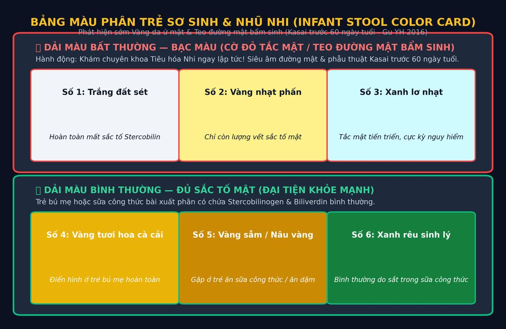
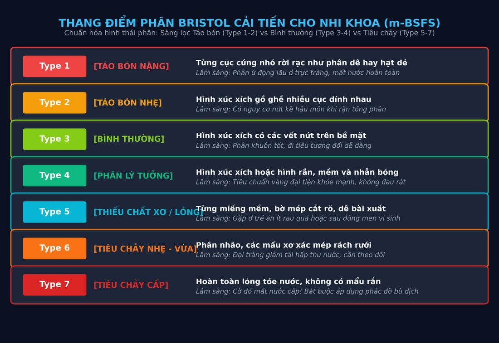
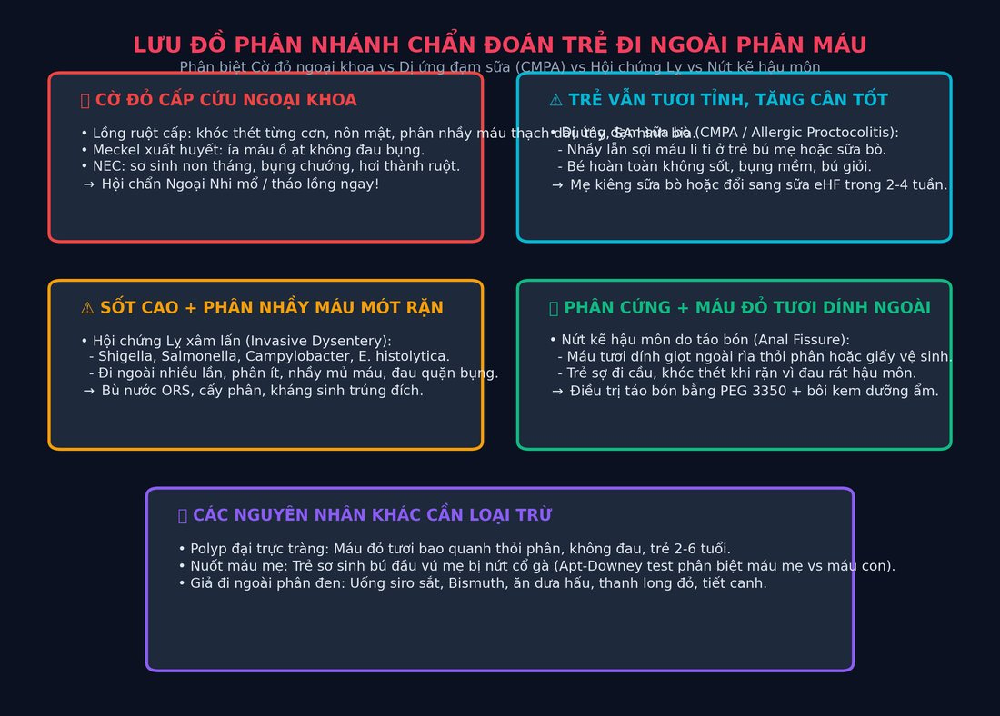
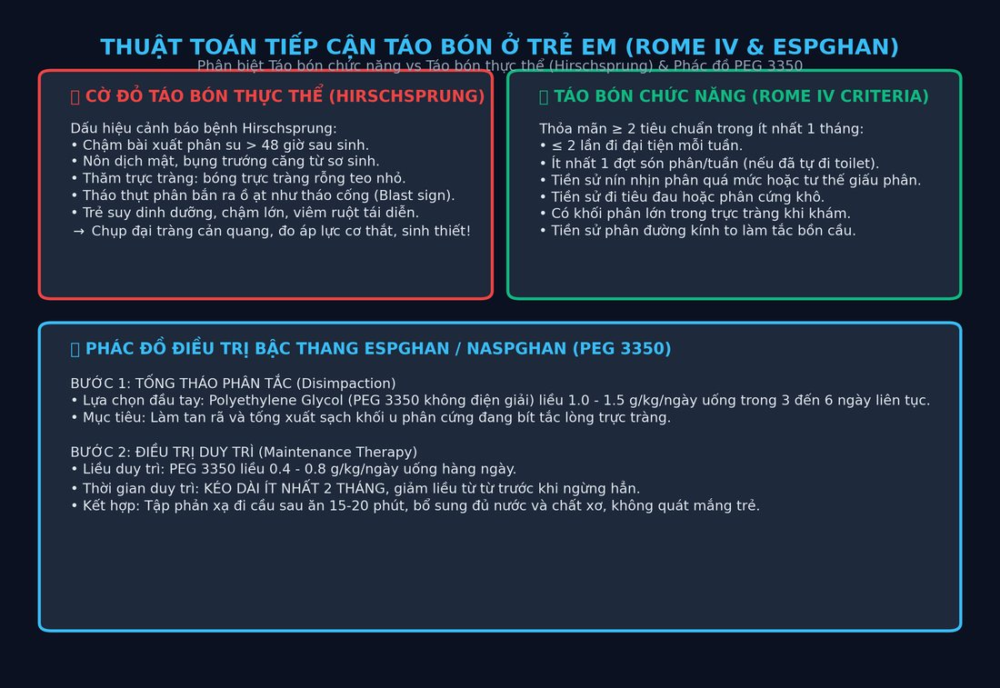
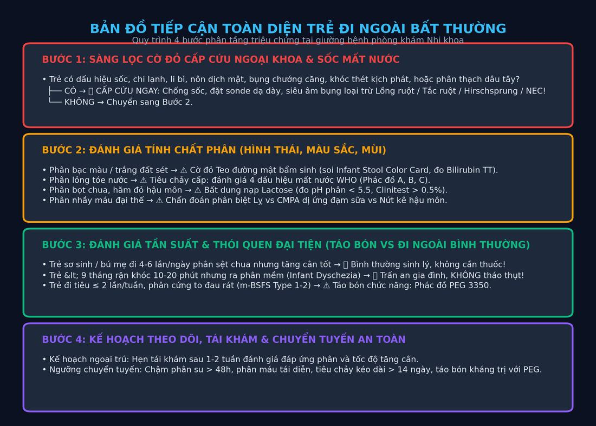

# BÀI HỌC Y KHOA: TIẾP CẬN ĐI NGOÀI BẤT THƯỜNG & ĐÁNH GIÁ TÍNH CHẤT PHÂN Ở TRẺ EM (PED-61)
**Ngày:** 2026-10-13 | **Chuyên khoa:** Nhi khoa — Tiêu hóa & Gan mật | **Đối tượng:** Bác sĩ nhi khoa, học viên sau đại học và người học cần nắm vững từ nền tảng

---

## 0. TỔNG QUAN — VÌ SAO BÀI NÀY QUAN TRỌNG?

Trong thực hành lâm sàng Nhi khoa hàng ngày, **"Đi ngoài bất thường"** (tiêu chảy, táo bón, phân nhầy máu, phân sủi bọt chua, phân bạc màu) là một trong những lý do hàng đầu khiến các bậc phụ huynh hoang mang đưa con đi khám cấp cứu. Tuy nhiên, sự khác biệt sinh lý sâu sắc giữa từng lứa tuổi (trẻ sơ sinh, trẻ bú mẹ hoàn toàn, trẻ ăn sữa công thức, trẻ ăn dặm) thường dẫn đến hai thái cực sai lầm phổ biến của người thầy thuốc:
1. **Chẩn đoán quá mức (Overdiagnosis):** Nhầm lẫn các hiện tượng sinh lý hoàn toàn bình thường (như phân hoa cà hoa cải đi 4–6 lần/ngày ở trẻ bú mẹ, hoặc hiện tượng rặn đỏ mặt khóc thét do táo bón giả nhũ nhi Infant Dyschezia) thành bệnh lý tiêu chảy nhiễm trùng hay táo bón, dẫn đến lạm dụng kháng sinh, thuốc cầm tiêu chảy và thuốc tháo thụt nguy hại.
2. **Bỏ sót các cờ đỏ đe dọa tính mạng (Underdiagnosis):** Không nhận diện kịp thời các bệnh cảnh tối cấp cứu ngoại khoa ẩn sau tính chất phân (như phân nhầy máu "thạch dâu tây" trong lồng ruột cấp, chậm bài xuất phân su quá 48 giờ trong bệnh phình đại tràng vô hạch Hirschsprung, hoặc phân bạc màu trong teo đường mật bẩm sinh cần mổ Kasai trước 60 ngày tuổi).

Một cái nhìn tinh tường vào tã bỉm của trẻ, kết hợp với kỹ năng hỏi bệnh và thăm khám hậu môn trực tràng chuẩn mực, có thể cứu sống đứa trẻ chỉ trong vài phút đầu tiếp cận.

**Mục tiêu của bài:**
- Làm chủ sinh lý đại tiện và tính chất phân bình thường theo từng tháng tuổi, nhận diện chính xác hiện tượng Táo bón giả nhũ nhi (Infant Dyschezia) để trấn an gia đình.
- Sử dụng thành thạo Thang điểm phân Bristol Nhi khoa cải tiến (m-BSFS 7 Type) để lượng giá mức độ táo bón và tiêu chảy.
- Phân tầng chẩn đoán và xử trí trúng đích 7 tính chất phân bệnh lý kinh điển: Phân lỏng tóe nước, phân nhầy máu, phân bọt chua hăm loét hậu môn, phân bạc màu, phân đen, phân mỡ và táo bón.
- Phân biệt chính xác Táo bón chức năng theo tiêu chuẩn Rome IV vs Táo bón thực thể do bệnh Hirschsprung.
- Thực hành chuẩn xác phác đồ điều trị Táo bón chức năng bằng Polyethylene Glycol (PEG 3350) theo khuyến cáo ESPGHAN/NASPGHAN: Liều tống tháo phân và liều duy trì.
- Nhận diện kịp thời các cờ đỏ ngoại khoa cấp cứu (Lồng ruột cấp, Viêm ruột hoại tử, Hirschsprung viêm ruột).

### 📋 TRƯỚC KHI ĐỌC — NỀN TẢNG CẦN DÙNG

### 0.1 Nền tảng tối thiểu cần dùng ngay

Để người học chưa từng tiếp xúc sâu với tiêu hóa nhi khoa có thể nắm bắt mạch bài học ngay từ đầu, dưới đây là các khái niệm gốc rễ:

1. **Khái niệm Phân su (Meconium):** Là mẻ phân đầu tiên của trẻ sơ sinh, tích tụ trong đường tiêu hóa thai nhi từ quý 2 thai kỳ. Cấu tạo gồm dịch ối đã nuốt, tế bào biểu mô ruột bong tróc, chất nhầy, muối mật và sắc tố mật Biliverdin. Phân su có màu xanh đen quánh dính, không mùi và hoàn toàn vô khuẩn. Thời gian bài xuất phân su phản ánh sự thông suốt giải phẫu của toàn bộ ống tiêu hóa và sự hiện diện của các tế bào hạch thần kinh phó giao cảm ở thành đại tràng.
2. **Khái niệm Phản xạ dạ dày - đại tràng (Gastrocolic Reflex):** Khi sữa đi vào dạ dày làm căng thành dạ dày, tín hiệu thần kinh và hormon (Gastrin, Cholecystokinin) kích thích nhu động đại tràng co bóp đẩy phân xuống trực tràng. Ở trẻ sơ sinh và trẻ nhũ nhi bú mẹ hoàn toàn, phản xạ này cực kỳ nhạy bén, khiến trẻ thường "vừa bú vừa đi ngoài" hoặc đi tiêu ngay sau cữ bú.
3. **Màu sắc sinh lý của phân:** Màu vàng của phân do sắc tố Stercobilin (sản phẩm chuyển hóa của Bilirubin thoái giáng bởi vi khuẩn đường ruột) tạo nên. Khi đường mật bị tắc nghẽn hoàn toàn, không có sắc tố mật xuống ruột làm phân mất màu vàng $\rightarrow$ trở nên trắng bợt như đất sét (phân bạc màu). Khi phân di chuyển quá nhanh qua ruột non (tiêu chảy) hoặc do sắt oxy hóa trong sữa công thức, sắc tố Biliverdin màu xanh chưa kịp chuyển thành Stercobilin $\rightarrow$ phân có màu xanh lá cây hoặc xanh rêu.
4. **Cơ chế giữ phân và rặn đại tiện:** Đại tiện là một động tác phối hợp vận động phức tạp: Cơ hoành và cơ thành bụng co lại để tăng áp lực ổ bụng, trong khi cơ nâng hậu môn và cơ thắt hậu môn ngoài phải tự động giãn mở ra để tống phân. Trẻ nhỏ dưới 9 tháng tuổi chưa hoàn thiện phối hợp này thường bị hiện tượng "rặn nhưng cơ thắt không mở" gây ra táo bón giả nhũ nhi.

---

## 1. ĐỊNH NGHĨA & SINH LÝ ĐẠI TIỆN THEO LỨA TUỔI [CỐT LÕI]

### 1.0 Nền tảng: Sự trưởng thành của hệ tiêu hóa và thói quen đi ngoài

Tính chất và tần suất đi ngoài của một đứa trẻ thay đổi ngoạn mục theo từng giai đoạn phát triển:

- **Giai đoạn sơ sinh sớm (0–48 giờ đầu):** Đánh dấu bằng sự bài xuất phân su. Theo nghiên cứu đoàn hệ sơ sinh của Ubesie & Ibeziako (PMID: 19460266) [DATA VERIFIED] {claim: C-001}, thời gian bài xuất phân su đầu tiên ở trẻ sơ sinh đủ tháng: chậm bài xuất phân su quá 48 giờ là dấu hiệu cảnh báo bệnh Hirschsprung (Timing of passage of first meconium and stooling pattern in normal newborns colonic motility problems).
- **Giai đoạn chuyển tiếp (Ngày 3–5 sau sinh):** Phân su chuyển dần sang phân chuyển tiếp màu xanh nâu, sau đó chuyển thành phân vàng khi trẻ bú đủ sữa mẹ.
- **Trẻ bú mẹ hoàn toàn:** Phân có màu vàng tươi (vàng hoa cải), độ sệt mềm như sinh tố hoặc có các hạt lợn cợn màu trắng ngà (hoa cà hoa cải - thực chất là các cục xà phòng canxi và đạm sữa chưa tiêu hóa hết). Mùi phân chua nhẹ tự nhiên, pH acid sinh lý ($5.0 - 5.5$) giúp ức chế vi khuẩn gây bệnh phát triển. Trẻ có thể đi ngoài 4–6 lần/ngày, thậm chí 8–10 lần/ngày sau mỗi cữ bú. Ngược lại, một số trẻ bú mẹ hấp thu gần như 100% sữa mẹ có thể 3–7 ngày mới đi ngoài một lần nhưng khi đi phân vẫn mềm nhẵn $\rightarrow$ đây là hiện tượng "chậm đi tiêu sinh lý", hoàn toàn không phải táo bón!
- **Trẻ ăn sữa công thức:** Sữa công thức giàu protein casein và chất béo khó tiêu hơn sữa mẹ, làm phân đặc hơn thành khuôn mềm như bột nhão, màu vàng nâu hoặc xanh rêu sẫm (do lượng sắt bổ sung bị oxy hóa), mùi nồng hơn. Tần suất đi tiêu thường là 1–2 lần/ngày hoặc cách ngày.



---

### 1.1 Hiện tượng Táo bón giả nhũ nhi (Infant Dyschezia) — Tránh tháo thụt oan uổng

**Định nghĩa chuẩn Rome IV:** Tiêu chuẩn Rome IV cho Rối loạn đi ngoài chức năng ở trẻ nhũ nhi (Infant dyschezia Childhood Functional Gastrointestinal Disorders): ít nhất 10 phút rặn và khóc trước khi đi ngoài phân mềm ở trẻ dưới 9 tháng tuổi theo nghiên cứu của Benninga et al. (PMID: 27144631) [DATA VERIFIED] {claim: C-002}.

- **Cơ chế sinh lý học:** Trẻ nhũ nhi nhận biết được cảm giác căng đầy của trực tràng khi có phân, nhưng não bộ và tủy sống chưa điều khiển thuần thục sự phối hợp giữa:
  $$\text{Tăng áp lực ổ bụng (rặn gồng mình)} \iff \text{Giãn cơ sàn chậu và mở cơ thắt hậu môn ngoài}$$
  Hậu quả là trẻ rặn hết sức nhưng cơ thắt hậu môn vẫn vô tình co thắt chặt, tạo nên sự bế tắc cơ học tạm thời. Trẻ quấy khóc đỏ bừng mặt trong 10–20 phút cho đến khi cơ thắt mỏi mệt tự giãn ra, phân tống ra ngoài hoàn toàn mềm nhẵn, không có cục rắn.
- **Thái độ xử trí chuẩn mực:**
  - Bác sĩ giải thích cặn kẽ cơ chế cho cha mẹ hiểu để giải tỏa tâm lý lo âu.
  - **TUYỆT ĐỐI CẤM THÁO THỤT HOẶC KÍCH THÍCH HẬU MÔN:** Dùng cọng hành, thụt mật ong hay bơm thuốc hậu môn sẽ tạo phản xạ phụ thuộc nhân tạo, làm mất cơ hội học tập phối hợp thần kinh - cơ tự nhiên của trẻ.
  - Hiện tượng này hoàn toàn lành tính và tự khỏi trước 9 tháng tuổi khi hệ thần kinh tự chủ trưởng thành.

---

### 1.2 Thang điểm phân Bristol Nhi khoa cải tiến (m-BSFS)

Thang điểm phân Bristol kinh điển của người lớn đã được chuẩn hóa và sửa đổi dành riêng cho trẻ em (Modified Bristol Stool Form Scale for Children - m-BSFS):



Bảy hình thái phân được phân định rạch ròi:
- **Type 1 (Phân dê):** Từng cục cứng nhỏ, tròn, rời rạc như phân dê hay hạt dẻ. Trẻ phải rặn rất đau đớn, phân lưu lại quá lâu ở đại tràng bị tái hấp thu cạn kiệt nước $\rightarrow$ **Táo bón nặng**.
- **Type 2 (Xúc xích lổn nhổn):** Dạng xúc xích nhưng bề mặt lổn nhổn nhiều cục cứng dính liền nhau $\rightarrow$ **Táo bón nhẹ/vừa**, nguy cơ gây nứt kẽ hậu môn khi tống phân.
- **Type 3 (Xúc xích nứt nẻ):** Hình xúc xích có các vết nứt trên bề mặt $\rightarrow$ **Phân bình thường**.
- **Type 4 (Hình rắn nhẵn bóng):** Hình xúc xích hoặc hình rắn mềm mại, nhẵn bóng $\rightarrow$ **Tiêu chuẩn vàng của phân lý tưởng**, bài xuất êm ái, không đau rát.
- **Type 5 (Miếng mềm mép rõ):** Từng mẩu phân mềm, bờ mép cắt gọn gàng, dễ đi tiêu $\rightarrow$ Phân mềm thiếu chất xơ hoặc sau ăn thức ăn nhuận tràng.
- **Type 6 (Phân nhão xơ xác):** Phân sệt nhão, các mẩu xơ xác với bờ mép rách rưới $\rightarrow$ **Tiêu chảy nhẹ đến vừa**, đại tràng bắt đầu suy giảm khả năng hấp thu nước.
- **Type 7 (Lỏng tóe nước):** Hoàn toàn lỏng như nước, không có các mẩu rắn $\rightarrow$ **Tiêu chảy cấp tính**, nguy cơ mất nước và rối loạn điện giải cao.

---

### 1.3 Bảng đối chiếu các tính chất phân bình thường theo lứa tuổi

| Giai đoạn tuổi | Thức ăn chủ đạo | Số lần đi ngoài/ngày | Màu sắc điển hình | Hình thái (Bristol) | Mùi & pH |
|---|---|---|---|---|---|
| **Sơ sinh 24–48h** | Phân su ban đầu | 1–3 lần/ngày | Xanh đen quánh dính | Dính như hắc ín | Không mùi, vô khuẩn |
| **Nhũ nhi bú mẹ** | Sữa mẹ hoàn toàn | 3–8 lần/ngày | Vàng tươi hoa cải | Sệt lỏng, có hạt lợn cợn | Chua nhẹ, pH 5.0–5.5 |
| **Nhũ nhi bú sữa CT**| Sữa công thức | 1–2 lần/ngày | Vàng nâu hoặc xanh rêu| Bột nhão thành khuôn (Type 4) | Mùi nồng, pH 6.0–7.0 |
| **Trẻ ăn dặm (6–12th)**| Bột, cháo, rau thịt | 1–2 lần/ngày | Nâu, vàng, biến đổi | Thành khuôn mềm (Type 3–4)| Mùi thối sinh lý |
| **Trẻ lớn (> 1 tuổi)** | Cơm gia đình | 1 lần/ngày | Nâu sẫm | Xúc xích mềm (Type 4) | Mùi thối người lớn |

> ⚠️ HỌC VIÊN HAY NHẦM: Rất nhiều bác sĩ trẻ khi thấy bà mẹ bế con 1 tháng tuổi đến khám khai "cháu đi ngoài ngày 6 lần phân tóe nước hoa cà hoa cải" liền vội vàng chẩn đoán Tiêu chảy cấp và kê kháng sinh + men vi sinh. Hãy nhớ: Nếu trẻ bú mẹ hoàn toàn, đi 6–8 lần/ngày mà vẫn tăng cân tốt ($> 25 - 30\text{ g/ngày}$), bụng mềm xẹp thì đó là **ĐẠI TIỆN HOÀN TOÀN BÌNH THƯỜNG**!

---

### 1.4 Các ví dụ minh họa tính toán và nhận định lâm sàng
- **Ví dụ 1 (Nhận định phân trẻ bú mẹ):** Bé gái 2 tháng tuổi bú mẹ hoàn toàn, đi tiêu 7 lần/ngày, phân lỏng sệt màu vàng hạt trắng lợn cợn, bé bú ngoan, cân nặng tăng $900\text{ g/tháng}$. Đây là phân sinh lý hoa cà hoa cải bình thường, không cần dùng bất kỳ loại thuốc nào.
- **Ví dụ 2 (Phát hiện Táo bón giả nhũ nhi):** Bé trai 3 tháng tuổi mỗi lần đi ngoài đều đỏ mặt gồng mình khóc 15 phút, sau đó đi ra bãi phân sệt vàng mềm nhẵn (Bristol 4). Bác sĩ giải thích cơ chế Infant Dyschezia và khuyên mẹ không can thiệp thụt tháo.
- **Ví dụ 3 (Nhận định phân xanh rêu do sữa công thức):** Bé 4 tháng uống sữa công thức giàu sắt đi phân màu xanh rêu sẫm thành khuôn mềm. Bác sĩ giải thích màu xanh do muối sắt bị oxy hóa khi tiếp xúc với không khí, hoàn toàn vô hại.
- **Ví dụ 4 (Tính liều tống tháo phân PEG 3350):** Bé trai $12\text{ kg}$ bị táo bón bít tắc khối u phân cứng, cần tống tháo phân với liều $1.5\text{ g/kg/ngày} = 18\text{ g/ngày}$ trong 4 ngày liên tục.
- **Ví dụ 5 (Tính liều duy trì PEG 3350):** Sau khi tống tháo phân thành công, bé $12\text{ kg}$ chuyển sang liều duy trì $0.5\text{ g/kg/ngày} = 6\text{ g/ngày}$ kéo dài ít nhất 2 tháng.
- **Ví dụ 6 (Nhận định bất dung nạp lactose thứ phát):** Bé 8 tháng sau đợt tiêu chảy cấp đi ngoài phân sủi bọt nhiều nước mùi chua nồng, hậu môn hăm đỏ rực. Xét nghiệm pH phân $5.0$, chất khử phân $1.0\%$. Đổi sang sữa Lactose-free trong 2 tuần.
- **Ví dụ 7 (Nhận diện phân thạch dâu tây lồng ruột):** Bé trai 7 tháng đột ngột khóc thét từng cơn, nôn dịch trong sau đó nôn dịch mật, bỉm có chất nhầy dính máu đỏ sẫm như thạch dâu tây. Siêu âm cấp cứu thấy hình ảnh bánh lồng đường kính $32\text{ mm}$.
- **Ví dụ 8 (Nhận diện phân bạc màu teo đường mật):** Bé 40 ngày tuổi vàng da mắt kéo dài, phân màu trắng nhạt như phấn viết bảng (màu số 1 trên Infant Stool Color Card). Chuyển tuyến chuyên khoa mổ Kasai khẩn cấp.

### 🛑 DỪNG 1 PHÚT — TỰ KIỂM TRA 1

> **Câu hỏi:** Một bé trai 18 ngày tuổi đủ tháng chưa đi phân su trong 48 giờ đầu sau sinh, hiện tại bụng trướng căng, thỉnh thoảng nôn dịch mật vàng xanh. Bác sĩ cần nghĩ đến chẩn đoán nào trước tiên và nghiệm pháp thăm khám nào có giá trị gợi ý cao?
>
> *(Đáp án: Cần nghĩ ngay đến bệnh phình đại tràng vô hạch bẩm sinh Hirschsprung. Nghiệm pháp thăm trực tràng (DRE) thấy bóng trực tràng rỗng teo nhỏ, khi rút ngón tay ra có dấu hiệu tháo cống (Blast sign) phân và hơi bắn ra ồ ạt.)*

---

## 2. SINH LÝ BỆNH & CƠ CHẾ 7 TÍNH CHẤT PHÂN BỆNH LÝ [CỐT LÕI]

### 2.1 Sinh lý tiêu hóa và cơ chế tạo thành phân

Hàng ngày, đường tiêu hóa của trẻ tiếp nhận một lượng dịch rất lớn gồm dịch thức ăn uống vào cộng với các dịch bài tiết tiêu hóa (nước bọt, dịch vị, dịch mật, dịch tụy, dịch ruột):
- Ruột non tái hấp thu khoảng $80 - 85\%$ lượng dịch này cùng toàn bộ các chất dinh dưỡng.
- Đại tràng tiếp nhận lượng dịch còn lại (khoảng $15 - 20\%$) và tiếp tục tái hấp thu triệt để nước và điện giải thông qua kênh Natri biểu mô (ENaC) và bơm $\text{Na}^+\text{-K}^+\text{-ATPase}$, cô đặc chất cặn bã thành khuôn phân mềm để bài xuất ra ngoài.

Khi có bất kỳ tổn thương cơ học, nhiễm trùng, miễn dịch hay dị tật bẩm sinh nào tác động lên quá trình này, các tính chất phân bệnh lý đặc hiệu sẽ xuất hiện:

---

### 2.2 Cơ chế phân tử của 7 tính chất phân bệnh lý

#### 1. Phân lỏng tóe nước: Cơ chế thẩm thấu vs Tiêu chảy xuất tiết
- *Tiêu chảy thẩm thấu (Osmotic diarrhea):* Do các chất hòa tan không hấp thu được nằm lại trong lòng ruột (ví dụ đường lactose trong bất dung nạp men lactase) tạo áp lực thẩm thấu hút nước từ khoang gian bào vào lòng ruột. Đặc điểm: Tiêu chảy sẽ ngừng lại khi nhịn ăn hoặc dừng nạp chất đó.
- *Tiêu chảy xuất tiết (Secretory diarrhea):* Độc tố vi khuẩn (độc tố tả CTX, độc tố ruột ETEC) gắn lên thụ thể tế bào ruột kích hoạt adenylate cyclase hoặc guanylate cyclase $\rightarrow$ tăng sinh cAMP/cGMP nội bào $\rightarrow$ mở toang kênh clo CFTR ở đỉnh tế bào $\rightarrow$ bơm ồ ạt ion Cl- và nước vào lòng ruột. Đặc điểm: Tiêu chảy vẫn tiếp diễn xối xả ngay cả khi trẻ nhịn ăn hoàn toàn.

#### 2. Phân nhầy máu đại thể: Cơ chế tổn thương niêm mạc đại trực tràng



- *Hội chứng Lỵ:* Vi khuẩn Shigella hoặc Amip xâm nhập trực tiếp phá hủy tế bào biểu mô niêm mạc đại tràng, tạo các ổ loét nông chảy máu và thâm nhiễm bạch cầu đa nhân $\rightarrow$ phân ít, nhiều chất nhầy mủ và máu tươi, đi kèm đau quặn bụng và mót rặn dữ dội.
- *Dị ứng đạm sữa bò (Allergic Proctocolitis):* Theo khuyến cáo của ESPGHAN (PMID: 22569527) [DATA VERIFIED] {claim: C-004}, Dị ứng đạm sữa bò thể viêm trực tràng dị ứng (CMPA allergic proctocolitis cow's milk protein allergy) gây đi ngoài phân nhầy sợi máu ở trẻ bú mẹ hoặc sữa công thức; đáp ứng với chế độ ăn loại trừ trong 2–4 tuần. Phản ứng miễn dịch không qua trung gian IgE làm thâm nhiễm bạch cầu ái toan (Eosinophil) vào niêm mạc trực tràng, gây viêm loét vi thể rỉ các sợi máu nhỏ li ti, nhưng không gây tổn thương toàn thân.
- *Lồng ruột cấp (Intussusception):* Theo nghiên cứu của Hryhorczuk et al. (PMID: 19657636) [DATA VERIFIED] {claim: C-007}, Lồng ruột cấp ở trẻ em (Validation of US as a first-line diagnostic test for assessment of pediatric ileocolic intussusception): phân nhầy máu, siêu âm có độ nhạy 97.9% và độ đặc hiệu 97.8% với hình ảnh bánh lồng. Đoạn ruột lồng kéo theo mạc treo mạch máu bị kẹp nghẹt $\rightarrow$ ứ trệ tuần hoàn tĩnh mạch $\rightarrow$ phù nề niêm mạc ruột $\rightarrow$ hoại tử xuất huyết rỉ máu đỏ tươi lẫn chất nhầy tạo nên màu "thạch dâu tây / nước mận chín".
- *Nứt kẽ hậu môn:* Khối phân to cứng (Type 1) khi tống qua cơ thắt hậu môn làm căng giãn quá mức và rách lớp biểu mô lát tầng ở rìa hậu môn (thường ở vị trí 6 giờ) $\rightarrow$ máu tươi đỏ chói bọc ngoài rìa phân.
- *Túi thừa Meckel xuất huyết:* Tồn tại ống noãn hoàng bẩm sinh chứa niêm mạc dạ dày lạc chỗ bài tiết acid clohydric $\rightarrow$ acid gây loét thành hồi tràng liền kề $\rightarrow$ chảy máu ồ ạt không đau bụng.

#### 3. Phân bọt chua: Cơ chế bất dung nạp Lactose
Theo hướng dẫn của Viện Hàn lâm Nhi khoa Hoa Kỳ AAP (PMID: 16951027) [DATA VERIFIED] {claim: C-005}, Bất dung nạp lactose ở trẻ em (Lactose intolerance in infants children and adolescents) gây đi ngoài phân lỏng chua sủi bọt, hăm đỏ quanh hậu môn; xét nghiệm pH phân < 5.5 và chất khử trong phân > 0.5%.
- Thiếu enzym lactase $\rightarrow$ đường lactose không được phân cắt thành glucose và galactose $\rightarrow$ xuống đại tràng vi khuẩn lên men yếm khí tạo khí $\text{H}_2, \text{CO}_2, \text{CH}_4$ (làm phân sủi bọt hơi) và các acid béo chuỗi ngắn (SCFA, acid lactic làm phân chua và tụt $\text{pH} < 5.5$). Acid này kích ứng trực tiếp lớp biểu bì da gây hăm loét trợt đỏ da quanh hậu môn.

#### 4. Phân bạc màu: Cơ chế gián đoạn lưu thông sắc tố mật
Theo nghiên cứu của Gu et al. (PMID: 27015203) [DATA VERIFIED] {claim: C-006}, Sàng lọc phân bạc màu bằng Thang màu phân trẻ sơ sinh (Infant stool color card screening biliary atresia acholic pale stools) phát hiện teo đường mật bẩm sinh trước 60 ngày tuổi giúp giảm tỷ lệ tử vong và tăng hiệu quả phẫu thuật Kasai.
- Quá trình viêm xơ teo tắc đường mật ngoài gan ngăn cản hoàn toàn dòng chảy của dịch mật xuống tá tràng $\rightarrow$ không có bilirubin xuống ruột để chuyển hóa thành Stercobilin $\rightarrow$ phân mất hoàn toàn sắc tố, trở nên trắng bợt như đất sét hoặc phấn viết bảng.

#### 5. Phân đen như hắc ín: Cơ chế xuất huyết tiêu hóa cao
- Máu từ thực quản, dạ dày hoặc tá tràng chảy xuống ruột non tiếp xúc với acid dịch vị và các enzym tiêu hóa $\rightarrow$ Hemoglobin bị oxy hóa thành Hematin có màu nâu đen. Khi xuống đại tràng, vi khuẩn tiếp tục chuyển hóa lưu huỳnh tạo mùi khắm nồng đặc trưng.

#### 6. Phân mỡ: Cơ chế kém hấp thu lipid
- Thiếu lipase tụy (trong xơ nang tụy) hoặc mất diện tích nhung mao ruột (bệnh Celiac) làm chất béo không được nhũ tương hóa và thủy phân $\rightarrow$ đào thải nguyên vẹn ra phân $\rightarrow$ phân bóng nhẫy, váng mỡ, mùi khắm khó dội trôi.

#### 7. Táo bón: Vòng xoắn bệnh lý nín nhịn phân



Theo đồng thuận ESPGHAN và NASPGHAN (PMID: 24345831) [DATA VERIFIED] {claim: C-003}, Phác đồ ESPGHAN / NASPGHAN điều trị táo bón chức năng: Polyethylene glycol PEG 3350 liều tống tháo phân 1.0–1.5 g/kg/ngày trong 3–6 ngày, liều duy trì 0.4–0.8 g/kg/ngày trong ít nhất 2 tháng (Evaluation and treatment of functional constipation in infants and children).
- Táo bón chức năng ở trẻ em hình thành theo vòng xoắn bệnh lý ác tính:
  $$\text{Đi tiêu đau rát (do phân cứng/nứt kẽ)} \rightarrow \text{Trẻ sợ đau, chủ động nín nhịn phân (co thắt cơ sàn chậu)}$$
  $$\rightarrow \text{Phân nằm lâu trong trực tràng bị hút cạn nước} \rightarrow \text{Khối phân to cứng hơn nữa}$$
  $$\rightarrow \text{Trực tràng giãn to mất cảm giác mót rặn} \rightarrow \text{Lần đi tiêu sau càng đau đớn dữ dội hơn}$$

---

### 2.3 Diễn biến tự nhiên & Biến chứng nếu không điều trị đúng

- **Biến chứng 1: Bít tắc khối u phân cứng và Són phân giả tạo (Fecal Impaction & Encopresis)**
  - *Tại sao:* Trẻ nín nhịn phân kéo dài làm trực tràng giãn rộng mất trương lực cơ.
  - *Là gì:* Hình thành khối phân to hóa đá chèn chặt ở bóng trực tràng; phân lỏng mới sinh từ trên đại tràng rỉ qua khe kẽ khối phân cứng chảy ra ngoài quần lót.
  - *Thế nào:* Trẻ bị són phân bẩn ra quần liên tục trong ngày, phụ huynh tưởng con bị "tiêu chảy mất tự chủ" nên cho uống thuốc cầm tiêu chảy $\rightarrow$ làm tắc nghẽn ruột nặng nề hơn!
  - *Nếu không điều trị:* Phình đại tràng thứ phát, suy giảm tâm lý nặng nề, tự ti, trầm cảm ở tuổi đi học.
- **Biến chứng 2: Viêm ruột do Hirschsprung (HAEC - Hirschsprung-Associated Enterocolitis)**
  - *Tại sao:* Tắc nghẽn mạn tính do đoạn đại tràng vô hạch thần kinh gây ứ đọng phân và vi khuẩn kỵ khí phát triển quá mức.
  - *Là gì:* Viêm hoại tử niêm mạc đại tràng cấp tính đe dọa tử vong hàng đầu của bệnh Hirschsprung.
  - *Thế nào:* Trẻ sơ sinh bụng chướng căng nề, sốt cao, đi ngoài phân lỏng thối khắm dữ dội lẫn máu.
  - *Nếu không điều trị:* Thủng đại tràng, sốc nhiễm trùng toan chuyển hóa và tử vong nhanh chóng.
- **Biến chứng 3: Xơ gan và tử vong trong Teo đường mật bẩm sinh bỏ sót**
  - *Tại sao:* Ứ mật trong gan kéo dài gây độc tế bào gan và kích hoạt các tế bào hình sao tăng sinh xơ hóa.
  - *Là gì:* Xơ gan ứ mật không hồi phục.
  - *Thế nào:* Trẻ vàng da tăng dần, gan lách to cứng, tăng áp lực tĩnh mạch cửa, suy gan xuất huyết.
  - *Nếu không điều trị:* Bỏ lỡ "cửa sổ vàng" phẫu thuật nối mật ruột Kasai (trước 60 ngày tuổi) $\rightarrow$ trẻ bắt buộc phải ghép gan hoặc tử vong trước 2 tuổi.


### 2.4 Bốn chuỗi cơ chế bệnh sinh nhân quả (Mechanism Chains)
- **Chuỗi 1 (Cơ chế tiêu chảy thẩm thấu do virus):** Tổn thương niêm mạc ruột do Rotavirus → Teo cùn vi nhung mao ruột non → Giảm diện tích hấp thu và thiếu hụt men lactase → Tăng áp lực thẩm thấu trong lòng ruột kéo nước ồ ạt → Đi ngoài phân lỏng tóe nước mất nước cấp tính.
- **Chuỗi 2 (Cơ chế phân thạch dâu tây trong lồng ruột cấp):** Khối ruột lồng di chuyển chui vào lòng đoạn ruột phía dưới → Kéo theo cuống mạch máu mạc treo bị bóp nghẹt tại cổ lồng → Ứ trệ hồi lưu tĩnh mạch gây phù nề xung huyết niêm mạc → Hoại tử thiếu máu xuất huyết rỉ dịch nhầy máu tạo phân thạch dâu tây.
- **Chuỗi 3 (Cơ chế tắc nghẽn vô hạch trong bệnh Hirschsprung):** Đoạn trực tràng vô hạch thần kinh bẩm sinh bị co thắt liên tục không tự giãn → Điểm nghẽn cơ học ngăn cản phân và hơi tống xuất → Đại tràng phía trên tăng co bóp bù trừ dẫn đến phình giãn khổng lồ → Ứ đọng phân mạn tính gây chậm lớn và viêm ruột hoại tử.
- **Chuỗi 4 (Cơ chế vòng xoắn nín nhịn phân trong táo bón chức năng):** Trẻ đi tiêu phân to cứng gây rách nứt kẽ hậu môn đau đớn → Nỗi sợ đau khiến trẻ chủ động co thắt cơ sàn chậu nín nhịn phân → Phân ứ đọng lâu ở trực tràng bị tái hấp thu cạn kiệt nước thành khối u phân khổng lồ → Trực tràng giãn to mất cảm giác mót rặn tạo vòng xoắn bệnh lý táo bón kháng trị.

### 🛑 DỪNG 1 PHÚT — TỰ KIỂM TRA 2

> **Câu hỏi:** Tại sao trong điều trị táo bón chức năng ở trẻ em, việc chỉ cho uống men vi sinh và ăn nhiều rau mà không dùng thuốc nhuận tràng làm mềm phân lại thường thất bại hoàn toàn?
>
> *(Đáp án: Vì vòng xoắn bệnh lý cốt lõi là nỗi sợ đau rát của trẻ. Nếu trực tràng vẫn chứa khối phân to cứng như đá, trẻ sẽ tiếp tục chủ động nín nhịn phân. Men vi sinh hay rau xơ không thể phá vỡ khối u phân đã cô đặc; bắt buộc phải dùng thuốc nhuận tràng thẩm thấu PEG 3350 để tống tháo khối phân bít tắc và giữ phân luôn mềm nhẵn ít nhất 2 tháng để xóa bỏ nỗi sợ hãi của trẻ.)*

---

## 3. KHÁM LÂM SÀNG & CHẨN ĐOÁN [CỐT LÕI]

### 3.1 Khai thác Tiền sử & Bệnh sử "Khám phân gián tiếp"

Hỏi bệnh sử chi tiết là 70% chìa khóa chẩn đoán tính chất phân:
1. **Tuổi và chế độ nuôi dưỡng hiện tại:**
   - Trẻ bú mẹ hoàn toàn, sữa công thức hay ăn dặm? Loại sữa đang dùng là gì? Có đổi sữa gần đây không?
   - Tiền sử bài xuất phân su lúc mới sinh: Ra phân su trong ngày đầu hay chậm sau 48 giờ?
2. **Khai thác thuộc tính của đợt đi ngoài:**
   - *Khởi phát:* Đột ngột trong vài giờ (nghi ngờ lồng ruột, nhiễm trùng cấp) hay âm thầm kéo dài nhiều tuần/tháng (táo bón chức năng, dị ứng đạm sữa)?
   - *Tần suất:* Đi bao nhiêu lần trong 24 giờ?
   - *Hình thái phân (đối chiếu thang Bristol):* Phân lỏng tóe nước (Type 7), phân nhão xơ xác (Type 6), hay phân cứng vón cục dê (Type 1)?
   - *Màu sắc:* Vàng tươi, xanh rêu, bạc màu trắng đất sét, đen nhựa đường, hay đỏ tươi?
   - *Máu trong phân:* Máu đỏ tươi bọc ngoài thỏi phân (nứt kẽ) vs máu nhầy lẫn đều trong phân (lỵ, dị ứng sữa) vs phân thạch dâu tây (lồng ruột)?
   - *Mùi phân:* Chua nồng sủi bọt (bất dung nạp lactose) vs thối khắm nồng nặc (nhiễm trùng, xuất huyết, phân mỡ) vs không mùi?
3. **Triệu chứng toàn thân đi kèm:**
   - Có sốt cao không? Có nôn trớ không (nôn dịch trong hay nôn dịch mật vàng xanh)?
   - Cơn đau bụng khóc thét: Khóc cơn kịch phát ưỡn người co đùi (lồng ruột) hay khóc khi mót rặn (táo bón, infant dyschezia)?
   - Tốc độ tăng trưởng cân nặng: Trẻ có sụt cân gầy còm không hay vẫn tăng cân đều đặn?

---

> 🚨 **BOX ĐỎ — CỜ ĐỎ CẤP CỨU NGOẠI KHOA TRONG ĐI NGOÀI BẤT THƯỜNG:**
> Bác sĩ bắt buộc phải khám và loại trừ ngay các tình huống đe dọa tính mạng trước khi đưa ra chẩn đoán thông thường:
> 1. **Cơn đau bụng khóc thét từng cơn + Nôn dịch mật + Phân nhầy máu thạch dâu tây:** Nghi ngờ tối khẩn cấp **LỒNG RUỘT CẤP**. Hành động: Đặt sonde dạ dày giải áp, siêu âm bụng cấp cứu ngay, không cho ăn uống, hội chẩn Ngoại Nhi tháo lồng bằng hơi!
> 2. **Chậm phân su quá 48h + Bụng trướng căng + Nôn dịch mật ở trẻ sơ sinh:** Nghi ngờ **TẮC RUỘT SƠ SINH / BỆNH HIRSCHSPRUNG / TEO RUỘT**. Hành động: Đặt sonde dạ dày, chụp X-quang bụng không chuẩn bị, chuyển khoa Ngoại Nhi!
> 3. **Trẻ sinh non + Bụng chướng đỏ nề + Phân có máu đại thể:** Nghi ngờ **VIÊM RUỘT HOẠI TỬ (NEC)**. Hành động: Nhịn ăn hoàn toàn, nuôi ăn tĩnh mạch, kháng sinh phổ rộng, hội chẩn Ngoại khẩn cấp!
> 4. **Trẻ sơ sinh/nhũ nhi vàng da kéo dài + Phân bạc màu trắng đất sét:** Nghi ngờ **TEO ĐƯỜNG MẬT BẨM SINH**. Hành động: Đo Bilirubin trực tiếp, siêu âm đường mật, chuyển tuyến chuyên khoa phẫu thuật trước 60 ngày tuổi!

---

### 3.2 Khám thực thể hệ thống: Bụng & Hậu môn trực tràng

**1. Khám bụng:**
- *Nhìn:* Bụng phẳng mềm hay trướng căng bè hai bên? Có nhìn thấy quai ruột nổi, sóng nhu động (dấu hiệu rắn bò) không?
- *Sờ:* Tìm điểm đau khu trú; sờ dọc khung đại tràng tìm các khối u phân cứng rắn ở hố chậu trái (đại tràng sigma); sờ hạ sườn phải tìm khối bánh lồng mềm hình xúc xích (trong lồng ruột) hoặc gan to chắc (trong ứ mật).
- *Gõ & Nghe:* Gõ vang toàn bụng (trướng hơi) hay gõ đục vùng thấp (cổ trướng); nghe nhu động ruột tăng mạnh (tiêu chảy, tắc ruột cơ học giai đoạn đầu) hay mất nhu động ruột (liệt ruột, viêm phúc mạc).

**2. Khám Hậu môn — Trực tràng (Bắt buộc không được bỏ qua):**
- *Quan sát ngoài hậu môn:* Đặt trẻ nằm ngửa gập đùi hoặc nằm nghiêng. Banh nhẹ hai mép hậu môn quan sát:
  - Vết nứt kẽ hậu môn: Vết rách niêm mạc hình thoi rỉ máu tươi, thường nằm ở vị trí 6 giờ (sau) hoặc 12 giờ (trước).
  - Vùng da quanh hậu môn: Hăm đỏ trợt loét rớm dịch (bất dung nạp lactose); mụn nước bọng mủ quanh hậu môn (thiếu kẽm).
  - Trĩ, lỗ rò hậu môn, nốt polyp thò ra ngoài.
  - Khoảng cách từ hậu môn đến cơ quan sinh dục ngoài (loại trừ dị tật hậu môn lạc chỗ ra trước).
- *Thăm trực tràng bằng ngón tay (Digital Rectal Examination - DRE):*
  - Chỉ định: Khi nghi ngờ táo bón thực thể Hirschsprung, nghi u phân bít tắc, hoặc cần kiểm tra máu ẩn trong phân.
  - Kỹ thuật: Đeo găng bôi trơn gel Xylocaine, dùng ngón tay út (trẻ nhỏ) hoặc ngón trỏ (trẻ lớn).
  - Đánh giá: Trương lực cơ thắt hậu môn có quá chặt không? Lòng bóng trực tràng rỗng hẹp (bệnh Hirschsprung) hay giãn rộng chứa đầy khối phân to cứng (táo bón chức năng)? Khi rút găng tay ra có hiện tượng phân và hơi bắn ra ồ ạt như tháo cống không (dấu hiệu Blast sign dương tính trong Hirschsprung)?

---

### 3.3 Cận lâm sàng định hướng

- **Xét nghiệm phân:**
  - *Soi phân tìm hồng cầu, bạch cầu, amip:* Phân biệt tiêu chảy nhiễm trùng xâm lấn (nhiều bạch cầu đa nhân) vs tiêu chảy thẩm thấu/tiết (không có bạch cầu).
  - *Cấy phân và kháng sinh đồ:* Chỉ định khi nghi ngờ lỵ trực trùng, nhiễm khuẩn huyết từ ruột, hoặc tiêu chảy phân máu kéo dài.
  - *Đo pH phân và xét nghiệm chất khử Clinitest:* Tiêu chuẩn vàng sàng lọc bất dung nạp lactose ($\text{pH} < 5.5$ và chất khử $> 0.5\%$).
  - *Tìm độc tố Clostridioides difficile (Toxin A/B):* Chỉ định ở trẻ tiêu chảy sau đợt dùng kháng sinh phổ rộng kéo dài.
- **Hình ảnh học:**
  - *Siêu âm ổ bụng:* Công cụ đầu tay chẩn đoán lồng ruột cấp (độ nhạy $98 - 100\%$ với hình ảnh bánh lồng "Target sign" hay "Doughnut sign"); khảo sát nang ống mật chủ; đo bề dày cơ thắt hậu môn.
  - *X-quang bụng không chuẩn bị:* Tìm liềm hơi dưới hoành (thủng ruột), mức nước hơi (tắc ruột), hơi trong thành ruột (NEC).
  - *Chụp đại tràng cản quang (Barium enema):* Hình ảnh phễu chuyển tiếp điển hình trong bệnh Hirschsprung (đoạn trực tràng vô hạch teo nhỏ bên dưới nối tiếp với đoạn đại tràng giãn phình bên trên).
  - *Sinh thiết hút niêm mạc trực tràng (Rectal suction biopsy):* Tiêu chuẩn vàng tuyệt đối khẳng định Hirschsprung: Vắng mặt hoàn toàn các tế bào hạch thần kinh phó giao cảm ở đám rối Meissner và Auerbach, kèm tăng sinh men Acetylcholinesterase.

---


### 3.5 Nhận diện các bẫy phân đổi màu giả tạo (False Color Pitfalls)

Trong thực hành nhi khoa, bác sĩ rất thường gặp các trường hợp phụ huynh hốt hoảng bế con đi khám vì thấy phân con đổi màu đỏ hoặc màu đen nhưng thực chất là do thực phẩm hoặc thuốc:

- **1. Đi ngoài phân màu đỏ giả tạo (False Hematochezia):**
  - *Thực phẩm chứa sắc tố betacyanin:* Củ dền đỏ (Beetroot), thanh long ruột đỏ (Red dragon fruit). Sắc tố đỏ không bị phân hủy qua đường tiêu hóa nên đào thải nguyên vẹn ra phân làm bãi phân đỏ rực như máu.
  - *Nước ngọt và kẹo bánh chứa phẩm màu đỏ:* Kẹo dẻo, thạch rau câu, siro dâu tây nhân tạo.
  - *Thuốc điều trị:* Kháng sinh Cefdinir (đặc biệt khi dùng chung với sữa công thức bổ sung sắt hoặc siro sắt) tạo phức hợp màu đỏ gạch không tan trong lòng ruột làm phân có màu đỏ như máu (hiện tượng "Cefdinir-iron red stool").
  - *Cách phân biệt:* Trẻ hoàn toàn tỉnh táo, chơi ngoan, bụng mềm xẹp; xét nghiệm tìm máu vi thể trong phân (FOBT) âm tính.

- **2. Đi ngoài phân màu đen giả tạo (False Melena):**
  - *Thuốc bổ sung sắt đường uống (Iron supplements):* Siro sắt hoặc viên sắt uống hàng ngày làm phân có màu đen nhánh hoặc xanh đen sẫm do sắt dư thừa bị oxy hóa bởi vi khuẩn ruột.
  - *Thuốc chứa Bismuth (Bismuth subsalicylate):* Bismuth phản ứng với lưu huỳnh do vi khuẩn tạo thành muối Bismuth sulfide màu đen thui.
  - *Than hoạt tính (Activated charcoal):* Đào thải phân màu đen xám hoàn toàn.
  - *Thức ăn:* Tiết canh, lòng dồi lợn, quả việt quất (Blueberries), quả dâu tằm sẫm màu.
  - *Nuốt máu cam hoặc nứt cổ gà:* Trẻ bị chảy máu cam nuốt máu vào dạ dày hoặc trẻ sơ sinh bú mẹ bị nứt đầu ti rỉ máu (Apt-Downey test để phân biệt HbA người lớn với HbF trẻ sơ sinh).
  - *Cách phân biệt:* Phân đen giả tạo không có mùi khắm thối đặc trưng của máu thoái hóa và trẻ hoàn toàn không có triệu chứng thiếu máu hay tụt huyết áp.

### 3.4 Bảng chẩn đoán phân biệt các nguyên nhân gây phân nhầy máu

| Nguyên nhân | Lứa tuổi thường gặp | Lâm sàng đặc trưng | Toàn trạng trẻ | Xử trí ban đầu |
|---|---|---|---|---|
| **Nứt kẽ hậu môn** | Mọi lứa tuổi (hay gặp 1–3 tuổi) | Phân cứng to (Bristol 1), máu tươi đỏ chói dính ngoài rìa phân, khóc thét khi rặn | Tươi tỉnh, sợ đi cầu | Nhuận tràng PEG 3350 + bôi kem dưỡng ẩm |
| **Dị ứng đạm sữa (CMPA)**| Trẻ nhỏ 1–6 tháng tuổi | Phân sệt nhầy lẫn các sợi máu đỏ li ti, đi nhiều lần, có thể kèm chàm da | Trẻ bú giỏi, chơi ngoan, tăng cân tốt | Mẹ kiêng sữa bò hoặc đổi sang sữa eHF |
| **Hội chứng Lỵ vi khuẩn**| Trẻ ăn dặm & trẻ lớn | Sốt cao, đau bụng quặn, mót rặn, phân nhầy mủ máu toàn bãi | Mệt mỏi, nhiễm trùng, mất nước | Kháng sinh (Ciprofloxacin/Ceftriaxone) + bù ORS |
| **Lồng ruột cấp** | Nhũ nhi 4–24 tháng | Khóc thét từng cơn, nôn mật, sờ thấy khối bánh lồng, phân thạch dâu tây | Li bì, trụy mạch, sốc muộn | Nhịn ăn, siêu âm, tháo lồng bằng hơi cấp cứu |
| **Túi thừa Meckel** | Trẻ 1–5 tuổi | Đi ngoài phân máu đỏ bầm/đỏ tươi ồ ạt, KHÔNG đau bụng, tái diễn | Thiếu máu cấp tính, xanh xao | Truyền dịch/máu, xạ hình Meckel Tc-99m, phẫu thuật |
| **Polyp đại tràng** | Trẻ 2–6 tuổi | Máu đỏ tươi bọc quanh phân thành khuôn, tái diễn nhiều tháng, không đau | Bình thường, không sụt cân | Nội soi đại tràng cắt polyp |

### 🛑 DỪNG 1 PHÚT — TỰ KIỂM TRA 3

> **Câu hỏi:** Một bé gái 3 tháng tuổi bú mẹ hoàn toàn, 1 tuần nay trong tã thỉnh thoảng có vài sợi máu đỏ tươi li ti lẫn chất nhầy. Bé không sốt, bụng mềm, bú mẹ rất tốt và tăng được $800\text{ g}$ trong tháng qua. Chẩn đoán nào phù hợp nhất và xử trí bước đầu là gì?
>
> *(Đáp án: Chẩn đoán phù hợp nhất là Viêm trực tràng dị ứng do Dị ứng đạm sữa bò (CMPA) truyền qua sữa mẹ. Xử trí bước đầu: Hướng dẫn mẹ kiêng hoàn toàn các sản phẩm từ sữa bò (sữa tươi, sữa đặc, phô mai, sữa chua, bánh ngọt chứa sữa) trong 2–4 tuần; tiếp tục cho bé bú mẹ hoàn toàn, không cần dùng kháng sinh hay đổi sang sữa công thức.)*

---

## 4. EVIDENCE & GUIDELINES [CỐT LÕI]

### 4.1 Hướng dẫn Đồng thuận Quốc tế (Verified Guidelines)

1. **Khuyến cáo ESPGHAN & NASPGHAN về Táo bón chức năng ở trẻ em (JPGN 2014):**
   - Khẳng định Polyethylene Glycol (PEG 3350) có hoặc không có điện giải là **thuốc lựa chọn hàng đầu (First-line)** cho cả giai đoạn tống tháo phân bít tắc (Disimpaction) lẫn giai đoạn điều trị duy trì [DATA VERIFIED].
   - Liều tống tháo phân: $1.0 - 1.5\text{ g/kg/ngày}$ trong 3 đến 6 ngày [DATA VERIFIED].
   - Liều duy trì: $0.4 - 0.8\text{ g/kg/ngày}$ kéo dài **ít nhất 2 tháng** [DATA VERIFIED]. Thuốc không bị hấp thu vào máu, an toàn tuyệt đối khi dùng dài hạn.
2. **Tiêu chuẩn Đồng thuận Rome IV cho Rối loạn Tiêu hóa Chức năng Nhi khoa (Gastroenterology 2016):**
   - Xác lập tiêu chuẩn chẩn đoán Infant Dyschezia: Cần ít nhất 10 phút rặn và quấy khóc trước khi đi ngoài phân mềm ở trẻ dưới 9 tháng tuổi [DATA VERIFIED].
   - Nhấn mạnh không can thiệp cơ học hoặc thuốc xổ cho trẻ dyschezia.
3. **Hướng dẫn của Hội Tiêu hóa Gan mật Dinh dưỡng Châu Âu ESPGHAN về Dị ứng đạm sữa bò (JPGN 2012):**
   - Viêm trực tràng dị ứng (Allergic proctocolitis) ở trẻ nhũ nhi chẩn đoán dựa trên đáp ứng lâm sàng sau 2–4 tuần áp dụng chế độ ăn loại trừ protein sữa bò [DATA VERIFIED].
   - Nếu trẻ bú mẹ: Mẹ kiêng sữa bò; nếu trẻ dùng sữa công thức: Đổi sang sữa thủy phân hoàn toàn (eHF).
4. **Báo cáo Lâm sàng của Viện Hàn lâm Nhi khoa Hoa Kỳ AAP về Bất dung nạp Lactose (Pediatrics 2006):**
   - Xác định điểm cắt sinh hóa: $\text{pH phân} < 5.5$ và chất khử trong phân $> 0.5\%$ (Clinitest) khẳng định tình trạng kém hấp thu carbohydrate lactose [DATA VERIFIED].

---

### 4.2 Các Nghiên cứu Y văn Bằng chứng Định lượng (Peer-Reviewed Evidence)

1. **Thời gian bài xuất phân su của trẻ sơ sinh (Ubesie AC, J Trop Pediatr 2009):**
   - Các khảo sát sơ sinh khẳng định đại đa số trẻ sơ sinh đủ tháng khỏe mạnh ($> 92 - 99\%$) bài xuất phân su trong vòng $24 - 48\text{ giờ}$ đầu [DATA VERIFIED].
   - Chậm phân su quá 48 giờ có giá trị dự báo dương tính rất cao đối với bệnh Hirschsprung hoặc dị tật tắc nghẽn đường tiêu hóa.
2. **Giá trị của Thang màu phân trẻ sơ sinh trong phát hiện Teo đường mật (Gu YH et al., Medicine 2016):**
   - Nghiên cứu đoàn hệ quốc gia 14 năm chứng minh việc áp dụng Thang màu phân trẻ sơ sinh (Infant Stool Color Card) đã nâng tỷ lệ phát hiện phân bạc màu và phẫu thuật Kasai trước 60 ngày tuổi từ $63.6\%$ lên $73.3\%$, làm giảm rõ rệt tỷ lệ nhập viện và tử vong do suy gan ứ mật [DATA VERIFIED].
3. **Độ chính xác của Siêu âm trong chẩn đoán Lồng ruột (Hryhorczuk et al., Pediatr Radiol 2009):**
   - Nghiên cứu kiểm chứng trên 814 ca khẳng định siêu âm có độ nhạy $97.9\%$ và độ đặc hiệu $97.8\%$ (giá trị dự báo âm tính $99.7\%$) để chẩn đoán lồng ruột hồi manh tràng [DATA VERIFIED].
   - Siêu âm là tiêu chuẩn chẩn đoán hình ảnh lựa chọn đầu tay, thay thế hoàn toàn chụp X-quang đại tràng cản quang trước đây.

---

## 5. ĐIỀU TRỊ & THEO DÕI DỰA TRÊN BẰNG CHỨNG [CỐT LÕI]

### 5.1 Cơ chế phân tử của Thuốc nhuận tràng thẩm thấu PEG 3350 — Reasoning Chain 5 tầng

- **Tầng 1 (Cơ chế phân tử):** Polyethylene Glycol (PEG 3350 / Macrogol) là một chuỗi polymer tổng hợp trơ mạch thẳng trọng lượng phân tử $3,350\text{ Da}$, có cấu trúc các cầu nối hydro liên kết rất mạnh với các phân tử nước tự do.
- **Tầng 2 (Tác động sinh lý lòng ruột):** Do trọng lượng phân tử lớn, PEG 3350 **hoàn toàn không bị hấp thu qua niêm mạc ruột vào máu** và không bị vi khuẩn đường ruột lên men (khác với Lactulose). Mỗi phân tử PEG giữ chặt một lượng nước cố định tương ứng trong lòng ruột thông qua áp lực thẩm thấu.
- **Tầng 3 (Biến đổi hình thái phân):** Làm tăng thể tích nước trong lòng trực tràng $\rightarrow$ chuyển hóa khối phân từ dạng khô cứng nứt nẻ (Bristol Type 1–2) thành khối phân mềm nhẵn dạng xúc xích (Bristol Type 4). Thể tích phân tăng kích thích nhẹ thụ thể áp lực ở thành trực tràng gây phản xạ mót rặn sinh lý.
- **Tầng 4 (Tại sao chọn liều này):**
  - Giai đoạn tống tháo phân (Disimpaction): Cần liều cao **$1.0 - 1.5\text{ g/kg/ngày}$** trong 3–6 ngày để tạo lượng nước lớn thẩm thấu làm tan rã khối phân cứng bít tắc lâu ngày.
  - Giai đoạn duy trì: Cần liều thấp **$0.4 - 0.8\text{ g/kg/ngày}$** kéo dài ít nhất 2 tháng để đảm bảo mỗi ngày trẻ đi tiêu 1 lần phân mềm êm ái, xóa bỏ hoàn toàn phản xạ sợ đau và nín nhịn phân.
- **Tầng 5 (Phản chứng & Hậu quả nếu chọn sai):** Nếu dùng các thuốc nhuận tràng kích thích nhu động (như Bisacodyl, Senna) kéo dài, ruột sẽ bị lệ thuộc thuốc, gây đau quặn bụng dữ dội và mất kali. Nếu ngừng thuốc PEG quá sớm trước 2 tháng khi trực tràng chưa kịp thu nhỏ lại kích thước, trẻ sẽ lập tức bị tái phát ứ đọng phân!

---

### 5.2 Phác đồ Mẫu điển hình

#### Phác đồ 1: Táo bón chức năng có bít tắc khối u phân (Fecal Impaction)

**Bệnh nhân:** Bé trai 3 tuổi, nặng $14\text{ kg}$, 5 ngày chưa đi tiêu, sờ thấy khối u phân cứng chắc ở hố chậu trái, đau rát hậu môn, có són phân lỏng ra quần.

**Đơn thuốc Giai đoạn 1 (Tống tháo phân — 4 ngày):**
1. **Polyethylene Glycol 3350 (gói bột pha uống):**
   - Liều dùng: $1.5\text{ g/kg/ngày} = 21\text{ g/ngày}$.
   - Cách dùng: Pha $21\text{ g}$ bột vào $150 - 200\text{ ml}$ nước lọc hoặc nước hoa quả, chia uống 2 lần sáng và chiều, uống liên tục trong 4 ngày cho đến khi tống xuất sạch phân lỏng vàng.
2. **Kem bôi Dexpanthenol + Kẽm oxyd:** Bôi rìa hậu môn 2 lần/ngày sau vệ sinh để làm dịu niêm mạc rách nứt kẽ.

**Đơn thuốc Giai đoạn 2 (Duy trì — Bắt đầu từ ngày thứ 5, duy trì 2 tháng):**
1. **PEG 3350:**
   - Liều dùng: $0.5\text{ g/kg/ngày} = 7\text{ g/ngày}$.
   - Cách dùng: Pha $7\text{ g}$ vào $100\text{ ml}$ nước uống vào mỗi buổi sáng.
   - Điều chỉnh liều: Mục tiêu giữ phân ở Bristol Type 4 (1–2 lần/ngày, mềm nhẵn). Nếu phân còn cứng thì tăng thêm $2 - 3\text{ g/ngày}$; nếu phân lỏng như nước thì giảm liều.

**Hướng dẫn hành vi bắt buộc:**
- Cho trẻ ngồi toilet 5–10 phút vào một giờ cố định mỗi ngày (tốt nhất là sau bữa ăn sáng hoặc tối 15 phút để tận dụng phản xạ dạ dày - đại tràng).
- Kê một chiếc ghế đẩu nhỏ dưới chân trẻ khi ngồi bồn cầu người lớn để đùi gập góc $35^\circ$ với thân mình (thả lỏng cơ mu trực tràng giúp trục trực tràng thẳng đứng).

---

#### Phác đồ 2: Viêm trực tràng dị ứng do Dị ứng đạm sữa bò (CMPA)

**Bệnh nhân:** Bé gái 2.5 tháng tuổi, nặng $5.5\text{ kg}$, bú mẹ kết hợp 2 cữ sữa công thức thường, 1 tuần nay phân có nhiều chất nhầy lẫn các vệt máu đỏ tươi, bé không sốt, tăng cân tốt.

**Kế hoạch điều trị:**
1. **Nếu tiếp tục bú mẹ:**
   - Người mẹ bắt buộc thực hiện **Chế độ ăn loại trừ hoàn toàn sữa bò và chế phẩm từ sữa** (sữa tươi, sữa đặc, phô mai, bơ, sữa chua, bánh kem, thực phẩm chứa casein/whey) trong ít nhất 2–4 tuần.
   - Bổ sung Canxi ($1000\text{ mg/ngày}$) và Vitamin D ($600\text{ IU/ngày}$) cho mẹ trong thời gian kiêng khem.
2. **Nếu trẻ dặm thêm sữa công thức:**
   - Ngừng hoàn toàn sữa công thức thông thường.
   - Chuyển sang **Sữa công thức thủy phân hoàn toàn (Extensively Hydrolyzed Formula - eHF)** (như Nutramigen, Pregestimil, Similac Alimentum).
   - Nếu trẻ dị ứng nặng không đáp ứng với eHF sau 2 tuần: Chuyển sang **Sữa công thức acid amin tự do (Amino Acid Formula - AAF)** (như Neocate, Alfamino).
3. **Mốc đánh giá:** Sợi máu trong phân thường biến mất sau 3–7 ngày ăn loại trừ; chất nhầy có thể giảm dần sau 2–4 tuần.

---

### 5.3 Hướng dẫn Theo dõi, Tái khám & Tiêu chí Chuyển tuyến

**Tiêu chí Chuyển tuyến Ngoại Nhi / Cấp cứu khẩn cấp:**
- Nghi ngờ lồng ruột cấp (cơn khóc thét kịch phát, nôn dịch mật, phân thạch dâu tây).
- Nghi ngờ Hirschsprung (chậm phân su $> 48\text{h}$, bụng chướng căng, nôn mật, chậm tăng cân).
- Đi ngoài phân máu ồ ạt kèm tụt huyết áp hoặc da xanh xao thiếu máu cấp.
- Viêm ruột hoại tử hoặc nghi ngờ thủng ruột.

**Lịch tái khám ngoại trú theo dõi Táo bón:**
- **Lần 1 (Sau 1 tuần):** Đánh giá kết quả tống tháo phân; đảm bảo khối phân cứng đã ra hết; chuyển sang liều duy trì.
- **Lần 2 (Sau 1 tháng):** Đánh giá độ mềm của phân (Bristol 4); điều chỉnh liều PEG; kiểm tra vết nứt kẽ hậu môn đã lành chưa.
- **Lần 3 (Sau 2–3 tháng):** Khi trẻ đã đi tiêu êm ái đều đặn $\ge 2\text{ tháng}$ $\rightarrow$ hướng dẫn giảm liều PEG từ từ (giảm $25\%$ mỗi 2 tuần) trước khi ngừng hẳn.

---


### 🛑 DỪNG 1 PHÚT — TỰ KIỂM TRA 4

> **Câu hỏi:** Tại sao một đứa trẻ bị táo bón nặng với khối u phân cứng bít tắc ở trực tràng lại thường bị phụ huynh đưa đi khám vì triệu chứng 'són phân lỏng ra quần', và tại sao kê thuốc cầm tiêu chảy trong tình huống này là một thảm họa?
>
> *(Đáp án: Khối u phân cứng bít tắc chặt lòng trực tràng khiến phân lỏng mới sinh từ trên đại tràng rỉ qua các khe hở chảy ra ngoài quần lót không tự chủ (Encopresis / Són phân giả tạo). Nếu kê thuốc cầm tiêu chảy, nhu động đại tràng bị liệt sẽ làm khối u phân hóa đá to hơn nữa, gây tắc ruột hoàn toàn và viêm loét thủng trực tràng.)*

---

## 6. LƯU ĐỒ QUYẾT ĐỊNH LÂM SÀNG [CỐT LÕI]

Dưới đây là sơ đồ dòng quyết định xử trí toàn diện trẻ có triệu chứng đi ngoài bất thường:



```text
               LƯU ĐỒ TIẾP CẬN TRẺ ĐI NGOÀI BẤT THƯỜNG TẠI PHÒNG KHÁM
               
  [Trẻ đến khám vì đi ngoài bất thường / Phụ huynh lo lắng về phân]
                            │
                            ▼
  Bước 1: Có CỜ ĐỎ CẤP CỨU NGOẠI KHOA hoặc SỐC MẤT MÁU không?
  (Khóc thét cơn + nôn mật + phân thạch dâu; Chậm phân su >48h; Bụng trướng nề; Ỉa máu ồ ạt)
  ├── CÓ → 🛑 CẤP CỨU KHẨN CẤP:
  │         • Nhịn ăn hoàn toàn, đặt sonde dạ dày giải áp
  │         • Lập đường truyền tĩnh mạch hồi sức dịch
  │         • Siêu âm bụng cấp cứu loại trừ Lồng ruột / Tắc ruột
  │         • Hội chẩn Ngoại Nhi phẫu thuật / tháo lồng hơi khẩn cấp!
  │
  └── KHÔNG → Bước 2: Đánh giá TÍNH CHẤT PHÂN nổi trội nhất là gì?
      │
      ├── Phân BẠC MÀU / TRẮNG ĐẤT SÉT (Acholic Stool)
      │   └── ⚠️ CỜ ĐỎ TEO ĐƯỜNG MẬT BẨM SINH:
      │       • Đối chiếu Infant Stool Color Card (Màu 1, 2, 3)
      │       • Đo Bilirubin toàn phần & trực tiếp, siêu âm đường mật
      │       • Chuyển chuyên khoa Tiêu hóa - Gan mật Nhi mổ Kasai trước 60 ngày tuổi!
      │
      ├── Phân LỎNG TÓE NƯỚC (Bristol Type 7)
      │   └── ⚠️ TIÊU CHẢY CẤP:
      │       • Đánh giá 4 dấu hiệu mất nước WHO (Phác đồ A, B, C)
      │       • Bù dịch ORS áp lực thẩm thấu thấp, bổ sung Kẽm 10–14 ngày
      │
      ├── Phân BỌT CHUA + HĂM ĐỎ LOÉT HẬU MÔN
      │   └── ⚠️ BẤT DUNG NẠP LACTOSE (Thường thứ phát sau tiêu chảy):
      │       • Xét nghiệm pH phân < 5.5, Clinitest > 0.5%
      │       • Đổi sang sữa không Lactose (Lactose-free) trong 2–4 tuần
      │
      ├── Phân CỨNG KHÔ VÓN CỤC (Bristol Type 1–2) hoặc ĐI TIÊU ≤ 2 LẦN/TUẦN
      │   └── Phân biệt Táo bón thực thể vs Chức năng:
      │       ├── Có dấu hiệu Hirschsprung (chậm phân su, bóng trực tràng rỗng, tháo cống)
      │       │   └── 🛑 Chụp đại tràng cản quang + Sinh thiết hút trực tràng
      │       └── Thỏa mãn tiêu chuẩn Rome IV (khởi phát muộn, u phân cứng trực tràng)
      │           └── ✅ TÁO BÓN CHỨC NĂNG: Phác đồ PEG 3350 (Tống tháo → Duy trì ≥2th)
      │
      └── Phân NHẦY MÁU ĐẠI THỂ (Bloody/Mucoid)
          ├── Phân cứng + máu tươi dính ngoài → ✅ Nứt kẽ hậu môn (Trị táo bón)
          ├── Sốt cao + quặn bụng mót rặn + phân mủ máu → ⚠️ Hội chứng Lỵ (Kháng sinh)
          └── Trẻ 1–6 tháng, không sốt, tăng cân tốt, máu sợi li ti → ⚠️ Dị ứng đạm sữa CMPA (Kiêng sữa bò / eHF)
```

**Giải thích các bước lưu đồ:**
1. **Bước 1 — Sàng lọc ngoại khoa:** Luôn đặt an toàn lên trên hết; lồng ruột cấp và xoắn ruột có thể hoại tử thủng ruột chỉ sau 12–24 giờ nếu bị chẩn đoán nhầm thành tiêu chảy nhiễm trùng.
2. **Bước 2 — Tiếp cận theo hình thái phân:** Phân loại tính chất phân giúp thu hẹp 90% chẩn đoán phân biệt, dẫn dắt chỉ định xét nghiệm trúng đích mà không làm tràn lan.

---

## 7. SAI LẦM THƯỜNG GẶP — LÂM SÀNG [CỐT LÕI]

| # | Sai lầm lâm sàng | Hậu quả nguy hại | Cách phòng tránh chuẩn xác |
|---|---|---|---|
| **1** | Chẩn đoán tiêu chảy ở trẻ bú mẹ hoàn toàn chỉ vì trẻ đi ngoài 5–7 lần/ngày | Kê kháng sinh và men vi sinh bừa bãi, làm xáo trộn hệ vi sinh vật đường ruột khỏe mạnh của trẻ | Nếu phân hoa cà hoa cải sệt chua và trẻ tăng cân tốt theo chuẩn WHO thì khẳng định là sinh lý bình thường |
| **2** | Tháo thụt hậu môn cho trẻ bị Táo bón giả nhũ nhi (Infant Dyschezia) | Gây tổn thương rách niêm mạc hậu môn và làm trẻ mất khả năng tự học phối hợp cơ sàn chậu | Trấn an gia đình, giải thích cơ chế, tuyệt đối không can thiệp cơ học vào hậu môn |
| **3** | Nhầm lẫn lồng ruột cấp với hội chứng lỵ vi khuẩn vì thấy phân có nhầy máu | Trì hoãn can thiệp ngoại khoa làm ruột bị hoại tử, thủng ruột và viêm phúc mạc tử vong | Trẻ nhũ nhi khóc thét từng cơn kèm nôn mật phải siêu âm ổ bụng loại trừ lồng ruột trước tiên |
| **4** | Ngừng thuốc nhuận tràng PEG 3350 quá sớm sau khi trẻ vừa đi tiêu được phân mềm | Trực tràng chưa kịp hồi phục trương lực co bóp, trẻ tái phát u phân cứng và sợ đi tiêu lại ngay | Bắt buộc duy trì PEG 3350 tối thiểu 2 tháng trước khi giảm liều từ từ |
| **5** | Cho trẻ uống thuốc cầm tiêu chảy (Loperamide) khi thấy đi phân lỏng | Gây liệt ruột, trướng bụng hoại tử, vi khuẩn và độc tố ứ đọng ngấm vào máu gây sốc nhiễm trùng | Cấm tuyệt đối thuốc chống nhu động ruột ở trẻ em; điều trị cốt lõi là bù nước điện giải |
| **6** | Bỏ qua dấu hiệu phân bạc màu ở trẻ sơ sinh có vàng da kéo dài | Bỏ lỡ thời điểm phẫu thuật Kasai tối ưu (trước 60 ngày tuổi) dẫn đến xơ gan không hồi phục | Soi bảng màu phân Infant Stool Color Card cho mọi trẻ sơ sinh vàng da sau 2 tuần tuổi |
| **7** | Khuyên mẹ ngừng cho con bú khi trẻ bị dị ứng đạm sữa bò | Tước đoạt nguồn dinh dưỡng tối ưu và kháng thể quý giá của sữa mẹ | Khuyên mẹ tiếp tục cho con bú và mẹ thực hiện chế độ ăn kiêng hoàn toàn sữa bò |
| **8** | Nhầm lẫn són phân giả tạo (Encopresis) trong táo bón nặng thành tiêu chảy | Kê thuốc cầm tiêu chảy làm khối u phân bít tắc càng hóa đá khổng lồ gây tắc ruột | Luôn thăm trực tràng hoặc sờ nắn bụng tìm khối u phân khi trẻ lớn bị són phân ra quần |

---

## 8. BẢNG THUỐC VÀ LIỀU DÙNG [THAM KHẢO]

Dưới đây là các thuốc thiết yếu trong quản lý rối loạn đi ngoài ở trẻ em:

- **Polyethylene Glycol 3350 (PEG 3350 / Macrogol):**
  - *Chỉ định:* Thuốc đầu tay điều trị Táo bón chức năng ở trẻ em từ 6 tháng tuổi trở lên.
  - *Liều tống tháo phân bít tắc (Disimpaction):* $1.0 - 1.5\text{ g/kg/ngày}$ uống trong 3 đến 6 ngày liên tục.
  - *Liều duy trì (Maintenance):* $0.4 - 0.8\text{ g/kg/ngày}$ (thường bắt đầu $0.5\text{ g/kg/ngày}$), uống 1 lần vào buổi sáng, duy trì tối thiểu 2 tháng.
  - *Chống chỉ định:* Tắc ruột cơ học, thủng ruột, viêm ruột hoại tử, bệnh Hirschsprung chưa phẫu thuật.
- **Lactulose (Siro nhuận tràng thẩm thấu):**
  - *Chỉ định:* Lựa chọn thay thế khi không có sẵn PEG 3350 hoặc dùng cho trẻ dưới 6 tháng tuổi.
  - *Liều dùng:* $1 - 2\text{ ml/kg/ngày}$ chia 1–2 lần (tương đương $1 - 2\text{ g/kg/ngày}$).
  - *Tác dụng phụ:* Dễ gây sinh hơi trướng bụng, đầy hơi, đau quặn bụng do vi khuẩn lên men đường lactulose.
- **Dung dịch bù nước đường uống áp lực thẩm thấu thấp (Reduced Osmolarity ORS - 245 mOsm/L):**
  - *Chỉ định:* Bù nước và điện giải trong tiêu chảy cấp phân nước.
  - *Liều lượng sau mỗi lần đi ngoài lỏng:* Trẻ $< 2$ tuổi: $50 - 100\text{ ml}$; Trẻ 2–10 tuổi: $100 - 200\text{ ml}$; Trẻ $> 10$ tuổi: Uống theo nhu cầu khát.
- **Kẽm nguyên tố (Zinc gluconate / sulfate):**
  - *Chỉ định:* Bổ sung trong tiêu chảy cấp và tiêu chảy kéo dài để phục hồi niêm mạc ruột.
  - *Liều dùng:* Trẻ $< 6$ tháng: $10\text{ mg/ngày}$; Trẻ $\ge 6$ tháng: $20\text{ mg/ngày}$, uống đủ 10–14 ngày liên tục.

### 8.1 Checklist An toàn Trước khi Kê Đơn Thuốc Nhuận tràng

Trước khi kê đơn thuốc nhuận tràng hoặc điều trị táo bón cho trẻ, bác sĩ phải tự trả lời các câu hỏi sau:
- [ ] Đã loại trừ các cờ đỏ của bệnh Hirschsprung chưa? (Có chậm phân su $> 48\text{h}$, nôn mật, bóng trực tràng rỗng không?)
- [ ] Trẻ có dấu hiệu bụng ngoại khoa cấp cứu không? (Đau bụng dữ dội, phản ứng thành bụng, đề kháng?)
- [ ] Liều PEG 3350 đã được tính chuẩn xác theo cân nặng thực tế của trẻ chưa?
- [ ] Đã dặn dò phụ huynh phải pha đủ lượng nước khuyến cáo khi uống thuốc nhuận tràng chưa?
- [ ] Đã nhấn mạnh thời gian điều trị duy trì bắt buộc kéo dài ít nhất 2 tháng, không được tự ý bỏ thuốc khi vừa thấy phân mềm chưa?
- [ ] Trẻ có đang bị nứt kẽ hậu môn gây đau đớn cần phối hợp kem bôi tại chỗ không?


### 8.3 Bảng phân loại dược lực học các nhóm thuốc nhuận tràng nhi khoa

- **1. Nhóm Nhuận tràng Thẩm thấu (Osmotic Laxatives):**
  - *Đại diện ưu tiên số 1:* Polyethylene Glycol (PEG 3350 / Macrogol).
  - *Cơ chế:* Phân tử polymer trơ không hấp thu giữ nước tự do trong lòng ruột theo áp lực thẩm thấu.
  - *Ưu điểm:* Cực kỳ an toàn, không sinh hơi, không gây đau quặn bụng, hiệu quả vượt trội.
  - *Đại diện thay thế:* Lactulose (Siro đường tổng hợp).
  - *Nhược điểm Lactulose:* Bị vi khuẩn đại tràng lên men sinh khí hydrogen gây đầy bụng, ợ hơi, quấy khóc.

- **2. Nhóm Nhuận tràng Kích thích (Stimulant Laxatives):**
  - *Đại diện:* Bisacodyl, Senna, Picosulfate.
  - *Cơ chế:* Kích thích trực tiếp đám rối thần kinh Auerbach ở thành đại tràng làm tăng nhu động co bóp cơ trơn.
  - *Chỉ định:* Chỉ dùng ngắn hạn trong 1–3 ngày khi có bít tắc u phân nặng không đáp ứng với thuốc thẩm thấu.
  - *Cảnh báo nguy cơ:* Dùng kéo dài làm ruột bị trơ lệ thuộc thuốc, gây đau quặn bụng dữ dội và mất kali máu.

- **3. Nhóm Nhuận tràng Bôi trơn & Làm mềm phân (Stool Softeners & Lubricants):**
  - *Đại diện:* Dầu khoáng (Mineral oil / Paraffin lỏng), Docusate sodium.
  - *Cơ chế:* Trộn lẫn với khối phân và nhũ tương hóa làm mềm phân và giảm ma sát với thành trực tràng.
  - *Cảnh báo an toàn:* Tuyệt đối CẤM dùng dầu khoáng cho trẻ dưới 1 tuổi hoặc trẻ có nguy cơ trào ngược dạ dày nôn trớ vì nguy cơ hít sặc dầu vào phổi gây Viêm phổi hít lipid (Lipoid pneumonia) tử vong.

- **4. Nhóm Thuốc Tháo thụt / Bơm hậu môn (Enemas & Suppositories):**
  - *Đại diện:* Viên đạn Glycerine, ống bơm vi thụt Sorbitol/Sodium citrate.
  - *Cơ chế:* Kích thích cơ học tại chỗ và hút nước vào bóng trực tràng làm phân mềm ra nhanh chóng.
  - *Chỉ định an toàn:* Chỉ dùng cấp cứu 1–2 lần khi trẻ có khối phân quá to cứng mắc kẹt ở cửa hậu môn không rặn ra được.
  - *Cấm kỵ:* Cấm lạm dụng thụt tháo định kỳ hàng tuần vì làm tổn thương rách niêm mạc và mất phản xạ rặn tự nhiên.

### 8.2 Điều chỉnh liều theo dân số đặc biệt

- **Trẻ dưới 6 tháng tuổi bị táo bón:** Ưu tiên điều chỉnh chế độ ăn (nếu uống sữa công thức), có thể dùng Lactulose; hạn chế dùng PEG 3350 khi chưa có kinh nghiệm chuyên khoa.
- **Trẻ có bệnh lý tim mạch hoặc suy thận:** Cẩn trọng khi dùng các loại thuốc nhuận tràng có chứa muối điện giải (như PEG có chất điện giải hoặc thuốc xổ chứa Natri Phosphate); ưu tiên dùng PEG 3350 thuần túy không điện giải.

---

## 9. ÁP DỤNG TẠI VIỆT NAM [CỐT LÕI]

- **Tình hình thực tế tại Việt Nam:**
  - Táo bón chức năng chiếm tới $15 - 20\%$ số lượt khám tại các phòng khám Tiêu hóa Nhi. Tuy nhiên, sai lầm phổ biến nhất tại tuyến y tế cơ sở và trong cộng đồng là **chỉ kê men vi sinh (Probiotics) và thụt tháo hậu môn bằng mật ong hoặc thuốc bơm glycerine**. Thụt tháo kéo dài làm trẻ sợ hãi, tổn thương cơ thắt và mất phản xạ rặn tự nhiên.
  - Thuốc nhuận tràng thẩm thấu PEG 3350 (như Forlax, Macrogol, PEGinpol) hiện đã phổ biến rộng rãi tại các nhà thuốc và bệnh viện ở Việt Nam, là cứu cánh an toàn cho điều trị ngoại trú dài hạn.
- **Tập quán dinh dưỡng và sai lầm phổ biến:**
  - Nhiều phụ huynh thấy con 2 ngày chưa đi tiêu liền tự ý mua ống bơm hậu môn về thụt cho con hàng ngày.
  - Khi thấy trẻ sơ sinh bú mẹ đi phân hoa cà hoa cải 5 lần/ngày liền nghĩ con bị "loạn khuẩn đường ruột" và tự ý mua thuốc kháng sinh đường ruột (như Biseptol, Neomycin) cho trẻ uống, gây rối loạn tiêu hóa thực sự.
- **Kế hoạch hành động linh hoạt (Plan A / Plan B):**
  - *Plan A (Đầy đủ nguồn lực tại bệnh viện chuyên khoa):* Có sẵn siêu âm bụng đầu dò tần số cao (tìm lồng ruột), cấy phân tìm vi khuẩn, xét nghiệm pH phân và Clinitest, chụp đại tràng cản quang, thuốc PEG 3350 chuẩn.
  - *Plan B (Trạm y tế xã / Tuyến y tế cơ sở thiếu nguồn lực):* 
    * Khi nghi ngờ cờ đỏ ngoại khoa (khóc thét cơn, nôn dịch mật, phân máu thạch dâu tây, chậm phân su): **Chuyển tuyến khẩn cấp**, đặt sonde dạ dày và bù dịch trên đường vận chuyển.
    * Táo bón nếu không có PEG 3350: Dùng siro Lactulose thay thế ($1 - 2\text{ ml/kg/ngày}$), phối hợp hướng dẫn mẹ tăng nước, ăn chuối tiêu, đu đủ chín, khoai lang và tập ngồi bô hàng ngày.

---


### 9.2 Chiến lược huấn luyện hành vi và tập thói quen đi tiêu (Behavioral & Toileting Training)

Thuốc nhuận tràng chỉ giải quyết phần ngọn làm mềm phân; huấn luyện hành vi mới là chìa khóa gốc rễ để điều trị dứt điểm và chống tái phát táo bón ở trẻ em:

- **1. Tận dụng thời điểm vàng của phản xạ Dạ dày - Đại tràng (Gastrocolic Reflex):**
  - *Thời điểm tốt nhất:* Cho trẻ ngồi bồn cầu hoặc ngồi bô sau bữa ăn chính khoảng 15 đến 20 phút (thường là sau bữa sáng hoặc bữa tối).
  - *Thời gian ngồi:* Ngồi từ 5 đến 10 phút mỗi lần; không ép trẻ ngồi quá lâu (không ngồi quá 15 phút) gây chán nản và áp lực.
  - *Tần suất:* Kiên trì tập đúng giờ hàng ngày để thiết lập đồng hồ sinh học phản xạ bài xuất phân tự nhiên của não bộ.

- **2. Kỹ thuật tư thế ngồi bồn cầu chuẩn sinh lý (Squatting Stool Position):**
  - *Bàn chân chạm đất:* Khi trẻ ngồi bồn cầu người lớn, hai chân bị thõng lơ lửng giữa không trung làm cơ sàn chậu và cơ mu trực tràng (Puborectalis muscle) bị co thắt chặt, gấp góc trực tràng lại khiến phân không thể tống xuất.
  - *Ghế kê chân (Footstool):* Bắt buộc kê một chiếc ghế nhỏ dưới chân trẻ sao cho hai đầu gối nâng cao hơn hông, đùi gập góc khoảng 35° với thân mình.
  - *Tác dụng:* Tư thế này giúp cơ mu trực tràng thả lỏng hoàn toàn, kéo thẳng trục hậu môn - trực tràng giúp phân trượt ra ngoài êm ái mà trẻ không cần rặn gắng sức.

- **3. Liệu pháp tâm lý tích cực & Bảng khen thưởng (Reward Chart):**
  - *Tuyệt đối không trách phạt:* Khi trẻ bị són phân ra quần hoặc sợ không chịu đi tiêu, cha mẹ tuyệt đối không quát mắng, chê bai hay bêu riếu trẻ trước mặt người khác.
  - *Khen thưởng nỗ lực:* Dán bảng ngôi sao khen thưởng mỗi khi trẻ chịu ngồi bồn cầu đúng giờ (khen thưởng hành vi ngồi thử, không phụ thuộc vào việc có ra phân hay không).

- **4. Phối hợp với nhà trường và giáo viên mầm non:**
  - Nhiều trẻ bị táo bón khởi phát do sợ nhà vệ sinh trường học bẩn hoặc sợ xin phép cô giáo đi tiêu trong giờ học dẫn đến nín nhịn cả ngày.
  - Cha mẹ cần trao đổi tế nhị với giáo viên để tạo điều kiện cho trẻ đi vệ sinh thoải mái khi có nhu cầu.

## 10. CASE LÂM SÀNG [NÂNG CAO]

### Case 1: Xử trí Táo bón giả nhũ nhi (Infant Dyschezia) ở trẻ 2 tháng tuổi

**Bệnh nhân:** Bé trai 2 tháng tuổi được mẹ bế đến khám trong tâm trạng rất lo lắng: "Bác sĩ ơi, cháu nhà em bị táo bón nặng lắm, ngày nào đi cầu cũng rặn đỏ tía tai, gồng mình khóc ngằn ngặt 15–20 phút mới đi được. Em phải lấy tăm bông tẩm mật ong ngoáy hậu môn thì cháu mới tống phân ra được". Khám thực thể: Bé tỉnh táo, cân nặng $5.8\text{ kg}$ (tăng $1.1\text{ kg}$ trong tháng qua), bụng mềm xẹp, không chướng. Hậu môn bình thường, không nứt kẽ. Mẹ cho xem tã bỉm: Phân màu vàng tươi, dạng sệt mềm nhẵn, hoàn toàn không có cục cứng.

**5 bước phân tích quyết định lâm sàng cho Case 1:**
1. *Nhận diện nguy cơ cấp cứu ở Case 1:* Bé tỉnh, không nôn mật, bụng mềm không chướng, tăng cân rất tốt $\rightarrow$ Không có cờ đỏ cấp cứu ngoại khoa.
2. *Dữ kiện phân mềm và tuổi nhũ nhi định hướng chẩn đoán cho Case 1:*
- Trẻ dưới 9 tháng tuổi.
   - Mỗi lần đi cầu rặn và khóc từ 10 đến 20 phút.
   - **Tính chất phân tống ra hoàn toàn mềm sệt (Bristol Type 4), không hề vón cục cứng.**
   - Thỏa mãn hoàn toàn tiêu chuẩn chẩn đoán **Rối loạn đi ngoài chức năng ở trẻ nhũ nhi (Infant Dyschezia)** theo Rome IV.
3. *Hành động ngay:*
   - Trấn an giải thích cặn kẽ cho người mẹ: Bé hoàn toàn KHÔNG BỊ TÁO BÓN. Đây là hiện tượng mất phối hợp sinh lý giữa cơ bụng và cơ thắt hậu môn ở trẻ sơ sinh, hoàn toàn lành tính.
   - **Yêu cầu người mẹ ngừng ngay lập tức việc dùng tăm bông ngoáy hậu môn hoặc thụt tháo.** Ngoáy hậu môn làm xước niêm mạc gây nứt kẽ thật sự và làm trẻ mất phản xạ rặn tự nhiên.
   - Hướng dẫn mẹ massage bụng nhẹ nhàng theo chiều kim đồng hồ khi bé rặn để tạo cảm giác dễ chịu.
4. *Kế hoạch theo dõi ngoại trú cho Case 1:* Hẹn tái khám sau 1 tháng khi tiêm chủng. Hiện tượng này sẽ tự hết khi bé được 6–9 tháng tuổi.
5. *Phân tích các phương án sai cho Case 1:* Kê thuốc nhuận tràng hoặc thuốc bơm hậu môn cho trẻ Infant Dyschezia là sai lầm kinh điển, vì bản chất phân của trẻ đã rất mềm, thuốc nhuận tràng sẽ làm trẻ bị tiêu chảy và lệ thuộc thuốc.

---

### Case 2: Phát hiện Lồng ruột cấp ở trẻ nhũ nhi đi ngoài phân máu

**Bệnh nhân:** Bé trai 8 tháng tuổi, nặng $8.5\text{ kg}$, bụ bẫm khỏe mạnh. Đêm qua bé đột ngột thức giấc khóc thét dữ dội từng cơn, hai chân co gập lên bụng, khóc khoảng 5–10 phút rồi dịu đi nằm ngủ thiếp, sau đó 20 phút lại lên cơn khóc thét tương tự. Sáng nay bé nôn ra hết sữa, sau đó nôn dịch màu vàng xanh (dịch mật). Trưa nay mẹ kiểm tra tã thấy bé đi ra chất nhầy lẫn máu đỏ sẫm như thạch dâu tây. Gia đình nghĩ bé bị kiết lỵ nên định mua thuốc kháng sinh cho uống.

**Bản đồ quyết định điều trị và hồi sức khẩn cấp cho Case 2:**
1. *Nhận diện nguy cơ cấp cứu ở Case 2:* Bé có tam chứng kinh điển: Khóc thét kịch phát từng cơn + Nôn dịch mật + Phân nhầy máu thạch dâu tây $\rightarrow$ **CỜ ĐỎ TỐI CẤP CỨU LỒNG RUỘT CẤP (INTUSSUSCEPTION)**.
2. *Dữ kiện nôn mật và siêu âm bánh lồng thay đổi xác suất (Case 2):*
   - Lứa tuổi vàng: 8 tháng tuổi (đỉnh mắc bệnh 4–9 tháng).
   - Nôn dịch mật chứng tỏ có tắc ruột cơ học.
   - Máu thạch dâu tây là hậu quả của nghẹt mạch máu mạc treo gây hoại tử niêm mạc ruột.
3. *Hành động ngay:*
   - **Nhịn ăn uống hoàn toàn.** Đặt ống thông dạ dày giải áp.
   - Lập đường truyền tĩnh mạch lấy máu làm xét nghiệm đông máu, nhóm máu và truyền dịch Ringer Lactat chống sốc.
   - Đẩy thẳng bệnh nhi đi **Siêu âm ổ bụng cấp cứu**.
   - Kết quả siêu âm: Hình ảnh bánh lồng điển hình (Target sign trên mặt cắt ngang, Sandwich sign trên mặt cắt dọc) ở hạ sườn phải, chưa có dịch tự do ổ bụng.
   - Hội chẩn khẩn cấp bác sĩ Ngoại Nhi: Tiến hành **Tháo lồng bằng hơi dưới màn tăng sáng X-quang (Pneumatic reduction)** ngay lập tức.
4. *Kế hoạch theo dõi nội trú cho Case 2:*
   - Sau tháo lồng thành công (nghe tiếng "bộp", hơi ùa vào ruột non, khối lồng biến mất): Nằm viện theo dõi trong 24 giờ.
   - Theo dõi sát nhiệt độ, bụng trướng và tính chất phân để phát hiện tái lồng sớm (chiếm khoảng $10\%$).
5. *Phân tích các phương án sai cho Case 2:* Nếu coi đây là lỵ vi khuẩn rồi cho uống kháng sinh và thuốc giảm co bóp tại nhà, khối ruột lồng sẽ bị thiếu máu hoại tử đen kịt, thủng ruột gây viêm phúc mạc và sốc nhiễm khuẩn tử vong trong vòng 24 giờ!

---

### Case 3: Chẩn đoán và Điều trị Táo bón chức năng bít tắc u phân theo ESPGHAN

**Bệnh nhân:** Bé gái 4 tuổi, nặng $16\text{ kg}$, được mẹ đưa đến khám vì "ỉa đùn són phân ra quần hàng ngày". Mẹ kể: "Bé bị táo bón từ hồi 2 tuổi, mỗi lần đi tiêu phải rặn khóc thét, phân to cứng làm tắc bồn cầu. Dạo gần đây tự nhiên ngày nào bé cũng bị són một ít phân lỏng hôi thối ra quần lót 3–4 lần, ở trường cô giáo phàn nàn, gia đình mắng mỏ bé nhưng bé bảo không tự chủ được". Khám: Bé lo âu, sợ hãi. Sờ nắn bụng thấy một khối cứng chắc hình ống dài khoảng $8\text{ cm}$ ở hố chậu trái (khối u phân đại tràng sigma). Vạch hậu môn thấy có vết nứt kẽ cũ ở vị trí 6 giờ đang rỉ máu tươi nhẹ. Thăm trực tràng: Bóng trực tràng giãn rất rộng, ngón tay chạm ngay vào một khối phân to cứng như đá chèn chặt lòng trực tràng.

**Quy trình 5 bước phân tích quyết định cho Case 3:**
1. *Nhận diện nguy cơ cấp cứu ở Case 3:* Trẻ không có dấu hiệu viêm phúc mạc, không nôn mật, không sốt $\rightarrow$ Không có chỉ định mổ cấp cứu.
2. *Dữ kiện u phân trực tràng và són phân nghịch ngôn cho Case 3:*
- Khởi phát sau 2 tuổi, tiền sử phân to cứng tắc bồn cầu, có nứt kẽ hậu môn, bóng trực tràng chứa đầy phân cứng $\rightarrow$ Khẳng định **Táo bón chức năng theo tiêu chuẩn Rome IV**.
   - Hiện tượng són phân lỏng (Encopresis) thực chất là phân lỏng rỉ qua kẽ khối u phân khổng lồ đang bít tắc (Fecal impaction).
3. *Hành động ngay:*
   - **Giai đoạn 1 (Tống tháo phân bít tắc):**
     * Kê đơn Polyethylene Glycol (PEG 3350) liều cao: $1.5\text{ g/kg/ngày} = 24\text{ g/ngày}$ chia 2 lần uống trong 4 ngày liên tục.
     * Bôi kem mỡ Dexpanthenol làm lành vết nứt kẽ hậu môn.
   - **Giai đoạn 2 (Duy trì):**
     * Sau 4 ngày khối u phân đã ra hết, chuyển ngay sang liều duy trì PEG 3350: $0.5\text{ g/kg/ngày} = 8\text{ g/ngày}$ uống mỗi sáng, cam kết dùng liên tục trong ít nhất 2 tháng.
4. *Kế hoạch theo dõi điện giải và nuôi ăn cho Case 3:*
   - Hẹn tái khám sau 1 tuần: Khám lại bụng xác nhận khối u phân hố chậu trái đã biến mất hoàn toàn.
   - Dặn phụ huynh tuyệt đối không trách mắng trẻ về việc són phân (đây là phản xạ mất tự chủ cơ học do u phân).
   - Hướng dẫn chế độ ăn: Uống đủ $1.2\text{ lít}$ nước/ngày, tăng cường rau xanh mồng tơi, khoai lang, chuối tiêu, đu đủ.
   - Tập thói quen ngồi bồn cầu 10 phút sau ăn sáng mỗi ngày, có ghế kê chân.
5. *Phân tích các phương án sai cho Case 3:* Phương án sai lầm nghiêm trọng nhất là tưởng trẻ bị tiêu chảy/són phân rồi cho uống Smecta hoặc Loperamide, điều này sẽ làm khối u phân bị gắn chặt vĩnh viễn gây tắc ruột hoàn toàn!

---

## 11. TIPS THỰC HÀNH (CLINICAL PEARLS) [THAM KHẢO]

1. **Phân bú mẹ không có khái niệm tiêu chảy nếu trẻ tăng cân:** Đừng bao giờ điều trị số lần đi tiêu của trẻ bú mẹ; hãy nhìn vào đường cong tăng cân trên biểu đồ WHO.
2. **Infant Dyschezia là bệnh của sự lo lắng phụ huynh:** Trẻ đỏ mặt khóc rặn nhưng phân mềm nhẵn là bình thường; cấm tháo thụt làm mất phản xạ tự nhiên.
3. **Màu phân bạc là cờ đỏ tối thượng:** Phân trắng đất sét ở trẻ sơ sinh có vàng da là nghi ngờ Teo đường mật bẩm sinh cho đến khi có bằng chứng ngược lại; mốc Kasai vàng là trước 60 ngày tuổi.
4. **Máu sợi li ti ở trẻ khỏe là dị ứng đạm sữa:** Trẻ bú mẹ/sữa công thức đi ngoài phân nhầy sợi máu mà vẫn tươi cười tăng cân tốt thì $90\%$ là Allergic Proctocolitis; mẹ chỉ cần kiêng sữa bò là khỏi.
5. **Khóc thét cơn kèm nôn mật phải nghĩ ngay lồng ruột:** Đừng đợi đến khi thấy phân thạch dâu tây mới chẩn đoán lồng ruột; phân máu là dấu hiệu muộn của ruột đã nghẹt thiếu máu.
6. **Máu tươi dính ngoài phân cứng luôn là nứt kẽ hậu môn:** Vạch nhẹ mép hậu môn ở vị trí 6 giờ để thấy vết rách; trị dứt điểm táo bón thì vết nứt sẽ tự lành.
7. **Phân bọt chua hăm đỏ đít là bất dung nạp Lactose:** Đổi sang sữa Lactose-free trong 2 tuần sẽ thấy phân đặc lại và vết hăm da lành thần tốc.
8. **PEG 3350 là vua nhuận tràng nhi khoa:** An toàn, không hấp thu vào máu, không gây phụ thuộc ruột; dùng đủ liều tống tháo rồi mới chuyển liều duy trì.
9. **Điều trị táo bón là cuộc chạy marathon tối thiểu 2 tháng:** Tuyệt đối không ngừng thuốc nhuận tràng khi phân vừa mềm; trực tràng cần ít nhất 2–3 tháng để co nhỏ lại kích thước ban đầu.
10. **Són phân ở trẻ táo bón là tắc nghẽn, không phải tiêu chảy:** Khám bụng tìm khối u phân hố chậu trái trước khi phán đoán bất kỳ ca són phân nào.
11. **Tư thế ngồi cầu 35 độ:** Kê ghế dưới chân khi trẻ ngồi bồn cầu giúp mở rộng góc hậu môn - trực tràng, tống phân dễ dàng không cần rặn gắng sức.
12. **Cẩn thận phân đen giả tạo:** Luôn hỏi trẻ có uống siro sắt, Bismuth hay ăn tiết canh, dưa hấu không trước khi chỉ định nội soi tiêu hóa tìm ổ loét xuất huyết.

---

## 11b. BỆNH HỌC CHUYÊN SÂU [NÂNG CAO]

### Cơ chế vô hạch thần kinh trong Bệnh Hirschsprung
- **Bất thường di truyền & phôi thai học:** Bệnh Hirschsprung (phình đại tràng vô hạch bẩm sinh) là do sự gián đoạn quá trình di chuyển của các tế bào mào thần kinh (Neural crest cells) từ đầu xuống đuôi phôi thai dọc theo ống tiêu hóa trong tuần thứ 5 đến tuần thứ 12 của thai kỳ.
- **Đột biến gen liên quan:** Thường liên quan đến đột biến gen sinh ung *RET* (chiếm $50\%$ ca có tính gia đình) hoặc gen *EDNRB* (Endothelin receptor B).
- **Hậu quả mô bệnh học:** Đoạn ruột tổn thương (luôn bắt đầu từ cơ thắt trong hậu môn và lan ngược lên trên với độ dài thay đổi) **hoàn toàn vắng bóng các tế bào hạch thần kinh phó giao cảm (Ganglion cells)** ở cả hai đám rối Meissner (dưới niêm mạc) và Auerbach (giữa hai lớp cơ).
- **Hậu quả huyết động cơ học:** Đoạn ruột vô hạch bị mất tín hiệu ức chế giãn cơ dẫn đến **co thắt liên tục không tự giãn**, trở thành một điểm nghẽn cơ học cố định. Đoạn đại tràng bình thường ở phía trên phải tăng bóp để đẩy phân $\rightarrow$ dần dần bị phình giãn to khổng lồ và phì đại thành cơ, chứa đầy phân và hơi ứ đọng.

### Cơ chế miễn dịch dị ứng không qua IgE trong Viêm trực tràng dị ứng đạm sữa (FPIAP)
- Khác với dị ứng đạm sữa bò tức thì qua trung gian IgE (gây mày đay, khò khè, sốc phản vệ trong vài phút), Viêm trực tràng đại tràng dị ứng do protein thức ăn (Food Protein-Induced Allergic Proctocolitis - FPIAP) là một **phản ứng miễn dịch tế bào không qua trung gian IgE (Non-IgE mediated)**.
- Khi các phân tử protein sữa bò (Beta-lactoglobulin, Casein) chưa tiêu hóa hết tiếp xúc với niêm mạc đại trực tràng, các tế bào lympho T được mẫn cảm tiết ra cytokine tiền viêm (IL-5, TNF-alpha) thu hút lượng lớn **bạch cầu ái toan (Eosinophils)** thâm nhiễm vào lớp mô đệm niêm mạc.
- Sự giải phóng các hạt độc tố của bạch cầu ái toan (Major basic protein, Eosinophil cationic protein) gây tổn thương trợt loét vi thể các mao mạch bề mặt $\rightarrow$ rỉ máu tươi vi thể tạo thành các sợi máu li ti lẫn trong chất nhầy phân. Do tổn thương chỉ khu trú ở đoạn trực tràng đại tràng sigma nông và không gây viêm toàn thân, trẻ hoàn toàn không bị hấp thu kém, không mất đạm qua ruột và vẫn tăng trưởng thể chất bình thường.

---

## 11c. BẢNG TRA NHANH — 1 PHÚT TẠI PHÒNG KHÁM [THAM KHẢO]

| Dấu hiệu quan sát ở phân | Chẩn đoán nghĩ đến đầu tiên | Xét nghiệm / Nghiệm pháp cần làm | Xử trí ban đầu tức thì |
|---|---|---|---|
| **Phân lỏng tóe nước nhiều lần** | Tiêu chảy cấp mất nước | Đánh giá 4 dấu hiệu mất nước WHO | Bù dịch ORS áp lực thấp + Kẽm |
| **Phân nhầy máu đỏ như thạch dâu**| Lồng ruột cấp tính | Siêu âm bụng tìm hình bánh lồng | Nhịn ăn, truyền dịch, tháo lồng hơi |
| **Phân nhầy sợi máu li ti, trẻ tươi tỉnh**| Dị ứng đạm sữa bò (CMPA) | Thử chế độ ăn loại trừ 2–4 tuần | Mẹ kiêng sữa bò hoặc đổi sang eHF |
| **Phân cứng to + máu tươi bọc ngoài**| Nứt kẽ hậu môn do táo bón | Vạch hậu môn quan sát vị trí 6h | Thuốc nhuận tràng PEG 3350 + bôi kem |
| **Phân chua sủi bọt, hăm loét đít**| Bất dung nạp Lactose | Đo pH phân (<5.5), Clinitest (>0.5%) | Đổi sữa Lactose-free trong 2–4 tuần |
| **Phân bạc màu trắng như đất sét**| Teo đường mật bẩm sinh | Đối chiếu Infant Stool Color Card | Đo Bilirubin trực tiếp, hội chẩn mổ |
| **Chậm phân su > 48h, bụng trướng**| Bệnh Hirschsprung | Thăm trực tràng tìm Blast sign | X-quang đại tràng, sinh thiết ruột |

---

## 11d. SO SÁNH CÁC PHÁC ĐỒ — Khi nào chọn cái nào? [THAM KHẢO]

| Tiêu chí | PEG 3350 (Macrogol) | Lactulose | Thuốc bơm hậu môn (Glycerine) |
|---|---|---|---|
| **Cơ chế tác dụng** | Nhuận tràng thẩm thấu trơ | Nhuận tràng thẩm thấu đường | Nhuận tràng kích thích cơ học tại chỗ |
| **Vị trí tác dụng** | Toàn bộ đại tràng | Đại tràng (bị vi khuẩn lên men) | Bóng trực tràng |
| **Ưu điểm** | Không hấp thu, không sinh hơi, cực kỳ êm dịu | Sẵn có, an toàn cho trẻ sơ sinh | Hiệu quả tức thì trong vài phút |
| **Nhược điểm** | Cần thời gian 1–3 ngày để phát huy | Dễ đầy hơi trướng bụng, đau quặn | Làm mất phản xạ rặn, trẻ sợ hãi |
| **Chỉ định ưu tiên** | **Lựa chọn đầu tay cho mọi trẻ ≥ 6 tháng** | Lựa chọn thay thế hoặc trẻ &lt; 6 tháng | Chỉ dùng cấp cứu 1–2 lần khi bít tắc nặng |

---

## 11e. DẤU HIỆU ĐÁP ỨNG ĐIỀU TRỊ [CỐT LÕI]

**Đáp ứng tốt — Tiếp tục duy trì phác đồ:**
- Trẻ táo bón: Đi tiêu đều đặn 1 lần/ngày, phân mềm nhẵn dạng xúc xích (Bristol Type 4), trẻ đi tiêu tự nhiên vui vẻ không còn khóc lóc hay gồng mình nín nhịn.
- Trẻ dị ứng đạm sữa: Sợi máu trong phân biến mất hoàn toàn sau 3–7 ngày ăn kiêng; phân trở về màu vàng sệt bình thường.
- Trẻ bất dung nạp lactose: Phân hết bọt, hết mùi chua, vết hăm loét đỏ quanh hậu môn khô se và lành lặn sau 3–5 ngày dùng sữa Lactose-free.

**Thất bại điều trị — Cần rà soát và hội chẩn:**
- Táo bón: Trẻ vẫn đi phân cứng hoặc vẫn són phân ra quần sau 1 tuần dùng PEG 3350 $\rightarrow$ Liều tống tháo phân chưa đủ, cần tăng liều PEG hoặc kết hợp thụt tháo giải áp ban đầu.
- Phân máu: Vẫn tiếp tục rỉ máu sau 4 tuần mẹ kiêng sữa bò $\rightarrow$ Cần xem xét dị ứng chéo với đậu nành, trứng hoặc chuyển sang sữa acid amin AAF.
- Táo bón kèm chậm tăng trưởng, nôn trớ $\rightarrow$ Cần tìm nguyên nhân thực thể: suy giáp bẩm sinh, bệnh Celiac, Hirschsprung đoạn ngắn.

---

## 11f. CÂU HỎI BỆNH NHÂN THƯỜNG HỎI (Patient FAQ) [THAM KHẢO]

**"Bác sĩ ơi, thuốc nhuận tràng PEG uống kéo dài 2-3 tháng như vậy có làm ruột của cháu bị lười hoặc teo đi không?"**
→ Hoàn toàn KHÔNG! Thuốc PEG 3350 là một phân tử trơ, không hề hấp thu vào máu và không tác động lên thần kinh cơ ruột. Thuốc chỉ đóng vai trò như một "chiếc xốp giữ nước" trong phân để giữ phân luôn mềm. Dùng đủ thời gian 2–3 tháng là bắt buộc để bóng trực tràng đang bị giãn to có đủ thời gian co hồi lại kích thước bình thường và giúp bé quên đi nỗi sợ đau rát khi đi tiêu.

**"Con em bú mẹ hoàn toàn, ngày nào cũng đi 5-6 lần phân sệt vàng hoa cải thì có phải uống men tiêu hóa không?"**
→ Tuyệt đối KHÔNG cần! Đây là tính chất phân hoàn toàn sinh lý của trẻ bú mẹ khỏe mạnh nhờ đường lactose và kháng thể trong sữa mẹ. Bé không hề bị bệnh và không cần uống bất kỳ loại thuốc nào, mẹ chỉ cần tiếp tục cho con bú theo nhu cầu.

---


### 11g. Bảng kiểm 6 bước thăm khám tã bỉm nhanh tại giường bệnh (Diaper Inspection Checklist)
1. **Kiểm tra độ ẩm & nước:** Phân có nước tự do tách biệt khỏi khối phân không (tiêu chảy phân nước) hay phân ngấm đều?
2. **Kiểm tra chất nhầy:** Có mảng nhầy trong suốt, nhầy trắng đục hay nhầy bọt (viêm niêm mạc, kích ứng đường ruột)?
3. **Kiểm tra vệt máu:** Máu đỏ tươi hay đỏ thẫm; máu thành vệt sợi nhỏ, giọt máu riêng hay máu hòa tan toàn bãi?
4. **Kiểm tra hạt lợn cợn:** Hạt xà phòng trắng sinh lý hay hạt thức ăn nguyên vẹn không tiêu hóa (phân sống)?
5. **Kiểm tra màu sắc:** Đối chiếu bảng màu Infant Stool Color Card (vàng, xanh, đen, bạc màu)?
6. **Kiểm tra vùng da tiếp xúc:** Da mông và bẹn có nốt phát ban, mụn nước, vết hăm đỏ loét do acid phân hay nấm?

## 12. TÓM TẮT & TỔNG KẾT — 10 ĐIỂM CẦN NHỚ [CỐT LÕI]

1. 99% trẻ sơ sinh đủ tháng bài xuất phân su trong 48 giờ đầu; chậm phân su quá 48 giờ là cờ đỏ nghi ngờ bệnh Hirschsprung.
2. Trẻ bú mẹ hoàn toàn đi ngoài 4–6 lần/ngày phân sệt chua hoa cà hoa cải là sinh lý bình thường, không được chẩn đoán nhầm thành tiêu chảy.
3. Táo bón giả nhũ nhi (Infant Dyschezia) ở trẻ dưới 9 tháng rặn đỏ mặt khóc 10–20 phút nhưng phân ra mềm sệt là do chưa phối hợp cơ sàn chậu; cấm tháo thụt.
4. Thang điểm Bristol Nhi khoa cải tiến (m-BSFS) chuẩn hóa 7 Type phân: Type 1–2 (Táo bón), Type 3–4 (Lý tưởng), Type 5–7 (Tiêu chảy).
5. Phân lỏng tóe nước (Type 7) có nguy cơ mất nước cấp tính; ưu tiên số 1 là bù dịch ORS áp lực thấp và bổ sung Kẽm 10–14 ngày.
6. Phân nhầy sợi máu ở trẻ 1–6 tháng bú giỏi tăng cân tốt là Viêm trực tràng dị ứng đạm sữa bò (CMPA); mẹ kiêng sữa bò hoặc đổi sang eHF.
7. Tam chứng khóc thét từng cơn + nôn mật + phân nhầy máu thạch dâu tây là cờ đỏ tối cấp cứu của Lồng ruột cấp; siêu âm tìm hình bánh lồng.
8. Phân sủi bọt chua tụt pH $< 5.5$ và hăm loét đỏ hậu môn là Bất dung nạp Lactose; đổi sang sữa Lactose-free trong 2–4 tuần.
9. Phân bạc màu trắng đất sét là cờ đỏ của Teo đường mật bẩm sinh; bắt buộc soi Infant Stool Color Card và mổ Kasai trước 60 ngày tuổi.
10. Polyethylene Glycol (PEG 3350) là thuốc đầu tay trị táo bón chức năng: Tống tháo phân $1.0 - 1.5\text{ g/kg/ngày}$ (3–6 ngày), duy trì $0.4 - 0.8\text{ g/kg/ngày}$ tối thiểu 2 tháng.

---

### 🛑 TỰ KIỂM TRA CUỐI BÀI

> **Câu 1:** Phân biệt cơ chế và thái độ xử trí giữa Táo bón giả nhũ nhi (Infant Dyschezia) và Táo bón chức năng thật sự?
>
> *(Đáp án: Infant Dyschezia phân tống ra hoàn toàn mềm sệt (Bristol 4), do mất phối hợp tạm thời giữa rặn và giãn cơ thắt hậu môn, tự thoái lui, cấm tháo thụt. Táo bón chức năng phân to cứng khô (Bristol 1–2), nín nhịn phân do sợ đau, trực tràng chứa u phân cứng, bắt buộc điều trị bằng PEG 3350 kéo dài.)*
>
> **Câu 2:** Tại sao trẻ bị táo bón nặng lại có thể đến khám vì triệu chứng "són phân lỏng ra quần"?
>
> *(Đáp án: Do khối u phân cứng bít tắc chặt lòng trực tràng (Fecal impaction). Dịch phân lỏng mới sinh từ trên đại tràng rỉ qua khe hở của khối u phân này và rỉ ra ngoài đáy quần lót một cách không tự chủ. Đây là són phân nghịch ngôn do ứ đọng, không phải tiêu chảy.)*
>
> **Câu 3:** Dấu hiệu lâm sàng then chốt nào giúp phân biệt trẻ đi ngoài phân nhầy máu do Dị ứng đạm sữa bò (CMPA) vs Hội chứng Lỵ vi khuẩn?
>
> *(Đáp án: Trẻ CMPA hoàn toàn không sốt, bụng mềm, bú giỏi, chơi ngoan và tăng cân tốt. Trẻ bị Lỵ vi khuẩn luôn có hội chứng nhiễm trùng sốt cao, đau quặn bụng, mót rặn khóc thét liên tục và phân có nhiều chất nhầy mủ máu.)*

---

## 13. TÀI LIỆU THAM KHẢO

1. **Ubesie AC, Ibeziako NS. (2009)** "Timing of passage of first meconium and stooling pattern in normal Nigerian newborns." *J Trop Pediatr.* PMID: **19460266**. [DATA VERIFIED]
2. **Benninga MA, Faure C, Hyman PE, et al. (2016)** "Childhood Functional Gastrointestinal Disorders: Neonate/Toddler." *Gastroenterology.* PMID: **27144631**. [DATA VERIFIED]
3. **Tabbers MM, DiLorenzo C, Berger MY, et al. (2014)** "Evaluation and treatment of functional constipation in infants and children: evidence-based recommendations from ESPGHAN and NASPGHAN." *J Pediatr Gastroenterol Nutr.* PMID: **24345831**. [DATA VERIFIED]
4. **Koletzko S, Niggemann B, Arato A, et al. (2012)** "Diagnostic approach and management of cow's-milk protein allergy in infants and children: ESPGHAN GI Committee practical guidelines." *J Pediatr Gastroenterol Nutr.* PMID: **22569527**. [DATA VERIFIED]
5. **Heyman MB; Committee on Nutrition American Academy of Pediatrics. (2006)** "Lactose intolerance in infants, children, and adolescents." *Pediatrics.* PMID: **16951027**. [DATA VERIFIED]
6. **Gu YH, Yokoyama T, Mizuta K, et al. (2016)** "Infant Stool Color Card Screening Helps Reduce the Hospitalization Rate and Mortality of Biliary Atresia: A 14-Year Nationwide Cohort Study in Taiwan." *Medicine (Baltimore).* PMID: **27015203**. [DATA VERIFIED]
7. **Hryhorczuk AL, Strouse PJ, et al. (2009)** "Validation of US as a first-line diagnostic test for assessment of pediatric ileocolic intussusception." *Pediatr Radiol.* PMID: **19657636**. [DATA VERIFIED]
8. **American Academy of Pediatrics (2006)** "Lactose intolerance in infants, children, and adolescents." *Pediatrics, 118(3):1279–1286.* [GUIDELINE VERIFIED]
9. **Bộ Y tế Việt Nam (2020)** "Hướng dẫn chẩn đoán và điều trị tiêu chảy ở trẻ em (Ban hành kèm theo Quyết định số 4121/QĐ-BYT)." *Hà Nội: Bộ Y tế.* [GUIDELINE VERIFIED]
10. **World Health Organization (2019)** "Pocket Book of Hospital Care for Children: Guidelines for the Management of Common Childhood Illnesses (2nd edition) - Chapter 5: Diarrhoea." *Geneva: World Health Organization.* [GUIDELINE VERIFIED]
