# Chương 1
# ENZYM

### MỤC TIÊU HỌC TẬP
*1. Trình bày được cách gọi tên và phân loại theo quốc tế của enzym, cho được ví dụ mỗi loại.*  
*2. Trình bày được cấu tạo, cấu trúc của phân tử enzym.*  
*3. Kể tên và vai trò các loại coenzym, cơ chế hoạt động của coenzym $\text{NAD}^+$ và $\text{FAD}$.*  
*4. Trình bày được cơ chế hoạt động của enzym, ý nghĩa hằng số $K_m$, phương trình Lineweaver-Burk.*  
*5. Phân tích được các yếu tố ảnh hưởng đến hoạt động của enzym.*

---

Sự sống là quá trình động, là quá trình biến đổi chuyển hóa không ngừng của các chất diễn ra trong các tế bào, mô cơ thể sống. Thực chất của các quá trình biến đổi chuyển hóa là các phản ứng hóa học liên tiếp, phức tạp nhưng diễn ra ở môi trường rất đặc biệt: 2/3 là nước, nhiệt độ $37^\circ\text{C}$, pH trung tính, áp suất ôn hòa. Ngoài ra, các phản ứng hóa học, biến đổi chuyển hóa các chất diễn ra trong tế bào phải diễn ra nhanh chóng, mạnh mẽ và đặc biệt được kiểm soát, điều hòa chặt chẽ phù hợp với nhu cầu cơ thể. Để làm được điều này, tế bào sống sản sinh ra chất xúc tác sinh học đặc biệt được gọi là enzym. Enzym cũng có đầy đủ đặc tính của chất xúc tác thông thường:

- Các enzym không bị tiêu hao hoặc được sinh ra thêm trong quá trình phản ứng.
- Các enzym chỉ làm tăng tốc độ phản ứng mà không tạo ra phản ứng, không làm thay đổi hằng số cân bằng của phản ứng, không làm thay đổi chiều của phản ứng.

Tuy nhiên, ngoài các tính chất nêu trên, enzym còn có những tính chất khác với tính chất của các chất xúc tác hóa học thông thường:

- Hầu hết enzym có bản chất là protein (một số ít enzym có bản chất là RNA).
- Enzym có hiệu lực xúc tác lớn và thường lớn hơn nhiều so với các chất xúc tác vô cơ hoặc tổng hợp. Thông thường tăng tốc độ phản ứng enzym đến $10^6 - 10^{11}$ lần, ví dụ enzym catalase (có ở các mô khác nhau, đặc biệt có nhiều ở gan) có thể xúc tác chuyển $40.000.000$ phân tử $\text{H}_2\text{O}_2$ trong 1 giây.
- Enzym có tính đặc hiệu cơ chất và phản ứng, mỗi enzym chỉ xúc tác phản ứng cho một hoặc một nhóm cơ chất hoặc loại phản ứng nhất định.
- Hầu hết các enzym hoạt động ở vùng nhiệt độ ôn hòa và pH trung tính.
- Đặc biệt phản ứng mà enzym xúc tác được tế bào kiểm soát, điều hòa chặt chẽ thông qua kiểm soát hoạt tính enzym.

---

## [Trang 11] - Phân loại chất xúc tác & Cách gọi tên Enzym

### Bảng 1.1. Tóm tắt các đặc điểm của chất xúc tác vô cơ và enzym

| Đặc điểm | Chất xúc tác vô cơ | Chất xúc tác hữu cơ (Enzym) |
| :--- | :--- | :--- |
| **Nguồn gốc** | Từ tự nhiên | Do tế bào sản xuất |
| **Bản chất hóa học** | Chất vô cơ | Chất hữu cơ (Protein) |
| **Tăng tốc độ phản ứng** | $10^2 - 10^6$ lần | $10^6 - 10^{11}$ lần |
| **Điều kiện phản ứng:** | *Môi trường ngoài cơ thể:* | *Môi trường trong cơ thể:* |
| Nhiệt độ | $100\ ^\circ\text{C}$, hoặc cao hơn | Thấp ($35 - 45\ ^\circ\text{C}$) |
| pH | Acid/kiềm mạnh | pH sinh lý ($7,4$) |
| Áp suất | Cao (vài atm) | Áp suất khí quyển ($1\text{ atm}$) |
| **Thay đổi cấu trúc** | Không | Có thay đổi, trở lại cấu trúc ban đầu khi kết thúc phản ứng |
| **Tính đặc hiệu** | Thấp | Cao |

Có thể nói enzym có vai trò rất quan trọng trong mọi quá trình hóa sinh học diễn ra trong cơ thể như xúc tác chuỗi phản ứng hóa học kế tiếp nhau trong thoái hóa các phân tử dinh dưỡng, tích lũy và chuyển dạng năng lượng hóa học và xúc tác tạo nên các đại phân tử phức tạp từ các tiền chất đơn giản.

Nghiên cứu enzym ngoài những kiến thức khoa học cơ bản còn có giá trị thực tiễn lâm sàng. Việc đo hoạt độ một số enzym trong huyết tương, hồng cầu, mẫu mô giúp cho chẩn đoán và điều trị một số bệnh. Ở một số bệnh, đặc biệt rối loạn di truyền do sự thiếu hụt, thậm chí không có một hoặc một số enzym. Một số bệnh khác lại có sự tăng cường hoạt động của một enzym nào đó. Nhiều loại thuốc hoạt động thông qua tương tác với enzym. Nhiều enzym cũng là các công cụ thực hành trong công nghệ hóa sinh y học, công nghệ thực phẩm và nông nghiệp.

### 1. CÁCH GỌI TÊN VÀ PHÂN LOẠI ENZYM

#### 1.1. Cách gọi tên enzym: enzym có 4 cách gọi tên:

##### 1.1.1. Tên cơ chất và thêm tiếp vĩ ngữ *ase*.
Ví dụ: cơ chất là ure tên enzym là *urease*, tên cơ chất là protein tên enzym là *proteinase*,...

##### 1.1.2. Tên tác dụng và thêm tiếp vĩ ngữ *ase*.
Ví dụ: tác dụng oxy hóa, enzym là *oxidase*, tác dụng trao đổi amin enzym là *amino transferase*, tác dụng khử nhóm $\text{CO}_2$, enzym là *decarboxylase*,...

##### 1.1.3. Tên cơ chất, tác dụng và thêm tiếp vĩ ngữ *ase*.
Ví dụ: cơ chất là lactat và tác dụng là khử hydro thì tên enzym là *lactat dehydrogenase*, cơ chất là tyrosin và tác dụng là khử nhóm $\text{CO}_2$ thì tên enzym là *tyrosin decarboxylase*,...

##### 1.1.4. Tên thường gọi:
Cách gọi tên này không có tiếp vĩ ngữ ase. Ví dụ: *pepsin*, *trypsin*, *chymotrypsin*,...

---

## [Trang 12] - Phân loại Enzym (EC 1 & EC 2)

#### 1.2. Phân loại enzym

Khi số lượng enzym được tách chiết, tinh sạch và xác định đặc tính lên đến con số hàng nghìn, việc gọi tên và phân loại trở nên phức tạp. Để chuẩn hóa cách gọi tên và phân loại enzym, hiệp hội enzym quốc tế (Enzym Commission: EC) đã đưa ra cách phân loại enzym năm 1961 (chuẩn hóa lại năm 1972 và 1978) dựa theo phản ứng mà chúng xúc tác. Theo cách phân loại này, enzym được xếp thành 6 loại (class), theo thứ tự từ 1 đến 6, mỗi loại lại được chia thành các dưới lớp (subclass) dựa trên cơ chất xúc tác, mỗi dưới lớp lại được chia thành các nhóm (sub-subclass) dựa trên coenzym tham gia, mỗi nhóm gồm một số enzym. Như vậy, mỗi enzym đều được ký hiệu bằng một mã số EC chứa 4 chữ số, cách nhau bởi các dấu chấm thập phân. Chữ số thứ nhất chỉ loại enzym, chữ số thứ hai chỉ dưới lớp, chữ số thứ ba chỉ nhóm và chữ số thứ tư chỉ tên của bản thân từng enzym riêng biệt trong nhóm. Ví dụ: enzym *hexokinase* có ký hiệu là EC 2.7.1.1, là enzym thuộc loại 2, dưới lớp là 7, thuộc nhóm 1 và có số thứ tự của enzym trong nhóm là 1. Sáu loại enzym được sắp xếp theo thứ tự sau:

##### 1.2.1. Enzym oxy hóa khử (*oxidoreductase*):
Là loại enzym xúc tác cho phản ứng oxy hóa và phản ứng khử, nghĩa là các phản ứng có sự trao đổi H hoặc điện tử theo phản ứng tổng quát sau:
$$\text{AH}_2 + \text{B} \rightarrow \text{A} + \text{BH}_2$$

Loại enzym oxy hóa khử gồm các dưới lớp:
- **Các dehydrogenase:** sử dụng các phân tử không phải oxy (ví dụ: $\text{NAD}^+$) làm chất nhận điện tử. Ví dụ: *lactat dehydrogenase*, *malat dehydrogenase*,...
- **Các oxidase:** sử dụng oxy như một chất nhận điện tử nhưng không tham gia vào thành phần cơ chất. Ví dụ: *cytochrom oxidase*, *xanthin oxidase*,...
- **Các reductase:** đưa H và điện tử vào cơ chất. Ví dụ: *$\beta$-cetoacyl-ACP reductase*.
- **Catalase:** xúc tác phản ứng:
  $$2\text{H}_2\text{O}_2 \rightarrow \text{O}_2 + 2\text{H}_2\text{O}$$
- **Các peroxidase:** xúc tác phản ứng:
  $$\text{H}_2\text{O}_2 + \text{AH}_2 \rightarrow \text{A} + 2\text{H}_2\text{O}$$
- **Các oxygenase (hydroxylase):** gắn một nguyên tử O vào cơ chất. Ví dụ: *cytochrom P-450* xúc tác phản ứng:
  $$\text{RH} + \text{NADPH} + \text{H}^+ + \text{O}_2 \rightarrow \text{ROH} + \text{NADP}^+ + \text{H}_2\text{O}$$
  *phenylalanin hydroxylase*,...

##### 1.2.2. Enzym vận chuyển nhóm (*transferase*):
Là loại enzym xúc tác cho phản ứng vận chuyển một nhóm hóa học (không phải hydro) giữa hai cơ chất theo phản ứng tổng quát sau:
$$\text{AX} + \text{B} \rightarrow \text{A} + \text{BX}$$

Loại enzym vận chuyển nhóm gồm các dưới lớp:
- **Các aminotransferase:** chuyển nhóm $-\text{NH}_2$ từ acid amin vào acid cetonic. Ví dụ: *aspartat transaminase*, *alanin transferase*,...

---

## [Trang 13] - Phân loại Enzym (EC 2, EC 3, EC 4)

- **Transcetolase và transaldolase:** chuyển đơn vị 2C và 3C vào cơ chất. Ví dụ: *transcetolase*, *transaldolase*,...
- **Các acyl-, metyl-, glucosyl-transferase, phosphrylase:** chuyển các nhóm tương ứng vào cơ chất. Ví dụ: *acyl CoA-cholesterol acyl transferase* (ACAT), *glycogen phosphorylase*,...
- **Các kinase:** chuyển gốc $-\text{PO}_3^-$ từ ATP vào cơ chất. Ví dụ: *hexokinase*, *nucleoside diphospho kinase*, *PEP carboxykinase*,...
- **Các thiolase:** chuyển nhóm $\text{CoA-SH}$ vào cơ chất. Ví dụ: *acyl-CoA acetyltransferase* (*thiolase*),...
- **Các polymerase:** chuyển các nucleotid từ các nucleotide triphosphat (NTP) vào phân tử DNA hoặc RNA. Ví dụ: các *DNA polymerase*, các *RNA polymerase*.

##### 1.2.3. Enzym thủy phân (*hydrolase*):
Là loại enzym xúc tác cho phản ứng cắt đứt liên kết của chất hóa học bằng cách thủy phân, nghĩa là phản ứng có sự tham gia của phân tử nước, theo phản ứng tổng quát sau:
$$\text{AB} + \text{H}_2\text{O} \rightarrow \text{AH} + \text{BOH}$$

Loại enzym thủy phân gồm các dưới lớp:
- **Các esterase:** thủy phân liên kết este. Ví dụ: *triacylglycerol lipase*.
- **Các glucosidase:** thủy phân liên kết glycosid.
- **Các protease:** thủy phân liên kết peptid trong phân tử protein.
- **Các phosphatase:** thủy phân liên kết este phosphat, tách gốc $\text{PO}_3^-$ khỏi cơ chất.
- **Các phospholipase:** thủy phân liên kết este phosphat trong phân tử phospholipid.
- **Các amidase:** thủy phân liên kết N-osid. Ví dụ: *nucleosidase*.
- **Các desaminase:** thủy phân liên kết C-N, tách nhóm amin ra khỏi cơ chất. Ví dụ: *adenosin desaminase*, *guanin desaminase*,...
- **Các nuclease:** thủy phân các liên kết este phosphat trong phân tử DNA hoặc RNA.

##### 1.2.4. Enzym phân cắt (*lyase*):
Còn gọi là enzym tách nhóm, là loại enzym xúc tác cho phản ứng chuyển đi một nhóm hóa học khỏi một cơ chất mà không có sự tham gia của phân tử nước. Phản ứng tổng quát như sau:
$$\text{AB} \rightarrow \text{A} + \text{B}$$

Loại enzym tách nhóm gồm các dưới lớp:
- **Các decarboxylase:** tách phân tử $\text{CO}_2$ từ cơ chất. Ví dụ: *pyruvat decarboxylase*, *glutamate decarboxylase*,...
- **Các aldolase:** tách một phân tử aldehyd từ cơ chất. Ví dụ: *aldolase* xúc tác phản ứng tách fructose 1,6-diphosphat thành GAP và DHAP.

---

## [Trang 14] - Phân loại Enzym (EC 4, EC 5, EC 6) & Đặc tính enzym

- **Các lyase:** tách đôi một phân tử mà không có sự tham gia của phân tử $\text{H}_2\text{O}$. Ví dụ: *arginosuccinase*.
- **Các hydratase:** gắn một phân tử $\text{H}_2\text{O}$ vào một phân tử cơ chất. Ví dụ: *fumarase*.
- **Các dehydratase:** tách một phân tử $\text{H}_2\text{O}$ khỏi một phân tử cơ chất. Ví dụ: *$\beta$-hydroxyacyl-ACP dehydratase*, *$\beta$-hydroxyacyl-CoA dehydratase*,...
- **Các synthase:** gắn hai phân tử mà không cần sự tham gia của ATP để cung cấp năng lượng. Ví dụ: *ATP synthase*, *citrat synthase*, *glycogen synthase*, *acid béo synthase*, *$\beta$-levulenat synthase*,...

##### 1.2.5. Enzym đồng phân (*isomerase*):
Là loại enzym xúc tác cho phản ứng biến đổi giữa các dạng đồng phân của chất hóa học. Phản ứng tổng quát như sau:
$$\text{ABC} \rightarrow \text{ACB}$$

Loại enzym đồng phân gồm các dưới lớp:
- **Các racemase:** chuyển dạng đồng phân giữa dãy D và dãy L.
- **Các epimerase:** chuyển dạng đồng phân epi. Ví dụ: *ribose 5-phosphat epimerase*.
- **Các isomerase:** chuyển dạng giữa nhóm ceton và nhóm aldehyd. Ví dụ: *phosphopentose isomerase*.
- **Các mutase:** chuyển nhóm hóa học giữa các nguyên tử trong một phân tử.

##### 1.2.6. Enzym tổng hợp (*ligase* hoặc *synthetase*):
Là loại enzym xúc tác cho phản ứng gắn hai phân tử với nhau thành một phân tử lớn hơn, sử dụng ATP hoặc các nucleosidtriphosphat khác để cung cấp năng lượng; phản ứng tổng quát như sau:

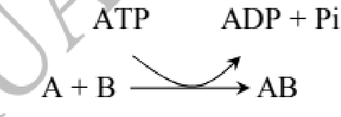

Loại enzym tổng hợp gồm các dưới lớp:
- **Các synthetase:** gắn hai phân tử với sự tham gia của ATP để cung cấp năng lượng.
- **Các carboxylase:** gắn $\text{CO}_2$ vào phân tử cơ chất. Ví dụ: *pyruvat carboxylase*,...
- **Ligase:** sử dụng cho việc gắn 2 đoạn nucleotid với nhau. Ví dụ: *DNA ligase*.

### 2. MỘT SỐ ĐẶC TÍNH CỦA PHÂN TỬ ENZYM

#### 2.1. Cấu tạo và cấu trúc của enzym
Các enzym là các protein có khối lượng phân tử từ $12.000$ đến hàng triệu đơn vị dalton (Da). Cũng như các protein, về thành phần cấu tạo, enzym cũng được chia làm hai loại: enzym thuần và enzym tạp.

---

## [Trang 15] - Enzym thuần & Enzym tạp, Cofactor & Coenzym

Enzym thuần là các enzym mà phân tử chỉ do các gốc acid amin cấu tạo nên. Những enzym này không đòi hỏi các nhóm ngoại (coenzym) cho hoạt động của chúng (còn gọi là enzym một thành phần). Ví dụ các enzym thủy phân: *amylase*, *proteinase*.

Enzym tạp là các enzym mà ngoài thành phần protein (acid amin), phân tử enzym còn có chất cộng tác (cofactor) là các ion như $\text{Fe}^{2+}$, $\text{Mg}^{2+}$, $\text{Mn}^{2+}$, $\text{Zn}^{2+}$,... hoặc là một phân tử chất hữu cơ hoặc phức hợp hữu cơ kim loại, cấu tạo nên. Nếu chất cộng tác (cofactor) là chất hữu cơ thì được gọi là *coenzym*. Một số phân tử enzym đòi hỏi cả coenzym và ion kim loại cho hoạt động của chúng.

Trong phân tử enzym tạp (còn gọi là *holoenzym*), phần protein được gọi là *apoenzym*, phần chất cộng tác được gọi là *cofactor*:
$$\text{Holoenzym} = \text{apoenzym} + \text{cofactor}$$

Phần apoenzym mang những đặc tính cơ bản của enzym, trong khi phần coenzym hoặc ion kim loại là chất phối hợp của enzym, có vai trò bổ sung khả năng phản ứng và khả năng xúc tác cho phân tử enzym.

*Coenzym* thường có trong thành phần các enzym thuộc loại oxy hóa khử và loại enzym vận chuyển nhóm; thiếu coenzym, enzym loại này không hoạt động. Các cofactor (coenzym) thường là các vitamin và dẫn xuất của chúng. Một số cofactor gắn chặt vào phân tử enzym, không thể tách ra được gọi là *nhóm phụ* (prosthetic group). Nhiều coenzym trong thành phần cấu tạo có chứa vitamin.

Những enzym chứa kim loại hoặc đòi hỏi kim loại cho hoạt động của nó được gọi là enzym kim loại (*metalloenzym*). Vai trò của kim loại trong thành phần của enzym kim loại là:
- Tham gia trực tiếp vào phản ứng xúc tác của enzym.
- Hoạt động như một chất oxy hóa khử.
- Tạo thành phức hợp với cơ chất.

### Bảng 1.2. Các ion có chức năng là chất cộng tác của enzym

| Ion | Enzym |
| :--- | :--- |
| $\text{Cu}^{2+}$ | *Cytochrome oxidase* |
| $\text{Fe}^{2+}$ hoặc $\text{Fe}^{3+}$ | *Cytochrome oxidase*, *catalase*, *peroxidase* |
| $\text{K}^+$ | *Pyruvate kinase* |
| $\text{Mg}^{2+}$ | *Hexokinase*, *glucose 6-phosphatase*, *pyruvate kinase* |
| $\text{Mn}^{2+}$ | *Arginase*, *ribonucleotide reductase* |
| $\text{Mo}$ | *Dinitrogenase* |
| $\text{Ni}^{2+}$ | *Urease* |
| $\text{Zn}^{2+}$ | *Carbonic anhydrase*, *alcohol dehydrogenase*, *carboxypeptidases A và B* |

<!-- END FILE: pages_006_015.md -->

<!-- BEGIN FILE: pages_016_025.md -->

# GIÁO TRÌNH HÓA SINH - ĐẠI HỌC Y HÀ NỘI
**Chủ biên:** GS. TS. BS. Tạ Thành Văn  
**Nguồn:** SGK Hóa sinh YHN 2019 (Nhà xuất bản Y học)

---

## [Trang 16] - Trung tâm hoạt động & Thuyết ổ khóa - chìa khóa

#### 2.2. Trung tâm hoạt động của enzym và tính đặc hiệu cơ chất

Trung tâm hoạt động hoặc vị trí hoạt động (active site) của enzym là một vùng đặc biệt của enzym có tác dụng gắn với cơ chất để xúc tác cho phản ứng làm biến đổi cơ chất thành sản phẩm. Mỗi enzym có thể có một, hai hoặc vài trung tâm hoạt động. Trung tâm hoạt động của enzym gồm những nhóm hóa học và những liên kết tiếp xúc trực tiếp với cơ chất hoặc không tiếp xúc trực tiếp với cơ chất nhưng có chức năng trực tiếp trong quá trình xúc tác.

Về thành phần cấu tạo, trung tâm hoạt động thường bao gồm các acid amin có các nhóm hóa học có hoạt tính cao như serin (có nhóm $-\text{OH}$), cystein (có nhóm $-\text{SH}$), glutamic (có nhóm $\gamma\text{-COO}^-$), lysin (có nhóm $\varepsilon\text{-NH}_3^+$), histidin (có nhóm $\text{imidazol}^+$), tryptophan (có nhóm $\text{indol}^+$),... là những nhóm phân cực hoặc ion hóa, có khả năng tạo liên kết hydro hoặc ion với cơ chất. Hình 1.1 minh họa sự gắn của glucose vào trung tâm hoạt động của glucokinase. Chính nhờ trung tâm hoạt động mà enzym thể hiện tính đặc hiệu cơ chất: glucokinase không xúc tác (gắn) với galactose.

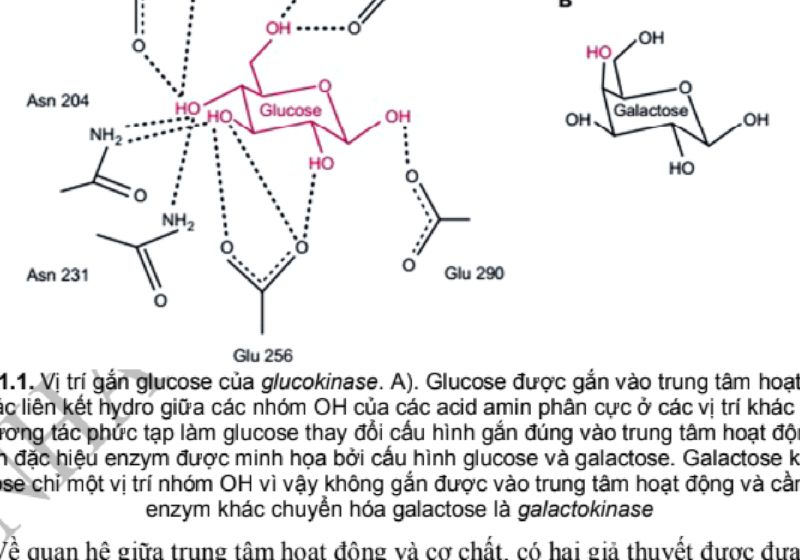
*Hình 1.1. Vị trí gắn glucose của glucokinase. A). Glucose được gắn vào trung tâm hoạt động bởi các liên kết hydro giữa các nhóm OH của các acid amin phân cực ở các vị trí khác nhau. Sự tương tác phức tạp làm glucose thay đổi cấu hình gắn đúng vào trung tâm hoạt động. B) Tính đặc hiệu enzym được minh họa bởi cấu hình glucose và galactose. Galactose khác glucose chỉ một vị trí nhóm OH vì vậy không gắn được vào trung tâm hoạt động và cần một enzym khác chuyển hóa galactose là galactokinase.*

Về quan hệ giữa trung tâm hoạt động và cơ chất, có hai giả thuyết được đưa ra:

- **Thuyết "ổ khóa và chìa khóa":** Fischer.E (1894) đã đưa ra thuyết "ổ khóa và chìa khóa" ("lock and key") về tác động của enzym. Theo thuyết này, tương tác giữa enzym E và cơ chất S, nghĩa là sự gắn giữa enzym và cơ chất để tạo thành phức hợp enzym - cơ chất ES cũng giống như quan hệ giữa "ổ khóa" và "chìa khóa", nghĩa là enzym nào thì chỉ xúc tác cho đúng cơ chất đó. Thuyết này chỉ giải thích được tính đặc hiệu tuyệt đối của enzym nhưng không giải thích được tính đặc hiệu tương đối của enzym.

---

## [Trang 17] - Thuyết mô hình cảm ứng không gian & Dạng cấu trúc enzym

- **Thuyết "mô hình cảm ứng không gian":** để giải thích tính đặc hiệu tương đối của enzym, Koshland D (1958) đã đưa ra thuyết "mô hình cảm ứng không gian" ("induced fit"). Theo thuyết này, trung tâm hoạt động của enzym e có tính mềm dẻo và linh hoạt, có thể biến đổi về cấu hình không gian trong quá trình tương tác với cơ chất sao cho phù hợp với cấu hình không gian của cơ chất, để có thể tạo thành phức hợp enzym - cơ chất ES. Thuyết này giải thích được tính đặc hiệu tương đối của enzym và đa số các tác giả hiện nay chấp nhận thuyết này.

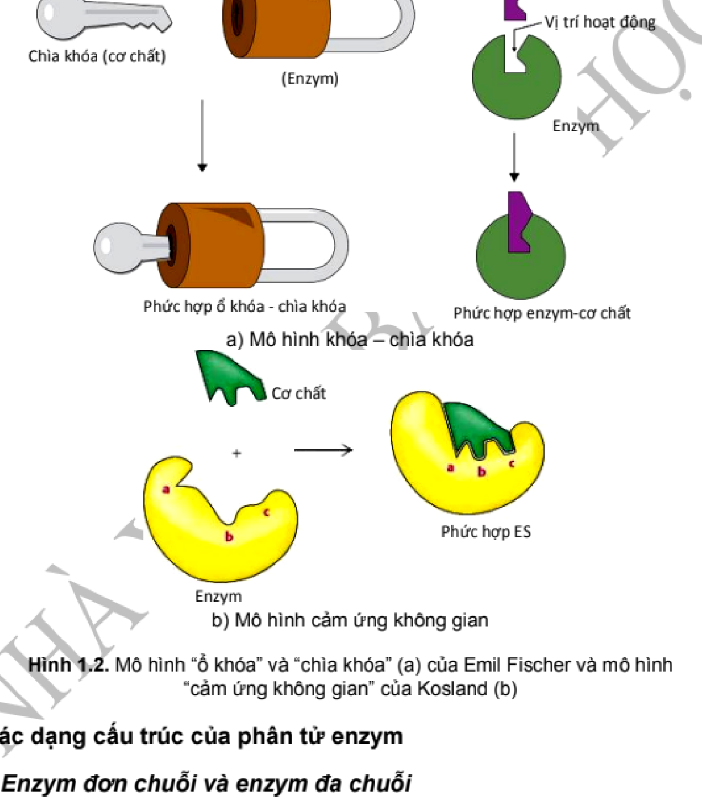
*Hình 1.2. Mô hình "ổ khóa" và "chìa khóa" (a) của Emil Fischer và mô hình "cảm ứng không gian" của Kosland (b)*

#### 2.3. Các dạng cấu trúc của phân tử enzym

##### 2.3.1. Enzym đơn chuỗi và enzym đa chuỗi
Enzym có thể do một chuỗi, cũng có thể do nhiều chuỗi polypeptide tạo nên.

Enzym đơn chuỗi (monomer) là enzym chỉ do một chuỗi polypepid cấu tạo nên, ví dụ: *ribonuclease a*, *lysozym*, *lipase*, *pepsin*, *chymotrypsin*,...

Enzym đa chuỗi (oligomer hoặc polymer) là enzym do hai hoặc nhiều chuỗi polypeptid cấu tạo nên, ví dụ: *aspartat transaminase* (AST): 2 chuỗi, *alkalin phosphatase*

---

## [Trang 18] - Enzym dị lập thể (Allosteric enzyme) & Điều hòa hoạt tính

(ALP): 2 chuỗi, *creatin kinase* (CK): 2 chuỗi, *hexokinase* (HK): 2 chuỗi, *lactat dehydrogenase* (LDH): 4 chuỗi, *RNA polymerase*: 5 chuỗi, *ATP synthetase*: 12 chuỗi, *glutamat dehydrogenase* (GLDH): 40 chuỗi.

##### 2.3.2. Enzym dị lập thể (*Allosteric enzym*) và điều hòa hoạt tính enzym
Enzym dị lập thể là loại enzym ngoài trung tâm hoạt động còn một hoặc vài vị trí dị lập thể; trung tâm hoạt động tiếp nhận cơ chất để xúc tác cho phản ứng enzym trong khi vị trí dị lập thể tiếp nhận yếu tố dị lập thể để điều chỉnh hoạt động xúc tác của enzym. Về cấu tạo phân tử, enzym dị lập thể có thể là loại enzym đơn chuỗi hoặc loại enzym đa chuỗi. Phân tử enzym dị lập thể có thể có loại vị trí dị lập thể dương, loại vị trí dị lập thể âm hoặc có cả hai.

Khi vị trí dị lập thể dương tiếp nhận yếu tố dị lập thể dương a (chất hoạt hóa: activator) thì cấu hình enzym thay đổi theo hướng thuận lợi hơn cho việc gắn cơ chất, ái lực enzym với cơ chất tăng lên, sự tạo thành phức hợp enzym - cơ chất tốt hơn, tốc độ phản ứng tăng lên.

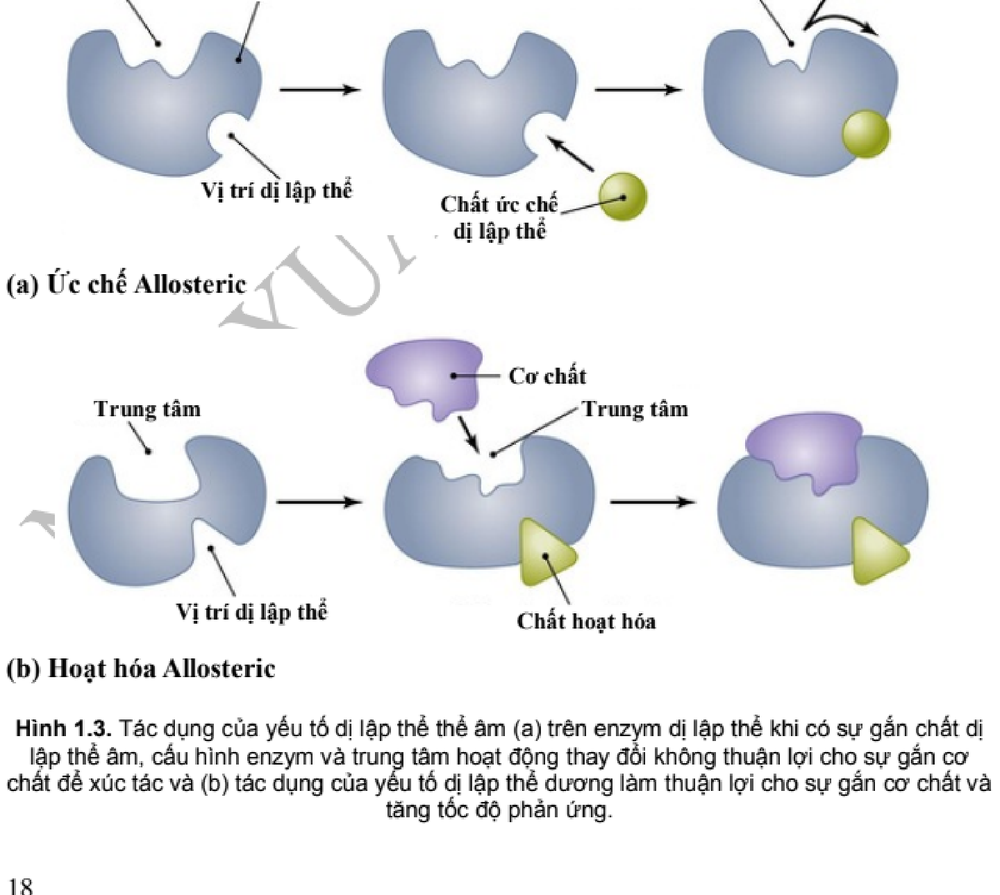
*Hình 1.3. Tác dụng của yếu tố dị lập thể thể âm (a) trên enzym dị lập thể khi có sự gắn chất dị lập thể âm, cấu hình enzym và trung tâm hoạt động thay đổi không thuận lợi cho sự gắn cơ chất để xúc tác và (b) tác dụng của yếu tố dị lập thể dương làm thuận lợi cho sự gắn cơ chất và tăng tốc độ phản ứng.*

---

## [Trang 19] - Ức chế ngược (Feedback inhibition) & Điều hòa chuỗi phản ứng

Khi vị trí dị lập thể âm tiếp nhận yếu tố dị lập thể âm I (chất ức chế: inhibitor) thì cấu hình enzym thay đổi theo hướng không thuận lợi cho việc gắn cơ chất, enzym bị ức chế, ái lực enzym với cơ chất giảm nên tốc độ phản ứng giảm đi.

Thông thường, những chất hoạt hóa dị lập thể là những chất đứng trước cơ chất trong chuỗi phản ứng, trong khi những chất ức chế dị lập thể là những chất đứng sau chuỗi phản ứng hoặc là sản phẩm cuối cùng của chuỗi phản ứng. Ví dụ: trong con đường đường phân, enzym *phosphofructokinase* là một enzym dị lập thể, được hoạt hóa bởi yếu tố dị lập thể dương là ADP và AMP, nhưng bị ức chế bởi yếu tố dị lập thể âm là ATP và citrat.

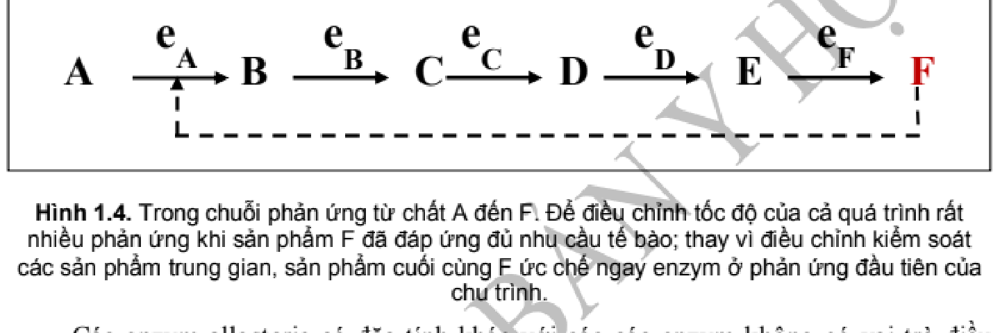
*Hình 1.4. Trong chuỗi phản ứng từ chất A đến F. Để điều chỉnh tốc độ của cả quá trình rất nhiều phản ứng khi sản phẩm F đã đáp ứng đủ nhu cầu tế bào; thay vì điều chỉnh kiểm soát các sản phẩm trung gian, sản phẩm cuối cùng F ức chế ngay enzym ở phản ứng đầu tiên của chu trình.*

Các enzym allosteric có đặc tính khác với các các enzym không có vai trò điều hòa khác. Một số khác biệt là về cấu trúc. Ngoài trung tâm hoạt động, enzym allosteric có một hoặc nhiều vị trí dị lập thể (allosteric) để gắn chất dị lập thể (chất điều hòa) Hình 1.3. Trung tâm hoạt động để gắn cơ chất, vị trí dị lập thể để gắn chất dị lập thể. Mỗi vị trí dị lập thể gắn với một chất dị lập thể. Một enzym allosteric có thể có vài vị trí dị lập thể khác nhau để gắn với các chất dị lập thể khác nhau. Trong các enzym đồng đẳng (homotropic enzyms), trung tâm hoạt động và vị trí dị lập thể là giống nhau.

Các enzym allosteric thường lớn và có cấu trúc phức tạp thường gồm nhiều tiểu đơn vị. Ví dụ enzym *Aspartate transcarbamoylase* xúc tác phản ứng kết hợp carbamoyl phosphat và aspartat để hình thành carbamoyl aspartat. Đây là phản ứng đầu tiên trong quá trình tổng hợp các nucleotide pyrimidine. *Aspartat transcarbamoylase* có 12 chuỗi polypeptid được tổ chức thành 6 tiểu đơn vị xúc tác (2 phức hợp trimer) và 6 tiểu đơn vị điều hòa (3 phức hợp dimer).

Trong quá trình chuyển hóa các chất ở tế bào, các nhóm enzym hoạt động cùng nhau trong các phản ứng liên tiếp, tuần tự để thực hiện một quá trình chuyển hóa, ví dụ như quá trình phân hủy glucose tạo lactat hoặc sự tổng hợp qua nhiều phản ứng tạo một amino acid từ tiền chất đơn giản. Trong các hệ thống enzym như vậy, sản phẩm của phản ứng trước là cơ chất của phản ứng kế tiếp. Hầu hết các enzym trong mỗi quá trình trao đổi chất đều tuân theo các mô hình động học đã trình bày. Tuy nhiên, mỗi con đường bao gồm một hoặc nhiều enzym có vai trò lớn hơn đến tốc độ chuyển hóa của toàn bộ quá trình. Những enzym điều hòa này thường là các enzym allosteric có hoạt tính xúc tác tăng hoặc giảm rất nhanh đáp ứng với các tín hiệu nhất định theo nhu cầu

---

## [Trang 20] - Biến đổi đồng hóa trị (Covalent modification) & Isoenzym

của tế bào. Thay đổi tốc độ phản ứng xúc tác bởi các enzym điều hòa này sẽ làm thay đổi nhanh chóng tốc độ toàn bộ quá trình chuyển hóa. Điều này cho phép tế bào đáp ứng nhanh chóng nhu cầu thay đổi về năng lượng và các phân tử sinh học cần thiết cho sự phát triển và sửa chữa.

Sự phát triển và sự sống của tế bào phụ thuộc vào việc sử dụng hiệu quả các nguồn nguyên liệu, và hiệu quả này được thực hiện bởi các enzym điều hòa.

Cần lưu ý là, ngoài enzym điều hòa là enzym allosteric, trong tế bào còn có cơ chế điều hòa quan trọng khác là thay đổi đồng hóa trị của một hoặc nhiều gốc acid amin trong phân tử enzym. Hơn 500 loại thay đổi đồng hóa trị đã được tìm thấy trong phân tử protein-enzym. Các nhóm chức năng thay đổi thường là nhóm phosphoryl, acetyl, adenylyl, uridylyl, metyl, amid, carboxyl, myristoyl, palmitoyl, prenyl, hydroxyl, sulfat và các nhóm adenosine diphosphate ribosyl.

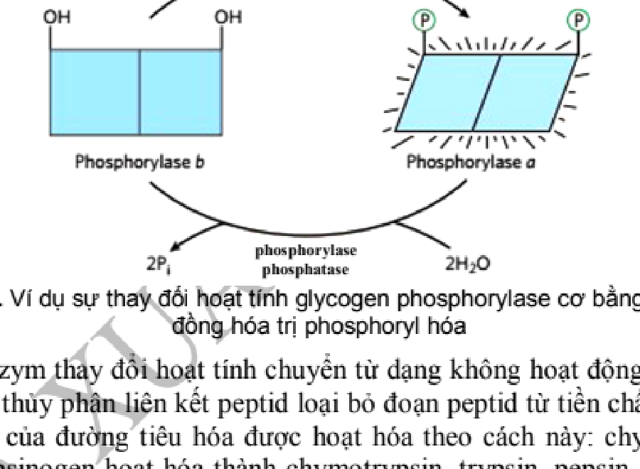
*Hình 1.5. Ví dụ sự thay đổi hoạt tính glycogen phosphorylase cơ bằng thay đổi đồng hóa trị phosphoryl hóa*

Một số enzym thay đổi hoạt tính chuyển từ dạng không hoạt động sang dạng hoạt động bằng cách thủy phân liên kết peptid loại bỏ đoạn peptid từ tiền chất enzym. Nhiều enzym protease của đường tiêu hóa được hoạt hóa theo cách này: chymotrypsinogen, trypsinogen, pepsinogen hoạt hóa thành chymotrypsin, trypsin, pepsin. Sau khi loại bỏ đoạn peptid, cấu hình enzym thay đổi và bộc lộ trung tâm hoạt động của enzym. Ngoài ra, một số các enzym protease tham gia vào quá trình đông máu cũng được hoạt hóa theo cách này.

#### 2.3.3. Các dạng phân tử của enzym (isoenzym hoặc isozym)
Trong cùng một loài, cùng một cơ thể, có những enzym tuy cùng xúc tác một loại phản ứng hóa học nhưng lại tồn tại dưới những dạng phân tử khác nhau, có những tính chất vật lý và hóa học khác nhau. Các dạng phân tử khác nhau của một loại enzym được gọi là isoenzym hoặc isozym. Ví dụ: phân tử enzym *lactat dehydrogenase* (LDH) do bốn tiểu đơn vị, mỗi tiểu đơn vị là một chuỗi polypeptid cấu tạo nên. Các chuỗi này gồm 2 loại, do hai gen khác nhau tổng hợp nên: chuỗi nguồn gốc tim (H) và chuỗi nguồn gốc cơ (M). Vì enzym LDH là loại enzym tetramer do bốn chuỗi polypeptid cấu tạo nên,

---

## [Trang 21] - Các dạng LDH, CK, Tiền chất enzym (Zymogen) & Phức hợp đa enzym

cho nên sự tổ hợp giữa hai loại chuỗi polypeptid đã tạo thành năm dạng phân tử (isoenzym) của LDH khác nhau:

$$\begin{aligned}
\text{LDH}_1 \text{ do 4 chuỗi H tạo thành:} &\quad \text{HHHH} \\
\text{LDH}_2 \text{ do 3 chuỗi H và 1 chuỗi M tạo thành:} &\quad \text{HHHM} \\
\text{LDH}_3 \text{ do 2 chuỗi H và 2 chuỗi M tạo thành:} &\quad \text{HHMM} \\
\text{LDH}_4 \text{ do 1 chuỗi H và 3 chuỗi M tạo thành:} &\quad \text{HMMM} \\
\text{LDH}_5 \text{ do 4 chuỗi M tạo thành:} &\quad \text{MMMM}
\end{aligned}$$

Vì vậy, $\text{LDH}_1$ được gọi là isoenzym kiểu tim và $\text{LDH}_5$ được gọi là isoenzym kiểu gan. Các isoenzym này có hằng số Michaelis ($K_m$) và tốc độ phản ứng tối đa ($V_{max}$) khác nhau.

Enzym *creatin kinase* (CK) do 2 chuỗi polypeptid cấu tạo nên: một chuỗi có nguồn gốc não (B) và một chuỗi có nguồn gốc cơ (M), do đó tạo thành 3 loại isoenzym: CK-BB, CK-MB và CK-MM.

Việc hiểu biết về các isoenzym có ý nghĩa trong thực tế lâm sàng do các dạng isoenzym khác nhau tồn tại ở các mô khác nhau. Khi tổn thương mô nào thì chỉ có dạng isoenzym đó tăng trong máu và khi đo hoạt độ riêng dạng isoenzym đó sẽ tăng và tăng tính đặc hiệu chẩn đoán. Ví dụ khi nghi ngờ bệnh nhân bị nhồi máu cơ tim, người ta đo hoạt độ CK-MB (có nhiều ở cơ tim - được gọi enzym tim) huyết thanh có giá trị hơn nhiều khi đo hoạt độ CK toàn phần (gồm cả 3 dạng isoenzym).

#### 2.3.4. Các tiền chất của enzym
Một số enzym sau khi được tổng hợp còn ở dạng chưa có hoạt tính (dạng không hoạt động) được gọi là các tiền enzym (*proenzym* hoặc *zymogen*). Các tiền chất này khi được bài tiết vào môi trường khắc nghiệt của cơ thể sẽ chịu tác dụng thủy phân của môi trường, bị thủy phân cắt đi một đoạn polypeptid vốn che lấp trung tâm hoạt động để bảo vệ trung tâm hoạt động, làm cho enzym được hoạt hóa, trở nên dạng enzym chính thức có hoạt tính.

Các tiền enzym có tên tiếp vĩ ngữ là *ogen*. Ví dụ: các tiền enzym của đường tiêu hóa chưa có hoạt tính như *pepsinogen*, *trypsinogen* và *chymotrypsinogen* sau khi được bài tiết vào đường tiêu hóa sẽ bị thủy phân, loại bớt một đoạn peptid để trở thành các enzym chính thức có hoạt tính tương ứng là *pepsin*, *trypsin* và *chymotrypsin*; tiền enzym có thể có tiếp đầu ngữ "pro", ví dụ: tiền enzym của thrombin là *prothrombin*.

#### 2.3.5. Phức hợp đa enzym
Phức hợp đa enzym là một phức hợp gồm nhiều các phân tử enzym khác nhau nhưng có liên quan với nhau trong một quá trình chuyển hóa nhất định, kết tụ với nhau thành một khối nhiều enzym. Không thể tách riêng từng enzym trong phức hợp đa enzym bởi vì nếu bị tách ra, các enzym riêng biệt trong phức hợp đa enzym sẽ bị biến tính và mất hoạt tính. Sự kết tụ các enzym tạo thành phức hợp đa enzym có tác dụng

---

## [Trang 22] - Phức hợp Pyruvat Dehydrogenase & Cấu trúc - Chức năng Coenzym

tăng cường sự cộng tác của các enzym khác nhau trên một quá trình hoặc chuỗi chuyển hóa gồm nhiều phản ứng, làm tăng hiệu lực và hiệu quả xúc tác.

Ví dụ: phức hợp đa enzym pyruvat dehydrogenase xúc tác cho chuỗi phản ứng biến pyruvat thành acetyl CoA (hình 1.6). Chuỗi phản ứng này gồm bốn phản ứng với sự tham gia của phức hợp đa enzym pyruvat dehydrogenase gồm ba enzym *pyruvat dehydrogenase*, *dihydrolipoyl transacetylase* và *dihydrolipoyl dehydrogenase* với bốn coenzym là thiamin pyrophosphat (TPP), acid lipoic, coenzym A và $\text{NAD}^+$.

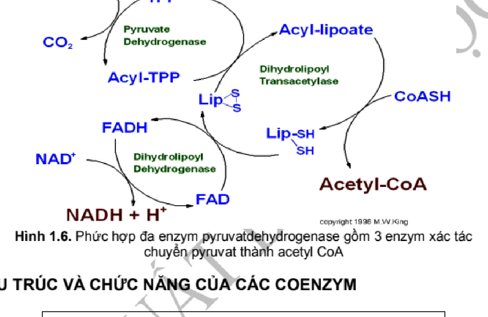
*Hình 1.6. Phức hợp đa enzym pyruvat dehydrogenase gồm 3 enzym xúc tác chuyển pyruvat thành acetyl CoA*

### 3. CẤU TRÚC VÀ CHỨC NĂNG CỦA CÁC COENZYM

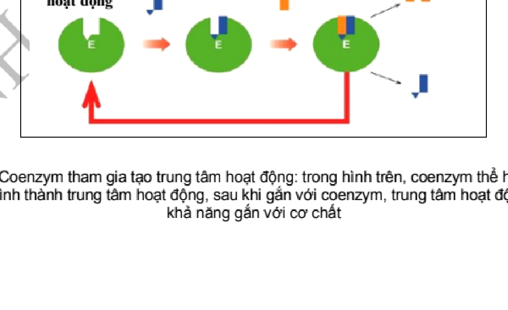
*Hình 1.7. Coenzym tham gia tạo trung tâm hoạt động: trong hình trên, coenzym thể hiện vai trò tham gia hình thành trung tâm hoạt động, sau khi gắn với coenzym, trung tâm hoạt động mới có khả năng gắn với cơ chất*

---

## [Trang 23] - Coenzym oxy hóa khử: NAD+, NADP+, FMN, FAD

Các coenzym có chức năng là tham gia cùng enzym trong quá trình xúc tác. Coenzym thường có ái lực với enzym cũng tương tự như ái lực của enzym với cơ chất; vì vậy, coenzym có thể được coi như một cơ chất thứ hai. Trong các trường hợp khác, các coenzym được gắn đồng hóa trị với enzym và có chức năng như hoặc gần như vị trí hoạt động trong quá trình xúc tác.

Một số coenzym được tổng hợp từ các vitamin nhóm B. Vitamin B6, pyridoxin cần biến đổi chút ít đã có thể chuyển thành pyridoxan phosphat là dạng coenzym hoạt động, trong khi đó, niacin cần một sự biến đổi cơ bản bởi tế bào động vật mới có khả năng tác động như một coenzym.

### 3.1. Các coenzym oxy hóa khử

#### 3.1.1. Các coenzym niacin (nicotinic acid: vitamin $B_3$): $\text{NAD}^+$ và $\text{NADP}^+$
Niacin là acid pyridin 3-carboxylic, có thể được biến đổi thành 2 coenzym chủ yếu tham gia vào loại enzym oxy hóa khử. Hai coenzym này là nicotinamid adenin dinucleotid ($\text{NAD}^+$) và nicotinamid adenin dinucleotid phosphat ($\text{NADP}^+$). Cấu trúc của coenzym $\text{NADP}^+$ khác với coenzym $\text{NAD}^+$ ở chỗ có thêm một gốc phosphat ở vị trí $2'$ của ribose trong phân tử adenosin monophosphat.

Cả hai coenzym này đều có chức năng là vận chuyển 2 điện tử và một $\text{H}^+$ giữa chất cho và chất nhận H trong phản ứng oxy hóa khử xúc tác bởi enzym dehydrogenase. Tuy nhiên, có enzym dehydrogenase cần coenzym $\text{NAD}^+$, có enzym dehydrogenase cần coenzym $\text{NADP}^+$ trong quá trình xúc tác.

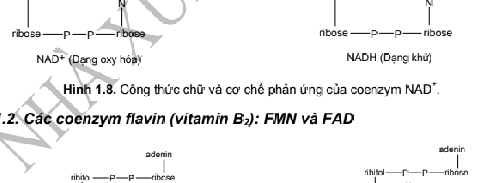
*Hình 1.8. Công thức chữ và cơ chế phản ứng của coenzym $\text{NAD}^+$.*

#### 3.1.2. Các coenzym flavin (vitamin $B_2$): FMN và FAD

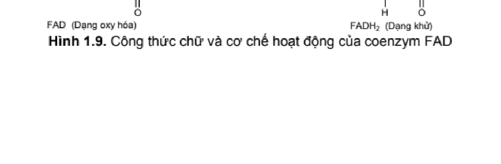
*Hình 1.9. Công thức chữ và cơ chế hoạt động của coenzym FAD*

---

## [Trang 24] - Coenzym FAD/FMN (tiếp) & Coenzym Hem (Porphyrin Fe2+)

Có 2 dạng coenzym của riboflavin là flavin mononucleotid (FMN) và flavin adenin dinucleotide (FAD). Vitamin riboflavin chứa một dị vòng, isoalloxazin (flavin), nối qua nguyên tử N-10 đến một alcol là ribitol. FMN có một gốc phosphat ở vị trí $5'$ của ribitol trong phân tử riboflavin. FAD có cấu trúc tương tự như $\text{NAD}^+$, nhưng có adenosin liên kết qua pyrophosphat gắn với dị vòng riboflavin.

Cả FMN và FAD đều có chức năng là tham gia vào phản ứng oxy hóa khử bằng cách trao đổi 2 điện tử và $2\text{H}^+$ ở vòng isoalloxazin.

#### 3.1.3. Các porphyrin $\text{Fe}^{2+}$ (còn gọi là coenzym hem)
Coenzym hem là coenzym của hệ thống cytochrom, của enzym catalase, peroxidase, monooxygenase và dioxygenase.

Vai trò của các coenzym hem là vận chuyển điện tử nhờ khả năng biến đổi thuận nghịch giữa $\text{Fe}^{2+}$ và $\text{Fe}^{3+}$:
$$\text{Fe}^{2+} - e \leftrightarrow \text{Fe}^{3+}$$

Các phản ứng được xúc tác bởi các loại coenzym hem:

Hai điện tử được vận chuyển từ cytochrom b sang cytochrom c trong chuỗi hô hấp tế bào như sau:
$$2\text{Cyt b Fe}^{2+} + 2\text{ Cyt c Fe}^{3+} \leftrightarrow 2\text{Cyt b Fe}^{3+} + 2\text{ Cyt c Fe}^{2+}$$

Phản ứng phân huỷ $\text{H}_2\text{O}_2$ được xúc tác bởi *catalase* (có coenzym hem) như sau:
$$2\text{ H}_2\text{O}_2 \xrightarrow{\text{Catalase}} 2\text{ H}_2\text{O} + \text{O}_2$$

Phản ứng phân huỷ $\text{H}_2\text{O}_2$ được xúc tác bởi *peroxidase* (có coenzym hem) và đòi hỏi kèm theo một cơ chất dạng khử như sau:
$$2\text{ H}_2\text{O}_2 + \text{AH}_2 \xrightarrow{\text{Peroxidase}} 2\text{ H}_2\text{O} + \text{A}$$

Phản ứng oxygen hóa một cơ chất (thường là thuốc hoặc các chất xenobiotic) được xúc tác bởi các enzym *monooxygenase* (thuộc hệ thống cytochrom P-450) có coenzym là Cytochrom P-450 là một loại coenzym hem và đòi hỏi một coenzym dạng khử là $\text{NADPH} + \text{H}^+$ như sau:
$$\text{RH} + \text{NADPH} + \text{H}^+ + \text{O}_2 \xrightarrow{\text{Monooxygenase (cytochrom P-450)}} \text{ROH} + \text{NADP}^+ + \text{H}_2\text{O}$$

Phản ứng này nói chung có tác dụng biến một chất độc, ít tan trong nước thành một chất không độc hoặc ít độc hơn và tan trong nước nhiều hơn để có thể đào thải khỏi cơ thể.

Các enzym *dioxygenase* là loại enzym có coenzym hem, có tác dụng xúc tác phản ứng peroxy hóa một cơ chất. Phản ứng được thể hiện như sau:
$$\text{RH} + \text{O}_2 \xrightarrow{\text{Dioxygenase}} \text{R-O-O-H}$$

---

## [Trang 25] - Acid lipoic, Coenzym vận chuyển nhóm: TPP & Coenzym A

#### 3.1.4. Acid lipoic
Acid lipoic là một acid béo chứa 2 nhóm sulfur (-SH) có tên khoa học là acid 6,8-dithio-octanoic. Acid lipoic có phổ biến trong các chất tự nhiên. Nó là một chất quan trọng trong chuyển hóa chất, tham gia vào phức hợp enzym khử carboxyl oxy hóa của acid pyruvic và acid $\alpha$-ceto glutaric cùng với các coenzym khác như TPP, coenzym A, FAD và $\text{NAD}^+$ (tổng cộng gồm 5 coenzym).

### 3.2. Các coenzym vận chuyển nhóm

#### 3.2.1. Thiamin pyrophosphat (TPP) vận chuyển nhóm $\text{CO}_2$
Trong thành phần của TPP có thiamin là vitamin $\text{B}_1$. TPP là coenzym của các enzym có vai trò tách nhóm $\text{CO}_2$ của các acid $\alpha$-cetonic như acid pyruvic hoặc acid $\alpha$-cetoglutaric. Sự thiếu hụt thiamin (vit. $\text{B}_1$) làm cho enzym chuyển hóa acid pyruvic không hoạt động, gây ứ đọng acid pyruvic trong máu và các mô, đặc biệt các mô não, thần kinh ảnh hưởng chủ yếu đến hệ thần kinh ngoại biên, đường tiêu hóa và hệ thống tim mạch. Vì vậy, bổ sung Thiamin có giá trị trong điều trị các bệnh như beriberi (bệnh tê-phù), viêm thần kinh do rượu, viêm thần kinh do thai nghén,...

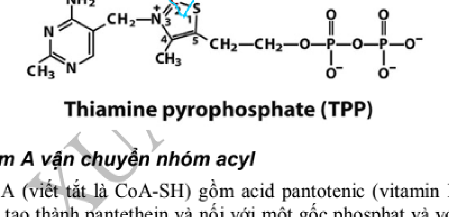
*Hình: Cấu trúc Thiamine pyrophosphate (TPP) với vòng thiazolium mang trung tâm phản ứng ở vị trí C-2.*

#### 3.2.2. Coenzym A vận chuyển nhóm acyl
Coenzym A (viết tắt là $\text{CoA-SH}$) gồm acid pantotenic (vitamin $\text{B}_5$) nối với một thioethanolamin tạo thành pantethein và nối với một gốc phosphat và với một nucleotid là adenosin monophosphat qua liên kết pyrophosphat. Coenzym A có vai trò trong chuyển hóa các acid béo, thể cetonic, acetat và các acid amin. Ví dụ: coenzym A kết hợp với acetat để tạo nên “acetat hoạt động” là acetyl CoA, chất này có thể kết hợp với acid oxaloacetat để tạo thành acid citric, mở đầu cho chu trình acid citric, có thể tham gia vào quá trình sinh tổng hợp acid béo, sinh tổng hợp cholesterol và các hormon steroid,...

*Hình: Cấu trúc Pantothenic acid (Vitamin B5)*

<!-- END FILE: pages_016_025.md -->

<!-- BEGIN FILE: pages_026_035.md -->

# GIÁO TRÌNH HÓA SINH - ĐẠI HỌC Y HÀ NỘI
**Chủ biên:** GS. TS. BS. Tạ Thành Văn  
**Nguồn:** SGK Hóa sinh YHN 2019 (Nhà xuất bản Y học)

---

## [Trang 26] - Coenzym: SAM, FH4, Biotin, Pyridoxal phosphat

#### 3.2.3. S-adenosyl-methionin
S-adenosyl-methionin có tác dụng vận chuyển nhóm methyl $-\text{CH}_3$.

#### 3.2.4. Acid tetrahydrofolic (FH4)
Acid tetrahydrofolic có vai trò vận chuyển nhóm 1 nguyên tử carbon.

#### 3.2.5. Biotin
Biotin có chức năng như một coenzym của enzym carboxylase, enzym xúc tác cho sự gắn $\text{CO}_2$ (gọi là sự carboxyl hóa). Vai trò hóa sinh quan trọng nhất của biotin là tham gia các phản ứng carboxyl hóa.

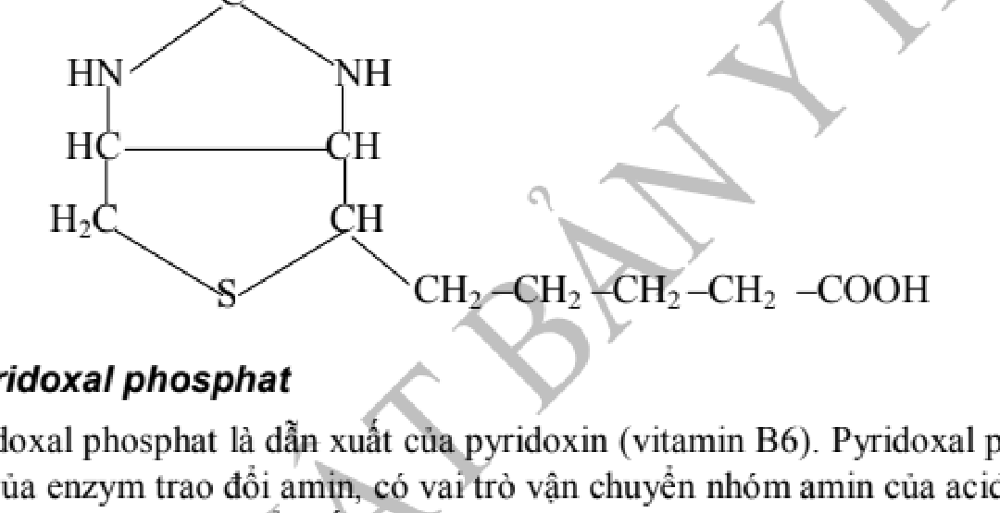
*Hình: Cấu trúc hóa học của Biotin*

#### 3.2.6. Pyridoxal phosphat
Pyridoxal phosphat là dẫn xuất của pyridoxin (vitamin $\text{B}_6$). Pyridoxal phosphat là coenzym của enzym trao đổi amin, có vai trò vận chuyển nhóm amin của acid $\alpha$-amin 1 cho một acid $\alpha$-cetonic 2 để biến thành acid $\alpha$-cetonic 1, còn acid $\alpha$-cetonic 2 nhận nhóm amin để biến thành acid $\alpha$-amin 2. Hai enzym trao đổi amin quan trọng và có nhiều ở gan sử dụng coenzym này là AST, ALT.

Ngoài vai trò tham gia vào thành phần của các enzym trao đổi amin, pyridoxalphosphat còn có vai trò là coenzym của các enzym khử carboxyl của một số acid amin như tyrosin, arginin, acid glutamic và một số acid amin khác. Sản phẩm của sự khử carboxyl của acid amin là các amin có hoạt tính sinh học. Ví dụ: sự khử carboxyl của acid glutamic sẽ tạo thành $\gamma$-amino butyric acid (GABA) là một chất ức chế hoạt động của thần kinh, sự khử carboxyl của histidin sẽ tạo thành histamin là một hormon của mô, làm tăng tính thấm thành mạch, gây hiện tượng dị ứng, sự hydroxy hóa cùng với sự khử carboxyl của phenylalanin và tyrosin sẽ tạo thành nor-epinephrin và epinephrin là những hormon quan trọng của tủy thượng thận,...

---

## [Trang 27] - Cơ chế Transaminase & Bảng tổng kết Vitamin - Coenzym

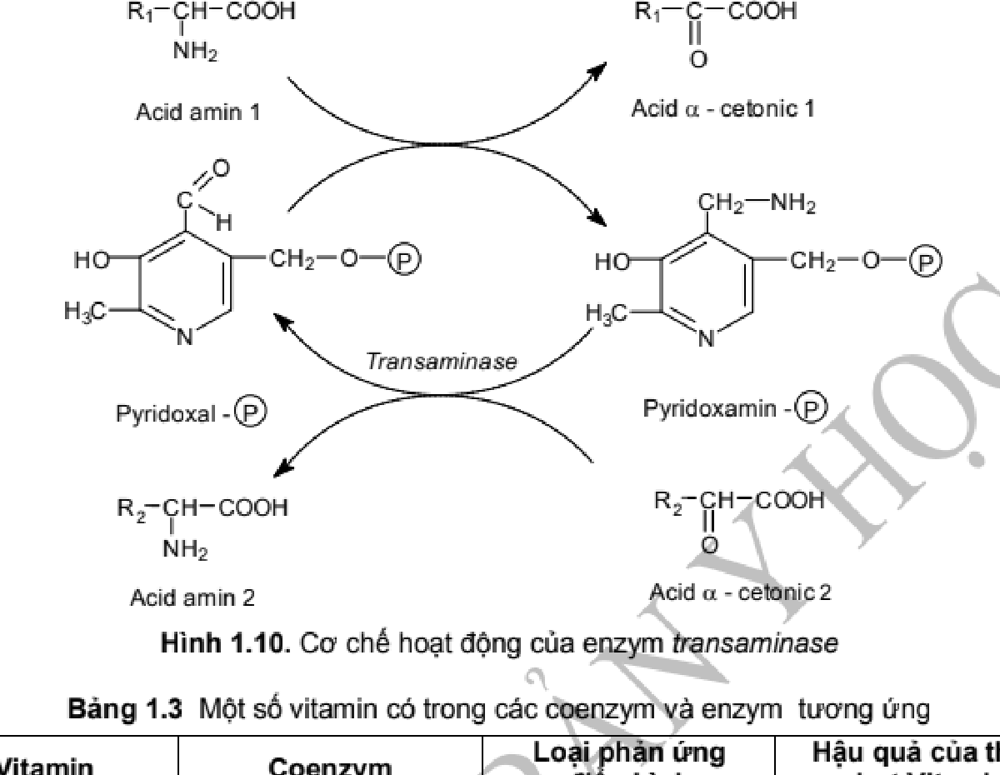
*Hình 1.10. Cơ chế hoạt động của enzym transaminase*

### Bảng 1.3. Một số vitamin có trong các coenzym và enzym tương ứng

| Vitamin | Coenzym | Loại phản ứng điển hình | Hậu quả của thiếu hụt Vitamin |
| :--- | :--- | :--- | :--- |
| **Thiamine ($\text{B}_1$)** | Thiamine pyrophosphate | Chuyển nhóm aldehyde | Beriberi (giảm cân, đau tim, rối loạn chức năng thần kinh) |
| **Riboflavin ($\text{B}_2$)** | Flavin adenine dinucleotide (FAD) | Oxy hóa - khử | Cheliosis và stomatitus góc (tổn thương của miệng), viêm da |
| **Pyridoxin ($\text{B}_6$)** | Phosphate Pyridoxal | Chuyển nhóm amin | Trầm cảm, nhầm lẫn, co giật |
| **Acid nicotinic (niacin)** | Nicotinamide adenine dinucleotide ($\text{NAD}^+$) | Oxy hóa - khử | Pellagra (viêm da, trầm cảm, tiêu chảy) |
| **Acid Pantothenic** | Coenzym A | Chuyển nhóm Acyl | Cao huyết áp |
| **Biotin** | Phức hợp biotin-lysine (sinh học) | Chuyển nhóm carboxyl | Phát ban về lông mày, đau cơ, mệt mỏi (hiếm) |
| **Acid folic** | Tetrahydrofolate | Chuyển giao các thành phần một-carbon; tổng hợp thymine | Thiếu máu, dị tật ống thần kinh trong sự phát triển |
| **$\text{B}_{12}$** | 5'-Deoxyadenosyl cobalamin | Chuyển các nhóm methyl; sự sắp xếp lại nội tuyến | Thiếu máu, thiếu máu ác tính, nhiễm toan methylmalonic |
| **C (acid ascorbic)** | | Chất chống oxy hóa | Suy thận (sưng phù và chảy máu, xuất huyết dưới da) |

---

## [Trang 28] - Cơ chế xúc tác của Enzym: Năng lượng tự do & Năng lượng hoạt hóa

### 4. CƠ CHẾ XÚC TÁC CỦA ENZYM

#### 4.1. Sự biến thiên năng lượng tự do ($\Delta G$) và năng lượng hoạt hóa

Năng lượng tự do của một hệ thống phản ứng là năng lượng có thể tạo ra công có ích. Năng lượng tự do được ký hiệu là $G$. Một phản ứng hóa học chỉ có thể xảy ra theo chiều năng lượng tự do giảm, biến chất có năng lượng tự do cao thành chất có mức năng lượng thấp hơn. Điều này có nghĩa là điều kiện cần của một phản ứng hóa học là biến thiên năng lượng tự do phải âm ($\Delta G < 0$):
$$\text{A} + \text{B} = \text{C} + \text{D}$$
$$G_1 > G_2 \rightarrow \Delta G = G_2 - G_1 < 0$$

Tuy nhiên, do vật chất có sức ỳ về mặt hóa học nên một phản ứng dù có $\Delta G < 0$, vẫn chưa thể tự xảy ra được.

Vật chất thường có sức ỳ về mặt hóa học. Sức ỳ về mặt hóa học của vật chất là do các yếu tố sau gây nên:
- Yếu tố về entropy (sự chuyển động hỗn loạn của các phân tử vật chất).
- Lớp áo nước cản trở và có thể làm mất hoạt tính của cơ chất.
- Hình thể không gian cồng kềnh của cơ chất.
- Sự sắp xếp chưa định hướng của các nhóm chức năng trên phân tử enzym.

Vì vậy, một số phản ứng hóa học mặc dù có điều kiện cần là khả năng xảy ra theo hướng năng lượng thấp hơn ($\Delta G < 0$), nhưng phản ứng vẫn không xảy ra được. Muốn phản ứng xảy ra phải có thêm điều kiện đủ, nghĩa là phải cung cấp cho hệ thống phản ứng một năng lượng để thắng được sức ỳ về hóa học của vật chất. Năng lượng cần cung cấp ấy được gọi là *năng lượng hoạt hóa*.

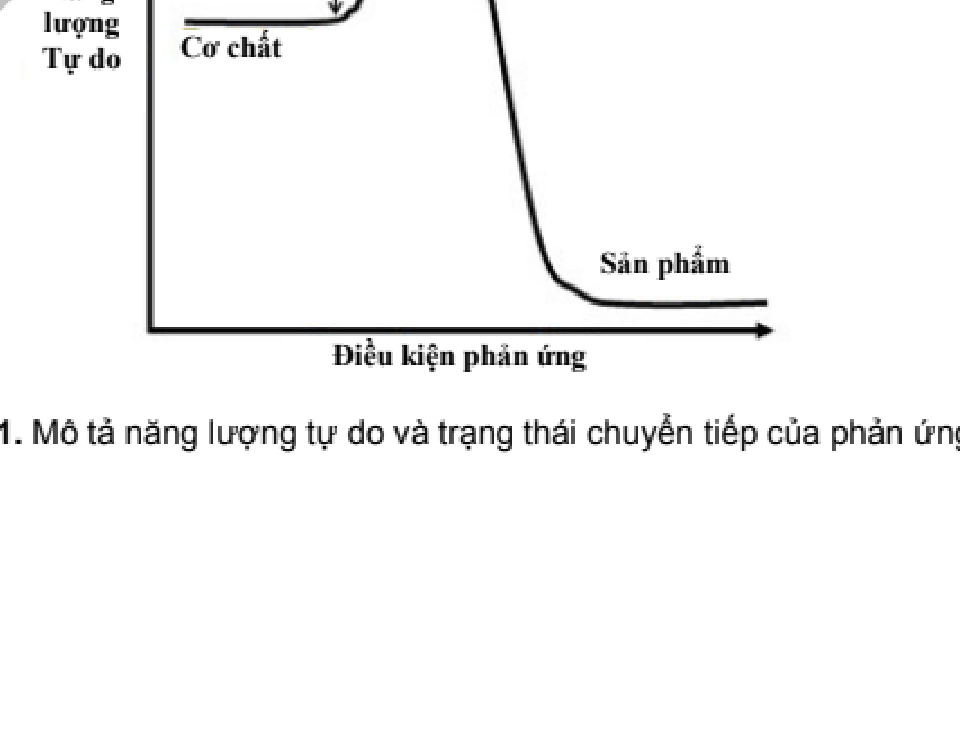
*Hình 1.11. Mô tả năng lượng tự do và trạng thái chuyển tiếp của phản ứng*

---

## [Trang 29] - Cơ chế tác dụng hạ thấp năng lượng hoạt hóa

Năng lượng hoạt hóa là năng lượng cần thiết để nâng tất cả các phân tử của 1 mol cơ chất ở nhiệt độ nhất định lên trạng thái chuyển tiếp (transition state) ở đỉnh của hàng rào năng lượng, để phản ứng enzym có thể xảy ra. Ở trạng thái chuyển tiếp, mỗi phân tử cơ chất có thể sẵn sàng tham gia vào sự tạo thành sản phẩm phản ứng.

#### 4.2. Cơ chế tác dụng của enzym

Như đã trình bày ở trên, để phản ứng có thể xảy ra cần có 2 điều kiện: biến thiên năng lượng tự do của phản ứng phải âm ($\Delta G < 0$) và cơ chất phải được cung cấp năng lượng hoạt hóa để thắng được sức ỳ hóa học (đạt tới trạng thái chuyển tiếp). Cơ chế tác dụng của enzym là enzym làm giảm mức năng lượng hoạt hóa của phản ứng để các cơ chất dễ dàng đạt được mức năng lượng để đưa phản ứng vào trạng thái chuyển tiếp, từ đó phản ứng có thể xảy ra. Tốc độ của phản ứng phụ thuộc vào số các phân tử cơ chất vượt qua hàng rào năng lượng để phản ứng vào trạng thái chuyển tiếp.

Vậy enzym làm giảm năng lượng hoạt hóa của phản ứng bằng cách nào? Thật sự, enzym làm giảm năng lượng hoạt hóa của phản ứng bằng cách kết hợp với cơ chất tạo thành phức hợp enzym- cơ chất (E-S) theo phản ứng qua 2 bước sau:
$$\text{E} + \text{S} \leftrightarrow \text{ES} \rightarrow \text{E} + \text{P}$$
$$\text{(a)} \qquad\qquad \text{(b)}$$

Ở đây, E là enzym, S là cơ chất (substrate), ES là phức hợp enzym-cơ chất và P là sản phẩm của phản ứng (product). Như vậy, enzym có tác dụng biến một phản ứng hóa học một bước thành một phản ứng hóa học qua 2 bước gồm một *phản ứng liên phân tử* (a) và một *phản ứng nội phân tử* (b) nhờ tạo thành phức hợp enzym-cơ chất, cả hai phản ứng này đều đòi hỏi năng lượng hoạt hóa thấp hơn rất nhiều so với phản ứng không có sự xúc tác của enzym.

Một phần quan trọng của năng lượng được sử dụng làm tăng tốc độ phản ứng enzym xuất phát từ các tương tác yếu (tương tác hydro, tương tác kỵ nước và tương tác ion) giữa cơ chất và enzym. Trung tâm hoạt động của enzym được cấu trúc để các tương tác yếu xảy trên trong trạng thái chuyển tiếp. Sự cần thiết có nhiều tương tác yếu là một trong những lý do làm cho enzym có kích thước lớn. Năng lượng gắn dựa trên các nhóm hóa học cũng là cơ sở quyết định tính đặc hiệu enzym.

Cách làm giảm năng lượng hoạt hóa của enzym là enzym kết hợp với cơ chất để tạo thành phức hợp E-S qua trạng thái chuyển tiếp $\text{E-S1}^*$ bằng những tương tác, tạo ra các liên kết yếu nhờ một năng lượng hoạt hóa thấp, đồng thời giải phóng ra năng lượng tự do. Năng lượng tự do được giải phóng này lại góp phần hoạt hóa phức hợp E-S để đưa phức hợp này vào trạng thái chuyển tiếp $\text{E-S}^*$ với năng lượng hoạt hóa cũng rất thấp để tạo sản phẩm P và E tự do, đồng thời cũng giải phóng năng lượng tự do. Như vậy, bằng cách tạo ra phức hợp E-S, enzym chỉ cần những năng lượng hoạt hóa rất nhỏ cũng có thể thúc đẩy phản ứng xảy ra. Cũng chính vì vậy, các phản ứng enzym dễ dàng xảy ra trong điều kiện nhiệt độ sinh lý của cơ thể.

---

## [Trang 30] - Động học Enzym: Tốc độ phản ứng & Đơn vị đo

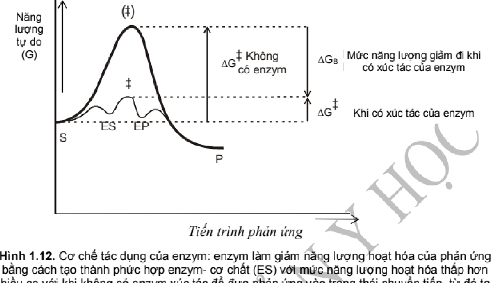
*Hình 1.12. Cơ chế tác dụng của enzym: enzym làm giảm năng lượng hoạt hóa của phản ứng bằng cách tạo thành phức hợp enzym- cơ chất (ES) với mức năng lượng hoạt hóa thấp hơn nhiều so với khi không có enzym xúc tác để đưa phản ứng vào trạng thái chuyển tiếp, từ đó tạo thành phức hợp enzym sản phẩm EP và phản ứng tạo thành sản phẩm P và giải phóng E dễ dàng xảy ra.*

### 5. ĐỘNG HỌC ENZYM

#### 5.1. Tốc độ phản ứng enzym và đơn vị đo
Tốc độ phản ứng của một enzym là lượng cơ chất bị biến đổi dưới tác dụng của enzym ấy trong một phút ở nhiệt độ $25^\circ\text{C}$ và các điều kiện được chuẩn hóa.

Đơn vị hoạt độ enzym được thể hiện bằng đơn vị quốc tế (international units, IU hoặc U) và được định nghĩa là lượng enzym làm biến đổi $1\ \mu\text{mol}$ cơ chất thành sản phẩm trong 1 phút ở $25^\circ\text{C}$ và các điều kiện đã được chuẩn hóa.

##### Tốc độ phản ứng ban đầu ($V$)
Tốc độ ban đầu của một phản ứng enzym (được ký hiệu là $V$) có nồng độ enzym, nồng độ cơ chất, ở một nhiệt độ và pH nhất định, là tốc độ phản ứng enzym ở những phút đầu tiên của phản ứng, khi mà tốc độ phản ứng chưa bị ảnh hưởng bởi sự thay đổi của nhiệt độ, pH, nồng độ sản phẩm phản ứng,... tốc độ ban đầu tăng lên một cách tuyến tính, sau đó không tăng tuyến tính nữa. Hoạt độ enzym chỉ được đo một cách chính xác ở tốc độ ban đầu, nghĩa là đo trong khoảng 5 phút đầu tiên của phản ứng.

##### Tốc độ cực đại ($V_{max}$)
Với một nồng độ enzym thích hợp, nhiệt độ và pH thích hợp, khi nồng độ cơ chất tăng lên thì tốc độ phản ứng tăng lên. Khi các phân tử enzym đều bão hoà cơ chất thì tốc độ phản ứng đạt tốc độ tối đa ($V_{max}$).

---

## [Trang 31] - Thuyết và Phương trình Michaelis-Menten

#### 5.2. Thuyết Michaelis-Menten

Năm 1913, Michaelis và Menten đã đề ra giả thuyết về vai trò của nồng độ cơ chất trong việc hình thành phức hợp enzym – cơ chất ES.

Sự liên quan nói chung giữa enzym, cơ chất và sản phẩm phản ứng được thể hiện bằng phương trình sau:
$$\text{E} + \text{S} \underset{k_{-1}}{\overset{k_1}{\rightleftharpoons}} \text{ES} \xrightarrow{k_2} \text{E} + \text{P}$$

Giả thuyết của Michaelis-Menten về sự liên quan giữa tốc độ phản ứng và nồng độ cơ chất được tính toán theo phương trình Michaelis-Menten:
$$V = V_{max} \frac{[\text{S}]}{K_m + [\text{S}]}$$

Ở đây:
- $V = \text{tốc độ phản ứng}$
- $V_{max} = \text{tốc độ tối đa}$
- $[\text{S}] = \text{nồng độ cơ chất}$
- $K_m = \text{hằng số Michaelis của enzym đối với cơ chất.}$

Khi nồng độ cơ chất thấp hơn $K_m$ rất nhiều, nghĩa là với số lượng enzym vượt quá số lượng cơ chất, trong phương trình Michaelis-Menten, ta có thể bỏ $[\text{S}]$ ở mẫu số, phương trình trở thành dạng $V = V_{max}[\text{S}]/K_m$, đây là phương trình tuyến tính dạng $y = ax$, nghĩa là tốc độ phản ứng chỉ phụ thuộc vào nồng độ cơ chất $[\text{S}]$. Lúc này phản ứng là phản ứng động học bậc 1 bởi vì tốc độ phản ứng tỷ lệ thuận với nồng độ cơ chất.

Khi nồng độ cơ chất tăng lên đến mức đạt giá trị bằng giá trị $K_m$ thì phương trình Michaelis-Menten trở thành dạng $V = V_{max}/2$, có nghĩa là tốc độ phản ứng bằng $1/2$ tốc độ tối đa.

Khi nồng độ cơ chất lớn hơn $K_m$ rất nhiều thì ta có thể bỏ $K_m$ ở mẫu số của phương trình Michaelis-Menten, và phương trình trở thành dạng $V = V_{max}$, có nghĩa là tốc độ phản ứng đạt tốc độ tối đa ($V_{max}$). Lúc này tất cả các phân tử enzym đều bão hoà cơ chất, phản ứng đạt động học “bậc không”, bởi vì, dù có tiếp tục tăng nồng độ cơ chất thì tốc độ phản ứng cũng không thay đổi và lúc này tốc độ phản ứng chỉ phụ thuộc vào nồng độ enzym.

---

## [Trang 32] - Đồ thị Michaelis-Menten & Ý nghĩa hằng số Km

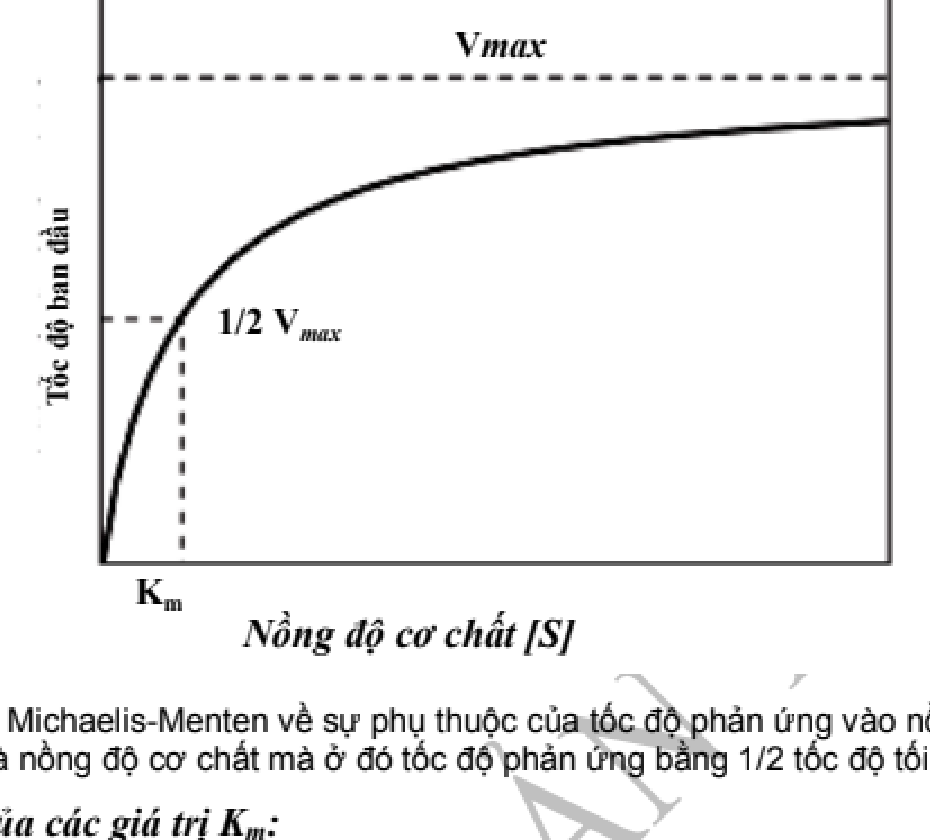
*Hình 1.13. Đồ thị Michaelis-Menten về sự phụ thuộc của tốc độ phản ứng vào nồng độ cơ chất: $K_m$ là nồng độ cơ chất mà ở đó tốc độ phản ứng bằng $1/2$ tốc độ tối đa*

#### Ý nghĩa của các giá trị $K_m$:
- $K_m$ là hằng số tổng hợp của các hằng số tốc độ, có giá trị bằng nồng độ cơ chất cần thiết để tốc độ phản ứng đạt bằng $1/2$ tốc độ tối đa. Như vậy, $K_m$ được tính bằng $\text{mol/l}$.
- $K_m$ là hằng số đặc trưng của mỗi enzym đối với mỗi cơ chất, nó thể hiện ái lực của enzym đối với cơ chất: $K_m$ càng nhỏ, ái lực của enzym đối với cơ chất càng lớn, bởi vì chỉ cần một lượng cơ chất rất nhỏ, tốc độ phản ứng đã đạt $1/2$ tốc độ tối đa, $K_m$ càng lớn, ái lực của enzym đối với cơ chất càng nhỏ, bởi vì phải cần một lượng lớn cơ chất, tốc độ phản ứng mới đạt $1/2$ tốc độ tối đa.

### Bảng 1.4. Hằng số Km của một số enzym và cơ chất

| Enzym | Cơ chất | $K_m\ (\text{mM})$ |
| :--- | :--- | :---: |
| **Hexokinase (brain)** | ATP | 0.4 |
| | D-Glucose | 0.05 |
| | D-Fructose | 1.5 |
| **Carbonic anhydrase** | $\text{HCO}_3^-$ | 26 |
| **Chymotrypsin** | Glycyltyrosinylglycine | 108 |
| | N-Benzoyltyrosinamide | 2.5 |
| **$\beta$-Galactosidase** | D-Lactose | 4.0 |
| **Threonine dehydratase** | L-Threonine | 5.0 |

---

## [Trang 33] - Ý nghĩa Vmax, Phương trình & Đồ thị Lineweaver-Burk

Muốn đạt được $V_{max}$, nồng độ cơ chất phải $\ge 100$ lần $K_m$.

**Ý nghĩa của $V_{max}$:** tốc độ tối đa $V_{max}$ thể hiện số vòng quay (turnover number) của một enzym. Hằng số động học $K_2$ được gọi là số vòng quay. Số vòng quay của một enzym là số phân tử cơ chất được biến đổi thành sản phẩm trong một đơn vị thời gian, khi enzym này được bão hoà đầy đủ với cơ chất.

#### Phương trình và đồ thị Lineweaver-Burk:
Đồ thị hyperbol của Michaelis-Menten là đồ thị chuẩn xác và cơ bản về động học enzym về phương diện lý thuyết, nhưng khó áp dụng về thực hành. Ví dụ, rất khó có thể được xác định một cách chính xác $V_{max}$ từ đồ thị hyperbol của Michaelis-Menten, vì vậy, Lineweaver-burk đã cải tiến phương trình Mechaelis-Menten bằng cách nghịch đảo phương trình này và thu được phương trình tuyến tính dạng $y = ax + b$ như sau:
$$\frac{1}{V} = \frac{K_m}{V_{max}} \times \frac{1}{[\text{S}]} + \frac{1}{V_{max}}$$

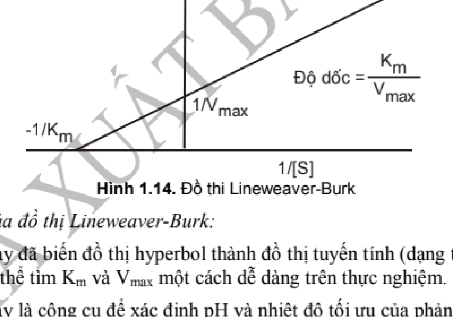
*Hình 1.14. Đồ thị Lineweaver-Burk*

#### Ý nghĩa của đồ thị Lineweaver-Burk:
- Đồ thị này đã biến đồ thị hyperbol thành đồ thị tuyến tính (dạng thẳng), như vậy, từ đồ thị này có thể tìm $K_m$ và $V_{max}$ một cách dễ dàng trên thực nghiệm.
- Đồ thị này là công cụ để xác định pH và nhiệt độ tối ưu của phản ứng enzym.
- Đồ thị này cũng còn là công cụ để xác định loại chất ức chế là chất ức chế cạnh tranh hay không cạnh tranh đối với một enzym nhất định.

---

### 6. CÁC YẾU TỐ ẢNH HƯỞNG ĐẾN HOẠT ĐỘNG CỦA ENZYM

Vì các enzym có trong huyết thanh với những lượng rất nhỏ nên trong thực tế lâm sàng người ta thường đo hoạt độ enzym chứ không đo nồng độ enzym. Trong nghiên cứu về enzym, người ta thường khảo sát tốc độ phản ứng enzym ở các điều kiện khác nhau. Các yếu tố sau có thể ảnh hưởng đến tốc độ phản ứng enzym.

---

## [Trang 34] - Các yếu tố ảnh hưởng: [S], [E] & Nhiệt độ

#### 6.1. Nồng độ cơ chất [S]
Sự ảnh hưởng của nồng độ cơ chất đến hoạt động của enzym đã được mô tả ở phần động học enzym với phương trình và đồ thị Mechaelis-Menten.

#### 6.2. Nồng độ enzym [E]
Ngoài nồng độ cơ chất, nồng độ enzym cũng ảnh hưởng đến tốc độ phản ứng enzym. Đối với cùng một lượng cơ chất, tốc độ phản ứng enzym tăng khi tăng nồng độ enzym và ngược lại. Tuy nhiên, giá trị $K_m$ không bị phụ thuộc vào nồng độ enzym.

#### 6.3. Nhiệt độ
Nhiệt độ tăng thường làm tăng tốc độ của một phản ứng hóa học do làm tăng sự chuyển động của các phân tử, làm tăng số va chạm hiệu quả của các phân tử enzym và cơ chất và cũng cung cấp năng lượng cho phản ứng. Tuy nhiên, sau khi đạt được tốc độ tối đa, tốc độ phản ứng giảm dần bởi vì bản chất của enzym là protein nên khi nhiệt độ tăng cao sẽ dẫn đến biến tính protein, làm mất hoạt tính xúc tác của chúng. Hầu hết các enzym có một ranh giới nhiệt độ tối ưu giống như điều kiện nhiệt độ sinh lý của cơ thể. Sự biến tính bắt đầu xảy ra ở nhiệt độ từ $40$ đến $50^\circ\text{C}$ và sự biến tính xảy ra ở những nhiệt độ cao hơn. Thời gian tiếp xúc với nhiệt độ cũng ảnh hưởng đến sự hoạt động của enzym. Enzym có thể chịu đựng được nhiệt độ cao hơn trong một thời gian ngắn. Nói chung, ở ranh giới nhiệt độ enzym chưa bị biến tính, khi tăng nhiệt độ lên $10^\circ\text{C}$, tốc độ phản ứng tăng lên gấp hai lần, nghĩa là giá trị hệ số nhiệt độ (temperature coeficient) $Q_{10}$ bằng 2. Như vậy, các kết quả phân tích enzym phải được nêu rõ là được thực hiện ở nhiệt độ nào và phải hiệu chỉnh bằng bảng hiệu chỉnh hoạt độ enzym theo nhiệt độ nếu cần thiết. Các mẫu huyết tương có thể được bảo quản ở nhiệt độ trong tủ lạnh ($0^\circ - 4^\circ\text{C}$) hoặc đông lạnh trong một thời gian nhất định cho đến khi phân tích mà các enzym không bị mất hoạt tính. Tuy nhiên, không nên đông lạnh rồi lại làm tan enzym nhiều lần bởi vì điều này có thể gây biến tính enzym protein.

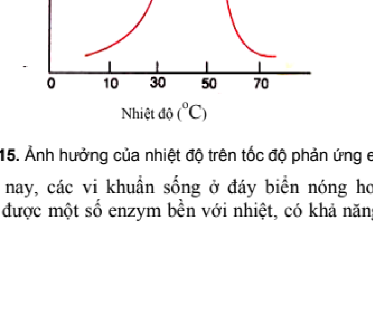
*Hình 1.15. Ảnh hưởng của nhiệt độ trên tốc độ phản ứng enzym*

Ngoài ra, ngày nay, các vi khuẩn sống ở đáy biển nóng hoặc suối nước nóng người ta đã phát hiện được một số enzym bền với nhiệt, có khả năng chịu nhiệt rất cao.

---

## [Trang 35] - Nhiệt độ (tiếp), pH môi trường & Chất hoạt hóa

Ví dụ: các enzym *Taq DNA polymerase*, *Tli DNA polymerase*, *Pfu DNA polymerase*, *Tth DNA polymerase*, *Tma DNA polymerase*,... có nhiệt độ tối ưu khoảng $75 - 80^\circ\text{C}$, có thể hoạt động ở nhiệt độ $95^\circ\text{C}$ trong vài chục phút. Vì vậy, các enzym này hiện đang được sử dụng rộng rãi cho phản ứng chuỗi polymerase (polymerase chain reaction: PCR).

#### 6.4. pH môi trường
Bản chất của các enzym là protein nên chúng mang điện. Các mức độ pH khắc nghiệt có thể gây biến tính enzym hoặc ảnh hưởng đến trạng thái ion hóa của enzym, gây nên sự thay đổi cấu trúc hoặc thay đổi điện tích trên các gốc acid amin ở trung tâm hoạt động. Vì vậy, mỗi enzym chỉ hoạt động trong vùng pH nhất định và hoạt động tối ưu ở một pH thích hợp. Ngoài vùng pH này, pH cao hơn hoặc thấp hơn hoạt tính enzym đều giảm. Hầu hết các phản ứng enzym sinh lý xảy ra trong một giới hạn pH khoảng từ 7 đến 8. Tuy nhiên, một số enzym hoạt động trong một giới hạn pH rộng hơn một số enzym khác. Ví dụ pH tối ưu của *pepsin* ở vùng acid ($\text{pH } 2,0 - 4,0$), còn pH tối ưu của *trypsin* ở vùng pH kiềm ($8 - 10$). Điều này hoàn toàn phù hợp tạo kiện cho quá trình phân hủy protein thức ăn tạo acid amin ở đường tiêu hóa. Trong phòng thí nghiệm, hoạt độ enzym phải được kiểm soát một cách chặt chẽ ở pH tối ưu bằng những dung dịch đệm thích hợp.

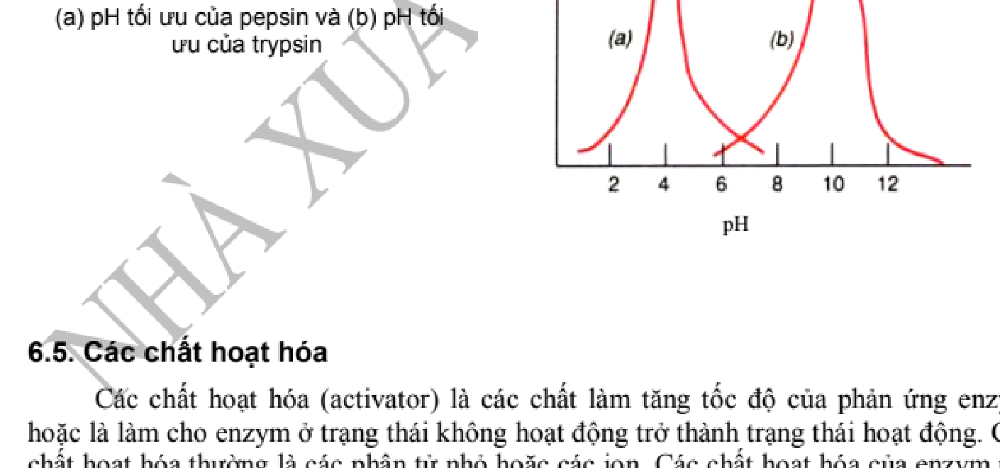
*Hình 1.16. Ảnh hưởng của pH đến tốc độ phản ứng enzym. (a) pH tối ưu của pepsin và (b) pH tối ưu của trypsin*

#### 6.5. Các chất hoạt hóa
Các chất hoạt hóa (activator) là các chất làm tăng tốc độ của phản ứng enzym hoặc là làm cho enzym ở trạng thái không hoạt động trở thành trạng thái hoạt động. Các chất hoạt hóa thường là các phân tử nhỏ hoặc các ion. Các chất hoạt hóa của enzym nói chung thường là các kim loại ($\text{Ca}^{2+}$, $\text{Fe}^{2+}$, $\text{Mg}^{2+}$, $\text{Mn}^{2+}$, $\text{Zn}^{2+}$ và $\text{K}^+$) hoặc á kim ($\text{Br}^-$ và $\text{Cl}^-$). Cơ chế hoạt động của các chất hoạt hóa là tạo nên một vị trí hoạt động tích điện dương để có thể tác động vào các nhóm tích điện âm của cơ chất. Các chất hoạt hóa khác có vai trò làm thay đổi cấu hình không gian của enzym, làm ổn định cấu trúc bậc

<!-- END FILE: pages_026_035.md -->

<!-- BEGIN FILE: pages_036_045.md -->

# GIÁO TRÌNH HÓA SINH - ĐẠI HỌC Y HÀ NỘI
**Chủ biên:** GS. TS. BS. Tạ Thành Văn  
**Nguồn:** SGK Hóa sinh YHN 2019 (Nhà xuất bản Y học)

---

## [Trang 36] - Chất hoạt hóa (tiếp), Chất ức chế & Ức chế cạnh tranh

ba và bậc bốn của phân tử enzym, làm enzym dễ gắn với cơ chất, cũng có thể có vai trò liên kết cơ chất với enzym hoặc với coenzym, hoặc tạo ra sự oxy hóa hoặc sự khử.

Một số coenzym có vai trò như một chất hoạt hóa đối với một số enzym đòi hỏi các phân tử hữu cơ này cho hoạt tính enzym đầy đủ của chúng. Ví dụ: $\text{NAD}^+$ là một cofactor có thể bị khử thành $\text{NADH}$ trong đó cơ chất thứ nhất bị oxy hóa.

### 6.6. Các chất ức chế

Chất ức chế là những chất khi kết hợp với enzym có tác dụng ức chế hoạt động của enzym, nghĩa là làm giảm hoặc làm mất hoạt tính của những enzym nhất định.

Enzym xúc tác hầu như tất cả các phản ứng trong tế bào sống, tuy nhiên cũng không ngạc nhiên rằng nhiều chất ức chế enzym là những thuốc quan trọng đã được biết. Ví dụ, aspirin (acetylsalicylate) ức chế enzym xúc tác bước đầu tiên trong tổng hợp prostaglandin, chất này liên quan đến nhiều quá trình, bao gồm quá trình gây ra đau. Nghiên cứu về các chất ức chế enzym cũng cung cấp nhiều thông tin có giá trị về cơ chế enzym, giúp xác định một số con đường trao đổi chất. Có hai loại chất ức chế enzym: *ức chế thuận nghịch* (Reversible inhibition) và *ức chế không thuận nghịch* (irreversible inhibition).

#### 6.6.1. Ức chế thuận nghịch (reversible inhibition)

##### 6.6.1.1. Ức chế cạnh tranh (competitive inhibitor)
Một dạng ức chế thuận nghịch thông thường là *ức chế cạnh tranh*. Sự ức chế cạnh tranh là sự ức chế của những chất có cấu trúc tương tự như phân tử cơ chất và vì vậy có khả năng cạnh tranh với cơ chất để gắn vào trung tâm hoạt động của enzym (hình 1.17). Khi chất ức chế gắn vào trung tâm hoạt động của enzym tạo phức hợp EI sẽ ngăn cản sự gắn của cơ chất vào enzym và không có phản ứng xúc tác xảy ra. Sự ức chế cạnh tranh có khả năng thuận nghịch (đảo ngược), vì vậy có thể khắc phục sự ức chế cạnh tranh bằng cách tăng nồng độ cơ chất. Khi cơ chất nhiều hơn, chúng sẽ cạnh tranh với chất ức chế để gắn vào trung tâm hoạt động.

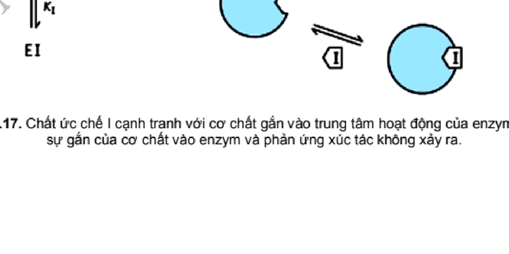
*Hình 1.17. Chất ức chế I cạnh tranh với cơ chất gắn vào trung tâm hoạt động của enzym, ngăn sự gắn của cơ chất vào enzym và phản ứng xúc tác không xảy ra.*

---

## [Trang 37] - Động học Ức chế cạnh tranh & Ứng dụng điều trị ngộ độc Methanol

Như được chỉ ra ở hình 1.18 từ đồ thị Lineweaver-burk, giá trị $V_{max}$ là không thay đổi nhưng giá trị $K_m$ là lớn hơn, điều này chỉ ra rằng cần một nồng độ cơ chất lớn hơn để đạt được động học bậc “0” do các ảnh hưởng của chất ức chế cạnh tranh.

Trong trường hợp có chất ức chế cạnh tranh, phương trình Michaelis-Menten có dạng:
$$V = V_{max} \frac{[\text{S}]}{K_m (1 + [\text{I}] / K_I) + [\text{S}]}$$

Và phương trình Lineweaver-Burk là:
$$\frac{1}{V} = \frac{K_m}{V_{max}} \left(1 + \frac{[\text{I}]}{K_I}\right) \times \frac{1}{[\text{S}]} + \frac{1}{V_{max}}$$

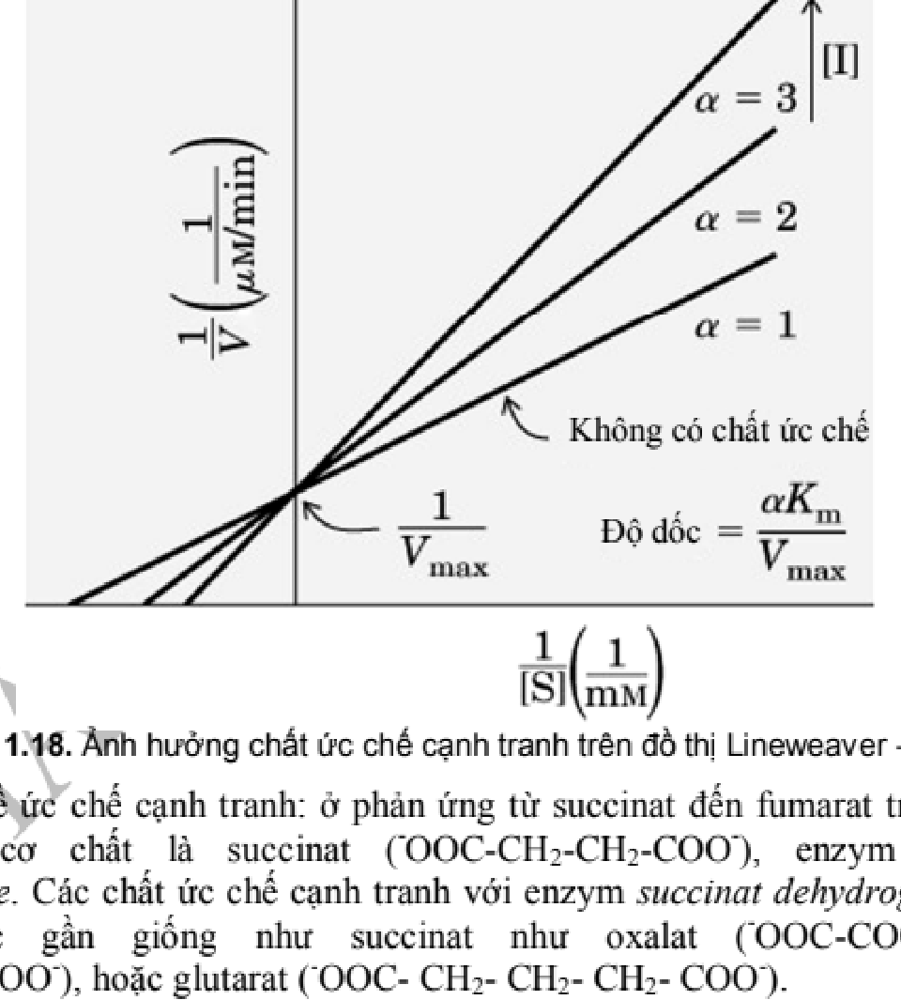
*Hình 1.18. Ảnh hưởng chất ức chế cạnh tranh trên đồ thị Lineweaver - burk*

Ví dụ về ức chế cạnh tranh: ở phản ứng từ succinat đến fumarat trong chu trình acid citric, cơ chất là succinat ($^-\text{OOC-CH}_2\text{-CH}_2\text{-COO}^-$), enzym là *succinat dehydrogenase*. Các chất ức chế cạnh tranh với enzym succinat dehydrogenase là chất có cấu trúc gần giống như succinat như oxalat ($^-\text{OOC-COO}^-$), malonat ($^-\text{OOC-CH}_2\text{-COO}^-$), hoặc glutarat ($^-\text{OOC-CH}_2\text{-CH}_2\text{-CH}_2\text{-COO}^-$).

Một ứng dụng chất ức chế cạnh tranh được sử dụng trong y học là điều trị bệnh nhân ngộ độc methanol. Khi ngộ độc methanol, ở gan có enzym *alcohol dehydrogenase* chuyển methanol thành formaldehyde. Đây là chất độc gây tổn thương nhiều mô. Mù mắt là kết quả thường gặp của ngộ độc methanol, bởi vì mắt đặc biệt nhạy cảm với formaldehyde. Ethanol cạnh tranh có hiệu quả với methanol như một cơ chất thay thế cho *alcohol dehydrogenase*. Tác dụng của ethanol rất giống với của một chất ức chế cạnh tranh, với sự khác biệt là ethanol cũng là cơ chất cho alcohol dehydrogenase và nồng độ của nó sẽ giảm theo thời gian khi enzym chuyển hóa nó thành acetaldehyde. Liệu pháp cho nhiễm độc methanol là truyền chậm trong tĩnh mạch ethanol, với tốc độ duy trì nồng độ có kiểm soát trong máu trong vài giờ. Liệu pháp này làm chậm sự hình thành formaldehyde, làm giảm tác hại do formaldehyde, trong khi methanol sẽ được thận lọc và bài tiết nước tiểu thành chất vô hại.

---

## [Trang 38] - Ứng dụng Allopurinol trị Gút & Ức chế phi cạnh tranh (Uncompetitive)

Một ví dụ khác của việc ứng dụng chất ức chế cạnh tranh trong việc chế tạo thuốc điều trị bệnh gout. Bệnh gout có sự ứ đọng acid uric và dễ dàng tạo tủa dạng muối urat ở các mô gây viêm, đau khớp. Việc tạo acid uric từ xanthin nhờ enzym xanthin oxidase (xem chuyển hóa acid nucleic). Một loại thuốc điều trị bệnh gout là Allopurinol có cấu tạo tương tự xanthin (nhưng khác một chút ở vị trí nitơ số 7 chuyển sang vị trí số 8). Vì có cấu tạo tương tự xanthin, Allopurinol có thể cạnh tranh gắn vào trung tâm hoạt động enzym nhưng không có phản ứng tạo acid uric, hạn chế tạo thành urat.

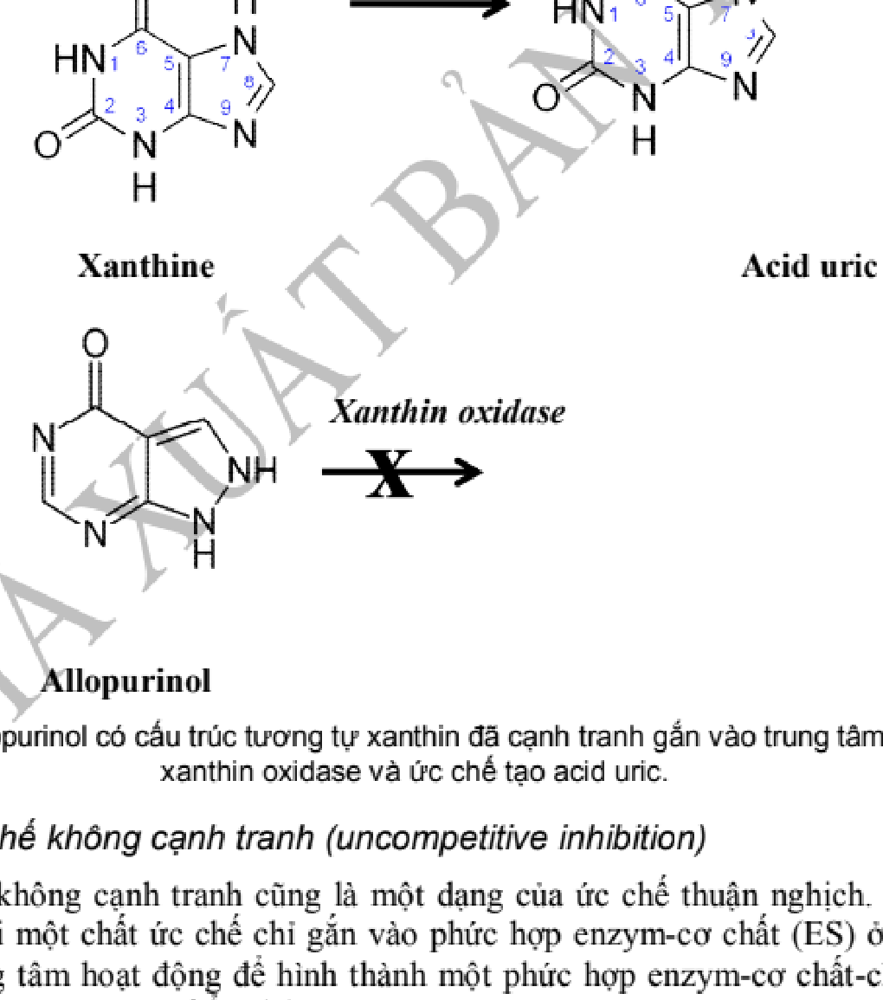
*Hình 1.19. Allopurinol có cấu trúc tương tự xanthin đã cạnh tranh gắn vào trung tâm hoạt động xanthin oxidase và ức chế tạo acid uric.*

##### 6.6.1.2. Ức chế không cạnh tranh (uncompetitive inhibition - phi cạnh tranh)
Ức chế không cạnh tranh cũng là một dạng của ức chế thuận nghịch. Sự ức chế này xảy ra khi một chất ức chế chỉ gắn vào phức hợp enzym-cơ chất (ES) ở một vị trí khác với trung tâm hoạt động để hình thành một phức hợp enzym-cơ chất-chất ức chế (ESI) mà không tạo ra sản phẩm (P):
$$\text{ES} + \text{I} \rightleftharpoons \text{ESI}$$

---

## [Trang 39] - Cơ chế & Đồ thị Ức chế phi cạnh tranh (Uncompetitive)

Trong kiểu ức chế này, chất ức chế I không gắn vào enzym tự do (hình 1.20).

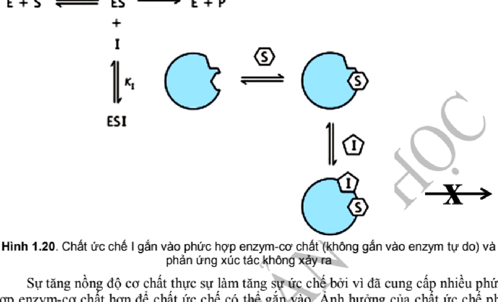
*Hình 1.20. Chất ức chế I gắn vào phức hợp enzym-cơ chất (không gắn vào enzym tự do) và phản ứng xúc tác không xảy ra*

Sự tăng nồng độ cơ chất thực sự làm tăng sự ức chế bởi vì đã cung cấp nhiều phức hợp enzym-cơ chất hơn để chất ức chế có thể gắn vào. Ảnh hưởng của chất ức chế phi cạnh tranh được chỉ ra trên đồ thị Lineweaver-burk là làm giảm giá trị $V_{max}$ do bất hoạt enzym và làm giảm giá trị $K_m$ (hình 1.21).

$$\frac{1}{V} = \left(\frac{K_m}{V_{max}}\right) \frac{1}{[\text{S}]} + \frac{\alpha'}{V_{max}}$$

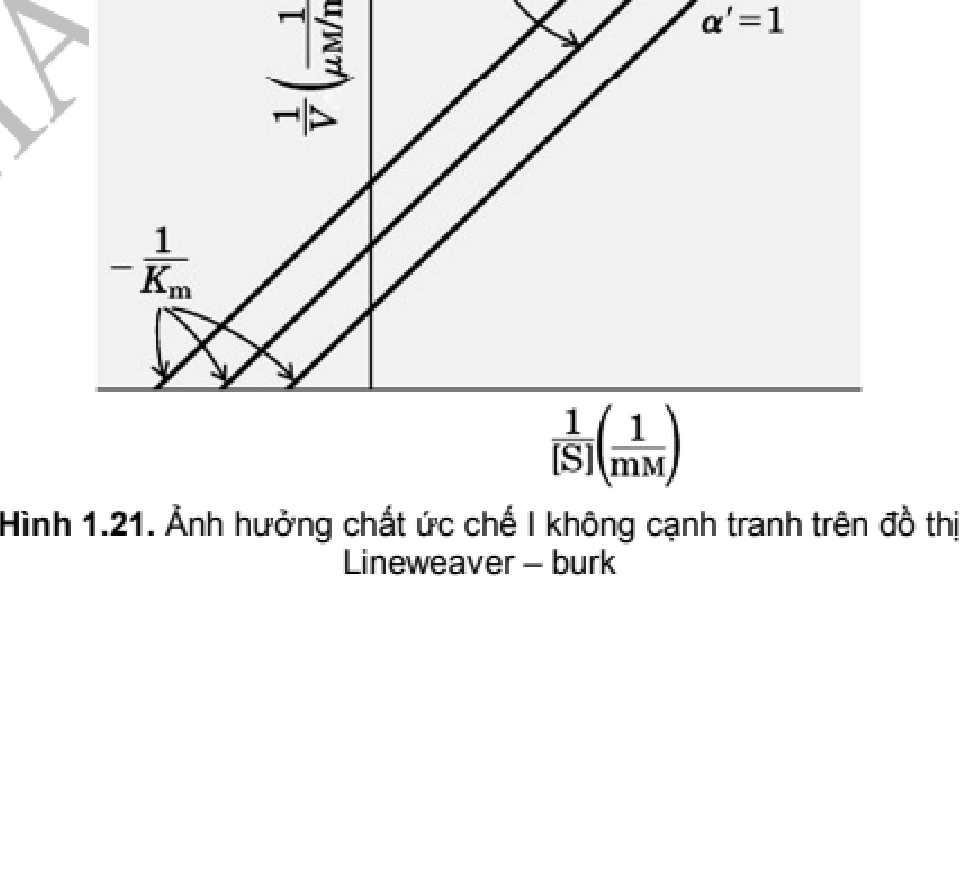
*Hình 1.21. Ảnh hưởng chất ức chế I không cạnh tranh (phi cạnh tranh) trên đồ thị Lineweaver - burk*

---

## [Trang 40] - Ức chế hỗn hợp (Mixed inhibition / Noncompetitive)

##### 6.6.1.3. Ức chế không cạnh tranh kiểu hỗn hợp (mixed inhibition)
Sự ức chế xảy ra khi chất ức chế này gắn vào enzym ở một vị trí không phải trung tâm hoạt động. Sự gắn này có thể xảy ra với cả enzym tự do và với cả phức hợp enzym cơ chất tạo thành phức hợp EI và ESI (hình 1.22):
$$\begin{aligned}
\text{E} + \text{I} &\rightleftharpoons \text{EI} \\
\text{ES} + \text{I} &\rightleftharpoons \text{ESI}
\end{aligned}$$

Sự gắn này gây nên một sự thay đổi cấu hình không gian của cấu trúc phân tử enzym, làm cho trung tâm hoạt động cũng bị thay đổi, không thể tiếp nhận được cơ chất, nếu đã tiếp nhận cơ chất cũng không thể biến đổi cơ chất thành sản phẩm. Sự tăng nồng độ cơ chất không ảnh hưởng đến sự gắn của ức chế không cạnh tranh vào phân tử enzym nên không thể khắc phục được tình trạng ức chế bằng cách tăng nồng độ cơ chất.

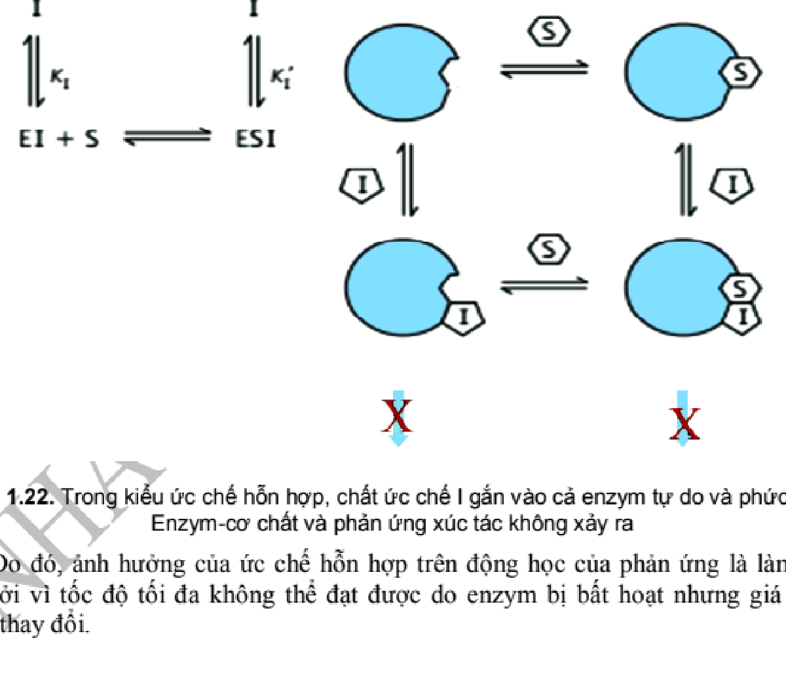
*Hình 1.22. Trong kiểu ức chế hỗn hợp, chất ức chế I gắn vào cả enzym tự do và phức hợp Enzym-cơ chất và phản ứng xúc tác không xảy ra*

Do đó, ảnh hưởng của ức chế hỗn hợp trên động học của phản ứng là làm giảm $V_{max}$ bởi vì tốc độ tối đa không thể đạt được do enzym bị bất hoạt nhưng giá trị $K_m$ không thay đổi (nếu ái lực gắn như nhau).

---

## [Trang 41] - Đồ thị Ức chế hỗn hợp & Ức chế không thuận nghịch (Ngộ độc thuốc trừ sâu)

$$\frac{1}{V} = \left(\frac{\alpha K_m}{V_{max}}\right) \frac{1}{[\text{S}]} + \frac{\alpha'}{V_{max}}$$

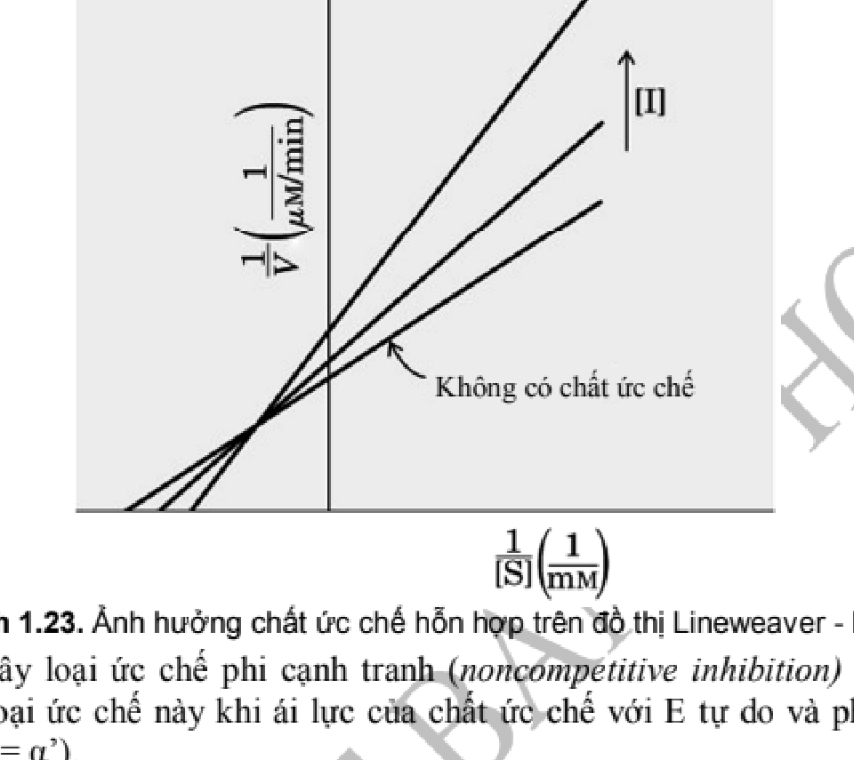
*Hình 1.23. Ảnh hưởng chất ức chế hỗn hợp trên đồ thị Lineweaver - burk*

Trước đây loại ức chế phi cạnh tranh (*noncompetitive inhibition*) là trường hợp đặc biệt của loại ức chế này khi ái lực của chất ức chế với E tự do và phức hợp ES là bằng nhau ($\alpha = \alpha'$).

Thực tế, sự ức chế không cạnh tranh và ức chế hỗn hợp chỉ gặp ở các enzym xúc tác phản ứng có 2 cơ chất hoặc nhiều hơn.

#### 6.6.2. Ức chế không thuận nghịch (irreversible inhibition)
Trong ức chế không thuận nghịch, chất ức chế gắn đồng hóa trị hoặc phá hủy nhóm chức năng cần thiết cho hoạt động xúc tác của phân tử enzym hoặc tạo phức không phải liên kết đồng hóa trị nhưng rất bền vững. Sự hình thành liên kết đồng hóa trị giữa chất ức chế và enzym tạo ra sự ức chế không thể đảo ngược (không thuận nghịch). Các chất ức chế không thuận nghịch là một công cụ hữu ích để nghiên cứu cơ chế phản ứng. Các acid amin (với các nhóm chức năng) tham gia cấu tạo trung tâm hoạt động của enzym có thể xác định bằng cách gốc nào, nhóm chức nào liên kết cộng hóa trị với chất ức chế sau khi enzym bị bất hoạt. Sự ức chế không thuận nghịch này cũng gặp trong thực tế khi bệnh nhân ngộ độc thuốc trừ sâu loại phosphor hữu cơ như hình 1.24.

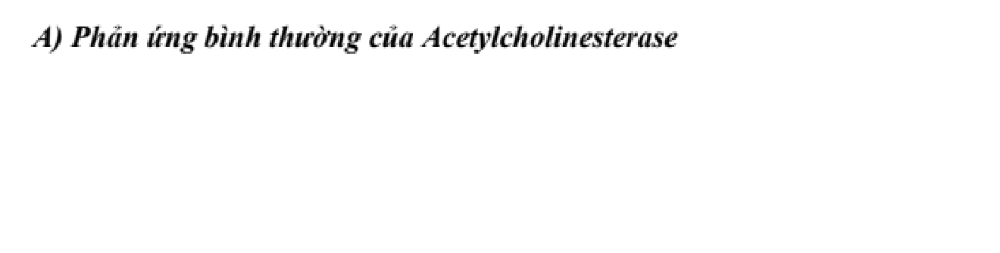
*A) Phản ứng bình thường của Acetylcholinesterase*

---

## [Trang 42] - Cơ chế ngộ độc Phosphor hữu cơ, Chất bất hoạt tự sát & Câu hỏi ôn tập Chương 1

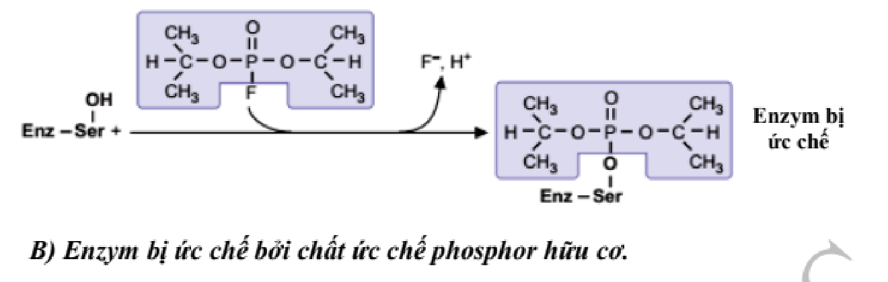
*B) Enzym bị ức chế bởi chất ức chế phosphor hữu cơ.*

*Hình 1.24. A) Acetylcholinesterase bình thường xúc tác phân hủy làm bất hoạt chất dẫn truyền thần kinh acetylcholine bằng phản ứng thủy phân tạo cholin và acetat. B) Khi bệnh nhân nhiễm độc chất phosphor hữu cơ diisopropylphosphofluoridate (DFP) (một chất khí độc thần kinh và thuốc trừ sâu loại phospholam bất hoạt Acetylcholinesterase do tạo phức hợp đồng hóa trị với trung tâm hoạt động. Điều này dẫn tới tăng tích lũy, ứ đọng acetylcholine và gây độc.*

Một loại chất ức chế không thuận nghịch đặc biệt là **chất bất hoạt tự sát** (*suicide inactivators*). Các chất này không hoạt động cho đến khi gắn vào trung tâm hoạt động của enzym. Chất bất hoạt tự sát trải qua một số bước phản ứng hóa học đầu tiên như phản ứng enzym bình thường. Nhưng sau đó thay vì được biến đổi thành sản phẩm thông thường, chất bất hoạt lại chuyển thành một chất có hoạt tính cao gắn không thuận nghịch với enzym. Phức hợp này được gọi là chất bất hoạt dựa vào cơ chế phản ứng (*mechanism-based inactivators*) vì chúng bởi vì chúng dựa trên cơ chế phản ứng enzym bình thường để ức chế enzym. Các chất bất hoạt tự sát có vai trò quan trọng trong việc tạo ra các loại thuốc điều trị. Các nhà hóa học tổng hợp các thuốc mới dựa trên các kiến thức về cơ chất, cơ chế phản ứng và chất ức chế tự sát là mô hình để tạo ra các thuốc mới.

---

### CÂU HỎI ÔN TẬP CHƯƠNG 1
1. Trình bày cách gọi tên và phân loại enzym theo phân loại quốc tế, cho ví dụ mỗi loại.
2. Trình bày thành phần cấu tạo, cấu trúc, trung tâm hoạt động của enzym.
3. Trình bày trung tâm dị lập thể enzym, ý nghĩa trong chuyển hóa chất.
4. Trình bày vai trò của các coenzym trong hoạt động enzym và cơ chế hoạt động của coenzym $\text{NAD}^+$ và $\text{FAD}$.
5. Trình bày cơ chế hoạt động của enzym.
6. Trình bày phương trình và đồ thị Michaelis-Menten, ý nghĩa của $K_m$.
7. Trình bày phương trình và đồ thị Lineweaver-Burk, ý nghĩa của đồ thị.
8. Trình bày ảnh hưởng của nhiệt độ và pH đến hoạt động của enzym.
9. Trình bày ảnh hưởng của các yếu tố hoạt hóa và ức chế đến hoạt động của enzym.

---

## [Trang 43] - Chương 2: NĂNG LƯỢNG SINH HỌC