# Chương 2
# NĂNG LƯỢNG SINH HỌC

### MỤC TIÊU HỌC TẬP
*1. Trình bày được bản chất và ý nghĩa chuỗi hô hấp tế bào và cơ chế tạo ATP ở ty thể.*  
*2. Trình bày được khái niệm năng lượng sinh học, sự phosphoryl hóa và phosphoryl-oxy hóa, ý nghĩa của quá trình này.*  
*3. Trình bày được chu trình acid citric: các giai đoạn, công thức, enzym, năng lượng, đặc điểm và ý nghĩa.*

---

### ĐẠI CƯƠNG
Mọi tế bào, cơ thể sống đều cần năng lượng cho sự hoạt động, tồn tại, phát triển của mình. Khi thiếu năng lượng cơ thể trở nên mỏi mệt và phải “nạp” năng lượng từ bên ngoài qua đường ăn và uống. Một người trưởng thành nặng 70 kg hàng ngày cần khoảng 1920-2900 kcal, tùy thuộc vào hoạt động thể chất. Động vật lớn đòi hỏi ít năng lượng hơn cho mỗi kg cơ thể, và động vật nhỏ hơn cần năng lượng nhiều hơn cho mỗi kg cơ thể. Trẻ em có nhu cầu năng lượng cao hơn cho sự tăng trưởng.

Các thành phần trong thức ăn, nước uống có khả năng cung cấp năng lượng cho cơ thể và tế bào là glucid, lipid, protein. Đối với con người, nhu cầu năng lượng lấy từ glucid (40% - 60%), lipid (chủ yếu là triacylglycerol, 30% - 40%), và protein (10% - 15%).

Nhu cầu năng lượng theo ngày tương đối hằng định; hoạt động thể lực trung bình làm tăng tốc độ chuyển hóa chất chỉ khoảng 40% đến 50% so với tốc độ chuyển hóa cơ sở hoặc nghỉ ngơi. Tuy nhiên, hầu hết mọi người hấp thu nguồn năng lượng từ thức ăn hàng ngày qua hai hoặc ba bữa ăn, vì vậy cần có dự trữ nguồn năng lượng carbohydrat (glycogen trong gan và cơ), lipid (triacylglycerol trong mô mỡ), và protein không bền trong giai đoạn xa bữa ăn.

Năng lượng sinh học hay sự oxy hóa sinh học hay còn gọi là sự hô hấp tế bào là quá trình đốt cháy các chất hữu cơ glucid, lipid, protein (G, L, P) tạo năng lượng cho các hoạt động sống của cơ thể.

Khi vào cơ thể, tế bào, các thành phần hữu cơ trên sẽ thoái hóa cung cấp năng lượng và sinh ra các chất cặn bã ($\text{CO}_2$, $\text{NH}_3$,...). Nếu chỉ xem xét về lượng chất thoái hóa và năng lượng, sản phẩm tạo ra thì việc thoái hóa (đốt cháy) các chất hữu cơ diễn ra trong và ngoài cơ thể là giống nhau. Ví dụ sự đốt cháy một phân tử glucose trong và ngoài cơ thể đều có thể biểu diễn như phản ứng sau:
$$\text{C}_6\text{H}_{12}\text{O}_6 + \text{O}_2 \longrightarrow 6\text{CO}_2 + 6\text{ H}_2\text{O} + Q\text{ calo}$$

---

## [Trang 44] - 3 Bước thoái hóa G, L, P & Sơ đồ đốt cháy chất hữu cơ

Tuy nhiên, quá trình diễn biến sự đốt cháy các chất hữu cơ diễn ra trong và ngoài cơ thể khác nhau về bản chất.

Sự đốt cháy các chất hữu cơ ngoài cơ thể xảy ra nhanh, mạnh mẽ, cần ngọn lửa, oxy không khí tác dụng trực tiếp, nhanh với carbon, hydro của chất hữu cơ; năng lượng ($Q$) giải phóng cùng một lúc.

Sự đốt cháy các chất hữu cơ trong cơ thể trong điều kiện nhiệt độ không cao ($37^\circ\text{C}$), môi trường 2/3 là nước, lượng nhiệt toả ra không được quá lớn một lúc, oxy không khí không tiếp xúc trực tiếp với carbon và hydro của cơ chất. Vì vậy quá trình đốt cháy các chất xảy ra từ từ, từng bước, không có ngọn lửa, ít tăng nhiệt độ, năng lượng được giải phóng dần. Năng lượng giải phóng trong quá trình đốt cháy các chất hữu cơ trong cơ thể được tích trữ lại dưới dạng năng lượng hóa học. Năng lượng này sẽ được sử dụng trong các hoạt động sống của cơ thể như: co cơ, dẫn truyền xung động thần kinh, hấp thu, bài tiết, tổng hợp các chất cần thiết,...v.v.

Sự thoái hóa các chất G, L, P từ thức ăn được minh họa ở hình 2.1 diễn ra qua 3 bước:

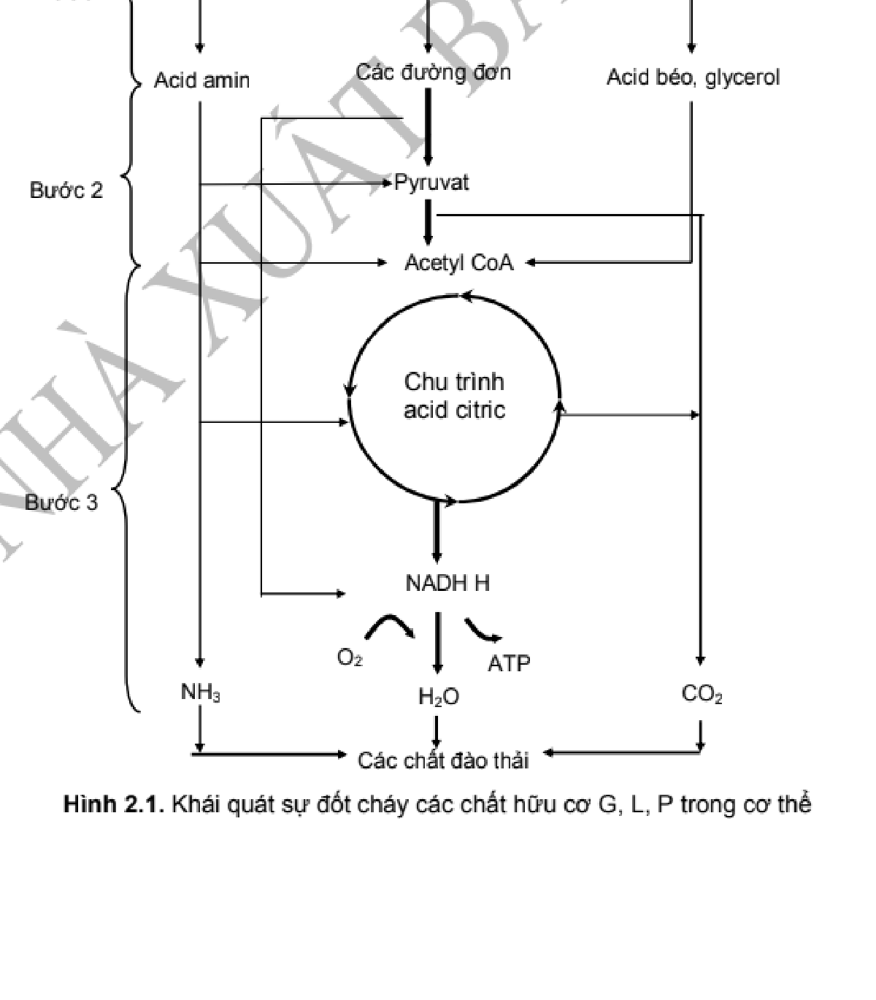
*Hình 2.1. Khái quát sự đốt cháy các chất hữu cơ G, L, P trong cơ thể*

---

## [Trang 45] - 3 Bước thoái hóa (tiếp) & Bản chất Hô hấp tế bào

*Bước 1:* sự thoái hóa các chất đến khi tạo ra các đơn vị cấu tạo.  
Thoái hóa glucid sẽ tạo ra đơn vị cấu tạo là glucose. Thoái hóa lipid tạo ra đơn vị cấu tạo là acid béo, glycerol. Thoái hóa protein tạo ra đơn vị cấu tạo là các acid amin.

*Bước 2:* sự thoái hóa các đơn vị cấu tạo đến khi tạo ra các sản phẩm chuyển hóa trung gian như acid pyruvic, acetyl $\text{CoA}$,...v.v.

*Bước 3:* sự thoái hóa các chất chuyển hóa trung gian đến sản phẩm cuối cùng là các chất cặn bã ($\text{CO}_2$, $\text{NH}_3$) đào thải ra ngoài cơ thể.

Sự thoái hóa các chất ở bước 1 và 2 diễn ra theo những quá trình riêng, con đường riêng và sẽ được trình bày chi tiết ở các chương sau. Sự thoái hóa các chất G, L, P ở bước 3 là giống nhau và năng lượng sinh học giải phóng khi thoái hóa các chất chủ yếu xảy ra ở bước này. Vì vậy, chương này trình bày chi tiết giai đoạn 3 của quá trình thoái hóa chất tạo năng lượng. Riêng thoái hóa glucid ở bước 2 cũng có tạo năng lượng, nhưng chỉ với một lượng rất nhỏ và cơ chế tạo năng lượng sinh học dự trữ (ATP) là hoàn toàn khác với cơ chế chủ yếu tạo ATP ở bước 3.

### 1. BẢN CHẤT SỰ HÔ HẤP TẾ BÀO (OXY HOÁ KHỬ SINH HỌC)

Về mặt hóa học, oxy hóa được định nghĩa là sự cho điện tử (electron) và sự khử là nhận electron. Do đó, quá trình oxy hóa của một phân tử (chất cho electron) luôn luôn đi kèm với việc nhận điện tử của một phân tử thứ hai (chất nhận electron). Nguyên tắc oxy hóa khử này được áp dụng như nhau trong các hệ thống hóa sinh và là một khái niệm quan trọng để hiểu biết về bản chất oxy hóa sinh học. Lưu ý rằng nhiều quá trình oxy hóa sinh học có thể diễn ra mà không có sự tham gia trực tiếp của phân tử oxy, ví dụ khử hydro. Sự sống của động vật bậc cao hoàn toàn phụ thuộc vào việc cung cấp oxy cho quá trình hô hấp, quá trình mà tế bào tạo được năng lượng dưới dạng ATP từ phản ứng vận chuyển hydro tới oxy để tạo thành nước.

Khi đốt cháy các chất hữu cơ tạo năng lượng, tế bào cần sử dụng $\text{O}_2$ và tạo ra sản phẩm $\text{CO}_2$, $\text{H}_2\text{O}$. Đây chính là sự hô hấp, và quá trình sử dụng $\text{O}_2$, tạo $\text{CO}_2$, $\text{H}_2\text{O}$ diễn ra trong tế bào nên còn gọi là hô hấp tế bào.

#### 1.1. Quá trình tạo $\text{H}_2\text{O}$ và $\text{CO}_2$

- Thuyết hiện đại về sự hô hấp tế bào giải thích một cách toàn diện, chính xác về sự sử dụng oxy, giải phóng khí $\text{CO}_2$, tạo thành $\text{H}_2\text{O}$ trong quá trình đốt cháy các chất hữu cơ.
- Khí $\text{CO}_2$ tạo thành do phản ứng khử carboxyl của phân tử chất hữu cơ nhờ enzym xúc tác là *decarboxylase*:
$$\text{R-COOH} \longrightarrow \text{RH} + \text{CO}_2$$
Phản ứng này không giải phóng nhiều năng lượng.
- $\text{H}_2\text{O}$ được tạo thành nhờ một dây chuyền phản ứng bao gồm hàng loạt quá trình tách, vận chuyển $\text{H}_2$ ra khỏi cơ chất và vận chuyển $\text{H}_2$ qua một chuỗi dài các chất trung gian cuối cùng tới $\text{O}_2$. Trong quá trình này, cả hydro và oxy đều được hoạt hóa chuyển

<!-- END FILE: pages_036_045.md -->

<!-- BEGIN FILE: pages_046_055.md -->

# GIÁO TRÌNH HÓA SINH - ĐẠI HỌC Y HÀ NỘI
**Chủ biên:** GS. TS. BS. Tạ Thành Văn  
**Nguồn:** SGK Hóa sinh YHN 2019 (Nhà xuất bản Y học)

---

## [Trang 46] - Chuỗi vận chuyển điện tử & Phức hợp I

thành dạng các ion $\text{H}^+$ và $\text{O}^{2-}$. Những ion này hoạt động mạnh nên khi gặp nhau tạo thành $\text{H}_2\text{O}$.

- Quá trình vận chuyển $\text{H}_2$ tới $\text{O}_2$ tạo thành $\text{H}_2\text{O}$ giải phóng rất nhiều năng lượng và được tích trữ lại cho cơ thể sử dụng.

### 1.2. Chuỗi vận chuyển điện tử

#### 1.2.1. Thành phần chuỗi
Chuỗi vận chuyển điện tử được hình thành bởi 4 phức hợp protein vận chuyển điện tử và 2 chất vận chuyển điện tử riêng biệt.

##### - Phức hợp I: NADH-CoQ Reductase.
Trong phức hợp này, các điện tử được chuyển từ $\text{NADH}$ trước tiên tới FMN (flavin mononucleotid, có chứa vitamin $\text{B}_2$) và được chuyển tới một protein chứa kim loại gắn với lưu huỳnh (trung tâm sắt lưu huỳnh). Sau đó $2e^-$ được chuyển tới $\text{CoQ}$ tạo $\text{CoQH}_2$. Toàn bộ phản ứng ở bước này có thể viết:
$$\text{NADH} + \text{H}^+ + \text{CoQ} \longrightarrow \text{NAD}^+ + \text{CoQH}_2$$

Cơ chế vận chuyển điện tử và hydro của $\text{NAD}^+$ (Nicotinamid adenin dinucleotid) tới phức hợp I diễn ra thông qua nhân nicotinamid như ở hình 2.2.

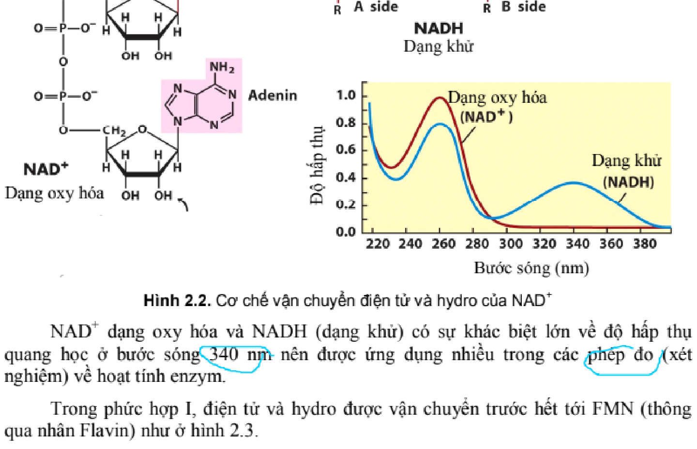
*Hình 2.2. Cơ chế vận chuyển điện tử và hydro của $\text{NAD}^+$*

$\text{NAD}^+$ dạng oxy hóa và $\text{NADH}$ (dạng khử) có sự khác biệt lớn về độ hấp thụ quang học ở bước sóng $340\text{ nm}$ nên được ứng dụng nhiều trong các phép đo (xét nghiệm) về hoạt tính enzym.

Trong phức hợp I, điện tử và hydro được vận chuyển trước hết tới FMN (thông qua nhân Flavin) như ở hình 2.3.

---

## [Trang 47] - Cơ chế FMN & Ba dạng trung tâm Sắt - Lưu huỳnh (Fe-S)

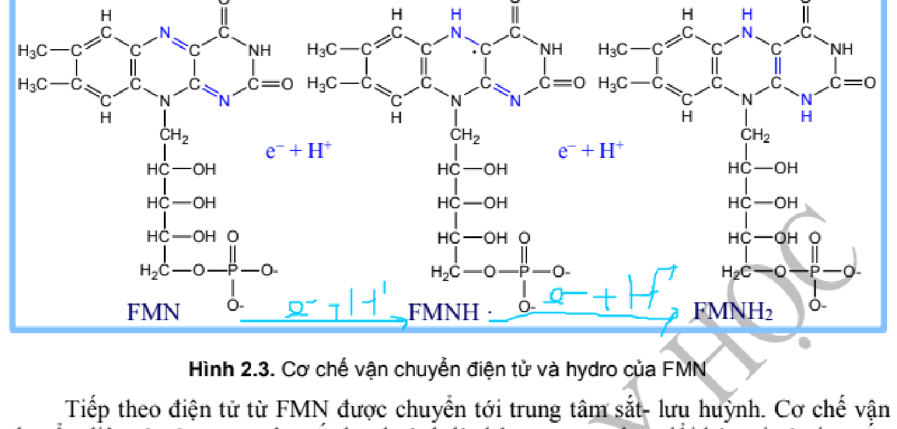
*Hình 2.3. Cơ chế vận chuyển điện tử và hydro của FMN*

Tiếp theo điện tử từ FMN được chuyển tới trung tâm sắt-lưu huỳnh. Cơ chế vận chuyển điện tử của trung tâm sắt lưu huỳnh là thông qua sự thay đổi hóa trị của ion sắt. Có ba trạng thái cấu hình của trung tâm sắt-lưu huỳnh tương ứng với 2 trạng thái hóa trị của sắt như ở hình 2.4.

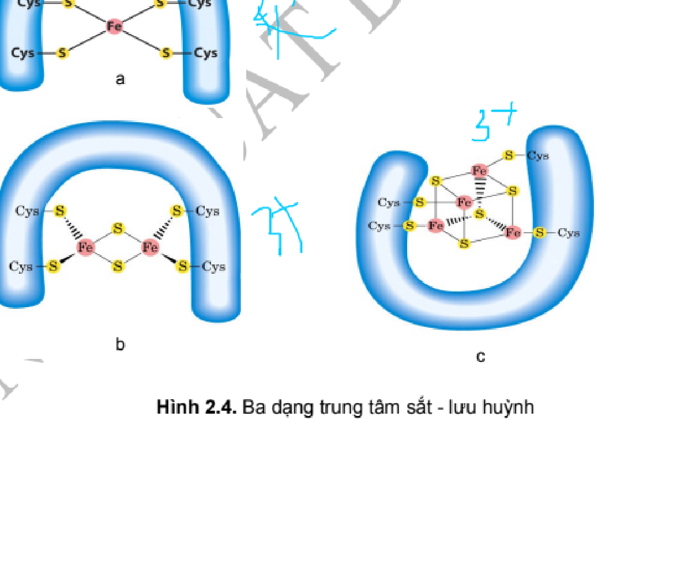
*Hình 2.4. Ba dạng trung tâm sắt - lưu huỳnh (Fe-S)*

---

## [Trang 48] - Phức hợp II: Succinat-CoQ reductase & Coenzym Q (Ubiquinon)

##### + Phức hợp II: Succinat-CoQ reductase.
Trong phức hợp này, $2e^-$ được chuyển từ succinat tới FAD trước tiên và cơ chế vận chuyển điện tử của FAD được chỉ ra ở hình 2.4. Cả FMN và FAD trong thành phần có chứa vitamin $\text{B}_2$.

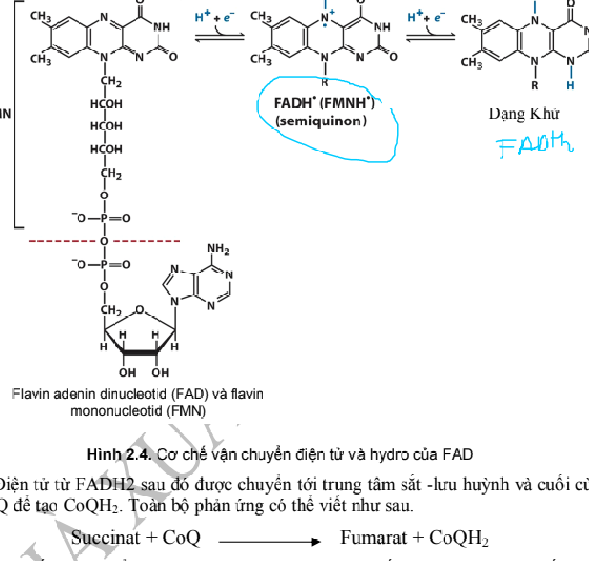
*Hình 2.4 (tiếp). Cơ chế vận chuyển điện tử và hydro của FAD*

Điện tử từ $\text{FADH}_2$ sau đó được chuyển tới trung tâm sắt - lưu huỳnh và cuối cùng tới $\text{CoQ}$ để tạo $\text{CoQH}_2$. Toàn bộ phản ứng có thể viết như sau:
$$\text{Succinat} + \text{CoQ} \longrightarrow \text{Fumarat} + \text{CoQH}_2$$

Cơ chế vận chuyển điện tử của FAD và trung tâm sắt - lưu huỳnh cũng giống như đã trình bày ở phức hợp trên.

##### + CoQ hay Ubiquinon.
$\text{CoQ}$ là một chất mang các nguyên tử hydro ($\text{H}^+$ và $e^-$). Quinon dạng oxy hóa có thể nhận $1e^-$ để hình thành semiquinon và nhận tiếp theo $1e^-$ và $2\text{H}^+$ để tạo ra dạng hydroquinon. $\text{CoQH}_2$ chuyển $2e^-$ tới phức hợp $\text{CoQH}_2\text{-Cytc reductase}$.

$\text{CoQ}$ và $\text{CoQH}_2$ có thể khuếch tán tự do vào màng trong ty thể và là điểm nối của 2 phức hợp enzym đầu và phức hợp thứ 3. Cơ chế vận chuyển điện tử của $\text{CoQ}$ được trình bày ở hình 2.5.

---

## [Trang 49] - Cơ chế vận chuyển điện tử của CoQ & Phức hợp III

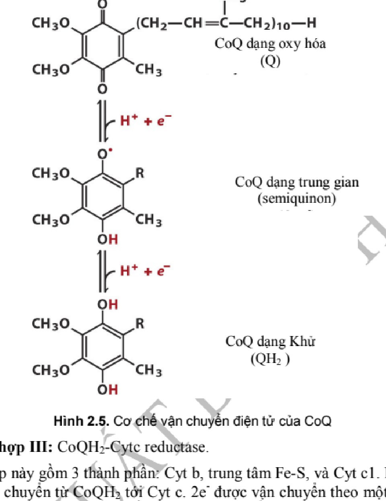
*Hình 2.5. Cơ chế vận chuyển điện tử của CoQ*

##### + Phức hợp III: $\text{CoQH}_2\text{-Cytc reductase}$.
Phức hợp này gồm 3 thành phần: Cyt b, trung tâm Fe-S, và Cyt c1. Nhờ phức hợp này, $2e^-$ được chuyển từ $\text{CoQH}_2$ tới Cyt c. $2e^-$ được vận chuyển theo một trật tự từ Cyt b, trung tâm Fe-S và tới Cyt c1, cuối cùng tới Cyt c để tạo Cyt c dạng khử. Điện tử vận chuyển ở các cytochrom thông qua ion $\text{Fe}^{2+}$ và $\text{Fe}^{3+}$ và ion sắt nằm ở nhân Hem. Fe liên kết phối trí với 4 nguyên tử N của vòng porphyrin (hình 2.6).

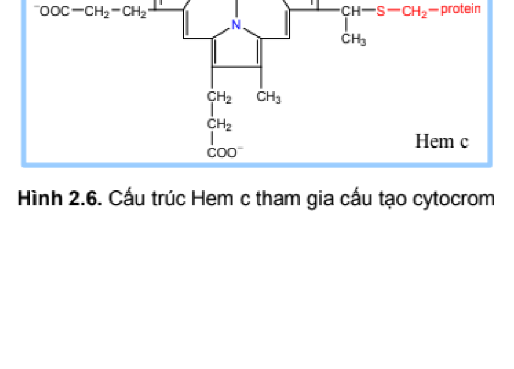
*Hình 2.6. Cấu trúc Hem c tham gia cấu tạo cytochrom*

---

## [Trang 50] - Cytochrom c, Phức hợp IV & Toàn bộ chuỗi vận chuyển điện tử

Toàn bộ phản ứng được xúc tác bởi phức hợp này là:
$$\text{CoQH}_2 + 2\text{ Cyt c-Fe}^{3+} \longrightarrow \text{CoQ} + 2\text{H}^+ + 2\text{ Cytc}^{2+}$$

##### + Cytc:
Cũng như các Cyt khác, Cyt c là protein chứa nhóm ngoại là Hem giống như Myoglobin, Hb. Fe nằm ở trung tâm của Hem làm nhiệm vụ vận chuyển e- bởi quá trình oxy hóa - khử như sau:
$$\text{Fe}_{ox}^{3+} + e^- \longrightarrow \text{Fe}_{kh}^{2+}$$

##### + Phức hợp IV: Cytochrom oxidase.
Phức hợp này nhận $e^-$ từ Cyt c và $e^-$ được chuyển theo thứ tự tới $\text{Cu}_2^+$ (Cyt a) và tới phức hợp chứa đồng thứ hai là $\text{Cyt a}_3$. Cuối cùng $e^-$ được vận chuyển từ phức hợp này tới nguyên tử oxy (là chất nhận điện tử cuối cùng) tạo $\text{O}^{2-}$. $\text{O}^{2-}$ kết hợp với $2\text{H}^+$ tạo $\text{H}_2\text{O}$. Phản ứng được xúc tác bởi phức hợp này có thể tóm tắt như sau:
$$2\text{Cyt c-Fe}_{(kh)}^{2+} + \frac{1}{2}\text{O}_2 + 2\text{H}^+ \longrightarrow 2\text{Cyt c-Fe}_{(ox)}^{3+} + \text{H}_2\text{O}$$

Toàn bộ chuỗi vận chuyển điện tử được tóm tắt ở hình 2.7.

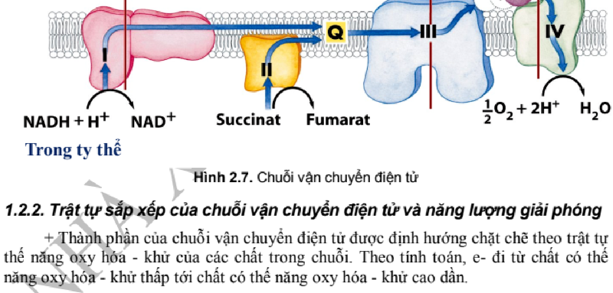
*Hình 2.7. Chuỗi vận chuyển điện tử*

#### 1.2.2. Trật tự sắp xếp của chuỗi vận chuyển điện tử và năng lượng giải phóng
+ Thành phần của chuỗi vận chuyển điện tử được định hướng chặt chẽ theo trật tự thế năng oxy hóa - khử của các chất trong chuỗi. Theo tính toán, $e^-$ đi từ chất có thế năng oxy hóa - khử thấp tới chất có thế năng oxy hóa - khử cao dần.
+ Trong quá trình vận chuyển này năng lượng được giải phóng và có thể tính được bằng một đại lượng là $\Delta G^\circ$:
$$\Delta G^\circ = -n F \Delta E^{\circ'}$$

Ở đây:
- $\Delta G^\circ$: sự biến thiên năng lượng tự do tính theo kcalo ở điều kiện chuẩn ($\text{pH} = 7$, $t = 25^\circ\text{C}$).
- $n$: số $e^-$ vận chuyển.

---

## [Trang 51] - Cấu tạo ty thể & ATP synthase (Fo, F1)

- $F$: số Faraday $= 23.062\text{ calo/(V}\cdot\text{mol)}$.
- $\Delta E^{\circ'}$: sự chênh lệch thế năng của hệ thống cho và nhận $e^-$.

Các giá trị trên được tính trong điều kiện tiêu chuẩn: nồng độ $0,1\text{ M}$, nhiệt độ $25^\circ\text{C}$, $\text{pH} = 7,0$. Sự thay đổi năng lượng tự do của một cặp $e^-$ từ $\text{NADH/NAD}^+$ ($E^{\circ'} = -0,32\text{ V}$) đến $\text{H}_2\text{O}/(1/2)\text{O}_2$ ($E^{\circ'} = +0,82\text{ V}$) có $\Delta G^{\circ'} = -2(23.062)[0,82 - (-0,32)] = -52,6\text{ kcal/mol}$.

Toàn bộ năng lượng trên được giải phóng dần từng chặng. Năng lượng đủ tạo vài phân tử ATP từ ADP và Pi ($\Delta G^{\circ'}$ cần cho tổng hợp ATP từ $\text{ADP} + \text{Pi} = +7,3\text{ kcal/mol}$), còn một phần năng lượng toả ra dưới dạng nhiệt.

### 1.3. Cơ chế tạo ATP ở ty thể (mitochondria)

Năng lượng giải phóng trong quá trình vận chuyển $\text{H}^+$ và $e^-$ trong chuỗi vận chuyển $e^-$ được dùng tạo ATP từ ADP và Pi. Tuy nhiên năng lượng trên không được sử dụng trực tiếp để tạo ATP từ $\text{ADP} + \text{Pi}$ mà qua cơ chế phức tạp hơn.

#### 1.3.1. Nhắc lại cấu tạo ty thể
Cấu tạo bởi 2 màng sinh học:
- **Màng ngoài:** cho qua tự do phân tử nhỏ, ion.
- **Màng trong:** không cho qua các ion (kể cả proton $\text{H}^+$) và có chứa các enzym của chuỗi vận chuyển $e^-$, hệ thống enzym vận chuyển qua màng và *ATP synthase*.

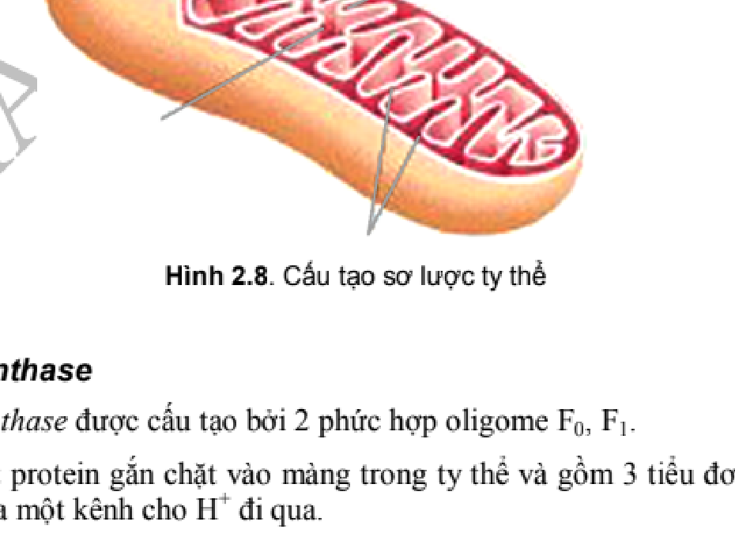
*Hình 2.8. Cấu tạo sơ lược ty thể*

#### 1.3.2. ATP synthase
+ *ATP synthase* được cấu tạo bởi 2 phức hợp oligome $\text{F}_0$, $\text{F}_1$.
- **$\text{F}_0$:** là một protein gắn chặt vào màng trong ty thể và gồm 3 tiểu đơn vị: a, b, c. 3 đơn vị này tạo ra một kênh cho $\text{H}^+$ đi qua.

---

## [Trang 52] - Thuyết hóa thẩm thấu Peter Mitchell & Động lực proton (pmf)

- **$\text{F}_1$:** gồm 3 tiểu đơn vị $\alpha$, 3 tiểu đơn vị $\beta$ và được gắn với $\text{F}_0$ qua các tiểu đơn vị $\gamma$, $\varepsilon$, $\delta$.

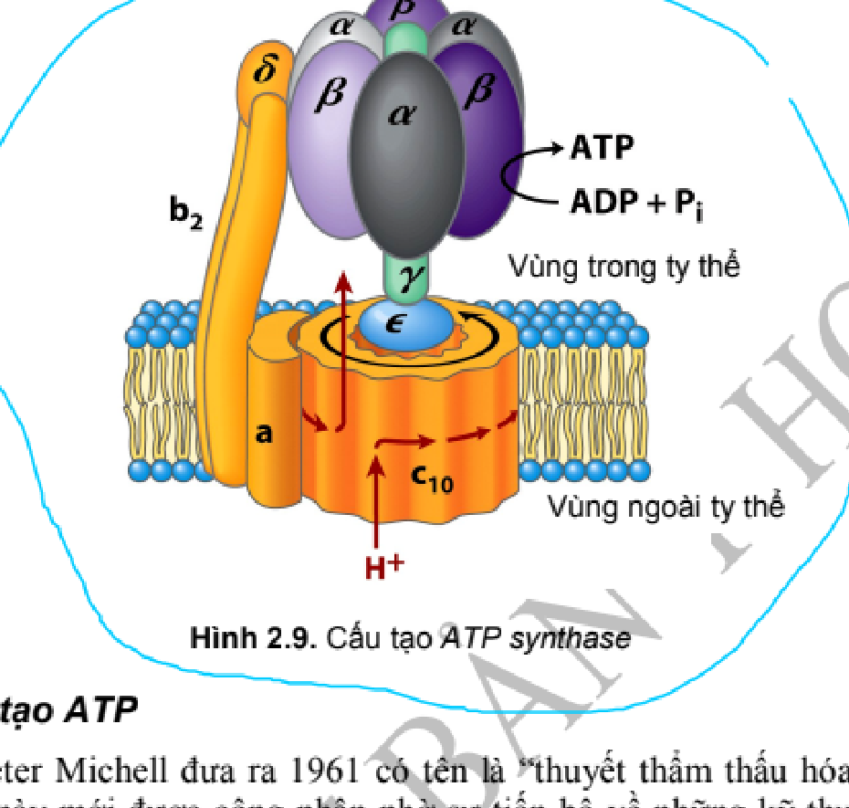
*Hình 2.9. Cấu tạo ATP synthase*

#### 1.3.3. Cơ chế tạo ATP
- Được Peter Mitchell đưa ra 1961 có tên là “thuyết thẩm thấu hóa học” (chemiosmotic theory). Nhưng gần đây thuyết này mới được công nhận nhờ sự tiến bộ về những kỹ thuật tinh chế và cấu tạo lại màng sinh học của các bào quan.
- Năng lượng trong quá trình vận chuyển $e^-$ được dùng để bơm những ion $\text{H}^+$ trong ty thể ra pha lỏng bên ngoài qua màng trong ty thể. Quá trình này tạo ra một gradient ion $\text{H}^+$ qua màng trong. Vì $\text{H}^+$ mang điện dương, sự chênh lệch nồng độ $\text{H}^+$ tạo ra một sự chênh lệch điện thế giữa 2 phía của màng trong ty thể. Chính sự chênh lệch điện thế này tạo ra một lực đẩy $\text{H}^+$ trở lại khuôn ty thể qua màng trong và lực này có thể tính được:
$$\text{pmf} = \psi - \frac{RT}{F} \Delta\text{pH} = \psi - 59\ \Delta\text{pH}$$

- $1$ đơn vị $\text{pH} = 10$ lần chênh lệch nồng độ $\text{H}^+$.
- Chênh lệch một đơn vị pH qua màng = điện thế là $59\text{ mV}$ (ở $20^\circ\text{C}$).
- $R$: hằng số khí $= 1,987\text{ calo/mol}$.
- $T$: Nhiệt độ Kelvin.
- $F$: hằng số Faraday ($23.062\text{ calo}/(\text{V}\cdot\text{mol})$).
- $\psi$: Điện thế qua màng.
- $\text{pmf}$: được đo bằng $\text{mV}$. Ở ty thể lúc nghỉ $\text{pmf} = 220\text{ mV}$.

---

## [Trang 53] - Bơm Proton & Cơ chế quay của ATP synthase tạo ATP

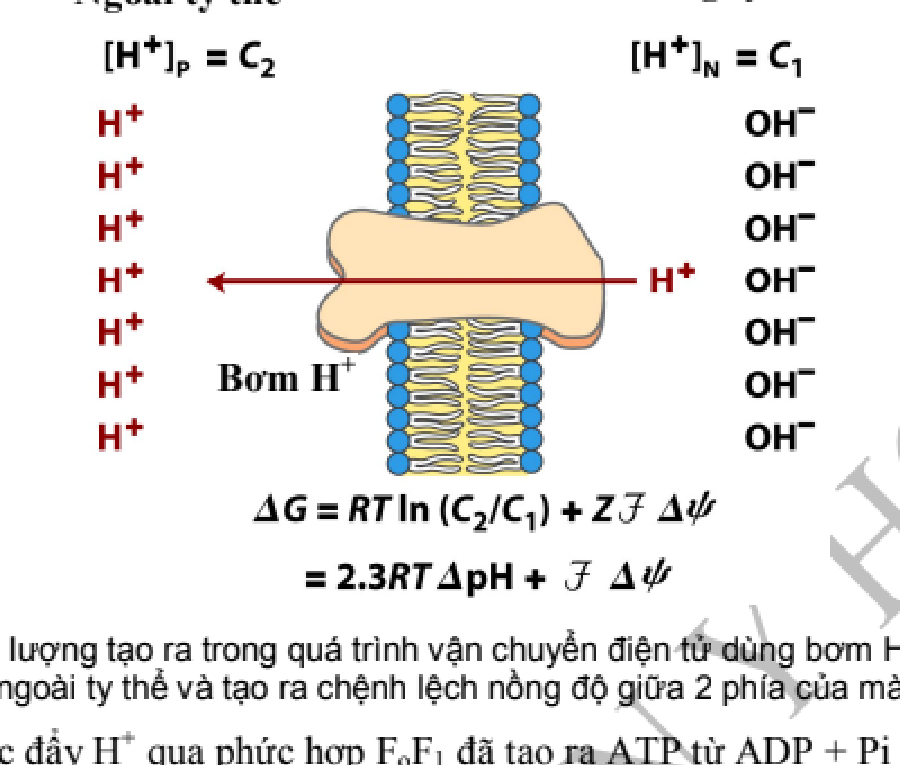
*Hình 2.10. Năng lượng tạo ra trong quá trình vận chuyển điện tử dùng bơm $\text{H}^+$ từ trong ty thể ra ngoài ty thể và tạo ra chênh lệch nồng độ giữa 2 phía của màng*
$$\Delta G = RT \ln(C_2/C_1) + Z \mathcal{F} \Delta\psi = 2,3RT \Delta\text{pH} + \mathcal{F} \Delta\psi$$

Chính lực đẩy $\text{H}^+$ qua phức hợp $\text{F}_0\text{F}_1$ đã tạo ra ATP từ $\text{ADP} + \text{Pi}$.

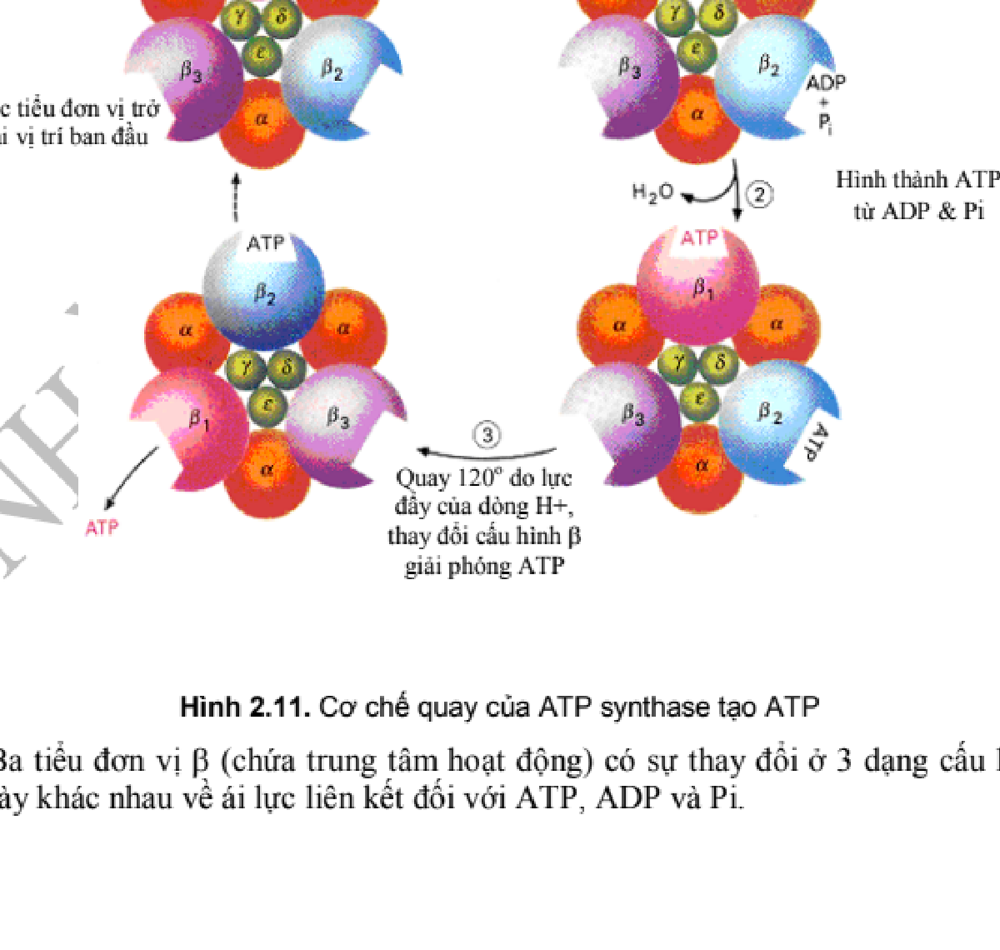
*Hình 2.11. Cơ chế quay của ATP synthase tạo ATP*

Ba tiểu đơn vị $\beta$ (chứa trung tâm hoạt động) có sự thay đổi ở 3 dạng cấu hình, 3 dạng này khác nhau về ái lực liên kết đối với ATP, ADP và Pi.

---

## [Trang 54] - Số lượng proton bơm & Hiệu suất tổng hợp ATP (Tỷ lệ P/O)

Ở phản ứng 1, ADP và Pi gắn vào 1 trong 3 tiểu đơn vị $\beta$ (ở đây là $\beta_2$) và đồng thời hình thành ATP (phản ứng 2). Lực đẩy $\text{H}^+$ tạo ra một sự quay $120^\circ$ của các phần $\alpha_3\beta_3$ của $\text{F}_1$ và giải phóng 1 phân tử ATP (ở phản ứng 3) từ 1 tiểu đơn vị $\beta$ (ở đây là $\beta_1$) kèm theo sự thay đổi cấu hình của cả 3 tiểu đơn vị $\beta$.

Quá trình quay của $\text{F}_1$ và tạo ATP được tiếp tục cho đến khi không còn sự chênh lệch về $\text{H}^+$ giữa 2 phía của màng trong ty thể.

Giả thuyết trên về cơ chế tạo ATP đã được chứng minh bằng các thực nghiệm.

Trong quá trình vận chuyển $e^-$ của chuỗi vận chuyển điện tử có 3 vị trí mà năng lượng giải phóng từ sự vận chuyển $e^-$ đủ để đẩy $\text{H}^+$ qua màng trong ty thể ra ngoài ty thể:
- $2e^-$ vận chuyển qua phức hợp $\text{NADH-CoQ reductase}$ tạo ra năng lượng đủ để bơm **$4\text{ H}^+$** qua màng trong.
- $2e^-$ vận chuyển qua phức hợp $\text{CoQH}_2\text{-Cytc reductase}$ bơm **$4\text{ H}^+$** qua màng trong.
- $2e^-$ vận chuyển qua phức hợp cytochrom oxidase làm chuyển **$2\text{ H}^+$** qua màng.

Tổng cộng **$10\text{ H}^+$** được bơm từ trong ty thể qua màng trong ty thể ra ngoài khi $2e^-$ được vận chuyển từ $\text{NADH}$ tới $\text{O}_2$. Nếu đi từ Succinat hoặc $\text{FADH}_2$ chỉ có **$6\text{ H}^+$** được chuyển qua màng.

Các thực nghiệm đã chứng minh rằng, sự vận chuyển **$3\text{ H}^+$** qua phức hợp $\text{F}_0\text{F}_1$ đủ tạo 1 phân tử ATP từ $\text{ADP} + \text{Pi}$ (kèm thêm $1\text{ H}^+$ cho vận chuyển Pi, tổng cộng khoảng $4\text{ H}^+$ / 1 ATP).

Như vậy, một chuỗi vận chuyển điện tử đi từ $\text{NADH}$ tới $\text{O}_2$ tạo ra **$3\text{ ATP}$**. Và nếu đi từ succinat tạo ra **$2\text{ ATP}$** và nếu đi từ sau đó tạo **$1\text{ ATP}$**. *(Theo quan điểm hóa sinh cổ điển: tỷ lệ $\text{P/O} = 3$ với $\text{NADH}$ và $2$ với $\text{FADH}_2$)*.

Năng lượng giải phóng trong quá trình vận chuyển $e^-$ còn được tế bào sử dụng vào các mục đích khác ngoài việc tạo ATP: tạo nhiệt, vận chuyển calci,...v.v.

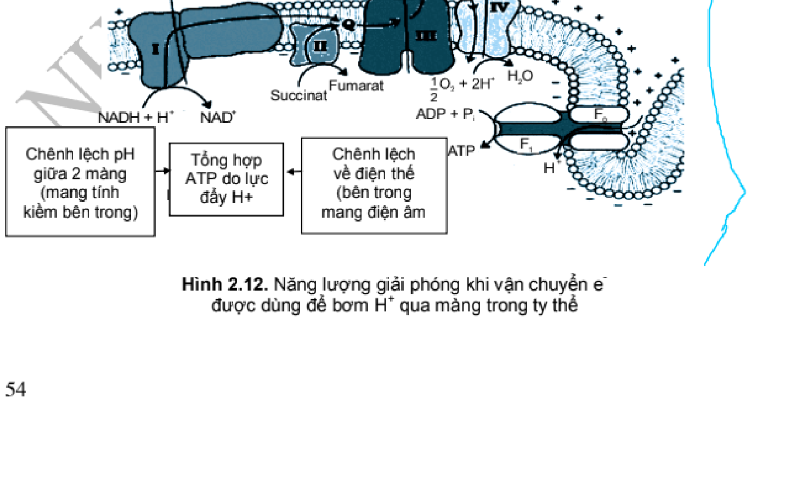
*Hình 2.12. Năng lượng giải phóng khi vận chuyển $e^-$ được dùng để bơm $\text{H}^+$ qua màng trong ty thể*

---

## [Trang 55] - Điều hòa tổng hợp ATP & Các chất ức chế chuỗi hô hấp tế bào

#### 1.4. Điều hoà tổng hợp ATP

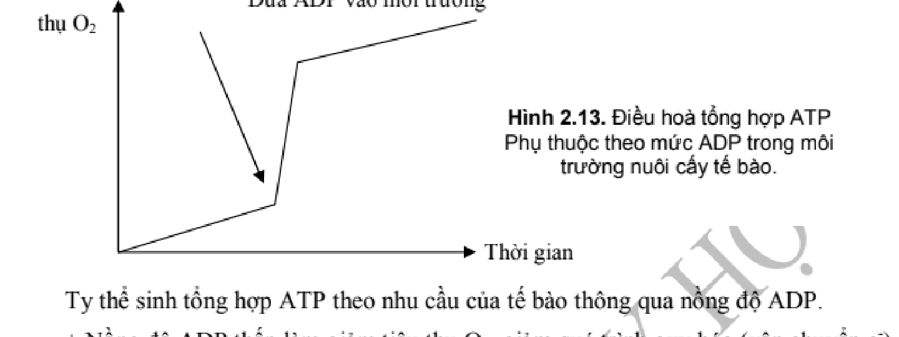
*Hình 2.13. Điều hoà tổng hợp ATP phụ thuộc theo mức ADP trong môi trường nuôi cấy tế bào.*

Ty thể sinh tổng hợp ATP theo nhu cầu của tế bào thông qua nồng độ ADP.
+ Nồng độ ADP thấp làm giảm tiêu thụ $\text{O}_2$, giảm quá trình oxy hóa (vận chuyển $e^-$) và giảm tổng hợp ATP.
+ Khi tăng đột ngột nồng độ ADP (ví dụ thuỷ phân nhiều ATP trong trường hợp co cơ mạnh và nhanh) làm tăng tiêu thụ $\text{O}_2$, tăng quá trình oxy hóa (vận chuyển $e^-$) và làm tăng quá trình tổng hợp ATP bù lại phần ATP đã bị tiêu hao. Điều hoà tổng hợp ATP được minh họa ở hình 2.13.

#### 1.5. Các chất ức chế chuỗi hô hấp tế bào
Chuỗi hô hấp tế bào bị ức chế bởi một số chất như sau:
- **Rotenon:** chặn sự vận chuyển $e^-$ giữa $\text{NADH}$ và Ubiquinon.
- **Antimycin A:** được phân lập từ một chủng *streptomyces*, chặn sự vận chuyển $e^-$ giữa Ubiquinon đến $\text{Cyt c}_1$.
- $\text{CN}^-$, $\text{CO}$, $\text{HS}^-$: chặn sự khử $\text{O}_2$ của cytochrom $a, a_3$ (Phức hợp IV).

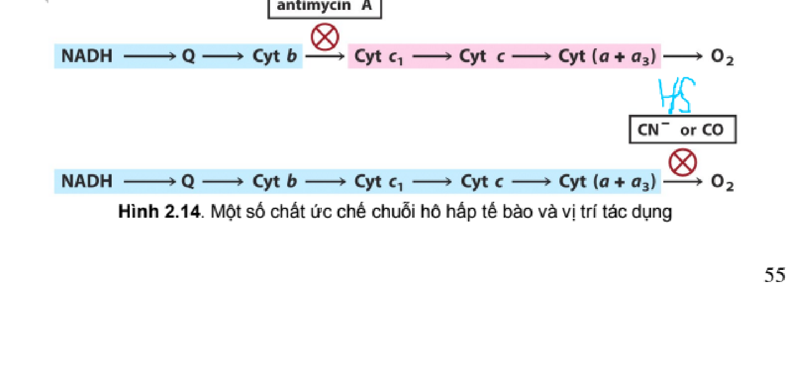
*Hình 2.14. Một số chất ức chế chuỗi hô hấp tế bào và vị trí tác dụng*

<!-- END FILE: pages_046_055.md -->

<!-- BEGIN FILE: pages_056_065.md -->

# GIÁO TRÌNH HÓA SINH - ĐẠI HỌC Y HÀ NỘI
**Chủ biên:** GS. TS. BS. Tạ Thành Văn  
**Nguồn:** SGK Hóa sinh YHN 2019 (Nhà xuất bản Y học)

---

## [Trang 56] - Chất phá ghép (Uncouplers) & Phosphoryl hóa ở mức độ cơ chất

Ngoài một số chất ức chế chuỗi hô hấp tế bào, còn có một số chất phá ghép (uncouplers). Các chất này có tác dụng làm cho quá trình oxy hóa (vận chuyển điện tử) và quá trình phosphoryl hóa (tạo ATP) không tương ứng. Có 2 chất phá ghép sau:
- **DNP (2,4-dinitrophenol):** đây là chất phá ghép hóa học cho phép oxy hóa $\text{NADH}$ liên tục ở mức độ cao nhưng không tạo ATP mà năng lượng được toả ra dưới dạng nhiệt.
- **Chất phá ghép sinh học (nội sinh):** có ở ty thể tổ chức mỡ nâu (khác mỡ trắng).
  + Mỡ nâu là mỡ sinh nhiệt, mỡ trắng là mỡ dự trữ.
  + Mỡ nâu chứa rất nhiều ty thể nên có màu nâu.
  + Màng trong ty thể mỡ nâu có một chất **thermogenin** (KLPT $33.000\text{ Da}$) là chất phá ghép tự nhiên có tác dụng chuyển năng lượng của quá trình vận chuyển điện tử thành năng lượng nhiệt (mà không tạo ATP dự trữ) nhằm duy trì nhiệt độ cơ thể ở các điều kiện tự nhiên khác nhau. Ví dụ cho chuột vào môi trường lạnh, khả năng sinh nhiệt tăng lên bởi kích thích tăng tổng hợp thermogenin ở màng trong ty thể. Ở động vật xứ lạnh thermogenin chiếm 15% protein màng ty thể. Ty thể tế bào cơ cũng chứa thermogenin.

Người lớn ít mỡ nâu, trẻ mới sinh thì việc tổng hợp thermogenin rất cần thiết để giữ nhiệt độ cơ thể khi hệ thần kinh điều hoà thân nhiệt của trẻ chưa hoàn chỉnh.

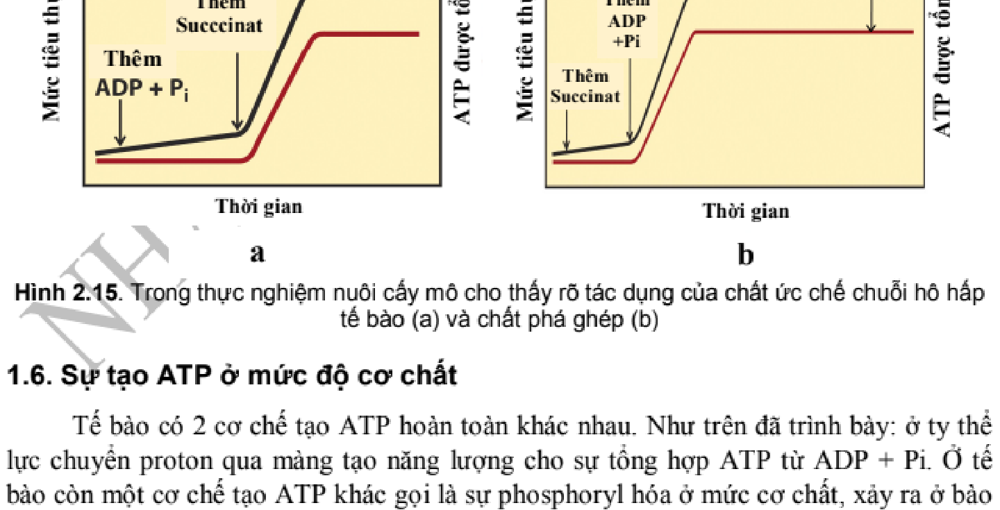
*Hình 2.15. Trong thực nghiệm nuôi cấy mô cho thấy rõ tác dụng của chất ức chế chuỗi hô hấp tế bào (a) và chất phá ghép (b)*

### 1.6. Sự tạo ATP ở mức độ cơ chất
Tế bào có 2 cơ chế tạo ATP hoàn toàn khác nhau. Như trên đã trình bày: ở ty thể lực chuyển proton qua màng tạo năng lượng cho sự tổng hợp ATP từ $\text{ADP} + \text{Pi}$. Ở tế bào còn một cơ chế tạo ATP khác gọi là *sự phosphoryl hóa ở mức cơ chất*, xảy ra ở bào tương mà không có liên quan tới màng ty thể và gradient $\text{H}^+$. Có 2 quá trình phosphoryl hóa ở mức cơ chất trong quá trình đường phân (xem chương chuyển hóa glucid).

---

## [Trang 57] - Phản ứng tạo ATP mức cơ chất & Các loại liên kết phosphat

$$\begin{aligned}
\text{1-3 diphosphoglycerat} + \text{ADP} &\longrightarrow \text{3 phospho glycerat} + \text{ATP} \\
\text{Phosphoenol pyruvat} + \text{ADP} &\longrightarrow \text{Pyruvat} + \text{ATP}
\end{aligned}$$

### 2. SỰ PHOSPHORYL - OXY HÓA

Sự giải phóng năng lượng trong quá trình vận chuyển $e^-$ (oxy hóa) ở chuỗi vận chuyển $e^-$ được tích trữ dưới dạng ATP từ ADP và Pi nhờ quá trình gọi là phosphoryl hóa.

#### 2.1. Sự phosphoryl hóa
- Sự phosphoryl hóa là sự gắn một gốc $\text{H}_3\text{PO}_4$ vào một phân tử chất hữu cơ:
$$\text{RH} + \text{HO-PO}_3\text{H}_2 \longrightarrow \text{R-PO}_3\text{H}_2 + \text{H}_2\text{O}$$
*(Chất hữu cơ + A.phosphoric $\longrightarrow$ Hợp chất phosphat hữu cơ)*
- Phản ứng phosphoryl hóa là phản ứng tổng hợp nên cần năng lượng và enzym *phosphoryl kinase*.
- Phản ứng ngược lại là phản ứng khử phosphoryl:
$$\text{R-PO}_3\text{H}_2 + \text{H}_2\text{O} \longrightarrow \text{RH} + \text{H}_3\text{PO}_4$$

Trong quá trình này năng lượng được giải phóng đúng bằng số năng lượng đã dùng để tạo liên kết phosphat.

Phosphoryl hóa là một trong những phản ứng quan trọng bậc nhất trong chuyển hóa chất. Nó đóng vai trò chủ yếu trong việc tích trữ và vận chuyển năng lượng, hoạt hóa các chất.

#### 2.2. Các loại liên kết phosphat
Căn cứ vào năng lượng tự do được giải phóng từ phản ứng thuỷ phân cắt đứt liên kết phosphat, các liên kết phosphat được chia làm 2 loại: liên kết phosphat nghèo năng lượng và liên kết phosphat giàu năng lượng.

##### 2.2.1. Liên kết phosphat nghèo năng lượng
- Khi thuỷ phân liên kết này chỉ có từ $1000 - 5000\text{ calo}$ được giải phóng, ký hiệu $\text{R - \textcircled{P}}$.
- Ví dụ: liên kết phosphat estephosphat.
- Gốc $-\text{PO}_3\text{H}_2$ được ký hiệu là $\text{\textcircled{P}}$.

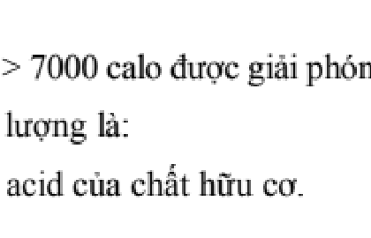
*(Cấu trúc glycerol 3-phosphat mang liên kết estephosphat)*

##### 2.2.2. Liên kết phosphat giàu năng lượng
Khi thủy phân liên kết phosphat giàu năng lượng thì có $> 7000\text{ calo}$ được giải phóng. Ký hiệu là $\text{R} \sim \text{P}$. Một số liên kết phosphat giàu năng lượng là:
+ **Acylphosphat:** tạo thành do $\text{H}_3\text{PO}_4$ kết hợp với gốc acid của chất hữu cơ.

---

## [Trang 58] - Các dạng liên kết phosphat giàu năng lượng & Bản chất Phosphoryl-oxy hóa

Ví dụ: acid 1-3 diphosphoglyceric. Năng lượng giải phóng khi thuỷ phân liên kết này là $-11,8\text{ kcal/mol}$.
+ **Enol phosphat:** do $\text{H}_3\text{PO}_4$ kết hợp với nhóm chức enol của chất hữu cơ. Ví dụ: phosphoenolpyruvic. Năng lượng giải phóng khi thuỷ phân liên kết này là $-14,8\text{ kcal/mol}$.
+ **Amid phosphat (phosphamid):** do $\text{H}_3\text{PO}_4$ kết hợp với nhóm amin. Ví dụ: phosphocreatinin. Năng lượng giải phóng khi thuỷ phân liên kết này là $-10,3\text{ kcal/mol}$.
+ **Anhydrid phosphat (pyrophosphat):** là liên kết giữa 2 gốc phosphat, ví dụ trong phân tử ATP là liên kết phosphat giàu năng lượng quan trọng nhất. Năng lượng giải phóng khi thuỷ phân liên kết này là $-7,3\text{ kcal/mol}$.

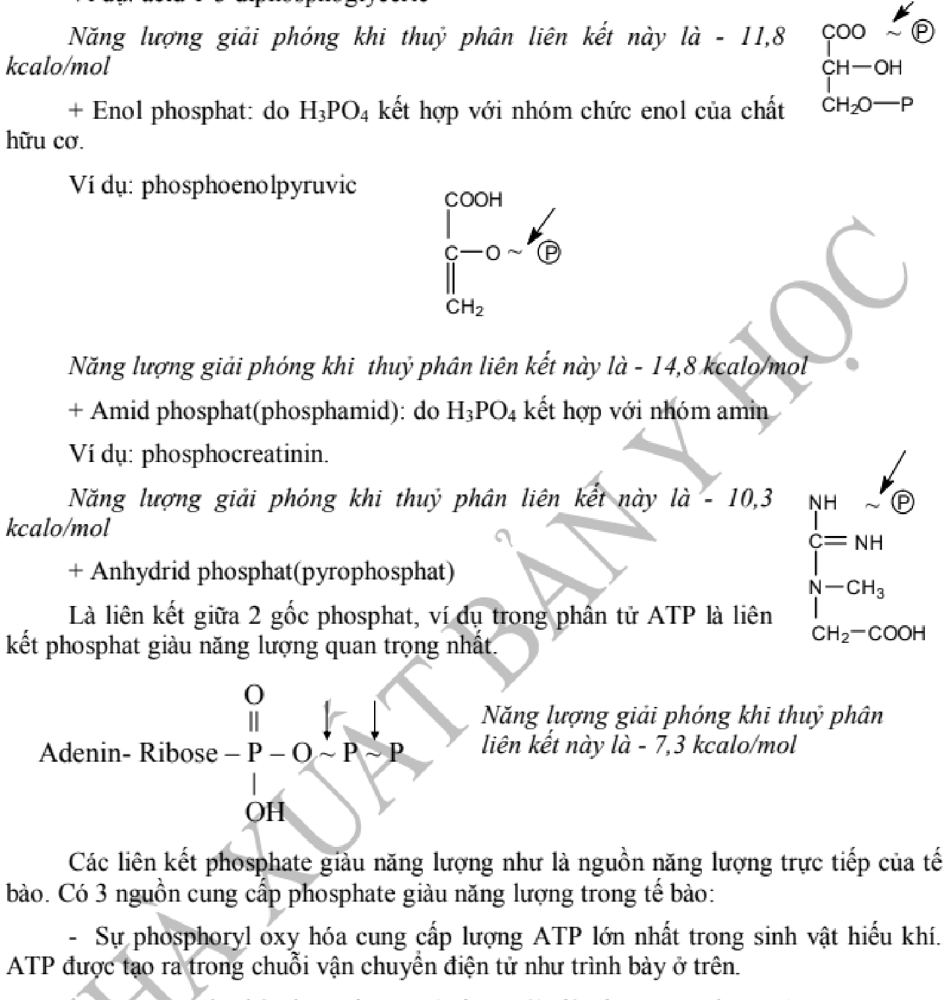
*Hình: Công thức cấu tạo các hợp chất chứa liên kết phosphat giàu năng lượng: 1,3-diphosphoglycerat, Phosphoenolpyruvat, Phosphocreatin, ATP.*

Các liên kết phosphate giàu năng lượng như là nguồn năng lượng trực tiếp của tế bào. Có 3 nguồn cung cấp phosphate giàu năng lượng trong tế bào:
- Sự phosphoryl oxy hóa cung cấp lượng ATP lớn nhất trong sinh vật hiếu khí. ATP được tạo ra trong chuỗi vận chuyển điện tử như trình bày ở trên.
- Từ quá trình phân hủy glucose (ở bước 2) đây là quá trình tạo ATP ở mức cơ chất và tạo ATP với số lượng nhỏ (2 ATP / 1 phân tử glucose đến lactat).
- Trong chu trình acid Citric, 1 ATP được tạo trực tiếp từ succinyl CoA tạo succinat nhờ *succinate thiokinase*.

#### 2.2.3. Sự phosphoryl – oxy hóa
- Trong chuỗi vận chuyển điện tử, quá trình $e^-$ đi từ chất có thế năng oxy hóa khử thấp tới chất có thế năng oxy hóa cao hơn là những quá trình oxy hóa - khử.
- Trong quá trình trên, năng lượng giải phóng ra được sử dụng để tạo ATP nhờ phản ứng phosphoryl hóa ADP:

---

## [Trang 59] - Sơ đồ Phosphoryl-oxy hóa & Chu trình Acid Citric (Khái quát)

$$\text{ADP} + \text{H}_3\text{PO}_4 \longrightarrow \text{ATP} + \text{H}_2\text{O}$$
*(lượng ATP tạo thành của một chuỗi vận chuyển $2e^-$ đã được tính cụ thể ở trên).*

- Hai quá trình trên luôn đi kèm (gắn liền), nghĩa là sự phosphoryl hóa ADP thành ATP đi kèm với sự oxy hóa - khử (chuỗi vận chuyển điện tử) nên được gọi thành từ ghép là **sự phosphoryl – oxy hóa** (hình 2.16).

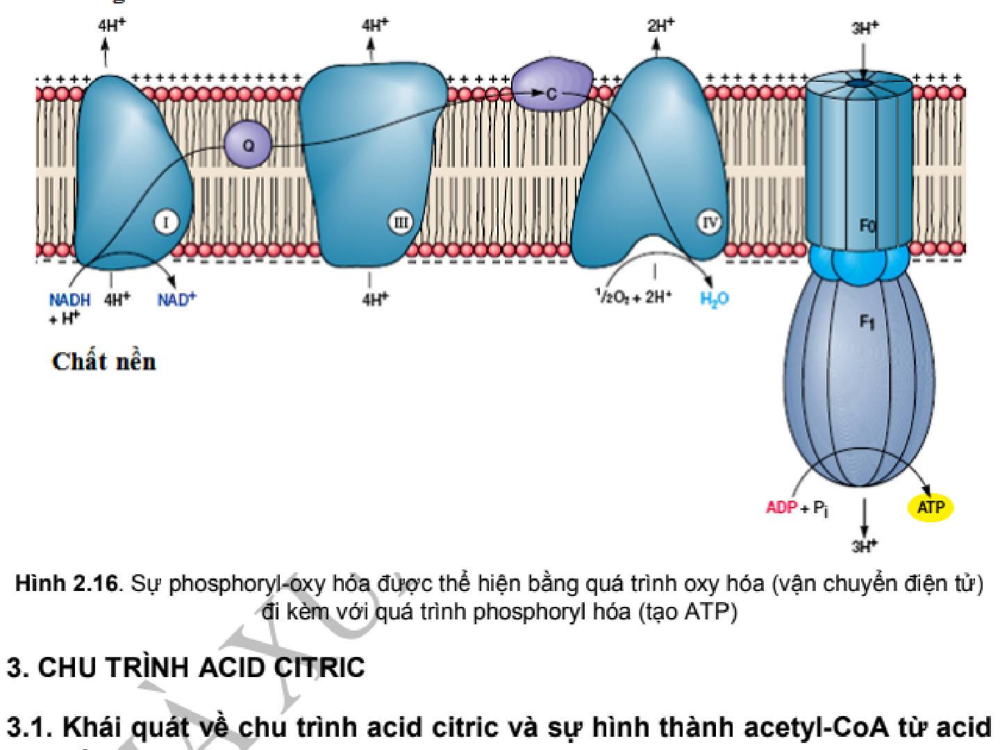
*Hình 2.16. Sự phosphoryl-oxy hóa được thể hiện bằng quá trình oxy hóa (vận chuyển điện tử) đi kèm với quá trình phosphoryl hóa (tạo ATP)*

### 3. CHU TRÌNH ACID CITRIC

#### 3.1. Khái quát về chu trình acid citric và sự hình thành acetyl-CoA từ acid pyruvic
Chu trình acid citric là giai đoạn thoái hóa cuối cùng chung của các chất glucid, lipid và protein. Chất đầu tiên tham gia vào phản ứng của chu trình là acetyl CoA mà sản phẩm thoái hóa các chất chủ yếu tạo ra là acid pyruvic. Vì vậy, phải có phản ứng chuyển acid pyruvic tạo acetyl-CoA.

Sự khử carboxyl- oxy hóa của acid pyruvic thành acetyl-CoA xảy ra trong ty thể và là điểm nối acid pyruvic và chu trình acid citric.

Enzym xúc tác là một phức hợp enzym có tên là *pyruvat dehydrogenase*. Phức hợp gồm 3 enzym:
- **E1:** *Pyruvat dehydrogenase* có coenzym là TPP

---

## [Trang 60] - Cơ chế phức hợp Pyruvat Dehydrogenase & Bệnh Beriberi

- **E2:** *Dihydrolipoyl transacetylase* có coenzym là lipoamid
- **E3:** *Dihydrolipoyl dehydrogenase* có coenzym là FAD.

Các bước phản ứng diễn ra được tóm tắt ở hình 2.17.

Bệnh Beriberi do thiếu vit B1: nguyên nhân rối loạn do thiếu E1, ứ đọng acid pyruvic làm thoái hóa thần kinh vận động và gây liệt.

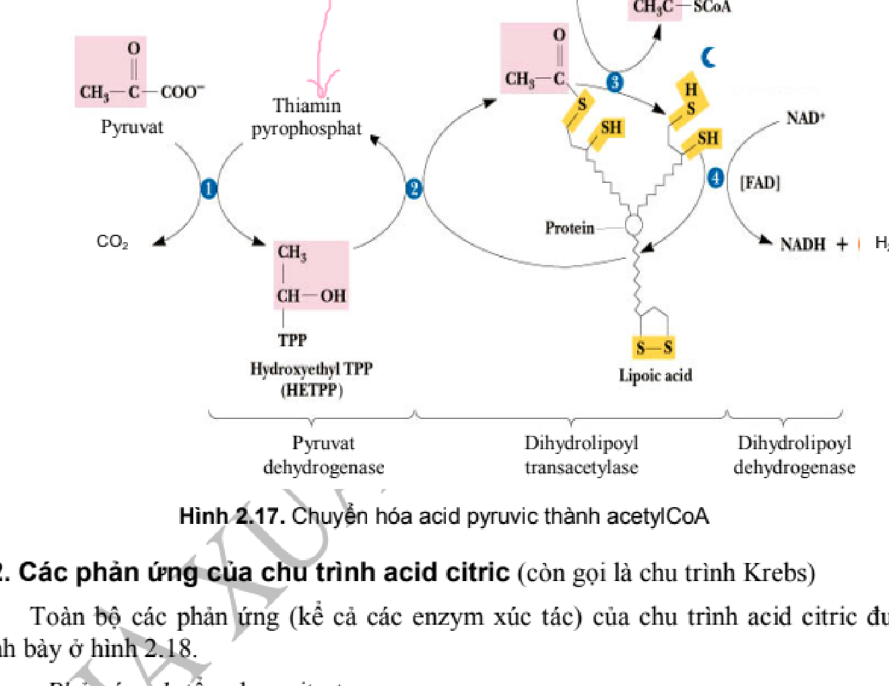
*Hình 2.17. Chuyển hóa acid pyruvic thành acetyl-CoA*

### 3.2. Các phản ứng của chu trình acid citric (còn gọi là chu trình Krebs)

Toàn bộ các phản ứng (kể cả các enzym xúc tác) của chu trình acid citric được trình bày ở hình 2.18.

- **Phản ứng 1: tổng hợp citrat.**  
  Một phân tử acetyl CoA kết hợp với một phân tử oxaloacetat (4C) tạo thành citrat (6C) nhờ enzym *citrate synthase*.
- **Phản ứng 2: đồng phân hóa citrat thành isocitrat.**  
  Citrate loại đi $1\text{ H}_2\text{O}$ tạo thành Cis-aconitate (2a) và lại kết hợp ngay với $1\text{ H}_2\text{O}$ tạo isocitrat (2b). Cả 2 phản ứng đều do enzym *aconitase* xúc tác. Kết quả ở phản ứng 2 là vị trí nhóm OH bị thay đổi làm mất tính cân đối bền vững của phân tử citrat và tạo ra một phân tử kém bền vững là isocitrat dễ dàng tham gia vào các phản ứng tiếp theo.

---

## [Trang 61] - Sơ đồ tổng quát 8 phản ứng Chu trình Acid Citric (Chu trình Krebs)

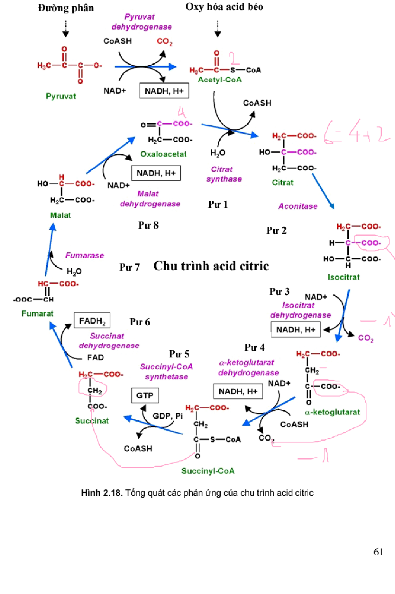
*Hình 2.18. Tổng quát các phản ứng của chu trình acid citric (Chu trình Krebs)*

---

## [Trang 62] - Chi tiết các phản ứng 3-8 & Kết quả Bilan năng lượng Chu trình Krebs

- **Phản ứng 3: khử carboxyl oxy hóa isocitrat thành $\alpha$-cetoglutarat.**  
  Isocitrate loại đi một cặp $\text{H}_2$ nhờ xúc tác của enzym *isocitrate dehydrogenase* có coenzym là $\text{NAD}^+$ sẽ chuyển thành oxalosuccinate (3a). Oxalosuccinate loại 1 phân tử $\text{CO}_2$ tự phát (không cần enzym xúc tác) tạo thành $\alpha$-cetoglutarat (3b).
- **Phản ứng 4: khử carboxyl oxy hóa $\alpha$-cetoglutarat.**  
  $\alpha$-cetoglutarat nhờ xúc tác của phức hợp đa enzym *$\alpha$-cetoglutarat dehydrogenase* (gồm 3 enzym) sẽ loại đi 1 cặp $\text{H}_2$ dưới dạng $\text{NADH}_2$, 1 phân tử $\text{CO}_2$, và có sự tham gia của $\text{HS-CoA}$ tạo succinyl CoA. Đây là phản ứng phức tạp, diễn ra qua nhiều bước tương tự như quá trình chuyển pyruvat thành acetylCoA.
- **Phản ứng 5: tạo succinat.**  
  Succinyl CoA thuỷ phân tạo succinat nhờ enzym *thiokinase* (succinyl-CoA synthetase). Năng lượng giải phóng khi thuỷ phân liên kết giàu năng lượng thioeste trong succinyl CoA được dùng để tạo liên kết giàu năng lượng trong phân tử GTP từ GDP và $\text{H}_3\text{PO}_4$.
- **Phản ứng 6: oxy hóa succinat thành fumarat.**  
  Succinat loại đi 1 cặp $\text{H}_2$ nhờ enzym *succinat dehydrogenase* có coenzym FAD sẽ tạo thành fumarat.
- **Phản ứng 7: hydrat hóa fumarat thành malat.**  
  Fumarat kết hợp với 1 phân tử $\text{H}_2\text{O}$ tạo malat nhờ enzym *fumarase*.
- **Phản ứng 8: oxy hóa malat thành oxaloacetat.**  
  Malat loại đi 1 cặp $\text{H}_2$ nhờ enzym *malat dehydrogenase* có coenzym là $\text{NAD}^+$. Đây là phản ứng cuối cùng đóng vòng chu trình acid citric.

### 3.3. Kết quả, đặc điểm và ý nghĩa của chu trình

#### * Kết quả:
- Hai nguyên tử C dưới dạng acetyl CoA vào chu trình, ngưng tụ với acid oxaloacetic. Hai nguyên tử C ra khỏi chu trình dưới dạng $\text{CO}_2$ do các phản ứng khử $\text{CO}_2$ ở phản ứng 3 và 4.
- Bốn cặp $\text{H}_2$ ra khỏi chu trình: 3 ở dạng $\text{NADH}$ và 1 là $\text{FADH}_2$. Các cặp $\text{H}_2$ này vào chuỗi hô hấp tế bào cho 11 ATP ($3 \times 3 + 1 \times 2 = 11\text{ ATP}$). 1 liên kết phosphat giàu năng lượng hình thành ở GTP được dùng tạo 1 phân tử ATP. **Tổng cộng: 12 ATP**.
- Hai phân tử $\text{H}_2\text{O}$ được sử dụng.

#### * Đặc điểm:
- Xảy ra trong ty thể.
- Trong điều kiện ái khí.

#### * Ý nghĩa:
- Là giai đoạn thoái hóa chung, cuối cùng của các chất glucid, lipid và protein.
- Cung cấp nhiều năng lượng.

---

## [Trang 63] - Điều hòa Chu trình Krebs & Sơ đồ tổng kết Năng lượng sinh học tế bào

- Cung cấp các chất chuyển hóa trung gian cho các chuyển hóa khác (liên hệ với các chuyển hóa khác ở những chương sau).

#### 3.4. Điều hoà chu trình acid citric
Điều hoà chu trình acid citric là điều hoà quá trình tạo ATP theo nhu cầu của tế bào sống. Có 3 điểm quan trọng trong chu trình acid citric do những enzym dị lập thể xúc tác có tác dụng điều tiết hoạt động của toàn bộ chu trình:
- **Phản ứng 1:** ATP là chất ức chế dị lập thể của E1 (*citrate synthase*).
- **Phản ứng 4:** ATP là chất ức chế, ADP là chất kích thích (*isocitrat dehydrogenase* / $\alpha$-cetoglutarat dehydrogenase).
- **Phản ứng 5:** succinylCoA và $\text{NADH}$ ức chế phản ứng.

Toàn bộ chương năng lượng sinh học có thể tóm tắt như hình 2.19.

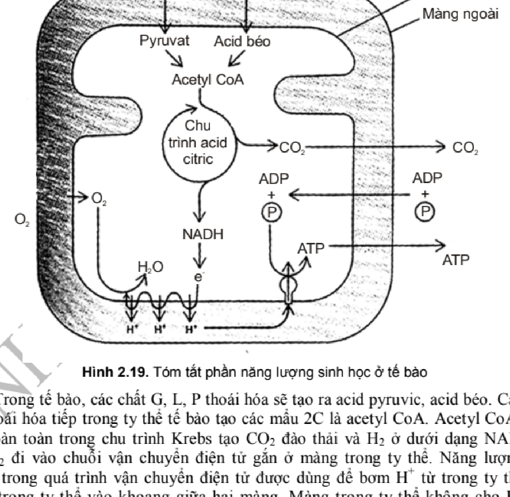
*Hình 2.19. Tóm tắt phần năng lượng sinh học ở tế bào*

Trong tế bào, các chất G, L, P thoái hóa sẽ tạo ra acid pyruvic, acid béo. Các chất này thoái hóa tiếp trong ty thể tế bào tạo các mẩu 2C là acetyl CoA. Acetyl CoA thoái hóa hoàn toàn trong chu trình Krebs tạo $\text{CO}_2$ đào thải và $\text{H}_2$ ở dưới dạng $\text{NADH}$ và $\text{FADH}_2$ đi vào chuỗi vận chuyển điện tử gắn ở màng trong ty thể. Năng lượng giải phóng trong quá trình vận chuyển điện tử được dùng để bơm $\text{H}^+$ từ trong ty thể qua màng trong ty thể vào khoang giữa hai màng. Màng trong ty thể không cho $\text{H}^+$ qua lại tự do vì vậy tạo ra một chênh lệch nồng độ $\text{H}^+$ giữa hai phía màng trong ty thể và $\text{H}^+$ có xu hướng bị đẩy vào màng trong ty thể theo quy luật vật lý thông thường. $\text{H}^+$ chỉ có thể đi vào trong ty thể qua *ATP synthase* và lực đẩy $\text{H}^+$ qua enzym này đã xúc

---

## [Trang 64] - Kết thúc Chương 2 & Câu hỏi ôn tập Năng lượng sinh học

tác tạo nên ATP. ATP từ trong ty thể ra ngoài bào tương cung cấp năng lượng cho mọi hoạt động sống của tế bào.

---

### CÂU HỎI ÔN TẬP CHƯƠNG 2
1. Hãy chứng minh (bằng sơ đồ) sự đốt cháy các chất hữu cơ sinh năng lượng trong cơ thể khác với sự đốt cháy các chất đó ở ngoài cơ thể.
2. Trình bày chuỗi vận chuyển điện tử và tính năng lượng giải phóng dưới dạng calo khi vận chuyển $2e^-$ từ $\text{NADH}_2$ đến $\text{O}_2$.
3. Trình bày sự phosphoryl hóa, liên kết giàu và nghèo năng lượng. Các loại liên kết giàu năng lượng và cho ví dụ.
4. Năng lượng giải phóng trong quá trình vận chuyển $e^-$ được gắn với quá trình tạo ATP như thế nào, cơ chế tạo ATP ở ty thể.
5. Trình bày các chất ức chế chuỗi hô hấp tế bào và chất phá ghép chuỗi hô hấp tế bào và sự phosphoryl-oxy hóa.
6. Hãy trình bày chu trình acid citric: các phản ứng, enzym xúc tác, năng lượng, đặc điểm và ý nghĩa.

---

## [Trang 65] - Chương 3: HÓA HỌC CARBOHYDRAT