# Chương 3
# HÓA HỌC CARBOHYDRAT

### MỤC TIÊU HỌC TẬP
*1. Trình bày được định nghĩa, phân loại của carbohydrat.*  
*2. Trình bày được định nghĩa, danh pháp, cấu tạo, tính chất của monosaccharid.*  
*3. Phân biệt được nguồn gốc, cấu tạo, tính chất của: saccharose, lactose và maltose.*  
*4. So sánh được nguồn gốc, vai trò, cấu tạo của: tinh bột, glycogen và cellulose.*  
*5. Kể tên được các polysaccharid tạp.*

---

### 1. ĐẠI CƯƠNG

Carbohydrat hay còn gọi là glucid là hợp chất dồi dào, phong phú nhất trong tự nhiên, đóng vai trò chủ yếu trong sự sống của các động vật và thực vật. Mỗi năm quá trình quang hợp chuyển đổi hơn 100 tỉ tấn $\text{CO}_2$ và $\text{H}_2\text{O}$ thành cellulose và các sản phẩm thực vật khác. Một số glucid như đường và tinh bột là thành phần chủ yếu trong chế độ ăn của con người và quá trình oxy hóa glucid là con đường chuyển hóa năng lượng trung tâm của các tế bào sống. Các polymer của glucid còn được gọi là glycan tham gia cấu trúc và là yếu tố bảo vệ của thành tế bào vi khuẩn, tham gia cấu trúc mô liên kết của thực vật. Ngoài ra, glucid còn tham gia cấu tạo chất nhờn bôi trơn các khớp xương, giúp nhận diện cũng như bám dính giữa các tế bào. Glucid còn tồn tại dưới dạng các phức hợp liên kết với protein hoặc lipid. Chương này sẽ giới thiệu các loại glucid chính và vai trò chức năng chính của chúng trong cơ thể.

#### 1.1. Định nghĩa carbohydrat
Carbohydrat là các dẫn xuất aldehyd hoặc ceton của các polyalcol hoặc là các chất tạo ra các dẫn xuất này khi bị thuỷ phân. Đa số thành phần nguyên tố của glucid được viết dưới dạng $\text{C}_n(\text{H}_2\text{O})_m$ nên còn gọi là carbohydrat, một số chứa nitơ, phospho hoặc lưu huỳnh.

#### 1.2. Phân loại carbohydrat
Carbohydrat được chia thành 3 loại chính: monosaccharid, oligosaccharid và polysaccharid.
- **Monosaccharid (còn được gọi là các đường đơn):** là đơn vị cấu tạo của glucid, không bị thuỷ phân thành các đơn vị nhỏ hơn nữa. Ví dụ: glucose, fructose...

<!-- END FILE: pages_056_065.md -->

<!-- BEGIN FILE: pages_066_075.md -->

# GIÁO TRÌNH HÓA SINH - ĐẠI HỌC Y HÀ NỘI
**Chủ biên:** GS. TS. BS. Tạ Thành Văn  
**Nguồn:** SGK Hóa sinh YHN 2019 (Nhà xuất bản Y học)

---

## [Trang 66] - Đại cương Carbohydrat & Cấu trúc Monosaccharid

- **Oligosaccharid:** là các đường tạo ra từ 2 đến 10 phân tử đường đơn khi bị thuỷ phân. Ví dụ: maltose, lactose, saccharose, maltotriose...
- **Polysaccharid (glycan):** là một nhóm các hợp chất tạo ra từ hơn 10 monosaccharid khi bị thuỷ phân. Ví dụ: glycogen, tinh bột, mucopolysaccharid...

### 1.3. Vai trò của carbohydrat
- **Vai trò tạo năng lượng:** là nguồn cung cấp năng lượng chủ yếu đồng thời cũng là nguồn dự trữ năng lượng chính của cơ thể động vật (glycogen) và thực vật (tinh bột).
- **Vai trò tạo hình:** tham gia thành phần cấu tạo của tế bào và mô.
  + Tham gia vào thành phần cấu tạo mô nâng đỡ của thực vật (cellulose) và động vật chân đốt (chitin).
  + Ở vi sinh vật: carbohydrat tham gia thành phần cấu tạo vách tế bào vi khuẩn.
  + Ở người: đường 5C như ribose là thành phần quan trọng trong cấu tạo của các coenzym ($\text{FAD}^+$, $\text{NAD}^+$) và cấu tạo bộ khung của acid nucleic (ribose trong RNA và deoxyribose trong DNA). Glucid còn tạo các phức hợp liên kết với protein và lipid tham gia cấu trúc màng tế bào. Carbohydrat và dẫn xuất của chúng còn có nhiều chức năng sinh học quan trọng khác trong cơ thể như hệ miễn dịch, quá trình thụ tinh, đông máu và quá trình phát triển.

### 2. MONOSACCHARID

#### 2.1. Định nghĩa
- Monosaccharid là đơn vị cấu tạo của carbohydrat có từ 3 đến 8 carbon, không bị thủy phân thành các phân tử nhỏ hơn. Monosaccharid là những aldehyd alcol hoặc ceton alcol, trong công thức trừ một carbon thuộc nhóm carbonyl ($\text{C=O}$), còn tất cả các carbon khác của monosaccharid đều liên kết với nhóm hydroxyl ($-\text{OH}$).
- Nếu nhóm carbonyl ở đầu mạch thì monosaccharid là aldehydalcol (aldose), nếu nhóm carbonyl ở vị trí khác thì là cetonalcol (cetose).

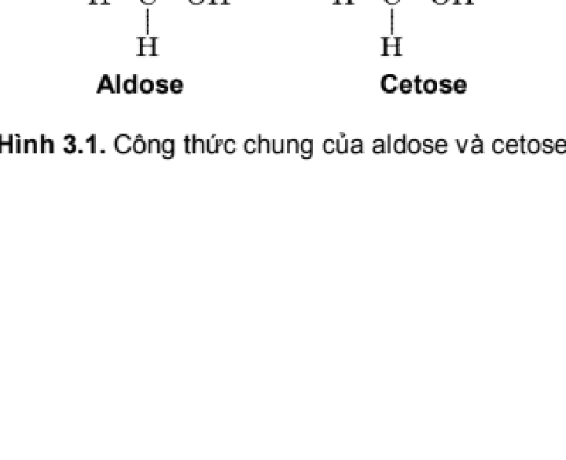
*Hình 3.1. Công thức chung của aldose và cetose*

---

## [Trang 67] - Cách gọi tên Monosaccharid & Cấu tạo mạch thẳng Fischer

#### 2.2. Cách gọi tên
Monosaccharid được gọi tên theo 4 cách khác nhau:
- **Số C gọi theo gốc chữ Hy Lạp + ose:**
  + Triose = 3 carbon
  + Tetrose = 4 carbon
  + Pentose = 5 carbon
  + Hexose = 6 carbon
- **Thêm tiếp đầu ngữ aldo- hay ceto- biểu thị chức khử aldehyd hay ceton:**
  + Aldohexose
  + Cetohexose
- **Kết hợp nhóm chức và số lượng C:**
  + Aldohexose.
  + Cetohexose.
- **Tên riêng:**
  + Glucose (aldohexose).
  + Fructose (cetohexose).
  + Galactose (aldohexose).
- **Tên riêng + Hóa học lập thể:**
  + D-glucose
  + D-fructose

#### 2.3. Cấu tạo

##### 2.3.1. Cấu tạo mạch thẳng
Cấu tạo thẳng của monosaccharid được biểu diễn bằng công thức hình chiếu Fischer:
- Các carbon nằm trên một đoạn thẳng, các nhóm thế nằm hai bên.
- C có số oxy hóa cao nhất ở vị trí trên cùng (C1).
- Dùng đường nằm ngang cho các liên kết về phía trước.
- Dùng đường thẳng đứng cho các liên kết về phía sau.

---

## [Trang 68] - Đồng phân quang học, Carbon bất đối & Dãy D/L

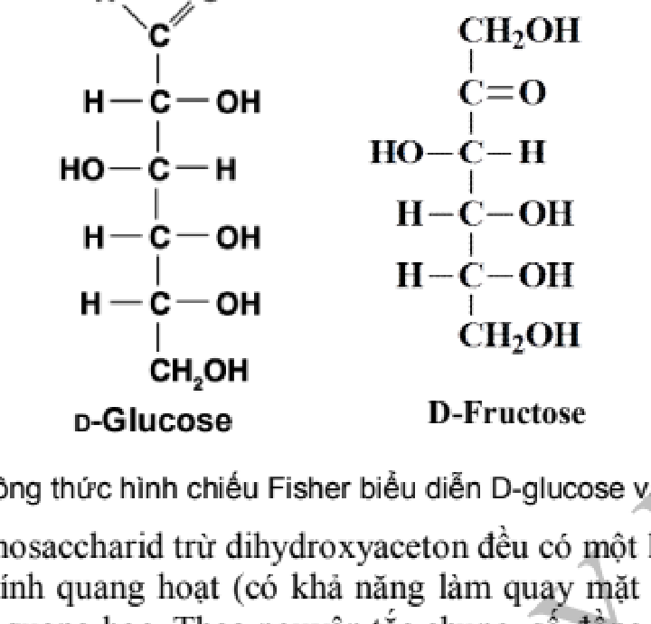
*Hình 3.2. Công thức hình chiếu Fisher biểu diễn D-glucose và D-fructose*

- Tất cả các monosaccharid trừ dihydroxyaceton đều có một hoặc nhiều carbon bất đối ($\text{C}^*$) nên đều có tính quang hoạt (có khả năng làm quay mặt phẳng ánh sáng phân cực) và có đồng phân quang học. Theo nguyên tắc chung, số đồng phân quang học được tính theo công thức sau:
$$N = 2^n$$
*(Trong đó $N$: số đồng phân quang học; $n$: số carbon bất đối $\text{C}^*$).*  
Aldose đơn giản nhất là glyceraldehyd chứa $1\ \text{C}^*$ do đó có $2$ đồng phân quang học, aldose hexose chứa $4\ \text{C}^*$ có $2^4 = 16$ đồng phân quang học.

- Ký hiệu $(+)$, $(-)$ chỉ khả năng làm quay mặt phẳng ánh sáng phân cực sang phải hay sang trái của một monosaccharid nhất định.
- Các đồng phân quang học của mỗi monosaccharid được chia thành 2 nhóm thuộc **dãy D** hay **dãy L** dựa vào vị trí nhóm $-\text{OH}$ của $\text{C}^*$ nằm xa nhóm carbonyl nhất. Monosaccharid nào có nhóm $(-\text{OH})$ của carbon bất đối cuối cùng nằm ở bên phải, thuộc dãy D; nằm ở bên trái, thuộc dãy L. Phần lớn các ose trong tự nhiên thuộc dãy D.

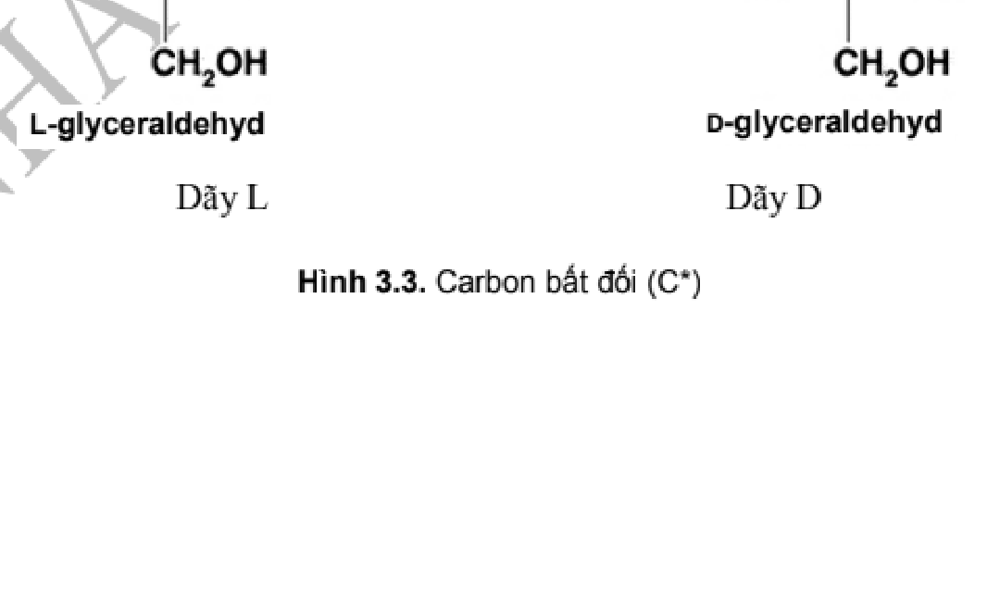
*Hình 3.3. Carbon bất đối ($\text{C}^*$)*

---

## [Trang 69] - Cấu tạo các D-Aldose (từ 3C đến 6C) & Đồng phân Epimer

Dưới đây là một số cấu trúc đồng phân lập thể thuộc dãy D của các aldose và cetose có từ 3 đến 6 carbon. Với các cetose có 4 hoặc 5 carbon, tên gọi được thêm “ul” vào trong tên gọi của aldose có số carbon tương ứng. Ví dụ: D-ribulose là tên gọi của cetopentose tương ứng với aldopentose là D-ribose. Các cetohexose có tên gọi riêng thường theo nguồn gốc phát hiện như fructose bắt nguồn từ *fructus* theo tiếng La tinh.

Các đường chỉ khác nhau ở 1 vị trí dị lập thể được gọi là **đồng phân epimer** của nhau. Như D-glucose và D-mannose chỉ khác nhau vị trí nhóm $-\text{OH}$ của C2; D-glucose và D-galactose chỉ khác nhau vị trí nhóm $-\text{OH}$ ở C4 nên là đồng phân epimer của nhau.

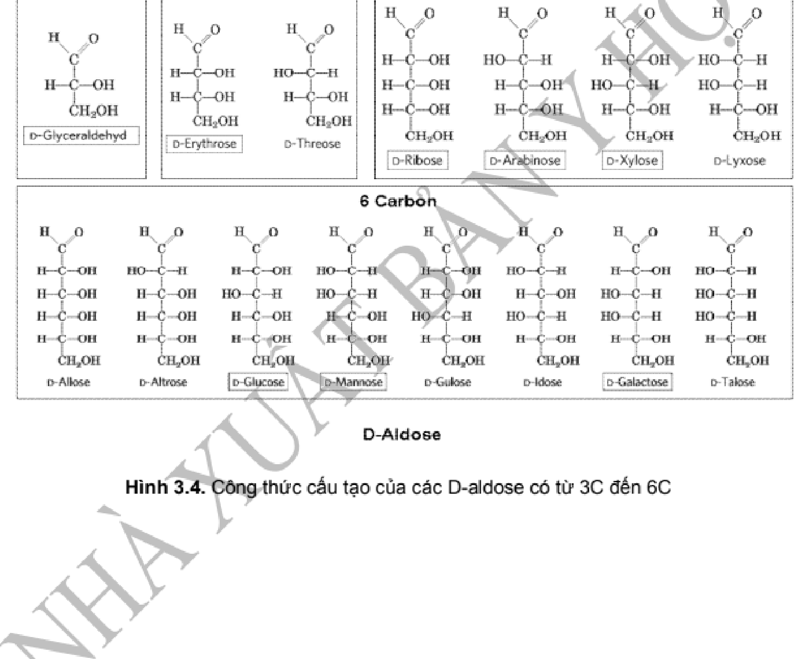
*Hình 3.4. Công thức cấu tạo của các D-aldose có từ 3C đến 6C*

---

## [Trang 70] - Cấu tạo các D-Cetose & Hiện tượng chuyển quay

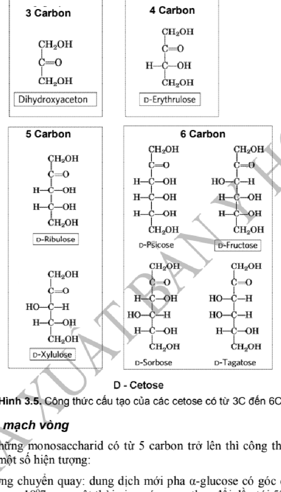
*Hình 3.5. Công thức cấu tạo của các cetose có từ 3C đến 6C*

##### 2.3.2. Cấu tạo mạch vòng
Đối với những monosaccharid có từ 5 carbon trở lên thì công thức thẳng không giải thích được một số hiện tượng:
- **Hiện tượng chuyển quay:** dung dịch mới pha $\alpha$-glucose có góc quay $+112^\circ 2$, $\beta$-glucose có góc quay $+18^\circ 7$, sau một thời gian góc quay thay đổi dần tới $52^\circ 7$ thì ổn định.
- Mặc dù có chức khử aldehyd nhưng các aldose không nhuộm đỏ thuốc thử Schiff và chỉ cho bán acetal (các aldehyd thông thường nhuộm đỏ thuốc thử Schiff và cho acetal).

---

## [Trang 71] - Phản ứng tạo Bán Acetal & Cấu trúc vòng Pyranose

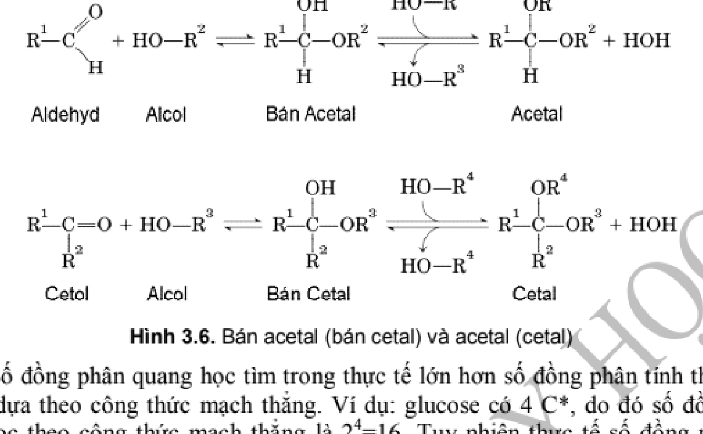
*Hình 3.6. Bán acetal (bán cetal) và acetal (cetal)*

- Số đồng phân quang học tìm trong thực tế lớn hơn số đồng phân tính theo công thức $2^n$ dựa theo công thức mạch thẳng. Ví dụ: glucose có $4\ \text{C}^*$, do đó số đồng phân quang học theo công thức mạch thẳng là $2^4 = 16$. Tuy nhiên thực tế số đồng phân tìm được là 32.

Như vậy, ngoài công thức thẳng, các monosaccharid còn có cấu tạo vòng. Các monosaccharid có từ 5C trở lên có cấu tạo vòng nhờ phản ứng của nhóm $-\text{OH}$ alcol với nhóm aldehyd hoặc ceton tạo thành các dẫn xuất bán acetal nội phân tử và xuất hiện thêm $1\ \text{C}^*$ do đó xuất hiện thêm 2 dạng đồng phân lập thể nữa. Ví dụ, phân tử glucose tồn tại trong dung dịch dưới dạng bán acetal nội phân tử nhờ liên kết giữa nhóm $-\text{OH}$ tự do của C5 phản ứng với aldehyde của C1 làm xuất hiện thêm $1\ \text{C}^*$ và tạo ra 2 dạng đồng phân lập thể nữa là dạng $\alpha$ và dạng $\beta$. Dạng $\alpha$ dùng để chỉ cấu tạo có nhóm $-\text{OH}$ bán acetal nằm cùng phía với nhóm $-\text{OH}$ tự do của carbon bất đối xa nhất. Dạng $\beta$ dùng chỉ dạng cấu tạo có nhóm $-\text{OH}$ acetal nằm khác phía với nhóm $-\text{OH}$ của carbon bất đối xa nhất. Các hợp chất vòng 6 cạnh này được gọi là dạng pyranose vì có cấu trúc giống vòng pyran. Hai dạng vòng này của glucose được gọi tên là $\alpha\text{-D-glucopyranose}$ và $\beta\text{-D-glucopyranose}$.

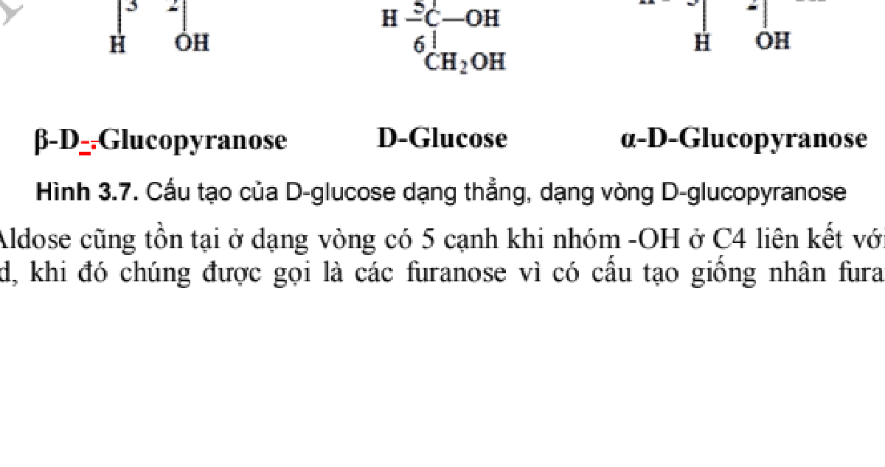
*Hình 3.7. Cấu tạo của D-glucose dạng thẳng, dạng vòng D-glucopyranose*

Aldose cũng tồn tại ở dạng vòng có 5 cạnh khi nhóm $-\text{OH}$ ở C4 liên kết với nhóm aldehyd, khi đó chúng được gọi là các furanose vì có cấu tạo giống nhân furan. Tuy

---

## [Trang 72] - Vòng Pyranose & Furanose, Quy tắc chiếu Haworth

nhiên vòng 6 cạnh ổn định hơn vòng 5 cạnh, vì vậy đóng vòng 6 cạnh là phổ biến đối với các aldohexose và aldopentose. Chỉ có các aldose có từ 5C trở lên mới đóng vòng pyranose.

Các dạng đồng phân của các monosaccharid chỉ khác nhau ở cấu hình tại nguyên tử C bán acetal được gọi là **các đồng phân anomer**. 2 dạng đồng phân $\alpha$ và $\beta$ của glucose có thể chuyển dạng lẫn nhau trong dung dịch và quá trình chuyển dạng này được gọi là **quá trình mutarotation**. Khi đạt trạng thái cân bằng, $1/3$ là dạng $\alpha\text{-D-glucose}$ và $2/3$ là dạng $\beta\text{-D-glucose}$, chỉ có một lượng rất nhỏ ở dạng thẳng và dạng glucofuranose.

Các cetohexose tạo dạng vòng nhờ liên kết giữa nhóm $-\text{OH}$ của C5 hoặc C6 với nhóm ceton ở C2 tạo vòng furanose hoặc pyranose. D-fructose dễ dàng tạo vòng furanose và dạng thường gặp là $\beta\text{-D-fructose}$.

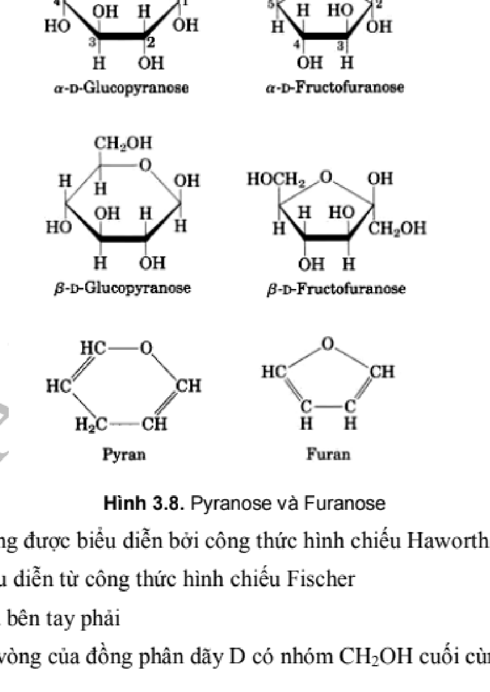
*Hình 3.8. Pyranose và Furanose*

Cấu trúc vòng được biểu diễn bởi công thức hình chiếu Haworth như sau:
- Được biểu diễn từ công thức hình chiếu Fischer
- C1 ở phía bên tay phải
- Cấu trúc vòng của đồng phân dãy D có nhóm $\text{CH}_2\text{OH}$ cuối cùng ở phía trên mặt phẳng vòng (C6)
- Nhóm $-\text{OH}$ ở bên trái trong công thức thẳng (C3) ở phía trên
- Nhóm $-\text{OH}$ ở bên phải trong công thức thẳng (C2, C4) ở phía dưới

---

## [Trang 73] - Giải thích hiện tượng quay bằng Haworth & Tính khử Monosaccharid

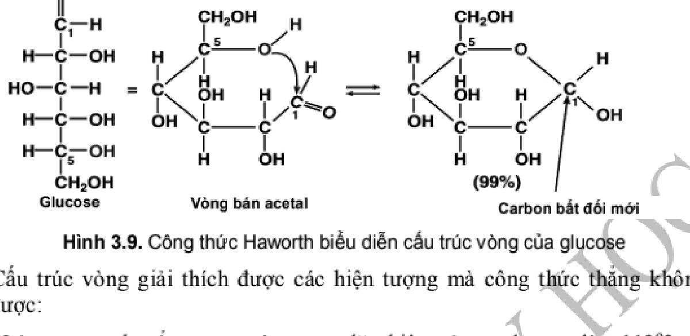
*Hình 3.9. Công thức Haworth biểu diễn cấu trúc vòng của glucose*

Cấu trúc vòng giải thích được các hiện tượng mà công thức thẳng không giải thích được:
- **Hiện tượng chuyển quay:** góc quay đặc hiệu của $\alpha$-glucose là $+112^\circ 2$, của $\beta$-glucose là $+18^\circ 7$. Khi pha vào dung dịch sẽ có sự chuyển dạng từ $\alpha$-glucose sang dạng thẳng rồi tới dạng $\beta$-glucose và ngược lại dẫn tới làm thay đổi góc quay đặc hiệu của dung dịch. Khi đạt trạng thái cân bằng với $1/3$ là dạng $\alpha$-glucose, $2/3$ là dạng $\beta$-glucose và một lượng rất nhỏ dạng thẳng. Do góc quay đặc hiệu lúc này ổn định ở $52^\circ 7$.
- **Hiện tượng chỉ cho bán acetal:** khi monosaccharid đóng vòng tạo thành bán acetal nội phân tử thì aldose chỉ còn 1 nhóm $-\text{OH}$ bán acetal. Nhóm này chỉ có thể kết hợp được với $1\ -\text{OH}$ để cho bán acetal.
- **Số đồng phân của glucose:** khi tạo thành bán acetal nội phân tử, C1 của glucose trở thành $\text{C}^*$, vì vậy tổng số $\text{C}^*$ của glucose là 5 và số đồng phân quang học phải là $2^5 = 32$, điều này phù hợp với thực tế.

Tất cả những điều trình bày ở trên chứng tỏ giả thuyết về cấu trúc vòng của các monosaccharid là đúng.

#### 2.4. Tính chất của monosaccarid
Các monosaccarid có vị ngọt, dễ tan trong nước, ít tan trong alcol, không tan trong ete. Trừ dihydroxyaceton, các ose đều có khả năng làm quay mặt phẳng ánh sáng phân cực.

##### 2.4.1. Tính khử (bị oxy hóa)
Glucose bị oxy hóa nhóm aldehyd tạo thành acid gluconic, các aldose khác bị oxy hóa nhóm aldehyd tạo thành acid aldonic.

Do có hoá chức khử aldehyd hoặc ceton, monosaccarid tác dụng với muối kim loại nặng (muối Cu, Hg...) sẽ khử ion kim loại giải phóng kim loại tự do hoặc muối kim loại có hoá trị thấp hơn, bản thân monosaccarid sẽ bị oxy hoá trở thành acid. Đây là nguyên lý của phản ứng Fehling sử dụng để xác định lượng đường khử.

Ví dụ: trong phản ứng Fehling, glucose khử $\text{Cu(OH)}_2$ thành $\text{Cu}_2\text{O}$ kết tủa đỏ gạch.

---

## [Trang 74] - Phản ứng Fehling, Acid Glucuronic, Tính oxy hóa & Tạo Glycosid

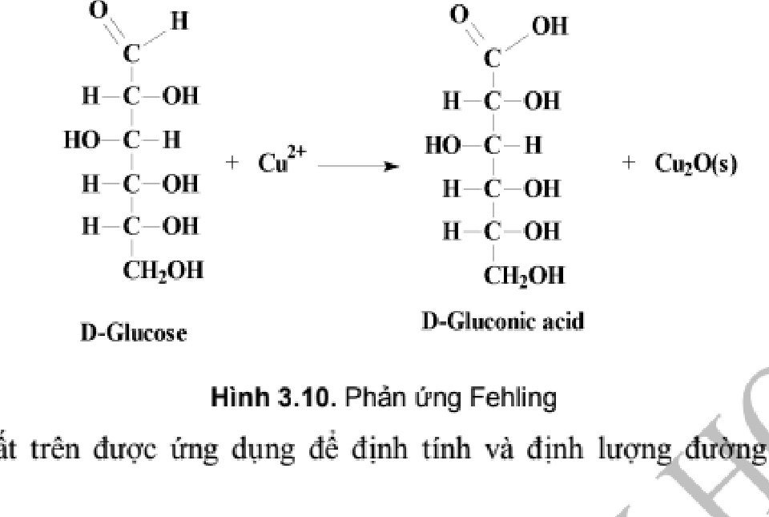
*Hình 3.10. Phản ứng Fehling*

Tính chất trên được ứng dụng để định tính và định lượng đường có mặt trong nước tiểu.

Ngoài ra, khi glucose bị oxy hóa ở nhóm $-\text{OH}$ tại C6 sẽ tạo thành acid glucuronic. Trong cơ thể, quá trình này diễn ra tại gan nhờ quá trình thoái hóa glucose theo con đường acid uronic. Acid glucuronic có vai trò tham gia vào thành phần cấu tạo của các mucopolysaccharid và liên hợp với các chất độc, thuốc, hormon, bilirubin, chuyển chúng thành các sản phẩm không độc, hòa tan được trong nước và đào thải ra ngoài theo đường nước tiểu.

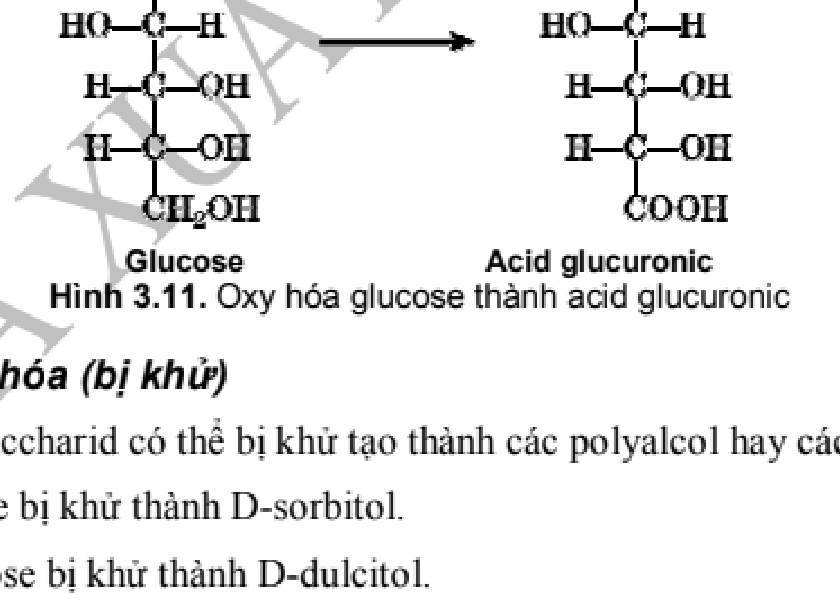
*Hình 3.11. Oxy hóa glucose thành acid glucuronic*

##### 2.4.2. Tính oxy hóa (bị khử)
Các monosaccharid có thể bị khử tạo thành các polyalcol hay các alditol:
- D-glucose bị khử thành D-sorbitol.
- D-galactose bị khử thành D-dulcitol.
- D-manose bị khử thành D-Mannitol.
- D-fructose bị khử thành d-mannitol và D-sorbitol.

##### 2.4.3. Tạo glycosid
Các monosaccharid có khả năng tạo thành các hợp chất ete với alcol do có nhóm $-\text{OH}$ bán acetal, các hợp chất này gọi là các glycosid, các liên kết này được gọi là liên

---

## [Trang 75] - Liên kết Glycosid & Dẫn xuất Este Phosphat

kết glycosid hoặc osid. Các glycosid được gọi tên theo carbohydrat chứa trong phân tử, nếu là glucose thì được gọi là glucosid, nếu là galactose thì được gọi là galactosid.

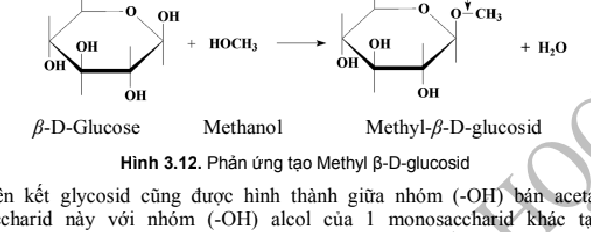
*Hình 3.12. Phản ứng tạo Methyl $\beta$-D-glucosid*

Liên kết glycosid cũng được hình thành giữa nhóm $(-\text{OH})$ bán acetal của 1 monosaccharid này với nhóm $(-\text{OH})$ alcol của 1 monosaccharid khác tạo thành disaccharid, oligosaccharid và polysaccharid.

##### 2.4.4. Tạo este
Do có nhóm $(-\text{OH})$ alcol nên các monosaccharid có thể phản ứng với các acid như $\text{HNO}_3$, $\text{H}_2\text{SO}_4$, $\text{H}_3\text{PO}_4$, acid acetic... tạo nên các este tương ứng.

Các este phosphat của các monosaccharid là các este quan trọng nhất của các monosaccharid trong cơ thể sinh vật vì chúng là các sản phẩm chuyển hoá trung gian hoặc dạng hoạt hoá của cơ chất chuyển hoá của glucid.

Ví dụ: một số dẫn xuất este của các monosaccharid quan trọng:
- Glyceraldehyd 3-phosphat
- Dihydroxyaceton phosphat (DHAP)
- Ribose 5-phosphat
- Fructose 6-phosphat

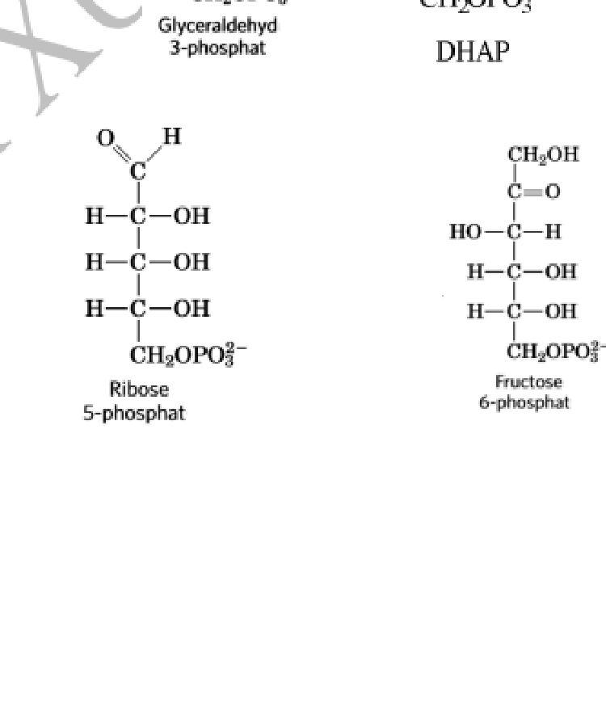
*Hình: Công thức cấu tạo các este phosphat: Glyceraldehyd 3-phosphat, DHAP, Ribose 5-phosphat, Fructose 6-phosphat.*

<!-- END FILE: pages_066_075.md -->

<!-- BEGIN FILE: pages_076_085.md -->

# GIÁO TRÌNH HÓA SINH - ĐẠI HỌC Y HÀ NỘI
**Chủ biên:** GS. TS. BS. Tạ Thành Văn  
**Nguồn:** SGK Hóa sinh YHN 2019 (Nhà xuất bản Y học)

---

## [Trang 76] - Este Phosphat G6P, G1P & Chuyển dạng Enediol

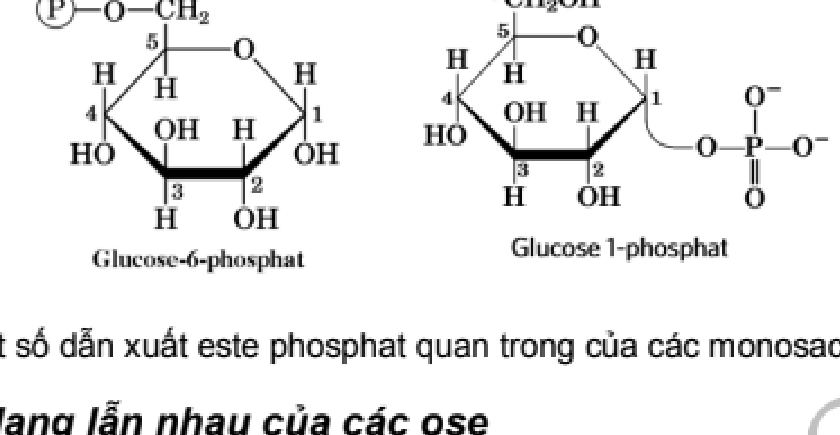
*Hình 3.13. Một số dẫn xuất este phosphat quan trọng của các monosaccharid: Glucose-6-phosphat và Glucose-1-phosphat*

#### 2.4.5. Sự chuyển dạng lẫn nhau của các ose
Glucose, fructose, mannose có thể chuyển dạng lẫn nhau trong môi trường kiềm yếu như $\text{Ba(OH)}_2$ hoặc $\text{Ca(OH)}_2$ qua trung gian enediol.

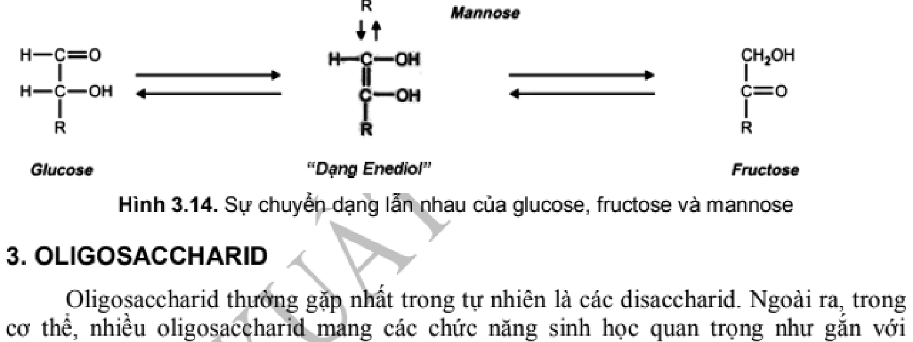
*Hình 3.14. Sự chuyển dạng lẫn nhau của glucose, fructose và mannose qua "dạng Enediol"*

---

### 3. OLIGOSACCHARID

Oligosaccharid thường gặp nhất trong tự nhiên là các disaccharid. Ngoài ra, trong cơ thể, nhiều oligosaccharid mang các chức năng sinh học quan trọng như gắn với protein màng tế bào ở phía ngoài của tế bào, tham gia cấu tạo của các kháng thể, các yếu tố đông máu, tham gia vào các đích phân tử và nhận diện của tế bào.

Disaccharid được cấu tạo từ 2 monosaccharid liên kết với nhau bằng liên kết glycosid, loại bỏ 1 phân tử nước. Nếu cả 2 nhóm $-\text{OH}$ bán acetal liên kết với nhau thì disaccharid tạo thành sẽ không còn tính khử như saccharose. Nếu trong phân tử của disaccharid vẫn còn nhóm $-\text{OH}$ bán acetal tự do thì phân tử đó có tính khử như các monosaccharid khác, ví dụ như maltose và lactose.

Các disaccharid có vai trò sinh học quan trọng, thường gặp nhất là maltose, lactose và saccharose. Cấu trúc phân tử của chúng là $\text{C}_{12}\text{H}_{22}\text{O}_{11}$, bị thủy phân khi đun sôi trong môi trường acid với xúc tác của các enzym tương ứng để tạo thành các monosaccharid.

---

## [Trang 77] - Thủy phân Disaccharid, Cấu tạo Maltose & Lactose

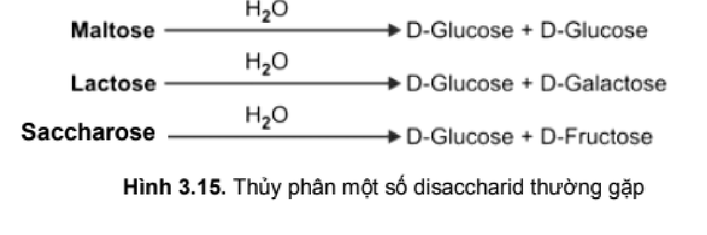
*Hình 3.15. Thủy phân một số disaccharid thường gặp*

$$\begin{aligned}
\text{Maltose} + \text{H}_2\text{O} &\longrightarrow \text{D-Glucose} + \text{D-Glucose} \\
\text{Lactose} + \text{H}_2\text{O} &\longrightarrow \text{D-Glucose} + \text{D-Galactose} \\
\text{Saccharose} + \text{H}_2\text{O} &\longrightarrow \text{D-Glucose} + \text{D-Fructose}
\end{aligned}$$

#### 3.1. Maltose
Maltose hay còn gọi là đường mạch nha có nguồn gốc trong mầm lúa mạch, kẹo mạch nha, sinh ra từ sự thủy phân tinh bột trong môi trường acid. Đây là đường có vị khá ngọt và rất hòa tan trong nước. Maltose được cấu tạo từ 2 phân tử $\alpha\text{-D-glucose}$ liên kết với nhau bởi **liên kết $\alpha\text{-1,4-glycosid}$**. Trong phân tử maltose còn 1 nhóm $-\text{OH}$ bán acetal tự do ở vị trí C1 của phân tử glucose thứ 2 nên **maltose có tính khử**. Enzym thủy phân maltose có tên gọi là *maltase* có vai trò thủy phân maltose thành 2 phân tử D-glucose.

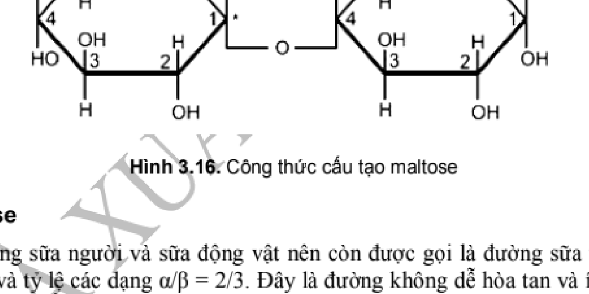
*Hình 3.16. Công thức cấu tạo maltose: $\alpha\text{-D-Glucopyranosyl-(1}\rightarrow\text{4)-}\alpha\text{-D-glucopyranose}$*

#### 3.2. Lactose
Có trong sữa người và sữa động vật nên còn được gọi là đường sữa với nồng độ khoảng 5% và tỷ lệ các dạng $\alpha/\beta = 2/3$. Đây là đường không dễ hòa tan và ít ngọt, được cấu tạo nhờ **liên kết glycosid giữa nhóm $-\text{OH}$ ở vị trí C1 của $\beta\text{-galactose}$ và $-\text{OH}$ ở vị trí C4 của $\alpha\text{-glucose}$ (hoặc $\beta\text{-glucose}$)**. Với cấu tạo như vậy, phân tử lactose vẫn còn 1 nhóm $-\text{OH}$ bán acetal tự do nên **lactose có tính khử**. Enzym thủy phân đường lactose là *lactase* của dịch ruột.

---

## [Trang 78] - Cấu tạo Lactose, Saccharose & Khái quát Polysaccharid

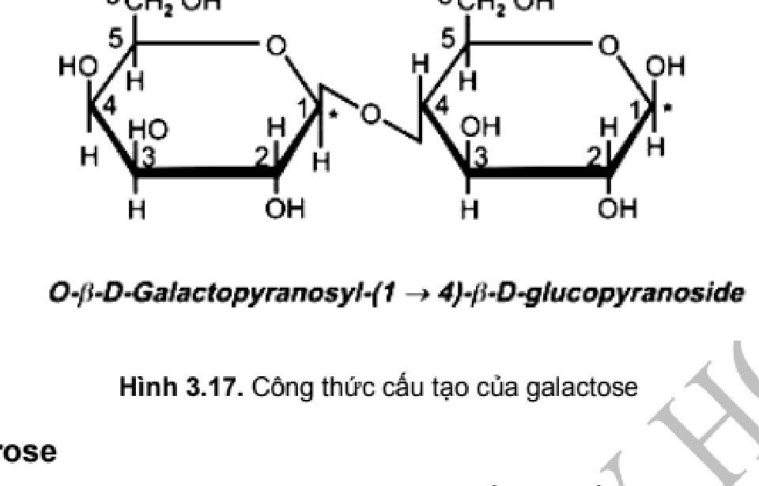
*Hình 3.17. Công thức cấu tạo của lactose: $O\text{-}\beta\text{-D-Galactopyranosyl-(1}\rightarrow\text{4)-}\beta\text{-D-glucopyranoside}$*

#### 3.3. Saccharose
Saccharose hay còn gọi là đường mía được cấu tạo bằng cách loại đi 1 phân tử nước giữa **nhóm $-\text{OH}$ ở C1 $\alpha\text{-glucose}$ và $-\text{OH}$ ở C2 của $\beta\text{-fructose}$**. Vì vậy saccharose **không còn nhóm $-\text{OH}$ bán acetal tự do nên không có tính khử** như 2 loại đường đôi ở trên. Enzym thủy phân saccharose là *saccharase* (invertase), sản phẩm tạo thành 1 phân tử glucose và 1 phân tử fructose. Saccharose có vị rất ngọt, dễ hòa tan trong nước có nhiều trong cây mía và củ cải đường.

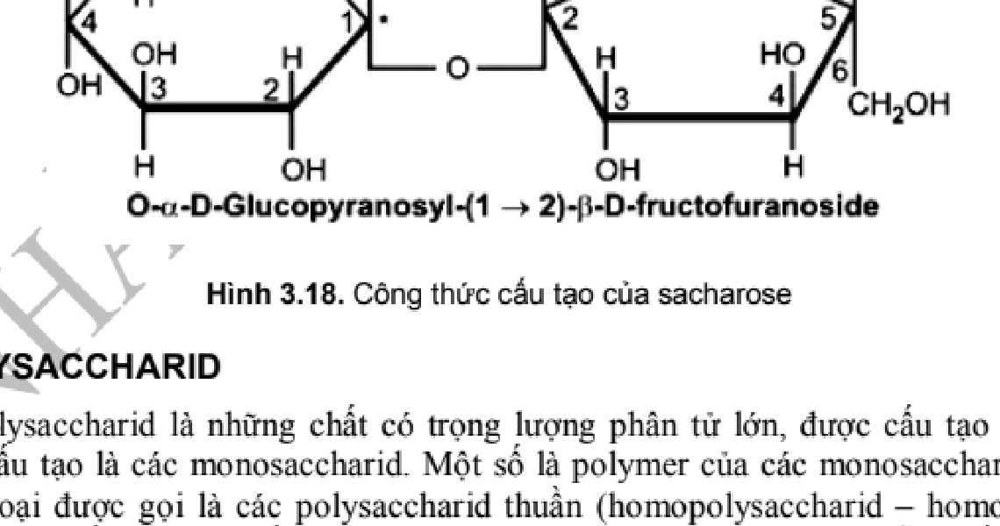
*Hình 3.18. Công thức cấu tạo của saccharose: $O\text{-}\alpha\text{-D-Glucopyranosyl-(1}\rightarrow\text{2)-}\beta\text{-D-fructofuranoside}$*

---

### 4. POLYSACCHARID

Polysaccharid là những chất có trọng lượng phân tử lớn, được cấu tạo từ nhiều đơn vị cấu tạo là các monosaccharid. Một số là polymer của các monosaccharid thuộc cùng 1 loại được gọi là các **polysaccharid thuần** (*homopolysaccharid – homoglycan*). Một số được cấu tạo từ nhiều loại monosaccharid khác nhau hay các dẫn xuất của các monosaccharid thuộc các loại khác nhau được gọi là các **polysaccharid tạp** (*heteropolysaccharid - heteroglycan*).

---

## [Trang 79] - Polysaccharid thuần: Tinh bột (Amylose & Amylopectin)

#### 4.1. Polysaccharid thuần

##### 4.1.1. Tinh bột
Tinh bột được cấu tạo từ hàng nghìn gốc $\alpha\text{-D-glucose}$, được chứa với nồng độ cao trong các hạt, củ, rễ cây, trái cây, thân cây và lá cây. Tinh bột chính là thực phẩm chính trong bữa ăn hàng ngày của chúng ta. Dưới kính hiển vi, tinh bột thường ở dạng hạt có hình dạng, kích thước khác nhau tùy thuộc nguồn gốc. Phân tử tinh bột gồm 2 đơn vị cấu tạo là polymer của glucose nhưng có cấu tạo và tính chất khác nhau là amylose và amylopectin.

- **Amylose:** chiếm 12-20% tinh bột, trọng lượng phân tử thấp, tan trong nước, phản ứng với iod cho màu xanh. Về cấu trúc, amylose có cấu tạo mạch thẳng không chia nhánh, cấu tạo từ 250-300 gốc D-glucose bằng **liên kết $\alpha\text{-1,4 - glycosid}$**.

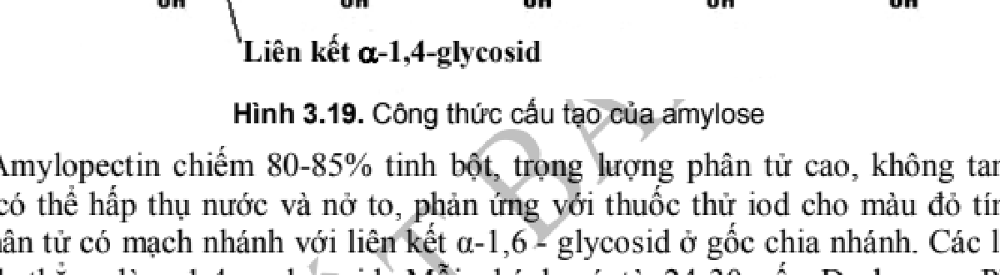
*Hình 3.19. Công thức cấu tạo của amylose (mạch thẳng liên kết $\alpha\text{-1,4-glycosid}$)*

- **Amylopectin:** chiếm 80-85% tinh bột, trọng lượng phân tử cao, không tan trong nước, có thể hấp thụ nước và nở to, phản ứng với thuốc thử iod cho màu đỏ tím. Cấu trúc phân tử có mạch nhánh với **liên kết $\alpha\text{-1,6 - glycosid}$ ở gốc chia nhánh**. Các liên kết ở mạch thẳng là $\alpha\text{-1,4 - glycosid}$. Mỗi nhánh có từ 24-30 gốc D-glucose. Phân tử amylopectin có khoảng 80 nhánh cấu tạo từ vài nghìn phân tử D-glucose.

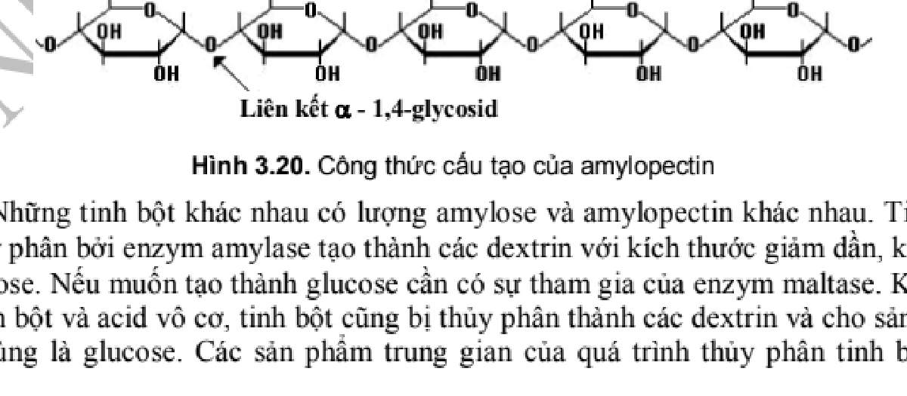
*Hình 3.20. Công thức cấu tạo của amylopectin (nhánh $\alpha\text{-1,6}$ và mạch thẳng $\alpha\text{-1,4}$)*

Những tinh bột khác nhau có lượng amylose và amylopectin khác nhau. Tinh bột bị thủy phân bởi enzym amylase tạo thành các dextrin với kích thước giảm dần, kết thúc ở maltose. Nếu muốn tạo thành glucose cần có sự tham gia của enzym maltase. Khi đun sôi tinh bột và acid vô cơ, tinh bột cũng bị thủy phân thành các dextrin và cho sản phẩm cuối cùng là glucose. Các sản phẩm trung gian của quá trình thủy phân tinh bột cho

---

## [Trang 80] - Glycogen, Cellulose & Chitin

phản ứng tạo các màu khác nhau với iod, riêng maltose và glucose không cho phản ứng màu với iod.

##### 4.1.2. Glycogen
Glycogen là carbohydrat dự trữ của động vật, còn được gọi là tinh bột động vật. Ngoài ra, glycogen còn có mặt trong các loại thực vật không có hệ thống chất diệp lục như trong nấm và nấm men. Ở động vật, glycogen dự trữ nhiều ở gan và cơ, là nguồn năng lượng dự trữ, sẵn sàng cung cấp ngay khi cơ thể cần. Glycogen được cấu tạo gồm 2.400 đến 24.000 gốc $\alpha\text{-D-glucose}$ tạo thành. Cấu tạo giống amylopectin nhưng nhiều mạch nhánh hơn và độ dài của nhánh ngắn hơn (chỉ từ 8 đến 12 gốc glucose). Liên kết ở mạch thẳng là $\alpha\text{-1,4-glycosid}$ và liên kết ở gốc nhánh là $\alpha\text{-1,6-glycosid}$. Cũng như tinh bột, khi bị thủy phân, glycogen cũng biến thành các dextrin rồi thành maltose và cuối cùng thành glucose.

##### 4.1.3. Cellulose
Cellulose là polymer mạch thẳng của khoảng 1.500 gốc $\beta\text{-D-glucose}$ tạo thành nhờ **liên kết $\beta\text{-1,4-glycosid}$**. Cellulose tồn tại ở dạng sợi rất chắc, không hòa tan trong nước và là thành phần chính của mô nâng đỡ thực vật.

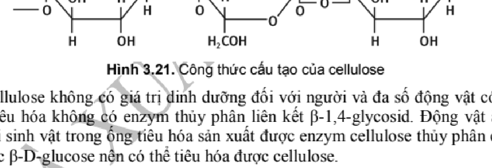
*Hình 3.21. Công thức cấu tạo của cellulose (liên kết $\beta\text{-1,4-glycosid}$)*

Cellulose không có giá trị dinh dưỡng đối với người và đa số động vật có vú vì ở đường tiêu hóa không có enzym thủy phân liên kết $\beta\text{-1,4-glycosid}$. Động vật ăn cỏ có những vi sinh vật trong ống tiêu hóa sản xuất được enzym cellulase thủy phân cellulose thành các $\beta\text{-D-glucose}$ nên có thể tiêu hóa được cellulose.

##### 4.1.4. Chitin
Chitin là thành phần chính cấu tạo lớp vỏ của các loài động vật không xương sống như loài giáp xác, sâu bọ, nhện, nó cũng có mặt trong cấu tạo vách tế bào của các loại nấm và tảo. Cấu tạo của chitin tương tự như cellulose, đều là polymer mạch thẳng với các liên kết $\beta\text{-1,4-glycosid}$, tuy nhiên đơn vị cấu tạo của chitin là **N-acetyl-D-glucosamin** với sự thay thế nhóm $-\text{OH}$ ở C2 bởi gốc acetamid. Như vậy, tương tự như cellulose, con người và động vật có vú không tiêu hóa được chitin.

---

## [Trang 81] - Cấu tạo Chitin, Polysaccharid tạp & Acid Hyaluronic

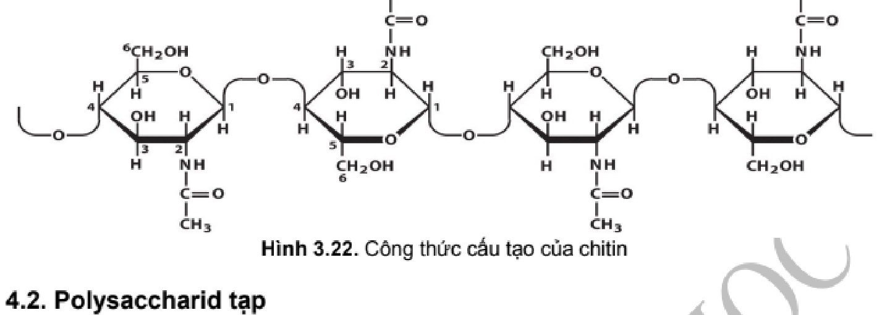
*Hình 3.22. Công thức cấu tạo của chitin*

#### 4.2. Polysaccharid tạp
Polysaccharid tạp là những chất có phân tử lượng lớn, cấu trúc phức tạp đóng nhiều vai trò sinh học quan trọng. Trong thành phần cấu tạo, người ta có thể tìm thấy nhiều monosaccharid khác nhau, acetamid, acid uronic và một số chất khác. Có nhiều tên gọi khác nhau cho nhóm này như *mucopolysaccharid* hay *glycosaminoglycan* (GAGs). Cấu tạo chung từ các hexosamin và acid uronic xen kẽ nhau trong đó hexosamin thường được acetyl hóa và một số không có mặt acid uronic. Chúng có thể tồn tại ở dạng tự do hoặc liên kết với protein. Khi nồng độ carbohydrat trong phức hợp $> 4\%$ thì được gọi là các *mucoprotein*, khi nồng độ carbohydrat $< 4\%$ thì được gọi là *glycoprotein*.

Các mucopolysaccharid được phân loại như sau:
- **Mucopolysaccharid acid:** nhóm này được chia thành 2 loại tùy thuộc vào cấu tạo có chứa sulphat hay không.
- **Mucopolysaccharid trung tính.**

##### 4.2.1. Mucopolysaccharid acid không chứa sulphat - acid hyaluronic
Acid hyaluronic được tạo thành từ nhiều đơn vị lặp lại của **acid D-glucuronic và N-acetylglucosamin** nối với nhau bởi liên kết $\beta\text{-1,3-glycosid}$ (và liên kết giữa các disaccharide lặp lại là $\beta\text{-1,4-glycosid}$).

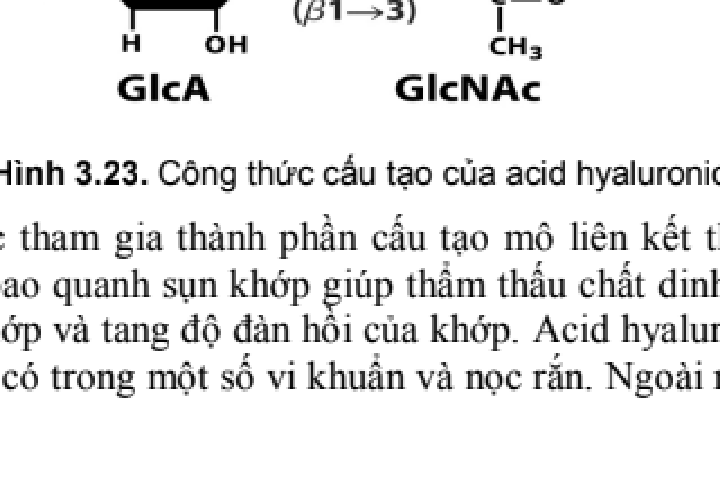
*Hình 3.23. Công thức cấu tạo của acid hyaluronic: $\text{GlcA}(\beta1\rightarrow3)\text{GlcNAc}$*

Acid hyaluronic tham gia thành phần cấu tạo mô liên kết thủy tinh thể của mắt, cuống rốn, chất nền bao quanh sụn khớp giúp thẩm thấu chất dinh dưỡng cũng như tạo độ nhớt bao quanh khớp và tăng độ đàn hồi của khớp. Acid hyaluronic bị thủy phân bởi enzym *hyaluronidase* có trong một số vi khuẩn và nọc rắn. Ngoài ra enzym này cũng có

---

## [Trang 82] - GAGs chứa Sulphat: Keratan sulphat, Chondroitin sulphat & Heparin

trong tinh dịch giúp thủy phân lớp glycosaminoglycan bên ngoài xung quanh buồng trứng giúp tinh trùng có thể xâm nhập vào trong trứng để thụ tinh.

#### 4.2.2. Các mucopolysaccharid acid chứa sulphat

##### * Keratan sulphat
Keratan sulphat được tìm thấy trong giác mạc, sụn xương, mặt trong của nhân đĩa đệm và trên thành động mạch chủ. Nó được cấu tạo là polymer của các đơn vị lặp lại xen kẽ giữa N-acetyl glucosamine và galactose, gốc sulphat được gắn ở vị trí C6 của N-acetyl glucosamine. Khác với các mucopolysaccharid khác, trong phân tử keratan sulphat không chứa acid uronic.

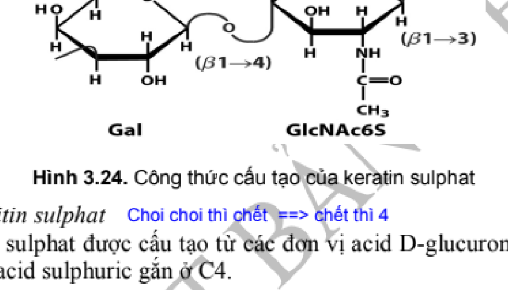
*Hình 3.24. Công thức cấu tạo của keratan sulphat: $\text{Gal}(\beta1\rightarrow4)\text{GlcNAc6S}(\beta1\rightarrow3)$*

##### * Chondroitin sulphat
Chondroitin sulphat được cấu tạo từ các đơn vị **acid D-glucuronic và N-acetyl-D-galactosamin với acid sulphuric gắn ở C4** (Chondroitin 4-sulphat) hoặc ở C6.

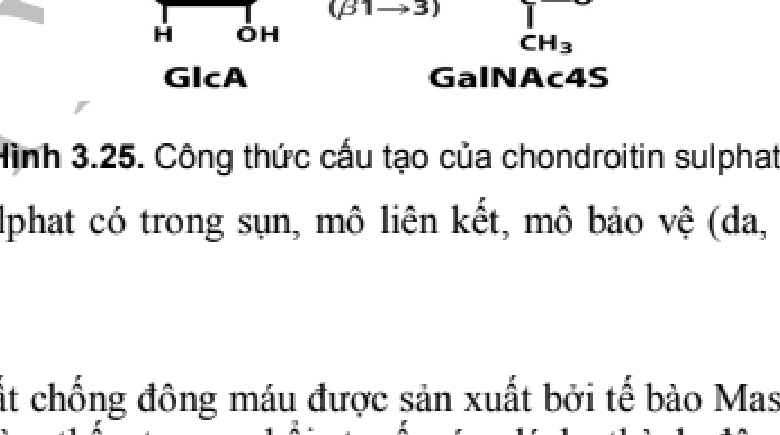
*Hình 3.25. Công thức cấu tạo của chondroitin sulphat: $\text{GlcA}(\beta1\rightarrow3)\text{GalNAc4S}$*

Chondroitin sulphat có trong sụn, mô liên kết, mô bảo vệ (da, gân, van tim, thành động mạch...).

##### * Heparin
Heparin là chất chống đông máu được sản xuất bởi tế bào Mast của gan. Ngoài ra, heparin còn được tìm thấy trong phổi, tuyến ức, lách, thành động mạch lớn và một lượng nhỏ trong máu.

Về cấu tạo, nó là polymer của các đơn vị D-glucosamin và 1 trong 2 acid D-glucuronic và L-iduronic. Nhóm $-\text{NH}_2$ ở C2 và $-\text{OH}$ ở C6 của D-glucosamin được gắn với nhóm sulphat. Một số có chứa nhóm acetyl ở C2 của D-glucosamin. Ngoài ra nhóm $-\text{OH}$ ở C2 của acid uronic cũng được gắn với nhóm sulphat. Ban đầu khi mới tổng hợp,

---

## [Trang 83] - Heparin (tiếp), Mucopolysaccharid trung tính & Glucid liên hợp

tất cả các acid uronic trên phân tử đều là acid D-glucuronic. Sau đó, nhờ enzym 5-epimerase chuyển đổi khoảng 90% lượng acid D-glucuronic thành acid L-iduronic. Do đó, trong phân tử heparin hoàn chỉnh có từ 90% là các acid L-iduronic.

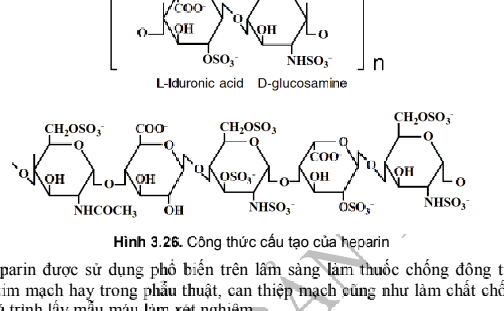
*Hình 3.26. Công thức cấu tạo của heparin*

Heparin được sử dụng phổ biến trên lâm sàng làm thuốc chống đông trong các bệnh lý tim mạch hay trong phẫu thuật, can thiệp mạch cũng như làm chất chống đông trong quá trình lấy mẫu máu làm xét nghiệm.

#### 4.2.3. Các mucopolysaccharid trung tính
Nhiều polysaccharid trung tính thuộc nhiều loại được tìm thấy trong vỏ phế cầu khuẩn. Tính đặc hiệu type của phế cầu khuẩn phụ thuộc vào polysaccharid đặc hiệu có mặt trên lớp vỏ (chính là các hapten - chất có tính kháng nguyên nhưng tự nó không có khả năng gây ra đáp ứng miễn dịch). Sản phẩm thủy phân polysaccharid tách chiết từ phế cầu khuẩn type 1 là glucosamin và acid glucuronic acid.

Cơ chất nhóm máu chứa các peptid hoặc các acid amin cũng như carbohydrat. 4 loại monosaccharid được tìm thấy trong tất cả các nhóm máu không liên quan đến nguồn gốc là galactose, fucose, acetyl galactosamin và acetyl glucosamin. Đầu không khử của acetyl glucosamin, galactose quy định tính đặc hiệu nhóm máu A, B tương ứng. Các acid amin cấu tạo cơ chất của nhóm máu là các acid amin không chứa nhân thơm và lưu huỳnh.

Các mucopolysaccharid trung tính còn có vai trò ổn định cấu hình của phân tử protein như ovalbumin chứa mannose và glucosamin.

### 5. GLUCID LIÊN HỢP (GLYCOCONJUGATE)

Ngoài các chức năng quan trọng như dự trữ năng lượng (tinh bột, glycogen, dextran) và tham gia cấu trúc cơ thể (cellulose, chitin, peptidoglycan), polysaccharid và oligosaccharid còn là chất mang thông tin. Một số là tín hiệu nhận diện tương tác giữa các tế bào với môi trường ngoại bào, một số khác là các tín hiệu của các protein được vận chuyển tới các cơ quan đặc hiệu hoặc phá hủy khi protein bị tổng hợp lỗi hay dư

---

## [Trang 84] - Proteoglycan, Glycoprotein, Glycolipid & Câu hỏi ôn tập Chương 3

thừa; một số giúp nhận diện vị trí của các tín hiệu phân tử ngoại bào (ví dụ yếu tố tăng trưởng) hoặc vị trí bám của các vi sinh vật ngoài tế bào (vi khuẩn hay virus). Trong hầu hết các tế bào nhân thật, các chuỗi oligosaccharid gắn với màng bào tương tạo thành 1 lớp carbohydrat dày vài nano mét có vai trò là vùng giàu thông tin của tế bào biểu lộ với các vùng lân cận. Những oligosaccharid này đóng vai trò trung tâm trong sự nhận diện và bám dính tế bào với tế bào, sự di chuyển của tế bào trong quá trình phát triển, đông máu, đáp ứng miễn dịch, hàn gắn tổn thương và các quá trình khác của tế bào. Trong hầu hết các trường hợp, carbohydrat mang thông tin liên kết đồng hóa trị với protein hoặc lipid tạo ra glucid liên hợp là những phân tử có hoạt tính sinh học.

#### 5.1. Proteoglycan
Là những đại phân tử trên bề mặt tế bào hay khoảng gian bào, được cấu tạo bởi một hay nhiều chuỗi glycosaminoglycan sulphat liên kết đồng hóa trị với protein màng tế bào hoặc protein được bài tiết. Các chuỗi glycosaminoglycan có thể gắn với protein ngoài tế bào nhờ lực hút tĩnh điện do chuỗi polysaccharid tích điện âm. Proteoglycan là thành phần chính của khoảng gian bào.

#### 5.2. Glycoprotein
Glycoprotein gồm một hay nhiều oligosaccharid liên kết đồng hóa trị với một phân tử protein, thường được thấy ở phía xa của màng bào tương, trong khoảng gian bào hay trong máu. Ngoài ra chúng còn được tìm thấy bên trong các bào quan như thể golgi, hạt bài tiết hay lysosom. Thành phần của các oligosaccharid trong glycoprotein rất không đồng nhất. Glycosaminoglycan giàu thông tin và tạo ra vị trí đặc hiệu để nhận biết, có ái lực cao với protein gắn carbohydrat là lectin. Một số protein trong bào tương và trong nhân cũng được glycosyl hóa.

#### 5.3. Glycolipid
Glycolipid là thành viên của nhóm sphingolipid với đầu ưa nước là các oligosaccharid. Giống như các glycoprotein, các oligosaccharid đóng vai trò là vị trí nhận diện đặc hiệu của lectin. Não và các nơ ron thần kinh rất giàu glycolipid giúp dẫn truyền thần kinh và hình thành myelin. Glycolipid cũng đóng vai trò dẫn truyền tín hiệu trong tế bào.

---

### CÂU HỎI ÔN TẬP CHƯƠNG 3
1. Trình bày được định nghĩa, phân loại của carbohydrat.
2. Trình bày được định nghĩa, danh pháp, cấu tạo, tính chất của monosaccharid.
3. Phân biệt được nguồn gốc, cấu tạo, tính chất của: saccarose, lactose và maltose.
4. So sánh được nguồn gốc, vai trò, cấu tạo của: tinh bột, glycogen và cellulose.
5. Kể tên được một số loại polysacccharid tạp.
6. Kể tên được các loại glucid liên hợp chính.

---

## [Trang 85] - Chương 4: CHUYỂN HÓA CARBOHYDRAT