# Chương 4
# CHUYỂN HÓA CARBOHYDRAT

### MỤC TIÊU HỌC TẬP
*1. Trình bày được quá trình thoái hóa carbohydrat theo con đường đường phân và ý nghĩa của quá trình đó.*  
*2. Trình bày được con đường hexose monophosphat.*  
*3. Trình bày được quá trình tân tạo glucose.*  
*4. Trình bày được quá trình thoái hóa glycogen.*  
*5. Trình bày được quá trình tổng hợp glycogen.*  
*6. Nêu được một số bệnh lý có rối loạn chuyển hóa carbohydrat.*

---

Chuyển hóa carbohydrat là một trong những chuyển hóa quan trọng nhất của cơ thể sống. Nó là nguồn cung cấp phần lớn năng lượng cho tế bào hoạt động, đồng thời cung cấp nhiều sản phẩm chuyển hóa trung gian quan trọng. Chuyển hóa carbohydrat cũng liên quan chặt chẽ với các chuyển hóa lipid và protein trong cơ thể. Bằng cách dự trữ glucose trong các hợp chất polymer như tinh bột và glycogen, tế bào dự trữ được một lượng lớn glucose mà không thay đổi áp suất thẩm thấu trong tế bào. Khi cơ thể có nhu cầu năng lượng, glucose sẽ được giải phóng từ các polymer để tạo ATP cung cấp cho tế bào. D-glucose không chỉ là nhiên liệu tuyệt vời mà còn là một tiền chất quan trọng, có khả năng tạo ra lượng lớn các chất chuyển hóa trung gian, cần thiết cho các phản ứng tổng hợp. Ở cơ thể bậc cao hoặc động vật, glucose có 4 số phận chính: tham gia tổng hợp các hợp chất polysaccharid cấu tạo tế bào, được dự trữ dưới dạng các polysaccharid, được oxy hóa tạo các hợp chất 3 carbon theo con đường đường phân hoặc bị oxy hóa theo con đường pentose phosphat tạo đường ribose 5-phosphat (để tổng hợp acid nucleic) và NADPH (dùng trong các quá trình tổng hợp lipid và chống oxy hóa của cơ thể).

### 1. TIÊU HÓA VÀ HẤP THU CARBOHYDRAT

Carbohydrat là nguồn cung cấp năng lượng chính cho cơ thể người, bao gồm: tinh bột (có trong các loại hạt ngũ cốc, củ quả có bột), glycogen có trong các tổ chức động vật, cellulose trong rau và một số quả, các disaccharid như saccharose trong đường ăn hay lactose trong sữa, các monosaccharid như glucose, fructose, mannose, ribose...

<!-- END FILE: pages_076_085.md -->

<!-- BEGIN FILE: pages_086_095.md -->

# GIÁO TRÌNH HÓA SINH - ĐẠI HỌC Y HÀ NỘI
**Chủ biên:** GS. TS. BS. Tạ Thành Văn  
**Nguồn:** SGK Hóa sinh YHN 2019 (Nhà xuất bản Y học)

---

## [Trang 86] - Tiêu hóa & Hấp thu Carbohydrat ở ruột non

#### 1.1. Sự tiêu hóa carbohydrat
Ở đường tiêu hoá, dưới tác dụng của *amylase* của nước bọt và dịch tụy, tinh bột của thức ăn bị thuỷ phân thành dextrin, maltose. Maltose tiếp tục bị thủy phân dưới tác dụng của *maltase* ở màng ngoài tế bào thành ruột thành glucose.

Các disaccharid khác như saccharose và lactose cũng bị thủy phân bởi các enzym tương ứng của tế bào thành ruột là *saccharase* và *lactase*. Sản phẩm của sự thủy phân này là các monosaccharid như glucose, fructose và galactose:

$$\begin{aligned}
\text{Maltose} + \text{H}_2\text{O} &\xrightarrow{\text{Maltase}} 2\text{ D-glucose} \\
\text{Lactose} + \text{H}_2\text{O} &\xrightarrow{\text{Lactase}} \text{D-galactose} + \text{D-glucose} \\
\text{Saccharose} + \text{H}_2\text{O} &\xrightarrow{\text{Saccharase}} \text{D-fructose} + \text{D-glucose}
\end{aligned}$$

Người ta ước tính quá trình tiêu hóa carbohydrat ở miệng chiếm khoảng 10% còn 90% ở ruột nhờ các enzym tiêu hóa ở dịch ruột và dịch tụy.

#### 1.2. Sự hấp thu carbohydrat
Sự hấp thu các monosaccharid xảy ra ở phần đầu của ruột non. Tốc độ hấp thu phụ thuộc vào cấu tạo và nồng độ của các monosaccharid trong ruột.

Sự hấp thu diễn ra theo 2 cơ chế chính:
- **Khuếch tán thụ động:** xảy ra đối với một số monosaccharid như arabinose, mannose và fructose, vận chuyển qua màng tế bào niêm mạc ruột do sự chênh lệch gradient nồng độ giữa dịch lòng ruột và bên trong tế bào niêm mạc ruột.
- **Vận chuyển tích cực:** là cơ chế vận chuyển của glucose và galactose. Các monosaccharid này được vận chuyển qua màng tế bào thành ruột theo cơ chế vận chuyển tích cực thứ phát phụ thuộc vào sự có mặt của ion natri. Quá trình vận chuyển nhanh chóng và ngược chiều nồng độ này nhờ 2 yếu tố:
  + Chất mang hay chất vận chuyển nằm trong diềm bàn chải của tế bào thành ruột, chứa 2 trung tâm kết hợp với natri và glucose hay galactose.
  + Bơm $\text{Na}^+\text{-K}^+\text{-ATPase}$ có vai trò thủy phân ATP cung cấp năng lượng cho quá trình vận chuyển ngược chiều nồng độ ion natri qua màng đáy của tế bào, đảm bảo cho nồng độ natri ở trong tế bào luôn ở mức rất thấp.

---

## [Trang 87] - Cơ chế SGLT1, GLUT2 & 3 Con đường thoái hóa Glucose

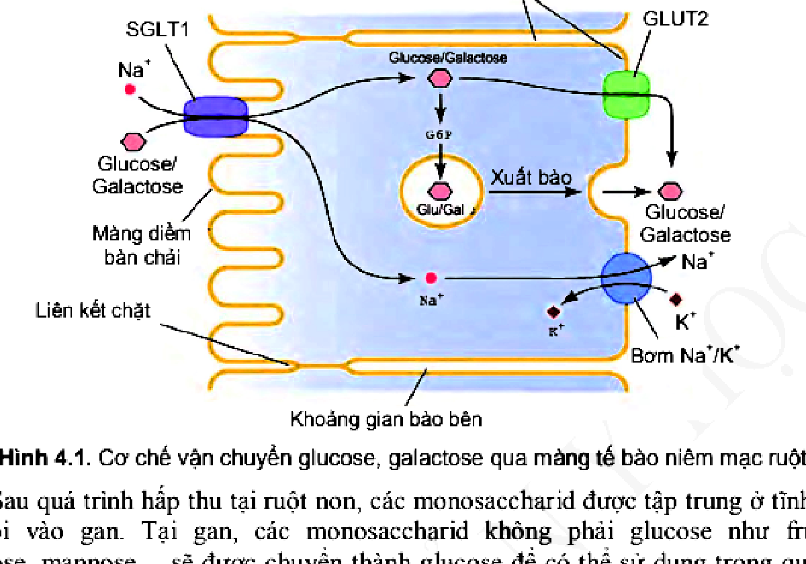
*Hình 4.1. Cơ chế vận chuyển glucose, galactose qua màng tế bào niêm mạc ruột*

Sau quá trình hấp thu tại ruột non, các monosaccharid được tập trung ở tĩnh mạch cửa rồi vào gan. Tại gan, các monosaccharid không phải glucose như fructose, galactose, mannose... sẽ được chuyển thành glucose để có thể sử dụng trong quá trình chuyển hóa.

### 2. SỰ THOÁI HÓA CỦA GLUCOSE Ở TẾ BÀO VÀ MÔ

Trong cơ thể người glucose được thoái hóa theo ba con đường:
- Con đường đường phân (hexose diphosphat).
- Con đường pentose phosphat (hexose monophosphat).
- Con đường acid uronic tạo acid glucuronic và acid ascorbic.

Trong phạm vi chương này chúng tôi tập trung vào trình bày con đường đường phân và con đường pentophosphat trong cơ thể.

#### 2.1. Con đường đường phân
Quá trình oxy hóa glucose để tạo thành pyruvat và lactat được gọi là con đường đường phân (*glycolysis*). Con đường này được mô tả bởi Embden, Meyerhof và Parnas, do đó nó còn được gọi tên là con đường Embden Meyerhof.

Con đường đường phân xảy ra ở hầu hết tất cả các mô, cung cấp năng lượng cho các mô sử dụng, là con đường duy nhất xảy ra trong cả điều kiện ái khí và yếm khí.

Con đường này bao gồm một chuỗi các phản ứng hoá học chuyển hoá glucose thành pyruvat đồng thời với sự tạo thành ATP, xảy ra ở bào tương qua 2 giai đoạn với 10 phản ứng:
- **Giai đoạn 1 - giai đoạn chuẩn bị:** gồm 5 phản ứng (1-5). Phân tử glucose được phosphoryl hoá và bị chặt đôi thành 2 triose: (glyceraldehyd-3-phosphat) cần 2 ATP.

---

## [Trang 88] - Đường phân: Giai đoạn 1 (Phản ứng 1 & 2)

- **Giai đoạn 2 - giai đoạn phosphoryl-oxy hóa:** gồm 5 phản ứng (6-10). Hai phân tử glyceraldehyd-3-phosphat chuyển hoá thành pyruvat tạo ra 4 ATP.

#### 2.1.1. Giai đoạn chuẩn bị cần cung cấp ATP

##### + Phản ứng 1 - sự phosphoryl hóa glucose:
Là sự vận chuyển của 1 ATP đến glucose để tạo thành glucose-6-phosphat (G6P) được xúc tác bởi *hexokinase*. Đây là enzym không đặc hiệu, có trong tất cả các loại tế bào chuyển gốc phosphat sang glucose, hoạt động xúc tác đòi hỏi ion $\text{Mg}^{2+}$ và ATP. Gan cũng chứa *glucokinase*, xúc tác phản ứng như trên nhưng chỉ trong điều kiện glucose máu tăng cao. Phản ứng này không đặc hiệu ở điều kiện trong tế bào.

$$\text{Glucose} + \text{ATP} \xrightarrow[\text{Mg}^{2+}]{\text{hexokinase}} \text{Glucose 6-phosphat} + \text{ADP} \qquad (\Delta G^{\circ'} = -16,7\text{ kJ/mol})$$

##### + Phản ứng 2: đồng phân hóa G6P thành fructose-6-phosphat (F6P)
Xảy ra thuận nghịch, được xúc tác bởi *phosphoglucose isomerase* – (PGI) (*glucose-6-phosphat isomerase* / *phosphohexose isomerase*).

$$\text{Glucose 6-phosphat} \underset{\text{Mg}^{2+}}{\overset{\text{phosphohexose isomerase}}{\rightleftharpoons}} \text{Fructose 6-phosphat} \qquad (\Delta G^{\circ'} = 1,7\text{ kJ/mol})$$

##### + Phản ứng 3: phosphoryl hoá F6P thành fructose-1-6-diphosphat (F1,6DP)
Xúc tác bởi *phosphofructokinase* (PFK) với sự tham gia của ion $\text{Mg}^{2+}$. Phản ứng này là phản ứng không thuận nghịch ở điều kiện trong tế bào.

---

## [Trang 89] - Đường phân: Giai đoạn 1 (Phản ứng 3, 4 & 5)

$$\text{Fructose 6-phosphat} + \text{ATP} \xrightarrow[\text{Mg}^{2+}]{\text{Phosphofructokinase-1 (PFK-1)}} \text{Fructose 1,6-diphosphat} + \text{ADP} \qquad (\Delta G^{\circ'} = -14,2\text{ kJ/mol})$$

##### + Phản ứng 4: enzym aldolase xúc tác phản ứng cắt đôi phân tử F1,6DP thành 2 triose:
Glyceraldehyd-3-phosphat (GAP) và dihydroxyacetonphosphat (DHAP).

$$\text{Fructose 1,6-diphosphat} \xrightleftharpoons{\text{aldolase}} \text{Dihydroxyaceton phosphat} + \text{Glyceraldehyd 3-phosphat} \qquad (\Delta G^{\circ'} = 23,8\text{ kJ/mol})$$

##### + Phản ứng 5:
Chỉ có một trong hai triose phosphat ở phản ứng trên là GAP có thể được thoái hoá tiếp tục trong các phản ứng của con đường đường phân. DHAP có thể biến đổi thuận nghịch một cách nhanh chóng thành GAP nhờ enzym *triose phosphat isomerase* (TPI).

$$\text{Dihydroxyaceton phosphat} \xrightleftharpoons{\text{triose phosphat isomerase}} \text{Glyceraldehyd 3-phosphat} \qquad (\Delta G^{\circ'} = 7,5\text{ kJ/mol})$$

Phản ứng này kết thúc giai đoạn chuẩn bị của quá trình đường phân, trong đó 1 phân tử hexose đã được phosphoryl hóa 2 lần ở C1 và C6 (vì vậy còn có tên là con đường hexose diphosphat), sau đó được chặt đôi để tạo thành **2 phân tử GAP**.

---

## [Trang 90] - Đường phân: Giai đoạn 2 (Phản ứng 6 & 7) - Sinh năng lượng ATP

#### 2.1.2. Giai đoạn phosphoryl - oxy hóa sinh ATP
Sự biến đổi của 2 phân tử GAP thành 2 pyruvat được kèm theo sự hình thành 4 phân tử ATP từ ADP. Tuy nhiên trên thực tế, quá trình này chỉ tạo ra được 2 ATP vì có 2 phân tử ATP được sử dụng trong giai đoạn chuẩn bị (PƯ 1 và PƯ 3).

##### + Phản ứng 6: oxy hoá và phosphoryl hoá GAP thành 1,3-diphosphoglycerat (1,3 DPG)
Nhờ xúc tác bởi *glyceraldehyd-3-phosphat dehydrogenase* (GAPDH).

$$\text{Glyceraldehyd 3-phosphat} + \text{Pi} + \text{NAD}^+ \xrightleftharpoons{\text{GAPDH}} \text{1,3-diphosphoglycerat} + \text{NADH} + \text{H}^+ \qquad (\Delta G^{\circ'} = 6,3\text{ kJ/mol})$$

Đây là một trong hai phản ứng dự trữ năng lượng của con đường đường phân dẫn đến tạo ATP. Nhóm aldehyd của GAP bị khử hydro để tạo liên kết acyl phosphat giàu năng lượng. Phản ứng có coenzym dạng oxy hóa $\text{NAD}^+$ tham gia, tạo thành $\text{NADH}$. Enzym GAP dehydrogenase bị ức chế bởi iodoacetat. Do đó, để phân lập và xác định các hexose phosphat tạo ra trong con đường đường phân, người ta thường cho thêm các chất ức chế enzym này vào dịch chiết thô của men bia hay tổ chức cơ.

##### + Phản ứng 7: phản ứng đầu tiên của con đường đường phân tạo ra ATP và 3-phosphoglycerat (3PG)
Nhờ *phosphoglycerat kinase* (PGK). Enzym này vận chuyển nhóm phosphat giàu năng lượng từ nhóm carboxyl của 1,3-DPG tới ADP để tạo thành ATP và 3PG.

$$\text{1,3-diphosphoglycerat} + \text{ADP} \underset{\text{Mg}^{2+}}{\overset{\text{phosphoglycerat kinase}}{\rightleftharpoons}} \text{3-Phosphoglycerat} + \text{ATP} \qquad (\Delta G^{\circ'} = -18,5\text{ kJ/mol})$$

---

## [Trang 91] - Phản ứng 8 & Chu trình 2,3-DPG điều hòa gắn Oxy của Hemoglobin

##### + Phản ứng 8: *phosphoglycerat mutase* (PGM)
Xúc tác sự vận chuyển thuận nghịch nhóm phosphat giữa C2 và C3 của glycerat, với sự có mặt của $\text{Mg}^{2+}$, 3PG biến đổi thành 2-phosphoglycerat (2PG).

##### Con đường đường phân ảnh hưởng đến sự vận chuyển oxy:
Trong hồng cầu 2,3 DPG gắn vào deoxyhemoglobin và làm giảm ái lực của oxy với Hb. Nồng độ 2,3 DPG trong hồng cầu khá cao ($5\text{ mM}$). Trong hồng cầu sự tạo thành và phân huỷ 2,3 DPG phụ thuộc vào con đường đường phân. *Diphosphoglycerat mutase* xúc tác sự chuyển gốc phosphat từ C1 sang C2 của phân tử 1,3 DPG để tạo thành 2,3 DPG. Sau đó 2,3 DPG lại bị thuỷ phân tách phosphat nhờ *2,3 phosphoglycerat phosphatase* (Hình 4.2). Do đó sự vận chuyển oxy trong hồng cầu chịu ảnh hưởng của con đường đường phân.

Ở bệnh bẩm sinh thiếu hụt enzym *hexokinase* và thiếu hụt *pyruvat kinase* ảnh hưởng đến đường cong bão hòa oxy của hemoglobin:
- Khi thiếu hụt *hexokinase*, các chất chuyển hóa trung gian của đường phân có nồng độ thấp do sự phosphoryl hóa glucose ở bước đầu tiên bị cản trở. Vì vậy, nồng độ của 2,3-DPG trong hồng cầu giảm, hemoglobin có ái lực với oxy cao bất thường.
- Trái lại, khi thiếu hụt *pyruvat kinase*, nồng độ các chất chuyển hóa trung gian của con đường đường phân trở nên cao một cách bất thường do bước cuối cùng bị khóa. Do đó, mức độ 2,3-DPG tăng cao làm cho ái lực của hemoglobin với oxy giảm.

Các đường cong phân ly oxy trong bệnh thiếu hụt hexokinase và pyruvat kinase được giải thích khi phát hiện ra 2,3-DPG là chất điều hòa sự vận chuyển oxy của hemoglobin (Hình 4.3).

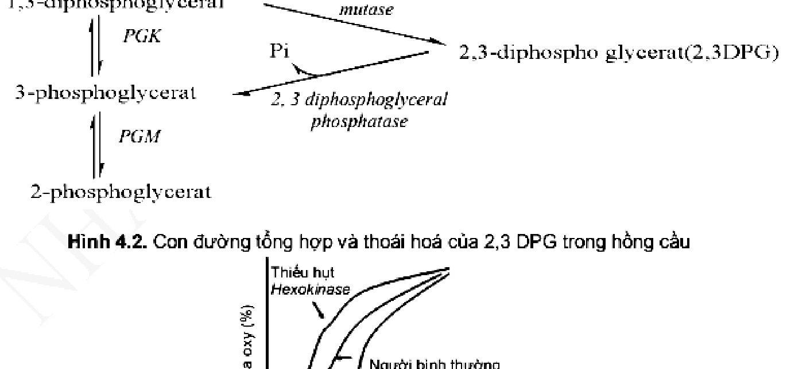
*Hình 4.2. Con đường tổng hợp và thoái hoá của 2,3 DPG trong hồng cầu*

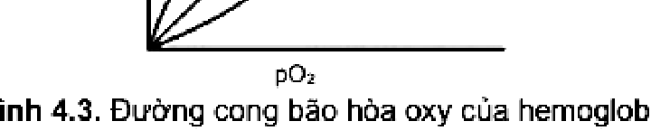
*Hình 4.3. Đường cong bão hòa oxy của hemoglobin khi thiếu hụt hexokinase và pyruvat kinase*

---

## [Trang 92] - Phản ứng 9 & 10 Đường phân: Enolase & Pyruvat kinase

##### + Phản ứng 9: khử nước của 2PG thành phosphoenol pyruvat (PEP).
Phản ứng thuận nghịch được xúc tác bởi *enolase*. Enolase chỉ hoạt động khi ở dạng phức hợp với $\text{Mg}^{2+}$.

$$\text{2-Phosphoglycerat} \xrightleftharpoons{\text{enolase}} \text{Phosphoenolpyruvat} + \text{H}_2\text{O} \qquad (\Delta G^{\circ'} = 7,5\text{ kJ/mol})$$

*Enolase* bị Flo ($\text{F}^-$) ức chế, người ta lợi dụng tính chất này để ức chế quá trình đường phân trong xét nghiệm định lượng glucose máu (dùng ống nghiệm chứa Natri Fluorid NaF).

##### + Phản ứng 10: tạo thành ATP thứ hai do PEP chuyển phosphat từ liên kết enolphosphat (liên kết giàu năng lượng) sang phân tử ADP tạo thành ATP và pyruvat
Dưới tác dụng của *pyruvat kinase*.

$$\text{Phosphoenolpyruvat} + \text{ADP} \xrightarrow[\text{Mg}^{2+},\ \text{K}^+]{\text{pyruvat kinase}} \text{Pyruvat} + \text{ATP} \qquad (\Delta G^{\circ'} = -31,4\text{ kJ/mol})$$

---

## [Trang 93] - Sơ đồ tổng kết 10 phản ứng Đường phân & Số phận Pyruvat

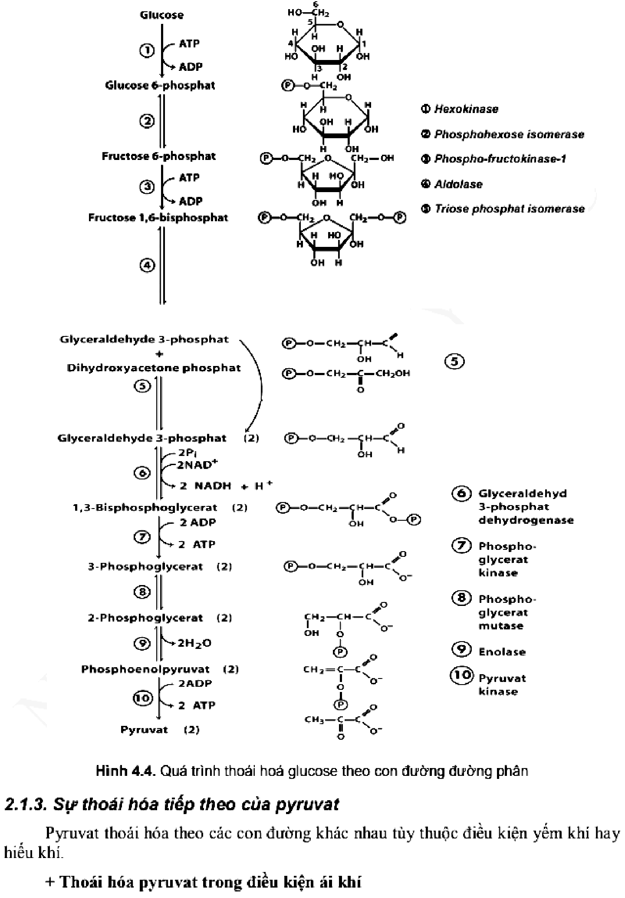
*Hình 4.4. Quá trình thoái hoá glucose theo con đường đường phân (10 phản ứng)*

#### 2.1.3. Sự thoái hóa tiếp theo của pyruvat
Pyruvat thoái hóa theo các con đường khác nhau tùy thuộc điều kiện yếm khí hay hiếu khí.

##### + Thoái hóa pyruvat trong điều kiện ái khí:
Trong điều kiện ái khí, con đường đường phân chỉ là giai đoạn đầu tiên của sự thoái hóa hoàn toàn glucose. Với sự có mặt của oxy, phân tử pyruvat sẽ được chuyển vào trong ty thể, oxy hoá thành acetat dưới dạng acetyl CoA, đi vào chu trình citric, oxy hoá thành $\text{CO}_2$ và $\text{H}_2\text{O}$.

---

## [Trang 94] - Oxy hóa Pyruvat thành Acetyl-CoA & Con thoi Malat - Aspartat

Phản ứng không thuận nghịch tạo acetyl CoA được xúc tác bởi phức hợp enzym *pyruvat dehydrogenase* gồm 3 enzym và 5 coenzym tham gia. Phản ứng tạo ra 1 phân tử $\text{NADH}$ đi vào chuỗi hô hấp tế bào sẽ tạo thành 3 ATP. Acetyl CoA oxy hoá trong chu trình acid citric tạo thành 12 ATP.

$$\text{Pyruvat} + \text{CoA-SH} + \text{NAD}^+ \xrightarrow{\text{Phức hợp PDH}} \text{Acetyl-CoA} + \text{NADH} + \text{CO}_2 \qquad (\Delta G^{\circ'} = -33,4\text{ kJ/mol})$$

Phân tử $\text{NADH}$ (tạo ra ở phản ứng 6) được chuyển vào ty thể để oxy hoá trong chuỗi hô hấp tế bào, tại đây mỗi phân tử $\text{NADH}$ tạo thành 3 ATP hoặc 2 ATP tùy thuộc con đường vận chuyển $\text{NADH}$ vào trong ty thể:
- Nếu vận chuyển qua **con thoi malat-aspartat** sẽ cho **3 ATP** (Hình 4.5).
- Nếu vận chuyển qua **con thoi glycerol 3-phosphat** sẽ chỉ cho **2 ATP** do điện tử được chuyển sang $\text{FADH}_2$ (Hình 4.6).

Như vậy sự thoái hoá hoàn toàn phân tử glucose trong điều kiện ái khí cung cấp **38 ATP hoặc 36 ATP** tùy điều kiện (Bảng 4.1).

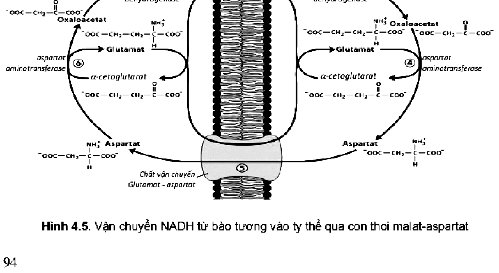
*Hình 4.5. Vận chuyển NADH từ bào tương vào ty thể qua con thoi malat-aspartat*

---

## [Trang 95] - Con thoi Glycerol-P, Bilan năng lượng & Thoái hóa yếm khí (Lên men Lactat)

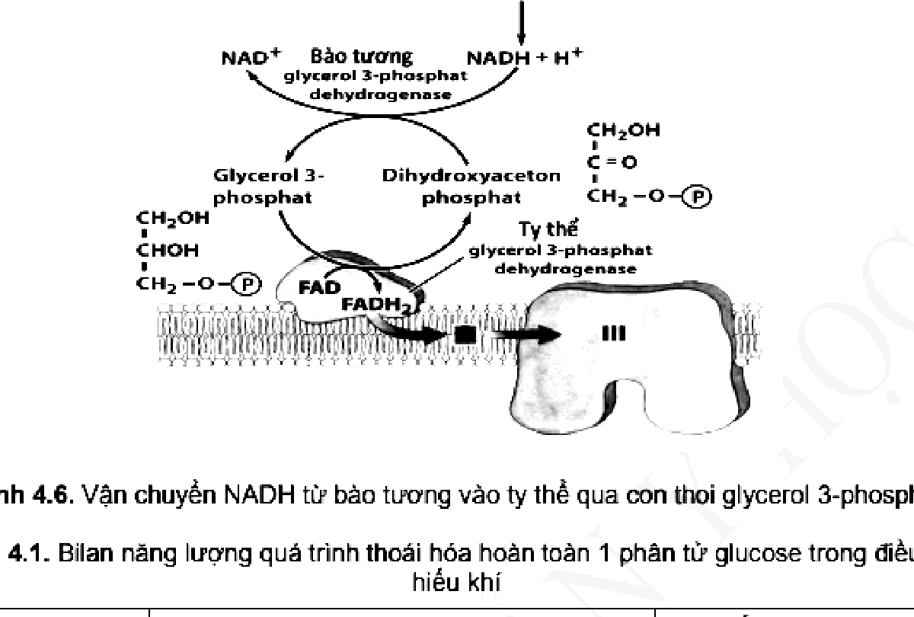
*Hình 4.6. Vận chuyển NADH từ bào tương vào ty thể qua con thoi glycerol 3-phosphat*

### Bảng 4.1. Bilan năng lượng quá trình thoái hóa hoàn toàn 1 phân tử glucose trong điều kiện hiếu khí

| Con đường | Phản ứng | Số ATP tạo thành |
| :--- | :--- | :---: |
| **Đường phân** | $\text{Glucose} \longrightarrow 2\text{ pyruvat}$ | 2 |
| | $2\text{ NADH}$ (ở phản ứng 6) | 6 hoặc 4 |
| **Chu trình Krebs** | $2\text{ NADH}$ ($2\text{ Pyruvat} \longrightarrow 2\text{ Acetyl CoA}$) | 6 |
| | $2\text{ Acetyl CoA}$ | 24 |
| **Tổng** | | **38 hoặc 36** |

##### + Thoái hóa pyruvat trong điều kiện yếm khí:
Trong con đường đường phân như đã mô tả ở trên, số lượng $\text{NAD}^+$ giảm sau phản ứng 6 (Hình 4.4). Khi thiếu hụt $\text{O}_2$, $\text{NADH}$ không thể bị oxy hóa trở lại thành $\text{NAD}^+$ được trong chuỗi vận chuyển điện tử. Khi đó, pyruvat bị khử thành lactat nhờ $\text{NADH}$ dưới tác dụng của *lactat dehydrogenase* (LDH). Sự oxy hoá của $\text{NADH}$ khi tạo lactat cho phép tái tạo $\text{NAD}^+$ để con đường đường phân được tiếp tục diễn ra trong điều kiện yếm khí.

$$\text{Pyruvat} + \text{NADH} + \text{H}^+ \xrightleftharpoons{\text{lactat dehydrogenase}} \text{L-Lactat} + \text{NAD}^+$$
*(Bilan năng lượng đường phân yếm khí: tạo ra ròng **2 ATP** cho mỗi phân tử glucose).*

<!-- END FILE: pages_086_095.md -->

<!-- BEGIN FILE: pages_096_105.md -->

# GIÁO TRÌNH HÓA SINH - ĐẠI HỌC Y HÀ NỘI
**Chủ biên:** GS. TS. BS. Tạ Thành Văn  
**Nguồn:** SGK Hóa sinh YHN 2019 (Nhà xuất bản Y học)

---

## [Trang 96] - Thoái hóa yếm khí (tiếp), Ý nghĩa & Điều hòa Đường phân

Một số điểm cần được lưu ý trong thoái hóa glucose theo con đường yếm khí:
- Các mô hoạt động trong điều kiện yếm khí sẽ tạo ra acid lactic gây tình trạng toan hóa cục bộ. Nếu acid lactic được sản xuất nhiều có thể dẫn đến nhiễm toan acid lactic.
- Cơ xương khi hoạt động mạnh sẽ tạo ra acid lactic do lượng oxy cung cấp không đủ.
- Ở hồng cầu ngay cả trong điều kiện ái khí, quá trình đường phân vẫn tạo ra lactat vì hồng cầu không có ty thể nên không có hệ enzym oxy hóa pyruvat. Khoảng 90% nhu cầu năng lượng của hồng cầu được cung cấp bởi con đường đường phân này.
- Điều kiện yếm khí sẽ gây ra tình trạng cạn kiệt $\text{NAD}^+$.
- **Oxamat:** ức chế cạnh tranh với *LDH* và ngăn cản quá trình oxy hóa trở lại của $\text{NADH}$.

Năng lượng tạo ra khi thoái hóa hoàn toàn 1 phân tử glucose trong điều kiện yếm khí là **2 ATP**.

#### 2.1.4. Ý nghĩa của con đường đường phân
Thoái hóa glucose theo con đường đường phân có ý nghĩa quan trọng cho việc cung cấp năng lượng cho tế bào hoạt động, đồng thời cung cấp nhiều sản phẩm trung gian cho nhiều quá trình chuyển hóa khác của cơ thể.

Một phân tử glucose khi thoái hóa hoàn toàn trong điều kiện ái khí sẽ cung cấp 36 hoặc 38 ATP. Thoái hóa glucose trong điều kiện yếm khí không chỉ là quá trình duy nhất trong cơ thể tạo ra năng lượng trong điều kiện yếm khí dù chỉ 2 ATP, mà còn tái tạo $\text{NAD}^+$ bị cạn kiệt trong con đường đường phân, giúp tiếp tục duy trì con đường chuyển hóa này.

#### 2.1.5. Điều hòa con đường đường phân
Con đường đường phân được điều hòa nhờ 3 cơ chế chính:
- **Điều hòa mức độ tổng hợp các enzym nhờ cơ chế hoạt hóa hay ức chế:** Khi tăng nồng độ glucose sẽ tăng hoạt tính các enzym chính của con đường đường phân như *glucokinase*, *phosphofructokinase-1* và *pyruvate kinase*, đồng thời sẽ ức chế hoạt động của các enzym tổng hợp glucose.
- **Cơ chế điều hòa đồng hóa trị nhờ quá trình phosphoryl hóa thuận nghịch:** Các hormon như epinephrin và glucagon làm tăng nồng độ cAMP kích hoạt *protein kinase* phụ thuộc vào cAMP, có thể phosphoryl hóa enzym *pyruvate kinase* làm mất hoạt tính của enzym này và ức chế con đường đường phân một cách nhanh chóng.
- **Cơ chế điều hòa dị hợp tử (dị lập thể):** *phosphofructokinase* là enzym chính chịu sự kiểm soát theo cơ chế dị hợp tử. Enzym này bị ức chế bởi citrat và ATP, được hoạt hóa bởi AMP.

---

## [Trang 97] - Con đường Hexose Monophosphat (HMP / Pentose Phosphat)

### 2.2. Con đường hexose monophosphat

Con đường này còn được gọi với nhiều tên khác nhau:
- Con đường hexose monophosphat.
- Con đường pentose phosphat.
- Chu trình pentose.
- Con đường phosphogluconat.
- Con đường Warburg-Dickens-Lipmann.

Sự oxy hoá glucose theo con đường hexose monophosphat xảy ra trong bào tương của tế bào song song với con đường đường phân, nhưng chiếm tỉ lệ thấp hơn nhiều (7-10%).

Con đường này xảy ra trong một số mô chuyên biệt chỉ để phục vụ các chức năng cụ thể, ví dụ: gan, mô mỡ, hồng cầu, tinh hoàn, buồng trứng, vỏ thượng thận, tuyến sữa thời kỳ hoạt động, thủy tinh thể và giác mạc. Nó không quan trọng đối với cơ xương và tuyến sữa không hoạt động.

Trong con đường này, 3 phân tử glucose-6-phosphat đi vào chu kỳ sẽ tạo ra 3 phân tử $\text{CO}_2$ và 3 phân tử đường 5 carbon. Các đường 5 carbon trao đổi với nhau các mẩu 2C hoặc 3C tái tạo thành 2 phân tử đường 6C và 1 phân tử glyceraldehyd-3-phosphat.

Quá trình oxy hóa được thực hiện bằng cách khử hydro nhưng chất nhận hydro ở đây là $\text{NADP}^+$ mà không phải là $\text{NAD}^+$.

$\text{CO}_2$ được tạo ra trong con đường hexomonophosphat.

Con đường hexose monophosphat được chia thành 2 giai đoạn:

##### + Giai đoạn 1: Oxy hoá glucose-6-phosphat tạo sản phẩm NADPH và pentose phosphat.
- Trước hết G6P oxy hoá bởi $\text{NADP}^+$ tạo thành 6-phosphoglucono-$\delta$-lacton dưới tác dụng của *glucose-6-phosphat dehydrogenase* (G6PD).
- Dưới tác dụng của *6-phospho-gluconolactonase*, 6-phosphoglucono-$\delta$-lacton hợp $\text{H}_2\text{O}$ mở vòng tạo thành 6-phosphogluconat.
- Oxy hoá 6-phosphogluconat bởi $\text{NADP}^+$ giải phóng $\text{CO}_2$ và tạo thành ribulose-5-phosphat dưới tác dụng của *6-phosphogluconat dehydrogenase*.

##### + Giai đoạn 2: Biến đổi tiếp tục pentose-5-phosphat.

---

## [Trang 98] - Giai đoạn 2 chu trình Pentose Phosphat: Transketolase & Transaldolase

- Ribulose-5-phosphat đồng phân hoá thành ribose-5-phosphat nhờ *ribose-5-phosphat isomerase* và thành xylulose-5-phosphat nhờ *ribose-5-phosphat epimerase* (ribose-5-phosphat cũng là nguồn nguyên liệu tổng hợp các base purin và pyrimidin).
- Nếu nhu cầu chuyển hoá thành ribose-5-phosphat và xylulose-5-phosphat đã đầy đủ, phần dư thừa sẽ chuyển thành glyceraldehyd-3-phosphat và fructose-6-phosphat.
- Glyceraldehyd-3-phosphat và fructose-6-phosphat đi vào con đường đường phân hoặc tân tạo glucose.
- Quá trình biến đổi các đường pentose để tạo thành glyceraldehyd 3-phosphat và fructose 6-phosphat là sự trao đổi các mẩu 2C hoặc 3C nhờ xúc tác của các enzym *transcetolase* và *transaldolase*:
  + **Transcetolase:** là enzym xúc tác cho phản ứng chuyển một đơn vị 2C của một đường cetose đến một aldose. Enzym này cần sự có mặt của coenzym thiamine pyrophosphat (TPP).
  + **Transaldolase:** xúc tác phản ứng chuyển một đơn vị 3C của một đường cetose đến một aldose để tạo thành 1 aldose và 1 cetose khác.

Như vậy chu trình pentose phosphat có thể viết:
$$6\text{ G6P} + 12\text{ NADP}^+ + 6\text{ H}_2\text{O} \longrightarrow 5\text{ G6P} + 12\text{ NADPH} + 6\text{CO}_2 + \text{Pi}$$

Con đường hexose monophosphat không cung cấp năng lượng dưới dạng ATP nhưng nó cung cấp **NADPH** và **ribose-5-phosphat**:
- NADPH được sử dụng như dạng năng lượng cho quá trình tổng hợp acid béo, cholesterol và các steroid, duy trì glutathion dạng khử ở hồng cầu để bảo vệ màng tế bào khỏi các tác nhân oxy hóa.
- Ribose-5-phosphat được cung cấp cho quá trình tổng hợp base purin và pyrimidin (để tổng hợp DNA và RNA).

---

## [Trang 99] - Sơ đồ chi tiết Chu trình Pentose Phosphat (HMP)

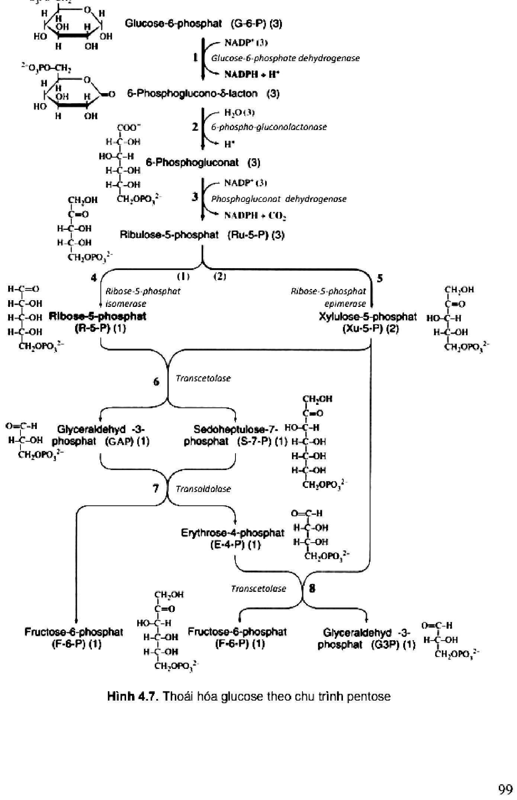
*Hình 4.7. Thoái hóa glucose theo chu trình pentose (Giai đoạn oxy hóa và Giai đoạn không oxy hóa)*

---

## [Trang 100] - Con đường Uronic Acid & Chuyển hóa Fructose

### 2.3. Con đường uronic acid
Acid uronic là một con đường thoái hóa khác của glucose nhằm cung cấp acid glucuronic cho phản ứng liên hợp đồng thời cung cấp acid ascorbic (vitamin C) cho cơ thể sử dụng (ở đa số động vật, trừ người và linh trưởng).

Acid glucuronic tham gia phản ứng liên hợp các thuốc, hóa chất, chất gây ung thư và các hormon nội sinh. Quá trình liên hợp diễn ra trong gan dưới xúc tác của enzym *glucuronyl transferase*. Các chất xenobiotic khi được liên hợp với acid glucuronic trở nên rất hòa tan và được đào thải ra ngoài qua nước tiểu. Ngoài ra acid glucuronic còn tham gia vào cấu tạo mucopolysaccharid trong thành phần của sụn xương, tổ chức da và giác mạc.

---

### 3. CHUYỂN HÓA CỦA CÁC MONOSACCARID KHÁC

Các monosaccarid khác như fructose có trong mật ong, hoa quả và là sản phẩm thuỷ phân của saccarose; galactose là sản phẩm thuỷ phân của lactose; mannose từ sản phẩm tiêu hoá của polysaccarid và glycoprotein. Sau quá trình tiêu hoá các monosaccarid vào vòng tuần hoàn và được đem đến các tổ chức. Sự chuyển hoá của fructose, galactose, mannose là sự biến đổi chúng thành sản phẩm trung gian của con đường đường phân.

#### 3.1. Fructose
Fructose có nhiều ở hoa quả và mật ong. Nguồn cung cấp fructose chính trong chế độ ăn là từ sự thủy phân saccharose dưới xúc tác của *saccharase* trong ruột. Fructose hấp thu qua niêm mạc ruột không nhanh bằng glucose, nhưng khi đã vào máu thì sự chuyển hoá lại nhanh hơn. Đời sống bán huỷ của fructose sau khi tiêm truyền ngắn hơn glucose, là 18 phút trong khi glucose là 41 phút. Có 2 con đường chuyển hoá của fructose: ở gan và ở cơ.
- **Ở cơ:** fructose chuyển thành fructose-6-phosphat (F6P) dưới tác dụng của *hexokinase*, F6P tiếp tục thoái hoá theo con đường đường phân.
- **Ở gan:** có ít *hexokinase*, chủ yếu là *glucokinase*, nhưng chúng chỉ phosphoryl hoá glucose. Ở gan fructose chuyển hoá qua 6 phản ứng để tạo thành sản phẩm trung gian của con đường đường phân.

Fructose là một đường có năng lượng tốt vì sự chuyển hoá của nó nhanh hơn glucose (hoạt động của *fructokinase* mạnh hơn hoạt động của *glucokinase*); không phụ thuộc vào hormon insulin.

---

## [Trang 101] - Sơ đồ Chuyển hóa Fructose & Chuyển hóa Galactose

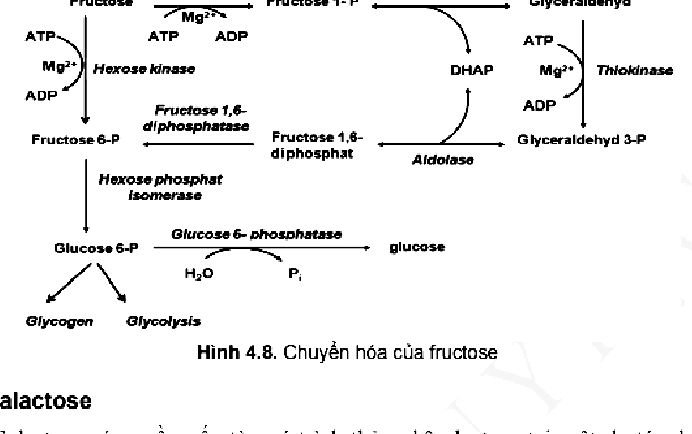
*Hình 4.8. Chuyển hóa của fructose ở gan và cơ*

#### 3.2. Galactose
Galactose có nguồn gốc từ quá trình thủy phân lactose tại ruột do tác dụng của enzym *lactase*. Galactose được hấp thu qua tĩnh mạch cửa đến gan và được chuyển hóa thành glucose tại đây:
- Trước hết galactose được phosphoryl hoá ở C1 bởi ATP thành galactose-1-phosphat nhờ *galactokinase*.
- Sau đó nhờ *galactose-1-phosphat uridyl transferase* chuyển nhóm uridylyl của UDP-glucose đến galactose-1-phosphat để thành glucose-1-phosphat (G1P) và UDP-galactose.
- *UDP-galactose-4-epimerase* chuyển UDP-galactose thành UDP-glucose (enzym này có sự tham gia của $\text{NAD}^+$ tham gia vào sự oxy hoá khử của C4 trong quá trình đồng phân hoá).
- G1P sẽ đồng phân hoá thành G6P để đi vào con đường đường phân nhờ *phosphoglucomutase*.

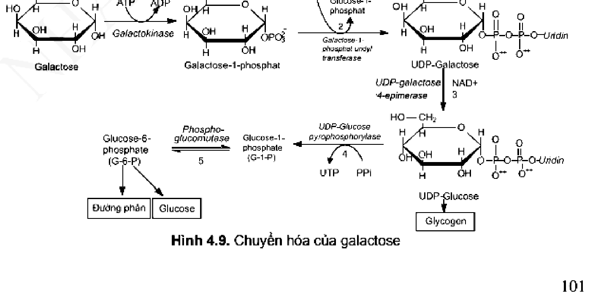
*Hình 4.9. Chuyển hóa của galactose thành G6P và tổng hợp glycogen*

---

## [Trang 102] - Chuyển hóa Mannose & Quá trình Tân tạo Glucose (Gluconeogenesis)

#### 3.3. Mannose
Mannose chuyển thành F6P trong con đường đường phân sau khi trải qua 2 phản ứng:
- Mannose chuyển thành mannose-6-phosphat dưới tác dụng của *hexokinase*.
- *Phosphomannose isomerase* đồng phân hoá mannose-6-phosphat thành fructose-6-phosphat.

---

### 4. CON ĐƯỜNG TÂN TẠO GLUCOSE

Sự tổng hợp glucose và glycogen từ những chất không phải carbohydrat được gọi là **quá trình tân tạo đường** (*gluconeogenesis*). Sự tổng hợp glucose xảy ra khi đói và khi cạn kiệt glycogen dự trữ. Chức năng này rất cần thiết đối với việc cung cấp glucose cho các mô, đặc biệt mô thần kinh. Cơ quan chủ yếu của sự tân tạo glucose là **gan** và khoảng **10% được tân tạo ở thận** (phần vỏ) và ruột.

#### 4.1. Tổng hợp glucose từ lactat
Các phản ứng tân tạo glucose gồm những phản ứng gần như ngược lại của con đường đường phân, trừ **3 enzym không xúc tác thuận nghịch** đó là *hexokinase*, *phosphofructokinase* và *pyruvat kinase*.

##### - Từ pyruvat thành PEP phải trải qua các phản ứng sau:
Trước hết pyruvat vào trong ty thể, dưới tác dụng của *pyruvat carboxylase* cần ATP để pyruvat chuyển thành oxaloacetat. Sau khi tạo thành malat, malat được chuyển ra bào tương nhờ con thoi malat-aspartat (chất vận chuyển dicarboxylat). Ở bào tương malat chuyển thành oxaloacetat rồi carboxyl hoá dưới tác dụng của *phosphoenol pyruvat carboxykinase* cần GTP tạo thành PEP.

$$\begin{aligned}
\text{Pyruvat} + \text{CO}_2 + \text{ATP} &\xrightarrow{\text{Pyruvat carboxylase (ty thể)}} \text{Oxaloacetat} + \text{ADP} + \text{Pi} \\
\text{Oxaloacetat} + \text{GTP} &\xrightarrow{\text{PEP carboxykinase (bào tương)}} \text{Phosphoenolpyruvat} + \text{GDP} + \text{CO}_2
\end{aligned}$$

---

## [Trang 103] - FBPase-1, G6Pase, Năng lượng tân tạo đường & Chu trình Cori

- **Phản ứng từ F1,6DP thành G6P** cần enzym *fructose-1,6-diphosphatase* (FBPase-1).
- **Phản ứng từ G6P thành glucose** cần sự xúc tác của *glucose-6-phosphatase*.

$$\begin{aligned}
\text{Fructose-1,6-bisphosphat} + \text{H}_2\text{O} &\xrightarrow{\text{Fructose-1,6-bisphosphatase}} \text{Fructose-6-phosphat} + \text{Pi} \\
\text{Glucose-6-phosphat} + \text{H}_2\text{O} &\xrightarrow{\text{Glucose-6-phosphatase}} \text{Glucose} + \text{Pi}
\end{aligned}$$

- **Năng lượng cần thiết để tổng hợp glucose từ pyruvat có thể viết như sau:**
$$2\text{ Pyruvat} + 2\text{ NADH} + 4\text{H}^+ + 4\text{ ATP} + 2\text{ GTP} + 6\text{ H}_2\text{O} \longrightarrow \text{Glucose} + 2\text{ NAD}^+ + 4\text{ ADP} + 2\text{ GDP} + 6\text{ Pi}$$
Trong khi đó chuyển hoá glucose thành pyruvat:
$$\text{Glucose} + 2\text{ NAD}^+ + 2\text{ ADP} + 2\text{ Pi} \longrightarrow 2\text{ Pyruvat} + 2\text{ NADH} + 4\text{H}^+ + 2\text{ ATP} + 2\text{ H}_2\text{O}$$
Như vậy, năng lượng tiêu tốn cho sự tổng hợp một phân tử glucose từ pyruvat là **4 ATP** (và 2 GTP, tổng cộng tương đương **6 liên kết phosphat giàu năng lượng**).

#### 4.2. Chu trình Cori
Cơ thường xảy ra quá trình thoái hóa glucose trong điều kiện yếm khí tạo sản phẩm là lactat. Lactat từ cơ được nhanh chóng chuyển qua máu về gan. Ở gan lactat là nguồn nguyên liệu để tổng hợp glucose theo con đường tân tạo glucose. Vòng vận chuyển và biến đổi này được gọi là **chu trình Cori**.

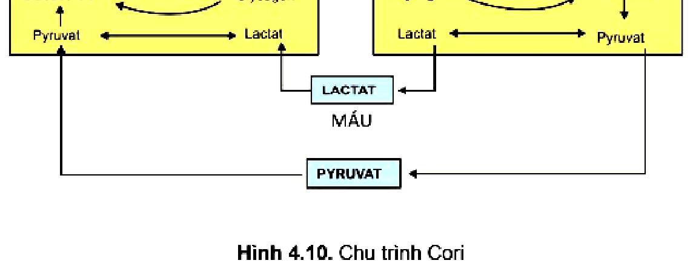
*Hình 4.10. Chu trình Cori (chu trình glucose - lactat giữa Gan và Cơ)*

---

## [Trang 104] - Chu trình Glucose - Alanin & Các điểm điều hòa Tân tạo đường

#### 4.3. Chu trình glucose-alanin
Trong nhiều tổ chức, trong đó có cơ, *alanin transaminase* chuyển đổi các acid cetonic thành acid amin. Thí dụ trong cơ, pyruvat chuyển thành alanin, alanin được vận chuyển trong máu đến gan, tại gan được chuyển thành pyruvat và được tổng hợp thành glucose theo con đường tân tạo. Glucose này lại được cung cấp trở lại các tổ chức trong đó có cơ. Quá trình vận chuyển và chuyển đổi này được gọi là chu trình Glucose – Alanin (Hình 4.11).

Gan là nơi duy nhất có khả năng tân tạo glucose từ các sản phẩm khác, từ các monosaccarid: fructose, galactose, mannose và từ các sản phẩm chuyển hóa trung gian.

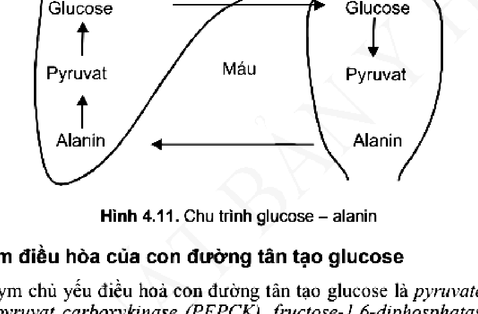
*Hình 4.11. Chu trình glucose – alanin*

#### 4.4. Các điểm điều hòa của con đường tân tạo glucose
Các enzym chủ yếu điều hoà con đường tân tạo glucose là *pyruvate carboxylase*, *phosphoenol pyruvat carboxykinase* (PEPCK), *fructose-1,6-diphosphatase* và *glucose-6-phosphatase*.
- **Chế độ ăn giàu carbohydrat** làm giảm tân tạo đường bằng cách tăng tỷ lệ insulin/glucagon và do đó làm giảm hoạt động của tất cả bốn enzym tân tạo đường chủ chốt ở trên.
- ***Glucose-6-phosphatase:*** enzym này được hoạt hóa bởi các hormon glucagon và glucocorticoid, được tiết ra trong suốt quá trình đói để tăng quá trình tân tạo đường. Enzym này bị ức chế bởi insulin.
- ***Fructose-1,6-diphosphatase:*** enzym này bị ức chế dị lập thể mạnh bởi AMP và Fructose-2,6-bisphosphat, được hoạt hóa bởi citrat. Do đó quá trình tân tạo đường tăng lên khi có sự gia tăng mức độ ATP và citrat. Ngược lại, quá trình tân tạo đường giảm do enzym bị ức chế khi các tế bào gan giàu AMP và nồng độ citrate thấp.
- ***Phosphoenol pyruvat carboxykinase:*** được hoạt hóa bởi glucagon khi đói gây tăng tân tạo glucose, bị ức chế bởi insulin.
- ***Pyruvat carboxylase:*** đây là enzym chủ chốt trong đường tân tạo glucose. Enzym được hoạt hóa dị lập thể bởi acetyl-CoA. Nó liên kết với vị trí dị lập thể của enzym, gây ra sự thay đổi cấu trúc bậc 3 của enzym làm tăng ái lực của enzym đối với $\text{CO}_2$.

---

## [Trang 105] - Mở đầu Chuyển hóa Glycogen & Glycogen Phosphorylase

### 5. CHUYỂN HÓA GLYCOGEN

Glycogen là dạng dự trữ của glucose trong cơ thể động vật, tập trung nhiều ở gan và cơ. Glycogen được dự trữ trong bào tương dưới dạng hạt, đường kính khoảng 100-400 Å. Những hạt này đều chứa những enzym của quá trình thoái hóa và tổng hợp glycogen. Cấu trúc mạch nhánh của glycogen có ý nghĩa sinh học đáng kể. Nó cho phép thoái hóa các mạch nhánh giải phóng nhanh chóng glucose (với số lượng lớn) và G6P. Trong cơ việc giải phóng nhanh chóng glucose (một chất sinh năng lượng bằng con đường đường phân) có ý nghĩa quan trọng khi cơ hoạt động. Trong gan việc thoái hóa glycogen cho phép gan nhanh chóng điều hoà nồng độ glucose bằng sự bài tiết glucose vào vòng tuần hoàn. Thực tế sự thoái hóa lipid cung cấp năng lượng và sự tổng hợp glucose là những quá trình quá chậm chạp để đảm bảo cung cấp năng lượng trong trường hợp nhu cầu cấp. Mặt khác thoái hóa lipid không xảy ra trong điều kiện yếm khí.

#### 5.1. Thoái hóa glycogen
Cơ và gan là nơi xảy ra quá trình thoái hóa glycogen. Ở cơ khi tế bào hoạt động cần ATP, glycogen được thoái hóa thành G6P cho con đường đường phân. Ở gan, khi nồng độ glucose trong máu giảm, glycogen thoái hóa thành G6P và trong trường hợp này được chuyển tiếp tục thành glucose để đưa vào vòng tuần hoàn điều hoà mức glucose máu.

Quá trình thoái hóa của glycogen nhờ hoạt động của 3 enzym:
- ***Glycogen phosphorylase*** (gọi đơn giản là *phosphorylase*) xúc tác quá trình phosphoryl (bẻ gãy liên kết 1-4 glucosid bằng sự thay thế nhóm phosphat) tạo thành glucose-1-phosphat (G1P). Enzym này tác dụng tới khi còn 4 gốc glucose từ điểm chia nhánh thì không hoạt động nữa.

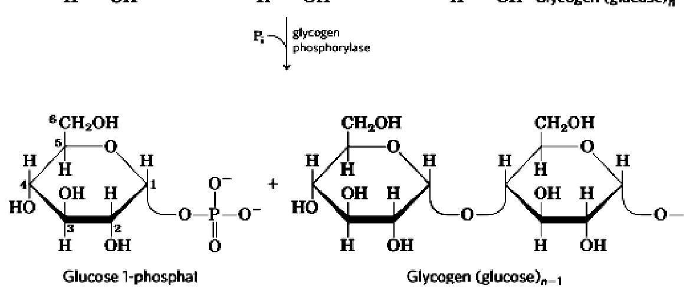
*Hình: Cơ chế cắt liên kết $\alpha\text{-1,4-glucosid}$ bằng phản ứng phosphoryl phân nhờ Glycogen phosphorylase tạo Glucose-1-phosphat*

<!-- END FILE: pages_096_105.md -->

<!-- BEGIN FILE: pages_106_115.md -->

# GIÁO TRÌNH HÓA SINH - ĐẠI HỌC Y HÀ NỘI
**Chủ biên:** GS. TS. BS. Tạ Thành Văn  
**Nguồn:** SGK Hóa sinh YHN 2019 (Nhà xuất bản Y học)

---

## [Trang 106] - Thoái hóa Glycogen: Enzym cắt nhánh & Tổng hợp Glycogen

Enzym cắt nhánh có 2 hoạt tính:
- **Hoạt tính chuyển nhánh** [oligo-($\alpha\ 1,4 \rightarrow \alpha\ 1,4$) *glucosyl transferase*]: thuỷ phân liên kết 1-4 glucosid giữa gốc thứ nhất và gốc thứ hai tính từ gốc nhánh, chuyển một đoạn 3 gốc glucose đến gắn vào đầu một chuỗi thẳng khác bằng cách tạo liên kết 1-4 glucosid, nhánh glycogen này được kéo dài thêm 3 gốc glucose, nhánh còn lại chỉ còn một gốc glucose với liên kết 1-6 glucosid.
- **Hoạt tính cắt nhánh** [amylo - $\alpha\ (1,6)$-*glucosidase*]: thuỷ phân liên kết 1-6 của gốc glucose còn lại giải phóng glucose tự do.

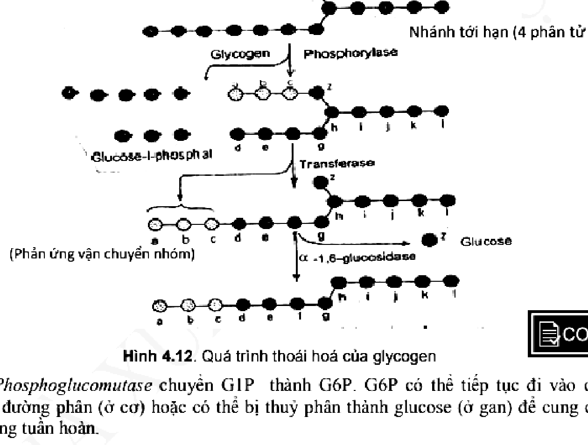
*Hình 4.12. Quá trình thoái hoá của glycogen: Tác dụng phối hợp giữa Phosphorylase và Enzym cắt nhánh (Transferase & $\alpha\text{-1,6-glucosidase}$)*

*Phosphoglucomutase* chuyển G1P thành G6P. G6P có thể tiếp tục đi vào con đường đường phân (ở cơ) hoặc có thể bị thuỷ phân thành glucose (ở gan) để cung cấp cho vòng tuần hoàn:
$$\text{Glucose-1-P} \xrightleftharpoons{\text{Phosphoglucomutase}} \text{Glucose-6-P}$$

Sau quá trình thoái hóa **khoảng 90% gốc glucose của glycogen chuyển thành G1P** và **10% chuyển thành glucose tự do** (tại các điểm phân nhánh 1-6).

---

### 5.2. Tổng hợp glycogen

Sự tổng hợp glycogen xảy ra thực tế ở tất cả các mô nhưng chủ yếu ở gan và cơ. Sự tạo thành glycogen xảy ra trong bào tương. Nguyên liệu để tổng hợp glycogen là glucose. Đầu tiên, glucose được phosphoryl hóa thành glucose-6-phosphat bằng

---

## [Trang 107] - Tạo UDP-Glucose & Kéo dài mạch Glycogen

*glucokinase* hoặc *hexokinase*. G6P chuyển thành G1P nhờ xúc tác của enzym *phosphoglucomutase*:

$$\begin{aligned}
\text{Glucose} + \text{ATP} &\xrightarrow[\text{Mg}^{2+}]{\text{Glucokinase / Hexokinase}} \text{Glucose-6-P} + \text{ADP} \\
\text{Glucose-6-P} &\underset{\text{Mg}^{2+}}{\overset{\text{Phosphoglucomutase}}{\rightleftharpoons}} \text{Glucose-1-P}
\end{aligned}$$

Từ G1P sự tổng hợp phân tử glycogen gồm 3 bước nhờ 3 enzym là: *UDP-glucose pyrophosphorylase*, *glycogen synthase* và *enzym gắn nhánh*.

Trước hết enzym *UDP-glucose pyrophosphorylase* xúc tác sự tạo thành phân tử UDP-glucose từ G1P và UTP. UDP-glucose là chất “năng lượng cao” cho phép chuyển phân tử glucose để gắn vào phân tử glycogen kéo dài phân tử này:
$$\text{Glucose-1-P} + \text{UTP} \xrightarrow{\text{UDP-Glc Pyrophosphorylase}} \text{UDP-Glc} + \text{PPi}$$

Sau đó *glycogen synthase* vận chuyển UDP-G đến nhóm C4-OH có sẵn ở đầu không khử của phân tử glycogen tạo thành liên kết 1-4 glucosid và giải phóng phân tử UDP.

---

## [Trang 108] - Cơ chế Glycogen Synthase & Tái tạo UTP

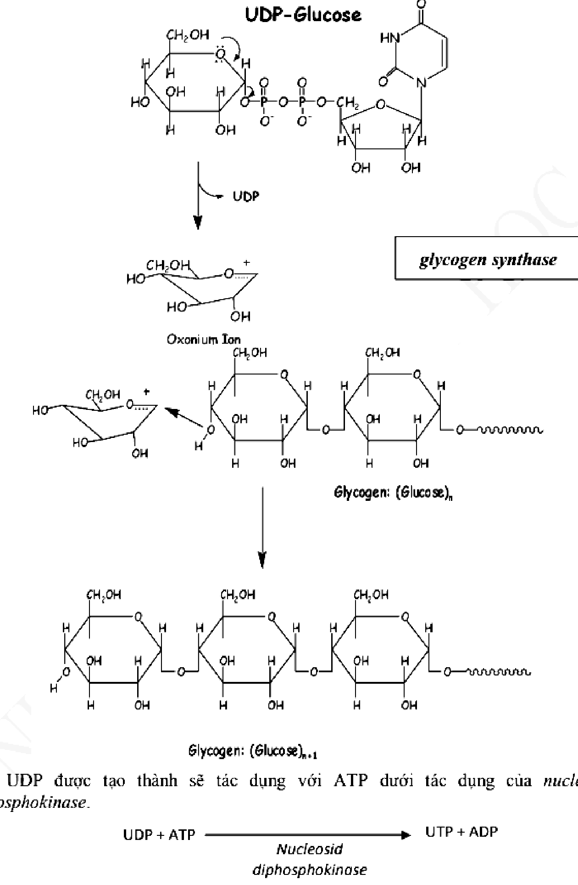
*Hình: Cơ chế phản ứng của Glycogen synthase gắn UDP-glucose vào đầu không khử của glycogen qua trung gian ion Oxonium*

UDP được tạo thành sẽ tác dụng với ATP dưới tác dụng của *nucleosid diphosphokinase* để tái tạo UTP:
$$\text{UDP} + \text{ATP} \xrightleftharpoons{\text{Nucleosid diphosphokinase}} \text{UTP} + \text{ADP}$$

---

## [Trang 109] - Protein mồi Glycogenin & Enzym tạo nhánh (Branching enzyme)

*Glycogen synthase* không có khả năng tổng hợp phân tử glycogen từ đầu mà chỉ có thể kéo dài mạch glycogen bằng liên kết 1-4.

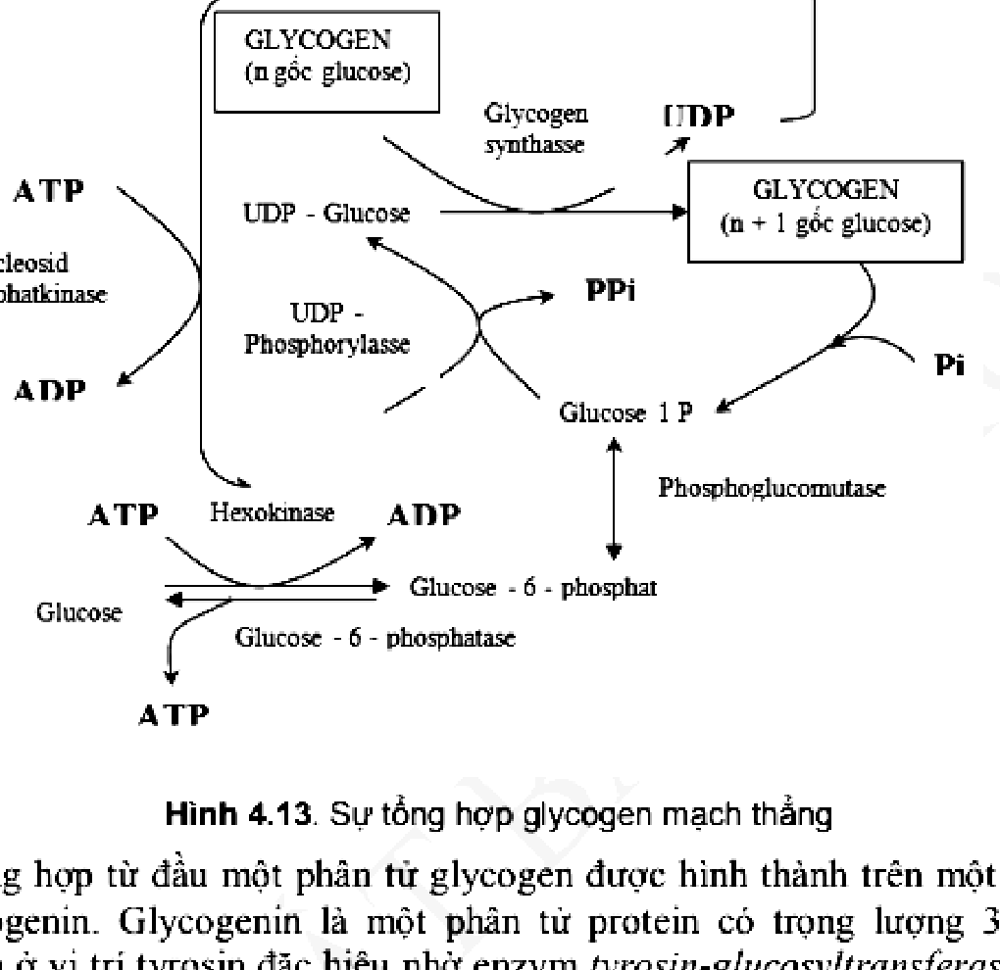
*Hình 4.13. Sự tổng hợp glycogen mạch thẳng*

Sự tổng hợp từ đầu một phân tử glycogen được hình thành trên một protein mồi gọi là **glycogenin**. Glycogenin là một phân tử protein có trọng lượng $37\text{ kDa}$, được glycosyl hóa ở vị trí tyrosin đặc hiệu nhờ enzym *tyrosin-glucosyltransferase*. Sau đó tự xúc tác kéo dài chuỗi bởi sự gắn thêm các gốc glucose từ UDP-glucose tạo thành đoạn mồi “primer”, cơ chất của enzym *glycogen synthase* mở đầu tổng hợp glycogen. Protein glycogenin tách rời khi hạt glycogen đạt kích thước tối thiểu ở gan, số lượng các phân tử glycogen nhiều hơn glycogenin. Tuy nhiên ở cơ, glycogenin tiếp tục gắn với phân tử glycogen ở trung tâm.

#### Sự tạo mạch nhánh:
Là sự tạo ra liên kết 1-6 glucosid dưới tác dụng của enzym gắn nhánh (*branching enzym*) gọi là **amylo-($\alpha\ 1,4 \rightarrow \alpha\ 1,6$) transglucosylase**. Khi chuỗi thẳng dài $\ge 11$ gốc glucose, enzym *amylo-(1,4$\rightarrow$1,6) transglucosylase* chuyển một đoạn gồm 6 hoặc 7 gốc glucose ở đầu không khử đến nhóm C6-OH của gốc glucose và mạch nhánh được hình thành. Mạch nhánh cũ và mới được tiếp tục kéo dài bằng sự tạo thành liên kết 1-4 glucosid.

---

## [Trang 110] - Sơ đồ tạo nhánh & Điều hòa Chuyển hóa Glycogen

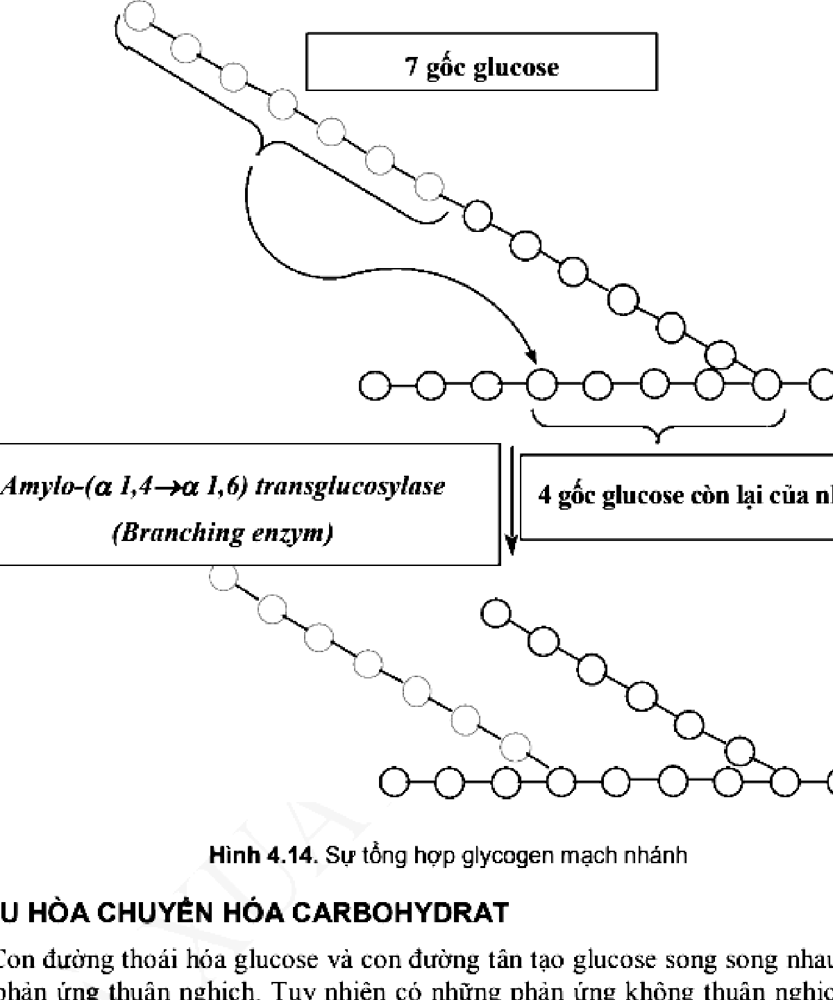
*Hình 4.14. Sự tổng hợp glycogen mạch nhánh nhờ Amylo-($\alpha\ 1,4 \rightarrow \alpha\ 1,6$) transglucosylase*

---

### 6. ĐIỀU HÒA CHUYỂN HÓA CARBOHYDRAT

Con đường thoái hóa glucose và con đường tân tạo glucose song song nhau và có nhiều phản ứng thuận nghịch. Tuy nhiên có những phản ứng không thuận nghịch giữa thoái hóa và tổng hợp đòi hỏi sự xúc tác bởi enzym khác nhau, chính những phản ứng này là những điểm điều hoà của hai con đường ngược nhau.

Ở cơ, sản phẩm cuối cùng của sự đường phân là sự sản sinh ATP và tốc độ đường phân tăng khi co cơ. Gan có vai trò giữ cho mức glucose máu hằng định bằng cách sản sinh glucose và đưa glucose vào máu khi cần thiết, ngược lại thu nhận và dự trữ glycogen khi được cung cấp dư thừa trong thức ăn. Con đường đường phân ở gan và cơ có 4 enzym đóng vai trò điều hoà: *glycogen phosphorylase*, *hexokinase*, *phosphofructokinase-1* và *pyruvat kinase*.

#### 6.1. Glycogen phosphorylase ở cơ được điều hoà theo cơ chế dị lập thể bởi hormon
Ở cơ epinephrin gắn vào chất nhận bề mặt màng bào tương, có tác dụng hoạt hóa *phosphorylase kinase b* qua cơ chế điều hoà dị lập thể của AMPv (adenylat cyclase xúc

---

## [Trang 111] - Thác Enzym điều hòa Glycogen & Bệnh lý Hạ đường huyết

tác sự tạo thành AMPv với sự có mặt của epinephrin). AMP hoạt hóa protein kinase phụ thuộc AMPv chuyển *phosphorylase kinase b* sang dạng hoạt động. *Phosphorylase kinase b* dạng hoạt động xúc tác phản ứng phosphoryl hóa *glycogen phosphorylase b* (dạng ít hoạt động) sang *glycogen phosphorylase a* (hoạt động).

#### 6.2. Glycogen phosphorylase ở gan được điều hoà bởi hormon
Ở gan *glycogen phosphorylase* được kiểm soát bởi glucagon theo cơ chế giống như ở cơ.

#### 6.3. Hexokinase bị ức chế dị lập thể bởi các sản phẩm của nó
*Hexokinase* bị ức chế dị lập thể bởi glucose-6-phosphat.

#### 6.4. Pyruvat kinase bị ức chế bởi ATP
Ở nồng độ cao của ATP, ATP ức chế dị lập thể *pyruvat kinase* bằng cách làm giảm ái lực của nó với cơ chất PEP.

#### 6.5. Phospho fructokinase –1 được điều hoà theo cơ chế dị lập thể
ATP ức chế *phospho fructokinase –1* bằng cách gắn vào vị trí dị lập thể làm giảm ái lực đối với cơ chất. Citrat làm tăng tác dụng ức chế của ATP. Fructose 2,6 diphosphat hoạt hóa *phospho fructokinase –1* và là một yếu tố điều hoà có ý nghĩa nhất đối với enzym này.

---

### 7. MỘT SỐ BỆNH LÝ RỐI LOẠN CHUYỂN HÓA CARBOHYDRAT

#### 7.1. Hạ đường huyết (hypoglycemia)
Hạ đường huyết là một hội chứng được đặc trưng bởi sự giảm nồng độ glucose máu, thường giảm dưới $50\text{ mg/dl}$ tương đương $2,8\text{ mmol/l}$. Merimee và Tyson đã đưa ra giới hạn thấp của nồng độ glucose trong huyết thanh là $35\text{ mg/dl}$ ($1,9\text{ mmol/l}$) ở phụ nữ khỏe mạnh trước tuổi mãn kinh nhịn ăn 24 giờ là khả năng thấp nhất của nồng độ glucose không bệnh lý. Hạ đường huyết có thể xảy ra do điều trị insulin quá liều, hoặc các thuốc hạ đường huyết khác hoặc bởi sự giảm tân tạo glucose do hậu quả của uống nhiều rượu. Cũng có thể xảy ra do nhịn ăn, hoặc hạ đường huyết tự phát. Trường hợp này ít gặp nhưng khi xảy ra thường do tổn thương nhiều cơ quan tổ chức.

Hạ đường huyết khi đói có thể xảy ra do sự bài tiết quá nhiều insulin của tuyến tụy: u tụy tế bào tiểu đảo (insulinomas), u ngoài tuyến tụy mà sản xuất ra những chất hoạt tính tương tự insulin, gặp trong các bệnh về gan, thiếu hụt glucocorticoid, nhiễm trùng huyết, giảm dự trữ glycogen.

Hội chứng hypoglycemia ở người lớn có thể phân biệt thành hai nhóm dựa trên sự hạ glucose trong huyết thanh xảy ra nhanh hay từ từ:
- Giảm glucose trong huyết thanh gây ra sự tăng tiết epinephrin, bệnh nhân có các triệu chứng gây ra bởi epinephrin như vã mồ hôi, đói, run lẩy bẩy, nôn mửa, mạch nhanh...

---

## [Trang 112] - Bệnh Beriberi & Các bệnh ứ đọng Glycogen bẩm sinh (GSD)

Giảm glucose huyết thanh từ từ tới nồng độ 20 hoặc $30\text{ mg/dl}$ ($1,1$ hoặc $1,7\text{ mmol/l}$) gây suy yếu chức năng thần kinh trung ương vì vỏ não phụ thuộc vào sự cung cấp đầy đủ glucose về mặt năng lượng. Người bệnh có các triệu chứng như: hoảng sợ, không có ý thức, thờ ơ. Não tổn thương, có thể chết sau hôn mê.

Trẻ em kém nhạy cảm với sự giảm nồng độ glucose, tuy nhiên nếu nồng độ $< 30\text{ mg/dl}$ ở tuổi học đường và giảm dưới $20\text{ mg/dl}$ ở tuổi trước học đường là không bình thường. Hiện tượng hypoglycemia còn gặp ở các bệnh ứ glycogen bẩm sinh như sẽ trình bày sau đây.

#### 7.2. Bệnh thiếu vitamin B1
Bệnh thiếu vitamin B1 (thiamin) còn được gọi là bệnh Beriberi. Bệnh lần đầu tiên được mô tả ở Java năm 1930, bởi Jacobus Bonitus (người Hà Lan). Bệnh xuất hiện khi có sự suy giảm thiamin trong thức ăn, (thiamin có rất ít ở lớp ngoài của gạo). Bệnh được đặc trưng bởi các triệu chứng thần kinh và tim. Với thần kinh ngoại biên thể hiện bằng sự đau tay chân, suy yếu hệ thống cơ, tê bì, rối loạn cảm giác da. Tim có thể to, hoạt động tim suy yếu. Vitamin B1 cấu tạo thiaminpyrophosphat (TPP), là coenzym của 3 enzym *pyruvat dehydrogenase*, *$\alpha$-cetoglutarat dehydrogenase* và các *transcetolase*. Ở bệnh Beriberi, pyruvat và $\alpha$-cetoglutarat cao hơn bình thường. Trên *in vitro* hoạt độ *pyruvat dehydrogenase*, *$\alpha$-cetoglutarat dehydrogenase* thấp, hoạt độ *transcetolase* trong hồng cầu thấp. Tuy nhiên, mức độ giảm của ba enzym này liên quan như thế nào với các triệu chứng lâm sàng là điều hiện còn chưa rõ ràng.

#### 7.3. Các bệnh ứ glycogen bẩm sinh (Glycogen Storage Diseases - GSD)
Các bệnh ứ glycogen là một tập hợp các bệnh thiếu hụt enzym của chuyển hóa glycogen, được chia làm 10 typ sau đây:

- **+ Typ I: thiếu hụt *glucose-6-phosphatase* (bệnh Von Gierke).**  
  *Glucose-6-phosphatase* là enzym xúc tác phản ứng tách glucose khỏi G6P từ gan vào vòng tuần hoàn. Khi nồng độ G6P tăng, *glycogen phosphorylase* bị ức chế và *glycogen synthase* được hoạt hoá, hậu quả là nồng độ glucose trong máu không tăng khi đáp ứng glucagon và epinephrin. Bệnh với biểu hiện: gan to, nồng độ glucose máu giảm trầm trọng, cấu trúc của glycogen bình thường nhưng nồng độ glycogen cao trong gan. Tăng cetonic và tăng lipid máu.
- **+ Typ II: thiếu hụt *$\alpha\text{-1,4-glucosidase}$* acid / Maltase acid (bệnh Pompe).**  
  Thiếu hụt $\alpha\text{-1,4-glucosidase}$ gây hậu quả tích luỹ lượng lớn glycogen có cấu trúc bình thường trong lysosom của tất cả các tế bào, người bệnh chết do suy tim, suy hô hấp, thường không sống được quá 1 tuổi.
- **+ Typ III: thiếu hụt *amylo-1,6-glucosidase* – enzym cắt nhánh (bệnh Cori).**  
  Thiếu hụt *amylo-1,6-glucosidase* ở tất cả các tổ chức làm cho cấu trúc của glycogen không bình thường (nhánh rất ngắn), không có amylo-1,6-glucosidase, glycogen không thể thoái hóa hoàn toàn gây tình trạng hạ glucose máu, nhưng không trầm trọng như bệnh

---

## [Trang 113] - Các typ GSD IV-X, Bệnh Galactose máu & Fructose niệu

typ I. Trong trường hợp này điều trị bằng chế độ ăn với nồng độ cao protein. Bệnh có thể hết ở tuổi dậy thì.
- **+ Typ IV: thiếu hụt *amylo-(1,4$\rightarrow$1,6)-transglycosylase* / Enzym tạo nhánh (bệnh Andersen).**  
  Đây là một bệnh trầm trọng về sự tổng hợp glycogen, người bệnh có nguy cơ không sống quá 2 tuổi do sự hoạt động không bình thường của gan, gan to, xơ gan. Nồng độ glycogen trong gan không tăng nhưng cấu trúc không bình thường, ít nhánh và nhánh rất dài (giống amylose).
- **+ Typ V: thiếu hụt *glycogen phosphorylase* cơ (bệnh McArdle).**  
  Ứ đọng glycogen trong cơ nhưng cấu trúc glycogen bình thường, người bệnh có biểu hiện chuột rút khi luyện tập. Đau cơ, myoglobin niệu. Có bệnh nhân vẫn phát triển bình thường.
- **+ Typ VI: thiếu hụt *glycogen phosphorylase* gan (bệnh Hers).**  
  Người bệnh có hội chứng giống như bệnh typ I nhưng diễn biến nhẹ nhàng, với biểu hiện hạ glucose máu, ứ glycogen trong gan, cấu trúc glycogen bình thường.
- **+ Typ VII: thiếu hụt *phosphofructokinase* cơ (bệnh Tarui).**  
  Ứ đọng glycogen trong cơ, nhưng cấu trúc glycogen bình thường, người bệnh có biểu hiện chuột rút khi luyện tập, một số bệnh nhân có myoglobin niệu.
- **+ Typ VIII: thiếu hụt *adenyl cyclase*.**  
  Nồng độ catecholamin cao trong nước tiểu, bệnh nhân chết từ tuổi ấu thơ. Bệnh có biểu hiện như bệnh typ VI.
- **+ Typ IX: thiếu hụt *phosphorylase b kinase*.**  
  Cấu trúc glycogen bình thường, lượng glycogen trong gan tăng, khối lượng gan tăng.
- **+ Typ X: thiếu *kinase phụ thuộc AMPv*.**  
  Bệnh chỉ thể hiện khối lượng gan tăng.

#### 7.4. Bệnh galactose máu bẩm sinh (Galactosemia)
Bệnh gây ra do thiếu một trong ba enzym chuyển hóa galactose là: *galactokinase*, *galactose-1-phosphat uridyl transferase* và *uridin diphosphat glucose - 4 - epimerase* bẩm sinh. Bệnh kinh điển là thiếu *galactose - 1 - phosphat uridyl transferase*. Trẻ em bị bệnh này sẽ còi cọc, thường bị nôn mửa và tiêu chảy sau khi ăn sữa, chậm phát triển trí óc, có galactose niệu, galactose máu tăng gây đục thuỷ tinh thể (do tích tụ galactitol). Bệnh được điều trị bằng chế độ ăn không có sữa.

#### 7.5. Bệnh chuyển hóa fructose
Bệnh biểu hiện bằng sự không dung nạp fructose, hạ glucose máu, tình trạng nặng có nhiễm acid lactic, gan to, nguyên nhân do thiếu enzym *fructose-1-phosphat aldolase* (Aldolase B) hoặc *fructose 1,6 diphosphatase*. Trường hợp nhẹ hơn là do thiếu hụt *fructokinase* gan (fructose niệu vô căn).

---

## [Trang 114] - Bệnh Đái tháo đường: Rối loạn chuyển hóa & ĐTĐ Typ 1

### 7.6. Bệnh đái tháo đường

Bệnh đái tháo đường (ĐTĐ) còn gọi là bệnh tiểu đường. Bệnh được xem như một hội chứng bao gồm nhiều rối loạn mà sự tăng glucose máu là dấu hiệu đặc trưng. Trong bệnh ĐTĐ, mức độ giảm insulin về số lượng và chất lượng là nguyên nhân gây tình trạng thay đổi các con đường chuyển hóa bình thường. Vì thiếu insulin nên sự hấp thu glucose vào trong tế bào nhờ GLUT 4 giảm, dẫn đến nồng độ glucose trong máu tăng cao, glucose sẽ đào thải ra ngoài nước tiểu. Kèm theo glucose, nước cũng bị đào thải theo. Vì vậy những bệnh nhân ĐTĐ không được điều trị sẽ có các triệu chứng khát và đói. Sự đào thải nhiều glucose làm cạn kiệt dự trữ glucid, do đó cơ thể tăng cường thoái hóa các chất lipid và protein để cung cấp năng lượng cho cơ thể, hậu quả trọng lượng cơ thể giảm. Có thể đưa ra biểu hiện điển hình của bệnh ĐTĐ là: **đái nhiều, uống nhiều, ăn nhiều nhưng gầy nhiều** (4 nhiều). Con đường đường phân bị hạn chế. Sự phân ly glycogen thành glucose tăng, và con đường tổng hợp glucose từ các sản phẩm không phải glucid tăng. Các quá trình này gây sự tăng sản phẩm pyruvat và acetyl CoA. Acetyl CoA này không vào được chu trình acid citric, mà chuyển hóa thành cholesterol và các chất ceton bao gồm acid acetoacetic, acid $\beta$ hydroxybutyric và aceton. Trong máu nồng độ các chất ceton tăng cao và trong nước tiểu có các chất ceton, hậu quả cuối cùng có thể dẫn đến nhiễm acid chuyển hoá (toan ceton).

#### + Các rối loạn chuyển hóa trong bệnh ĐTĐ:
- **Hiện tượng glycosyl hóa:** glycosyl hóa là các phân tử protein và enzym trong máu hoặc trong tổ chức gắn với phân tử glucose và các dẫn xuất của glucose, phản ứng kết hợp này không cần enzym mà phụ thuộc vào nồng độ glucose trong máu.
  + Trong huyết thanh albumin bị glycosyl hóa thành **fructosamin**.
  + Trong hồng cầu hemoglobin A (HbA), bị glycosyl hóa tạo thành **$\text{HbA}_{1c}$**.
  + Người ta định lượng fructosamin và $\text{HbA}_{1c}$ để theo dõi bệnh ĐTĐ trong quá trình điều trị ($\text{HbA}_{1c}$ phản ánh nồng độ đường huyết trung bình trong 2-3 tháng trước đó).
- **Hiện tượng gluco - oxy hóa:** trong phản ứng glycosyl hóa có kèm theo phản ứng oxy hóa tạo các gốc tự do, mở đầu một dây truyền sản sinh các gốc tự do nhiều gấp bội. Gốc tự do là một trong các nguyên nhân biến chứng mạch máu ở bệnh ĐTĐ.
- **Tăng chuyển hóa glucose theo con đường polyol:** glucose chuyển hóa theo con đường đường phân kém, glucose chuyển hóa theo con đường polyol, gây tăng nồng độ sorbitol và fructose trong tế bào. Nồng độ sorbitol và fructose tăng trong thủy tinh thể là nguyên nhân của đục thủy tinh thể trong ĐTĐ.

#### Theo phân loại của Tổ chức Y tế thế giới, hai loại ĐTĐ chính là:

##### - Đái tháo đường lệ thuộc insulin (IDDM) hay ĐTĐ typ 1:
Là bệnh tự miễn, được đặc trưng bởi sự phá huỷ tế bào $\beta$ của tuyến tụy nên không sản xuất đủ insulin. Những người có nguy cơ phát triển thành bệnh ĐTĐ trong huyết thanh có kháng thể kháng tế bào đảo, kháng thể kháng insulin và kháng *glutamic acid decarboxylase* (GAD). GAD là enzym xúc tác sự chuyển acid glutamic thành acid amino butyric được xem là một tự kháng thể (auto antigen) của bệnh. ĐTĐ typ 1 chiếm khoảng 5-10% các trường hợp ĐTĐ, được đặc trưng bởi:

---

## [Trang 115] - ĐTĐ Typ 2 & Câu hỏi ôn tập Chương 4

+ Sự thiếu hụt tuyệt đối hoặc gần như tuyệt đối insulin.
+ Sự xuất hiện những triệu chứng trầm trọng.
+ Khả năng xuất hiện thể ceton niệu.
+ Phụ thuộc vào insulin ngoại sinh để đảm bảo đời sống.

##### - Đái tháo đường không lệ thuộc insulin (NIDDM) hay ĐTĐ typ 2:
Chiếm 85% các trường hợp ĐTĐ ở các nước phát triển và gần như 100% ở những nước đang phát triển. ĐTĐ typ 2 là một rối loạn chuyển hóa trong một thời gian dài, được đặc trưng bởi:
+ Nồng độ insulin trong máu bình thường hoặc tăng (kháng insulin).
+ Các triệu chứng thường ôn hoà (mệt mỏi, khát nước) đôi khi không có triệu chứng.
+ Không có khả năng xuất hiện thể ceton niệu (trừ khi có stress cấp tính).
+ Người bệnh không phụ thuộc insulin ngoại sinh để duy trì sự sống.
+ Bệnh thường được chẩn đoán sau tuổi 40, thường được chẩn đoán một cách ngẫu nhiên sau kết quả xét nghiệm glucose máu và glucose niệu. Bệnh cũng gặp ở người trẻ.

ĐTĐ là bệnh mạn tính dẫn đến những biến chứng trầm trọng về các bệnh tim mạch (hơn 70% bệnh nhân ĐTĐ có tỷ lệ tử vong do bệnh tim mạch), bệnh thận, thần kinh, võng mạc.

---

### CÂU HỎI ÔN TẬP CHƯƠNG 4
1. Trình bày quá trình thoái hóa từ glucose đến lactat: nơi xảy ra, các phản ứng và năng lượng được tạo thành.
2. Trình bày sự thoái hóa glucose trong điều kiện ái khí (có oxy) đến sản phẩm cuối cùng là $\text{CO}_2$ và $\text{H}_2\text{O}$: nơi xảy ra, các phản ứng từ glucose đến pyruvat, tính toàn bộ năng lượng tạo thành.
3. Trình bày chu trình pentose phosphat (chú ý viết các phản ứng trong giai đoạn 1), ý nghĩa của chu trình này.
4. Trình bày quá trình thoái hóa của các monosaccarid: galactose, fructose, mannose.
5. Trình bày quá trình tân tạo glucose.
6. Trình bày quá trình thoái hóa glycogen.
7. Trình bày quá trình tổng hợp glycogen ở cơ, sự khác nhau giữa tổng hợp glycogen ở gan và cơ.
8. Trình bày một số bệnh lý có rối loạn chuyển hóa carbohydrat.

<!-- END FILE: pages_106_115.md -->

<!-- BEGIN FILE: pages_116_125.md -->

# GIÁO TRÌNH HÓA SINH - ĐẠI HỌC Y HÀ NỘI
**Chủ biên:** GS. TS. BS. Tạ Thành Văn  
**Nguồn:** SGK Hóa sinh YHN 2019 (Nhà xuất bản Y học)

---