# CHƯƠNG 5: HÓA HỌC LIPID

## [Trang 116] - Mục tiêu học tập, Mở đầu & Thành phần cấu tạo của Lipid

### MỤC TIÊU HỌC TẬP
1. Trình bày được định nghĩa và đặc điểm các thành phần cấu tạo chính của lipid.
2. Trình bày được phân loại lipid theo cấu tạo hoá học và công thức cấu tạo của mỗi loại.

---

### MỞ ĐẦU
Cũng như glucid và protein, lipid là thành phần cơ bản của sinh vật. Trong cơ thể, lipid cấu tạo nên màng tế bào và màng bào quan, cùng với protein đóng góp nhiều thành phần quan trọng trong tế bào. Lipid cấu tạo nên lớp mỡ dưới da và lớp mỡ bao quanh một số cơ quan có tác dụng bảo vệ cho cơ thể và các cơ quan.

Lipid có giá trị cao về mặt năng lượng ($1\text{ g}$ lipid cung cấp $9{,}3\text{ kcal}$, trong khi $1\text{ g}$ glucid cung cấp $4{,}1\text{ kcal}$, $1\text{ g}$ protein cung cấp $4{,}2\text{ kcal}$); lipid chứa nhiều loại vitamin tan trong dầu (như vitamin A, D, E, K) và nhiều loại acid béo không bão hòa rất cần thiết mà cơ thể không tổng hợp được.

Về cấu tạo hoá học, hầu hết các loại lipid đều có acid béo và alcol. Trong thành phần cấu tạo, lipid không có hoặc có rất ít các nhóm ưa nước như $-\text{OH}$, $-\text{NH}_2$, $-\text{COOH}$ và có rất nhiều các nhóm kỵ nước; bởi vậy, lipid không hoặc rất ít tan trong nước nhưng tan nhiều trong dung môi có độ phân cực thấp như các dung môi hữu cơ (ether, benzen, chloroform...).

Trong ngôn ngữ thông thường, lipid được gọi là chất béo và bao gồm dầu, mỡ, sáp. Tại nhiệt độ thường, mỡ và sáp ở thể đặc và dầu ở thể lỏng. Trong chương này sẽ trình bày thành phần cấu tạo, phân loại và tính chất của lipid tham gia cấu tạo và chuyển hóa trong cơ thể con người.

---

### 1. THÀNH PHẦN CẤU TẠO CỦA LIPID
Lipid là những este hoặc amid của acid béo với alcol hoặc aminoalcol.

#### 1.1. Acid béo
Acid béo là những acid carboxylic với chuỗi hydrocarbon chứa $4 - 36\text{ carbon}$. Acid béo chia làm 2 nhóm chính: acid béo bão hòa và acid béo không bão hòa. Một số acid béo có nhánh hoặc không có nhánh, hoặc vòng, hoặc chứa nhóm chức hydroxyl.

Theo quy ước quốc tế, acid béo được gọi tên theo tên của chuỗi hydrocarbon có cùng số lượng nguyên tử carbon và thêm đuôi *-oic*, ví dụ: chuỗi hydrocarbon có 8 nguyên tử carbon có tên là octan thì acid béo tương ứng được gọi là acid octanoic (acid caprylic), chuỗi hydrocarbon có 18 nguyên tử carbon và một liên kết đôi có tên là octadecen thì acid béo tương ứng được gọi là acid octadecenoic (acid oleic). Nguyên tử carbon của nhóm carboxyl được dùng làm mốc và mang số 1, nguyên tử carbon số 2 được gọi là carbon $\alpha$, nguyên tử carbon số 3 được gọi là carbon $\beta$,... và nguyên tử carbon của nhóm metyl tận cùng được gọi là carbon $\omega$. Ngoài ra, người ta còn dùng các ký hiệu để chỉ số lượng và vị trí của liên kết đôi trong phân tử acid béo: acid oleic có 18 carbon, 1 liên kết đôi giữa carbon số 9 và số 10, có thể ký hiệu là $18:1; 9$ hay $18:1\ (\Delta^9)$; acid linoleic có 18 carbon, 2 liên kết đôi giữa carbon số 9 - số 10 và giữa carbon số 12 - số 13, ký hiệu là $18:2; 9,12$ hay $18:2\ (\Delta^{9,12})$; acid palmitic có 16 carbon và không có liên kết đôi, ký hiệu là $16:0$.

---

## [Trang 117] - Acid béo bão hòa & Phân loại

#### Acid béo bão hoà
Acid béo bão hòa là acid béo có chuỗi hydrocarbon không chứa liên kết đôi, liên kết ba với công thức tổng quát là $\text{C}_n\text{H}_{2n+1}\text{COOH}$.

##### Bảng 5.1. Một số acid béo bão hoà thường gặp

| Tên acid | Công thức | Tên hệ thống | Độ nóng chảy ($^\circ\text{C}$) | Có trong thiên nhiên |
| :--- | :--- | :--- | :---: | :--- |
| **A. acetic** | $\text{CH}_3\text{COOH}$ | Acid n-etanoic | | |
| **A. butyric** | $\text{CH}_3(\text{CH}_2)_2\text{COOH}$ | Acid n-butanoic | $-7{,}9$ | Bơ sữa bò, dê |
| **A. caproic** | $\text{CH}_3(\text{CH}_2)_4\text{COOH}$ | Acid n-hexanoic | $-3{,}9$ | |
| **A. lauric** | $\text{CH}_3(\text{CH}_2)_{10}\text{COOH}$ | Acid n-dodecanoic | $+44{,}2$ | Dầu dừa |
| **A. myristic** | $\text{CH}_3(\text{CH}_2)_{12}\text{COOH}$ | Acid n-tetradecanoic | $+53{,}9$ | |
| **A. palmitic** | $\text{CH}_3(\text{CH}_2)_{14}\text{COOH}$ | Acid n-hexadecanoic | $+63{,}1$ | Mỡ động vật và dầu thực vật |
| **A. stearic** | $\text{CH}_3(\text{CH}_2)_{16}\text{COOH}$ | Acid n-octadecanoic | $+69{,}6$ | |
| **A. arachidic** | $\text{CH}_3(\text{CH}_2)_{18}\text{COOH}$ | Acid n-eicosanoic | $+76{,}5$ | Dầu lạc, sáp động vật và thực vật |
| **A. lignoceric** | $\text{CH}_3(\text{CH}_2)_{22}\text{COOH}$ | Acid tetracosanoic | $+86{,}0$ | |

Ngoài acid béo nêu trên, trong tự nhiên còn nhiều acid béo bão hòa có nhánh hoặc có số carbon nhiều hơn.

#### 1.1.2. Acid béo không bão hoà
Là những acid béo mạch thẳng (đôi khi có nhánh), trong phân tử có ít nhất một liên kết đôi hoặc liên kết ba, thường ở dạng đồng phân *cis*, được chia thành nhiều loại tuỳ theo mức độ không bão hoà.

---

## [Trang 118] - Acid béo không bão hòa, Acid mang chức alcol & Acid có vòng

##### Bảng 5.2. Một số acid béo không bão hoà thường gặp

| Tên acid | Khung carbon | Công thức cấu tạo | Điểm nóng chảy ($^\circ\text{C}$) |
| :--- | :---: | :--- | :---: |
| **A. palmitoleic** | $16:1\ (\Delta^9)$ | $\text{CH}_3(\text{CH}_2)_5\text{CH}=\text{CH}(\text{CH}_2)_7\text{COOH}$ | $-0{,}5$ |
| **A. oleic** | $18:1\ (\Delta^9)$ | $\text{CH}_3(\text{CH}_2)_7\text{CH}=\text{CH}(\text{CH}_2)_7\text{COOH}$ | $13{,}4$ |
| **A. linoleic** | $18:2\ (\Delta^{9,12})$ | $\text{CH}_3(\text{CH}_2)_4\text{CH}=\text{CH}\text{CH}_2\text{CH}=\text{CH}(\text{CH}_2)_7\text{COOH}$ | $-5$ |
| **A. linolenic** | $18:3\ (\Delta^{9,12,15})$ | $\text{CH}_3\text{CH}_2\text{CH}=\text{CH}\text{CH}_2\text{CH}=\text{CH}\text{CH}_2\text{CH}=\text{CH}(\text{CH}_2)_7\text{COOH}$ | $-11$ |
| **A. arachidonic** | $20:4\ (\Delta^{5,8,11,14})$ | $\text{CH}_3(\text{CH}_2)_4\text{CH}=\text{CH}\text{CH}_2\text{CH}=\text{CH}\text{CH}_2\text{CH}=\text{CH}\text{CH}_2\text{CH}=\text{CH}(\text{CH}_2)_3\text{COOH}$ | $-49{,}5$ |

- **Acid béo có một liên kết đôi (*monounsaturated fatty acid*):** công thức tổng quát là $\text{C}_n\text{H}_{2n-1}\text{COOH}$. Acid oleic là acid béo không bão hoà rất phổ biến; có trong tất cả dầu và mỡ động vật, thực vật như mỡ dự trữ của bò và lợn ($40\%$), dầu olive ($80\%$).
- **Acid béo có nhiều liên kết đôi (*polyunsaturated fatty acid*):**
  - Loại có hai liên kết đôi: công thức tổng quát là $\text{C}_n\text{H}_{2n-3}\text{COOH}$; ví dụ như acid linoleic có trong nhiều loại hạt có dầu như hạt ngũ cốc, hạt lạc, hạt bông và hạt đậu nành.
  - Loại có ba liên kết đôi: công thức tổng quát là $\text{C}_n\text{H}_{2n-5}\text{COOH}$; ví dụ như acid linolenic thường có mặt cùng với acid linoleic nhưng đặc biệt có trong dầu lanh.
  - Loại có bốn liên kết đôi: công thức tổng quát là $\text{C}_n\text{H}_{2n-7}\text{COOH}$; ví dụ như acid arachidonic, thấy chủ yếu trong dầu lạc.

Một số acid béo không bão hoà rất cần thiết cho cơ thể nhưng cơ thể không thể tự tổng hợp được, phải đưa từ ngoài vào, ví dụ: acid linoleic, acid linolenic,...

#### 1.1.3. Acid béo mang chức alcol
Acid cerebronic có trong lipid tạp của não:

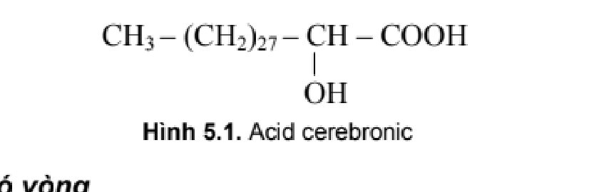  
*Hình 5.1. Acid cerebronic*

$$\text{CH}_3 - (\text{CH}_2)_{21} - \underset{\substack{|\\\text{OH}}}{\text{CH}} - \text{COOH}$$
*(Ghi chú: Trong cấu trúc Hình 5.1 in chuỗi dài là $(\text{CH}_2)_{21}$ hoặc $(\text{CH}_2)_{27}$, tương ứng với acid cerebronic chứa 24C).*

#### 1.1.4. Acid béo có vòng
Acid prostanoic là acid có vòng 5 cạnh với 20 carbon và mang 2 chuỗi thẳng. Acid prostanoic có dẫn xuất là prostaglandin, một nhóm hợp chất có tầm quan trọng về mặt dược lý và hoá sinh.

---

## [Trang 119] - Prostaglandin & Đồng phân hình học của Acid béo không no

Trong cơ thể, prostaglandin được tổng hợp từ acid arachidonic, ví dụ: prostaglandin $\text{E}_2$ ($\text{PGE}_2$).

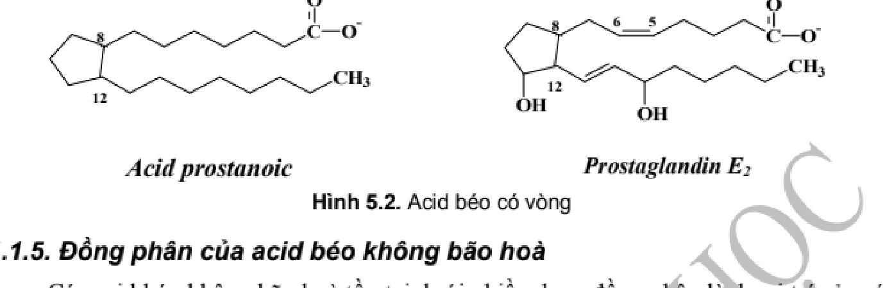  
*Hình 5.2. Acid béo có vòng (Acid prostanoic và Prostaglandin $\text{E}_2$)*

#### 1.1.5. Đồng phân của acid béo không bão hoà
Các acid béo không bão hoà tồn tại dưới nhiều dạng đồng phân là do vị trí của các liên kết đôi trong chuỗi carbon của acid béo tạo ra. Đồng phân hình học của acid béo không bão hoà là do phương hướng của các gốc hydrocarbon ở xung quanh trục của liên kết đôi quyết định, nếu những gốc này ở về cùng một phía của liên kết đôi thì acid béo được gọi là dạng *"cis"*, nếu những gốc đó ở những hướng trái ngược nhau thì acid béo được gọi là dạng *"trans"*. Những acid béo không bão hoà chuỗi dài thường gặp trong tự nhiên hầu như đều thuộc dạng cis và phân tử bị uốn cong ở vị trí liên kết đôi.

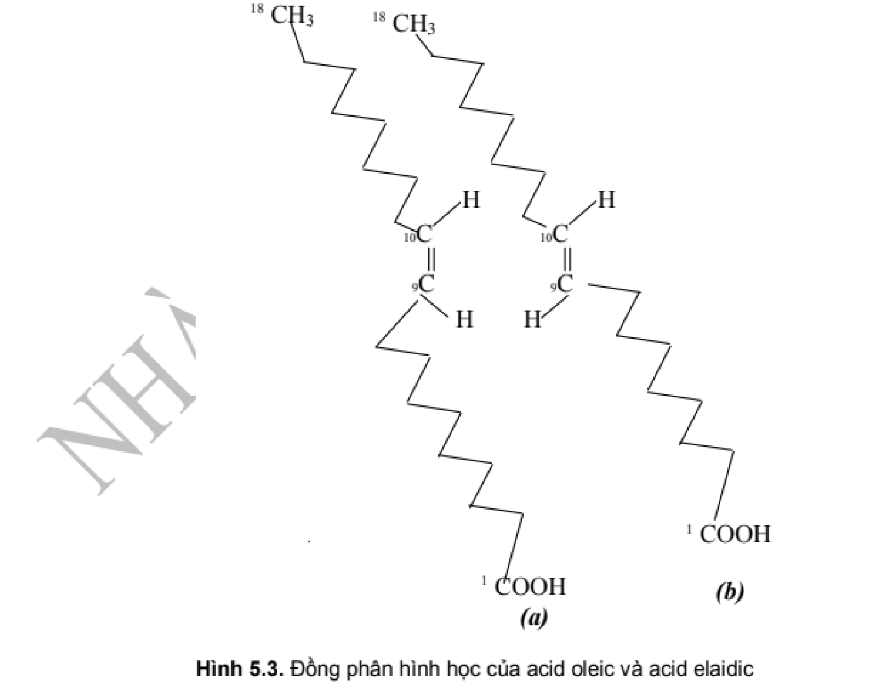  
*Hình 5.3. Đồng phân hình học của acid oleic và acid elaidic: (a) acid oleic (cis); (b) acid elaidic (trans)*

- **Dạng cis (acid oleic):** Hai đoạn mạch hydrocarbon uốn cong cùng phía quanh liên kết đôi $\text{C}_9=\text{C}_{10}$, làm phân tử gập khúc linh hoạt, khó xếp chặt nên có nhiệt độ nóng chảy thấp ($13{,}4^\circ\text{C}$, ở thể lỏng ở thân nhiệt).
- **Dạng trans (acid elaidic):** Hai đoạn mạch hydrocarbon duỗi thẳng về hai phía đối diện, phân tử thẳng tương tự acid bão hòa nên có nhiệt độ nóng chảy cao hơn nhiều ($+44^\circ\text{C}$).

---

## [Trang 120] - Tính chất của Acid béo & Alcol của Lipid (Glycerol)

#### 1.1.6. Tính chất của acid béo
Tính chất hóa học của acid béo phụ thuộc vào hai thông số: nhóm carboxyl và liên kết đôi. Chuỗi carbon không có tính chất hóa học gì đặc biệt.

##### - Tính chất hóa học của nhóm carboxyl:
- **Sự tạo thành muối:** acid béo tác dụng với hydroxyd kim loại kiềm ($\text{NaOH}$ hoặc $\text{KOH}$) tạo thành muối kiềm của acid béo hay xà phòng. Xà phòng tan trong nước và có tính chất tạo bọt. Muối của acid béo với kim loại khác như $\text{Ca}$, $\text{Mg}$, $\text{Zn}$ thì không tan trong nước. Người ta ứng dụng tính chất này để đo độ cứng của nước.
- **Sự tạo thành este:** acid béo tác dụng với alcol xúc tác bởi acid vô cơ sẽ tạo ra sản phẩm este.

##### - Tính chất hóa học do sự có mặt của liên kết đôi:
- **Phản ứng cộng:** acid béo không no tác dụng với halogen (Iod) tạo ra dẫn xuất chứa halogen của acid béo và mất đi liên kết đôi. Phản ứng này được ứng dụng xác định **chỉ số iod** của dầu mỡ (lượng iod gắn vào $100\text{ g}$ chất béo). Chỉ số iod càng cao thì số liên kết đôi trong dầu mỡ càng nhiều.
- **Phản ứng khử:** khi có mặt của chất xúc tác, acid béo không no được khử thành aldehyd. Ở ngoài không khí, quá trình này tạo ra mùi khét đặc biệt nhờ được hoạt hóa bởi chất xúc tác hữu cơ (peroxid) hoặc chất xúc tác sinh học (lipoxydase). Các chất chống oxy hóa (*antioxydant*) có thể ngăn ngừa sự tự oxy hóa này của acid béo không bão hòa.

---

### 1.2. Alcol của lipid
Alcol trong phân tử lipid gồm glycerol, alcol bậc cao, aminoalcol, sterol. Trong các chất béo còn gặp những alcol không no, một số alcol này là những chất màu quan trọng, ví dụ: phytol - một cấu tử của chlorophyll và lycophyl - là một hydroxy alcol chưa no có nhiều liên kết đôi, có màu đỏ tía chứa trong cà chua.

#### 1.2.1. Glycerol
Là một trialcol (có 3 nhóm chức alcol), tham gia trong thành phần của glycerid và phosphatid. Vị trí các nguyên tử carbon trong phân tử glycerol được ghi bằng chữ số 1, 2, 3 hoặc ký hiệu $\alpha$, $\beta$, $\alpha'$.

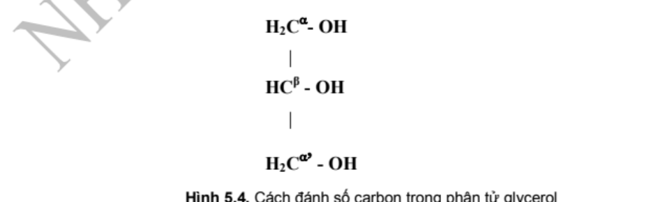  
*Hình 5.4. Cách đánh số carbon trong phân tử glycerol*

$$\begin{matrix}
\text{H}_2\text{C}^\alpha - \text{OH} \quad (\text{C}_1) \\
| \qquad\qquad\quad \\
\text{HC}^\beta - \text{OH} \quad (\text{C}_2) \\
| \qquad\qquad\quad \\
\text{H}_2\text{C}^{\alpha'} - \text{OH} \quad (\text{C}_3)
\end{matrix}$$

---

## [Trang 121] - Alcol cao phân tử, Aminoalcol & Sterol

#### 1.2.2. Alcol cao phân tử
Tham gia trong thành phần các chất sáp, ví dụ: alcol cetylic $\text{C}_{16}\text{H}_{33}\text{OH}$, alcol n-hexacosanol $\text{CH}_3(\text{CH}_2)_{24}\text{CH}_2\text{OH}$, alcol n-octacosanol $\text{CH}_3(\text{CH}_2)_{26}\text{CH}_2\text{OH}$,...

#### 1.2.3. Aminoalcol
Tham gia trong thành phần của cerebrosid và một số phosphatid. Các aminoalcol thường gặp là sphingosin, cholin (ethanolamin trimethylamin), ethanolamin (cholamin), serin, cerebrin (có trong nấm men, hạt ngô).

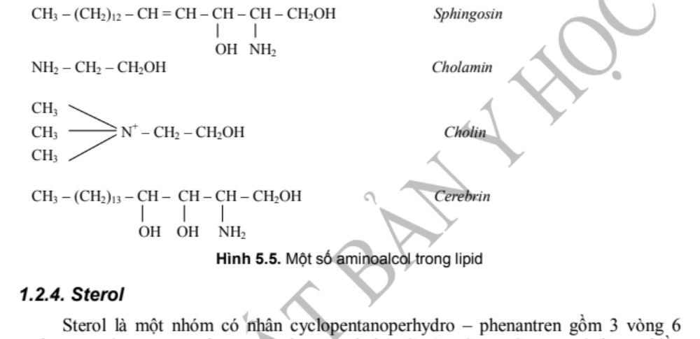  
*Hình 5.5. Một số aminoalcol trong lipid*

- **Sphingosin:** $\text{CH}_3 - (\text{CH}_2)_{12} - \text{CH}=\text{CH} - \underset{\substack{|\\\text{OH}}}{\text{CH}} - \underset{\substack{|\\\text{NH}_2}}{\text{CH}} - \text{CH}_2\text{OH}$
- **Cholamin (Ethanolamin):** $\text{NH}_2 - \text{CH}_2 - \text{CH}_2\text{OH}$
- **Cholin:** $(\text{CH}_3)_3\text{N}^+ - \text{CH}_2 - \text{CH}_2\text{OH}$
- **Cerebrin:** $\text{CH}_3 - (\text{CH}_2)_{13} - \underset{\substack{|\\\text{OH}}}{\text{CH}} - \underset{\substack{|\\\text{OH}}}{\text{CH}} - \underset{\substack{|\\\text{NH}_2}}{\text{CH}} - \text{CH}_2\text{OH}$

#### 1.2.4. Sterol
Sterol là một nhóm có nhân **cyclopentanoperhydro-phenanthren** gồm 3 vòng 6 carbon (vòng A, B, C) và một vòng 5 carbon (vòng D), có 2 nhóm methyl ($-\text{CH}_3$) ở $\text{C}_{10}$ ($\text{C}_{19}$) và $\text{C}_{13}$ ($\text{C}_{18}$), có một hoặc nhiều nhóm alcol ($-\text{OH}$), không chứa nhóm carboxyl ($-\text{COOH}$) hoặc carbonyl ($-\text{CO}-$), có một mạch nhánh ở $\text{C}_{17}$ có $8 - 10\text{ carbon}$.

Chất tiêu biểu cho các sterol ở mô động vật là **cholesterol**. Cholesterol có một nhóm chức alcol ở $\text{C}_3$, liên kết đôi ở $\text{C}_5-\text{C}_6$, mạch nhánh gồm 8 carbon ở $\text{C}_{17}$. Cholesterol có trong hầu hết tế bào của cơ thể; đặc biệt trong mô thần kinh, mật và sỏi mật, thể vàng của buồng trứng. Cholesterol là thành phần của chất béo động vật nhưng không có trong chất béo thực vật.

---

## [Trang 122] - Cholesterol, Dẫn xuất Hormon Steroid & Phân loại Lipid thuần (Glycerid)

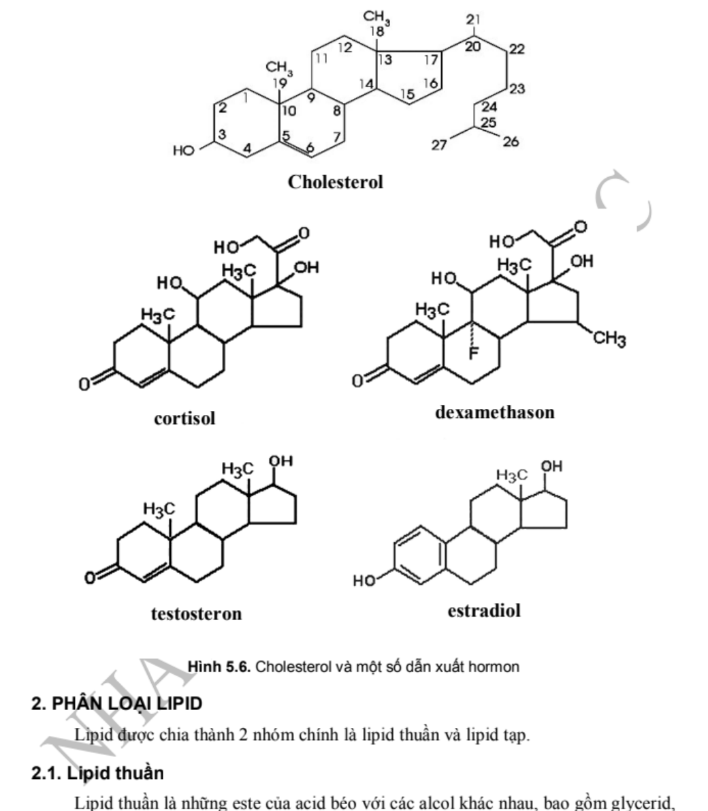  
*Hình 5.6. Cấu trúc cholesterol và một số dẫn xuất hormon steroid (cortisol, dexamethason, testosteron, estradiol)*

- **Cholesterol:** $27\text{ carbon}$, nhân steroid 4 vòng $A, B, C, D$, nhóm $-\text{OH}$ ở $\text{C}_3$, liên kết đôi $\text{C}_5=\text{C}_6$, mạch nhánh hydrocarbon gồm 8C tại $\text{C}_{17}$ ($\text{C}_{20}-\text{C}_{27}$).
- **Cortisol (Glucocorticoid):** Hormon vỏ thượng thận chuyển hóa đường, chống viêm, có oxy hóa nhóm $-\text{COCH}_2\text{OH}$ ở $\text{C}_{17}$, $-\text{OH}$ ở $\text{C}_{11}$ và nhóm $\text{C}=\text{O}$ ở $\text{C}_3$.
- **Dexamethason:** Dẫn xuất glucocorticoid tổng hợp kháng viêm cực mạnh với nguyên tử Fluor ($\text{F}$) gắn ở $\text{C}_9$ và nhóm $-\text{CH}_3$ ở $\text{C}_{16}$.
- **Testosteron:** Hormon sinh dục nam androgen có nhóm $-\text{OH}$ ở $\text{C}_{17}$ và nhóm keton ở $\text{C}_3$.
- **Estradiol:** Hormon sinh dục nữ estrogen có vòng A thơm hóa, nhóm phenolic $-\text{OH}$ ở $\text{C}_3$ và alcol ở $\text{C}_{17}$.

---

### 2. PHÂN LOẠI LIPID
Lipid được chia thành 2 nhóm chính là **lipid thuần** và **lipid tạp**.

### 2.1. Lipid thuần
Lipid thuần là những este của acid béo với các alcol khác nhau, bao gồm **glycerid**, **cerid** và **sterid**.

#### 2.1.1. Glycerid (acylglycerol)
Glycerid có trong hầu hết tổ chức của sinh vật, nhưng có nhiều nhất ở mô mỡ ($90\%$). Glycerid có nguồn gốc động vật và thực vật khác nhau về thành phần acid béo.

---

## [Trang 123] - Cấu tạo hóa học của Glycerid & Tính chất

Glycerid là este của glycerol và acid béo, là chất béo trung tính. Tuỳ theo một, hai hay ba nhóm chức alcol của glycerol được este hoá bởi acid béo mà tạo nên mono-, di- hay tri-glycerid (monoacylglycerol, diacylglycerol, triacylglycerol). Các acid béo trong phân tử glycerid có thể giống nhau hoặc khác nhau (glycerid thuần nhất hoặc glycerid hỗn hợp). Các triglycerid có chứa cùng một loại acid béo trong phân tử không có đồng phân quang học và chiếm tỷ lệ rất nhỏ. Tuỳ theo thành phần của acid béo mà glycerid có tên gọi khác nhau, ví dụ: tristearin là triglycerid có 3 gốc acid béo là acid stearic, 1,2-distearopalmitin là triglycerid có 2 gốc acid stearic ở $\text{C}_1$ và $\text{C}_2$ và 1 gốc acid palmitic ở $\text{C}_3$.

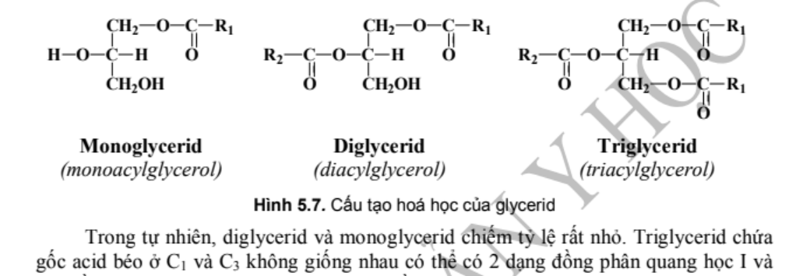  
*Hình 5.7. Cấu tạo hoá học của glycerid (Monoglycerid, Diglycerid, Triglycerid)*

Trong tự nhiên, diglycerid và monoglycerid chiếm tỷ lệ rất nhỏ. Triglycerid chứa gốc acid béo ở $\text{C}_1$ và $\text{C}_3$ không giống nhau có thể có 2 dạng đồng phân quang học I và II, phần lớn triglycerid thiên nhiên ở dạng đồng phân II.

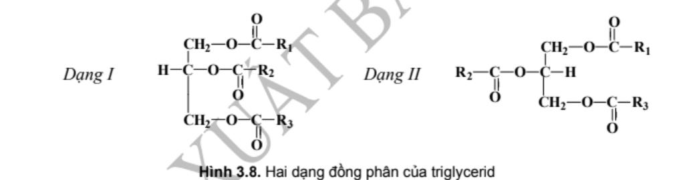  
*Hình 5.8. Hai dạng đồng phân của triglycerid (Dạng I và Dạng II)*

#### Tính chất của Glycerid
Glycerid không tan trong nước và dung môi phân cực. Tính chất vật lý của glycerid chủ yếu là do thành phần acid béo quyết định. Glycerid chứa nhiều acid béo no thường ở thể đặc và gọi là mỡ, glycerid chứa nhiều acid béo không no thường ở thể lỏng và gọi là dầu. Hàm lượng acid béo mạch ngắn và acid béo không no càng lớn thì nhiệt độ nóng chảy của glycerid càng thấp. Người ta sử dụng **chỉ số iod** để đánh giá mức độ không no của các acid béo trong dầu mỡ. Chỉ số iod càng cao chứng tỏ dầu mỡ càng chứa nhiều acid béo không no. Do đó, dầu có chỉ số iod cao hơn mỡ.

Vì không tan trong nước nên glycerid rất khó thuỷ phân mà phải nhờ xúc tác bằng kiềm, acid hoặc enzym *lipase* tạo thành sản phẩm là diglycerid, monoglycerid, glycerol và các acid béo. Sự thuỷ phân bằng kiềm gọi là **xà phòng hóa**, sản phẩm là muối của acid béo - gọi là xà phòng. Xà phòng là chất tẩy rửa nhờ tác dụng chuyển chất bẩn thành nhũ tương. Một số xà phòng có trọng lượng phân tử cao và độ không bão hòa lớn là những chất sát khuẩn. Một số xà phòng có tác dụng khử độc, chống độc tố bạch hầu và uốn ván.

---

## [Trang 124] - Cerid, Sterid & Mở đầu Lipid tạp (Glycerophospholipid)

Một số đặc điểm cần lưu ý là sau một thời gian, chất béo thường bị ôi, có mùi khét khó chịu. Đó là do các liên kết đôi của acid béo không no bị oxy hóa thành liên kết peroxyd, rồi tạo thành aldehyd và acid béo bay hơi.

Ngày nay, bằng phương pháp sắc ký người ta có thể tách glycerid ra khỏi hỗn hợp các loại lipid khác hoặc giữa các glycerid với nhau.

#### 2.1.2. Cerid
Cerid là este của acid béo chuỗi dài với alcol có trọng lượng phân tử cao ($30 - 40\text{ carbon}$). Cerid còn gọi là **sáp**, có trong động vật (sáp ong, mỡ cá nhà táng,...) và thực vật (lớp mỏng bao phủ lá, thân và quả). Vỏ của một số vi khuẩn cũng chứa sáp (vi khuẩn Koch gây bệnh lao). Chức phận sinh học của cerid khác nhau tuỳ loài nhưng nói chung cerid giữ vai trò bảo vệ các tổ chức của động vật và thực vật. Có lớp sáp nên vi khuẩn không bị tác dụng bởi acid và alcol. Động vật cao cấp và người không chuyển hoá được cerid. Sáp được ứng dụng làm nến, sáp bôi và các thuốc cao.

#### 2.1.3. Sterid
Sterid là este của acid béo với alcol vòng sterol (tiêu biểu là cholesterol). Một số sterid là oleatcholesterol, palmitatcholesterol, stearatcholesterol.

---

### 2.2. Lipid tạp
Lipid tạp bao gồm ngoài acid béo và alcol còn chứa những nhóm hoá học khác. Lipid tạp chia thành hai nhóm tuỳ thuộc vào thành phần alcol của chúng: **glycerophospholipid** có alcol là glycerol và **sphingolipid** có alcol là sphingosin.

#### 2.2.1. Glycerophospholipid (glycerophosphatid hay diacylphosphatid)
Các glycerophospholipid là những diacylglycerol được kết hợp với các chất bởi nhóm chức alcol tận thông qua liên kết phosphodieste.

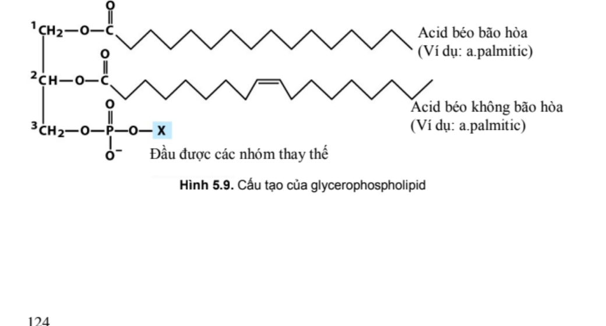  
*Hình 5.9. Cấu tạo chung của glycerophospholipid*

- $\text{C}_1$ của glycerol liên kết este với acid béo bão hòa (ví dụ: acid palmitic).
- $\text{C}_2$ của glycerol liên kết este với acid béo không bão hòa (ví dụ: acid oleic).
- $\text{C}_3$ liên kết este với acid phosphoric, nhóm phosphat gắn với gốc thế $-\text{X}$ mang tính phân cực (đầu ưa nước).

---

## [Trang 125] - Bảng các loại Glycerophospholipid, Acid phosphatidic & Phosphatidylcholin

##### Bảng 5.3. Các loại glycerophospholipid

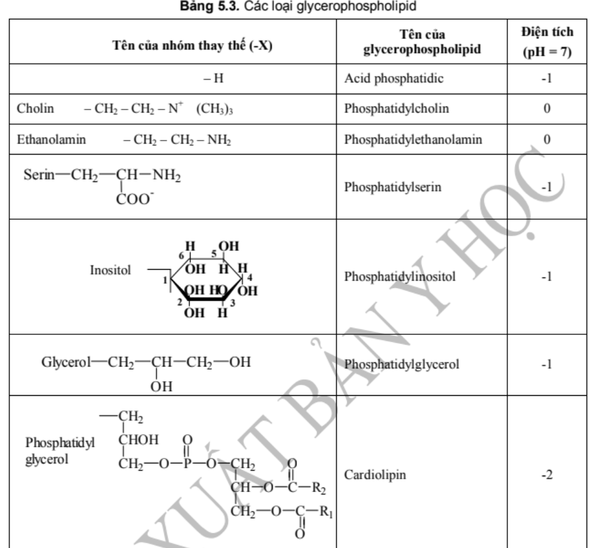  
*Bảng 5.3. Các loại glycerophospholipid và gốc thế $-\text{X}$*

| Tên của nhóm thay thế ($-\text{X}$) | Công thức cấu tạo nhóm $-\text{X}$ | Tên của glycerophospholipid | Điện tích ($\text{pH} = 7$) |
| :--- | :--- | :--- | :---: |
| **$-\text{H}$** | $-\text{H}$ | **Acid phosphatidic** | $-1$ |
| **Cholin** | $-\text{CH}_2-\text{CH}_2-\text{N}^+(\text{CH}_3)_3$ | **Phosphatidylcholin** *(Lecithin)* | $0$ |
| **Ethanolamin** | $-\text{CH}_2-\text{CH}_2-\text{NH}_2$ | **Phosphatidylethanolamin** *(Cephalin)* | $0$ |
| **Serin** | $-\text{CH}_2-\underset{\substack{|\\\text{COO}^-}}{\text{CH}}-\text{NH}_2$ | **Phosphatidylserin** | $-1$ |
| **Inositol** | Vòng hexahydroxycyclohexan (công thức Haworth ghế) | **Phosphatidylinositol** | $-1$ |
| **Glycerol** | $-\text{CH}_2-\underset{\substack{|\\\text{OH}}}{\text{CH}}-\text{CH}_2-\text{OH}$ | **Phosphatidylglycerol** | $-1$ |
| **Phosphatidyl glycerol** | Cấu trúc chứa 2 phân tử acid phosphatidic nối qua 1 glycerol trung tâm | **Cardiolipin** *(Diphosphatidylglycerol)* | $-2$ |

Glycerophospholipid là dẫn xuất của acid phosphatidic, bao gồm acid phosphatidic, phosphatidylglycerol, phosphatidylcholin (lecithin), phosphatidylethanolamin (cephalin), phosphatidylinositol, phosphatidylserin, plasmalogen.

#### - Acid phosphatidic
Acid phosphatidic là chất trung gian trong quá trình tổng hợp triglycerid và glycerophospholipid nhưng có rất ít trong các mô; thành phần gồm: glycerol, 2 gốc acid béo và 1 gốc acid phosphoric. Chúng là những diacylglycerol trong đó chức alcol ở vị trí $\text{C}_3$ của glycerol được este hoá bởi acid phosphoric. Acid béo gắn ở $\text{C}_1$ thường là acid béo bão hoà và gắn ở $\text{C}_2$ thường là acid béo không bão hoà.

#### - Phosphatidylcholin (Lecithin)
Lecithin là dẫn xuất của acid phosphatidic mà $-\text{X}$ là cholin (*bảng 5.3*). Lecithin được chiết xuất từ lòng đỏ trứng. Chất này có phổ biến trong các tế bào của cơ thể động vật, đặc biệt trong tế bào gan, não, lòng đỏ trứng.


<!-- END FILE: pages_116_125.md -->


<!-- BEGIN FILE: pages_126_135.md -->

# GIÁO TRÌNH HÓA SINH - ĐẠI HỌC Y HÀ NỘI
**Chủ biên:** GS. TS. BS. Tạ Thành Văn  
**Nguồn:** SGK Hóa sinh YHN 2019 (Nhà xuất bản Y học)

---

# CHƯƠNG 5: HÓA HỌC LIPID (TIẾP THEO)

## [Trang 126] - Phosphatidylethanolamin, Phosphatidylserin, Phosphatidylinositol, Cardiolipin, Plasmalogen & Sphingolipid

#### - Phosphatidylethanolamin (Cephalin)
Cephalin khác lecithin ở vị trí $-\text{X}$ là ethanolamin. Cũng như lecithin, cephalin có dạng $\alpha$ và dạng $\beta$ tuỳ theo phức hợp acid phosphoric ethanolamin được gắn vào carbon $\alpha$ hay carbon $\beta$ của glycerol. Cephalin được chiết xuất đầu tiên từ não.

#### - Phosphatidylserin
Thành phần cấu tạo của phosphatidylserin có acid amin là serin, acid béo thường là acid stearic và acid oleic. Phosphatidylserin chiếm $5\%$ glycerophospholipid của não. Trong tự nhiên, người ta còn tìm thấy những phospholipid chứa acid amin là threonin.

#### - Phosphatidylinositol
Phosphatidylinositol có trong tổ chức động vật (não) và thực vật (đậu tương, lạc, mầm lúa mì,...). Phân tử phosphatid có 6 gốc $-\text{OH}$ (*bảng 5.3*), do đó nó mang tính ưa nước.

> [!NOTE]
> Trong truyền tín hiệu tế bào, phosphatidylinositol 4,5-bisphosphat ($\text{PIP}_2$) trên màng tế bào dưới tác dụng của phospholipase C sẽ bị thủy phân thành hai chất truyền tin thứ hai quan trọng: **$\text{IP}_3$** (inositol 1,4,5-trisphosphat kích hoạt giải phóng $\text{Ca}^{2+}$ từ lưới nội chất) và **$\text{DAG}$** (diacylglycerol hoạt hóa protein kinase C - PKC).

#### - Diphosphatidylglycerol (Cardiolipin)
Chất này là phospholipid có trong ty thể (*mitochondria*), đặc trưng của màng trong ty thể.

#### - Plasmalogen
Plasmalogen chiếm khoảng $10\%$ phospholipid của não và cơ. Trong phân tử plasmalogen, vị trí $\text{C}_1$ ($\alpha$) không phải là liên kết este mà là **liên kết ete** giữa nhóm $-\text{OH}$ của glycerol với một gốc rượu không bão hoà (liên kết $\alpha,\beta$-alkenyl ether).

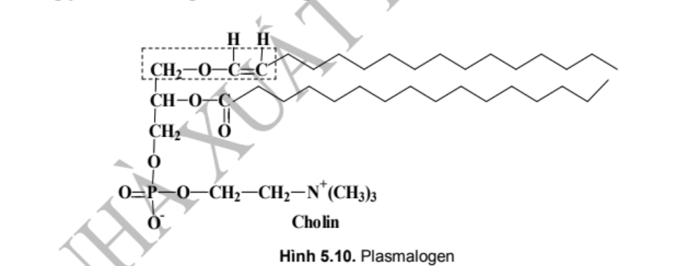  
*Hình 5.10. Cấu tạo của Plasmalogen*

$$\begin{matrix}
\text{CH}_2 - \text{O} - \text{CH}=\text{CH} - \text{R}_1 \quad (\text{liên kết ete không no tại C}_1) \\
| \qquad\qquad\qquad\qquad\qquad\qquad\qquad\quad \\
\text{CH} - \text{O} - \text{CO} - \text{R}_2 \qquad\qquad\qquad\qquad (\text{liên kết este acid béo tại C}_2) \\
| \qquad\qquad\qquad\qquad\qquad\qquad\qquad\quad \\
\text{CH}_2 - \text{O} - \text{PO}_2^- - \text{O} - \text{CH}_2 - \text{CH}_2 - \text{N}^+(\text{CH}_3)_3 \quad (\text{Phosphocholin tại C}_3)
\end{matrix}$$

---

### 2.2.2. Sphingolipid
Sphingolipid là lipid tạp chứa alcol là **sphingosin**. Sphingosin được nối với acid béo bởi nhóm amin, tạo thành **ceramid**. Acid béo có thể là acid lignoceric, acid cerebronic. Ceramid là đơn vị cơ bản của sphingolipid và có trong các mô động vật. 

Những sphingolipid có chứa acid phosphoric trong thành phần cấu tạo (ví dụ: sphingomyelin) được xếp cùng với các lipid tạp có chứa acid phosphoric khác và gọi chung là phospholipid. Những sphingolipid có chứa ose trong phân tử (ví dụ: cerebrosid, sulfatid, gangliosid) được xếp thành loại khác, gọi là **glycolipid**. Các ose phổ biến trong glycolipid là galactose, glucose, galactosamin.

---

## [Trang 127] - Cấu tạo Sphingolipid & Bảng phân loại Sphingolipid

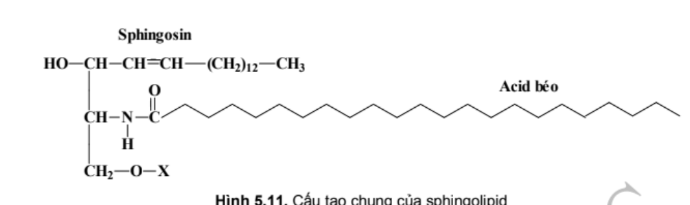  
*Hình 5.11. Cấu tạo chung của sphingolipid (Khung Sphingosin + Acid béo qua liên kết peptid/amid tạo Ceramid, đầu $-\text{X}$)*

Các sphingolipid là thành phần cấu tạo quan trọng của màng tế bào động vật và thực vật, đặc biệt ở mô não và mô thần kinh.

##### Bảng 5.4. Các loại sphingolipid

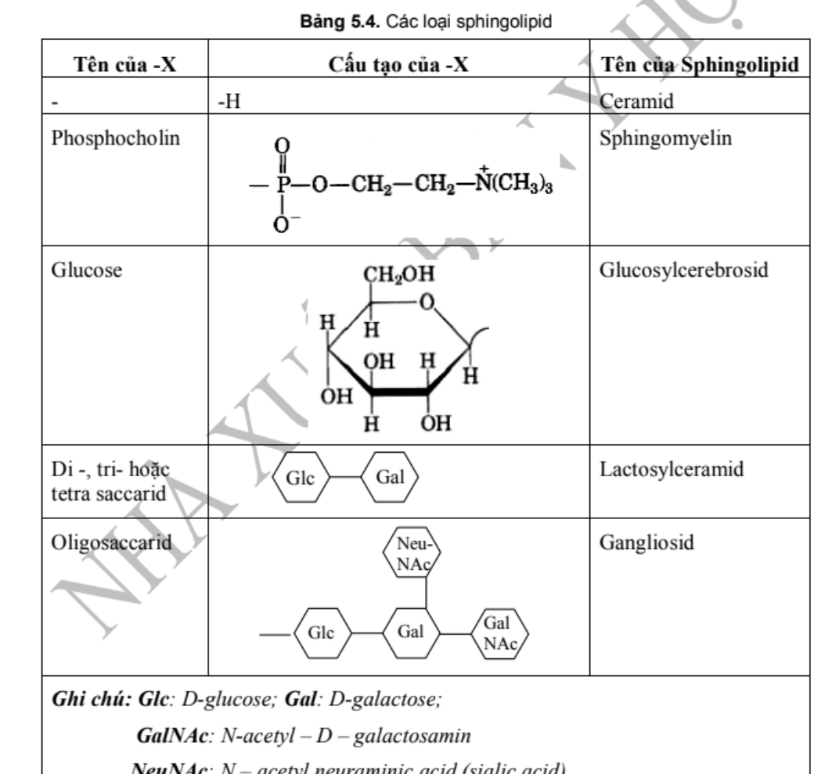  
*Bảng 5.4. Các loại sphingolipid*

| Tên của $-\text{X}$ | Cấu tạo của $-\text{X}$ | Tên của Sphingolipid |
| :--- | :--- | :--- |
| **$-$** | $-\text{H}$ | **Ceramid** |
| **Phosphocholin** | $-\text{PO}_2^--\text{O}-\text{CH}_2-\text{CH}_2-\text{N}^+(\text{CH}_3)_3$ | **Sphingomyelin** |
| **Glucose** | D-glucosyl (vòng pyranose Haworth) | **Glucosylcerebrosid** |
| **Di-, tri- hoặc tetrasaccarid** | $-\text{Glc}-\text{Gal}$ | **Lactosylceramid** |
| **Oligosaccarid** | Mạch oligosaccharid phức tạp chứa $\text{NeuNAc}$ (Acid sialic) gắn nhánh $-\text{Gal}$ | **Gangliosid** |

*Ghi chú:*
- $\text{Glc}$: D-glucose
- $\text{Gal}$: D-galactose
- $\text{GalNAc}$: N-acetyl-D-galactosamin
- $\text{NeuNAc}$: N-acetylneuraminic acid (*sialic acid*)

---

## [Trang 128] - Sphingomyelin, Cerebrosid, Sơ đồ phân loại Lipid & Gangliosid

#### - Sphingomyelin
Sphingomyelin được xếp vào loại phospholipid; được chiết xuất từ phổi, lách, não và tất cả tế bào thần kinh (tạo nên bao myelin bao bọc quanh sợi trục thần kinh). Sphingomyelin là ceramid mà chức alcol bậc nhất (ở vị trí $\text{C}_1$) liên kết với phosphocholin.

#### - Cerebrosid
Phân tử cerebrosid gồm: alcol là sphingosin, acid béo cao phân tử và galactose, nhưng không có acid phosphoric. Acid béo trong cerebrosid gồm 24 carbon như acid lignoceric, acid cerebronic, acid nervonic, acid hydroxynervonic. Tuỳ theo thành phần acid béo trong phân tử mà cerebrosid có tên khác nhau, ví dụ:
- **Kerasin:** là cerebrosid chứa acid lignoceric.
- **Cerebron:** là cerebrosid chứa acid cerebronic,...

Cerebrosid có chủ yếu ở não và mô thần kinh.

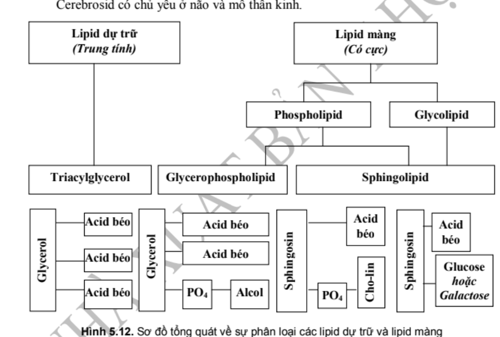  
*Hình 5.12. Sơ đồ tổng quát về sự phân loại các lipid dự trữ và lipid màng*

```
LIPID
 ├── 1. Lipid dự trữ (Trung tính)
 │     └── Triacylglycerol (Glycerol + 3 Acid béo)
 └── 2. Lipid màng (Có cực / Phân cực)
       ├── Phospholipid
       │     ├── Glycerophospholipid (Glycerol + 2 Acid béo + Phosphat + Alcol)
       │     └── Sphingolipid (Sphingosin + 1 Acid béo + Phosphat + Cholin) [Sphingomyelin]
       └── Glycolipid
             └── Sphingolipid (Sphingosin + 1 Acid béo + Ose: Glucose hoặc Galactose) [Cerebrosid / Gangliosid]
```

#### - Sulfatid
Sulfatid là dẫn xuất có sulfat của cerebrosid, nhóm sulfat ($-\text{SO}_3^-$) thường gắn vào vị trí $\text{C}_3$ của galactose.

#### - Gangliosid
Gangliosid là glycosylceramid; trong phân tử có sphingosin, acid béo có 22 carbon hoặc 24 carbon, acid neuraminic và các dẫn xuất của nó như acid N-acetylneuraminic (acid sialic), 3 ose (ose phổ biến trong gangliosid là galactose, glucose, galactosamin).

---

## [Trang 129] - Gangliosid & Câu hỏi ôn tập Chương 5

Gangliosid chiếm khoảng $6\%$ lipid màng của tế bào chất xám trong não người và có số lượng ít hơn trong lách, hồng cầu. Gangliosid có ở vùng đầu dây thần kinh, tham gia vào quá trình dẫn truyền xung động thần kinh và đóng vai trò làm thụ thể tiếp nhận độc tố (như độc tố vi khuẩn tả *Vibrio cholerae* nhận diện thụ thể $\text{GM}_1$).

---

### CÂU HỎI ÔN TẬP CHƯƠNG 5
1. Định nghĩa về lipid và những đặc điểm chính về các thành phần cấu tạo của lipid.
2. Hãy nêu những đặc điểm chính của acid béo cấu tạo lipid (định nghĩa, công thức cấu tạo tổng quát, phân loại và đặc điểm chính của từng loại).
3. Hãy nêu những đặc điểm chính của các alcol cấu tạo lipid.
4. Phân loại lipid theo cấu tạo hoá học, cho ví dụ từng loại.
5. Thế nào là lipid thuần? Trình bày cấu tạo hoá học của glycerid, cerid và sterid.
6. Thế nào là lipid tạp? Phân loại lipid tạp và cho ví dụ của từng loại.

---