# CHƯƠNG 6: CHUYỂN HÓA LIPID VÀ LIPOPROTEIN

## [Trang 130] - Mục tiêu học tập, Đại cương & Thoái hóa Lipid ở tế bào

### MỤC TIÊU HỌC TẬP
1. Trình bày được quá trình thoái hóa của acid béo bão hòa có số carbon chẵn và acid béo không bão hòa có một liên kết đôi.
2. Trình bày được sự tạo thành các thể ceton máu và sự oxy hóa chúng trong tế bào.
3. Trình bày được quá trình tổng hợp acid béo bão hòa trong tế bào (ở bào tương và ty thể).
4. Trình bày được sự chuyển hóa của triglycerid và lecithin.
5. Trình bày được các dạng lipoprotein trong máu và đặc điểm, vai trò sinh lý chủ yếu của từng loại.

---

### ĐẠI CƯƠNG
Lipid đóng nhiều vai trò quan trọng trong tế bào và cơ thể. Lipid là dạng chính của năng lượng lưu trữ trong tế bào ở hầu hết các sinh vật và là thành phần chính của màng tế bào. Các chất béo đặc biệt còn có vai trò như các chất màu (retinal, caroten), các chất cộng tác (*cofactor*) (vitamin K), chất nhũ hoá (muối mật), chất vận chuyển (dolols), kích thích tố (dẫn xuất vitamin D, hormon giới tính), các chất dẫn truyền nội và ngoại tế bào (eicosanoids, phosphatidylinositol), và chất neo cho protein màng (liên kết cộng hóa trị acid béo, phosphatidylinositol). Nhu cầu lipid của cơ thể: $60 - 100\text{ g/ngày}$ với người trưởng thành, $30 - 80\text{ g/ngày}$ với trẻ em và chủ yếu dưới dạng triglycerid.

Chương này mô tả các quá trình chuyển hoá lipid gồm thoái hoá và tổng hợp lipid là quá trình trung tâm ở nhiều tế bào và cơ quan. Ở động vật, ở mô gan và tim quá trình thoái hoá lipid cung cấp lên tới $80\%$ nhu cầu năng lượng; tất cả các tế bào đều có quá trình tổng hợp lipid (thành phần cấu trúc tế bào) đồng thời thay thế hoặc sửa chữa và dự trữ. Quá trình sinh tổng hợp acid béo và lipid dự trữ trong các mô xảy ra theo một cách khác nhờ một tập hợp enzym đặc biệt.

---

### 1. THOÁI HÓA CỦA LIPID Ở TẾ BÀO
Triglycerid hay còn gọi là mỡ trung tính là dạng dự trữ năng lượng chính trong cơ thể. Đặc điểm của triglycerid hoàn toàn phù hợp với chức năng dự trữ năng lượng. Cấu trúc chuỗi hydrocarbon của acid béo mạch dài trong thành phần triglycerid mang năng lượng liên kết cao, khi oxy hoá hoàn toàn sẽ giải phóng năng lượng gấp hơn 2 lần so với carbonhydrat và protein cùng khối lượng ($\sim 38\text{ kJ/g} \approx 9{,}3\text{ kcal/g}$). Một đặc điểm ưu thế của dạng dự trữ này là chúng có tính kỵ nước, hoàn toàn không tan trong nước hay môi trường dịch bào nên tập trung lại thành tạo thành giọt mỡ, do đó không gây tăng áp lực thẩm thấu trong bào tương.

---

## [Trang 131] - Tiêu hóa và hấp thu chất béo tại ruột

Về mặt hoá học chúng khá trơ nên không phản ứng với các thành phần khác trong tế bào. Tuy nhiên, cũng chính vì những đặc điểm này nên khi thoái hoá triglycerid đòi hỏi phải có quá trình nhũ tương hoá hay cắt nhỏ hạt mỡ to thành hạt nhỏ nhờ muối mật và các enzym xúc tác tại ruột, sau đó được hấp thụ vào máu vận chuyển về mô dự trữ nhờ sự hỗ trợ của các protein vận chuyển. Để cắt đứt được liên kết bền $\text{C}-\text{C}$ trong acid béo, nhóm carboxyl ở $\text{C}_1$ cần được hoạt hoá bằng gắn với coenzym A, cho phép bước oxy hoá tiếp theo xảy ra ở vị trí $\text{C}_3$ hay vị trí $\beta$ nên quá trình thoái hoá acid béo còn được gọi là **quá trình $\beta$-oxy hoá**. Phần này trình bày nguồn gốc của các acid béo, con đường di chuyển và vị trí oxy hoá trong tế bào tạo thành sản phẩm acetyl CoA đi vào chu trình acid citric. Quá trình thoái hoá đơn giản nhất là thoái hoá acid béo no bão hoà có số carbon chẵn tại ty thể sẽ được mô tả chi tiết; đồng thời tóm tắt quá trình thoái hoá acid béo có số carbon lẻ và không bão hoà; quá trình tạo các thể cetonic. Ngoài ra, một số quá trình oxy hoá acid béo khác ít phổ biến hơn như $\alpha$ hoặc $\omega$ oxy hoá cũng sẽ được mô tả ngắn gọn.

### 1.1. Quá trình thoái hoá triglycerid

#### 1.1.1. Quá trình tiêu hoá hấp thụ chất béo tại ruột
Tế bào nhận acid béo từ 3 nguồn khác nhau: thức ăn, dự trữ tại chính tế bào và các mô. Ở động vật có xương sống, chất béo từ thức ăn sẽ được hấp thụ, vận chuyển đến mô dự trữ chuyên biệt là mô mỡ và mô gan. Triglycerid cung cấp hơn một nửa nhu cầu năng lượng ở một số mô như gan, tim và cơ lúc nghỉ ngơi. Tại ruột, chất béo trước khi hấp thụ sẽ được nhũ tương hoá nhờ mật tiết ra từ gan tạo điều kiện tăng diện tích tiếp xúc với các enzym *lipase* thuỷ phân triglycerid. Dưới tác dụng của *lipase*, triglycerid bị thuỷ phân thành glycerol và acid béo và xảy ra theo từng giai đoạn: trước hết là liên kết este ở $\text{C}_1$ và $\text{C}_3$ bị thuỷ phân khá nhanh, phần còn lại là **2-monoglycerid** bị thuỷ phân chậm (*Hình 6.1*).

Sản phẩm của *lipase* là acid béo và glycerol được khuếch tán vào tế bào niêm mạc ruột, tại đây chúng sẽ tái tổng hợp lại thành triglycerid, kết hợp với protein vận chuyển đặc hiệu **apolipoprotein C-II (apoC-II)** và cholesterol tạo thành phức hợp lipoprotein gọi là **chylomicron**. Chylomicron được hấp thụ vào hệ thống bạch huyết, đi vào máu và được vận chuyển đến cơ và mô mỡ. Tại mô, các enzym *lipoprotein lipase* có mặt tại mao mạch được hoạt hoá nhờ apoC-II, thuỷ phân triglycerid thành acid béo và glycerol để hấp thụ vào mô. Tại cơ, acid béo sẽ được oxy hoá tạo năng lượng; tại mô mỡ, acid béo kết hợp lại với glycerol tạo thành triglycerid dự trữ. Phần còn lại của chylomicron gồm rất ít triglycerid còn lại và cholesterol, apolipoprotein được vận chuyển về gan. Tại đây, chúng được nội nhập bào nhờ receptor của apoE/C-II trên bề mặt tế bào gan. Triglycerid tại gan sẽ được oxy hoá tạo năng lượng hoặc tiền chất tổng hợp thành thể cetonic. Khi chế độ ăn quá nhiều lipid so với nhu cầu năng lượng hoặc dư thừa tiền chất, gan sẽ chuyển chúng lại thành dạng triglycerid, kết hợp với apolipoprotein đặc hiệu tạo thành lipoprotein tỷ trọng rất thấp **VLDL** để chuyển đến mô mỡ dự trữ.

---

## [Trang 132] - Tác dụng của Lipase tiêu hóa & Thoái hóa Triglycerid tại mô mỡ

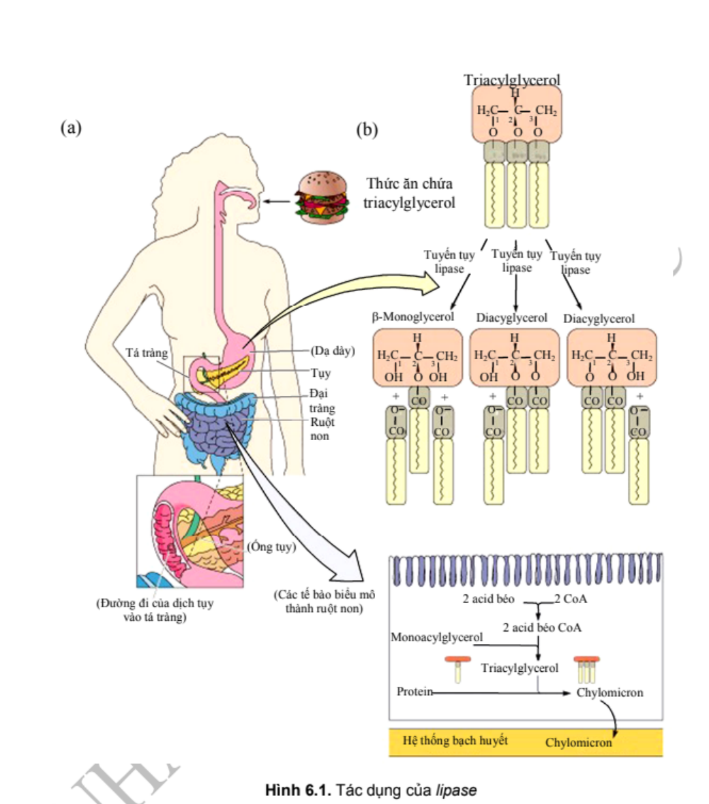  
*Hình 6.1. Tác dụng của lipase tiêu hóa lipid tại ruột và tái tổng hợp chylomicron*

- **(a) Đường tiêu hóa:** Thức ăn chứa triacylglycerol từ miệng $\rightarrow$ dạ dày $\rightarrow$ tá tràng (nhận dịch mật và dịch tụy qua ống tụy).
- **(b) Thủy phân hóa học:** Triacylglycerol $\xrightarrow{\text{Tuyến tụy lipase}}$ Diacylglycerol + Acid béo tự do $\xrightarrow{\text{Lipase}}$ $\beta$-Monoglycerol (2-monoacylglycerol) + Acid béo.
- **Hấp thu và tạo Chylomicron:** Acid béo và monoacylglycerol đi qua vi nhung mao tế bào biểu mô thành ruột non, hoạt hóa thành acyl-CoA, tái tổng hợp thành triacylglycerol, đóng gói cùng apoprotein thành hạt **Chylomicron** đi vào hệ thống bạch huyết rồi đổ vào tĩnh mạch máu.

---

#### 1.1.2. Quá trình thoái hoá triglycerid tại mô mỡ
Mỡ trung tính dự trữ tại mô mỡ và các mô tổng hợp steroid như tuyến vỏ thượng thận, buồng trứng, tinh hoàn dưới dạng các hạt mỡ trong bào tương với lõi là cholesterol và triglycerid, vỏ là phospholipid. Bề mặt của các hạt mỡ có bao phủ bởi một loại protein có tên là **perilipin**, giúp bảo vệ hạt mỡ tránh thoái lipid ra ngoài bào tương khi không cần thiết. Khi có tín hiệu hormon cần chuyển hoá năng lượng, triglycerid trong hạt mỡ sẽ được huy động vận chuyển đến các mô có thể oxy hoá acid béo tạo năng lượng (cơ xương, tim và vỏ thượng thận). Hormon **epinephrin** và **glucagon**, được tiết khi nồng độ glucose giảm thấp, khi gắn vào receptor đặc hiệu trên bề mặt tế bào mỡ sẽ kích hoạt quá trình thoái hóa mỡ.

---

## [Trang 133] - Điều hòa Lipase mô mỡ, Thoái hóa Glycerol & Hoạt hóa Acid béo

Hormon gắn vào receptor sẽ kích hoạt enzym *adenylyl cyclase* xúc tác sản xuất chất truyền tin thứ 2 là **cAMP** (AMP vòng) từ ATP. AMP vòng sẽ hoạt hoá **protein kinase A (PKA)** giúp phosphoryl hoá **perilipin** dẫn đến tăng hoạt hoá *lipase* trong bào tương tế bào mỡ, chúng di chuyển tiếp cận bề mặt hạt mỡ và thực hiện thuỷ phân triglycerid thành acid béo và glycerol. PKA cũng có thể xúc tác phosphoryl hoá trực tiếp *lipase* nhưng chỉ làm tăng hoạt độ của chúng lên 2-3 lần, trong khi gián tiếp bằng phosphoryl hoá perilipin, epinephrine có thể kích hoạt lipase lên gấp 50 lần. Sản phẩm của lipase sẽ giải phóng vào máu dưới dạng acid béo tự do (*free fatty acid*, FFA), tại đây chúng sẽ gắn với **albumin** huyết thanh để đi đến các mô cơ xương, tim và tuyến thượng thận. Tại mô đích, acid béo sẽ tách khỏi albumin và đi vào bào tương sinh năng lượng nhờ các protein vận chuyển trên màng.

---

### 1.2. Thoái hóa của glycerol
Khoảng $95\%$ năng lượng trong triglycerid tích lũy trong 3 chuỗi hydrocarbon của acid béo, glycerol chỉ đóng góp $5\%$ năng lượng. Quá trình thoái hóa glycerol xảy ra ở gan và một số mô. Mô mỡ không có *glycerolkinase*. Enzym *glycerolkinase* xúc tác sự hoạt hóa glycerol, tạo glycerol phosphat. Enzym này có nhiều trong gan, thận, niêm mạc ruột và tuyến vú đang tạo sữa. Glycerol-3-phosphat được oxy hóa thành dihydroxyaceton phosphat (DAP), rồi được đồng phân hóa thành glyceraldehyd 3-phosphat (GAP) nhờ *isomerase* xúc tác. Glyceraldehyd 3-phosphat được oxy hóa trong chu trình acid citric (*Hình 6.2*).

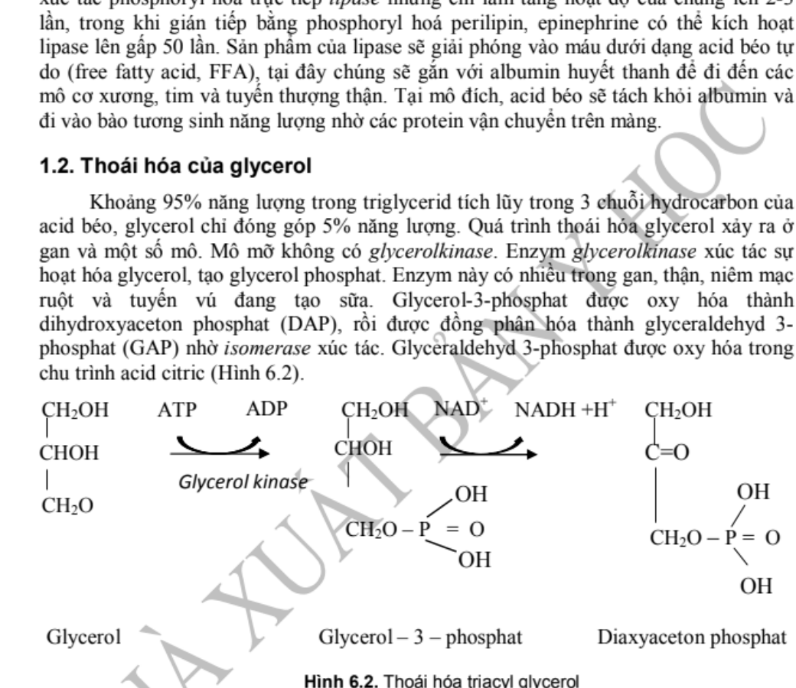  
*Hình 6.2. Con đường thoái hóa glycerol thành dihydroxyaceton phosphat*

$$\begin{matrix}
\text{CH}_2\text{OH} \\
| \qquad \\
\text{CHOH} \\
| \qquad \\
\text{CH}_2\text{OH}
\end{matrix}
\quad\xrightarrow[\text{ATP} \quad \text{ADP}]{\text{Glycerol kinase}}\quad
\begin{matrix}
\text{CH}_2\text{OH} \\
| \qquad \\
\text{CHOH} \\
| \qquad \\
\text{CH}_2\text{O}-\text{PO}_3^{2-}
\end{matrix}
\quad\xrightarrow[\text{NAD}^+ \quad \text{NADH}+\text{H}^+]{\text{Glycerol-3-P dehydrogenase}}\quad
\begin{matrix}
\text{CH}_2\text{OH} \\
| \qquad \\
\text{C}=\text{O} \\
| \qquad \\
\text{CH}_2\text{O}-\text{PO}_3^{2-}
\end{matrix}$$

---

### 1.3. Thoái hóa của acid béo bão hòa có số carbon chẵn
Enzym oxy hoá lipid trong tế bào động vật nằm trong **ty thể**, vì vậy acid béo cần được đưa vào ty thể trước khi oxy hoá. Acid béo có chuỗi carbon dài 12C hoặc ngắn hơn đi vào ty thể không cần protein vận chuyển. Acid béo mạch dài từ 14C trở lên cũng là thành phần chính của FFA lấy từ thức ăn hoặc giải phóng từ các mô dự trữ, không tự đi vào ty thể được mà phải cần chất vận chuyển có tên gọi là **Carnitin**. Hệ thống vận chuyển Carnitin đòi hỏi acid béo phải được hoạt hoá thành **Acyl-CoA** trước khi được đưa vào ty thể.

---

## [Trang 134] - Hoạt hóa Acid béo & Con thoi Carnitin đưa Acyl-CoA vào ty thể

#### 1.3.1. Hoạt hóa và vận chuyển acid béo vào ty thể

##### Phản ứng hoạt hóa Acid béo:
$$\text{R}-\text{COOH} + \text{ATP} + \text{CoASH} \xrightarrow{\text{AcylCoA synthetase}} \text{R}-\text{CO}-\text{S-CoA} + \text{AMP} + \text{PP}_i$$

Enzym *acylCoA synthetase* gồm các isoenzym khác nhau đặc hiệu cho các acid béo chuỗi ngắn, trung bình và dài; chúng có mặt ở màng ngoài ty thể.

Gốc pyrophosphat vô cơ ($\text{PP}_i$) sinh ra được thuỷ phân ngay lập tức bởi *pyrophosphatase*:
$$\text{PP}_i + \text{H}_2\text{O} \xrightarrow{\text{Pyrophosphatase}} 2\text{ P}_i$$

Phục hồi ATP tiêu tốn thông qua enzym *adenylat kinase*:
$$\text{ATP} + \text{AMP} \xrightleftharpoons{\text{Adenylat kinase}} 2\text{ ADP}$$

> [!IMPORTANT]
> Như vậy, sự hoạt hoá 1 phân tử acid béo tiêu tốn tương đương **$2\text{ ATP}$** (2 liên kết phosphat giàu năng lượng).

##### Vận chuyển Acyl-CoA qua màng ty thể nhờ Carnitin:
Acyl CoA tiếp tục phản ứng để gắn gốc acyl với carnitin bằng mối liên kết este và loại bỏ CoA nhờ xúc tác của enzym **Carnitin acyltransferase I** (CAT-I) có ở mặt ngoài của màng ngoài ty thể. Carnitin là amin bậc 4 mang chức alcol bậc 2, do đó có thể este hóa với acid béo. Este acyl-carnitin đi qua màng trong ty thể vào trong ty thể bởi cơ chế khuếch tán được tạo điều kiện thuận lợi (*facilitated diffusion*) nhờ protein vận chuyển *acyl-carnitin/carnitin translocase* (*Hình 6.3*).

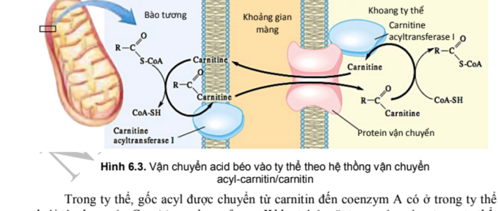  
*Hình 6.3. Vận chuyển acid béo vào ty thể theo hệ thống vận chuyển acyl-carnitin/carnitin*

Trong ty thể, gốc acyl được chuyển từ carnitin đến coenzym A có ở trong ty thể dưới tác dụng của **Carnitin acyltransferase II** (CAT-II) khu trú ở mặt trong của màng trong ty thể. Carnitin được giải phóng sẽ trở lại khoảng giữa của hai màng ty thể theo hệ thống vận chuyển acylcarnitin/carnitin. Cơ chế vận chuyển trên giữ cho 2 nguồn coenzym A ở trong và ngoài ty thể không cách biệt nhau.

---

## [Trang 135] - Điều hòa chuyển hóa & 4 phản ứng của Chu trình $\beta$-oxy hóa

Cần chú ý rằng trong ty thể có một loại *acylCoA synthetase* xúc tác phản ứng hoạt hoá những acid béo trong ty thể, enzym này không sử dụng ATP mà đòi hỏi GTP. 

> [!NOTE]
> **Carnitin acyltransferase I (CAT-I)** bị ức chế bởi **malonyl-CoA** là sản phẩm trung gian đầu tiên trong quá trình tổng hợp lipid; cơ chế này giúp điều hoà quá trình thoái hoá và tổng hợp lipid không xảy ra đồng thời, phù hợp nhu cầu năng lượng của tế bào. Acyl CoA trong bào tương có thể đi vào con đường tổng hợp kéo dài chuỗi carbon ở bào tương hoặc tham gia cấu trúc màng tế bào thay vì đi vào ty thể để thoái hoá tạo năng lượng.

---

#### 1.3.2. Quá trình $\beta$-oxy hóa acid béo
Sau khi được vận chuyển vào ty thể, acid béo sẽ bị oxy hoá qua **4 giai đoạn (4 phản ứng)** nhằm cắt dần acid béo thành những mẩu 2C dưới dạng acetylCoA để đi vào chu trình acid citric thoái hoá thành $\text{CO}_2$ và $\text{H}_2\text{O}$. Quá trình này xảy ra bắt đầu từ nhóm carboxyl tận của gốc acyl:

##### 1. Phản ứng khử hydro lần thứ nhất (Oxy hóa tạo liên kết đôi):
Sự khử hydro sản sinh một liên kết đôi giữa $\text{C}_\alpha$ và $\text{C}_\beta$ ($\text{C}_2$ và $\text{C}_3$) tạo thành **trans-$\Delta^2$-enoylCoA**. Cần lưu ý liên kết đôi này mang cấu hình *trans* khác biệt với cấu hình *cis* trong liên kết đôi ở acid béo không bão hoà tự nhiên. Có 3 loại *acylCoA dehydrogenase*, mỗi enzym đặc hiệu với một loại acid béo có độ dài chuỗi hydrocarbon nhất định, các enzym này đều có chất cộng tác là **FAD**. FAD nhận điện tử và lập tức nhường điện tử này cho chất nhận điện tử trong chuỗi hô hấp tế bào trong ty thể (thông qua protein chuyển điện tử ETF). Quá trình oxy hoá nhờ enzym *acylCoA dehydrogenase* tương tự succinate dehydrogenase trong chu trình acid citric, cả 2 phản ứng đều nằm trên màng trong ty thể. Sinh ra **$1{,}5\text{ ATP}$** (hoặc $2\text{ ATP}$).

##### 2. Phản ứng kết hợp nước (Hydrat hóa):
Sự kết hợp một phân tử nước vào liên kết đôi $\Delta^2$-trans dưới tác dụng của enzym **enoylCoA hydratase** có tính đặc hiệu không gian và tạo nên **L-$\beta$-hydroxyacylCoA**. Enzym này cũng có khả năng xúc tác phản ứng kết hợp nước vào liên kết đôi $\Delta^2$-cis của các acylCoA không bão hòa và sinh ra D-3-hydroxyacylCoA.

##### 3. Phản ứng khử hydro lần thứ hai (Oxy hóa chức alcol thành ceton):
Dưới tác dụng của **$\beta$-hydroxyacylCoA dehydrogenase** có chất cộng tác là **$\text{NAD}^+$** tạo ra **$\beta$-cetoacylCoA**. Enzym này ít đặc hiệu với chiều dài chuỗi hydrocarbon của acid béo nhưng đặc hiệu tuyệt đối với dạng đồng phân không gian L. $\text{NADH}$ hình thành sẽ nhường điện tử cho *NADH-dehydrogenase* (Phức hợp I) và sinh ra **$2{,}5\text{ ATP}$** (hoặc $3\text{ ATP}$) khi chuyển một cặp điện tử từ $\text{NADH}$ đến $\text{O}_2$ trong chuỗi hô hấp tế bào.

##### 4. Phản ứng phân cắt, tạo acetylCoA (Thiolase):
Có sự tham gia của **acylCoA acetyltransferase (thiolase hay $\beta$-cetothiolase)** và một phân tử coenzym A ($\text{CoASH}$), cắt ra 1 phân tử **acetylCoA**. Gốc acyl của acid béo bị ngắn đi hai carbon. Phân tử acylCoA mới này lại tiếp tục trải qua 4 phản ứng như trên của quá trình $\beta$-oxy hóa cho đến khi gốc acylCoA chỉ còn một phân tử acetylCoA.

Như vậy, 01 phân tử acid palmitic có 16C được hoạt hóa thành palmitylCoA và trải qua **7 vòng oxy hóa** để giải phóng **8 phân tử acetylCoA**.

Ba enzym xúc tác 3 phản ứng cuối của quá trình $\beta$-oxy hoá tạo thành phức hợp đặc hiệu chiều dài mạch carbon nằm ở màng trong hoặc khoang ty thể. Với chuỗi carbon từ 12C trở lên, phức hợp nằm trên màng trong ty thể gọi là **phức hợp protein 3 chức năng** (*trifunctional protein*, TFP).


<!-- END FILE: pages_126_135.md -->


<!-- BEGIN FILE: pages_136_145.md -->

# GIÁO TRÌNH HÓA SINH - ĐẠI HỌC Y HÀ NỘI
**Chủ biên:** GS. TS. BS. Tạ Thành Văn  
**Nguồn:** SGK Hóa sinh YHN 2019 (Nhà xuất bản Y học)

---

# CHƯƠNG 6: CHUYỂN HÓA LIPID VÀ LIPOPROTEIN (TIẾP THEO)

## [Trang 136] - Sơ đồ Chu trình $\beta$-oxy hóa & Bilan năng lượng

chức năng (*trifunctional protein* - TFP). Việc tạo phức hợp enzym tạo điều kiện xúc tác nhanh hơn do hạn chế khuếch tán sản phẩm trung gian xa vị trí enzym. Khi TFP cắt mạch acid béo ngắn lại còn 12C trở xuống, quá trình xúc tác sẽ được tiếp tục bởi phức hợp enzym nằm trong khoang ty thể.

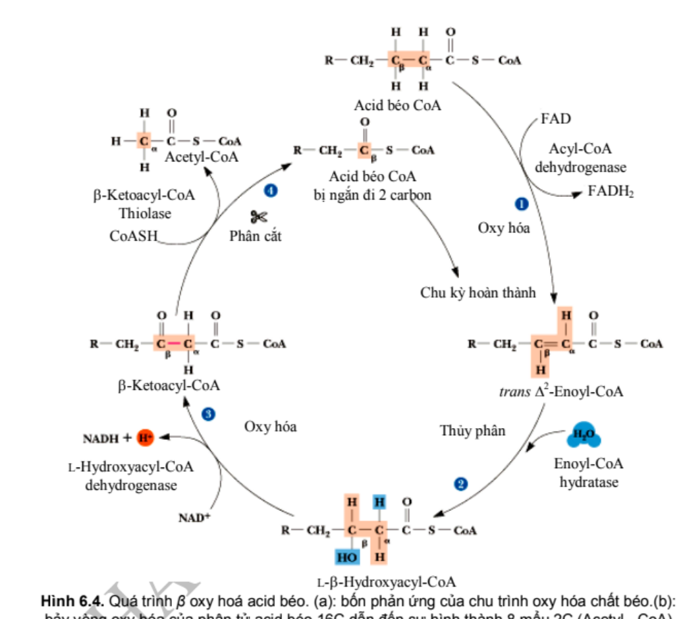  
*Hình 6.4. Quá trình $\beta$ oxy hoá acid béo: (a) bốn phản ứng của chu trình oxy hóa chất béo; (b) bảy vòng oxy hóa của phân tử acid béo 16C dẫn đến sự hình thành 8 mẩu 2C (Acetyl-CoA)*

---

### Bilan năng lượng của quá trình $\beta$-oxy hóa acid béo
Một phân tử acid béo có số carbon chẵn $2n$ bị oxy hoá hoàn toàn sẽ cho $n$ phân tử acetylCoA, ứng với $12n\text{ ATP}$ ($1$ phân tử acetylCoA bị oxy hóa trong chu trình acid citric tạo thành $12\text{ ATP}$); $(n-1)$ phân tử $\text{FADH}_2$ và $(n-1)$ phân tử $\text{NADH}$ hoặc $5(n-1)\text{ ATP}$. Quá trình hoạt hóa acid béo cần $2\text{ ATP}$. Như vậy, số lượng ATP thu được là:

$$\text{Tổng ATP} = [5(n - 1) + 12n] - 2 = 17n - 7$$

Năng lượng tích luỹ trong ATP đạt $33\%$ năng lượng tự do lý thuyết khi oxy hoá hoàn toàn một phân tử acid béo. Tuy nhiên, khi tính toán dựa trên nồng độ thực tế các chất trong và ngoài tế bào, tỷ lệ này đạt đến $60\%$ cho thấy năng lượng tích luỹ khá hiệu quả trong điều kiện tế bào.

> [!TIP]
> **Ví dụ với Acid Palmitic ($16\text{C}$, $n = 8$):**
> - $8\text{ Acetyl-CoA} \times 12\text{ ATP} = 96\text{ ATP}$ (hoặc $8 \times 10 = 80\text{ ATP}$ theo hệ số P/O mới).
> - $7\text{ vòng } \beta\text{-oxy hóa}$ tạo:
>   - $7\text{ FADH}_2 \times 2\text{ ATP} = 14\text{ ATP}$ (hoặc $7 \times 1{,}5 = 10{,}5\text{ ATP}$).
>   - $7\text{ NADH} \times 3\text{ ATP} = 21\text{ ATP}$ (hoặc $7 \times 2{,}5 = 17{,}5\text{ ATP}$).
> - Tổng tạo ra: $96 + 14 + 21 = 131\text{ ATP}$.
> - Trừ đi $2\text{ ATP}$ tiêu tốn ở giai đoạn hoạt hóa ban đầu:
>   $$\text{Bilan thuần} = 131 - 2 = \mathbf{129\text{ ATP}} \quad (\text{hoặc } 108 - 2 = \mathbf{106\text{ ATP}})$$

---

## [Trang 137] - Oxy hóa ở Peroxisome, $\omega$-oxy hóa & $\alpha$-oxy hóa

Ty thể là nơi chủ yếu diễn ra quá trình $\beta$ oxy hoá ở động vật, tuy nhiên có vị trí khác trong tế bào cũng chứa enzym xúc tác quá trình này đó là **peroxisome**. Quá trình diễn ra tại peroxisome lại là nơi chính ở tế bào thực vật, bao gồm các bước tương tự xảy ra ở ty thể nhưng không giống hoàn toàn. Peroxisome không chứa chuỗi vận chuyển điện tử như ty thể nên điện tử và hydro khi tách ra từ phản ứng 1 sẽ đến trực tiếp chất nhận là $\text{O}_2$ tạo nên phân tử $\text{H}_2\text{O}_2$, là chất oxy hoá mạnh có thể phá huỷ tế bào, do đó cần *catalase* thuỷ phân thành $\text{H}_2\text{O}$ và $\text{O}_2$, đồng thời toàn bộ năng lượng giải phóng trong phản ứng 1 sẽ không được tích luỹ trong ATP mà chuyển thành nhiệt. Một điểm khác biệt nữa là hệ thống tại peroxisome ưu tiên thoái hoá acid béo chuỗi rất dài như **hexacosanoic acid (26:0)** và acid béo mạch nhánh như **phytanic acid** và **pristanic acid** do ở đây có một số enzym phụ trợ đặc biệt. 

Thiếu hụt bào quan này sẽ rối loạn chuyển hoá liên quan đến những enzym đặc trưng như **hội chứng Zellweger** do đột biến gen nằm trên nhiễm sắc thể X (X-linked adrenoleukodystrophy - **XALD**). Cơ chế bệnh XALD là do thiếu hụt protein vận chuyển vào peroxisome để oxy hoá do đó gây ứ đọng acid béo chuỗi rất dài, xét nghiệm tăng acid béo rất dài trong máu. Bệnh gặp ở trẻ nam với triệu chứng mất thị lực, rối loạn hành vi và chết trước tuổi trưởng thành. Ở động vật, chế độ ăn giàu chất béo sẽ gây tăng tổng hợp enzym oxy hoá chất béo tại peroxisome ở tế bào gan. Peroxisome tại gan có nhiệm vụ xử lý các acid béo mạch rất dài và mạch nhánh thành mạch ngắn hơn để chuyển vào ty thể tiếp tục thoái hoá.

---

### 1.3.3. Thoái hoá acid béo $\omega$ oxy hoá
Ngoài con đường chính $\beta$ oxy hoá tách carbon từ đầu carboxyl, acid béo còn được thoái hoá nhờ con đường $\omega$ oxy hoá, carbon được tách từ đầu tận chuỗi hydrocarbon, vị trí cách xa nhất nhóm carboxyl (carbon $\omega$). Quá trình này xảy ra ở **lưới nội chất** (*endoplasmic reticulum*) trong tế bào gan, thận, thoái hoá acid béo có $10 - 12\text{C}$. Ở điều kiện bình thường, con đường này chiếm tỷ lệ thấp trong thoái hoá acid béo, nhưng khi rối loạn con đường $\beta$ oxy hoá, chúng sẽ trở thành con đường chính trong chuyển hoá năng lượng tế bào. Quá trình chuyển hoá gồm:
1. Gắn nhóm hydroxyl vào $\omega$ carbon nhờ enzym 1 loại oxidase, chức năng hỗn hợp với coenzym là **cytochrome P450**, oxy được lấy từ oxy và điện tử từ $\text{NADPH}$.
2. Oxy hoá hydroxyl thành aldehyd nhờ enzym *alcohol dehydrogenase*.
3. Tiếp tục oxy hoá aldehyd thành carboxylic nhờ enzym *aldehyd dehydrogenase*.

Như vậy, acid béo ban đầu nhờ quá trình $\omega$ oxy hoá sẽ chuyển thành **acid dicarboxylic**, tạo điều kiện cho quá trình $\beta$ oxy hoá xảy ra ở cả 2 đầu của acid béo. Sản phẩm cuối cùng sau khi tách các mẩu 2C nhờ $\beta$ oxy hoá sẽ là **acid succinic** là mắt xích của chu trình acid citric.

---

### 1.3.4. Thoái hoá acid béo $\alpha$ oxy hoá
Khi acid béo có nhóm methyl ở vị trí carbon $\beta$, quá trình $\beta$ oxy hoá sẽ không thể xảy ra, do đó acid béo mạch nhánh sẽ được xử lý tại peroxisome nhờ quá trình $\alpha$ oxy hoá. Đầu tiên, carbon $\alpha$ được hydroxyl hoá, tiếp đến decarboxyl tách 1 phân tử $\text{CO}_2$ và carbon $\alpha$ chuyển thành nhóm aldehyd và nhóm methyl lúc này đổi vị trí là gắn với carbon $\alpha$; nhóm aldehyd sẽ tiếp tục được oxy hoá thành carboxylic acid, vị trí $\beta$ không còn mạch nhánh nên sẽ thoái hoá tiếp tục nhờ con đường $\beta$ oxy hoá.

---

## [Trang 138] - Thoái hóa Acid béo không bão hòa (Acid Oleic)

### 1.4. Thoái hóa acid béo không bão hòa
Các acid béo không bão hòa (ví dụ: acid oleic) được oxy hóa gần giống như con đường oxy hóa acid béo bão hòa, nhưng có hai vấn đề cần chú ý:
1. Một là, liên kết đôi trong phân tử acid béo không bão hòa trong tự nhiên thuộc dạng *cis*, còn liên kết đôi của chất chuyển hóa trung gian trong quá trình oxy hóa acid bão hòa thuộc dạng *trans*.
2. Hai là, các liên kết đôi của hầu hết phân tử acid béo không bão hòa thường ở những vị trí mà sau khi phân cắt dần những mẩu 2C kể từ đầu có nhóm carboxyl là liên kết đôi $\Delta^3$, không phải liên kết đôi $\Delta^2$ giống như trong phân tử các chất chuyển hóa trung gian của acid bão hòa.

Điều này được thể hiện trong sự thoái hóa của **acid oleic** (*Hình 6.5*). OleylCoA trải qua 3 vòng oxy hóa sản sinh 3 phân tử acetylCoA và 1 phân tử $\text{cis-}\Delta^3\text{-dodecenylCoA}$, chất này không thể được chuyển hóa bởi enzym *enoylCoA hydratase* (enzym này chỉ tác dụng trên những liên kết đôi dạng trans). Tuy nhiên, dưới tác dụng của **$\Delta^3,\Delta^2$-enoylCoA isomerase**, $\text{cis-}\Delta^3\text{-enoylCoA}$ được đồng phân hóa thành **$\text{trans-}\Delta^2\text{-enoylCoA}$** ($\text{trans-}\Delta^2\text{-dodecenylCoA}$) rồi chịu tác dụng của *enoylCoA hydratase* tạo thành $\text{L-}\beta\text{-hydroxyacylCoA}$. Sản phẩm này là cơ chất của quá trình oxy hóa acid béo, bởi vậy sự oxy hóa acid oleic được tiếp tục và khi kết thúc sẽ tạo ra 9 mẩu 2C.

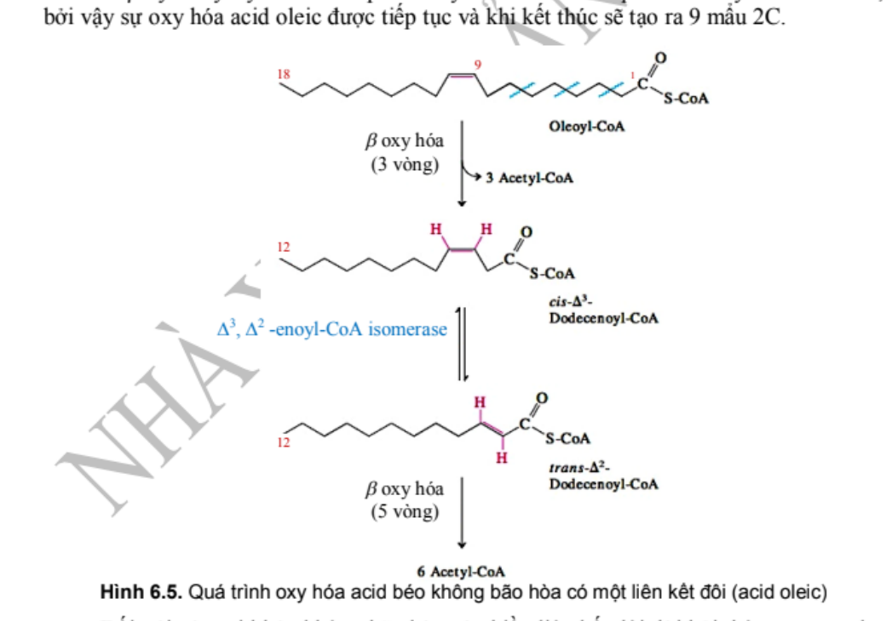  
*Hình 6.5. Quá trình oxy hóa acid béo không bão hòa có một liên kết đôi (acid oleic)*

---

Đối với các acid béo không bão hòa có nhiều liên kết đôi đòi hỏi thêm enzym phụ nữa để hoàn thành sự oxy hóa chúng (*Hình 6.6*). Ngoài enzym *isomerase*, enzym **reductase** cũng được sử dụng để chuyển 2 liên kết đôi liên tiếp ($\text{C}_2\&\text{C}_4$) thành 1 liên kết đôi ở vị trí $\text{C}_3$ sau khi nhận $2\text{H}$.

---

## [Trang 139] - Thoái hóa Acid béo nhiều liên kết đôi (Linoleic) & Acid béo có số C lẻ

Như vậy, các enzym phụ của quá trình oxy hóa acid béo có thể làm cho tất cả acid béo không bão hòa gặp trong các lipid tự nhiên được oxy hóa hoàn toàn.

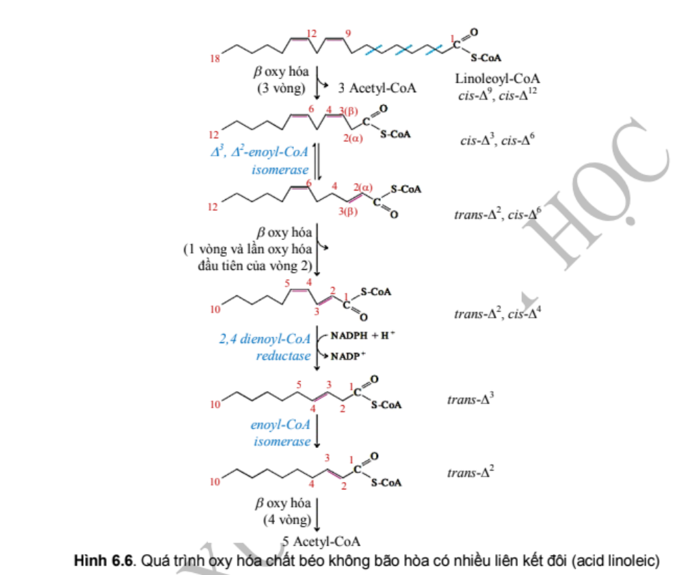  
*Hình 6.6. Quá trình oxy hóa chất béo không bão hòa có nhiều liên kết đôi (acid linoleic)*

- **Acid linoleic ($18:2\ \Delta^{9,12}$):** Trải qua 3 vòng $\beta$-oxy hóa giải phóng $3\text{ Acetyl-CoA}$, còn lại $\text{cis-}\Delta^3,\text{cis-}\Delta^6$.
- **Enzym $\Delta^3,\Delta^2$-enoyl-CoA isomerase:** Chuyển thành $\text{trans-}\Delta^2,\text{cis-}\Delta^6$.
- Qua 1 vòng $\beta$-oxy hóa và lần oxy hóa đầu tiên của vòng tiếp theo tạo $\text{trans-}\Delta^2,\text{cis-}\Delta^4$.
- **Enzym 2,4-dienoyl-CoA reductase (dùng $\text{NADPH}+\text{H}^+$):** Khử thành $\text{trans-}\Delta^3$.
- **Enzym enoyl-CoA isomerase:** Đồng phân hóa thành $\text{trans-}\Delta^2$.
- Tiếp tục 4 vòng $\beta$-oxy hóa giải phóng $5\text{ Acetyl-CoA}$ còn lại.

---

### 1.5. Thoái hoá acid béo có số carbon lẻ
Đa phần các acid béo trong tự nhiên đều có số carbon chẵn. Tuy nhiên, ở một số động vật gia súc nhai lại hoặc ở thực vật vẫn xuất hiện acid béo có số carbon lẻ, một lượng nhỏ propionat cũng có mặt trong chế độ ăn ở người. Thoái hoá acid béo có số carbon lẻ cũng giống như ở acid béo có số carbon chẵn, tuy nhiên vòng sản phẩm của vòng $\beta$ oxy hoá cuối cùng sẽ cho sản phẩm là **propionyl-CoA có 3C**. 

Thoái hoá propionyl-CoA cần trải qua thêm 3 bước trước khi đi vào chu trình acid citric:
1. Đầu tiên, propionyl-CoA sẽ được gắn thêm 1C nhờ enzym **propionyl-CoA carboxylase** tạo **D-methylmalonyl-CoA (4C)**. Phản ứng này cần **ATP** cung cấp năng lượng và coenzym **Biotin** cố định $\text{HCO}_3^-$.
2. Tiếp theo, D-methylmalonyl-CoA được đồng phân hoá nhờ enzym **methylmalonyl-CoA epimerase** tạo thành phân tử **L-methylmalonyl-CoA**.
3. Cuối cùng, L-methylmalonyl-CoA sắp xếp lại chuỗi carbon tạo thành **succinyl CoA** nhờ enzym **methylmalonyl-CoA mutase** có coenzym là **vitamin $\text{B}_{12}$** (5'-deoxyadenosylcobalamin). 

Succinyl CoA chính là mắt xích trong chu trình acid citric, tiếp tục thoái hoá tận cùng thành $\text{CO}_2$ và $\text{H}_2\text{O}$.

---

## [Trang 140] - Con đường chuyển hóa Propionyl-CoA & Điều hòa thoái hóa Acid béo

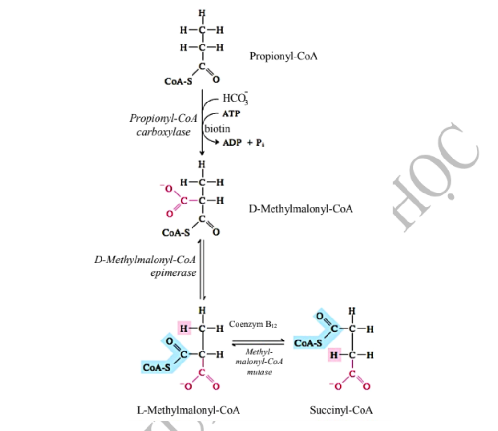  
*Hình 6.7. Con đường chuyển hóa Propionyl-CoA thành Succinyl-CoA*

$$\begin{matrix}
\text{Propionyl-CoA} \quad (3\text{C}) \\
\Big\downarrow \ \text{Propionyl-CoA carboxylase} \quad (\text{ATP} + \text{HCO}_3^- \xrightarrow{\text{Biotin}} \text{ADP} + \text{P}_i) \\
\text{D-Methylmalonyl-CoA} \\
\Big\downarrow \ \text{Methylmalonyl-CoA epimerase} \\
\text{L-Methylmalonyl-CoA} \\
\Big\downarrow \ \text{Methylmalonyl-CoA mutase} \quad (\text{Coenzym B}_{12}) \\
\text{Succinyl-CoA} \quad (4\text{C, đi vào Chu trình Krebs})
\end{matrix}$$

---

### 1.6. Điều hòa thoái hoá acid béo
Điều hoà thoái hoá acid béo phụ thuộc duy nhất vào nhu cầu năng lượng của tế bào. Có 3 enzym quan trọng tham gia điều hoà quá trình đó là:

1. **Carnitin acyltransferase I (CAT-I):** Ức chế vận chuyển acid béo vào ty thể nhờ vai trò ức chế của **malonyl-CoA**. Khi tế bào đang dư thừa năng lượng hoặc lượng glucose tăng lên trong tế bào, tế bào sẽ tăng tổng hợp acid béo dự trữ và ức chế quá trình oxy hoá acid béo. Một khi acid béo được vận chuyển vào ty thể, lập tức nó sẽ thoái hoá sinh năng lượng, do đó ức chế *carnitin acyltransferase I* bởi chính sản phẩm đầu tiên của quá trình tổng hợp acid béo đảm bảo 2 quá trình tổng hợp và thoái hoá acid béo không xảy ra đồng thời.
2. **$\beta$-hydroxyacyl-CoA dehydrogenase:** Điều hoà enzym này nhờ thay đổi tỷ lệ $[\text{NADH}]/[\text{NAD}^+]$. Khi tỷ lệ này tăng cao có nghĩa là đang dư thừa cơ chất đi vào chuỗi vận chuyển điện tử, enzym này sẽ bị ức chế, giảm thoái hoá acid béo.

---

## [Trang 141] - Ức chế Thiolase, Bệnh lý di truyền & Quá trình tạo Thể Ceton

3. **Thiolase:** Bị ức chế bởi nồng độ **acetyl-CoA** cao hay khi dư thừa cơ chất đi vào chu trình acid citric.

Một bệnh lý di truyền rối loạn thoái hoá acid béo hay gặp nhất là thiếu hụt enzym **acid béo-CoA dehydrogenase** sẽ gây ra bệnh lý nghiêm trọng. Bệnh này hay gặp ở người Mỹ và Bắc Âu, đột biến gen gây thiếu hụt enzym acid béo-CoA dehydrogenase thoái hoá acid béo chuỗi dài trung bình (6-12C) (MCAD deficiency). Bệnh đặc trưng bởi hội chứng lâm sàng: tăng tích luỹ chất béo trong gan, tăng acid béo octanoic trong huyết thanh, giảm glucose máu, buồn ngủ, buồn nôn và thậm chí hôn mê. Phân tích nước tiểu đặc trưng bởi sự xuất hiện với nồng độ cao của dicarboxylic acid (6-10C) là sản phẩm của quá trình $\omega$ oxy hoá và giảm thể ceton niệu. Một số cá thể có thể không biểu hiện triệu chứng ở giai đoạn sớm, tuy nhiên khi giai đoạn nặng có thể tử vong và thường xảy ra $25 - 60\%$ khi còn bé. Nếu được phát hiện sớm từ khi mới sinh và điều chỉnh chế độ ăn giảm béo, nhiều carbonhydrat, không nhịn ăn quá lâu để ngăn ngừa quá trình huy động năng lượng từ acid béo; bệnh hoàn toàn có thể kiểm soát được với tiên lượng khá tốt.

Ngoài ra, có khoảng hơn 20 bệnh lý di truyền khác liên quan đến vận chuyển acid béo hoặc oxy hoá acid béo nhưng đều rất hiếm gặp. Một trong số đó gây bệnh lý nghiêm trọng là mất chức năng của enzym *$\beta$-hydroxyacyl-CoA dehydrogenase* trong phức hợp TFP; hoặc thiếu hụt tiểu phần $\alpha$ hoặc $\beta$ gây giảm hoạt độ của TFP gây nên bệnh lý cơ xương và cơ tim nghiêm trọng.

---

### 1.7. Thể ceton và sự oxy hóa chúng
Ở cơ thể người và động vật có vú, acetylCoA được hình thành ở gan trong quá trình oxy hóa acid béo có thể đi vào chu trình acid citric hoặc có thể tạo ra các thể ceton gồm **acetoacetat**, **D-$\beta$-hydroxybutyrat** và **aceton** để cung cấp cho các mô ngoại vi (*Hình 6.8*).

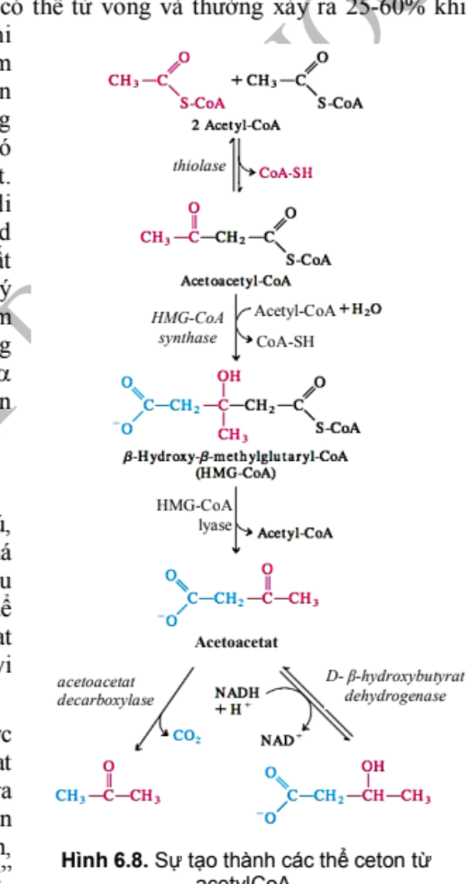  
*Hình 6.8. Sự tạo thành các thể ceton từ acetylCoA tại ty thể tế bào gan*

$$\begin{matrix}
2\text{ Acetyl-CoA} \xrightleftharpoons[\text{CoASH}]{\text{Thiolase}} \text{Acetoacetyl-CoA} \\
\Big\downarrow \ \text{HMG-CoA synthase} \quad (+\text{Acetyl-CoA} + \text{H}_2\text{O} \rightarrow \text{CoASH}) \\
\beta\text{-Hydroxy-}\beta\text{-methylglutaryl-CoA (HMG-CoA)} \\
\Big\downarrow \ \text{HMG-CoA lyase} \quad (\rightarrow \text{Acetyl-CoA}) \\
\textbf{Acetoacetat} \\
\swarrow \qquad\qquad\qquad\qquad\qquad \searrow \\
\text{Acetoacetat decarboxylase} \ (\rightarrow \text{CO}_2) \qquad\qquad \text{D-}\beta\text{-hydroxybutyrat dehydrogenase} \ (\text{NADH}+\text{H}^+ \leftrightarrow \text{NAD}^+) \\
\textbf{Aceton} \qquad\qquad\qquad\qquad\qquad\qquad \textbf{D-}\beta\textbf{-hydroxybutyrat}
\end{matrix}$$

Ở người khỏe mạnh, aceton được hình thành với số lượng rất ít. Acetoacetat và D-$\beta$-hydroxybutyrat sẽ khuếch tán ra ngoài tế bào gan, rồi theo máu tuần hoàn đến các mô ngoại vi như cơ xương, cơ tim, vỏ thượng thận,... Bình thường "chất đốt" để cung cấp cho não chủ yếu là glucose.

---

## [Trang 142] - Thoái hóa Thể Ceton ở mô ngoại vi & Cơ chế Toan Ceton

Khi bị đói kéo dài hoặc sự cung cấp glucose bị hạn chế thì não có thể dùng D-$\beta$-hydroxybutyrat được tạo thành trong gan từ acid béo là "chất đốt" chính để cung cấp năng lượng ($75\%$ năng lượng cần cho não có nguồn gốc từ các thể ceton).

Tại các mô ngoại vi, D-$\beta$-hydroxybutyrat được oxy hóa thành acetoacetat, sau đó chất này được hoạt hóa thành acetoacetylCoA và rồi phân tách tạo nên 2 phân tử acetylCoA (*Hình 6.9*). AcetylCoA sẽ đi vào chu trình acid citric.

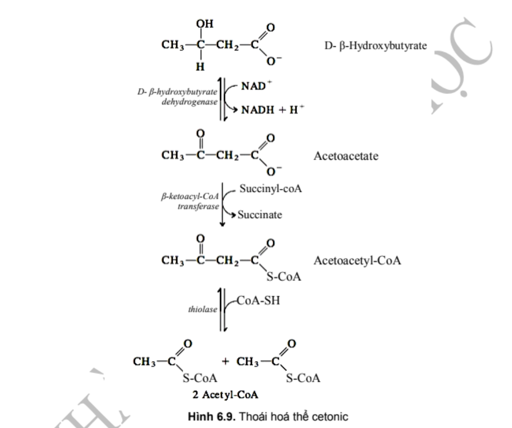  
*Hình 6.9. Con đường thoái hoá thể cetonic tại ty thể các mô ngoại vi*

1. $\text{D-}\beta\text{-hydroxybutyrat} + \text{NAD}^+ \xrightarrow{\text{D-}\beta\text{-hydroxybutyrat dehydrogenase}} \text{Acetoacetat} + \text{NADH} + \text{H}^+$
2. $\text{Acetoacetat} + \text{Succinyl-CoA} \xrightarrow{\beta\text{-ketoacyl-CoA transferase (Thiophorase)}} \text{Acetoacetyl-CoA} + \text{Succinat}$
3. $\text{Acetoacetyl-CoA} + \text{CoASH} \xrightarrow{\text{Thiolase}} 2\text{ Acetyl-CoA} \rightarrow \text{Chu trình Krebs}$

> [!NOTE]
> Gan là cơ quan duy nhất tổng hợp thể ceton nhưng **gan không sử dụng được thể ceton** vì thiếu enzym **$\beta$-ketoacyl-CoA transferase (thiophorase)**.

Sự hình thành và vận chuyển các thể ceton từ gan đến các mô ngoại vi tạo điều kiện cho quá trình oxy hóa tiếp tục của acid béo và acetylCoA trong tế bào gan. Bình thường, nồng độ các thể ceton trong máu rất thấp ($\le 1\text{ mg/dL}$). Khi đói glucid hoặc khi bị bệnh **đái tháo đường**, sự thoái hóa của glucid bị giảm và cơ thể cần phải oxy hóa lipid dự trữ để bù đắp cho nhu cầu của cơ thể và gây nên nồng độ bệnh lý của các thể ceton: các thể ceton tăng rất cao trong máu (**nhiễm ceton máu**) và nước tiểu (**ceton niệu**), đôi khi có mùi aceton trong hơi thở. Sự tạo thành các thể ceton bệnh lý là hậu quả của sự mất cân đối giữa chuyển hóa glucid và chuyển hóa lipid, dẫn đến:
- Thiếu $\text{NADPH}$-coenzym được tạo nên từ con đường hexose monophosphat và cần thiết cho quá trình tổng hợp acid béo.

---

## [Trang 143] - Nguyên nhân ứ đọng Thể Ceton & Thoái hóa Glycerophospholipid

- Thiếu **succinylCoA** và **oxaloacetat** – các sản phẩm chuyển hóa trung gian của chu trình acid citric cần thiết để ngưng tụ với acetyl-CoA và cung cấp CoA để hoạt hóa acid acetoacetic. Do oxaloacetat bị rút bớt ra ngoài để tân tạo glucose, acetyl-CoA ứ đọng vượt quá khả năng oxy hóa của chu trình Krebs, buộc phải chuyển hướng mạnh mẽ sang tạo thể ceton tại gan.

Tóm lại, sự ứ đọng các thể ceton trong cơ thể là do tốc độ tạo thành các chất này ở gan vượt quá khả năng sử dụng chúng tại các mô ngoại vi, gây toan máu chuyển hóa (**toan ceton do đái tháo đường** - *Diabetic Ketoacidosis*, DKA).

---

### 1.8. Thoái hóa Glycerophospholipid
Enzym xúc tác quá trình thoái hóa glycerophospholipid được gọi là **phospholipases (PL)**. Phospholipase là một enzym thủy phân phospholipid thành acid béo và các chất lipophilic khác. Có bốn loại chính, được gọi là A, B, C và D, được phân biệt bởi loại phản ứng mà chúng xúc tác:
- **Phospholipase A (PLA):** gồm *phospholipase A1 (PLA1)* và *phospholipase A2 (PLA2)*. Phospholipase A1 thủy phân liên kết este acyl ở vị trí $\text{C}_1$ và Phospholipase A2 thủy phân liên kết este acyl ở vị trí $\text{C}_2$.
- Thuật ngữ **phospholipase B** được trao cho phospholipases xúc tác thủy phân liên kết acyl ester ở cả vị trí $\text{C}_1$ và $\text{C}_2$. Enzym này còn được gọi là *lysophospholipase*.
- **Phospholipase C (PLC):** tách liên kết glycerophosphat, giải phóng **diacylglycerol (DAG)** và nhóm đầu chứa phosphat. Các phospholipase C đóng một vai trò trung tâm trong việc truyền tín hiệu, phát hành chất truyền tín hiệu hiệu inositol triphosphat ($\text{IP}_3$). Phospholipase C là một phosphodiesterase.
- **Phospholipase D (PLD):** cũng là một phosphodiesterase xúc tác sự thủy phân nhóm đầu, để lại **phosphatidat (acid phosphatidic)**.

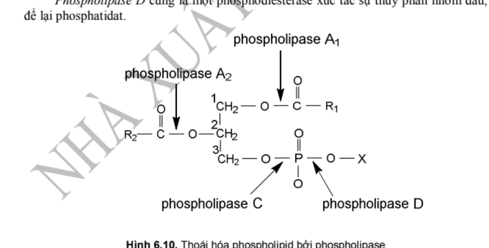  
*Hình 6.10. Vị trí tác dụng phân cắt của các loại phospholipase $\text{A}_1$, $\text{A}_2$, $\text{C}$, $\text{D}$*

---

## [Trang 144] - Vai trò tín hiệu của Phospholipase & Bắt đầu Tổng hợp Acid béo

Các động thủy phân của nhiều PL có chức năng tạo ra các gốc tín hiệu nội bào. Bằng cách giải phóng **acid arachidonic** từ phospholipid tế bào, một số **$\text{PLA}_2$** là bước đầu tiên và tỷ lệ giới hạn trong sinh tổng hợp **eicosanoid** (prostaglandin, thromboxan, leukotrien). Hoạt động **PLC** trong thủy phân phosphatidylinositol tạo ra **DAG** và **$\text{IP}_3$**, và do đó kích hoạt hai đường tín hiệu nội bào: protein kinase C và giải phóng các ion calci từ các tiểu thể nội bào. PL cũng rất quan trọng về mặt dược lý bởi vì một số PL khi được hoạt hóa bởi các tương tác với một số thụ thể khác nhau trên màng tế bào.

Trong thiên nhiên, các loại lysophospholipid thường gặp là lysophosphatidyl cholin (lysolecithin), lysophosphatidyl ethanolamin (lysocephalin). Đó là những chất tẩy và gây **vỡ hồng cầu** khá mạnh. **Nọc rắn** thường gây vỡ hồng cầu vì chứa nhiều loại *phospholipase A*. Trong gan và huyết tương có enzym **lecithin-cholesterol acyltransferase (LCAT)**, xúc tác sự vận chuyển gốc acyl ở $\text{C}_2$ của lecithin đến cholesterol để tạo cholesterol este hóa và lysolecithin.

---

### 2. TỔNG HỢP LIPID Ở TẾ BÀO

### 2.1. Sinh tổng hợp acid béo bão hòa có số carbon chẵn
Quá trình tổng hợp acid béo bão hòa từ acetylCoA xảy ra ở tất cả các mô nhưng đặc biệt rất mạnh trong **gan, mô mỡ, ruột và tuyến vú** của các loài động vật cấp cao. Sự tổng hợp cũng như sự oxy hóa acid béo được xảy ra theo những con đường khác nhau với sự xúc tác bởi các hệ enzym khác nhau và ở các vị trí khác nhau trong tế bào. Acid béo được tổng hợp bởi những nguyên liệu từ lipid hoặc không phải lipid. Quá trình tổng hợp acid béo xảy ra ở 3 vị trí khác nhau: ở **bào tương**, trong **ty thể** và ở **lưới nội chất**; trong đó sự tổng hợp acid béo ở bào tương đóng vai trò chủ yếu đảm nhiệm tổng hợp acid béo mạch ngắn và trung bình, ở lưới nội chất và bào tương giúp kéo dài mạch carbon để tạo thành acid béo mạch dài.

#### 2.1.1. Tổng hợp acid béo trong bào tương tế bào
- **Nguyên liệu:** là **acetylCoA** – được hình thành trong ty thể (do quá trình khử carboxyl oxy hóa pyruvat, oxy hóa một số acid amin, oxy hóa acid béo) và được vận chuyển ra bào tương theo 2 cách:
  1. *Nhờ hệ thống vận chuyển tricarboxylat (con thoi citrat):*
     - Trong ty thể: $\text{AcetylCoA} + \text{Oxaloacetat} \xrightarrow{\text{Citrat synthase}} \text{Citrat} + \text{HS-CoA}$
     - Citrat đi qua màng ty thể ra bào tương nhờ protein mang tricarboxylat.
     - Bào tương: $\text{Citrat} + \text{ATP} + \text{HS-CoA} \xrightarrow{\text{Citrat lyase}} \text{Oxaloacetat} + \text{ADP} + \text{P}_i + \text{AcetylCoA}$
  2. *Nhờ chất vận chuyển carnitin:* cùng hệ thống vận chuyển acid béo vào ty thể.

- **Chất trung gian để tổng hợp acid béo là malonylCoA:** Chất này được hình thành nhờ enzym **acetylCoA carboxylase (ACC)** xúc tác. Enzym này có 3 vùng chức năng: 
  - Protein mang biotin (*biotin carrier protein*)
  - *Biotin carboxylase* hoạt hóa $\text{CO}_2$ bằng cách gắn $\text{CO}_2$ với nguyên tử N của vòng biotin nhờ phản ứng phụ thuộc ATP
  - *Transcarboxylase* làm nhiệm vụ vận chuyển $\text{CO}_2$ được hoạt hóa từ biotin đến acetylCoA để tạo thành malonyl CoA.

---

## [Trang 145] - Phức hợp Đa enzym Acid béo Synthetase (FAS) & Các phản ứng

Quá trình tổng hợp malonyl-CoA có thể tóm tắt như sau:

$$\text{Acetyl-CoA} + \text{HCO}_3^- + \text{ATP} \xrightarrow[\text{Biotin}]{\text{Acetyl-CoA carboxylase}} \text{Malonyl-CoA} + \text{ADP} + \text{P}_i$$

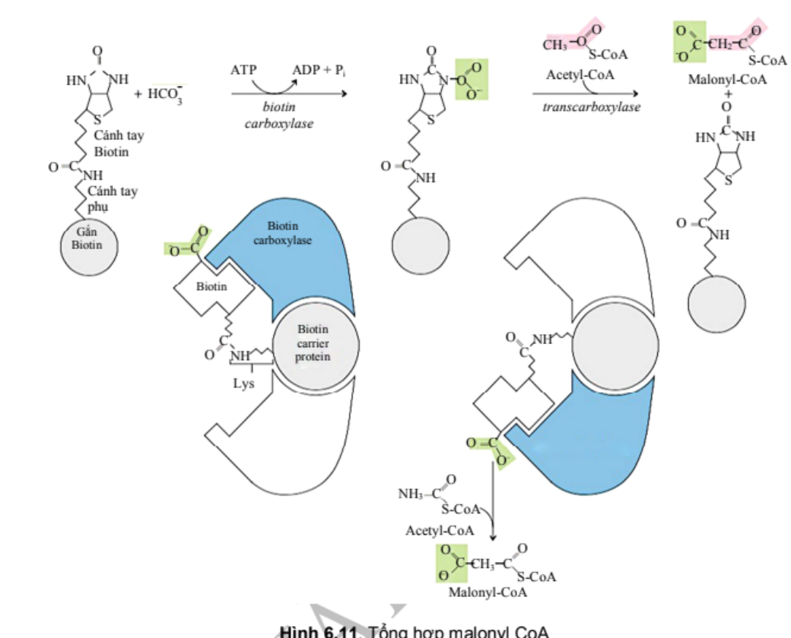  
*Hình 6.11. Cơ chế phản ứng hai bước của phức hợp Acetyl-CoA carboxylase tạo Malonyl-CoA nhờ cánh tay linh hoạt Biotin*

---

### Chu trình tổng hợp acid béo (Phức hợp Fatty Acid Synthase - FAS)
Chu trình tổng hợp acid béo gồm 6 phản ứng liên tiếp nhau do 6 enzym của hệ thống tổng hợp acid béo xúc tác. Hệ thống này là phức hợp multienzym gọi là **acid béo synthetase (FAS)**, gồm 6 enzym và một protein không có hoạt tính enzym:

1. **AT** (*ACP-acyltransferase*): vận chuyển gốc acetyl từ acetyl-CoA đến ACP.
2. **MT** (*ACP-malonyltransferase*): vận chuyển gốc malonyl từ malonyl-CoA đến ACP.
3. **KS** (*$\beta$-cetoacyl-ACP synthase*): enzym ngưng tụ tạo liên kết $\text{C}-\text{C}$.
4. **KR** (*$\beta$-cetoacyl-ACP reductase*): khử hydro lần 1 nhờ $\text{NADPH}$.
5. **HD** (*$\beta$-hydroxyacyl-ACP dehydrogenase / dehydratase*): phản ứng tách nước tạo liên kết đôi trans.
6. **ER** (*enoyl-ACP reductase*): khử hydro lần 2 nhờ $\text{NADPH}$.
7. **ACP** (*Acyl carrier protein*): protein mang gốc acyl với cánh tay linh hoạt **phosphopantethein** chứa nhóm $-\text{SH}$ tự do.

Phức hợp multienzym có 2 nhóm $-\text{SH}$ hoạt động:
- **$-\text{SH}$ trung tâm:** thuộc về protein vận chuyển ACP (gốc phosphopantethein).
- **$-\text{SH}$ ngoại vi:** thuộc về gốc cystein trong phân tử enzym ngưng tụ KS.

#### + Sự tạo thành acetyl ACP và malonyl ACP:
Sau bước này, phức hợp multienzym được khởi động để sẵn sàng thực hiện chuỗi phản ứng gắn hai mẩu acetyl với nhau, phức hợp mang nhóm acetyl este hóa với $-\text{SH}$ ngoại vi và nhóm malonyl este hóa với $-\text{SH}$ trung tâm.


<!-- END FILE: pages_136_145.md -->


<!-- BEGIN FILE: pages_146_155.md -->

# GIÁO TRÌNH HÓA SINH - ĐẠI HỌC Y HÀ NỘI
**Chủ biên:** GS. TS. BS. Tạ Thành Văn  
**Nguồn:** SGK Hóa sinh YHN 2019 (Nhà xuất bản Y học)

---

# CHƯƠNG 6: CHUYỂN HÓA LIPID VÀ LIPOPROTEIN (TIẾP THEO)

## [Trang 146] - Chu trình Tổng hợp Acid béo qua Phức hợp FAS

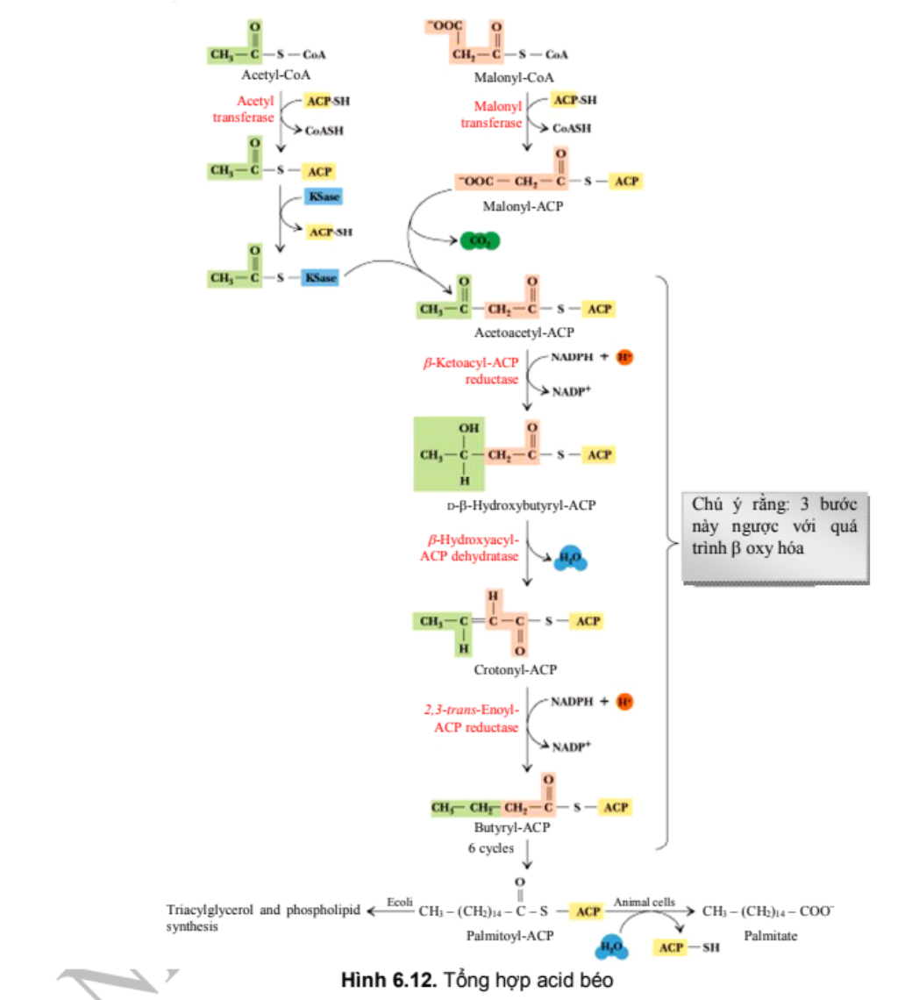  
*Hình 6.12. Chu trình tổng hợp acid béo qua phức hợp Fatty Acid Synthase (FAS)*

Sau khi nạp acetyl vào $-\text{SH}$ ngoại vi của enzym KS (*$\beta$-cetoacyl-ACP synthase*) và nạp malonyl vào $-\text{SH}$ trung tâm của ACP nhờ hai enzym vận chuyển tương ứng (*AT* và *MT*), chu trình ngưng tụ và khử oxy hóa gồm 4 phản ứng tiếp theo xảy ra:

1. **Phản ứng ngưng tụ:** dưới tác dụng của **KS**, nhóm acetyl được chuyển đến $\text{C}_2$ của nhóm malonyl gắn trên ACP và đồng thời khử carboxyl giải phóng $\text{CO}_2$, tạo thành **acetoacetyl-ACP** (4C).
2. **Phản ứng khử lần 1:** xúc tác bởi **KR** (*$\beta$-cetoacyl-ACP reductase*), sử dụng chất khử là **$\text{NADPH} + \text{H}^+$** để khử nhóm ceton tại $\text{C}_3$ ($\beta$) thành nhóm alcol, tạo **$\text{D-}\beta\text{-hydroxybutyryl-ACP}$**.
3. **Phản ứng khử nước (tách nước):** xúc tác bởi **HD** (*$\beta$-hydroxyacyl-ACP dehydratase*), tách 1 phân tử $\text{H}_2\text{O}$ tạo liên kết đôi trans giữa $\text{C}_2$ và $\text{C}_3$, sinh ra **crotonyl-ACP** ($\text{trans-}\Delta^2\text{-butenoyl-ACP}$).
4. **Phản ứng khử lần 2:** xúc tác bởi **ER** (*2,3-trans-enoyl-ACP reductase*), sử dụng phân tử **$\text{NADPH} + \text{H}^+$** thứ hai để khử no liên kết đôi trans, tạo thành **butyryl-ACP** (chuỗi acyl no 4C).

> [!NOTE]
> *Chú ý rằng:* Ba bước khử lần 1, tách nước và khử lần 2 này có cơ chế hóa học hoàn toàn **ngược lại với quá trình $\beta$-oxy hóa** (oxy hóa, kết hợp nước và oxy hóa tiếp theo).

Sau 6 phản ứng (gồm 2 phản ứng nạp khởi đầu và 4 phản ứng của chu kỳ), **butyryl-ACP** được hình thành. Nhóm butyryl sau đó được chuyển sang nhóm $-\text{SH}$ ngoại vi của KS, giải phóng $-\text{SH}$ của ACP để tiếp nhận nhóm malonyl mới từ malonyl-CoA.

---

## [Trang 147] - Tổng hợp Acid Palmitic & Kéo dài mạch Acid béo

Quá trình trên tiếp tục lặp lại các phản ứng tương tự (*Hình 6.12*) thêm **6 chu kỳ nữa** cho đến khi chuỗi acyl đạt 16 carbon, tạo thành **palmityl-ACP** (tổng cộng 7 chu kỳ).

Gốc palmityl có thể được giải phóng tạo acid palmitic tự do dưới tác dụng của enzym **thioesterase** (ở tế bào động vật) hoặc có thể được chuyển sang phân tử Coenzym A tạo palmityl-CoA (ở vi khuẩn *E. coli* để tổng hợp triacylglycerol và phospholipid). Với hầu hết cơ thể sống, sự tổng hợp acid béo ở bào tương sẽ dừng lại khi acid palmitic được tạo thành (do tính đặc hiệu của KS với chiều dài gốc acyl mà nó tiếp nhận).

### Phương trình tổng quát sinh tổng hợp Palmitat:
$$\text{Acetyl-CoA} + 7\text{ Malonyl-CoA} + 14\text{ NADPH} + 14\text{ H}^+ \rightarrow \text{Palmitat} + 7\text{ CO}_2 + 14\text{ NADP}^+ + 8\text{ CoASH} + 6\text{ H}_2\text{O}$$

Kết hợp với 7 phản ứng tạo malonyl-CoA từ acetyl-CoA tiêu tốn $7\text{ ATP}$:
$$8\text{ Acetyl-CoA} + 7\text{ ATP} + 14\text{ NADPH} + 14\text{ H}^+ \rightarrow \text{Palmitat} + 7\text{ ADP} + 7\text{ P}_i + 14\text{ NADP}^+ + 8\text{ CoASH} + 6\text{ H}_2\text{O}$$

---

### 2.1.2. Tổng hợp acid béo mạch dài
Từ phân tử palmitat, tế bào có thể kéo dài chuỗi carbon tạo thành acid béo mạch dài nhờ hệ thống enzym trong **lưới nội chất** hoặc trong **ty thể**. Hệ thống kéo dài mạch carbon ở lưới nội chất chiếm ưu thế hơn, điển hình là kéo dài thêm 2C từ palmitoyl-CoA 16C thành stearoyl-CoA 18C. Cơ chế kéo dài tương tự tổng hợp acid béo ở tế bào: chất cho carbon vẫn là **malonyl-CoA**, tiếp theo là khử, dehydrat và khử để tạo thành sản phẩm 18C.

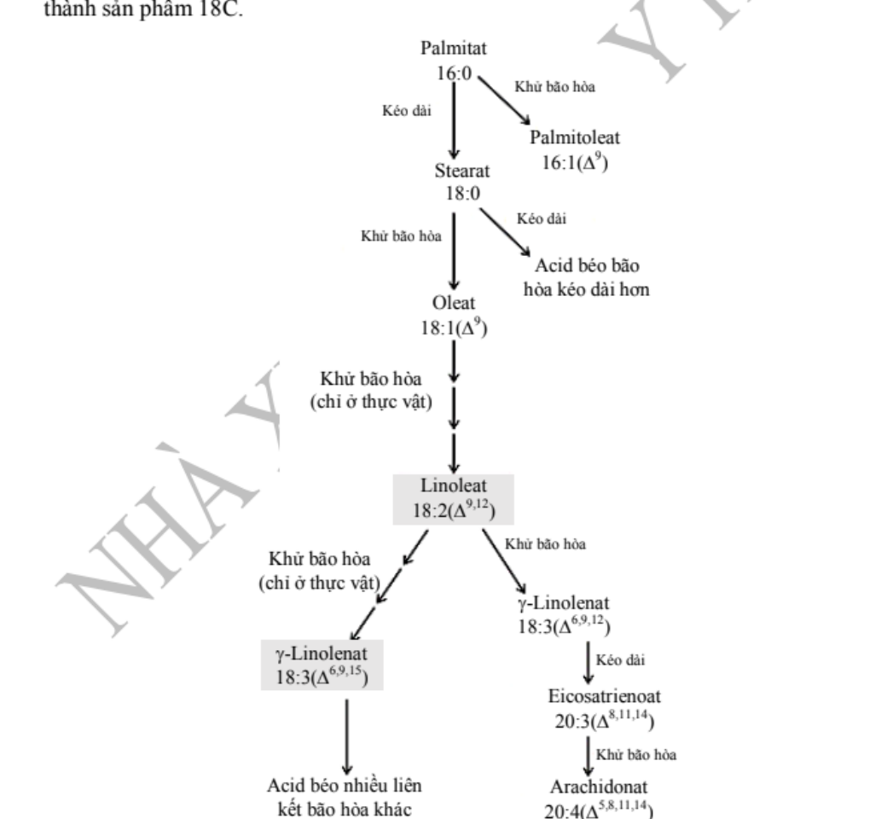  
*Hình 6.13. Sơ đồ con đường kéo dài mạch và khử bão hòa tổng hợp các acid béo mạch dài*

```
Palmitat (16:0)
 ├── Khử bão hòa → Palmitoleat [16:1(Δ⁹)]
 └── Kéo dài → Stearat (18:0)
                ├── Kéo dài → Acid béo bão hòa kéo dài hơn
                └── Khử bão hòa → Oleat [18:1(Δ⁹)]
                                    └── Khử bão hòa (chỉ ở thực vật) → Linoleat [18:2(Δ⁹,¹²)]
                                                                          ├── Khử bão hòa (chỉ ở thực vật) → γ-Linolenat [18:3(Δ⁶,⁹,¹⁵)] → Acid béo nhiều liên kết đôi khác
                                                                          └── Khử bão hòa → γ-Linolenat [18:3(Δ⁶,⁹,¹²)]
                                                                                                └── Kéo dài → Eicosatrienoat [20:3(Δ⁸,¹¹,¹⁴)]
                                                                                                                  └── Khử bão hòa → Arachidonat [20:4(Δ⁵,⁸,¹¹,¹⁴)]
```

---

## [Trang 148] - Tổng hợp Acid béo không bão hòa & Sinh tổng hợp Eicosanoid

### 2.1.3. Tổng hợp acid béo không bão hòa và eicosanoid
Trong mô động vật, acid palmitic và acid stearic là tiền chất của 2 acid béo không bão hòa có 1 liên kết đôi phổ biến là acid palmitoleic $16:1(\Delta^9)$ và acid oleic $18:1(\Delta^9)$. Sự tổng hợp các acid béo này xảy ra ở hệ thống lưới nội bào của gan và mô mỡ nhờ enzym **acid béo-CoA desaturase** thuộc hệ *mono-oxygenase* đặc hiệu xúc tác. Một phân tử oxy tiếp nhận 2 cặp điện tử: một cặp từ cơ chất acid béo bão hòa (acid palmitic hoặc acid stearic) và một cặp từ $\text{NADPH}$ ở tế bào động vật. Sự vận chuyển điện tử được thực hiện nhờ chuỗi vận chuyển điện tử trên hệ thống lưới nội chất (*Hình 6.14*).

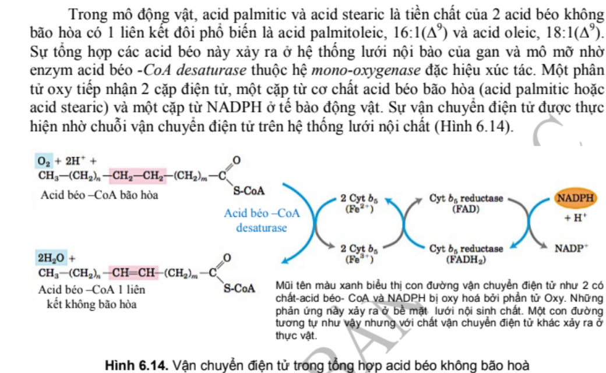  
*Hình 6.14. Chuỗi vận chuyển điện tử trong phản ứng khử bão hòa tạo liên kết đôi của acid béo tại lưới nội chất*

$$\begin{matrix}
\text{Acid béo-CoA bão hòa} \xrightarrow{\text{Acid béo-CoA desaturase}} \text{Acid béo-CoA 1 liên kết đôi} + 2\text{ H}_2\text{O} \\
\uparrow \qquad\qquad\qquad\qquad\qquad\qquad\qquad\qquad\qquad\quad \\
2\text{ Cyt } b_5\ (\text{Fe}^{2+}) \leftarrow \text{Cyt } b_5\text{ reductase (FADH}_2) \leftarrow \text{NADPH} + \text{H}^+
\end{matrix}$$

Tế bào gan có thể tạo liên kết đôi ở vị trí $\Delta^9$ nhưng **không thể tạo thêm liên kết đôi ở vị trí ngoài $\text{C}_{10}$** (hướng về phía nhóm methyl tận cùng). Do đó, tế bào động vật không thể tự tổng hợp được **acid linoleat $18:2(\Delta^{9,12})$** và **$\alpha$-linolenat $18:3(\Delta^{9,12,15})$** là 2 acid béo không bão hòa cần thiết mà bắt buộc phải cung cấp từ chế độ ăn (**acid béo thiết yếu**). Các acid béo không bão hòa cần thiết này là tiền chất tổng hợp nhiều acid béo không bão hòa khác như acid arachidonic, eicosatrienoic... **Acid arachidonic $20:4(\Delta^{5,8,11,14})$** là tiền chất tổng hợp nhiều loại lipid điều hoà gọi là nhóm **eicosanoid**.

#### Nhóm Eicosanoid
Eicosanoid là nhóm phân tử tín hiệu sinh học như prostaglandin hoặc thromboxan, leukotrien, hoạt động trong phạm vi gần tế bào tiết ra nó (*paracrine* và *autocrine*). Khi có tín hiệu kích thích do hormone hoặc yếu tố điều hoà khác, enzym **phospholipase $\text{A}_2$ ($\text{PLA}_2$)**, có mặt ở hầu hết các tế bào động vật, sẽ tiến tới phân huỷ phospholipid màng tế bào giải phóng arachidonic acid từ vị trí $\text{C}_2$ của glycerol. Acid arachidonic tiếp tục được chuyển hoá thành **prostaglandin $\text{H}_2$ ($\text{PGH}_2$)** nhờ enzym nằm ở lưới nội chất là **cyclooxygenase (COX)** hay còn gọi là *prostaglandin H2 synthase*. Từ tiền chất trung gian prostaglandin $\text{H}_2$ có thể tổng hợp thành nhiều loại prostaglandin hoặc thromboxane khác nhau. 

Aspirin thuốc giảm đau chống viêm không steroid (NSAID) ức chế enzym COX bằng cách gắn gốc acetyl vào vị trí acid amin Serin làm khoá vị trí hoạt động của enzym này, ức chế tổng hợp prostaglandin và thromboxane. Ibuprofen cũng có tác dụng giảm đau chống viêm nhờ cơ chế này. Thromboxan được tổng hợp từ prostaglandin $\text{H}_2$ nhờ enzym *thromboxane synthase* ở tiểu cầu giúp co mạch và kết dính tiểu cầu, bước đầu tiên của quá trình đông máu. Do đó, sử dụng **aspirin liều thấp** có tác dụng chống đột quỵ và nhồi máu cơ tim nhờ giảm hình thành cục máu đông do kết dính tiểu cầu. 

Ở tế bào động vật, prostaglandin $\text{H}_2$ có 2 dạng isoform: **COX-1** và **COX-2**.

---

## [Trang 149] - Đồng phân COX-1 / COX-2 & Con đường Tổng hợp Eicosanoid

COX-1 và COX-2 có chức năng khác nhau:
- **COX-1:** tổng hợp prostaglandin điều hoà bài tiết dịch nhầy bảo vệ niêm mạc dạ dày và chức năng thận sinh lý.
- **COX-2:** điều hoà quá trình viêm, đau và sốt.

Aspirin và các thuốc NSAID cổ điển ức chế cả hai loại COX-1 và COX-2 nên sử dụng giảm đau, chống viêm có thể gây tác dụng phụ **loét dạ dày - tá tràng** và xuất huyết tiêu hóa. Do đó, hiện nay người ta phát triển loại thuốc giảm đau chống viêm ức chế đặc hiệu COX-2 (ví dụ: celecoxib) để hạn chế tác dụng phụ này.

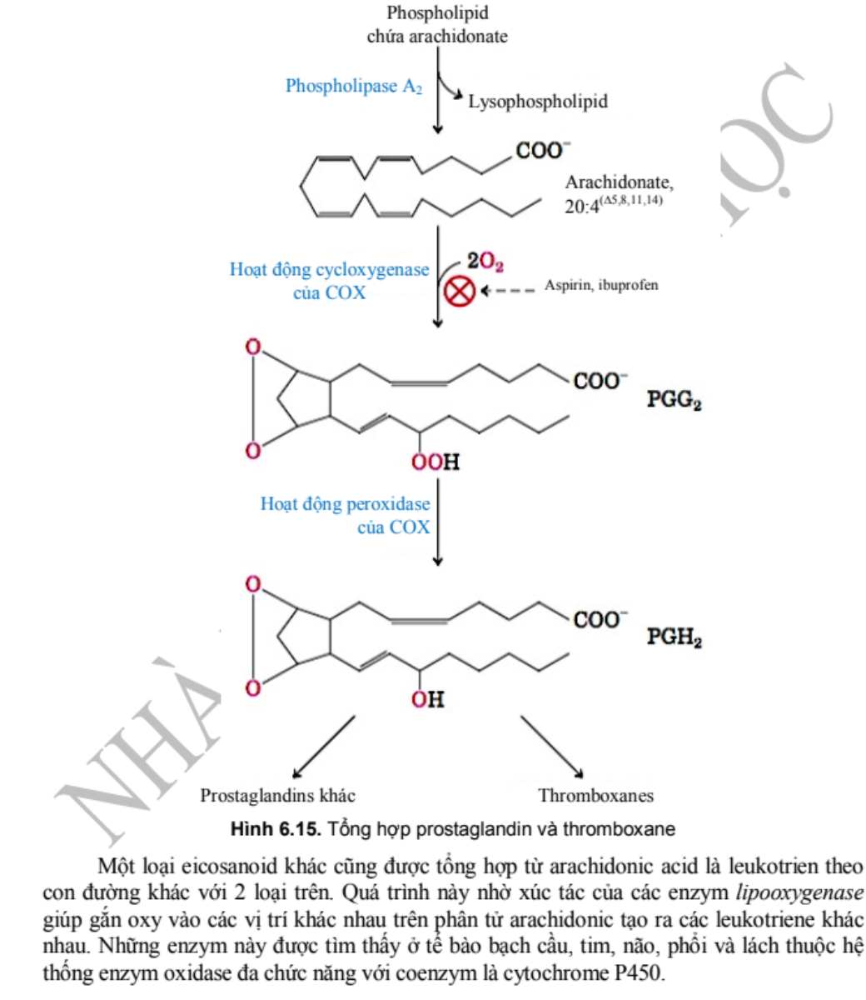  
*Hình 6.15. Con đường tổng hợp Prostaglandin và Thromboxan từ Acid Arachidonic qua enzym COX*

Một loại eicosanoid khác cũng được tổng hợp từ arachidonic acid là **leukotrien** theo con đường khác với 2 loại trên. Quá trình này nhờ xúc tác của các enzym **lipooxygenase (LOX)** giúp gắn oxy vào các vị trí khác nhau trên phân tử arachidonic tạo ra các leukotriene khác nhau. Những enzym này được tìm thấy ở tế bào bạch cầu, tim, não, phổi và lách thuộc hệ thống enzym oxidase đa chức năng với coenzym là cytochrome P450.

---

## [Trang 150] - Tổng hợp Leukotrien & Tổng hợp Triglycerid (Triacylglycerol)

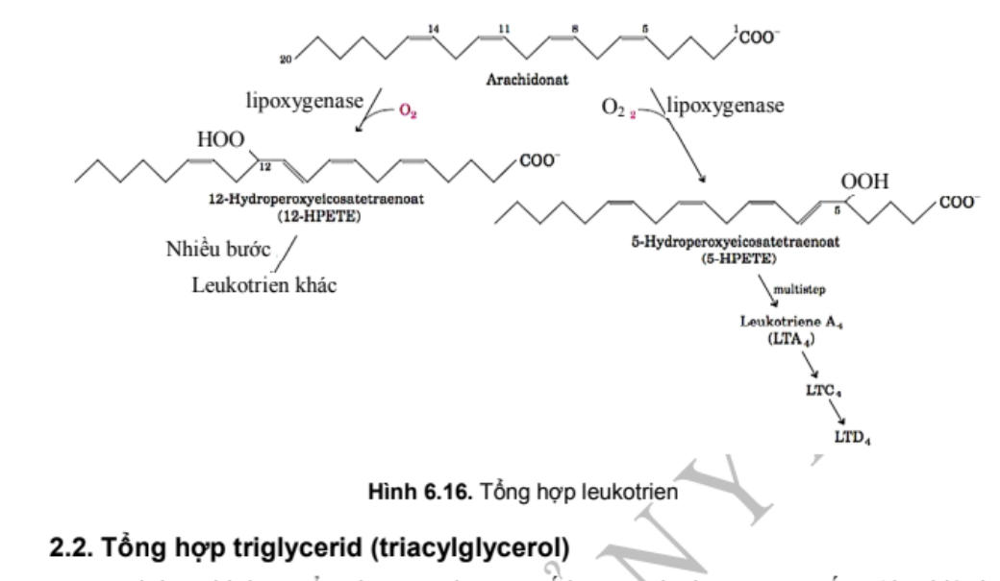  
*Hình 6.16. Con đường tổng hợp Leukotrien ($\text{LTA}_4$, $\text{LTC}_4$, $\text{LTD}_4$) từ Acid Arachidonic qua enzym lipoxygenase*

Leukotrien là chất trung gian hóa học mạnh gây co thắt phế quản, tăng tính thấm thành mạch và phản ứng dị ứng, hen phế quản.

---

### 2.2. Tổng hợp triglycerid (triacylglycerol)
Triglycerid được tổng hợp mạnh ở các tế bào của loài có xương sống (đặc biệt là **tế bào gan** và **tế bào mỡ**) cũng như trong các loài thực vật bậc cao. Hai tiền chất chủ yếu cần cho sự tổng hợp triglycerid là **glycerol-3-phosphat** và **acylCoA**.

Glycerol-3-phosphat được hình thành từ 2 con đường:
1. Từ dihydroxyaceton phosphat (DHAP - sản phẩm trung gian của đường phân) dưới tác dụng của enzym *glycerol-3-phosphat dehydrogenase* trong bào tương (dùng $\text{NADH} + \text{H}^+$).
2. Từ glycerol tự do dưới tác dụng của *glycerol kinase* có ở tế bào gan và tế bào thận (tiêu tốn $1\text{ ATP}$).

> [!NOTE]
> Mô mỡ không có enzym *glycerol kinase*, do đó sự tổng hợp triglycerid ở mô mỡ hoàn toàn phụ thuộc vào quá trình đường phân cung cấp dihydroxyaceton phosphat (DHAP).

Trong niêm mạc ruột tổng hợp triglycerid trong thời gian hấp thu acid béo từ lòng ruột xảy ra khá mạnh và trong quá trình này các monoglycerid được tạo thành do sự tiêu hóa ở ruột có thể được acyl hóa trực tiếp nhờ **monoglycerid palmityltransferase** (con đường 2-monoacylglycerol, không qua trung gian acid phosphatidic).

Trong mỡ dự trữ của mô động, thực vật, triglycerid thường là triglycerid hỗn hợp.

---

## [Trang 151] - Tổng hợp Acid Phosphatidic & Sinh tổng hợp Phospholipid

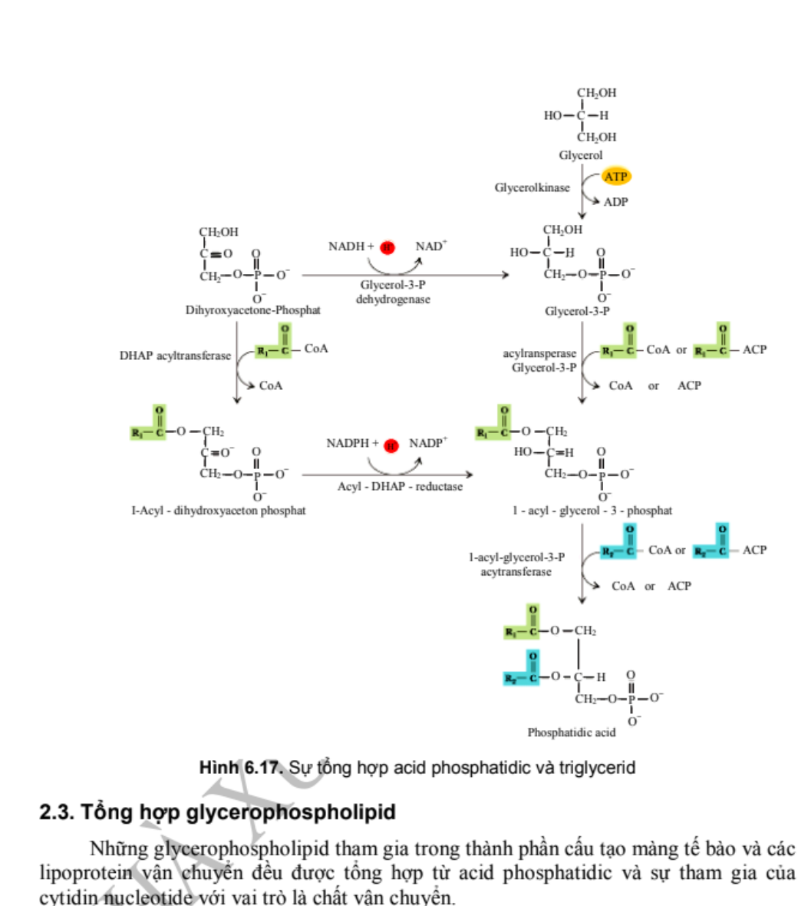  
*Hình 6.17. Sự tổng hợp acid phosphatidic và triglycerid từ glycerol-3-phosphat hoặc DHAP*

$$\begin{matrix}
\text{Glycerol-3-phosphat} \xrightarrow[+\text{R}_1\text{-CO-S-CoA}]{\text{Glycerol-3-P acyltransferase}} \text{1-Acyl-glycerol-3-phosphat} \\
\Big\downarrow \ \text{1-Acyl-glycerol-3-P acyltransferase} \quad (+\text{R}_2\text{-CO-S-CoA}) \\
\textbf{Acid phosphatidic (1,2-diacylglycerol phosphat)} \\
\Big\downarrow \ \text{Phosphatidat phosphatase} \quad (-\text{P}_i) \\
\textbf{1,2-Diacylglycerol (DAG)} \\
\Big\downarrow \ \text{Diacylglycerol acyltransferase (DGAT)} \quad (+\text{R}_3\text{-CO-S-CoA}) \\
\textbf{Triacylglycerol (Triglycerid)}
\end{matrix}$$

---

### 2.3. Tổng hợp glycerophospholipid
Những glycerophospholipid tham gia trong thành phần cấu tạo màng tế bào và các lipoprotein vận chuyển đều được tổng hợp từ acid phosphatidic và sự tham gia của **cytidin nucleotide** ($\text{CDP-diacylglycerol}$ hoặc $\text{CDP-cholin/CDP-ethanolamin}$) với vai trò là chất vận chuyển hoạt hóa cao năng.

#### 2.3.1. Phosphatidylethanolamin (cephalin)
Xảy ra ở các mô động vật. Enzym xúc tác quá trình này thường gắn chặt vào màng của hệ thống lưới nội nguyên sinh chất. Ethanolamin được hoạt hóa bởi ATP tạo phosphoethanolamin, sau đó phản ứng với CTP tạo **CDP-ethanolamin**, rồi kết hợp với diacylglycerol tạo phosphatidylethanolamin.

#### 2.3.2. Tổng hợp phosphatidylcholin (lecithin)
Trong mô động vật, lecithin được tổng hợp theo 2 con đường khác nhau:
1. **Con đường methyl hóa trực tiếp:** nhóm amin của cephalin được methyl hóa 3 lần bởi nhóm methyl của **S-adenosylmethionin (SAM)**.
2. **Con đường sử dụng cholin ngoại sinh:** từ thức ăn hoặc cholin được giải phóng trong quá trình thủy phân phosphatidylcholin, cholin được hoạt hóa tạo **CDP-cholin**, sau đó kết hợp với 1,2-diacylglycerol tạo lecithin.

---

## [Trang 152] - Chuyển hóa Cholesterol & Thuốc Statin hạ mỡ máu

### 3. CHUYỂN HÓA CHOLESTEROL
Cholesterol là chất cần thiết của cơ thể, tham gia thành phần cấu tạo của màng tế bào và quá trình tổng hợp các hormon steroid, acid mật và vitamin D. Cholesterol có hai nguồn: 
- **Ngoại sinh:** được đưa vào cơ thể từ thức ăn (trung bình mỗi người ăn khoảng $300 - 500\text{ mg}$ cholesterol/ngày; thức ăn giàu cholesterol gồm thịt, gan, não, lòng đỏ trứng).
- **Nội sinh:** được tổng hợp bởi tế bào, chủ yếu là tế bào gan (nội sinh khoảng $1\text{ g/ngày}$).

Cholesterol được tổng hợp chủ yếu ở **gan, ruột**. Ngoài ra, cholesterol được tổng hợp ở thượng thận, tinh hoàn, buồng trứng, da và hệ thần kinh. Quá trình tổng hợp cholesterol gồm 25 bước, chia làm 4 giai đoạn chính:
1. Tổng hợp **acid mevalonic (mevalonat 6C)** từ acid acetic dưới dạng acetylCoA qua chất trung gian $\text{HMG-CoA}$.
2. Biến đổi acid mevalonic thành **isopren hoạt hóa (isopentenyl pyrophosphat 5C)**.
3. Biến đổi 6 đơn vị isopren hoạt hóa trùng hợp thành **squalen (30C)**.
4. Biến đổi squalen đóng vòng thành nhân steroid 4 vòng tạo lanosterol, sau đó chuyển thành **cholesterol (27C)**.

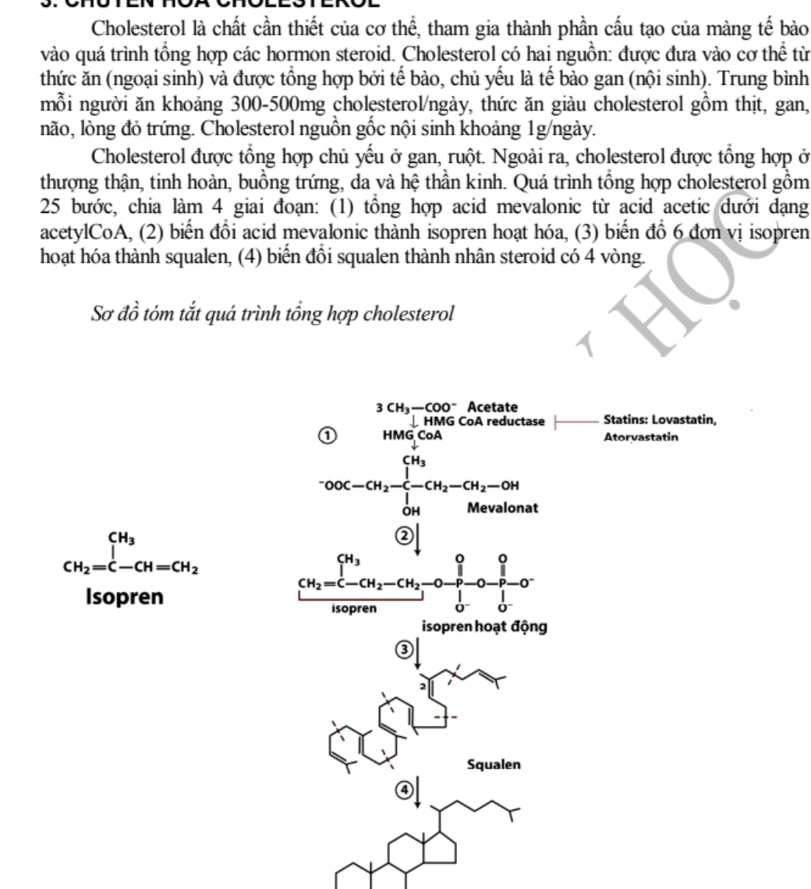  
*Sơ đồ tóm tắt quá trình tổng hợp cholesterol và vị trí tác dụng của thuốc nhóm Statin*

### Các thuốc nhóm Statin hạ Cholesterol máu
Các thuốc giảm cholesterol máu dựa trên cơ chế sinh tổng hợp của cholesterol. Điển hình là nhóm thuốc **statin**, bao gồm: **Lovastatin**, **Atorvastatin (Lipitor)**, **Rosuvastatin (Crestor)**, Simvastatin. 

> [!IMPORTANT]
> Statin là những chất **ức chế cạnh tranh** với enzym **hydroxymethylglutaryl coenzym A reductase (HMG-CoA reductase)**, là enzym chìa khóa xúc tác phản ứng tạo mevalonat từ HMG-CoA (giai đoạn 1). Statin ngăn cản chuyển HMG-CoA thành mevalonat, làm giảm tổng hợp cholesterol nội sinh tại gan, kích thích tế bào gan tăng tổng hợp thụ thể LDL-receptor trên màng, từ đó làm giảm LDL-cholesterol huyết tương từ $25 - 45\%$ tùy theo từng thuốc và liều lượng.

---

## [Trang 153] - Thoái hóa Cholesterol thành Muối mật & Đại cương Lipoprotein

#### Thoái hóa cholesterol
Khoảng $50\%$ lượng cholesterol được bài tiết qua phân dưới dạng **muối mật**, phần cholesterol còn lại được thải dưới dạng steroid trung tính (coprostanol và cholestanol) (*Hình 6.18*).

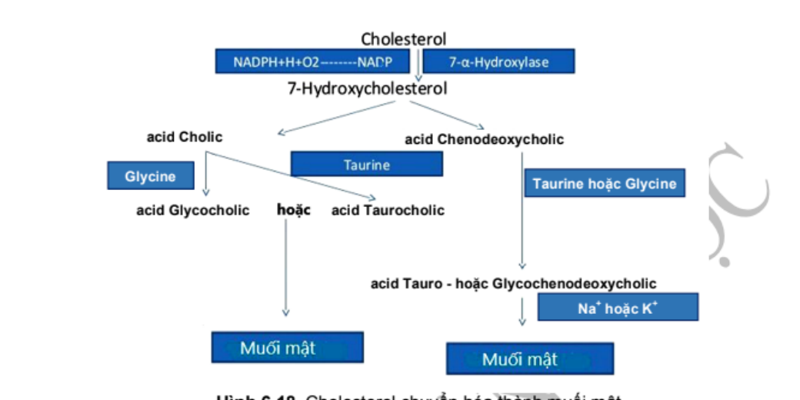  
*Hình 6.18. Sơ đồ con đường chuyển hóa Cholesterol thành các acid mật và muối mật tại gan*

$$\begin{matrix}
\text{Cholesterol} \xrightarrow[\text{NADPH}+\text{H}^+ + \text{O}_2 \rightarrow \text{NADP}^+]{7\text{-}\alpha\text{-Hydroxylase}} \text{7-}\alpha\text{-Hydroxycholesterol} \\
\swarrow \qquad\qquad\qquad\qquad\qquad\qquad \searrow \\
\text{Acid Cholic} \qquad\qquad\qquad\qquad\qquad\qquad \text{Acid Chenodeoxycholic} \\
\Big\downarrow \ +\text{Glycine} \quad \text{hoặc} \quad +\text{Taurine} \qquad\qquad\qquad \Big\downarrow \ +\text{Taurine hoặc Glycine} \\
\text{Acid Glycocholic / Taurocholic} \qquad\qquad \text{Acid Tauro-/Glycochenodeoxycholic} \\
\Big\downarrow \ +\text{Na}^+ \text{ hoặc } \text{K}^+ \qquad\qquad\qquad\qquad\qquad \Big\downarrow \ +\text{Na}^+ \text{ hoặc } \text{K}^+ \\
\textbf{Muối mật (Glycocholat/Taurocholat)} \qquad\qquad \textbf{Muối mật (Chenodeoxycholat)}
\end{matrix}$$

Các acid mật được tạo ra từ cholesterol sẽ liên hợp với **glycin** hoặc **taurin**, sau đó kết hợp với muối kali hoặc natri tạo thành **muối mật**. Muối mật có chức năng quan trọng trong việc tiêu hóa và hấp thu lipid ở ruột non kéo theo sự hấp thu các vitamin tan trong lipid: A, D, E và K.

Khi xuống đến hồi tràng, **$95\%$ muối mật được tái hấp thu** rồi theo tĩnh mạch cửa trở về gan, gọi là **chu trình ruột gan**. Còn lại $5\%$ muối mật được đào thải theo phân.

---

### 4. VẬN CHUYỂN LIPID TRONG MÁU

#### Lipoprotein – dạng lipid vận chuyển
Lipid không tan trong nước. Lipid lưu hành trong máu và dịch sinh vật chủ yếu là cholesterol, triglycerid, phospholipid và một số acid béo tự do. Lipid liên kết với protein đặc hiệu – gọi là **apoprotein (apo)** tạo nên các phân tử **lipoprotein** có khả năng hòa tan trong nước và là dạng vận chuyển của lipid trong máu tuần hoàn.

#### Cấu trúc của lipoprotein
Lipoprotein được Machebocuf mô tả năm 1929. Ngoài thành phần protein, lipoprotein còn có thành phần khác như: phospholipid, triglycerid, sterid và cholesterol. Lipoprotein có dạng hình cầu, đường kính khoảng $100 - 500\text{ \AA}$ ($10 - 50\text{ nm}$). Các phân tử lipid và protein liên kết với nhau chủ yếu bởi liên kết tương tác kỵ nước và lực Van der Waals. 

Theo mô hình của Shen (1977), phân tử lipoprotein gồm:
- **Lớp vỏ ngoài phân cực (dày $\sim 1\text{ nm}$):** apoprotein, phospholipid và cholesterol tự do mang tính phân cực, tiếp xúc với môi trường nước của huyết tương giúp hạt lipoprotein hòa tan.
- **Phần lõi trung tâm kỵ nước:** gồm triglycerid và cholesterol este (sterid).

Phần protein của lipoprotein giữ vai trò quyết định chất nhận diện chúng ở màng tế bào hoặc hoạt hóa các enzym của chúng.

---

## [Trang 154] - Bảng phân loại Lipoprotein, Chylomicron, VLDL & LDL

##### Bảng 6.1. Thành phần và tỷ trọng các lipoprotein huyết thanh người

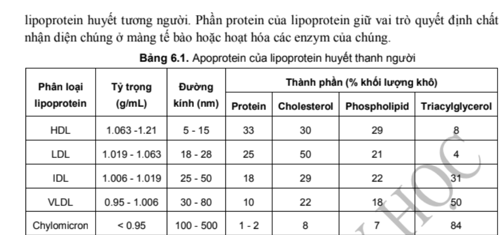  
*Bảng 6.1. Tỷ trọng, đường kính và thành phần hóa học (% khối lượng khô) của các lipoprotein huyết thanh người*

| Phân loại lipoprotein | Tỷ trọng ($\text{g/mL}$) | Đường kính ($\text{nm}$) | Protein ($\%$) | Cholesterol ($\%$) | Phospholipid ($\%$) | Triacylglycerol ($\%$) |
| :--- | :---: | :---: | :---: | :---: | :---: | :---: |
| **HDL** | $1{,}063 - 1{,}210$ | $5 - 15$ | $33$ | $30$ | $29$ | $8$ |
| **LDL** | $1{,}019 - 1{,}063$ | $18 - 28$ | $25$ | $50$ | $21$ | $4$ |
| **IDL** | $1{,}006 - 1{,}019$ | $25 - 50$ | $18$ | $29$ | $22$ | $31$ |
| **VLDL** | $0{,}950 - 1{,}006$ | $30 - 80$ | $10$ | $22$ | $18$ | $50$ |
| **Chylomicron** | $< 0{,}950$ | $100 - 500$ | $1 - 2$ | $8$ | $7$ | $84$ |

---

### Phân loại lipoprotein
Với phương pháp siêu ly tâm phân tích hoặc điện di, lipoprotein được chia thành các loại sau:

#### 1. Chylomicron (CM)
Là lipoprotein có kích thước lớn nhất và hàm lượng triglycerid cao nhất ($84\%$), apoprotein chủ yếu là **apoB-48**, **apoE** và **apoC-II**. CM được tổng hợp độc nhất tại lưới nội nguyên sinh của tế bào niêm mạc ruột, chỉ có mặt trong thời gian ngắn ở huyết tương sau bữa ăn giàu mỡ, là yếu tố làm cho huyết tương có màu đục như nước vo gạo hoặc trắng sữa. CM sẽ biến mất sau vài giờ và huyết tương của người bình thường khi đói phải trong suốt.

- **Chức năng:** vận chuyển triglycerid ngoại sinh (từ thức ăn) từ ruột tới các mô ngoại vi và gan.
- ApoC-II hoạt hóa enzym *lipoprotein lipase (LPL)* trong mao mạch của mô mỡ, tim, cơ xương,... để giải phóng acid béo tự do cho các mô này.
- Phần CM còn lại chứa nhiều cholesterol este, apoE và apoB-48 gọi là **CM tàn dư (remnant)**, tiếp tục theo dòng máu đến gan và được nội nhập bào, thoái hóa trong lysosom tế bào gan.

#### 2. Lipoprotein tỷ trọng rất thấp (VLDL – Very Low Density Lipoprotein)
Được tạo thành ở tế bào gan, là dạng vận chuyển triglycerid nội sinh ($50\%$) vào hệ tuần hoàn. Apo của VLDL bao gồm **apoB-100**, **apoC-I**, **apoC-II**, **apoC-III** và **apoE**. VLDL được vận chuyển từ gan đến mô mỡ và tại đây, enzym *lipoprotein lipase* được hoạt hóa nhờ apoC-II sẽ xúc tác sự thủy phân triglycerid, giải phóng acid béo. VLDL còn lại (VLDL tàn dư / IDL) tiếp tục được chuyển hóa thành LDL hoặc thoái hóa trong lysosom gan.

#### 3. Lipoprotein tỷ trọng thấp (LDL – Low Density Lipoprotein)
Là sản phẩm thoái hóa của VLDL trong máu tuần hoàn (thông qua IDL), rất giàu cholesterol và cholesterol este ($50\%$). **ApoB-100** là apo chính duy nhất của LDL. Chức năng chủ yếu của LDL là vận chuyển cholesterol từ gan đến cung cấp cho các mô ngoại vi và các tế bào. LDL được gắn với **thụ thể LDL-receptor** đặc hiệu ở màng tế bào, sau đó được đưa vào trong tế bào qua cơ chế ẩm bào/nội nhập bào. 

> [!WARNING]
> Cholesterol trong LDL được coi là **cholesterol "xấu"** vì khi dư thừa, LDL dễ bị oxy hóa thâm nhập vào thành mạch, bị đại thực bào thực bào tạo tế bào bọt (*foam cells*), khởi phát và phát triển các mảng vữa xơ động mạch ở thành động mạch.

---

## [Trang 155] - IDL & Lipoprotein tỷ trọng cao (HDL - Cholesterol "tốt")

#### 4. Lipoprotein tỷ trọng trung gian (IDL – Intermediate Density Lipoprotein)
Có tỷ trọng giữa VLDL và LDL. VLDL sau khi giải phóng triglycerid, nhận thêm cholesterol este và mất đi apoC sẽ chuyển thành IDL; chất này nhanh chóng được tế bào gan bắt giữ hoặc tiếp tục thoái hóa thành LDL.

#### 5. Lipoprotein tỷ trọng cao (HDL – High Density Lipoprotein)
Được tổng hợp và tạo thành ở **gan và ruột non**, được giải phóng dưới dạng **HDL mới sinh (nascent HDL)** có hình đĩa phẳng, chứa nhiều apoprotein và phospholipid nhưng rất ít lipid lõi. Sau đó HDL mới sinh chuyển thành $\text{HDL}_3 \rightarrow \text{HDL}_2$ hình cầu nhờ sự xúc tác của enzym **LCAT (Lecithin-cholesterol acyltransferase)** gắn trên bề mặt HDL.

- **Thành phần:** HDL giàu protein nhất ($33\%$) và phospholipid ($29\%$), apo chính của HDL là **apoA-I** (hoạt hóa LCAT) và **apoA-II**.
- **Chức năng:** HDL vận chuyển cholesterol dư thừa từ các mô ngoại vi về gan (**vận chuyển cholesterol ngược** / "trở về") và ở gan, chúng được đào thải hoặc thoái hóa thành acid mật.

> [!TIP]
> Cholesterol của HDL là **cholesterol "tốt"** vì chúng bảo vệ thành mạch, dọn dẹp các mảng lipid lắng đọng, chống nguy cơ xơ vữa động mạch. Lượng cholesterol-HDL càng thấp ($< 0{,}3\text{ g/L}$ hay $< 0{,}9\text{ mmol/L}$) có nguy cơ xơ vữa động mạch càng cao và ngược lại, nồng độ HDL-cholesterol cao là yếu tố bảo vệ tim mạch mạnh mẽ.


<!-- END FILE: pages_146_155.md -->


<!-- BEGIN FILE: pages_156_165.md -->