# CHƯƠNG 7: HÓA HỌC ACID AMIN, PROTEIN VÀ HEMOGLOBIN

---

## MỤC TIÊU HỌC TẬP
1. Trình bày được cấu trúc chung của các acid amin.
2. Phân loại được các acid amin, ý nghĩa của mỗi loại.
3. Trình bày được cấu trúc của peptid và hoạt tính sinh học của một số loại peptid.
4. Trình bày được các bậc cấu trúc của protein và các liên kết ổn định mỗi loại cấu trúc.
5. Trình bày được các tính chất lý hóa và một số chức năng của protein.
6. Trình bày được cấu trúc và chức năng của hemoglobin và myoglobin.

---

## MỞ ĐẦU

Protein đảm nhiệm rất nhiều chức năng trong cơ thể sống. Chúng đóng vai trò vận chuyển những chất kỵ nước ở trong máu; là những phân tử bám dính tế bào giúp gắn các tế bào với nhau và với khoảng gian bào; là hormon truyền tín hiệu từ một nhóm tế bào này đến nhóm tế bào khác; là kênh ion của màng lipid; là enzym giúp làm tăng tốc độ các phản ứng hóa sinh... 

Đặc tính của một phân tử protein được quy định bởi một chuỗi thẳng các acid amin được gọi là **cấu trúc bậc 1** của protein. Cấu trúc bậc 1 của một phân tử protein quyết định cấu trúc không gian và tương tác với phân tử khác để thực hiện chức năng trong tế bào. Cấu trúc bậc 1 của tất cả protein người tạo thành từ **20 acid amin** khác nhau sắp xếp thành chuỗi, trình tự của chuỗi được quyết định bởi mã di truyền (*genetic code*).

### Đặc tính chung của các acid amin
Các acid amin cấu tạo nên protein có cấu trúc chung giống nhau. Nó bao gồm:
- Một nhóm carboxylic ($-\text{COOH}$).
- Một nhóm amin ($-\text{NH}_2$) gắn vào nguyên tử carbon $\alpha$ ($\text{C}_\alpha$) trong cấu trúc dạng L.
- Một nguyên tử hydro ($-\text{H}$).
- Một nhóm hóa học gọi là nhóm bên (gốc $-\text{R}$) — nhóm bên này phân biệt các acid amin với nhau.

Trong dung dịch, acid amin tự do tồn tại dưới dạng **ion lưỡng tính** (*zwitterion*), nhóm amino tích điện dương ($-\text{NH}_3^+$) và nhóm carboxyl tích điện âm ($-\text{COO}^-$). Trong phân tử protein, các acid amin gắn với nhau thành chuỗi thẳng được gọi là **chuỗi peptid** thông qua **liên kết peptid** giữa nhóm acid carboxylic và nhóm amin của hai acid amin liền kề.

### Phân loại acid amin dựa trên đặc tính hóa học của gốc R
Đặc tính hóa học của nhóm bên quyết định loại liên kết và tương tác của mỗi acid amin với phân tử khác trong chuỗi polypeptid. Do đó các acid amin thường tập trung lại do sự phân cực của nhóm bên (tích điện, kỵ nước không phân cực, hoặc phân cực không tích điện) hoặc bởi đặc điểm cấu trúc (béo, có vòng hoặc nhân thơm):
- Tập hợp nhóm bên của các acid amin kỵ nước không phân cực (*alanin, valin, leucin, isoleucin, phenylalanin và methionin*) ngăn cản nước trong **hiệu ứng kỵ nước**.
- Các acid amin phân cực không tích điện (*serin, threonin, tyrosin, asparagin và glutamin*) tham gia vào **liên kết hydro**.
- Cystein chứa một nhóm sulfhydryl ($-\text{SH}$) hình thành **liên kết disulfid** ($-\text{S}-\text{S}-$).
- Các acid amin acid tích điện âm (*aspartat và glutamat*) hình thành **liên kết ion (tĩnh điện)** với phân tử tích điện dương, ví dụ acid amin base (*lysin, arginin và histidin*).

Sự tích điện của acid amin ở một $\text{pH}$ nhất định được quyết định bởi giá trị $\text{pK}_a$ — đại lượng đặc trưng cho khả năng phân tách cho proton của phân tử.

Trong cùng một cá thể, cấu trúc bậc 1 của nhiều loại protein thay đổi theo giai đoạn phát triển, ví dụ hemoglobin bào thai ($\text{HbF}$) và người trưởng thành ($\text{HbA}$). Cấu trúc bậc 1 của một vài loại protein cũng thay đổi giữa các mô (isozym đặc hiệu mô) hoặc giữa các vị trí nội bào của cùng một mô, ví dụ *creatine kinase*. Điện di các isozym đặc hiệu mô rất có ý nghĩa trong y học nhằm xác định vị trí mô bị tổn thương.

---

## 1. ACID AMIN

### 1.1. Cấu trúc chung của acid amin

Có 20 loại acid amin thường được tìm thấy trong protein, chúng là các **$\alpha$-acid amin** — nhóm amin gắn với $\text{C}_\alpha$ (nguyên tử carbon bên cạnh nhóm carboxylic). $\text{C}_\alpha$ có hai vị trí liên kết với nhóm thế: một là nguyên tử hydro ($-\text{H}$) và một nhóm hóa học gọi là nhóm bên ($-\text{R}$). Nhóm bên của các acid amin khác nhau thì khác nhau.

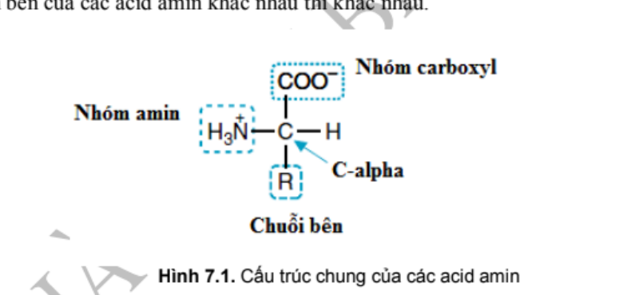
*Hình 7.1. Cấu trúc chung của các acid amin*

Ở $\text{pH} = 7{,}4$ trong điều kiện sinh lý bình thường:
- Nhóm amin của các acid amin tích điện dương ($-\text{NH}_3^+$).
- Nhóm acid carboxyl tích điện âm ($-\text{COO}^-$).

$\text{pK}_a$ của các nhóm carboxylic của tất cả các acid amin xấp xỉ 2 ($1{,}8 - 2{,}4$). Ở giá trị $\text{pH}$ thấp hơn $\text{pK}_a$ (nồng độ ion $\text{H}^+$ cao hơn), tất cả các nhóm acid carboxylic đều nhận thêm một proton ($-\text{COOH}$). Ở $\text{pK}_a$, $50\%$ các phân tử được phân tách thành anion carboxylic và $\text{H}^+$, và ở $\text{pH} = 7{,}4$ trên $99\%$ phân tử phân ly giải phóng proton. 

$\text{pK}_a$ của tất cả nhóm $\alpha$-amin xấp xỉ 9,5 ($8{,}8 - 11{,}0$), do đó thấp hơn $\text{pH} = 7{,}4$, phần lớn nhóm amin đều gắn $\text{H}^+$ hoàn toàn và mang điện tích dương ($-\text{NH}_3^+$). Acid amin mang cả điện tích dương và điện tích âm gọi là **ion lưỡng tính**. Do các nhóm hóa học mang điện có thể hình thành liên kết hydro với nước nên tất cả các acid amin này đều tan trong nước ở $\text{pH}$ sinh lý.

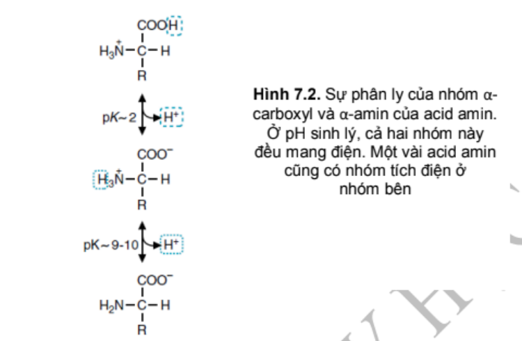
*Hình 7.2. Sự phân ly của nhóm $\alpha$-carboxyl và $\alpha$-amin của acid amin. Ở pH sinh lý, cả hai nhóm này đều mang điện. Một vài acid amin cũng có nhóm tích điện ở nhóm bên.*

Trong tất cả các acid amin trừ glycin, $\text{C}_\alpha$ là nguyên tử carbon bất đối liên kết với 4 nhóm thế khác nhau và có thể tồn tại ở dạng đồng phân quang học $\text{D}$ hoặc $\text{L}$. Acid amin ở protein động vật có vú là các **$\text{L}$-acid amin**, được biểu diễn với nhóm amin ở bên trái nếu nhóm carboxyl ở trên đỉnh (theo công thức chiếu Fischer). Các acid amin này đóng vai trò là các tiền chất của các chất chứa nitơ để tổng hợp trong cơ thể, do đó chuyển hóa acid amin trong cơ thể người cũng tập trung vào $\text{L}$-acid amin. Glycin không phải dạng $\text{D}$ cũng không phải dạng $\text{L}$ acid amin do $\text{C}_\alpha$ chứa 2 nguyên tử hydro đối xứng.

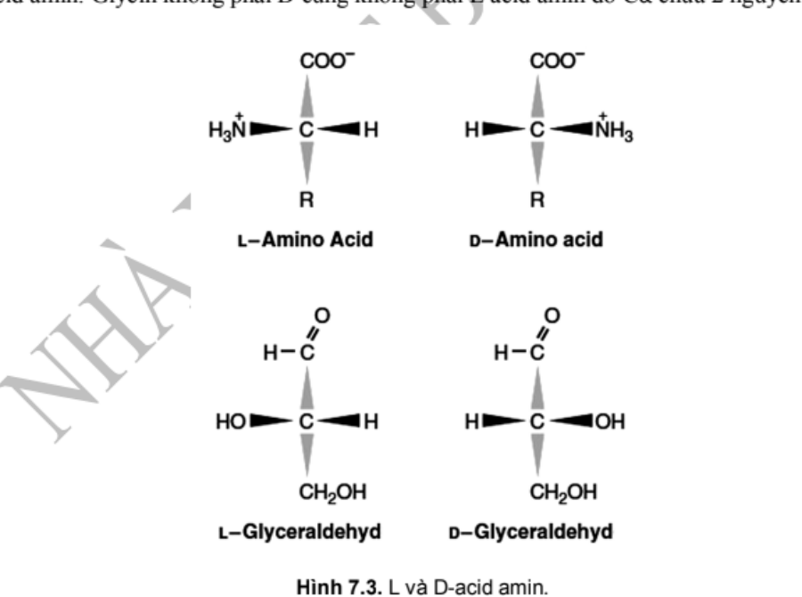
*Hình 7.3. Đồng phân $\text{L}$ và $\text{D}$-acid amin. Dạng $\text{L}$ là loại duy nhất trong protein người.*

Đặc tính hóa học của acid amin tạo ra mỗi protein có một đặc điểm riêng. Protein được tạo thành bởi 1 hoặc nhiều chuỗi peptid chứa hàng trăm acid amin. Trật tự sắp xếp của acid amin (cấu trúc bậc 1) được quyết định bởi mã di truyền. Trong chuỗi peptid, acid amin gắn với nhau thông qua **liên kết peptid** giữa nhóm acid carboxylic của một acid amin với nhóm amin của acid amin liền kề. Do đó, nhóm amin, $\text{C}_\alpha$ và nhóm carboxyl hình thành **khung peptid** (*peptide backbone*). 

Các nhóm bên tương tác với khung peptid của các vùng khác của chuỗi hoặc với nhóm bên của acid amin khác trong protein hình thành các vùng kỵ nước, liên kết tĩnh điện, liên kết hydro hoặc liên kết disulfid. Các tương tác này làm cho chuỗi peptid cuộn lại thành cấu trúc không gian 3 chiều đặc thù.

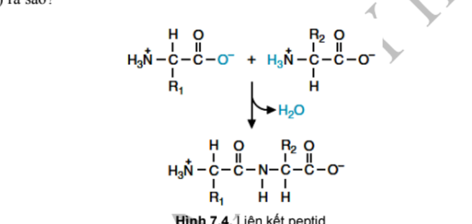
*Hình 7.4. Liên kết peptid. Trong quá trình hình thành liên kết peptid, 1 phân tử nước bị loại.*

Khi liên kết hình thành giữa 2 acid amin tạo thành một liên kết peptid, các acid amin này được gọi là **gốc acid amin** (*amino acid residue*). Hai acid amin gắn với nhau gọi là *dipeptid*, ba acid amin gắn với nhau gọi là *tripeptid*, nhiều acid amin gắn với nhau gọi là *polypeptid*. 

Mỗi chuỗi peptid có hai đầu tận cùng:
- **Đầu amin tự do** (đầu N hay tận cùng amin): acid amin có nhóm $\alpha$-amin tự do.
- **Đầu carboxyl tự do** (đầu C hay tận cùng carboxyl): acid amin có nhóm $\alpha$-carboxyl tự do.

Quy ước viết chuỗi peptid bắt đầu từ đầu N ở bên trái sang đầu C ở bên phải. Tên gọi các acid amin được viết tắt bằng hệ thống 3 chữ cái hoặc 1 chữ cái.

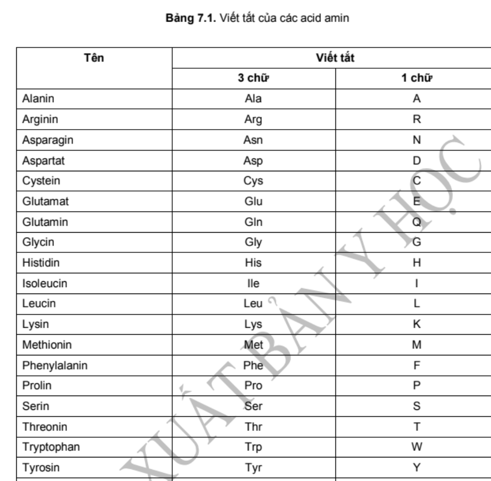
*Bảng 7.1. Viết tắt của các acid amin tiêu chuẩn*

| Tên acid amin | Viết tắt 3 chữ | Viết tắt 1 chữ |
| :--- | :---: | :---: |
| **Alanin** | Ala | A |
| **Arginin** | Arg | R |
| **Asparagin** | Asn | N |
| **Aspartat** | Asp | D |
| **Cystein** | Cys | C |
| **Glutamat** | Glu | E |
| **Glutamin** | Gln | Q |
| **Glycin** | Gly | G |
| **Histidin** | His | H |
| **Isoleucin** | Ile | I |
| **Leucin** | Leu | L |
| **Lysin** | Lys | K |
| **Methionin** | Met | M |
| **Phenylalanin** | Phe | F |
| **Prolin** | Pro | P |
| **Serin** | Ser | S |
| **Threonin** | Thr | T |
| **Tryptophan** | Trp | W |
| **Tyrosin** | Tyr | Y |
| **Valin** | Val | V |

---

### 1.2. Phân loại theo nhóm bên của acid amin

20 acid amin thường gặp được phân chia thành các nhóm dựa trên cấu trúc hóa học và đặc tính phân cực của nhóm bên (gốc $-\text{R}$):

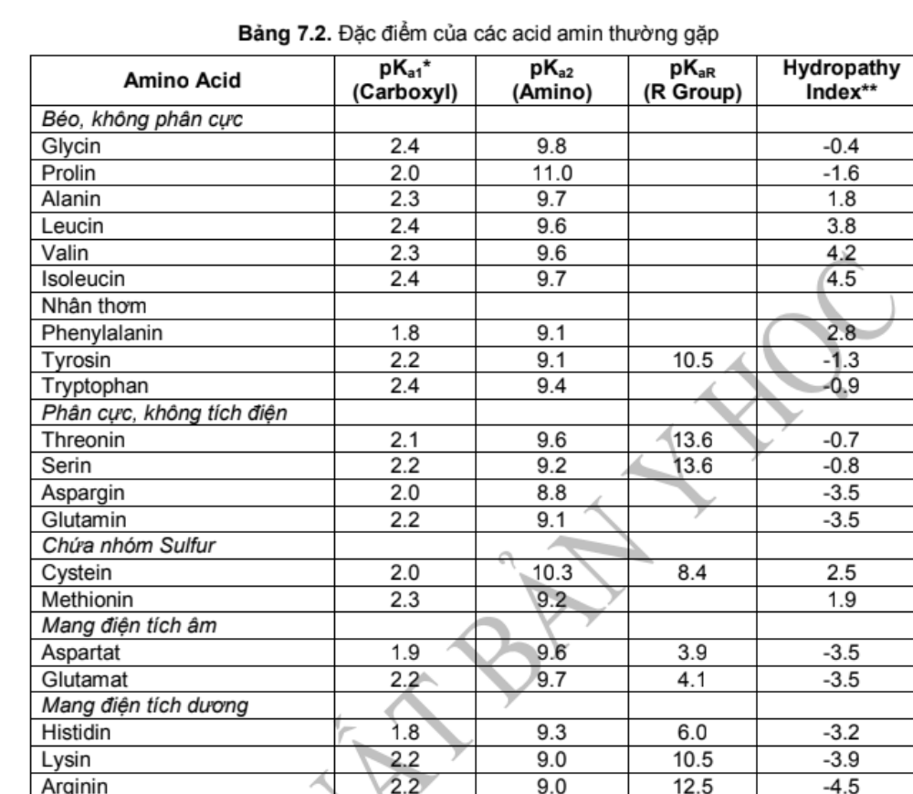
*Bảng 7.2. Đặc điểm của các acid amin thường gặp*

| Nhóm và Acid amin | $\text{pK}_{a1}$ ($\alpha$-Carboxyl) | $\text{pK}_{a2}$ ($\alpha$-Amino) | $\text{pK}_{a\text{R}}$ (Nhóm R) | Chỉ số kỵ nước (*Hydropathy Index*) |
| :--- | :---: | :---: | :---: | :---: |
| **Béo, không phân cực** | | | | |
| Glycin | 2,4 | 9,8 | — | -0,4 |
| Prolin | 2,0 | 11,0 | — | -1,6 |
| Alanin | 2,3 | 9,7 | — | 1,8 |
| Leucin | 2,4 | 9,6 | — | 3,8 |
| Valin | 2,3 | 9,6 | — | 4,2 |
| Isoleucin | 2,4 | 9,7 | — | 4,5 |
| **Nhân thơm** | | | | |
| Phenylalanin | 1,8 | 9,1 | — | 2,8 |
| Tyrosin | 2,2 | 9,1 | 10,5 | -1,3 |
| Tryptophan | 2,4 | 9,4 | — | -0,9 |
| **Phân cực, không tích điện** | | | | |
| Threonin | 2,1 | 9,6 | 13,6 | -0,7 |
| Serin | 2,2 | 9,2 | — | -0,8 |
| Asparagin | 2,0 | 8,8 | — | -3,5 |
| Glutamin | 2,2 | 9,1 | — | -3,5 |
| **Chứa nhóm Sulfur** | | | | |
| Cystein | 2,0 | 10,3 | 8,4 | 2,5 |
| Methionin | 2,3 | 9,2 | — | 1,9 |
| **Mang điện tích âm (Acid)** | | | | |
| Aspartat | 1,9 | 9,6 | 3,9 | -3,5 |
| Glutamat | 2,2 | 9,7 | 4,1 | -3,5 |
| **Mang điện tích dương (Base)** | | | | |
| Histidin | 1,8 | 9,3 | 6,0 | -3,2 |
| Lysin | 2,2 | 9,0 | 10,5 | -3,9 |
| Arginin | 2,2 | 9,0 | 12,5 | -4,5 |
| **Trung bình** | **2,2** | **9,5** | — | — |

---

#### A. Acid amin béo, không phân cực
- **Glycin** là acid amin đơn giản nhất, nó không thực sự phù hợp với bất kỳ nhóm nào bởi vì nhóm bên của nó chỉ có 1 nguyên tử hydro ($-\text{H}$).
- **Alanin** và các acid amin có nhóm bên là mạch nhánh (**valin, leucin và isoleucin**) có nhóm bên béo, cồng kềnh, không phân cực. Mức độ kỵ nước cao của nhóm bên acid amin mạch nhánh được biểu thị bằng chỉ số kỵ nước $\text{HI}$ cao (Bảng 7.2). Electron được phân chia đồng đều giữa $\text{C}$ và $\text{H}$ trong nhóm bên do đó không thể tạo thành liên kết hydro với nước. 
- Trong phân tử protein, các nhóm bên acid amin này sẽ kết hợp với nhau thành các **cụm kỵ nước** (*hydrophobic clusters*). Tương tác của chúng cũng được tăng lên bởi **lực Van der Waals** giữa hạt nhân tích điện dương của 1 nguyên tử và đám mây electron của nguyên tử khác. Lực này chỉ có tác dụng trong 1 khoảng cách ngắn khi nhiều nguyên tử được sắp xếp lại gần nhau.
- Vai trò của **prolin** và **glycin** không giống với các acid amin không phân cực khác:
  - **Prolin** chứa một vòng bao gồm nguyên tử $\text{C}_\alpha$ và nhóm $\alpha$-amin (acid amin vòng hay imin). Vòng cứng nhắc này tạo ra một **chỗ gấp nếp (thắt nút)** ở khung peptid nhằm ngăn nó hình thành cấu trúc xoắn bình thường.
  - Nhóm bên của **glycin** quá nhỏ để so sánh với các nhóm bên của acid amin khác, sự cản trở không gian do glycin tạo ra là nhỏ nhất. Do đó, glycin thường được tìm thấy ở những chỗ uốn hoặc ở những chuỗi được ép chặt của protein hình sợi (như collagen).

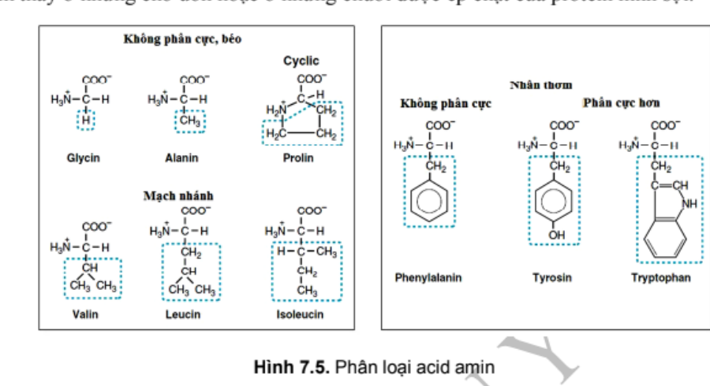
*Hình 7.5. Phân loại acid amin béo không phân cực và acid amin có nhân thơm.*

---

#### B. Acid amin có nhân thơm
Acid amin có nhân thơm được xếp cùng với nhau do chúng cùng chứa cấu trúc vòng với các đặc tính tương tự nhau, tuy nhiên khả năng phân cực của chúng khác nhau đáng kể:
- Nhân thơm là vòng $\text{C}-\text{H}$ 6 cạnh với 3 liên kết đôi liên hợp (vòng benzen hoặc nhóm phenyl). Nhóm thế của vòng này quyết định liệu nhóm bên của acid amin tham gia vào tương tác phân cực hay kỵ nước.
- Ở **phenylalanin**, vòng không có nhóm thế, các electron được chia đều giữa các nguyên tử $\text{C}$ của vòng, tạo ra cấu trúc rất kỵ nước không phân cực.
- Ở **tyrosin**, một nhóm $-\text{OH}$ gắn vào vòng phenyl có khả năng tạo ra liên kết hydro, do đó nhóm bên phân cực hơn và ưa nước hơn.
- Cấu trúc vòng của **tryptophan** phức tạp hơn với một vòng indol kết hợp với nguyên tử $\text{N}$ có thể tạo thành liên kết hydro. Tryptophan do đó cũng phân cực hơn phenylalanin.

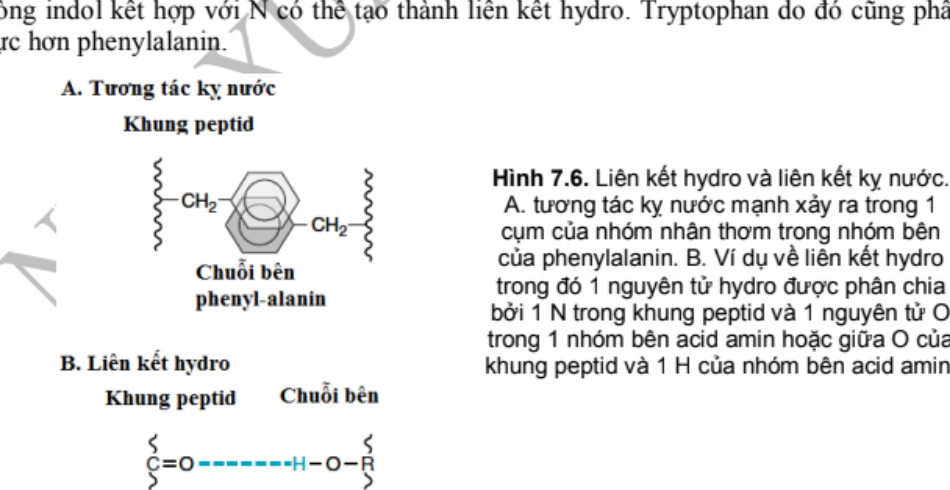
*Hình 7.6. Liên kết hydro và liên kết kỵ nước: A. Tương tác kỵ nước mạnh xảy ra trong một cụm của nhóm nhân thơm trong nhóm bên của phenylalanin; B. Ví dụ về liên kết hydro trong đó một nguyên tử hydro được phân chia bởi một N trong khung peptid và một nguyên tử O trong nhóm bên acid amin hoặc giữa O của khung peptid và H của nhóm bên acid amin.*

---

#### C. Acid amin béo, phân cực, không tích điện
- Acid amin với nhóm bên chứa 1 nhóm amid (**asparagin và glutamin**) hoặc 1 nhóm hydroxyl (**serin và threonin**) được phân vào nhóm acid amin béo, phân cực, không mang điện.
- Asparagin và glutamin là các amid tương ứng của acid amin acid aspartat và glutamat.
- Nhóm $-\text{OH}$ và nhóm amid trong nhóm bên cho phép các acid amin này tạo ra **liên kết hydro** với nước, với nhau và với khung peptid, hoặc với các hợp chất phân cực khác trong vị trí gắn của protein.
- Do tính ưa nước của chúng, các acid amin này thường được tìm thấy ở bề mặt của protein hình cầu tan trong nước.

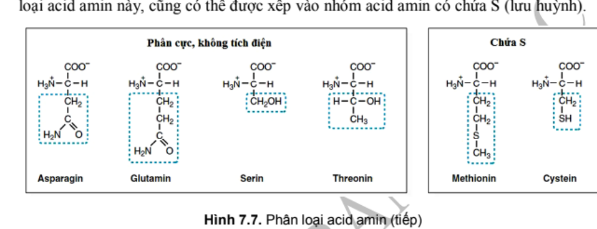
*Hình 7.7. Phân loại acid amin béo phân cực không tích điện (Ser, Thr) và acid amin chứa lưu huỳnh (Met, Cys).*

---

#### D. Acid amin chứa Lưu huỳnh (S)
Cả cystein và methionin đều chứa nguyên tử lưu huỳnh:
- Nhóm bên của **cystein** chứa một nhóm sulfhydryl ($-\text{SH}$) có giá trị $\text{pK}_a \approx 8{,}4$, do đó cystein có xu hướng không phân ly và không mang điện ở $\text{pH}$ sinh lý ($7{,}4$).
- Phân tử cystein tự do trong dung dịch có thể hình thành 1 **liên kết disulfid** ($-\text{S}-\text{S}-$) với phân tử cystein khác thông qua sự oxy hóa ngẫu nhiên (không cần enzym) của nhóm sulfhydryl. Hợp chất disulfid tạo thành gọi là **cystin**, xuất hiện ở máu và mô và rất ít tan trong nước.
- Trong phân tử protein, sự hình thành liên kết disulfid giữa 2 gốc cystein ở vị trí thích hợp đóng vai trò quan trọng trong việc giữ 2 chuỗi polypeptid (như insulin) hoặc 2 vùng khác nhau của cùng 1 chuỗi lại với nhau.

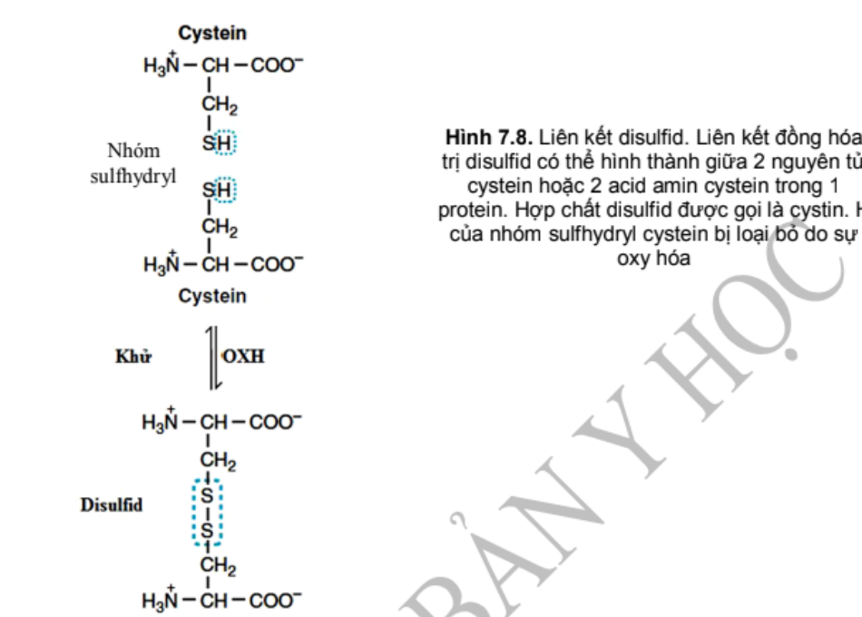
*Hình 7.8. Liên kết disulfid. Liên kết đồng hóa trị disulfid có thể hình thành giữa 2 nguyên tử cystein hoặc 2 acid amin cystein trong 1 protein. Hợp chất disulfid được gọi là cystin. H của nhóm sulfhydryl cystein bị loại bỏ do sự oxy hóa.*

- **Methionin**, mặc dù cũng chứa 1 nguyên tử lưu huỳnh, là acid amin không phân cực với nhóm $-\text{R}$ lớn kỵ nước. Do không chứa nhóm $-\text{SH}$ tự do (nguyên tử $\text{S}$ gắn với nhóm $-\text{CH}_3$ dạng thioether) nên không thể hình thành liên kết disulfid. Vai trò sinh học quan trọng bậc nhất của methionin là khả năng chuyển nhóm methyl ($-\text{CH}_3$) gắn với nguyên tử lưu huỳnh (thông qua SAM - S-adenosylmethionin) cho các chất nhận khác nhau trong cơ thể.

---

#### E. Acid amin acid và Acid amin base
- **Acid amin acid (aspartat và glutamat):**
  - Chứa nhóm acid carboxylic ở chuỗi bên ($-\text{COOH}$) có $\text{pK}_a \approx 3{,}9 - 4{,}1$, do đó mang điện tích âm ($-\text{COO}^-$) ở $\text{pH}$ sinh lý.
- **Acid amin base (histidin, lysin, arginin):**
  - Chứa nhóm chứa nitơ ở gốc $-\text{R}$ có thể được proton hóa và tích điện dương ở $\text{pH}$ sinh lý và giá trị $\text{pH}$ thấp hơn.
  - **Histidin** có một vòng imidazol chứa $\text{N}$ ở gốc $-\text{R}$ với $\text{pK}_a \approx 6{,}0$.
  - **Lysin** có nhóm amino bậc 1 ở vị trí carbon $\varepsilon$ ($\text{C}_\varepsilon$) với $\text{pK}_a \approx 10{,}5$.
  - **Arginin** chứa nhóm guanidinium có $\text{pK}_a \approx 12{,}5$.

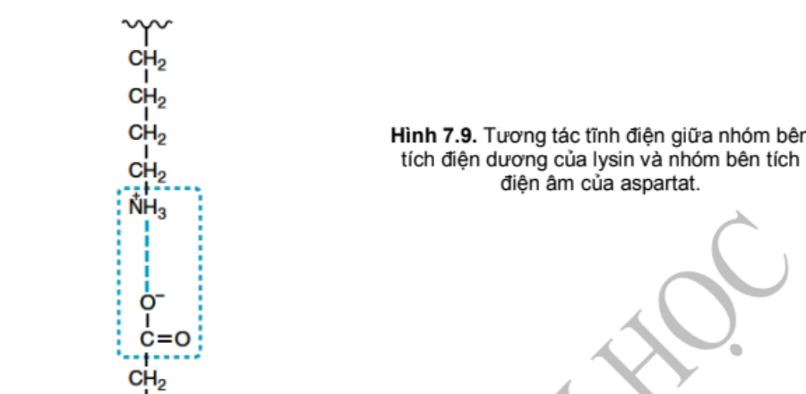
*Hình 7.9. Tương tác tĩnh điện giữa nhóm bên tích điện dương của lysin và nhóm bên tích điện âm của aspartat.*

Điện tích dương của các acid amin base cho phép chúng tạo thành **liên kết ion (liên kết tĩnh điện)** với các nhóm tích điện âm, như nhóm bên của acid amin acid hoặc nhóm phosphat của coenzym/nucleotid. Bên cạnh đó, nhóm bên của lysin và arginin thường tạo thành liên kết ion với các cơ chất mang điện tích âm gắn ở vị trí hoạt động của enzym, như gốc phosphat của ATP. 

Nhóm bên của các acid amin acid và base cũng tham gia vào việc tạo thành liên kết hydro và hình thành **cầu muối** (*salt bridge*), hoặc phối trí gắn các ion kim loại vô cơ (như $\text{Zn}^{2+}, \text{Mg}^{2+}, \text{Ca}^{2+}$).

---

### 1.3. Đường cong chuẩn độ của Acid amin

Điện tích của các acid amin ở các $\text{pH}$ khác nhau được quyết định bởi giá trị $\text{pK}_a$ phân ly proton từ nhóm $\alpha$-carboxylic, nhóm $\alpha$-amin và nhóm bên.

Đường cong chuẩn độ của **histidin** minh họa sự thay đổi cấu trúc và điện tích acid amin xảy ra khi $\text{pH}$ của dung dịch thay đổi từ nhỏ hơn 1 tới 14 khi chuẩn độ bằng base mạnh ($\text{OH}^-$):
- **Ở $\text{pH} < 1{,}8$:** Tất cả các nhóm đều được proton hóa hoàn toàn; nhóm carboxyl không tích điện ($-\text{COOH}$), nhóm imidazol tích điện dương, nhóm $\alpha$-amin tích điện dương ($-\text{NH}_3^+$). Điện tích thực của phân tử là $+2$.
- **Ở $\text{pK}_{a1} = 1{,}8$:** Nhóm $\alpha$-carboxyl phân ly proton đạt trạng thái cân bằng giữa $-\text{COOH}$ và $-\text{COO}^-$.
- **Trong khoảng $\text{pH} = 1{,}8 - 6{,}0$:** Nhóm carboxyl mang điện tích âm hoàn toàn ($-\text{COO}^-$).
- **Ở $\text{pK}_{a\text{R}} = 6{,}0$:** Nhóm imidazol của chuỗi bên phân ly proton, chuyển từ dạng tích điện dương sang dạng trung hòa không mang điện. Do giá trị $\text{pK}_a$ này rất gần với $\text{pH}$ sinh lý ($7{,}4$), histidin là acid amin duy nhất có nhóm bên có khả năng đệm chuyển đổi linh hoạt nhận hoặc nhường proton trong điều kiện sinh lý tế bào.
- **Tại điểm đẳng điện ($\text{pI} = 7{,}6$):** Tổng điện tích thực của phân tử bằng 0 (dạng ion lưỡng tính chiếm ưu thế tuyệt đối).
- **Ở $\text{pK}_{a2} = 9{,}3$:** Nhóm $\alpha$-amin phân ly proton chuyển từ $-\text{NH}_3^+$ sang $-\text{NH}_2$ trung hòa.
- **Ở $\text{pH} > 9{,}3$:** Tất cả các proton có thể phân ly đều đã tách ra, phân tử histidin mang điện tích âm ròng là $-1$.

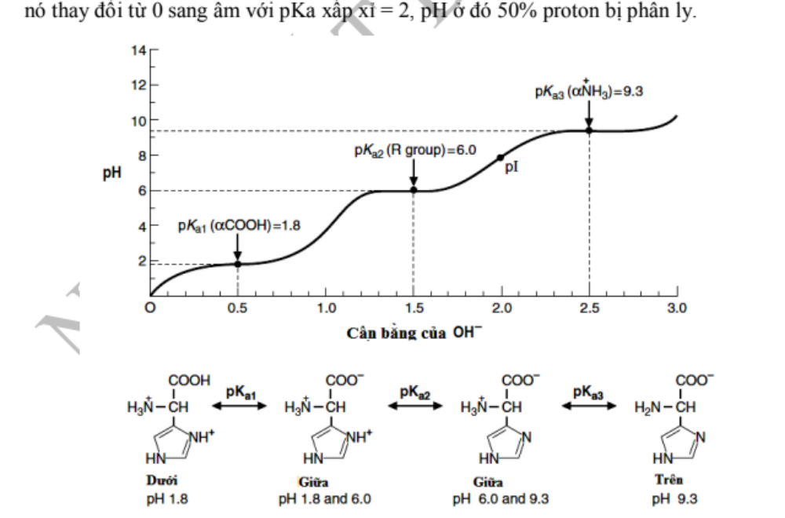
*Hình 7.10. Đường cong chuẩn độ của Histidin. Minh họa các nấc phân ly proton của nhóm $\alpha$-carboxyl ($\text{pK}_{a1} = 1{,}8$), nhóm imidazol bên ($\text{pK}_{a\text{R}} = 6{,}0$), và nhóm $\alpha$-amin ($\text{pK}_{a2} = 9{,}3$).*

<!-- END FILE: pages_156_165.md -->

<!-- BEGIN FILE: pages_166_175.md -->

# CHƯƠNG 7 (TIẾP THEO): PEPTID VÀ CẤU TRÚC PROTEIN

---

## 1. ACID AMIN (TIẾP THEO)

### 1.4. Sự phân ly và trạng thái ion hóa của các gốc R acid amin

Gốc $-\text{R}$ của histidin là một vòng imidazol với $\text{pK}_a \approx 6{,}0$, thay đổi từ vòng tích điện dương được proton hóa thành vòng không mang điện ở $\text{pH}$ này. Nhóm amin của $\text{C}_\alpha$ chuẩn độ ở $\text{pH}$ cao hơn nhiều (giữa $9$ và $10$) và điện tích thay đổi từ dương sang $0$. $\text{pH}$ mà tại đó tổng điện tích thực của acid amin bằng $0$ được gọi là **điểm đẳng điện** ($\text{pI}$). Ở $\text{pH}$ này, phân tử không di chuyển trong điện trường về phía cực dương (anod) hoặc cực âm (catot), do số điện tích âm của mỗi phân tử bằng với số điện tích dương.

Gốc $-\text{R}$ của acid amin thay đổi từ không mang điện tới tích điện âm hoặc từ tích điện dương tới không mang điện khi chúng giải phóng proton:
- **Acid amin acid (aspartat và glutamat):** Mất proton từ gốc $-\text{R}$ chứa acid carboxylic ở $\text{pH} \approx 4$, và sau đó tích điện âm ở $\text{pH} = 7{,}4$.
- **Cystein và Tyrosin:** Mất proton ở $\text{pK}_a$ của chúng (lần lượt là $8{,}4$ và $10{,}5$), do đó gốc $-\text{R}$ không mang điện ở $\text{pH}$ sinh lý.
- **Histidin, Lysin và Arginin:** Gốc $-\text{R}$ thay đổi từ tích điện dương sang trung tính ở $\text{pK}_a$ của chúng. Hai acid amin base, arginin và lysin, có $\text{pK}_a$ trên $10$, do đó dạng tích điện dương luôn luôn chiếm ưu thế tuyệt đối ở $\text{pH}$ sinh lý ($7{,}4$).

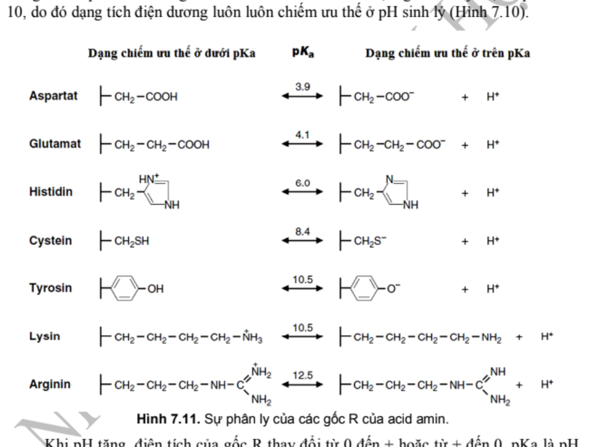
*Hình 7.11. Sự phân ly của các gốc R của acid amin.*

Khi $\text{pH}$ tăng, điện tích của gốc $-\text{R}$ thay đổi từ $0$ đến âm ($-$ ) hoặc từ dương ($+$) đến $0$. $\text{pK}_a$ là $\text{pH}$ mà ở đó một nửa phân tử của acid amin trong dung dịch có gốc $-\text{R}$ tích điện, nửa còn lại không mang điện.

Trong phân tử protein, chỉ có nhóm $\alpha$-amin và $\alpha$-carboxyl ở hai đầu tận cùng và các nhóm chức ở gốc $-\text{R}$ mới có khả năng phân ly proton. Tất cả các nhóm $\alpha$-carboxylic và $\alpha$-amin khác đều đã tham gia vào liên kết peptid nên không thể phân ly proton. Gốc $-\text{R}$ của acid amin có thể có giá trị $\text{pK}_a$ rất khác khi nằm trong chuỗi polypeptid so với khi là các acid amin tự do nếu chúng tham gia vào liên kết hydro hoặc liên kết ion với các gốc $-\text{R}$ của acid amin lân cận (ví dụ $\text{pK}_a$ của nhóm imidazol của histidin có thể chuyển sang giá trị $6 - 7$, cho phép nó vừa nhận vừa giải phóng proton linh hoạt ở giới hạn $\text{pH}$ sinh lý).

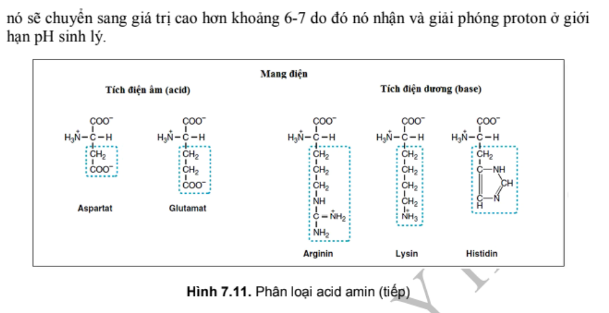
*Hình 7.11 (tiếp). Phân loại acid amin mang điện: Acid amin tích điện âm (acid: Aspartat, Glutamat) và acid amin tích điện dương (base: Histidin, Lysin, Arginin).*

---

## 2. PEPTID

### 2.1. Cấu trúc của peptid

* **Định nghĩa:** Peptid là các chuỗi acid amin. Hai acid amin gắn đồng hóa trị với nhau thông qua một **liên kết amid thay thế**, gọi là **liên kết peptid**, tạo ra *dipeptid*. Liên kết này được hình thành bằng cách loại bỏ một phân tử nước từ nhóm $\alpha$-carboxyl của một acid amin và nhóm $\alpha$-amin của acid amin khác. Sự hình thành liên kết peptid là ví dụ điển hình của phản ứng trùng ngưng tổng hợp trong tế bào sống.

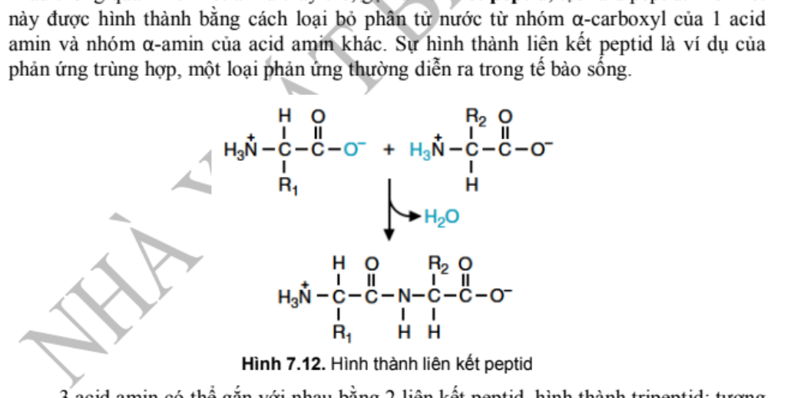
*Hình 7.12. Hình thành liên kết peptid giữa hai acid amin loại 1 phân tử nước.*

- 3 acid amin gắn với nhau bằng 2 liên kết peptid tạo thành **tripeptid**.
- 4 acid amin liên kết hình thành **tetrapeptid**.
- Khi một vài acid amin (dưới 10 - 20 acid amin) gắn với nhau gọi là **oligopeptid**.
- Khi nhiều acid amin gắn với nhau tạo thành chuỗi dài gọi là **polypeptid**.
- Protein có thể gồm hàng trăm đến hàng nghìn acid amin. Mặc dù thuật ngữ "protein" và "polypeptid" đôi khi được dùng thay thế cho nhau, phân tử polypeptid thường có trọng lượng phân tử dưới $10\text{ kDa}$, còn protein thường có trọng lượng phân tử trên $10\text{ kDa}$.

Trong chuỗi peptid:
- Phần acid amin tận cùng có nhóm $\alpha$-amin tự do được gọi là **đầu amin tận** (đầu N), theo quy ước luôn được đặt ở bên trái.
- Acid amin ở đầu còn lại có nhóm carboxyl tự do được gọi là **đầu carboxyl tận** (đầu C), đặt ở bên phải.

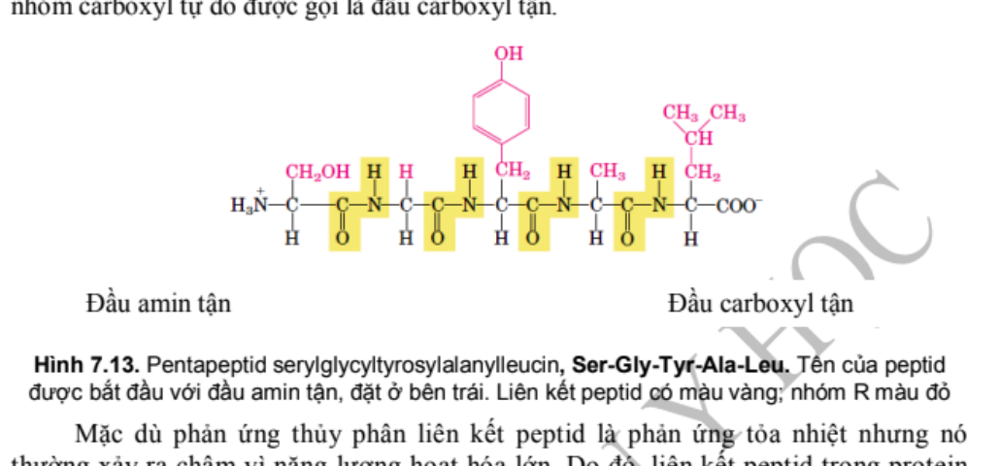
*Hình 7.13. Cấu trúc của một pentapeptid: serylglycyltyrosylalanylleucin (Ser-Gly-Tyr-Ala-Leu).*

Mặc dù phản ứng thủy phân liên kết peptid là phản ứng tỏa nhiệt ($\Delta G < 0$), nhưng nó xảy ra vô cùng chậm trong điều kiện thường vì có năng lượng hoạt hóa lớn. Do đó, liên kết peptid trong protein tương đối bền vững với thời gian bán hủy trung bình ($t_{1/2}$) khoảng 7 năm trong điều kiện tế bào khi không có enzym xúc tác.

### Phân loại và trạng thái ion hóa của peptid
Peptid mạch thẳng chỉ chứa 1 nhóm $\alpha$-amin tự do và 1 nhóm $\alpha$-carboxyl tự do ở hai đầu của chuỗi. Nhóm $\alpha$-amin và $\alpha$-carboxyl của tất cả các acid amin bên trong chuỗi đều đã tham gia liên kết đồng hóa trị trong liên kết peptid nên không tích điện và không tham gia vào tính chất acid-base.

Do đó, tính chất acid-base và điện tích của một chuỗi peptid được quyết định bởi:
1. Nhóm $\alpha$-amin tự do ở đầu N.
2. Nhóm $\alpha$-carboxyl tự do ở đầu C.
3. Bản chất và số lượng các nhóm ion hóa ở chuỗi bên (gốc $-\text{R}$) của các acid amin thành phần.

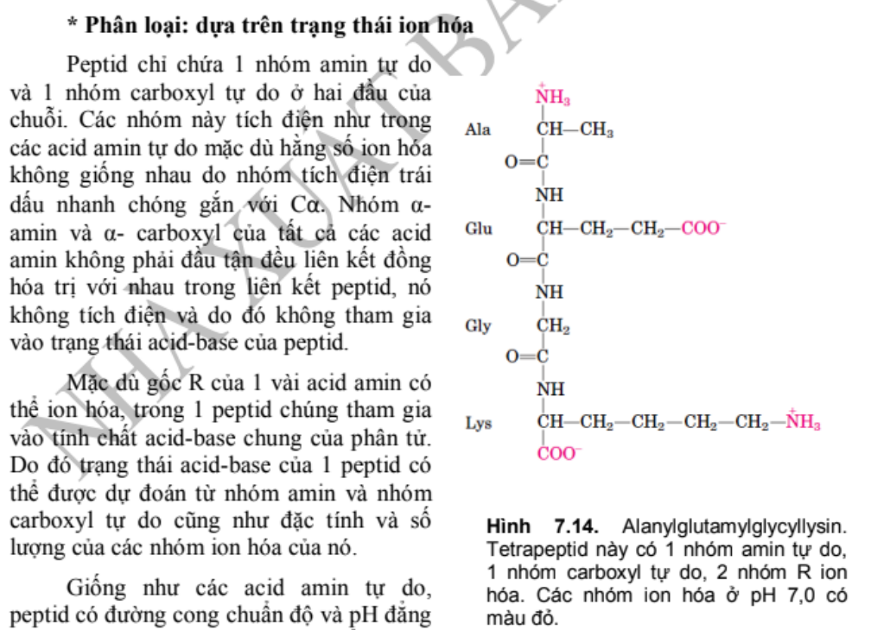
*Hình 7.14. Alanylglutamylglycyllysin (Ala-Glu-Gly-Lys). Tetrapeptid này có 1 nhóm amin tự do, 1 nhóm carboxyl tự do và 2 nhóm R có khả năng ion hóa (Glu mang điện âm, Lys mang điện dương ở pH 7,0).*

Giống như acid amin tự do, peptid có đường cong chuẩn độ và điểm đẳng điện ($\text{pI}$) xác định. Đặc tính này được ứng dụng rộng rãi trong các kỹ thuật điện di và sắc ký để phân tách, tinh sạch peptid và protein.

---

### 2.2. Hoạt tính sinh học của peptid và polypeptid

Chiều dài chuỗi peptid dao động từ 2 cho đến hàng nghìn acid amin. Ngay cả những peptid rất nhỏ cũng sở hữu các hoạt tính sinh học quan trọng:
- **Chất làm ngọt nhân tạo:** Dipeptid $\text{L}$-aspartyl-$\text{L}$-phenylalanin methyl ester (**Aspartam** hay NutraSweet).
- **Các peptid hormon nhỏ tác dụng ở nồng độ cực thấp:**
  - **Oxytocin** (nonapeptid gồm 9 acid amin): do vùng dưới đồi tổng hợp, tích trữ ở thùy sau tuyến yên, có tác dụng kích thích co bóp cơ trơn tử cung khi chuyển dạ và bài xuất sữa.
  - **Bradykinin** (9 acid amin): peptid trung gian gây giãn mạch và điều hòa phản ứng viêm ở mô.
  - **TRH** (*Thyrotropin-Releasing Hormone*, tripeptid gồm 3 acid amin): do vùng dưới đồi tiết ra, kích thích thùy trước tuyến yên bài tiết TSH.
- **Độc tố và kháng sinh:** Độc tố nấm cực độc như $\alpha$-amanitin, các kháng sinh polypeptid như bacitracin, gramicidin, polymyxin.
- **Các hormon polypeptid lớn hơn:**
  - **Insulin:** gồm 51 acid amin sắp xếp trong 2 chuỗi polypeptid: chuỗi A (21 acid amin) và chuỗi B (30 acid amin), nối với nhau bằng 2 cầu disulfid liên chuỗi.
  - **Glucagon:** hormon tuyến tụy gồm 29 acid amin, có tác dụng làm tăng glucose máu đối lập với insulin.
  - **ACTH** (*Corticotropin*): hormon thùy trước tuyến yên gồm 39 acid amin, kích thích vỏ tuyến thượng thận tăng sinh và bài tiết cortisol.

---

### 2.3. Polypeptid mang đặc tính của các acid amin thành phần

Thủy phân peptid hoặc protein bằng acid ($\text{HCl } 6\text{M}$ ở $110^\circ\text{C}$) thu được hỗn hợp các acid amin tự do. Mỗi loại protein có một thành phần và tỷ lệ các acid amin đặc thù. Phương pháp sắc ký trao đổi ion hoặc sắc ký lỏng hiệu năng cao (HPLC) cho phép xác định định tính và định lượng thành phần acid amin của phân tử protein.

---

## 3. PROTEIN

### 3.1. Đại cương về protein

Protein là những đại phân tử sinh học được cấu tạo từ một hay nhiều chuỗi polypeptid. Chiều dài chuỗi polypeptid trong protein rất đa dạng, từ vài chục đến hàng nghìn acid amin (ví dụ phân tử titin ở cơ chứa tới gần 27.000 acid amin).

Dựa trên cấu trúc không gian và độ hòa tan, protein được phân thành các nhóm chính:
1. **Protein hình cầu** (*globular proteins*): Các chuỗi polypeptid cuộn chặt thành hình cầu hoặc bầu dục, thường tan tốt trong nước, nhóm kỵ nước quay vào trong lõi và nhóm ưa nước quay ra ngoài bề mặt (ví dụ: myoglobin, hemoglobin, albumin, các enzym).
2. **Protein hình sợi** (*fibrous proteins*): Các chuỗi polypeptid xếp song song hoặc bện xoắn xung quanh một trục dài, có cấu trúc lặp đi lặp lại bền vững, không tan trong nước, đóng vai trò cấu trúc và cơ học (ví dụ: collagen, keratin, elastin).
3. **Protein xuyên màng** (*transmembrane proteins*): Có một hoặc nhiều đoạn xoắn xuyên qua lớp màng kép lipid, bề mặt tiếp xúc với màng lipid chứa nhiều acid amin kỵ nước (ví dụ: thụ thể bề mặt tế bào, kênh vận chuyển ion).
4. **Protein liên kết DNA** (*DNA-binding proteins*): Chứa các domain đặc hiệu gắn với rãnh của phân tử DNA (ví dụ: yếu tố phiên mã, histon).

---

### 3.2. Các bậc cấu trúc của Protein

Phân tử protein được tổ chức theo 4 bậc cấu trúc không gian:
- **Cấu trúc bậc 1:** Trình tự sắp xếp tuyến tính của các acid amin trong chuỗi polypeptid liên kết với nhau bằng liên kết đồng hóa trị peptid.
- **Cấu trúc bậc 2:** Sự cuộn xoắn hoặc gấp nếp tuần hoàn cục bộ của khung polypeptid, được duy trì chủ yếu bởi các liên kết hydro giữa nhóm $\text{C}=\text{O}$ và $\text{N}-\text{H}$ của các liên kết peptid (xoắn $\alpha$ và phiến gấp nếp $\beta$).
- **Cấu trúc bậc 3:** Sự cuộn lại toàn bộ trong không gian 3 chiều của chuỗi polypeptid tạo nên hình dạng đặc thù của protein, được duy trì bởi các tương tác giữa các nhóm bên (liên kết kỵ nước, liên kết tĩnh điện/cầu muối, liên kết hydro, liên kết disulfid).
- **Cấu trúc bậc 4:** Sự kết hợp và sắp xếp không gian của từ 2 chuỗi polypeptid (gọi là các tiểu đơn vị - *subunits*) trở lên để tạo thành một phức hợp phân tử protein hoàn chỉnh có hoạt tính sinh học.

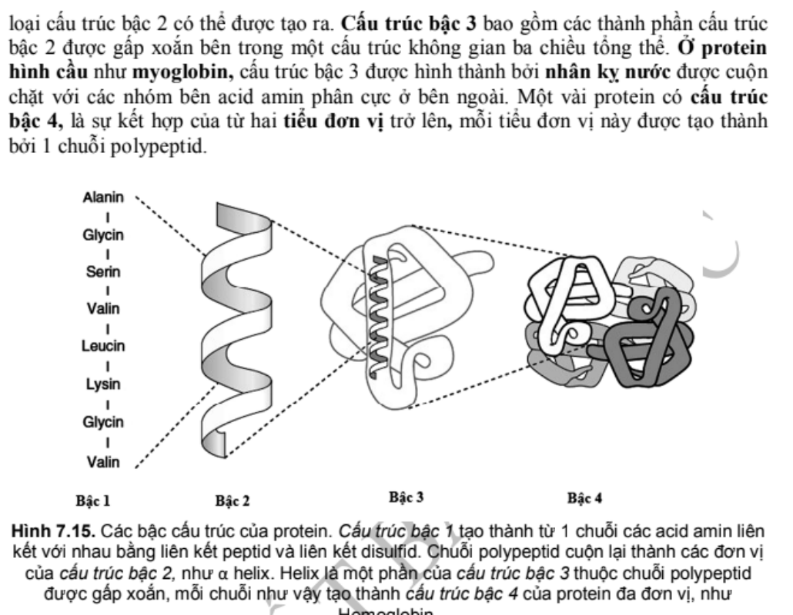
*Hình 7.15. Các bậc cấu trúc của protein: Cấu trúc bậc 1 (trình tự chuỗi acid amin); Cấu trúc bậc 2 (xoắn $\alpha$); Cấu trúc bậc 3 (chuỗi polypeptid cuộn thành hình cầu); Cấu trúc bậc 4 (phức hợp gồm nhiều tiểu đơn vị, ví dụ tetramer của Hemoglobin).*

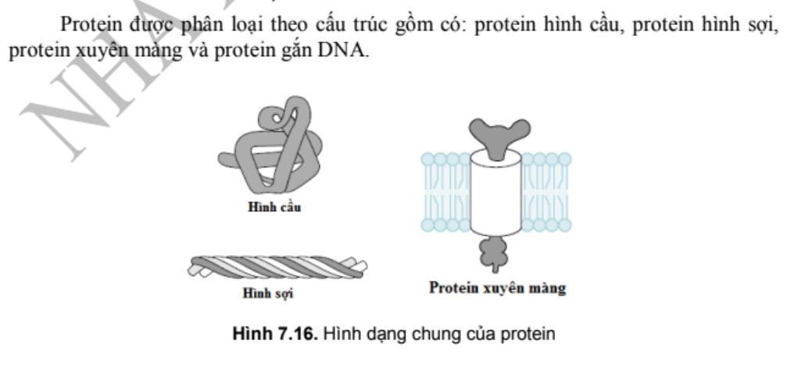
*Hình 7.16. Ba hình dạng chung phổ biến của protein: Protein hình cầu, Protein hình sợi và Protein xuyên màng lipid.*

---

### 3.3. Đặc điểm hình học của Liên kết Peptid

Khung polypeptid chỉ có thể gấp một cách hạn chế do đặc tính không gian của liên kết peptid. Mặc dù liên kết $\text{C}-\text{N}$ thường được biểu diễn là một liên kết đơn, trên thực tế do sự cộng hưởng electron giữa cặp electron tự do của nguyên tử $\text{N}$ và liên kết đôi $\text{C}=\text{O}$, liên kết peptid mang khoảng **$40\%$ đặc tính của liên kết đôi**:
- Liên kết peptid $\text{C}-\text{N}$ có độ dài ngắn hơn liên kết đơn bình thường ($1{,}32\text{ \AA}$ so với $1{,}49\text{ \AA}$).
- **Không có sự quay tự do xung quanh trục liên kết peptid $\text{C}-\text{N}$**. Sáu nguyên tử nằm trên cùng một mặt phẳng cứng nhắc gọi là **mặt phẳng peptid** ($\text{C}_\alpha - \text{C} - \text{O} - \text{N} - \text{H} - \text{C}_\alpha$).
- Cấu hình **trans** giữa hai nguyên tử $\text{C}_\alpha$ liền kề chiếm ưu thế tuyệt đối ($> 99\%$) để giảm thiểu cản trở không gian giữa các chuỗi bên.

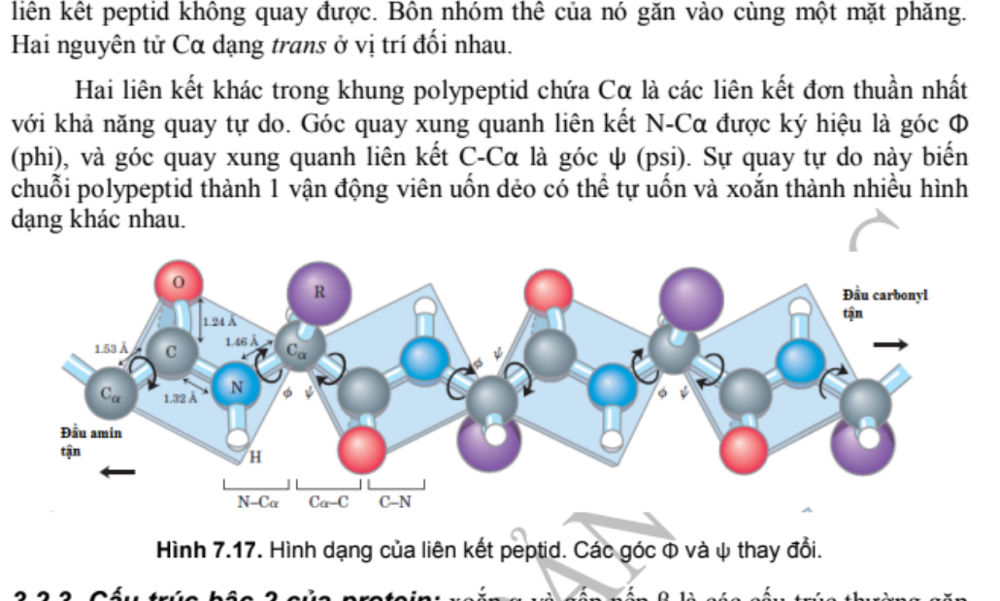
*Hình 7.17. Cấu trúc phẳng cứng nhắc của liên kết peptid và các góc quay tự do $\phi$ (quanh liên kết $\text{N}-\text{C}_\alpha$) và $\psi$ (quanh liên kết $\text{C}_\alpha-\text{C}$).*

Sự quay tự do trong khung polypeptid chỉ diễn ra tại hai liên kết đơn xung quanh nguyên tử carbon $\alpha$:
- Góc quay quanh trục $\text{N}-\text{C}_\alpha$ được gọi là **góc $\phi$** (*phi*).
- Góc quay quanh trục $\text{C}_\alpha-\text{C}$ được gọi là **góc $\psi$** (*psi*).

Chính sự quay tự do có giới hạn tại các góc $\phi$ và $\psi$ (được biểu thị trên biểu đồ Ramachandran) cho phép chuỗi polypeptid gấp cuộn linh hoạt thành các cấu trúc bậc 2 xác định.

---

### 3.4. Cấu trúc bậc 2 của protein

Cấu trúc bậc 2 là cấu trúc chu kỳ đều đặn lặp lại, khi đó các góc quay $\phi$ và $\psi$ dọc theo chuỗi polypeptid có giá trị tương đương nhau. Hai dạng cấu trúc bậc 2 phổ biến nhất là **xoắn $\alpha$** (*$\alpha$-helix*) và **gấp nếp $\beta$** (*$\beta$-pleated sheet*).

#### A. Cấu trúc xoắn $\alpha$ ($\alpha$-helix)
- Khung polypeptid cuộn xoắn chặt chẽ theo chiều kim đồng hồ tạo thành **xoắn bàn tay phải** (*right-handed helix*).
- **Thông số hình học:** Mỗi vòng xoắn chứa **3,6 gốc acid amin**, chiều cao mỗi vòng xoắn (bước xoắn) là **$5{,}4\text{ \AA}$**, tương ứng mỗi acid amin tịnh tiến dọc theo trục xoắn một khoảng **$1{,}5\text{ \AA}$**.
- **Liên kết duy trì:** Xoắn $\alpha$ được ổn định bởi các **liên kết hydro nội chuỗi** hình thành song song với trục xoắn giữa nhóm carbonyl ($\text{C}=\text{O}$) của gốc acid amin thứ $n$ với nhóm amino ($\text{N}-\text{H}$) của gốc acid amin thứ $n+4$ phía trên nó.
- **Vị trí của các gốc $-\text{R}$:** Các chuỗi bên $-\text{R}$ luôn chĩa ra phía ngoài trục xoắn để giảm thiểu sự va chạm không gian.
- **Yếu tố phá vỡ xoắn $\alpha$:** 
  - **Prolin:** không có nhóm $-\text{NH}$ tự do để tạo liên kết hydro và cấu trúc vòng imin cứng nhắc tạo góc uốn làm gãy xoắn $\alpha$ (được gọi là chất phá vỡ xoắn).
  - Các acid amin có nhóm bên quá lớn hoặc tích điện cùng dấu liên tiếp (như nhiều Asp/Glu hoặc Arg/Lys cạnh nhau).

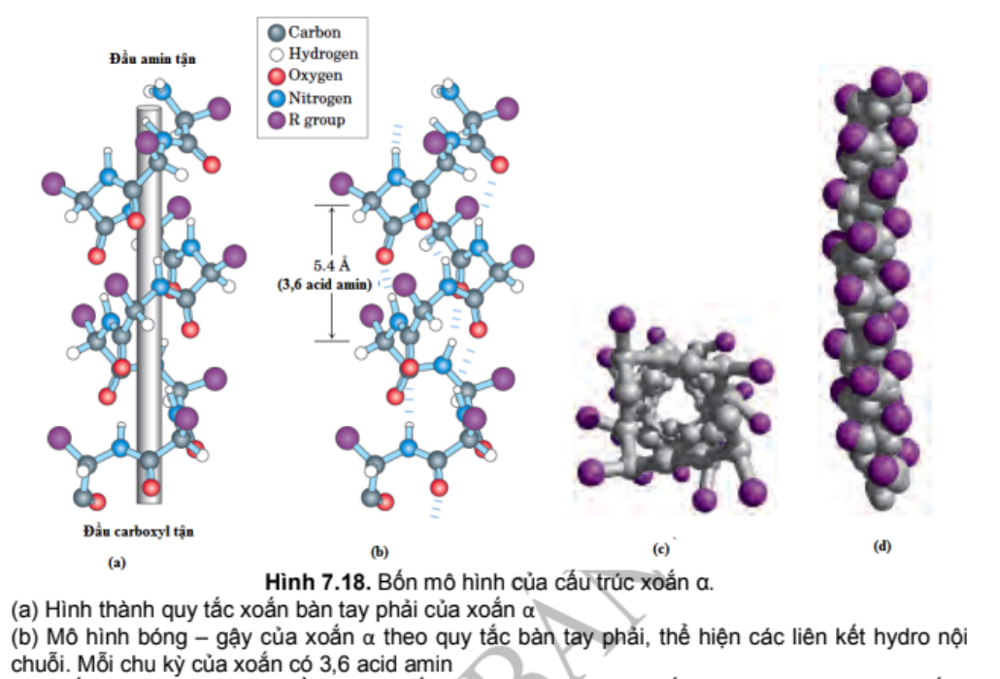
*Hình 7.18. Bốn mô hình biểu diễn cấu trúc xoắn $\alpha$: (a) Quy tắc xoắn bàn tay phải; (b) Mô hình bóng-que thể hiện các liên kết hydro nội chuỗi; (c) Nhìn dọc theo trục xoắn với các chuỗi bên chĩa ra ngoài; (d) Mô hình không gian đặc thể hiện sự xếp chặt bên trong lõi xoắn.*

---

#### B. Cấu trúc phiến gấp nếp $\beta$ ($\beta$-pleated sheet)
- Khung polypeptid ở cấu trúc phiến gấp $\beta$ ở trạng thái duỗi dài hơn nhiều so với xoắn $\alpha$, mỗi acid amin tịnh tiến khoảng **$3{,}5\text{ \AA}$**.
- Các liên kết hydro được hình thành **giữa các chuỗi polypeptid nằm cạnh nhau** (liên kết hydro liên chuỗi hoặc giữa các đoạn xa nhau của cùng một chuỗi).
- Dựa vào hướng của các chuỗi peptid (từ đầu N đến đầu C), phiến gấp $\beta$ được chia làm 2 loại:
  1. **Phiến gấp $\beta$ song song** (*parallel*): Các chuỗi peptid chạy cùng chiều từ đầu N đến đầu C; các liên kết hydro nằm chéo góc.
  2. **Phiến gấp $\beta$ đối song** (*antiparallel*): Các chuỗi peptid chạy ngược chiều nhau; các liên kết hydro thẳng hàng và trực diện, bền vững hơn dạng song song.
- Chuỗi bên $-\text{R}$ của các acid amin xen kẽ nhau nhô lên trên và chúc xuống dưới mặt phẳng của phiến gấp.

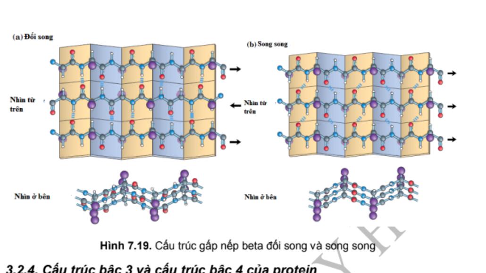
*Hình 7.19. Cấu trúc gấp nếp $\beta$: (a) Đối song (các chuỗi chạy ngược chiều, liên kết hydro thẳng hàng bền vững); (b) Song song (các chuỗi chạy cùng chiều).*

---

### 3.5. Cấu trúc bậc 3 và Cấu trúc bậc 4 của protein

#### Cấu trúc bậc 3
Cấu trúc bậc 3 là sự sắp xếp trong không gian ba chiều của toàn bộ chuỗi polypeptid:
- Ở các protein hình cầu, chuỗi polypeptid cuộn gấp chặt chẽ tạo thành một cấu trúc gọn gàng. Các đoạn cấu trúc bậc 2 tuần hoàn ($\alpha$-helix, $\beta$-sheet) được nối với nhau bằng các đoạn uốn cong không tuần hoàn (*loops, turns*).
- **Lực liên kết chủ yếu:** **Tương tác kỵ nước** là lực động học chính thúc đẩy quá trình gấp cuộn: các acid amin kỵ nước tập trung lại tạo thành một **lõi kỵ nước** (*hydrophobic core*) bên trong phân tử, tránh tiếp xúc với nước; trong khi các acid amin phân cực và tích điện phân bố chủ yếu ở bề mặt ngoài tạo liên kết hydro với môi trường nước xung quanh.
- Cấu trúc bậc 3 còn được củng cố bởi các **liên kết ion/cầu muối**, **liên kết hydro** và **cầu disulfid** ($-\text{S}-\text{S}-$) đồng hóa trị.

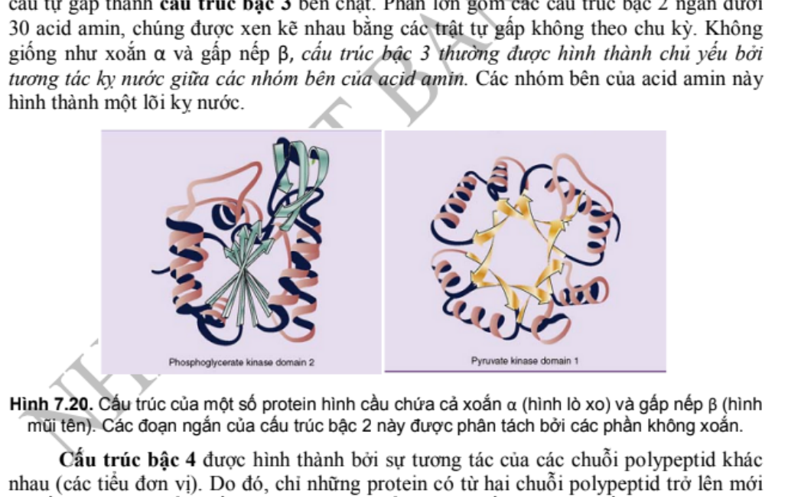
*Hình 7.20. Cấu trúc 3 chiều của một số protein hình cầu chứa cả xoắn $\alpha$ (dạng lò xo) và gấp nếp $\beta$ (dạng mũi tên dẹt).*

#### Cấu trúc bậc 4
- Cấu trúc bậc 4 chỉ có ở những protein gồm từ **2 chuỗi polypeptid trở lên** (gọi là protein đa tiểu đơn vị hay *oligomeric protein*).
- Các tiểu đơn vị liên kết với nhau chủ yếu bằng các tương tác yếu không đồng hóa trị (liên kết kỵ nước, lực Van der Waals, liên kết ion, liên kết hydro), một số trường hợp có thêm liên kết disulfid liên chuỗi.
- Ví dụ kinh điển: **Hemoglobin** gồm 4 tiểu đơn vị ($2\alpha$ và $2\beta$), tương tác giữa các tiểu đơn vị tạo ra hiện tượng hợp tác dị lập thể (*allosteric cooperation*) trong việc gắn và nhả oxy.

#### Nhóm ngoại và Protein tạp
Nhiều protein cần có thêm các thành phần phi protein gắn vào chuỗi polypeptid để thực hiện hoạt tính sinh học:
- **Protein thuần** (*simple proteins*): chỉ gồm các acid amin.
- **Protein tạp** (*conjugated proteins*): gồm phần protein (*apoprotein*) gắn với phần phi protein gọi là **nhóm ngoại** (*prosthetic group*):
  - **Glycoprotein:** gắn đồng hóa trị với carbohydrat.
  - **Phosphoprotein:** gắn đồng hóa trị với nhóm phosphat (như casein sữa).
  - **Lipoprotein:** phức hợp lipid và apolipoprotein.
  - **Hemoprotein:** chứa nhóm ngoại là nhân hem mang ion sắt (như hemoglobin, myoglobin, cytochrom).
  - Nhiều enzym chứa các nhóm ngoại hoặc ion kim loại tham gia trực tiếp vào phản ứng xúc tác, được gọi là **coenzym** hoặc **cofactor**.

<!-- END FILE: pages_166_175.md -->

<!-- BEGIN FILE: pages_176_185.md -->

# CHƯƠNG 7 (TIẾP THEO): TÍNH CHẤT PROTEIN, CẤU TRÚC VÀ CHỨC NĂNG CỦA HEMOGLOBIN

---

## 3. PROTEIN (TIẾP THEO)

### 3.3. Tính chất của protein

#### 3.3.1. Tính chất lưỡng tính
- Tính chất acid-base của protein phụ thuộc vào thành phần các acid amin cấu tạo nên phân tử:
  - Nếu tỷ lệ $\frac{\sum \text{Lys} + \sum \text{Arg}}{\sum \text{Glu} + \sum \text{Asp}} > 1$: protein có tính base (ví dụ histon).
  - Nếu tỷ lệ $\frac{\sum \text{Lys} + \sum \text{Arg}}{\sum \text{Glu} + \sum \text{Asp}} < 1$: protein có tính acid (ví dụ albumin, pepsin).
- Sự tích điện của protein phụ thuộc chặt chẽ vào $\text{pH}$ của môi trường. Giá trị $\text{pH}$ của môi trường mà tại đó tổng điện tích âm bằng tổng điện tích dương (tổng điện tích thực bằng $0$) được gọi là **điểm đẳng điện** ($\text{pI}$) của protein. Khi $\text{pH} = \text{pI}$, protein không di chuyển trong điện trường.
- **Ứng dụng:** Tính chất lưỡng tính và điểm đẳng điện được ứng dụng trong các phương pháp phân tích, tách chiết và tinh sạch protein như: **điện di** (điện di mao quản, điện di gel agarose, điện di tập trung đẳng điện IEF), **sắc ký trao đổi ion** (trao đổi cation hoặc anion), và **sắc ký ái lực**.

#### 3.3.2. Tính chất hòa tan, kết tủa và biến tính
- **Tính hòa tan:** Trong nước, các phân tử protein tồn tại dưới dạng dung dịch keo bền vững. Đa số protein hòa tan tốt trong dung dịch muối loãng. Tính bền vững của dung dịch keo protein được duy trì bởi 2 yếu tố chính:
  1. **Lớp áo nước hydrat hóa:** các phân tử nước bao quanh các nhóm ưa nước ở bề mặt phân tử.
  2. **Lực đẩy tĩnh điện:** các tiểu phân protein tích điện cùng dấu ngăn cản sự kết tụ.
- Khác với protein hình sợi, phần lớn protein hình cầu tan được trong nước. Độ hòa tan của chúng chịu ảnh hưởng rõ rệt bởi nồng độ muối:
  - Tăng nhẹ nồng độ muối từ $0\%$ lên $1\%$ làm tăng độ hòa tan (*hiện tượng hòa tan bằng muối - salting-in*).
  - Khi nồng độ muối vô cơ rất cao (như muối amoni sulfat $(\text{NH}_4)_2\text{SO}_4$ bão hòa), các ion muối cạnh tranh giữ lấy các phân tử nước của lớp áo hydrat hóa, làm mất lớp áo nước và gây **kết tủa phân đoạn protein** (*hiện tượng kết tủa bằng muối - salting-out*).
- **Sự kết tủa protein:** Xảy ra khi đồng thời làm mất lớp áo nước và trung hòa điện tích của protein. Khi thêm các dung môi hữu cơ phân cực (như ethanol, aceton) vào dung dịch, dung môi sẽ cạnh tranh kéo nước làm mất lớp áo hydrat hóa dẫn đến protein kết tủa. Kết tủa bằng muối trung tính hoặc cồn ở nhiệt độ lạnh là kết tủa thuận nghịch, protein có thể tái hòa tan và giữ nguyên hoạt tính sinh học ban đầu.
- **Sự biến tính protein (*denaturation*):** 
  - Xảy ra khi có sự thay đổi hoặc đảo lộn cấu trúc không gian bậc 2, bậc 3, bậc 4 của protein. Các liên kết yếu (liên kết hydro, tương tác kỵ nước, liên kết ion) và cầu disulfid bị phá vỡ, **chỉ duy nhất liên kết đồng hóa trị peptid ở cấu trúc bậc 1 được bảo tồn**.
  - Khi bị biến tính, các tính chất lý hóa (độ nhớt tăng, giảm độ hòa tan, dễ kết tủa) và đặc biệt là hoạt tính sinh học của protein bị suy giảm hoặc mất hoàn toàn.
  - **Tác nhân gây biến tính:** Nhiệt độ cao, bức xạ tử ngoại (UV), sóng siêu âm, áp suất cao, hoặc các yếu tố hóa học như acid mạnh, base mạnh, muối kim loại nặng ($\text{Hg}^{2+}, \text{Pb}^{2+}, \text{Ag}^+$), urê nồng độ cao ($8\text{M}$), guanidin hydrochlorid ($6\text{M}$), chất tẩy rửa (SDS).
  - Nếu sau khi loại bỏ tác nhân gây biến tính, protein có thể tự cuộn lại thành cấu trúc không gian ban đầu và phục hồi hoạt tính thì gọi là **biến tính thuận nghịch** (*renaturation*). Nếu không thể phục hồi được thì gọi là **biến tính không thuận nghịch**.

#### 3.3.3. Đặc tính hấp thụ ánh sáng tử ngoại
Protein không hấp thụ ánh sáng nhìn thấy nên đa phần dung dịch protein không màu (trừ khi có nhóm ngoại mang màu như Hem trong hemoglobin hay retinal trong rhodopsin). Tuy nhiên, dung dịch protein hấp thụ mạnh ánh sáng tử ngoại (UV) với 2 đỉnh hấp thụ đặc trưng:
- Đỉnh hấp thụ thứ nhất ở bước sóng cực đại $\lambda = 190\text{ nm}$ gây ra bởi các liên kết peptid.
- Đỉnh hấp thụ thứ hai ở bước sóng cực đại **$\lambda = 280\text{ nm}$**, gây ra bởi các nhóm bên của các **acid amin có nhân thơm** (chủ yếu là **tryptophan** và **tyrosin**; phenylalanin hấp thụ yếu ở $260\text{ nm}$). Đỉnh hấp thụ ở $280\text{ nm}$ thường được ứng dụng trong phòng thí nghiệm để định lượng nhanh nồng độ protein tinh sạch bằng phương pháp đo quang phổ tử ngoại.
- *Lưu ý y học:* Acid nucleic (DNA, RNA) có đỉnh hấp thụ cực đại ở bước sóng **$\lambda = 260\text{ nm}$** do các base nitơ purin và pyrimidin. Tỷ số hấp thụ quang học $\text{OD}_{260}/\text{OD}_{280}$ là tiêu chuẩn kinh điển đánh giá độ tinh sạch của acid nucleic (tỷ số lý tưởng $\approx 1{,}8 - 2{,}0$) và protein.

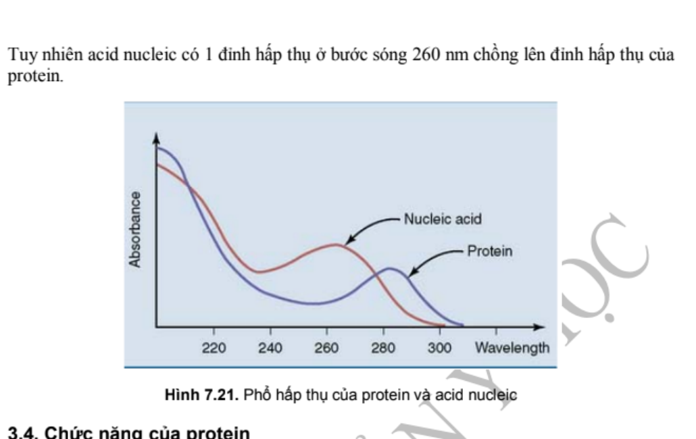
*Hình 7.21. Phổ hấp thụ quang phổ tử ngoại (UV) của protein (đỉnh cực đại $280\text{ nm}$) và acid nucleic (đỉnh cực đại $260\text{ nm}$).*

---

### 3.4. Chức năng sinh học của protein

Về mặt sinh lý và y học, protein được phân thành hai nhóm lớn:
1. **Protein chức năng:**
   - **Protein enzym xúc tác:** làm tăng tốc độ hàng triệu phản ứng hóa sinh trong cơ thể.
   - **Protein vận chuyển:** hemoglobin vận chuyển oxy trong máu; transferrin vận chuyển sắt; ceruloplasmin vận chuyển đồng; albumin vận chuyển acid béo tự do, bilirubin và thuốc.
   - **Protein miễn dịch và bảo vệ:** các kháng thể globulin miễn dịch ($\text{IgA}, \text{IgD}, \text{IgE}, \text{IgG}, \text{IgM}$); các yếu tố đông máu; interferon chống lại virus.
   - **Protein điều hòa và truyền tín hiệu:** các hormon peptid/protein (insulin, glucagon, GH); các thụ thể màng tế bào; các yếu tố điều hòa phiên mã.
   - **Protein co cơ và vận động:** actin, myosin trong cơ; tubulin trong thoi phân bào.
2. **Protein cấu trúc:**
   - Tham gia cấu tạo mô liên kết, hình thành khung nâng đỡ cơ học cho tế bào và mô: **collagen** (chiếm 25 - 30% tổng lượng protein cơ thể, tạo sức bền cho da, xương, gân, sụn), **elastin** (tạo tính đàn hồi cho mạch máu, phổi), **keratin** (cấu tạo tóc, móng, biểu bì da).

---

## 4. HEMOGLOBIN VÀ MYOGLOBIN

Protein vận chuyển oxy là cực kỳ cần thiết cho sự sống của động vật có vú vì oxy rất ít tan trong huyết tương ($0{,}3\text{ mL } \text{O}_2 / 100\text{ mL}$ máu ở $37^\circ\text{C}$). Sự hiện diện của hemoglobin trong hồng cầu giúp nâng khả năng vận chuyển oxy của máu lên gấp 70 lần (khoảng $20\text{ mL } \text{O}_2 / 100\text{ mL}$ máu). Quá trình kết hợp giữa protein vận chuyển với oxy là quá trình thuận nghịch gọi là **sự oxygen hóa** (*oxygenation*):

$$\text{Protein} + \text{O}_2 \rightleftharpoons \text{Protein}\cdot\text{O}_2$$

---

### 4.1. Cấu tạo nhân Hem: vị trí gắn oxy của Hemoglobin và Myoglobin

Các chuỗi acid amin thông thường không có nhóm chức nào có thể gắn trực tiếp với phân tử oxy. Do đó, để gắn oxy, hemoglobin ($\text{Hb}$) và myoglobin ($\text{Mb}$) cần có một nhóm ngoại là **nhân Hem**.

- **Cấu trúc của Hem:** Gồm một nhân porphyrin gọi là **protoporphyrin IX** kết hợp với ion sắt hóa trị hai ($\text{Fe}^{2+}$) tạo phức ở trung tâm.
- Protoporphyrin IX gồm **4 vòng pyrrol** (5 cạnh chứa $\text{N}$) nối với nhau bằng 4 cầu nối methin ($-\text{CH}=$), gắn thêm 8 nhóm thế ở chuỗi bên:
  - 4 nhóm methyl ($-\text{CH}_3$).
  - 2 nhóm vinyl ($-\text{CH}=\text{CH}_2$).
  - 2 nhóm propionat ($-\text{CH}_2-\text{CH}_2-\text{COO}^-$).
- Phần trên của nhân hem ưa nước do có 2 nhóm carboxylat của propionat tích điện âm, trong khi phần dưới của nhân hem kỵ nước do các vòng pyrrol và nhóm methyl/vinyl. Hệ thống liên kết đôi liên hợp làm cho nhân hem có màu đỏ đặc trưng. $\text{OxyHb}$ có màu đỏ tươi, còn $\text{deoxyHb}$ có màu đỏ sẫm tím.

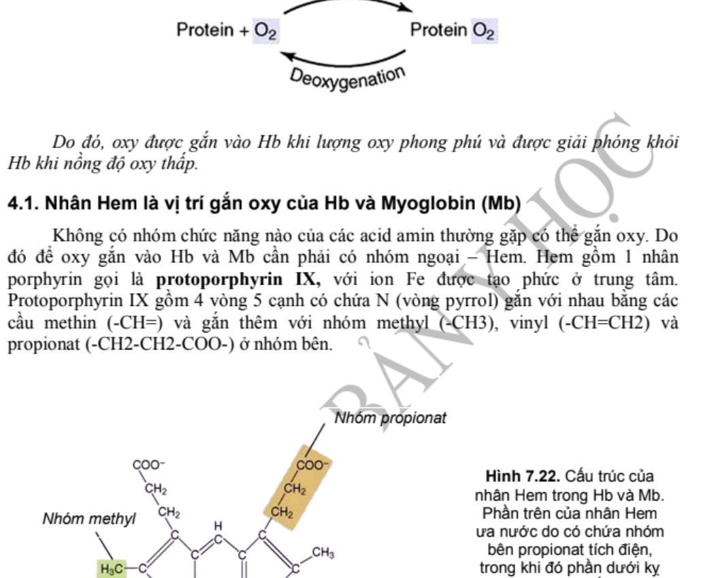
*Hình 7.22. Cấu trúc hóa học của nhân Hem (Fe2+-protoporphyrin IX).*

- **Trạng thái phối trí của ion Sắt ($\text{Fe}^{2+}$):**
  - Ion sắt ở trung tâm có 6 liên kết phối trí:
    - 4 liên kết phối trí với 4 nguyên tử nitơ của 4 vòng pyrrol trong mặt phẳng nhân hem.
    - Liên kết thứ 5 phối trí với nguyên tử nitơ của gốc **Histidin gần** (*proximal histidine*, **His F8** hay His 93) của chuỗi globin.
    - Liên kết thứ 6 liên kết thuận nghịch với **phân tử oxy** ($\text{O}_2$). Ở phía đối diện phân tử oxy là **Histidin xa** (*distal histidine*, **His E7** hay His 58); His E7 không liên kết trực tiếp với sắt nhưng tạo liên kết hydro với oxy và tạo cản trở không gian ngăn cản khí độc carbon monoxyd ($\text{CO}$) gắn thẳng hàng với sắt.
  - **Sự khác biệt giữa oxygen hóa và oxy hóa:**
    - Khi gắn oxy, sắt trong nhân hem luôn luôn được duy trì ở trạng thái **$\text{Fe}^{2+}$ (sắt ferrous)**. Quá trình này là **sự oxygen hóa** thuận nghịch.
    - Nếu $\text{Fe}^{2+}$ bị mất 1 electron chuyển thành **$\text{Fe}^{3+}$ (sắt ferric)** thì đó là phản ứng **oxy hóa**, tạo thành **methemoglobin** ($\text{MetHb}$). $\text{MetHb}$ không còn khả năng vận chuyển oxy. Trong hồng cầu bình thường, enzym **methemoglobin reductase** (sử dụng NADH) liên tục khử $\text{MetHb}$ trở lại thành $\text{Hb}$ hoạt động.

---

### 4.2. Cấu trúc và chức năng của Myoglobin (Mb)

- **Vị trí và chức năng:** Myoglobin là hemoprotein chỉ tìm thấy ở tế bào cơ tim và cơ vân xương, có chức năng dự trữ oxy ngắn hạn và tạo điều kiện khuếch tán oxy trong sợi cơ khi co cơ mạnh.
- **Cấu trúc phân tử:** Gồm **1 chuỗi polypeptid duy nhất (153 acid amin)** kết hợp với **1 nhân hem** (trọng lượng phân tử khoảng $17\text{ kDa}$).
- Khoảng $75\%$ chuỗi polypeptid cuộn thành **8 đoạn xoắn $\alpha$** (ký hiệu từ A đến H) nối với nhau bằng các đoạn uốn ngắn.
- Nhân hem nằm lọt trong một khe kỵ nước giữa xoắn E và xoắn F, được bảo vệ khỏi sự oxy hóa bởi môi trường nước. Gốc His F8 (histidin thứ 8 trên đoạn xoắn F) liên kết trực tiếp với $\text{Fe}^{2+}$, còn His E7 nằm ở phía đối diện.
- Không chứa liên kết disulfid, cấu trúc bậc 3 được ổn định hoàn toàn bởi tương tác kỵ nước giữa các nhóm bên không phân cực ở lõi trong.

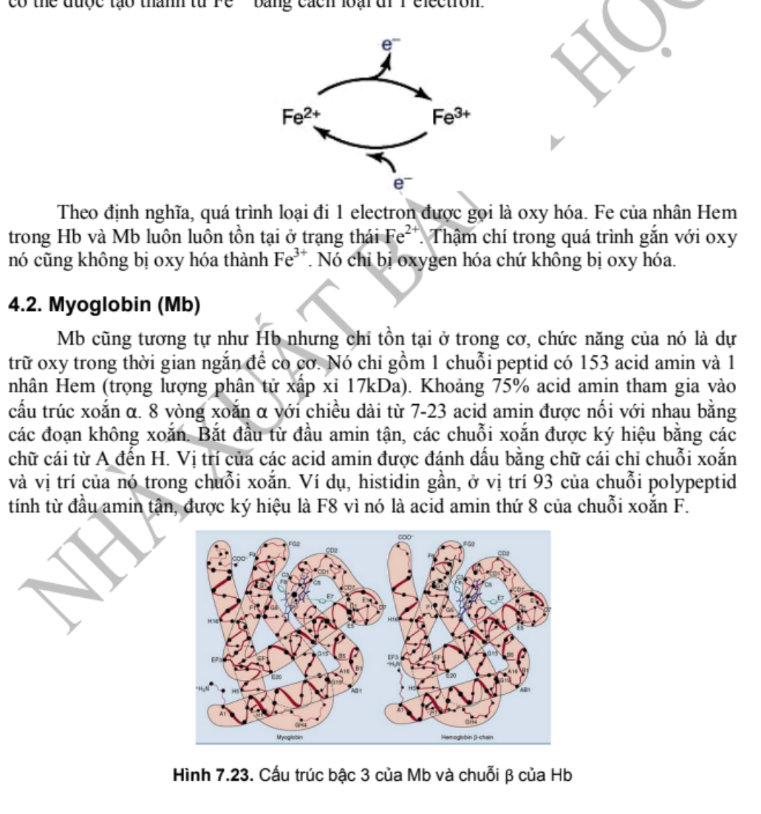
*Hình 7.23. So sánh cấu trúc không gian bậc 3 của Myoglobin (Mb) và chuỗi $\beta$ của Hemoglobin (Hb).*

---

### 4.3. Cấu tạo Hemoglobin (Hb) và các loại Hb ở người

- **Vị trí và đặc điểm:** Hemoglobin là protein chính trong hồng cầu (chiếm khoảng 33% trọng lượng dịch bào tương hồng cầu, tương ứng $34\text{ g/dL}$). Hồng cầu trưởng thành không có nhân và ty thể, thoái hóa glucose yếm khí tạo lactat và tổng hợp chất điều hòa $2,3\text{-BPG}$.
- **Cấu trúc tetramer:** Hemoglobin là một phân tử protein có cấu trúc bậc 4 gồm **4 chuỗi polypeptid (globin)**, mỗi chuỗi gắn với **1 nhân hem** (chở được tối đa 4 phân tử $\text{O}_2$, khối lượng phân tử khoảng $64{,}5\text{ kDa}$).

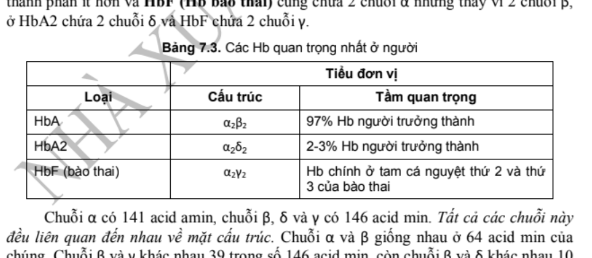
*Bảng 7.3. Các loại Hemoglobin sinh lý ở người*

| Loại Hb | Thành phần chuỗi tiểu đơn vị | Tỷ lệ và Tầm quan trọng sinh học |
| :--- | :---: | :--- |
| **HbA** | $\alpha_2\beta_2$ | Chiếm **$97\%$** tổng lượng Hb ở người trưởng thành. |
| **HbA2** | $\alpha_2\delta_2$ | Chiếm **$2 - 3\%$** Hb ở người trưởng thành. |
| **HbF** | $\alpha_2\gamma_2$ | Hb chính của thai nhi ở tam cá nguyệt thứ 2 và thứ 3; sau sinh giảm dần còn $< 1\%$. |

- Chuỗi $\alpha$ gồm 141 acid amin; chuỗi $\beta, \gamma, \delta$ đều gồm 146 acid amin.
- Mỗi tiểu đơn vị của $\text{Hb}$ có cấu trúc không gian bậc 3 cuộn gấp tương tự như phân tử $\text{Mb}$.
- **Đặc điểm ái lực oxy của $\text{HbF}$:**
  - $\text{HbF}$ có **ái lực với oxy cao hơn đáng kể so với $\text{HbA}$** người lớn.
  - Nguyên nhân cơ chế: Trong chuỗi $\beta$ của $\text{HbA}$, vị trí $\text{His H21}$ (His 143) mang điện tích dương tham gia liên kết ion gắn chặt phân tử $2,3\text{-BPG}$. Ở chuỗi $\gamma$ của $\text{HbF}$, acid amin này được thay thế bằng **Serin** trung hòa không tích điện. Do đó, $2,3\text{-BPG}$ gắn rất lỏng lẻo vào $\text{HbF}$, giúp $\text{HbF}$ duy trì trạng thái ái lực cao, cho phép thai nhi dễ dàng "hút" oxy từ máu mẹ qua rau thai. Áp lực bão hòa một nửa oxy $P_{50}$ của $\text{HbF}$ là $20\text{ mmHg}$ (so với $26\text{ mmHg}$ của $\text{HbA}$).

---

### 4.4. Trạng thái T (Tense) và Trạng thái R (Relaxed) của Hb

Phân tử hemoglobin chuyển đổi qua lại giữa hai trạng thái cấu hình không gian:
1. **Dạng T (*Tense - kéo căng*):** tương ứng với **deoxyhemoglobin**. Các tiểu đơn vị liên kết chặt chẽ với nhau bởi **8 cầu muối (liên kết ion)** giữa các chuỗi polypeptid. Dạng T có cấu trúc cứng nhắc và có **ái lực rất thấp với oxy**.
2. **Dạng R (*Relaxed - thư giãn*):** tương ứng với **oxyhemoglobin**. Khi phân tử oxy đầu tiên gắn vào ion sắt của nhân hem, bán kính ion $\text{Fe}^{2+}$ co nhỏ lại và dịch chuyển khoảng $0{,}4\text{ \AA}$ chui vào vừa khít mặt phẳng của vòng porphyrin. Sự di chuyển này kéo theo Histidin gần (F8) và làm chuyển dịch đoạn xoắn F, kéo theo sự vỡ các cầu muối liên chuỗi. Phân tử chuyển sang dạng R có **ái lực với oxy cao hơn gấp $150 - 300$ lần so với dạng T**.

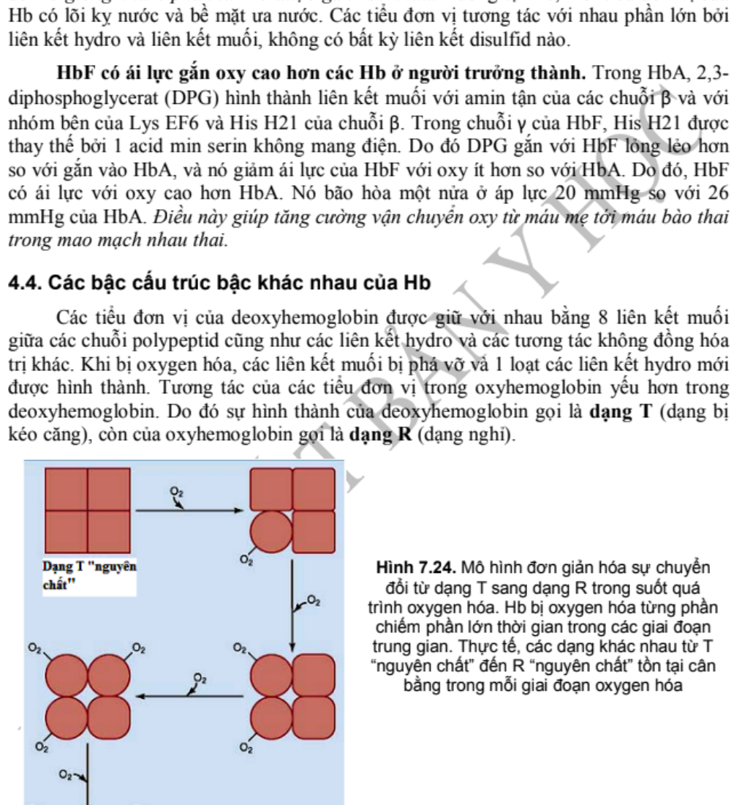
*Hình 7.24. Mô hình chuyển đổi phối hợp từ trạng thái T (ái lực thấp) sang trạng thái R (ái lực cao) khi gắn oxy.*

---

### 4.5. Đường cong gắn Oxy và Hiện tượng Hợp tác dương tính

- **Đường cong gắn oxy của Myoglobin:** có dạng **hyperbol**. Mb gắn oxy rất chặt ở phân áp thấp ($P_{50} \approx 2 - 3\text{ mmHg}$), chỉ giải phóng oxy khi phân áp oxy trong mô cơ giảm xuống cực thấp khi cơ bắp hoạt động cạn kiệt oxy.
- **Đường cong gắn oxy của Hemoglobin:** có dạng **chữ S (hình sigma)** đặc trưng cho **protein dị lập thể với hiện tượng hợp tác dương tính** (*positive cooperativity*):
  - Ở phân áp oxy thấp tại các mô ngoại vi ($p\text{O}_2 \approx 20 - 40\text{ mmHg}$), $\text{Hb}$ dễ dàng nhả oxy cho mô.
  - Ở phân áp oxy cao tại mao mạch phế nang phổi ($p\text{O}_2 \approx 90 - 100\text{ mmHg}$), $\text{Hb}$ nhanh chóng đạt độ bão hòa oxy tối đa ($96 - 98\%$).
  - Khi phân tử $\text{O}_2$ đầu tiên gắn vào 1 nhân hem của phân tử dạng T, nó kích hoạt sự chuyển đổi cấu hình sang dạng R làm tăng ái lực gắn của các nhân hem tiếp theo.

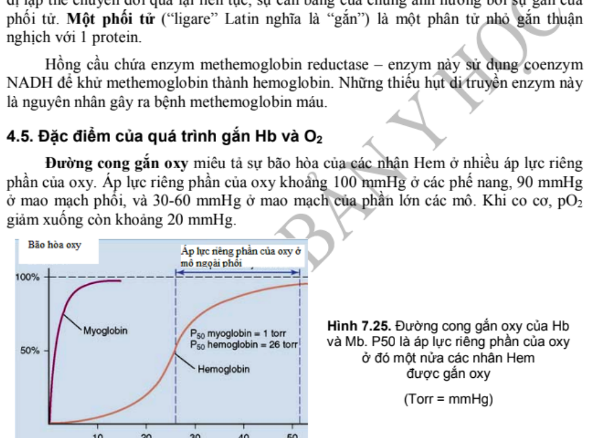
*Hình 7.25. So sánh đường cong phân ly oxy của Hemoglobin (đường chữ S) và Myoglobin (đường hyperbol).*

---

### 4.6. Điều hòa ái lực Oxy của Hb: 2,3-DPG, Hiệu ứng Bohr và Vận chuyển CO2

#### A. Vai trò của 2,3-Diphosphoglycerat (2,3-DPG / 2,3-BPG)
- $2,3\text{-DPG}$ là sản phẩm chuyển hóa rẽ nhánh từ đường phân trong hồng cầu (chu trình Rapoport-Luebering), hiện diện với nồng độ xấp xỉ phân tử $\text{Hb}$ (khoảng $5\text{ mmol/L}$).
- Một phân tử $2,3\text{-DPG}$ tích điện âm mạnh chui vào khoang trung tâm giữa hai chuỗi $\beta$ của deoxyHb (dạng T) và tạo liên kết muối với các acid amin mang điện dương (Lys EF6, His H21, Val 1).
- **Cơ chế:** $2,3\text{-DPG}$ chỉ gắn và làm **ổn định dạng T**, do đó làm **giảm ái lực của Hb đối với oxy**, đẩy đường cong phân ly oxy sang phải, giúp giải phóng oxy dễ dàng hơn cho các mô ngoại vi.
- Nồng độ $2,3\text{-DPG}$ tăng cao trong các trường hợp thiếu oxy mạn tính (lên vùng núi cao, bệnh phổi tắc nghẽn mạn tính COPD, thiếu máu nặng).

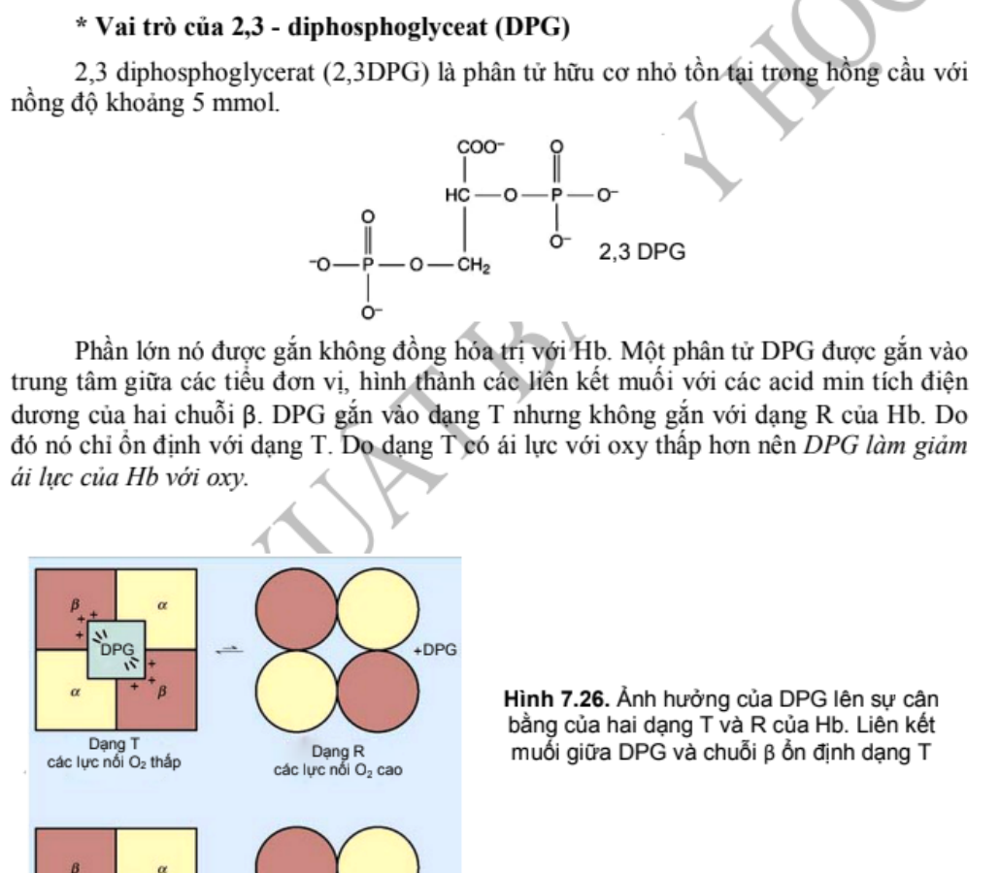
*Hình 7.26. Cơ chế 2,3-DPG liên kết tại khoang trung tâm giữa hai chuỗi $\beta$ làm ổn định cấu hình dạng T.*

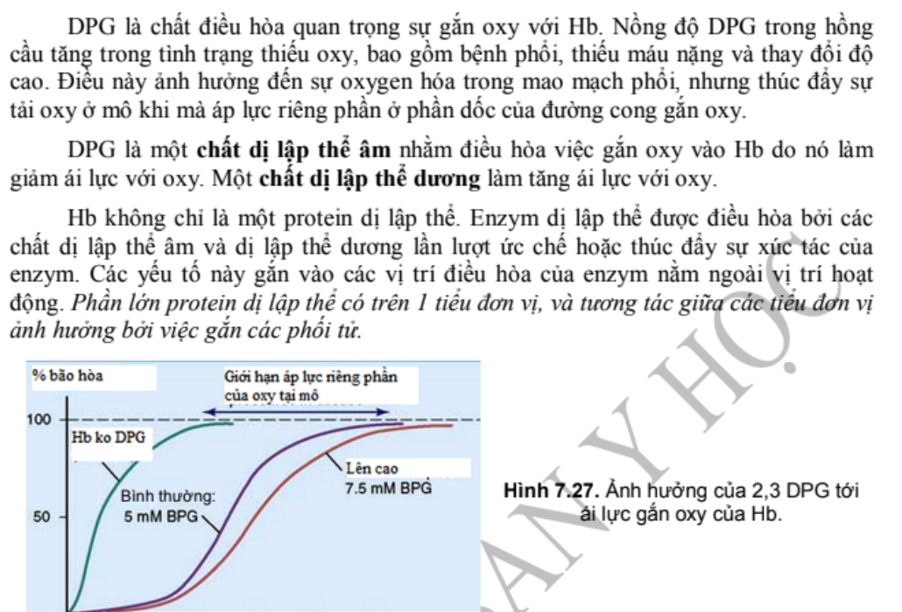
*Hình 7.27. Ảnh hưởng của 2,3-DPG lên đường cong bão hòa oxy của Hemoglobin.*

#### B. Hiệu ứng Bohr (Ảnh hưởng của pH và nồng độ H+)
- Tại các mô chuyển hóa mạnh, sự sản sinh $\text{CO}_2$ và acid lactic làm tăng nồng độ $\text{H}^+$ (giảm $\text{pH}$).
- Sự proton hóa các gốc Histidin trong chuỗi globin tạo thêm các liên kết muối làm ổn định dạng T, dẫn đến **làm giảm ái lực của Hb với oxy và kích thích giải phóng oxy cho mô**:

$$\text{Hb}\cdot\text{O}_2 + \text{H}^+ \rightleftharpoons \text{Hb}\cdot\text{H}^+ + \text{O}_2$$

- Ngược lại, tại mao mạch phổi, khi oxy gắn vào $\text{Hb}$ sẽ làm giải phóng các ion $\text{H}^+$, $\text{H}^+$ kết hợp với $\text{HCO}_3^-$ tái tạo $\text{CO}_2$ khuếch tán ra phế nang để thở ra ngoài.

#### C. Sự vận chuyển CO2 và hiện tượng Carbamin hóa
$\text{CO}_2$ sinh ra từ các mô được máu vận chuyển về phổi theo 3 hình thức:
1. **Dưới dạng ion Bicarbonat ($\text{HCO}_3^-$) trong huyết tương (chiếm chủ yếu $\approx 80\%$):** 
   - $\text{CO}_2$ khuếch tán vào hồng cầu, kết hợp với nước nhờ enzym **carbonic anhydrase** tạo thành $\text{H}_2\text{CO}_3$, sau đó phân ly thành $\text{H}^+$ và $\text{HCO}_3^-$.
   - $\text{HCO}_3^-$ được vận chuyển ra ngoài huyết tương để đổi lấy ion $\text{Cl}^-$ đi vào trong hồng cầu (**hiện tượng trao đổi clorid / hiệu ứng Hamburger**).
2. **Dưới dạng hợp chất Carbamin ($\text{Carbamino-Hb}$) (chiếm $\approx 15\%$):** 
   - $\text{CO}_2$ phản ứng thuận nghịch trực tiếp với các nhóm $\alpha$-amin tự do ở đầu tận cùng chuỗi polypeptid:

$$\text{Hb}-\text{NH}_2 + \text{CO}_2 \rightleftharpoons \text{Hb}-\text{NH}-\text{COO}^- + \text{H}^+$$

   - Sự tạo thành carbamin làm ổn định dạng T, hỗ trợ nhả oxy ở mô.
3. **Dưới dạng $\text{CO}_2$ hòa tan tự do trong huyết tương (chiếm khoảng $5\%$).**

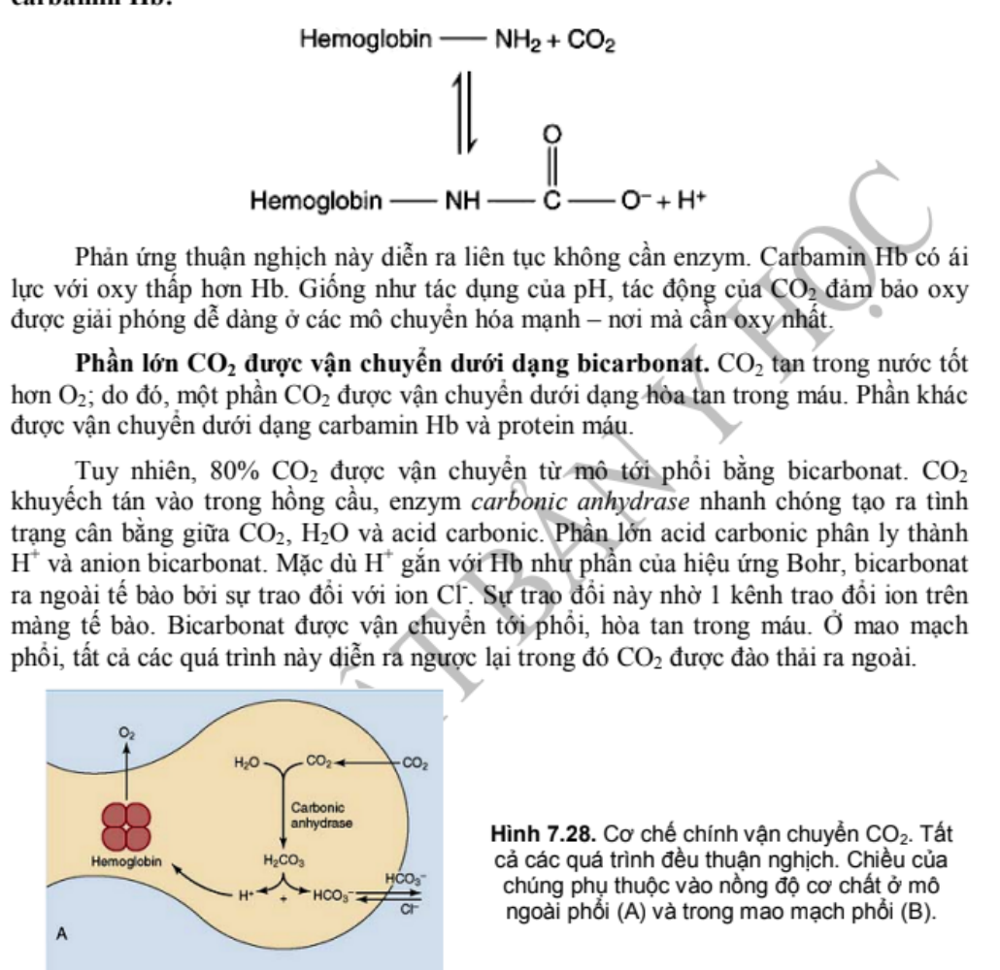
*Hình 7.28. Sơ đồ cơ chế vận chuyển $\text{CO}_2$ và trao đổi khí tại mô ngoại vi (A) và tại mao mạch phổi (B).*

<!-- END FILE: pages_176_185.md -->

<!-- BEGIN FILE: pages_186_195.md -->