# CHƯƠNG 8: CHUYỂN HÓA ACID AMIN VÀ PROTEIN

---

## TÓM TẮT VÀ CÂU HỎI LƯỢNG GIÁ CHƯƠNG 7

### Tóm tắt Chương 7
- Protein vận chuyển oxy là thiết yếu đối với sinh vật bậc cao vì oxy rất ít tan trong nước. Hemoglobin ($\text{Hb}$) trong hồng cầu và Myoglobin ($\text{Mb}$) trong cơ là các protein có cấu trúc tương tự nhau đều sử dụng nhân Hem làm nhóm ngoại.
- $\text{Mb}$ chỉ gồm 1 chuỗi polypeptid và 1 nhân Hem, đóng vai trò dự trữ oxy trong cơ.
- $\text{Hb}$ là protein dị lập thể có cấu trúc bậc 4 gồm 4 chuỗi polypeptid, mỗi chuỗi gắn với 1 nhân Hem. Ở người trưởng thành bình thường, $\text{HbA}$ ($\alpha_2\beta_2$) chiếm khoảng $97\%$, $\text{HbA}_2$ ($\alpha_2\delta_2$) chiếm $2 - 3\%$; ở thai nhi, $\text{HbF}$ ($\alpha_2\gamma_2$) chiếm ưu thế với ái lực oxy cao hơn hẳn $\text{HbA}$.
- Hiện tượng hợp tác dương tính giữa các nhân Hem tạo nên đường cong phân ly oxy dạng chữ S (hình sigma). Các chất điều hòa dị lập thể âm gồm $2,3\text{-DPG}$, ion $\text{H}^+$ (hiệu ứng Bohr) và $\text{CO}_2$ (tạo carbamino-Hb) làm ổn định cấu hình dạng T và giảm ái lực của $\text{Hb}$ đối với oxy, thúc đẩy giải phóng oxy cho các mô chuyển hóa.
- Thiếu hụt $\text{Hb}$ dẫn đến thiếu máu. $\text{Hb}$ mất khả năng vận chuyển oxy khi bị các tác nhân oxy hóa biến $\text{Fe}^{2+}$ thành $\text{Fe}^{3+}$ tạo methemoglobin, hoặc khi bị khí $\text{CO}$ gắn cạnh tranh mạnh với vị trí của oxy trên nhân Hem.

### Câu hỏi lượng giá Chương 7
1. Trình bày cấu trúc chung của các acid amin.
2. Trình bày phân loại acid amin theo nhóm bên và ý nghĩa của mỗi loại.
3. Trình bày cấu trúc của peptid và hoạt tính sinh học của một số loại peptid.
4. Trình bày các bậc cấu trúc của protein và các liên kết ổn định mỗi loại cấu trúc.
5. Trình bày các tính chất lý hóa và một số chức năng của protein.
6. Trình bày cấu trúc và chức năng của Hemoglobin và Myoglobin.

---

# BẮT ĐẦU CHƯƠNG 8: CHUYỂN HÓA ACID AMIN

## MỤC TIÊU HỌC TẬP
1. Trình bày được quá trình giáng hóa protein nội sinh nhờ hệ thống ubiquitin - proteasom.
2. Trình bày được quá trình khử amin oxy hóa và quá trình trao đổi amin của các acid amin; mối liên quan giữa trao đổi amin và khử amin oxy hóa.
3. Trình bày được quá trình tổng hợp urê; mối liên quan giữa chu trình urê và chu trình acid citric (chu trình Krebs).

---

## ĐẠI CƯƠNG VỀ CHUYỂN HÓA ACID AMIN

Acid amin là đơn phân cấu tạo nên protein — thành phần cơ bản và đặc trưng của mọi cơ thể sống. Trong cơ thể người và động vật bậc cao, **acid amin không có dạng dự trữ chuyên biệt** (khác với glucid dự trữ dưới dạng glycogen và lipid dự trữ dưới dạng mỡ triglycerid), mà liên tục tham gia vào một "bể chứa" (*amino acid pool*) chuyển hóa năng động.

Nguồn cung cấp acid amin cho cơ thể đến từ 3 nguồn:
1. Hấp thu từ thức ăn qua đường tiêu hóa (protein ngoại sinh).
2. Thoái hóa các protein nội sinh của tế bào.
3. Do cơ thể tự tổng hợp từ các sản phẩm trung gian của chuyển hóa glucid và lipid.

Tuy nhiên, cơ thể người **không thể tự tổng hợp được 8 acid amin thiết yếu** (bắt buộc phải được cung cấp đầy đủ từ khẩu phần ăn): **Valin, Leucin, Isoleucin, Phenylalanin, Threonin, Tryptophan, Methionin, Lysin** (ở trẻ em thêm *Histidin* và *Arginin* do tốc độ tổng hợp chưa đáp ứng đủ nhu cầu tăng trưởng nhanh).

Acid amin dư thừa không được dùng để tổng hợp protein hoặc các hợp chất chứa nitơ sinh học sẽ bị thoái hóa:
- **Loại bỏ nhóm $\alpha$-amin:** biến đổi thành amoniac ($\text{NH}_4^+$), sau đó chủ yếu được chuyển hóa thành **urê** tại gan để bài tiết qua nước tiểu.
- **Khung carbon ($\alpha$-cetoacid):** được chuyển hóa tiếp thành các sản phẩm trung gian đi vào chu trình Krebs để sinh năng lượng hoặc chuyển thành glucose (acid amin sinh đường) hoặc thể ceton/acid béo (acid amin sinh ceton).

---

## 1. SỰ THỦY PHÂN PROTEIN THÀNH ACID AMIN

### 1.1. Tiêu hóa protein ngoại sinh (thủy phân protein thức ăn)

Quá trình tiêu hóa protein bắt đầu tại **dạ dày**:
- Tế bào thành bài tiết $\text{HCl}$ tạo $\text{pH}$ dịch vị rất acid ($1 - 2$). Môi trường acid mạnh làm biến tính các protein thức ăn, tháo xoắn cấu trúc bậc 2, 3, 4 để lộ các liên kết peptid cho enzym tác dụng.
- Tế bào chính bài tiết tiền chất zymogen **pepsinogen**. Trong môi trường acid của $\text{HCl}$ hoặc nhờ chính pepsin xúc tác tự hoạt hóa (*autocatalysis*), pepsinogen cắt bỏ một đoạn peptid che chắn để trở thành **pepsin** hoạt động.
- Pepsin là một endopeptidase thủy phân liên kết peptid có sự tham gia của acid amin có nhân thơm (Phe, Tyr, Trp) hoặc acid amin kỵ nước, cắt chuỗi protein dài thành các đoạn polypeptid và oligopeptid ngắn hơn.

Tại **ruột non**:
- Dịch tụy có $\text{pH}$ kiềm (chứa nhiều $\text{HCO}_3^-$) trung hòa acid dịch vị, làm bất hoạt pepsin.
- Tụy bài tiết hàng loạt tiền chất enzym (*zymogen*):
  - **Enterokinase** (enteropeptidase) do niêm mạc tá tràng bài tiết xúc tác cắt đoạn peptid hoạt hóa **trypsinogen** thành **trypsin**.
  - Trypsin đóng vai trò trung tâm hoạt hóa dây chuyền các zymogen khác: hoạt hóa tiếp trypsinogen, **chymotrypsinogen** thành **chymotrypsin**, **proelastase** thành **elastase**, và **procarboxypeptidase** thành **carboxypeptidase**.
- **Tính đặc hiệu cơ chất của các protease dịch tiêu hóa:**
  - **Trypsin:** thủy phân liên kết peptid ở đầu carboxyl của các acid amin kiềm/base mang điện dương (**Lysin, Arginin**).
  - **Chymotrypsin:** thủy phân liên kết peptid ở đầu carboxyl của các acid amin nhân thơm hoặc trung tính (**Phe, Tyr, Trp, Leu**).
  - **Elastase:** thủy phân liên kết peptid của các acid amin có chuỗi bên nhỏ (**Gly, Ala, Ser**).
  - **Carboxypeptidase (A và B):** là exopeptidase cắt từng acid amin một từ **đầu C tận cùng** của chuỗi polypeptid.
  - **Aminopeptidase** (ở bờ bàn chải niêm mạc ruột non): cắt từng acid amin một từ **đầu N tận cùng**.
- **Hấp thu acid amin:** Các acid amin tự do được hấp thu qua màng biểu mô niêm mạc ruột non vào máu tĩnh mạch cửa nhờ các hệ thống đồng vận chuyển tích cực thứ phát phụ thuộc ion $\text{Na}^+$ cần tiêu tốn năng lượng ATP.

---

### 1.2. Thủy phân protein nội sinh và Hệ thống Ubiquitin - Proteasom

Ở người trưởng thành, có khoảng **$1 - 2\%$ tổng lượng protein cơ thể được đổi mới mỗi ngày** (*protein turnover*), tương ứng khoảng $300 - 400\text{ g}$ protein/ngày. Phần lớn các acid amin giải phóng ra được tái sử dụng để sinh tổng hợp protein mới.

Thời gian bán hủy ($t_{1/2}$) của protein nội sinh rất khác nhau: các enzym then chốt điều hòa chu trình chuyển hóa có đời sống rất ngắn (từ vài phút đến vài giờ), trong khi hemoglobin sống khoảng 120 ngày, và collagen có thể tồn tại nhiều năm.

Sự thoái hóa protein nội sinh được thực hiện qua hai hệ thống chính:
1. **Hệ thống Lysosom:** phân hủy các protein màng, protein bắt giữ từ ngoại bào qua ẩm bào/thực bào và các bào quan già cỗi nhờ các enzym cathepsin trong túi tiêu thể (không phụ thuộc ATP).
2. **Hệ thống Proteasom trong bào tương:** phân hủy có chọn lọc các protein nội sinh bị sai sót, biến tính hoặc các protein điều hòa có đời sống ngắn. Quá trình này phụ thuộc nghiêm ngặt vào protein đánh dấu **Ubiquitin** và tiêu tốn năng lượng ATP.

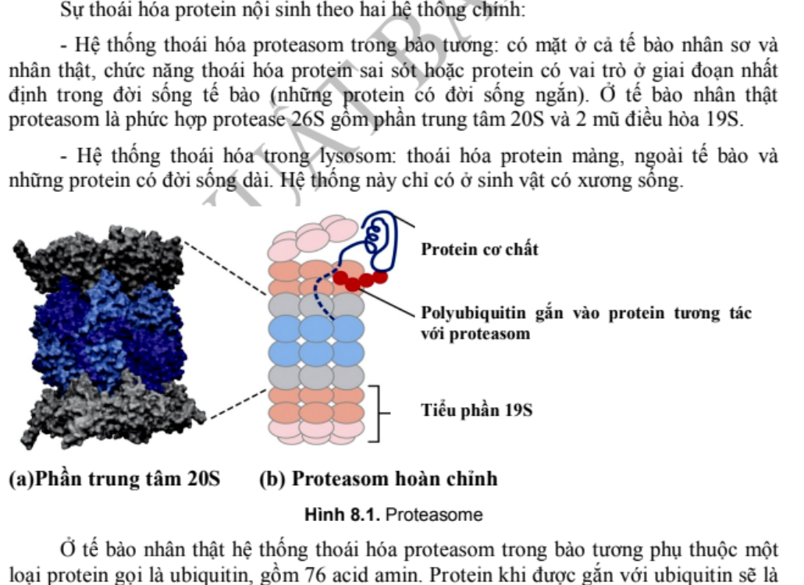
*Hình 8.1. Cấu trúc phức hợp Proteasome: (a) Phần lõi xúc tác hình ống 20S; (b) Phức hợp Proteasome 26S hoàn chỉnh gồm lõi 20S và hai nắp mũ điều hòa 19S ở hai đầu.*

#### Cơ chế gắn Ubiquitin và phân giải protein đích
Ubiquitin là một protein nhỏ gồm 76 acid amin được bảo tồn rất cao trong tiến hóa sinh học. Để một protein bị giáng hóa bởi proteasom 26S, nó phải được gắn một chuỗi **polyubiquitin (tối thiểu từ 4 phân tử ubiquitin trở lên)** thông qua liên kết isopeptid giữa nhóm carboxyl tận cùng của Glycin (trên ubiquitin) với nhóm $\varepsilon$-amino của gốc Lysin (trên protein cơ chất).

Quá trình gắn ubiquitin diễn ra qua 3 bước enzym:
1. **Enzym E1 (Ubiquitin-activating enzyme):** Hoạt hóa ubiquitin nhờ thủy phân ATP thành $\text{AMP} + \text{PP}_i$, tạo liên kết thioeste giàu năng lượng giữa gốc Cys của E1 và nhóm carboxyl tận cùng của ubiquitin ($\text{UB}-\text{CO}-\text{S}-\text{E1}$).
2. **Enzym E2 (Ubiquitin-conjugating enzyme):** Nhận nhóm ubiquitin từ E1 chuyển sang gốc Cys của E2 tạo phức hệ $\text{UB}-\text{CO}-\text{S}-\text{E2}$ và giải phóng E1.
3. **Enzym E3 (Ubiquitin-protein ligase):** Đóng vai trò nhận diện đặc hiệu protein đích cần phá hủy, xúc tác hình thành **liên kết isopeptid** giữa ubiquitin và nhóm $\varepsilon$-amino của gốc Lysin trên protein cơ chất. Quá trình lặp lại gắn thêm nhiều phân tử ubiquitin tạo chuỗi polyubiquitin.

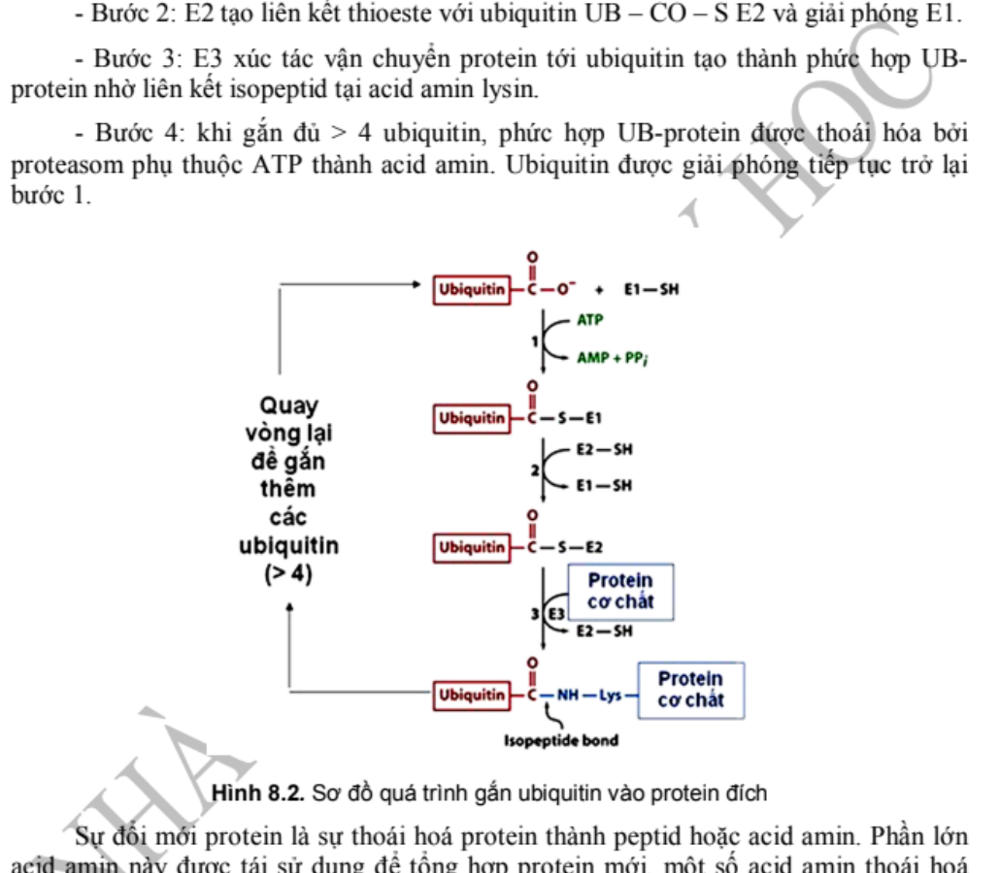
*Hình 8.2. Cơ chế chu trình gắn Ubiquitin qua các enzym E1, E2, E3 và phân giải protein đích tại Proteasom.*

- Khi protein cơ chất mang chuỗi polyubiquitin, nắp mũ 19S của proteasom 26S nhận diện chuỗi này, tháo xoắn chuỗi polypeptid đích (tiêu tốn ATP), cắt giải phóng các ubiquitin tự do để tái sử dụng, rồi dẫn chuỗi polypeptid vào khoang rỗng trung tâm của lõi 20S để các peptidase cắt nát thành các peptid ngắn và acid amin tự do.

---

## 2. SỰ THOÁI HÓA ACID AMIN

### 2.1. Chuyển hóa nhóm $\alpha$-amin của acid amin

Chuyển hóa nhóm amino là giai đoạn đầu tiên và then chốt của quá trình thoái hóa acid amin. Nhóm $\alpha$-amin được loại khỏi khung carbon thông qua hai phản ứng kết hợp chặt chẽ: **phản ứng trao đổi amin** (*transamination*) và **phản ứng khử amin oxy hóa** (*oxidative deamination*).

#### 2.1.1. Phản ứng Trao đổi amin (Transamination)
- **Định nghĩa:** Là phản ứng chuyển nhóm $\alpha$-amin từ một acid amin sang một $\alpha$-cetoacid, kết quả là acid amin ban đầu biến thành $\alpha$-cetoacid tương ứng, còn $\alpha$-cetoacid nhận amin trở thành acid amin mới. Phản ứng hoàn toàn thuận nghịch:

$$\text{Acid amin}_1 + \alpha\text{-Cetoacid}_2 \rightleftharpoons \alpha\text{-Cetoacid}_1 + \text{Acid amin}_2$$

- **Chất nhận amin phổ biến nhất:** Hầu hết mọi acid amin đều chuyển nhóm amin của mình sang **$\alpha$-cetoglutarat**, biến chất này thành **glutamat**.
- **Enzym xúc tác:** Các **aminotransferase** (hoặc **transaminase**). Tất cả các transaminase đều cần coenzym là **pyridoxal phosphat (PLP - dẫn xuất của vitamin $\text{B}_6$)**.
- Hai enzym transaminase quan trọng nhất trong lâm sàng y học:
  1. **ALT (Alanin Aminotransferase** hay **GPT - Glutamic-Pyruvic Transaminase):**

$$\text{Alanin} + \alpha\text{-Cetoglutarat} \stackrel{\text{ALT (PLP)}}{\rightleftharpoons} \text{Pyruvat} + \text{Glutamat}$$

  2. **AST (Aspartat Aminotransferase** hay **GOT - Glutamic-Oxaloacetic Transaminase):**

$$\text{Aspartat} + \alpha\text{-Cetoglutarat} \stackrel{\text{AST (PLP)}}{\rightleftharpoons} \text{Oxaloacetat} + \text{Glutamat}$$

- **Ý nghĩa lâm sàng:** ALT phân bố chủ yếu ở bào tương tế bào gan, AST phân bố ở cả bào tương và ty thể của tế bào cơ tim và gan. Định lượng hoạt độ ALT và AST huyết thanh là xét nghiệm cơ bản đánh giá mức độ hủy hoại tế bào gan (viêm gan cấp, nhiễm độc gan) và nhồi máu cơ tim.

---

#### 2.1.2. Phản ứng Khử amin oxy hóa (Oxidative Deamination)
- Nhóm amin của hầu hết các acid amin sau khi được tập trung về **glutamat** sẽ được khử amin oxy hóa mạnh mẽ tại ty thể tế bào gan nhờ enzym **Glutamat Dehydrogenase (GLDH)**.
- Đây là phản ứng khử amin oxy hóa duy nhất trong cơ thể có hoạt tính xúc tác rất cao và sử dụng coenzym $\text{NAD}^+$ hoặc $\text{NADP}^+$:

$$\text{Glutamat} + \text{NAD(P)}^+ + \text{H}_2\text{O} \stackrel{\text{GLDH}}{\rightleftharpoons} \alpha\text{-Cetoglutarat} + \text{NAD(P)H} + \text{H}^+ + \text{NH}_4^+$$

- **Cơ chế hiệp đồng giữa trao đổi amin và khử amin oxy hóa (Transdeamination):**
  - Đa số các $\text{L}$-amino acid oxidase thông thường có hoạt tính rất yếu và sinh ra chất độc hydro peroxyd ($\text{H}_2\text{O}_2$).
  - Do đó, cơ thể khử amin hầu hết các acid amin một cách **gián tiếp qua Glutamat**: các transaminase gom nhóm amin từ các acid amin khác nhau về $\alpha$-cetoglutarat tạo glutamat, sau đó GLDH khử amin oxy hóa giải phóng amoniac tự do ($\text{NH}_4^+$) và tái tạo $\alpha$-cetoglutarat hoạt động như một "con thoi" nhận amin.

---

### 2.2. Chuyển hóa nhóm Carboxyl: Phản ứng Khử carboxyl tạo các Amin hoạt tính sinh học

Nhóm carboxyl của một số acid amin có thể bị tách ra dưới dạng $\text{CO}_2$ nhờ enzym **decarboxylase** (cũng cần coenzym PLP - vitamin $\text{B}_6$) để tạo thành các amin có hoạt tính sinh học cực mạnh:
1. **Histidin $\rightarrow$ Histamin:** Histamin gây giãn mạch, hạ huyết áp, tăng tính thấm mao mạch, co thắt cơ trơn phế quản và kích thích bài tiết acid dịch vị $\text{HCl}$ dạ dày.
2. **Glutamat $\rightarrow$ GABA ($\gamma$-aminobutyric acid):** GABA là chất dẫn truyền thần kinh ức chế chính trong hệ thần kinh trung ương và não bộ.
3. **Tyrosin $\rightarrow$ Dopa $\rightarrow$ Dopamin $\rightarrow$ Noradrenalin $\rightarrow$ Adrenalin:** nhóm catecholamin dẫn truyền thần kinh giao cảm và hormon tủy thượng thận.
4. **Tryptophan $\rightarrow$ 5-Hydroxytryptophan $\rightarrow$ Serotonin (5-HT):** chất dẫn truyền thần kinh điều hòa giấc ngủ, tâm trạng và trương lực mạch máu.

Các amin này sau khi phát huy tác dụng sẽ nhanh chóng bị giáng hóa khử amin nhờ enzym **monoamin oxidase (MAO)** hoặc **diamin oxidase (DAO)** tạo thành aldehyd và acid carboxylic tương ứng.

---

### 2.3. Chuyển hóa và Vận chuyển Amoniac ($\text{NH}_4^+$) trong cơ thể

Amoniac ($\text{NH}_4^+ / \text{NH}_3$) được sinh ra từ quá trình khử amin của acid amin ở các mô, từ sự khử amin của purin/pyrimidin, và do vi khuẩn đường ruột phân giải urê/protein. 

$\text{NH}_4^+$ là một **chất cực độc đối với hệ thần kinh trung ương**. Khi nồng độ amoniac trong máu tăng cao (tăng amoniac máu), nó dễ dàng vượt qua hàng rào máu - não làm cạn kiệt $\alpha$-cetoglutarat của chu trình Krebs (do đảo ngược phản ứng GLDH) làm não thiếu hụt năng lượng ATP trầm trọng, tích tụ glutamin gây phù nề tế bào thần kinh đệm và rối loạn dẫn truyền thần kinh dẫn đến bệnh não gan (*hepatic encephalopathy*) và hôn mê gan.

Do đó, $\text{NH}_4^+$ từ các mô ngoại vi phải được chuyển thành các dạng vận chuyển trung tính, không độc trước khi đưa vào máu về gan và thận:
1. **Vận chuyển dưới dạng Glutamin (ở hầu hết các mô, đặc biệt là não):**
   - Tại não và các mô, $\text{NH}_4^+$ được gắn vào glutamat nhờ enzym **glutamin synthetase** (tiêu tốn 1 ATP) tạo thành **Glutamin**:

$$\text{Glutamat} + \text{NH}_4^+ + \text{ATP} \stackrel{\text{Glutamin synthetase}}{\longrightarrow} \text{Glutamin} + \text{ADP} + \text{P}_i$$

   - Glutamin là chất trung tính, không độc, dễ dàng qua màng tế bào vào máu tuần hoàn đến **gan** và **thận**.
   - Tại gan và thận, enzym **glutaminase** ở ty thể thủy phân glutamin giải phóng lại glutamat và $\text{NH}_4^+$:
     - Tại thận: $\text{NH}_4^+$ được bài tiết trực tiếp ra nước tiểu dưới dạng muối amoni, đóng vai trò đệm giữ cân bằng thăng bằng acid - base của cơ thể.
     - Tại gan: $\text{NH}_4^+$ đi thẳng vào chu trình urê để tổng hợp thành urê.
2. **Vận chuyển dưới dạng Alanin qua Chu trình Glucose - Alanin (ở cơ vân):**
   - Ở cơ khi hoạt động co cơ mạnh, thoái hóa glucose sinh nhiều pyruvat. Pyruvat nhận nhóm amin từ sự thoái hóa acid amin nhờ enzym ALT tạo thành **Alanin**.
   - Alanin theo máu về gan. Tại gan, ALT chuyển nhóm amin trở lại cho $\alpha$-cetoglutarat tạo glutamat (đi vào chu trình urê), còn pyruvat được dùng để tân tạo lại glucose quay trở lại nuôi dưỡng cơ bắp.

---

## 3. CHU TRÌNH TỔNG HỢP URÊ (CHU TRÌNH KREBS - HENSELEIT)

Tại tế bào gan, toàn bộ lượng amoniac tự do độc hại được cố định và chuyển hóa thành **Urê** — một hợp chất trung tính, hòa tan cao và hoàn toàn không độc — qua **Chu trình Urê**.

### 3.1. Nguyên liệu tổng hợp Urê
Phân tử urê có công thức $\text{H}_2\text{N}-\text{CO}-\text{NH}_2$, nguồn gốc các nguyên tử cấu thành gồm:
- **1 nguyên tử Nitơ** lấy từ amoniac tự do ($\text{NH}_4^+$) trong ty thể.
- **1 nguyên tử Nitơ** lấy từ acid amin **Aspartat** ngoài bào tương.
- **1 nguyên tử Carbon** lấy từ $\text{CO}_2$ (dưới dạng $\text{HCO}_3^-$) của hô hấp tế bào.
- **Tiêu tốn 3 phân tử ATP** (tương đương 4 liên kết phosphat giàu năng lượng vì 1 ATP bị thủy phân thành $\text{AMP} + \text{PP}_i$).
- Cần **1 phân tử Ornithin** làm mồi dẫn dắt chu trình.
- Do **5 enzym** xúc tác (2 enzym đầu trong ty thể, 3 enzym sau ở bào tương).

---

### 3.2. Các phản ứng của Chu trình Urê

#### Giai đoạn 1: Trong ty thể tế bào gan
1. **Tổng hợp Carbamyl Phosphat (Phản ứng then chốt điều hòa):**
   - Amoniac phản ứng với bicarbonat nhờ enzym **Carbamyl Phosphat Synthetase I (CPS-I)**, tiêu tốn 2 phân tử ATP:

$$\text{NH}_4^+ + \text{HCO}_3^- + 2\text{ATP} \stackrel{\text{CPS-I}}{\longrightarrow} \text{Carbamyl phosphat} + 2\text{ADP} + \text{P}_i$$

   - *Điều hòa:* CPS-I là enzym chìa khóa điều hòa tốc độ của toàn bộ chu trình urê, được hoạt hóa dị lập thể bắt buộc bởi **N-acetylglutamat (NAG)**.
2. **Tạo Citrullin:**
   - Gốc carbamyl được chuyển sang cho Ornithin nhờ enzym **Ornithin Carbamyl Transferase (OCT)** tạo thành **Citrullin**:

$$\text{Carbamyl phosphat} + \text{Ornithin} \stackrel{\text{OCT}}{\longrightarrow} \text{Citrullin} + \text{P}_i$$

   - Citrullin sau đó được hệ thống vận chuyển đưa từ ty thể ra ngoài bào tương.

#### Giai đoạn 2: Ngoài bào tương tế bào gan
3. **Tạo Argininosuccinat:**
   - Citrullin ngưng tụ với **Aspartat** (cung cấp nguyên tử nitơ thứ hai) nhờ enzym **Argininosuccinat Synthetase**, tiêu tốn 1 ATP thủy phân thành $\text{AMP} + \text{PP}_i$:

$$\text{Citrullin} + \text{Aspartat} + \text{ATP} \stackrel{\text{Argininosuccinat synthetase}}{\longrightarrow} \text{Argininosuccinat} + \text{AMP} + \text{PP}_i$$

   - Pyrophosphat ($\text{PP}_i$) bị pyrophosphatase thủy phân ngay thành $2\text{P}_i$, thúc đẩy phản ứng diễn ra một chiều hoàn toàn.
4. **Phân cắt Argininosuccinat tạo Arginin và Fumarat:**
   - Xúc tác bởi enzym **Argininosuccinat Lyase**:

$$\text{Argininosuccinat} \stackrel{\text{Argininosuccinat lyase}}{\longrightarrow} \text{Arginin} + \text{Fumarat}$$

   - **Fumarat** sinh ra đóng vai trò mắt xích liên kết giữa chu trình urê và chu trình Krebs (chuyển thành malat đi vào ty thể tạo oxaloacetat, rồi chuyển amin tạo lại aspartat).
5. **Thủy phân Arginin tạo Urê và tái tạo Ornithin:**
   - Xúc tác bởi enzym **Arginase** (chỉ có ở gan, cần ion $\text{Mn}^{2+}$):

$$\text{Arginin} + \text{H}_2\text{O} \stackrel{\text{Arginase}}{\longrightarrow} \text{Urê} + \text{Ornithin}$$

   - **Urê** được giải phóng vào máu, tới thận bài tiết ra ngoài theo nước tiểu.
   - **Ornithin** được con thoi vận chuyển ngược trở lại vào ty thể để bắt đầu một vòng chu trình mới.

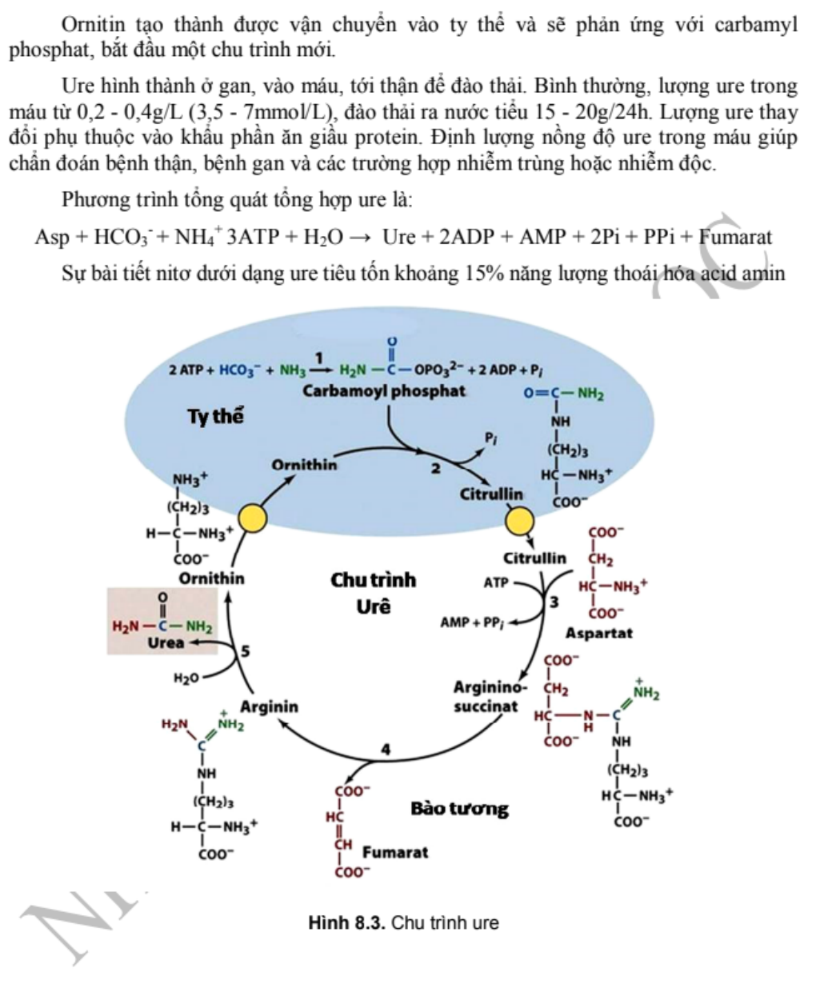
*Hình 8.3. Sơ đồ 5 phản ứng của Chu trình Urê diễn ra phân chia giữa ty thể và bào tương tế bào gan, cùng mối liên kết với chu trình Krebs qua phân tử Fumarat.*

---

### 3.3. Phương trình tổng quát và Bilan năng lượng
$$\text{Aspartat} + \text{NH}_4^+ + \text{HCO}_3^- + 3\text{ATP} + \text{H}_2\text{O} \longrightarrow \text{Urê} + \text{Fumarat} + 2\text{ADP} + 2\text{P}_i + \text{AMP} + \text{PP}_i$$

Sự bài tiết nitơ dưới dạng urê tiêu tốn khoảng **$15\%$ tổng năng lượng thoái hóa của acid amin**, một chi phí sinh học bắt buộc để giải độc amoniac bảo vệ cơ thể.

### 3.4. Ý nghĩa lâm sàng
- **Nồng độ urê máu bình thường:** $0{,}2 - 0{,}4\text{ g/L}$ (tương đương **$3{,}3 - 6{,}7\text{ mmol/L}$**).
- **Lượng urê đào thải qua nước tiểu:** khoảng $15 - 20\text{ g/24 giờ}$.
- Tăng urê máu gặp trong suy thận (giảm độ lọc cầu thận), chế độ ăn quá nhiều protein, xuất huyết tiêu hóa cao, sốt nhiễm trùng nặng. Giảm urê máu gặp trong suy gan nặng (xơ gan giai đoạn cuối, hoại tử gan cấp do không tổng hợp được urê, làm amoniac máu tăng vọt gây hôn mê gan).

<!-- END FILE: pages_186_195.md -->

<!-- BEGIN FILE: pages_196_205.md -->

# CHƯƠNG 8 (TIẾP THEO): CHUYỂN HÓA ACID AMIN VÀ CÁC BỆNH LÝ LIÊN QUAN

---

## 2. SỰ THOÁI HÓA ACID AMIN (TIẾP THEO)

### 2.3. Mối liên quan giữa Chu trình Urê và Chu trình Acid Citric (Chu trình Krebs)

Hai chu trình Krebs và Chu trình Urê được kết nối mật thiết với nhau trong tế bào gan qua cái gọi là "bánh xe kép Krebs" (*Krebs bicycle*):

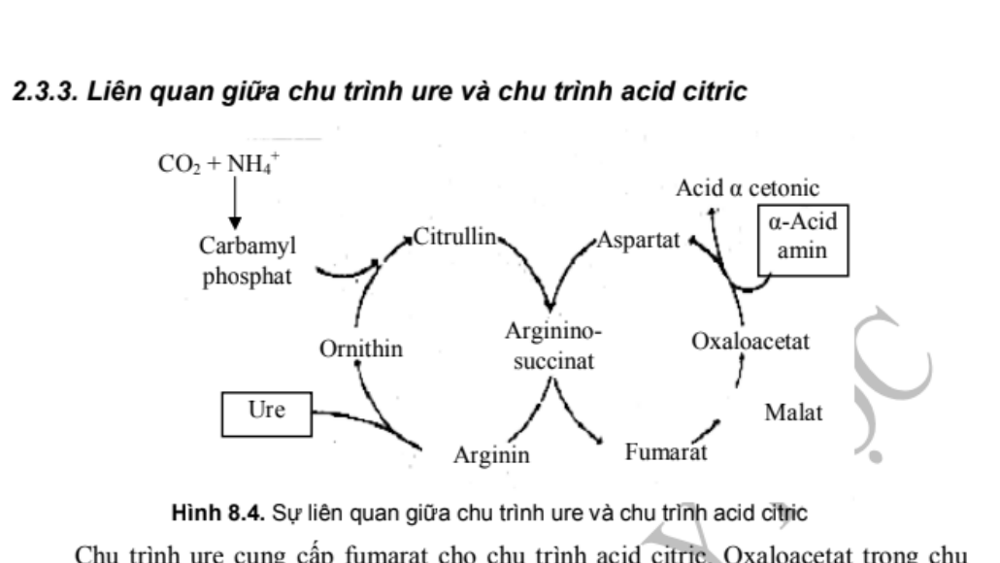
*Hình 8.4. Mối liên quan chuyển hóa giữa Chu trình Urê và Chu trình Acid Citric (Chu trình Krebs).*

- **Fumarat** do enzym argininosuccinat lyase giải phóng ngoài bào tương được chuyển thành malat, sau đó malat đi vào ty thể tham gia vào chu trình Krebs tạo oxaloacetat.
- **Oxaloacetat** trong chu trình Krebs thực hiện phản ứng trao đổi amin với glutamat (nhờ AST) để tái tạo **aspartat**.
- **Aspartat** từ ty thể ra bào tương tiếp tục cung cấp nguyên tử nitơ thứ hai cho chu trình urê bằng cách phản ứng với citrullin.

---

### 2.4. Số phận của Khung Carbon ($\alpha$-cetoacid)

Sau khi tách bỏ nhóm $\alpha$-amin, khung carbon của 20 acid amin được thoái hóa hội tụ về 7 sản phẩm chuyển hóa trung gian phổ biến: **Pyruvat, Oxaloacetat, $\alpha$-Cetoglutarat, Succinyl-CoA, Fumarat, Acetyl-CoA và Acetoacetyl-CoA**.

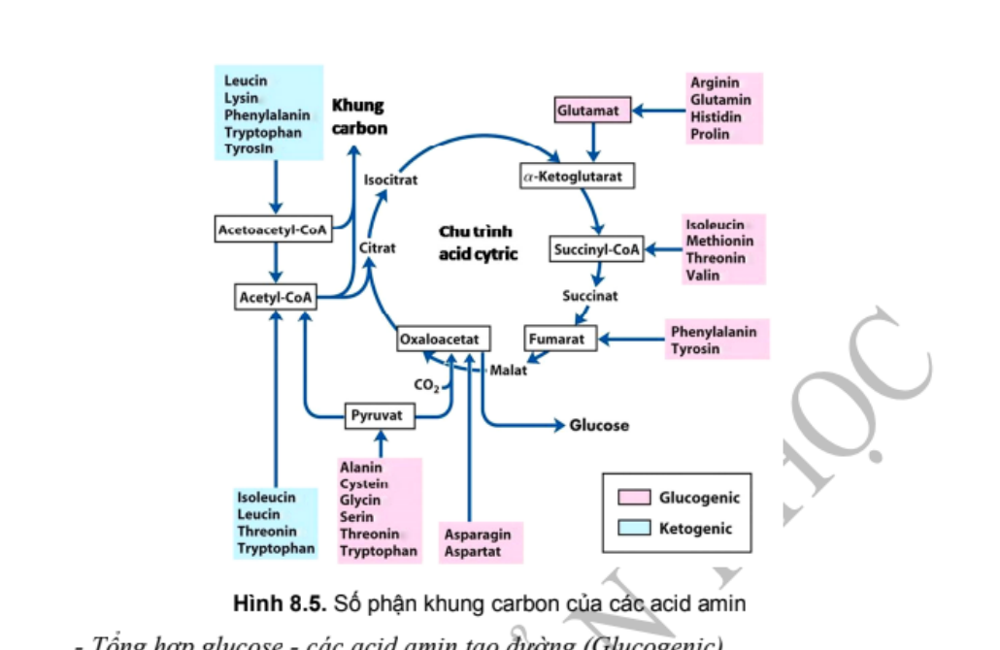
*Hình 8.5. Số phận khung carbon của các acid amin: phân nhóm thành các acid amin sinh đường (Glucogenic) và sinh ceton (Ketogenic).*

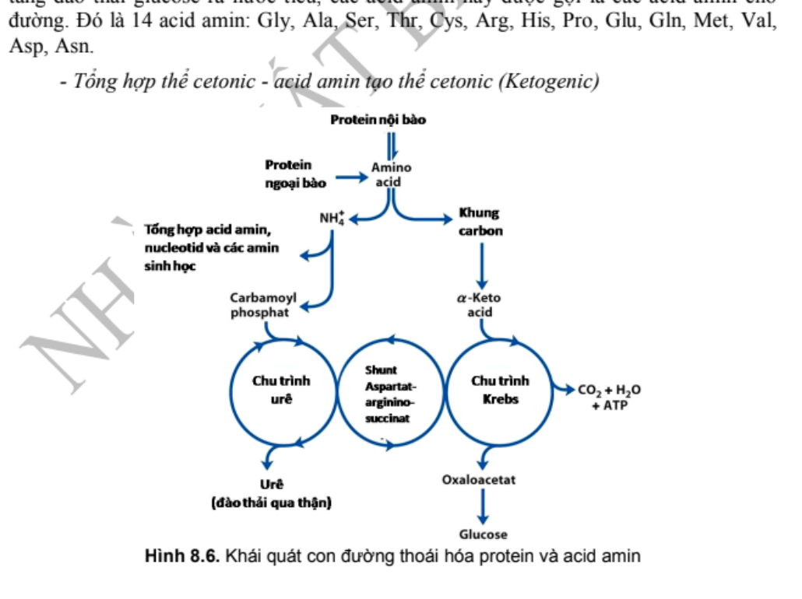
*Hình 8.6. Khái quát con đường thoái hóa protein và acid amin.*

#### 2.4.1. Thoái hóa khung carbon thành các sản phẩm trung gian
1. **Thoái hóa tạo Pyruvat (6 acid amin):**
   - **Alanin:** trao đổi amin trực tiếp với $\alpha$-cetoglutarat nhờ ALT tạo pyruvat.
   - **Serin:** khử amin loại nước nhờ enzym *serin hydratase* tạo pyruvat.
   - **Cystein:** thoái hóa tạo pyruvat kèm theo sự giải phóng lưu huỳnh dưới dạng $\text{H}_2\text{S}, \text{SO}_4^{2-}, \text{SCN}^-$.
   - **Glycin:** chuyển đổi thuận nghịch thành Serin nhờ enzym *serin hydroxymethyl transferase* (cần coenzym acid folic $\text{FH}_4$).
   - **Threonin:** biến đổi qua aminoaceton tạo pyruvat.
   - **Tryptophan:** một nhánh thoái hóa tách tạo alanin rồi chuyển thành pyruvat.
2. **Thoái hóa tạo Oxaloacetat (2 acid amin):**
   - **Aspartat:** trao đổi amin với $\alpha$-cetoglutarat nhờ AST tạo oxaloacetat.
   - **Asparagin:** bị thủy phân bởi *asparaginase* giải phóng $\text{NH}_4^+$ và aspartat.
3. **Thoái hóa tạo $\alpha$-Cetoglutarat (5 acid amin họ 5 carbon):**
   - **Glutamin:** thủy phân nhờ *glutaminase* tạo glutamat.
   - **Prolin, Arginin, Histidin:** thoái hóa qua chất trung gian glutamat-$\gamma$-semialdehyd tạo glutamat.
   - **Glutamat:** khử amin oxy hóa nhờ GLDH giải phóng $\alpha$-cetoglutarat.
4. **Thoái hóa tạo Succinyl-CoA (4 acid amin):**
   - **Methionin, Isoleucin, Valin, Threonin:** thoái hóa hội tụ tạo propionyl-CoA, sau đó carboxyl hóa thành methylmalonyl-CoA (cần Biotin) rồi đồng phân hóa nhờ enzym phụ thuộc vitamin $\text{B}_{12}$ thành **Succinyl-CoA** đi vào chu trình Krebs.
5. **Thoái hóa tạo Fumarat:**
   - **Phenylalanin** và **Tyrosin** bị phân cắt giải phóng fumarat và acetoacetat.
6. **Thoái hóa tạo Acetyl-CoA và Acetoacetyl-CoA:**
   - Các acid amin mạch nhánh và acid amin nhân thơm: **Leucin, Lysin, Tryptophan, Phenylalanin, Tyrosin, Isoleucin**.

#### 2.4.2. Phân loại Acid amin Sinh đường và Sinh ceton
- **Acid amin sinh đường (*Glucogenic amino acids*):** Là những acid amin mà khung carbon sau thoái hóa tạo thành pyruvat hoặc các chất trung gian của chu trình Krebs (oxaloacetat, $\alpha$-cetoglutarat, succinyl-CoA, fumarat), từ đó có thể tân tạo thành glucose qua con đường tân tạo đường (*gluconeogenesis*). Có **14 acid amin thuần sinh đường**: *Gly, Ala, Ser, Thr, Cys, Arg, His, Pro, Glu, Gln, Met, Val, Asp, Asn*.
- **Acid amin sinh ceton (*Ketogenic amino acids*):** Là những acid amin thoái hóa trực tiếp tạo acetyl-CoA hoặc acetoacetat (thể ceton). Có **2 acid amin thuần sinh ceton**: **Leucin** và **Lysin**.
- **Acid amin vừa sinh đường vừa sinh ceton:** Có **4 acid amin**: **Phenylalanin, Tyrosin, Tryptophan, Isoleucin** (và Threonin).

---

## 3. SINH TỔNG HỢP ACID AMIN

Thực vật và vi sinh vật có khả năng đồng hóa amoniac và nitrat để tự tổng hợp toàn bộ 20 acid amin từ các sản phẩm trung gian của đường phân và chu trình Krebs:

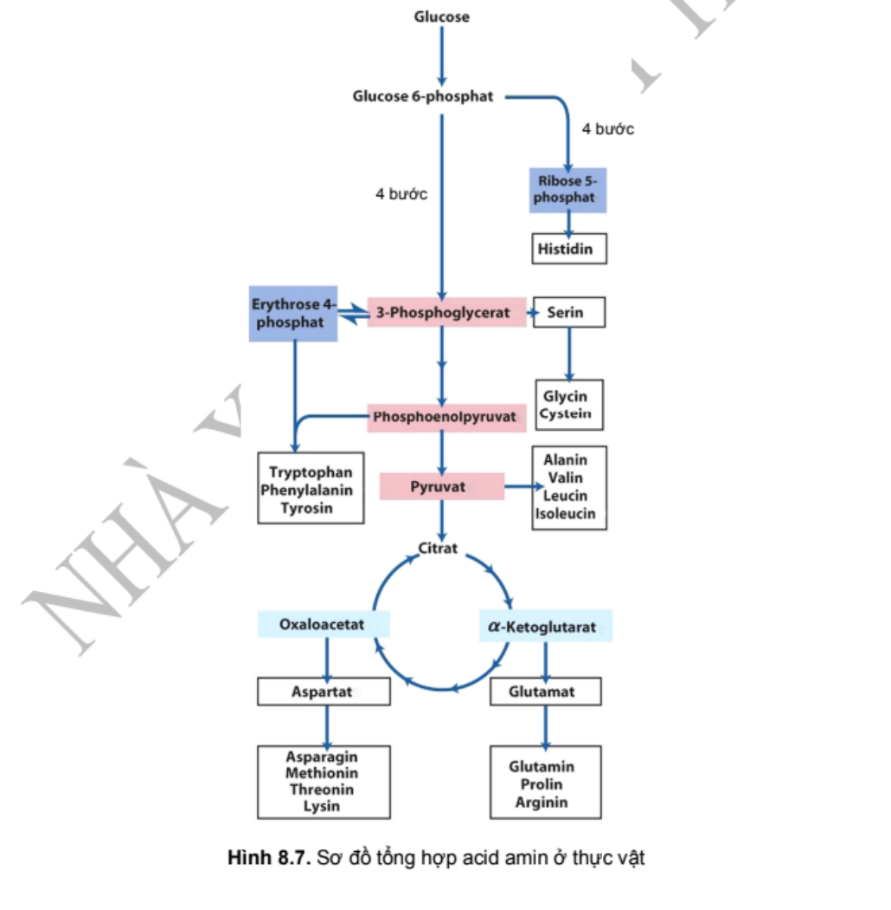
*Hình 8.7. Sơ đồ con đường sinh tổng hợp các họ acid amin từ các sản phẩm chuyển hóa glucid ở thực vật và vi khuẩn.*

Ở người và động vật bậc cao:
- **Acid amin không thiết yếu (cơ thể tự tổng hợp được):** Ala, Glu, Asp, Gln, Asn, Ser, Gly, Pro, Cys, Tyr.
- **Acid amin bán thiết yếu:** Arginin và Histidin (tổng hợp chậm, không đủ cho cơ thể đang lớn).
- **Acid amin thiết yếu (bắt buộc cung cấp từ thức ăn):** Val, Leu, Ile, Phe, Thr, Trp, Met, Lys.

---

## 4. CÁC HỢP CHẤT CÓ HOẠT TÍNH SINH HỌC CÓ NGUỒN GỐC ACID AMIN

### 4.1. Sinh tổng hợp Creatin, Creatin Phosphat và Creatinin

Creatin là hợp chất dự trữ năng lượng then chốt của mô cơ và mô não, được sinh tổng hợp từ **3 acid amin: Glycin, Arginin và Methionin (dưới dạng SAM)** qua hai cơ quan Thận và Gan:
1. **Tại Thận:** Nhóm amidin từ Arginin được chuyển sang Glycin nhờ enzym *transamidinase* tạo thành **Guanidinoacetat** và giải phóng Ornithin.
2. **Tại Gan:** Guanidinoacetat nhận nhóm methyl từ **S-adenosylmethionin (SAM)** nhờ enzym *methyltransferase* để trở thành **Creatin**.

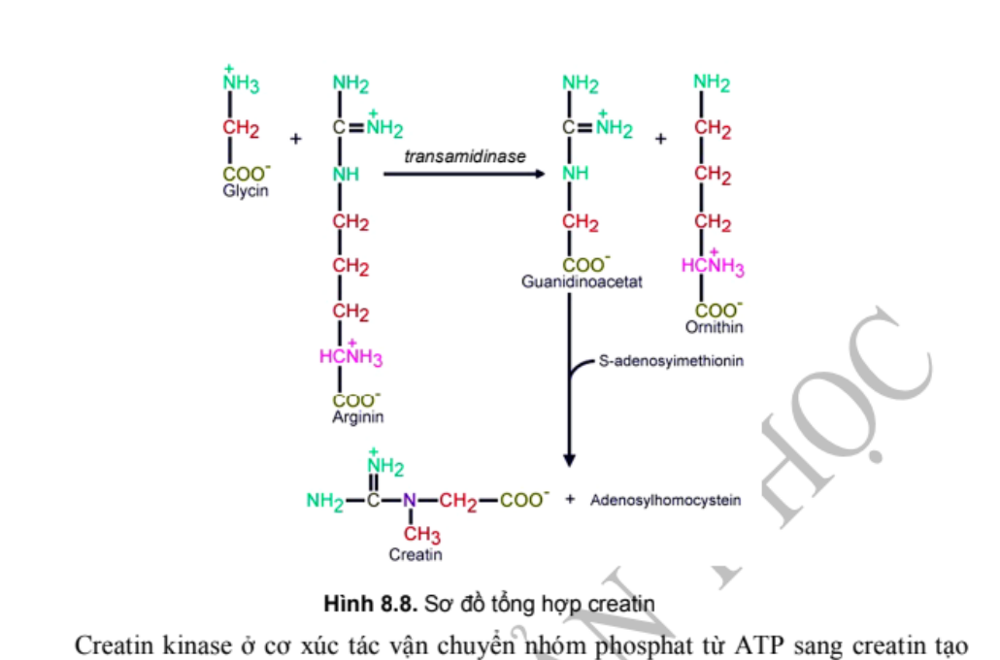
*Hình 8.8. Sơ đồ sinh tổng hợp Creatin từ Glycin, Arginin và Methionin (SAM).*

- **Tại cơ vân:** Creatin được enzym **Creatin Kinase (CK)** phosphoryl hóa thuận nghịch bằng ATP tạo thành **Creatin phosphat (Phosphocreatin)** — dạng dự trữ phosphat giàu năng lượng. Khi cơ co rút tiêu thụ nhiều ATP, creatin phosphat lập tức nhượng nhóm phosphat tái tạo ATP cực nhanh mà không cần qua đường phân hay chu trình Krebs:

$$\text{Creatin} + \text{ATP} \xrightleftharpoons[\text{Co cơ}]{\text{Nghỉ ngơi}} \text{Creatin phosphat} + \text{ADP}$$

- **Sự tạo thành Creatinin:** Trong cơ, một tỷ lệ cố định khoảng $1 - 2\%$ creatin phosphat mỗi ngày tự động bị mất nước khử phosphat đóng vòng không thuận nghịch (không cần enzym) biến thành **Creatinin**.
- **Ý nghĩa xét nghiệm y học:** Lượng creatinin sinh ra mỗi ngày tỷ lệ thuận tuyệt đối với khối lượng cơ bắp của cơ thể và được bài tiết hoàn toàn qua thận mà gần như không được ống thận tái hấp thu. Do đó, **nồng độ creatinin huyết thanh** ($50 - 110\text{ }\mu\text{mol/L}$) và **độ thanh thải creatinin** ($C_{\text{Cr}} \approx 90 - 120\text{ mL/phút}$) là chỉ số tin cậy nhất đánh giá mức lọc cầu thận (eGFR) trong thực hành lâm sàng thận học.

---

### 4.2. Sinh tổng hợp và vai trò của Glutathion (GSH)

Glutathion là một tripeptid có cấu tạo đặc biệt: **$\gamma$-L-Glutamyl-L-cysteinylglycin** (liên kết peptid hình thành qua nhóm $\gamma$-carboxyl của chuỗi bên glutamat chứ không phải $\alpha$-carboxyl).

Quá trình tổng hợp diễn ra qua 2 phản ứng cần ATP:
1. $\text{Glutamat} + \text{Cystein} + \text{ATP} \xrightarrow{\gamma\text{-glutamylcysteine synthetase}} \gamma\text{-Glutamylcystein} + \text{ADP} + \text{P}_i$.
2. $\gamma\text{-Glutamylcystein} + \text{Glycin} + \text{ATP} \xrightarrow{\text{Glutathione synthetase}} \text{Glutathion (GSH)} + \text{ADP} + \text{P}_i$.

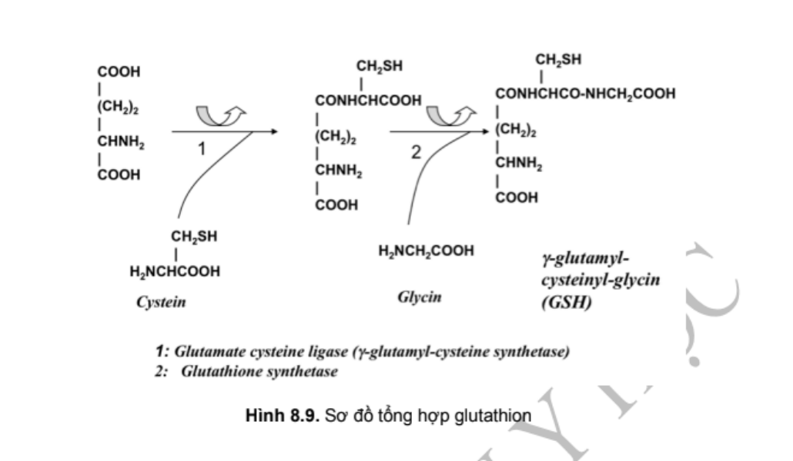
*Hình 8.9. Sơ đồ sinh tổng hợp tripeptid Glutathion (GSH).*

- **Vai trò sinh học của Glutathion khử (GSH):**
  - Chứa nhóm sulfhydryl ($-\text{SH}$) tự do của cystein có tính khử rất mạnh. Trong hồng cầu, GSH liên tục khử MetHb ($\text{Fe}^{3+}$) trở lại thành Hb ($\text{Fe}^{2+}$) chức năng:

$$2\text{GSH} + 2\text{MetHb} \longrightarrow \text{GSSG} + 2\text{Hb} + \text{H}^+$$

  - Là chất chống oxy hóa nội sinh hàng đầu, cùng enzym **glutathion peroxidase** khử độc các gốc oxy hóa tự do ($\text{H}_2\text{O}_2$, lipid hydroperoxyd) bảo vệ tính toàn vẹn của màng tế bào.
  - Tái tạo GSH từ dạng oxy hóa GSSG nhờ enzym **glutathion reductase** sử dụng coenzym **NADPH** do con đường pentose phosphat cung cấp.

---

## 5. BỆNH LÝ CHUYỂN HÓA ACID AMIN BẨM SINH

Các rối loạn chuyển hóa acid amin bẩm sinh là những bệnh lý di truyền lặn trên nhiễm sắc thể thường hiếm gặp do đột biến gen mã hóa các enzym chuyển hóa hoặc protein vận chuyển acid amin:

### 5.1. Bệnh Phenylceton niệu (Phenylketonuria - PKU)
- **Nguyên nhân:** Do đột biến thiếu hụt enzym **Phenylalanin Hydroxylase (PAH)** ở gan (hoặc hiếm hơn do thiếu hụt coenzym *tetrahydrobiopterin - $\text{BH}_4$*).
- **Cơ chế bệnh sinh:** Phenylalanin không chuyển hóa được thành Tyrosin, làm nồng độ Phe trong máu tăng vọt (bình thường $< 2\text{ mg/dL}$, ở bệnh nhân PKU tăng $> 20\text{ mg/dL}$). Phe dư thừa bị chuyển hóa theo các con đường phụ trao đổi amin tạo thành **phenylpyruvat, phenyllactat và phenylacetat** đào thải nhiều ra nước tiểu (nước tiểu có mùi chuột xạ).
- **Hậu quả lâm sàng:** Sự tích tụ nồng độ cao Phe và các phenylceton gây nhiễm độc hệ thần kinh trung ương nghiêm trọng, ngăn cản vận chuyển các acid amin khác qua hàng rào máu não dẫn đến **chậm phát triển trí tuệ nặng, co giật, giảm sắc tố da và tóc** (do thiếu tyrosin để tổng hợp melanin). Nếu phát hiện sớm qua sàng lọc sơ sinh bằng xét nghiệm Guthrie hoặc MS/MS, trẻ được điều trị bằng chế độ ăn nghèo phenylalanin sẽ phát triển hoàn toàn bình thường.

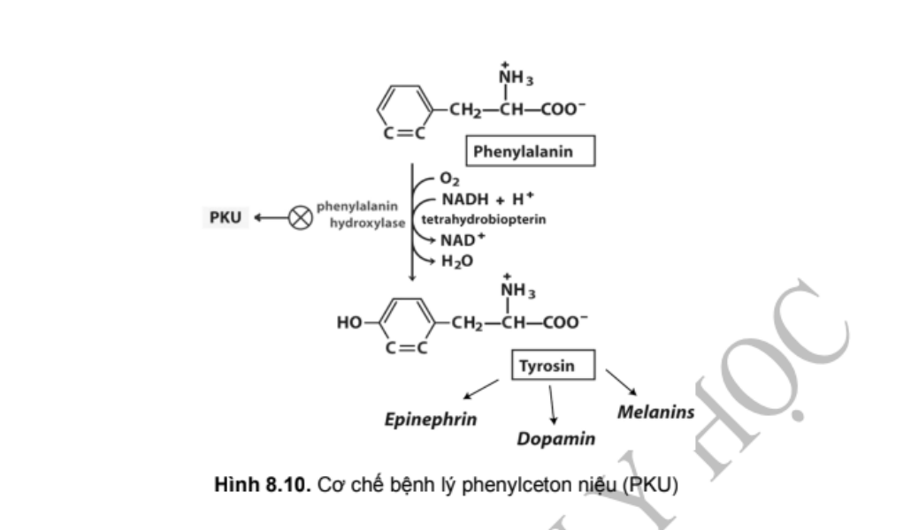
*Hình 8.10. Cơ chế chuyển hóa phenylalanin thành tyrosin và rối loạn trong bệnh Phenylceton niệu (PKU).*

---

### 5.2. Các rối loạn chuyển hóa Tyrosin và Bệnh tăng Tyrosin máu (Tyrosinemia)
- **Bệnh Tăng Tyrosin máu Typ 1 (*Tyrosinemia type 1*):** Do thiếu hụt enzym cuối cùng **Fumarylacetoacetat hydrolase (FAH)**. Sự tích tụ fumarylacetoacetat chuyển hóa thành **succinylaceton** — chất ức chế mạnh enzym tổng hợp hem (ALA dehydratase) và gây tổn thương ống thận, suy gan cấp và ung thư biểu mô tế bào gan (*HCC*). Thuốc điều trị đặc hiệu hiện nay là NTBC (nitisinone) ức chế enzym phía trên HPD để chặn sinh succinylaceton.
- **Bệnh Alcapton niệu (*Alkaptonuria*):** Do thiếu enzym **Homogentisat oxidase (HGD)**. Acid homogentisic ứ đọng bị oxy hóa và polymer hóa tạo sắc tố đen lắng đọng ở các khớp xương, sụn (bệnh ochronosis) và làm **nước tiểu hóa đen khi để lâu ngoài không khí hoặc khi tiếp xúc với môi trường kiềm**.
- **Bệnh Bạch tạng (*Albinism*):** Do thiếu enzym **Tyrosinase** xúc tác biến tyrosin thành melanin ở tế bào hắc tố, dẫn đến mất sắc tố hoàn toàn ở da, tóc và võng mạc mắt, bệnh nhân sợ ánh sáng và tăng nguy cơ ung thư da.

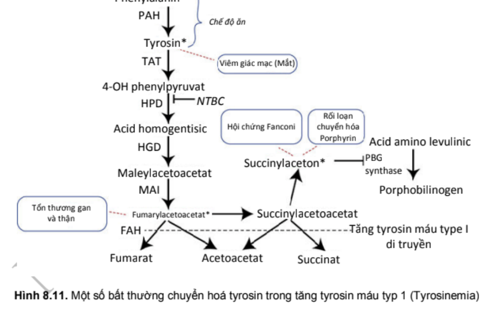
*Hình 8.11. Sơ đồ con đường thoái hóa Tyrosin và vị trí thiếu hụt enzym trong các bệnh lý di truyền.*

---

## CÂU HỎI ÔN TẬP CHƯƠNG 8
1. Trình bày quá trình thoái hóa protein nội sinh phụ thuộc ubiquitin nhờ proteasom 26S.
2. Trình bày quá trình khử amin oxy hóa và quá trình trao đổi amin. Phân tích mối liên quan chặt chẽ giữa 2 quá trình này.
3. Trình bày quá trình vận chuyển nhóm amin từ các mô ngoại vi về gan, thận và quá trình tổng hợp urê tại gan. Mối liên quan giữa chu trình urê và chu trình acid citric (Krebs).
4. Trình bày sự tổng hợp creatin, creatin phosphat và ý nghĩa của creatinin đối với thăm dò chức năng thận.
5. Trình bày sự tổng hợp glutathion và vai trò chống oxy hóa bảo vệ tế bào hồng cầu của nó.
6. Trình bày khái niệm, cơ chế bệnh sinh và biểu hiện của bệnh lý rối loạn chuyển hóa acid amin bẩm sinh (ví dụ PKU, tyrosinemia, alcapton niệu).

<!-- END FILE: pages_196_205.md -->

<!-- BEGIN FILE: pages_206_215.md -->