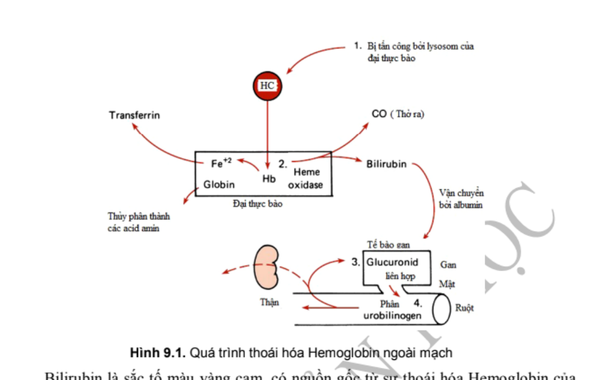
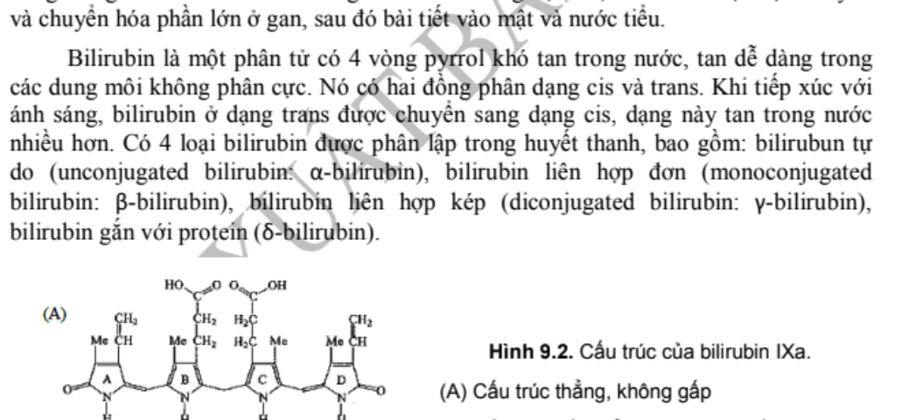
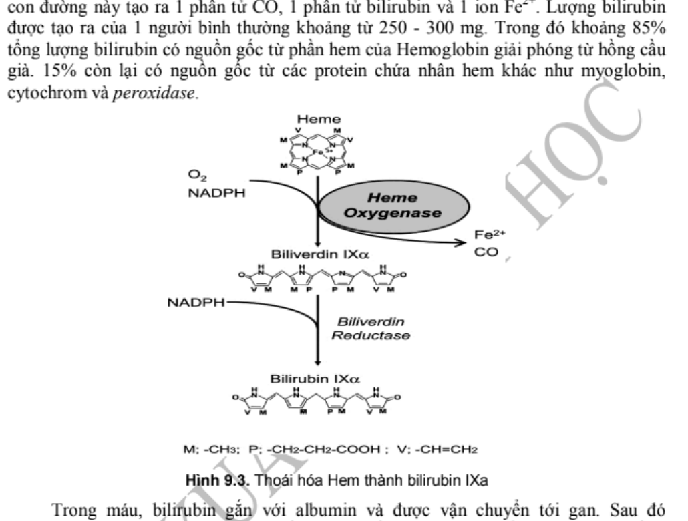
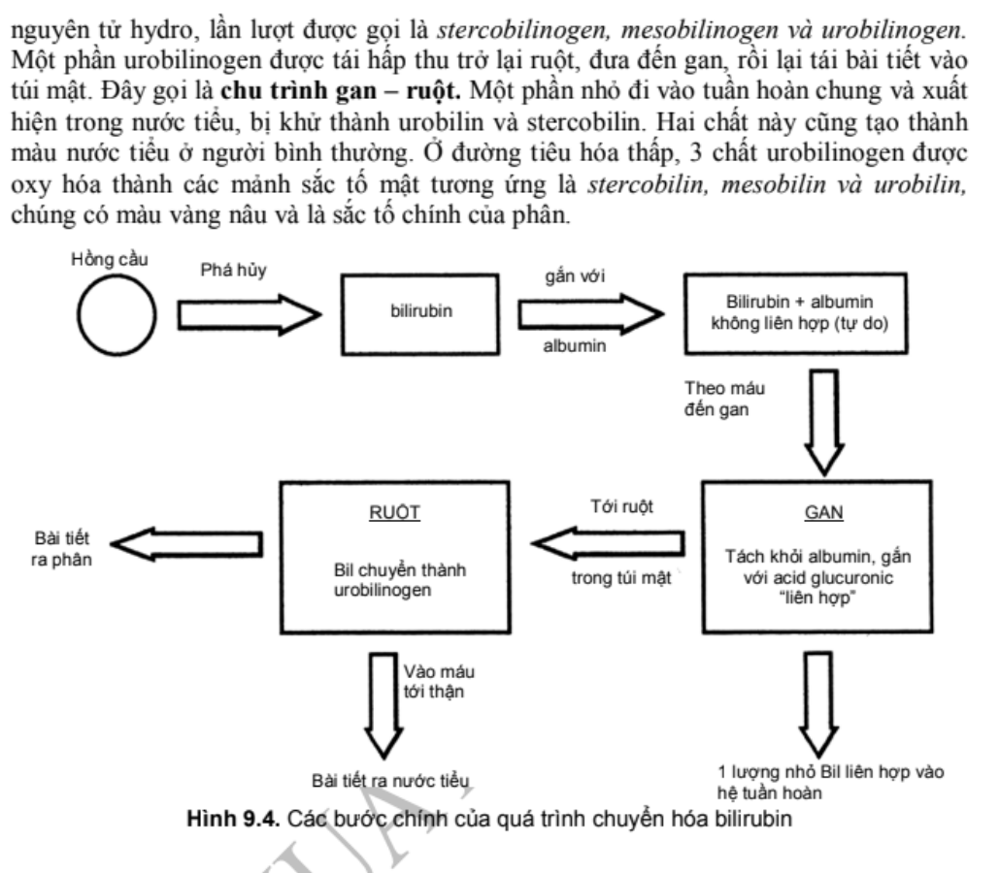
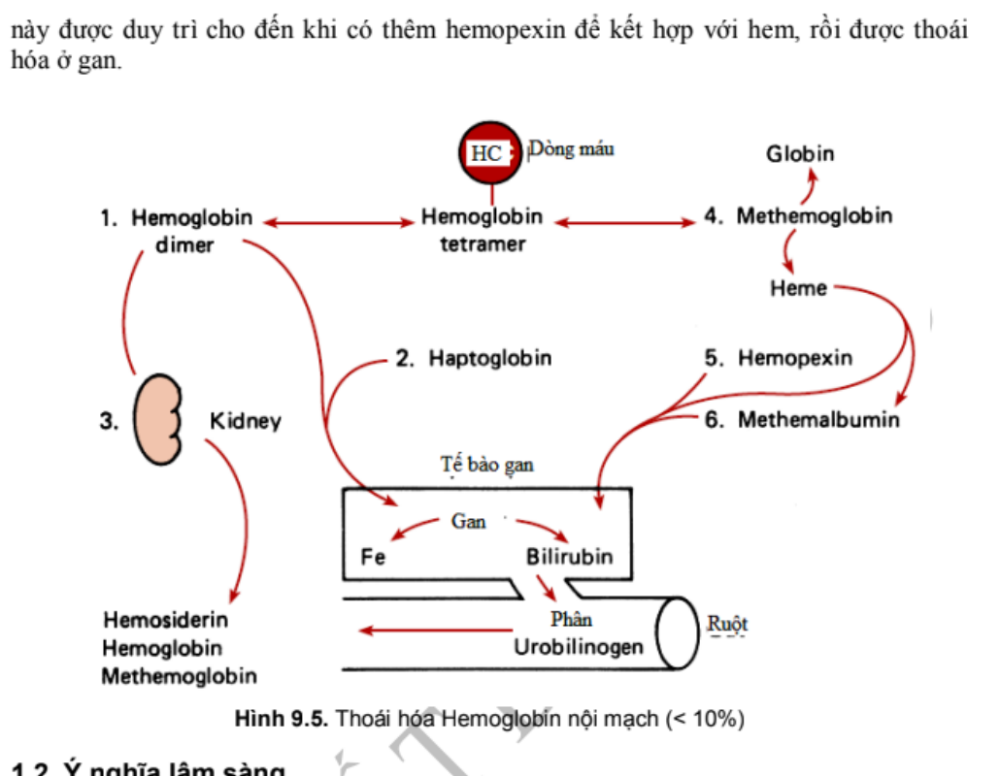
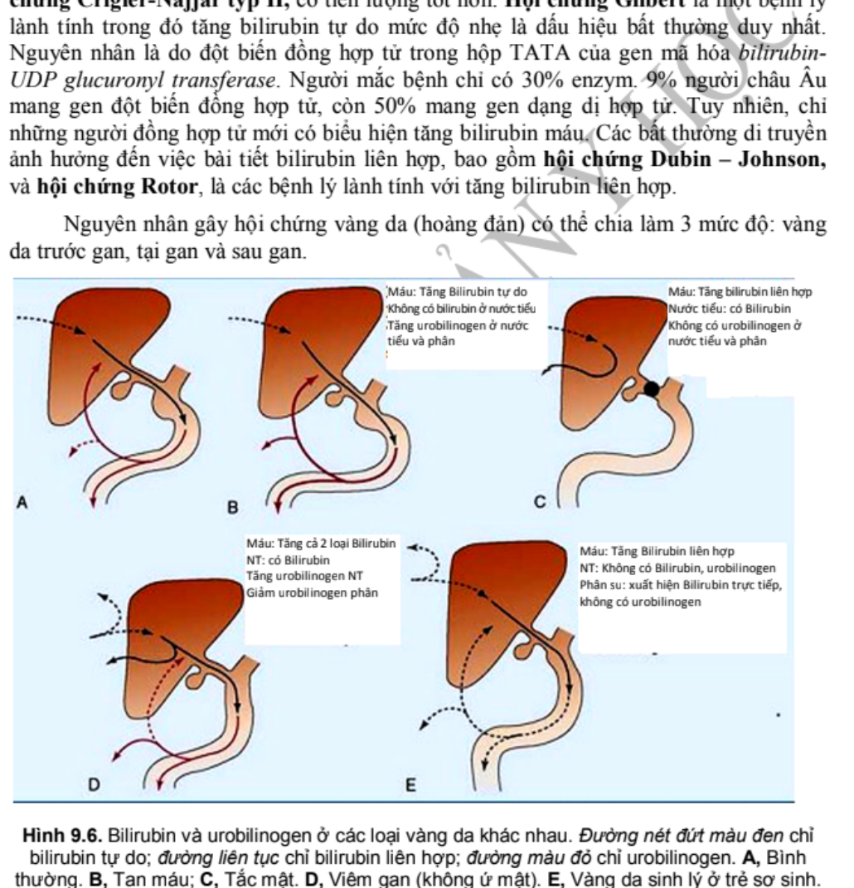
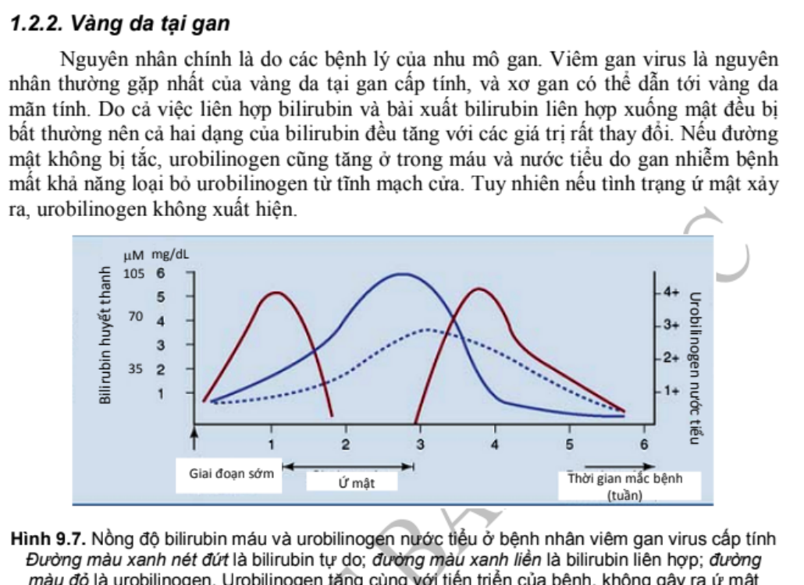
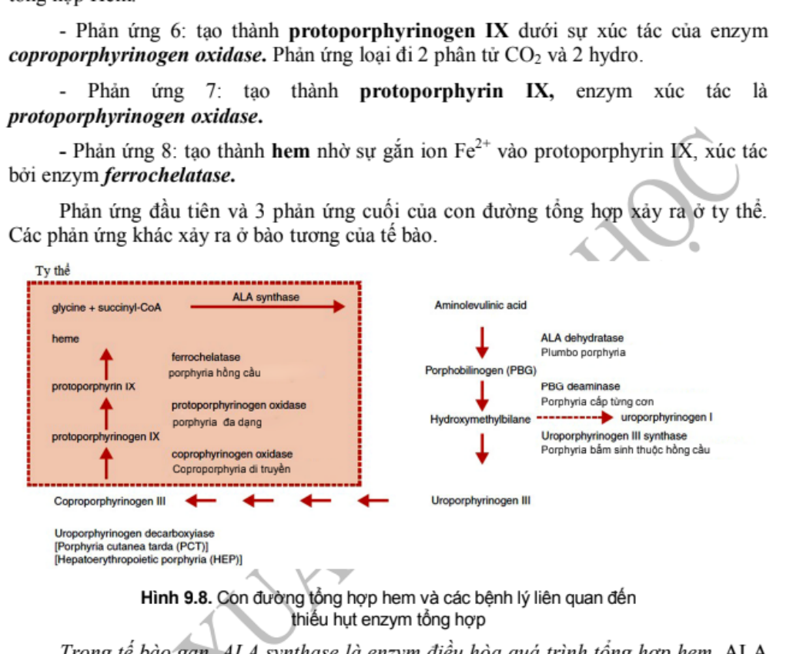

# CHƯƠNG 9: CHUYỂN HÓA HEMOGLOBIN

---

## MỤC TIÊU HỌC TẬP
1. Trình bày được sự thoái hóa Hemoglobin và ý nghĩa lâm sàng (các cơ chế gây vàng da).
2. Trình bày được sự sinh tổng hợp Hem và các rối loạn liên quan (bệnh lý Porphyria).

---

## MỞ ĐẦU

Hemoglobin ($\text{Hb}$) đảm nhiệm nhiều chức năng sống còn trong cơ thể: vai trò chính là vận chuyển oxy từ phổi tới các mô và vận chuyển $\text{CO}_2$ từ mô về phổi; đồng thời là một trong những hệ thống đệm quan trọng nhất duy trì thăng bằng acid - base của máu.

Hemoglobin chiếm khoảng $34\%$ tổng lượng protein trong hồng cầu. Đời sống trung bình của hồng cầu khoảng **120 ngày**. Khi hồng cầu già cỗi, màng tế bào mất tính mềm dẻo, chúng bị giữ lại và phá hủy bởi các đại thực bào của **hệ thống liên võng nội mô** (ở lách, gan và tủy xương), giải phóng hemoglobin.

Hemoglobin phân giải thành hai phần:
- **Phần protein (Globin):** bị thủy phân thành các acid amin tự do, phần lớn được tái sử dụng để sinh tổng hợp protein mới cho cơ thể.
- **Phần Hem:** được thoái hóa thành sắc tố mật **Bilirubin**. Sự gia tăng bilirubin máu vượt ngưỡng bình thường sẽ gây ra các hội chứng **vàng da** (*jaundice / icterus*).

Quá trình tổng hợp hemoglobin gồm hai hợp phần: tổng hợp globin (trên ribosom) và tổng hợp Hem (trong ty thể và bào tương). Sai sót một acid amin trong chuỗi globin hoặc mất cân bằng tỷ lệ các chuỗi gây ra các bệnh lý huyết sắc tố (*hemoglobinopathies* và *thalassemia*). Rối loạn con đường tổng hợp Hem do thiếu hụt enzym dẫn đến nhóm bệnh **Porphyria**.

---

## 1. SỰ THOÁI HÓA HEMOGLOBIN VÀ Ý NGHĨA LÂM SÀNG

Quá trình thoái hóa hemoglobin diễn ra theo 2 con đường:
1. **Thoái hóa ngoài mạch (*extravascular hemolysis*):** là con đường sinh lý chủ yếu, chiếm **$80 - 90\%$** tổng lượng hemoglobin thoái hóa, diễn ra bên trong các đại thực bào của lách, gan và tủy xương.
2. **Thoái hóa nội mạch (*intravascular hemolysis*):** chiếm khoảng **$10 - 20\%$**, giải phóng hemoglobin tự do trực tiếp vào lòng mạch tuần hoàn.

---

### 1.1. Thoái hóa Hemoglobin ngoài mạch và Chuyển hóa Bilirubin

*Hình 9.1. Sơ đồ quá trình thoái hóa Hemoglobin ngoài mạch trong đại thực bào hệ liên võng nội mô.*

Bilirubin là sắc tố màu vàng cam có nguồn gốc từ sự giáng hóa phần hem của hồng cầu già:
- Phân tử bilirubin có cấu tạo gồm **4 vòng pyrrol** nối với nhau bởi các cầu nối carbon.
- Bilirubin tự nhiên tồn tại ở đồng phân cấu hình trans ($4Z, 15Z$). Cấu trúc này có các liên kết hydro nội phân tử che kín các nhóm phân cực làm cho nó **rất khó tan trong nước**, tan dễ dàng trong dung môi hữu cơ và lipid.
- Dưới tác dụng của ánh sáng xanh (quang trị liệu / chiếu đèn vàng da sơ sinh), bilirubin chuyển thành các đồng phân cis tan tốt trong nước hơn và đào thải trực tiếp qua mật/nước tiểu mà không cần qua gan liên hợp.

*Hình 9.2. Cấu trúc của Bilirubin IX$\alpha$: (A) Cấu trúc thẳng; (B) Cấu trúc không gian gấp nếp với các liên kết hydro nội phân tử.*

#### A. Thoái hóa Hem thành Bilirubin trong đại thực bào
- Tại lưới nội chất của đại thực bào, enzym **Hem Oxygenase** (sử dụng $\text{O}_2$ và $\text{NADPH}$) mở vòng protoporphyrin IX tại cầu nối $\alpha$-methen:
  - Giải phóng **1 phân tử khí Carbon Monoxyd ($\text{CO}$)** — đây là phản ứng sinh học duy nhất trong cơ thể người sản sinh ra khí $\text{CO}$ nội sinh.
  - Giải phóng **ion sắt ($\text{Fe}^{2+}$)**: sắt được oxy hóa thành $\text{Fe}^{3+}$, gắn vào **transferrin** trong huyết tương để vận chuyển về tủy xương tái sử dụng hoặc tích trữ dưới dạng ferritin/hemosiderin.
  - Phần vòng porphyrin mở tạo thành sắc tố màu xanh lục là **Biliverdin IX$\alpha$**.
- Enzym **Biliverdin Reductase** trong bào tương tiếp tục khử biliverdin (dùng $\text{NADPH}$) thành sắc tố màu vàng cam là **Bilirubin IX$\alpha$**.

*Hình 9.3. Phản ứng mở vòng Hem bởi Hem Oxygenase và khử Biliverdin thành Bilirubin IX$\alpha$.*

Mỗi ngày ở người trưởng thành có khoảng **$250 - 300\text{ mg}$ bilirubin** được tạo ra (trong đó $85\%$ bắt nguồn từ hồng cầu già, $15\%$ còn lại từ các hemoprotein khác như myoglobin, cytochrom P450, catalase).

#### B. Vận chuyển Bilirubin trong máu về Gan
Bilirubin mới sinh ra trong đại thực bào là **Bilirubin tự do (Bilirubin gián tiếp)**: không tan trong nước, độc với tế bào (đặc biệt là tế bào não). Để lưu hành trong máu an toàn, bilirubin tự do gắn chặt không đồng hóa trị với **Albumin huyết tương** (mỗi phân tử albumin có 1 vị trí gắn ái lực rất cao và 2 vị trí ái lực thấp). Phức hợp Bilirubin-Albumin không đi qua được màng lọc cầu thận nên **không xuất hiện trong nước tiểu**.

#### C. Chuyển hóa Bilirubin tại Tế bào Gan
Quá trình chuyển hóa tại gan gồm 3 bước:
1. **Thu nhận (*uptake*):** Tại màng xoang mạch tế bào gan, bilirubin tách khỏi albumin và được các protein vận chuyển chuyên biệt (họ OATP) bắt giữ đưa vào bào tương. Trong tế bào gan, bilirubin gắn với protein **ligandin (protein Y)** để ngăn không cho khuếch tán ngược vào máu.
2. **Liên hợp (*conjugation*):** Tại lưới nội chất hạt, acid glucuronic từ **UDP-glucuronat** được chuyển gắn vào hai nhóm propionat của bilirubin nhờ enzym **UDP-glucuronosyltransferase (UGT1A1)**:
   - Gắn phân tử thứ nhất tạo *Bilirubin monoglucuronid* ($15\%$).
   - Gắn tiếp phân tử thứ hai tạo **Bilirubin diglucuronid** ($85\%$) — đây là **Bilirubin liên hợp (Bilirubin trực tiếp)**.
   - Bilirubin liên hợp **tan tốt trong nước, không độc** và không gắn albumin.
3. **Bài tiết (*secretion*):** Bilirubin liên hợp được bài tiết tích cực qua màng tiểu quản mật vào đường dẫn mật nhờ bơm vận chuyển phụ thuộc ATP là **MRP2** (*Multidrug Resistance-associated Protein 2*). Đây là **bước giới hạn tốc độ** (*rate-limiting step*) của toàn bộ quá trình đào thải bilirubin tại gan.

*Hình 9.4. Tổng thể quá trình chuyển hóa Bilirubin từ thoái hóa ở hệ liên võng nội mô, liên hợp tại gan đến bài xuất và biến đổi tại ruột.*

#### D. Số phận của Bilirubin tại Ruột và Chu trình Gan - Ruột
- Bilirubin liên hợp theo dịch mật đổ xuống tá tràng và ruột non. Do kích thước lớn và tan trong nước, nó không bị niêm mạc ruột non hấp thu.
- Khi xuống đến đoạn cuối hồi tràng và đại tràng, enzym $\beta$-glucuronidase của vi khuẩn đường ruột cắt bỏ acid glucuronic tái tạo bilirubin tự do. Sau đó hệ vi khuẩn kỵ khí khử bilirubin thành các hợp chất tetrapyrrol không màu gọi chung là **Urobilinogen** (*mesobilinogen, urobilinogen, stercobilinogen*).
- **Chu trình gan - ruột (*enterohepatic circulation*):** Khoảng **$10 - 20\%$** lượng urobilinogen được tái hấp thu qua tĩnh mạch cửa về gan; phần lớn được gan bắt giữ và bài tiết trở lại mật.
- Một lượng nhỏ urobilinogen ($1 - 2\%$, khoảng $0 - 4\text{ mg/24 giờ}$) thoát qua gan đi vào tuần hoàn chung đến thận và bài tiết ra nước tiểu. Khi tiếp xúc với không khí, urobilinogen bị oxy hóa thành **Urobilin** tạo nên một phần màu vàng nhạt của nước tiểu bình thường.
- Phần lớn urobilinogen còn lại trong ruột non và đại tràng ($80 - 90\%$) bị oxy hóa thành **Stercobilin** (và urobilin) có màu nâu sẫm, là sắc tố chính tạo nên **màu vàng nâu đặc trưng của phân** ($100 - 200\text{ mg/24 giờ}$).

---

### 1.2. Thoái hóa Hemoglobin nội mạch (< 10%)

Khi hồng cầu bị vỡ ngay trong lòng mạch máu, hemoglobin tetramer ($\alpha_2\beta_2$) phân ly thành các dimer $\alpha\beta$:
- **Haptoglobin (Hp):** là protein huyết tương liên kết với dimer $\text{Hb}$ với ái lực cực cao tạo phức hệ $\text{Hb}-\text{Haptoglobin}$ có kích thước rất lớn, ngăn chặn $\text{Hb}$ lọc qua cầu thận làm tổn thương ống thận. Phức hợp này nhanh chóng được các đại thực bào gan (tế bào Kupffer) thực bào qua thụ thể CD163.
- Khi tan máu nội mạch ồ ạt vượt quá khả năng gắn của haptoglobin:
  - $\text{Hb}$ tự do bị oxy hóa thành **Methemoglobin**, giải phóng nhân Hem tự do.
  - Hem tự do được bắt giữ bởi protein huyết tương **Hemopexin** vận chuyển về gan thoái hóa. Nếu hemopexin cạn kiệt, hem gắn tạm thời với albumin tạo thành **Methemalbumin**.
  - Phần $\text{Hb}$ tự do dimer lọc qua cầu thận gây **huyết sắc tố niệu** (*hemoglobinuria*). Một phần sắt được ống thận tái hấp thu tích tụ dưới dạng **hemosiderin** bài xuất ra nước tiểu (*hemosiderin niệu*).

*Hình 9.5. Sơ đồ cơ chế bắt giữ và dọn dẹp Hemoglobin tự do trong thoái hóa nội mạch qua Haptoglobin và Hemopexin.*

---

### 1.3. Ý nghĩa lâm sàng: Phân loại và Cơ chế các Hội chứng Vàng da

Nồng độ bilirubin huyết thanh toàn phần ở người bình thường dao động từ **$0{,}2 - 1{,}0\text{ mg/dL}$** ($3{,}4 - 17{,}1\text{ }\mu\text{mol/L}$), trong đó:
- **Bilirubin tự do (gián tiếp):** chiếm đa số, khoảng **$80 - 85\%$** ($0{,}2 - 0{,}8\text{ mg/dL}$).
- **Bilirubin liên hợp (trực tiếp):** chiếm **$15 - 20\%$** ($0 - 0{,}2\text{ mg/dL}$).

Khi bilirubin toàn phần tăng trên **$2{,}0 - 2{,}5\text{ mg/dL}$** ($> 40\text{ }\mu\text{mol/L}$), sắc tố mật ngấm vào các mô liên kết giàu elastin gây vàng mắt (củng mạc mắt) và vàng da rõ rệt trên lâm sàng.

*Hình 9.6. Sơ đồ chuyển hóa Bilirubin và Urobilinogen trong các bệnh cảnh: A. Bình thường; B. Vàng da trước gan (tan máu); C. Vàng da sau gan (tắc mật); D. Vàng da tại gan (viêm gan); E. Vàng da sinh lý sơ sinh.*

| Đặc điểm | Vàng da trước gan (Tan máu) | Vàng da tại gan (Viêm gan, Xơ gan) | Vàng da sau gan (Tắc mật cơ học) |
| :--- | :--- | :--- | :--- |
| **Cơ chế chính** | Tăng phá hủy hồng cầu $\rightarrow$ quá tải khả năng liên hợp của gan. | Tổn thương tế bào nhu mô gan $\rightarrow$ suy giảm bắt giữ, liên hợp và bài tiết. | Cản trở lưu thông đường mật (sỏi mật, u đầu tụy) $\rightarrow$ ứ mật trào ngược vào máu. |
| **Bilirubin máu** | **Tăng chủ yếu Bilirubin tự do (gián tiếp)**. | **Tăng hỗn hợp cả Bilirubin tự do và liên hợp**. | **Tăng chủ yếu Bilirubin liên hợp (trực tiếp)**. |
| **Bilirubin nước tiểu** | **Âm tính** (do bilirubin tự do không tan trong nước, gắn albumin). | Dương tính / Âm tính tùy mức độ ứ mật. | **Dương tính mạnh** (nước tiểu vàng sẫm như nước vối, tạo bọt vàng). |
| **Urobilinogen nước tiểu** | **Tăng rất cao** (do lượng sắc tố mật xuống ruột nhiều). | **Tăng** (gan suy yếu không bắt giữ được urobilinogen tái hấp thu). | **Âm tính / Giảm mạnh** (mật không xuống được ruột). |
| **Màu sắc phân** | **Sẫm màu** (tăng tạo stercobilin). | Bình thường hoặc nhạt màu. | **Bạc màu như phân cò** (*clay-colored stool* do thiếu stercobilin). |

*Hình 9.7. Diễn biến nồng độ Bilirubin máu và Urobilinogen nước tiểu theo các giai đoạn của bệnh viêm gan virus cấp tính.*

- **Vàng da sinh lý ở trẻ sơ sinh:** Do hoạt tính enzym liên hợp UGT1A1 của gan chưa hoàn thiện kết hợp với tình trạng tan máu sinh lý sau sinh. Bilirubin tự do tăng nhẹ từ ngày thứ 2 - 3 và tự hết sau 1 - 2 tuần.
- **Hội chứng vàng da nhân não (*Kernicterus*):** Nếu bilirubin tự do tăng quá cao ($> 20\text{ mg/dL}$ hay $> 340\text{ }\mu\text{mol/L}$) vượt quá khả năng gắn của albumin, bilirubin tự do thấm qua hàng rào máu não chưa hoàn thiện của trẻ sơ sinh lắng đọng vào các hạch nền não gây hoại tử tế bào thần kinh, co giật, hôn mê và di chứng bại não hoặc tử vong. Cần điều trị khẩn cấp bằng chiếu đèn ánh sáng xanh hoặc thay máu.

---

## 2. SINH TỔNG HỢP HEM VÀ CÁC RỐI LOẠN LIÊN QUAN

Quá trình sinh tổng hợp Hem diễn ra chủ yếu ở hai mô:
1. **Tế bào tiền thân hồng cầu trong tủy xương** (chiếm **$85\%$** tổng lượng Hem tạo ra, phục vụ cấu tạo hemoglobin).
2. **Tế bào nhu mô gan** (chiếm **$15\%$**, phục vụ cấu tạo cytochrom P450 giải độc thuốc và enzym peroxidase/catalase).

### 2.1. Các phản ứng sinh tổng hợp Hem

Con đường tổng hợp gồm **8 phản ứng enzym**, diễn ra phân bố ngăn cách giữa **Ty thể** (phản ứng 1 và 3 phản ứng cuối) và **Bào tương** (phản ứng 2 đến 5):

*Hình 9.8. Sơ đồ 8 phản ứng sinh tổng hợp Hem và các rối loạn Porphyria tương ứng do thiếu hụt enzym.*

1. **Phản ứng 1 (Tại Ty thể - Phản ứng then chốt điều hòa):** Ngưng tụ **Succinyl-CoA** (từ chu trình Krebs) với **Glycin** nhờ enzym **$\delta$-Aminolevulinat Synthase (ALA Synthase hay ALAS)** với coenzym pyridoxal phosphat (PLP - vitamin $\text{B}_6$) tạo thành **$\delta$-Aminolevulinat (ALA)**:
   - *Điều hòa:* ALAS là enzym giới hạn tốc độ của toàn bộ con đường. Tại gan, enzym này có thời gian bán hủy ngắn ($1 - 3\text{ giờ}$) và bị ức chế ngược dị lập thể âm mạnh mẽ bởi nồng độ Hem tự do.
2. **Phản ứng 2 (Tại Bào tương):** Hai phân tử ALA ngưng tụ loại 2 phân tử nước nhờ enzym **ALA Dehydratase (Porphobilinogen Synthase)** tạo thành vòng pyrrol đơn phân đầu tiên là **Porphobilinogen (PBG)**:
   - Enzym này chứa kẽm ($\text{Zn}^{2+}$) và cực kỳ nhạy cảm bị ức chế bởi kim loại nặng như **Chì ($\text{Pb}^{2+}$)** (nhiễm độc chì gây ứ ALA và thiếu máu nhược sắc).
3. **Phản ứng 3 (Tại Bào tương):** Bốn phân tử PBG ngưng tụ thẳng nhờ enzym **PBG Deaminase (Uroporphyrinogen I Synthase)** loại 4 phân tử $\text{NH}_3$ tạo thành chuỗi tetrapyrrol mạch thẳng **Hydroxymethylbilan (HMB)**.
4. **Phản ứng 4 (Tại Bào tương):** HMB bị đóng vòng và đảo trật tự vòng D nhờ enzym **Uroporphyrinogen III Synthase** tạo thành vòng bất đối xứng **Uroporphyrinogen III** (tiền chất trực tiếp của Hem).
5. **Phản ứng 5 (Tại Bào tương):** Khử carboxyl 4 nhóm acetyl ($-\text{CH}_2-\text{COOH}$) thành 4 nhóm methyl ($-\text{CH}_3$) nhờ enzym **Uroporphyrinogen Decarboxylase (UROD)** tạo thành **Coproporphyrinogen III**.
6. **Phản ứng 6 (Vào lại Ty thể):** Khử carboxyl và oxy hóa 2 nhóm propionat thành vinyl nhờ enzym **Coproporphyrinogen Oxidase** tạo thành **Protoporphyrinogen IX**.
7. **Phản ứng 7 (Tại Ty thể):** Oxy hóa cầu nối methylen thành methin ($-\text{CH}=$) nhờ enzym **Protoporphyrinogen Oxidase** tạo thành vòng liên hợp màu đỏ **Protoporphyrin IX**.
8. **Phản ứng 8 (Tại Ty thể):** Gắn ion sắt hóa trị hai ($\text{Fe}^{2+}$) vào tâm vòng protoporphyrin IX nhờ enzym **Ferrochelatase (Heme Synthase)** để hoàn tất sinh tổng hợp **Hem**. Enzym này cũng bị ức chế bởi chì.

---

### 2.2. Các bệnh lý Rối loạn Chuyển hóa Porphyrin (Bệnh Porphyria)

Porphyria là nhóm bệnh lý di truyền hiếm gặp do đột biến thiếu hụt một trong các enzym của con đường sinh tổng hợp Hem (ngoại trừ ALAS):
- **Phân loại:**
  - Theo cơ quan tổn thương: **Porphyria gan** (*Hepatic porphyrias*) và **Porphyria hồng cầu** (*Erythropoietic porphyrias*).
  - Theo triệu chứng lâm sàng: 
    - Nhóm gây triệu chứng thần kinh - nội tạng cấp tính (*Acute porphyrias*).
    - Nhóm gây nhạy cảm ánh sáng tổn thương da (*Cutaneous porphyrias*).
- **Cơ chế biểu hiện lâm sàng:**
  1. **Tích tụ các tiền chất sớm (ALA và PBG):** Gặp trong **Porphyria cấp từng cơn (AIP)** do thiếu PBG Deaminase. Bệnh nhân có các cơn đau bụng dữ dội không rõ nguyên nhân, nôn, táo bón, tăng huyết áp, nhịp tim nhanh và các rối loạn tâm thần kinh cấp (ảo giác, liệt cơ). Nước tiểu sẫm màu dần khi tiếp xúc với ánh sáng do PBG tự polymer hóa.
  2. **Tích tụ các porphyrinogen trung gian (Uroporphyrinogen, Coproporphyrinogen):** Gặp trong **Porphyria cutanea tarda (PCT)** do thiếu UROD. Các porphyrin ứ đọng lắng đọng ở da, khi hấp thụ tia cực tím UV sẽ bị kích hoạt sinh ra các gốc oxy hóa tự do làm hoại tử mô, da phồng rộp, lở loét để lại sẹo xấu khi tiếp xúc với ánh nắng mặt trời, rậm lông và sạm da.

---

## CÂU HỎI LƯỢNG GIÁ CHƯƠNG 9
1. Trình bày các giai đoạn của sự thoái hóa Hemoglobin ngoài mạch tại hệ liên võng nội mô.
2. Trình bày sự thoái hóa Hemoglobin trong lòng mạch và vai trò dọn dẹp của Haptoglobin, Hemopexin.
3. Trình bày cơ chế sinh bệnh, phân loại và sự thay đổi xét nghiệm Bilirubin/Urobilinogen trong các hội chứng vàng da (vàng da trước gan, tại gan và sau gan).
4. Trình bày 8 phản ứng của con đường sinh tổng hợp Hem và cơ chế điều hòa ngược của Hem lên enzym ALA Synthase.
5. Trình bày các rối loạn lâm sàng liên quan đến thiếu hụt enzym tổng hợp Hem trong nhóm bệnh lý Porphyria.

<!-- END FILE: pages_206_215.md -->

<!-- BEGIN FILE: pages_216_225.md -->