# CHƯƠNG 10: SINH TỔNG HỢP PROTEIN (DỊCH MÃ)

---

## MỤC TIÊU HỌC TẬP
1. Trình bày được vai trò của các yếu tố tham gia quá trình sinh tổng hợp protein.
2. Trình bày bằng sơ đồ các giai đoạn của quá trình sinh tổng hợp protein (hoạt hóa acid amin, mở đầu, kéo dài và kết thúc).
3. Trình bày cơ chế điều hòa sinh tổng hợp protein ở sinh vật nhân sơ và nhân thực.

---

## MỞ ĐẦU

Protein là những phân tử đóng vai trò trung tâm quyết định mọi hoạt động sống của tế bào, mô, cơ quan và cơ thể. Trong mỗi tế bào có hàng nghìn loại protein khác nhau, chiếm tới khoảng $50\%$ trọng lượng khô của tế bào. Protein quy định tính đặc thù của tế bào, đặc thù cá thể và đặc thù loài.

Sự tổng hợp protein còn được gọi là **quá trình dịch mã** (*translation*), tức là sự phiên dịch thông tin di truyền từ trình tự các nucleotide trên phân tử $\text{mRNA}$ thành trình tự các acid amin trong chuỗi polypeptid của protein. Đây là một trong những hoạt động đồng hóa phức tạp và tiêu tốn nhiều năng lượng nhất trong tế bào (có thể tiêu thụ tới $90\%$ năng lượng chuyển hóa của tế bào). 

Ở tế bào nhân chuẩn (eukaryote), quá trình dịch mã đòi hỏi sự phối hợp nhịp nhàng của hơn 300 đại phân tử: hơn 70 loại protein ribosom, 40 loại $\text{tRNA}$ và $\text{rRNA}$ khác nhau, hơn 20 enzym aminoacyl-$\text{tRNA}$ synthetase, cùng hàng loạt các yếu tố mở đầu, kéo dài và kết thúc. Sau khi tổng hợp, tế bào cần thêm hơn 100 enzym để hoàn thiện phân tử protein.

Tốc độ sinh tổng hợp protein diễn ra cực kỳ nhanh: ở vi khuẩn *E. coli*, một chuỗi polypeptid gồm 100 acid amin được lắp ráp hoàn chỉnh chỉ trong vòng **5 giây** ở $37^\circ\text{C}$ (tương ứng tốc độ dịch mã khoảng 20 acid amin/giây).

---

## 1. SINH TỔNG HỢP PROTEIN Ở TẾ BÀO NHÂN SƠ (PROKARYOTE)

### 1.1. Các yếu tố tham gia

1. **DNA (Deoxyribonucleic acid):** Cơ sở vật chất di truyền, mang các gen mã hóa thông tin xác định cấu trúc bậc 1 của protein.
2. **mRNA (RNA thông tin):** Bản sao truyền đạt thông tin di truyền từ DNA đến ribosom. Thông tin trên $\text{mRNA}$ được đọc dưới dạng **bộ ba mã hóa (codon)** gồm 3 nucleotide liền kề (trong số 4 loại base A, U, G, C) mã hóa cho một acid amin nhất định.
3. **tRNA (RNA vận chuyển):** Phân tử "phiên dịch" có nhiệm vụ gắn kết và vận chuyển chính xác acid amin tự do trong bào tương tới ribosom:
   - Cấu trúc bậc 2 dạng **lá chẻ ba** (*cloverleaf structure*).
   - **Vị trí gắn acid amin:** Đầu tận cùng $3'$ mang bộ ba nucleotide tự do **$-\text{CCA-}3'\text{OH}$**.
   - **Nhánh đối mã (Anticodon loop):** Chứa bộ ba đối mã (*anticodon*) khớp bổ sung và đối song với codon tương ứng trên $\text{mRNA}$.
   - Đến nay đã xác định được gần 60 loại $\text{tRNA}$ khác nhau trong tế bào.

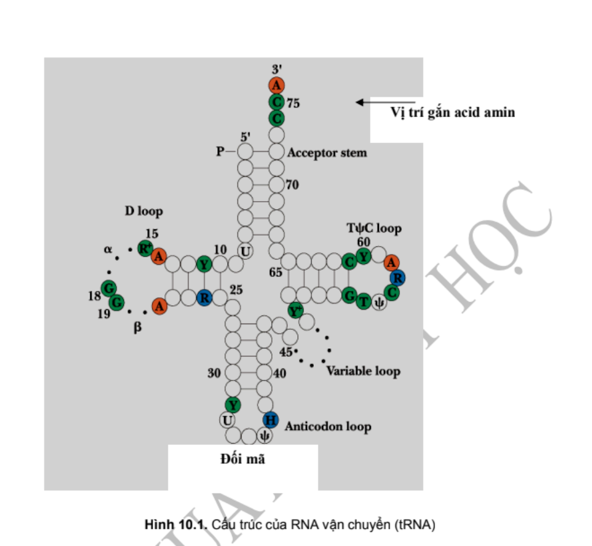
*Hình 10.1. Cấu trúc không gian và các thùy chức năng của phân tử tRNA.*

4. **rRNA và Ribosom:** "Nhà máy" lắp ráp chuỗi polypeptid. Ribosom gồm 2 tiểu đơn vị phân ly khi nghỉ và kết hợp lại khi dịch mã:
   - **Ở vi khuẩn (Prokaryote - 70S):**
     - Tiểu đơn vị nhỏ **$30\text{S}$**: gồm $\text{rRNA } 16\text{S}$ và 21 protein ribosom.
     - Tiểu đơn vị lớn **$50\text{S}$**: gồm $\text{rRNA } 23\text{S}$, $\text{rRNA } 5\text{S}$ và 34 protein ribosom.
   - **Ở tế bào nhân thực (Eukaryote - 80S):**
     - Tiểu đơn vị nhỏ **$40\text{S}$**: gồm $\text{rRNA } 18\text{S}$ và khoảng 33 protein.
     - Tiểu đơn vị lớn **$60\text{S}$**: gồm $\text{rRNA } 28\text{S}$, $5{,}8\text{S}$, $5\text{S}$ và khoảng 49 protein.
   - Trên phân tử $\text{mRNA}$, nhiều ribosom có thể cùng trượt đồng thời tạo thành phức hợp **polyribosom (polysom)** để tăng hiệu suất tổng hợp.

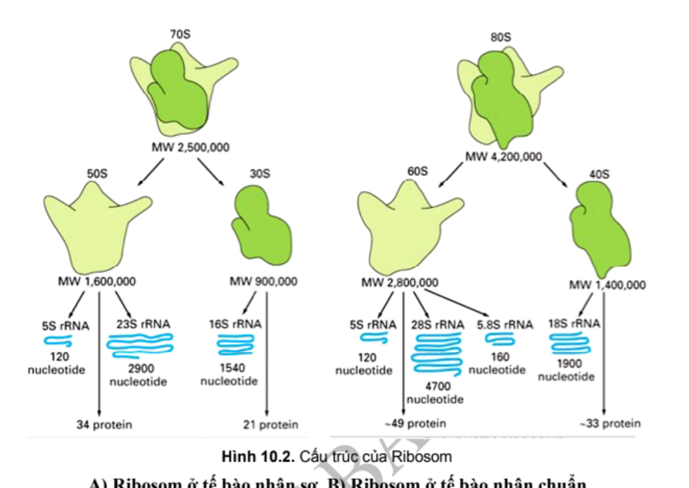
*Hình 10.2. Thành phần cấu trúc của Ribosom ở tế bào nhân sơ (70S) và tế bào nhân chuẩn (80S).*

5. **Các enzym xúc tác:**
   - **Aminoacyl-tRNA synthetase:** Xúc tác gắn acid amin đặc hiệu vào $\text{tRNA}$ tương ứng.
   - **Peptidyl transferase:** Hoạt tính ribozym nằm trên phân tử $\text{rRNA } 23\text{S}$ của tiểu đơn vị lớn, xúc tác hình thành liên kết peptid.
6. **Các yếu tố protein hỗ trợ dịch mã:**
   - Yếu tố mở đầu (*Initiation Factors*): $\text{IF1, IF2, IF3}$ ở vi khuẩn.
   - Yếu tố kéo dài (*Elongation Factors*): $\text{EF-Tu, EF-Ts, EF-G}$.
   - Yếu tố kết thúc (*Release Factors*): $\text{RF1, RF2, RF3}$.
7. **Nguồn năng lượng và ion:** Cần năng lượng từ **ATP** (cho hoạt hóa acid amin) và **GTP** (cho mở đầu, gắn codon và chuyển vị); các cation hóa trị hai $\text{Mg}^{2+}$, cùng $\text{K}^+, \text{NH}_4^+$.
8. **Nguyên liệu:** 20 loại $\text{L}$-acid amin tiêu chuẩn.

---

### 1.2. Quá trình sinh tổng hợp Protein

Quá trình dịch mã diễn ra qua 4 giai đoạn nối tiếp:

#### Giai đoạn 1: Hoạt hóa Acid Amin (Tại bào tương)
- Xúc tác bởi enzym **aminoacyl-tRNA synthetase** (phụ thuộc ion $\text{Mg}^{2+}$). Mỗi acid amin có một enzym đặc hiệu riêng. 
- Dựa trên cấu trúc và cơ chế xúc tác, các enzym này được chia thành hai lớp:

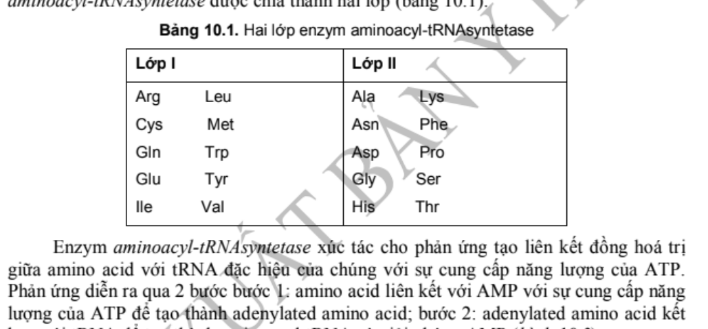
*Bảng 10.1. Phân loại 2 lớp enzym Aminoacyl-tRNA Synthetase*

| Lớp I (*gắn vào nhóm $2'\text{-OH}$ trước rồi chuyển sang $3'\text{-OH}$*) | Lớp II (*gắn trực tiếp vào nhóm $3'\text{-OH}$ của ribose*) |
| :--- | :--- |
| Arg, Cys, Gln, Glu, Ile, Leu, Met, Trp, Tyr, Val | Ala, Asn, Asp, Gly, His, Lys, Phe, Pro, Ser, Thr |

- Quá trình hoạt hóa diễn ra qua 2 bước:
  - **Bước 1:** Acid amin phản ứng với ATP tạo thành phức hợp trung gian giàu năng lượng **Aminoacyl-AMP (Adenylated amino acid)** và giải phóng pyrophosphat ($\text{PP}_i$):

$$\text{Acid amin} + \text{ATP} \rightleftharpoons \text{Aminoacyl-AMP} + \text{PP}_i$$

  - **Bước 2:** Nhóm aminoacyl được chuyển sang gắn vào nhóm hydroxyl ở đầu $3'\text{-OH}$ của gốc adenin tận cùng của $\text{tRNA}$ tương ứng, giải phóng $\text{AMP}$:

$$\text{Aminoacyl-AMP} + \text{tRNA} \rightleftharpoons \text{Aminoacyl-tRNA} + \text{AMP}$$

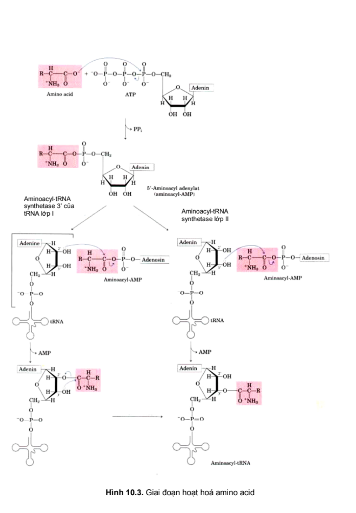
*Hình 10.3. Cơ chế 2 bước của phản ứng hoạt hóa amino acid bởi Aminoacyl-tRNA Synthetase.*

- **Cơ chế sửa sai (*proofreading*):** Enzym aminoacyl-tRNA synthetase có vị trí xúc tác sửa sai (thủy phân cắt bỏ nếu gắn nhầm acid amin tương tự), đảm bảo độ chính xác cực cao với tần số sai sót chỉ khoảng $10^{-4}$.

---

#### Giai đoạn 2: Mở đầu chuỗi (Initiation)
Ở vi khuẩn, acid amin mở đầu luôn là **N-formylmethionin (fMet)** được mang bởi phân tử $\text{tRNA}$ đặc biệt là $\text{fMet-tRNA}^{\text{fMet}}$.

Ribosom có 3 vị trí gắn $\text{tRNA}$:
- **Vị trí A (*Aminoacyl site*):** Nhận diện và gắn aminoacyl-$\text{tRNA}$ mới đi vào.
- **Vị trí P (*Peptidyl site*):** Gắn peptidyl-$\text{tRNA}$ mang chuỗi polypeptid đang kéo dài (hoặc gắn $\text{fMet-tRNA}$ lúc mở đầu).
- **Vị trí E (*Exit site*):** Nơi $\text{tRNA}$ đã mất acid amin dừng lại trước khi giải phóng khỏi ribosom.

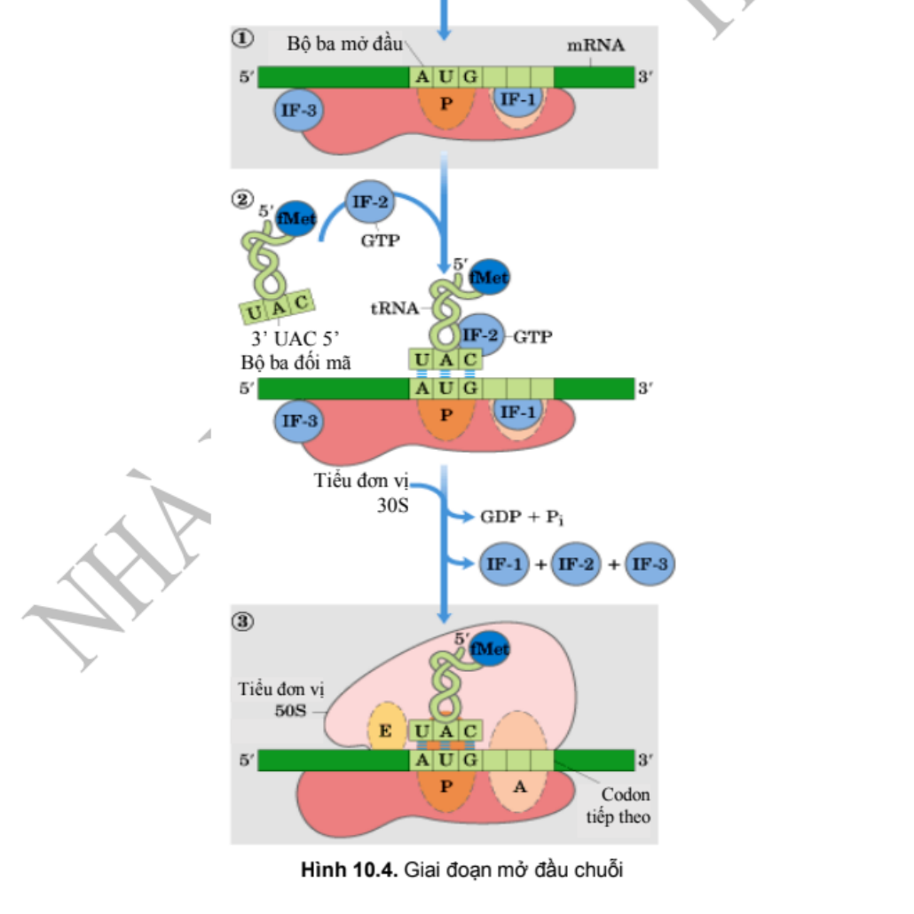
*Hình 10.4. Các bước hình thành phức hợp mở đầu 70S ở vi khuẩn.*

Quá trình mở đầu gồm 3 bước:
1. **Bước 1:** Tiểu đơn vị nhỏ $30\text{S}$ gắn với yếu tố $\text{IF1}$ và $\text{IF3}$ (ngăn $50\text{S}$ kết hợp sớm). Sau đó phân tử $\text{mRNA}$ gắn vào $30\text{S}$ nhờ sự bắt cặp giữa trình tự dẫn đầu **Shine - Dalgarno** giàu purin trên $\text{mRNA}$ với đoạn giàu pyrimidin ở đầu $3'$ của $\text{rRNA } 16\text{S}$, định vị codon mở đầu **$\text{AUG}$** vào đúng vị trí P.
2. **Bước 2:** Phức hợp $\text{IF2-GTP}$ đưa $\text{fMet-tRNA}^{\text{fMet}}$ vào gắn khớp đối mã bổ sung với codon mở đầu $\text{AUG}$ tại vị trí P.
3. **Bước 3:** Tiểu đơn vị lớn $50\text{S}$ kết hợp với phức hợp trên; $\text{GTP}$ bị thủy phân thành $\text{GDP} + \text{P}_i$, giải phóng cả 3 yếu tố $\text{IF1, IF2, IF3}$, tạo nên **phức hợp mở đầu $70\text{S}$ hoàn chỉnh** sẵn sàng kéo dài chuỗi.

---

#### Giai đoạn 3: Kéo dài chuỗi (Elongation)
Kéo dài chuỗi polypeptid là quá trình chu kỳ gồm 3 bước lặp lại cho mỗi acid amin:

1. **Bước 1: Gắn Aminoacyl-tRNA vào vị trí A:**
   - Yếu tố kéo dài **$\text{EF-Tu}$** gắn với $\text{GTP}$ vận chuyển aminoacyl-$\text{tRNA}$ tương ứng với codon tiếp theo vào vị trí A của ribosom.
   - Khi codon và anticodon khớp bổ sung chính xác, $\text{GTP}$ thủy phân giải phóng $\text{EF-Tu-GDP}$. Yếu tố **$\text{EF-Ts}$** đóng vai trò tái tạo $\text{EF-Tu-GTP}$ cho chu kỳ tiếp theo.

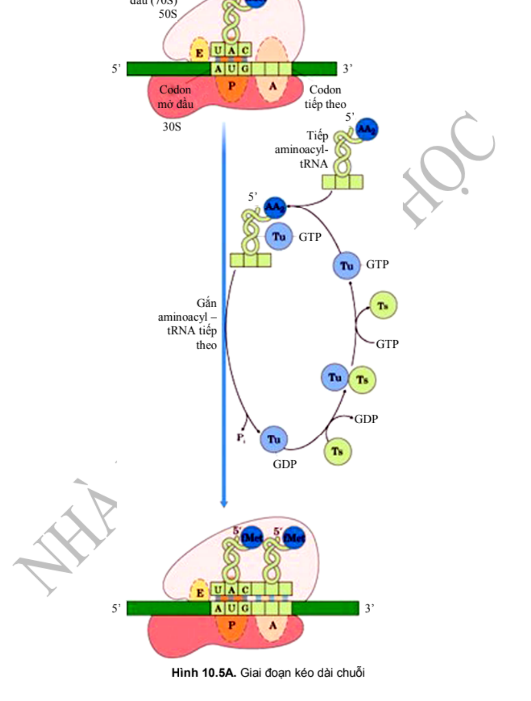
*Hình 10.5A. Cơ chế đưa Aminoacyl-tRNA vào vị trí A nhờ phức hợp EF-Tu-GTP.*

2. **Bước 2: Hình thành Liên kết Peptid:**
   - Trung tâm **peptidyl transferase** (trên $\text{rRNA } 23\text{S}$ của tiểu đơn vị $50\text{S}$) xúc tác chuyển gốc aminoacyl (hoặc fMet) từ $\text{tRNA}$ ở vị trí P sang nhóm $\alpha$-amino của aminoacyl-$\text{tRNA}$ tại vị trí A, hình thành **liên kết peptid**.
   - Phản ứng này sử dụng năng lượng từ liên kết este giàu năng lượng giữa acid amin và $\text{tRNA}$ ở vị trí P (không cần thêm năng lượng ngoài). Kết quả tạo thành dipeptidyl-$\text{tRNA}$ nằm tại vị trí A, còn vị trí P là $\text{tRNA}$ đã mất acid amin.

3. **Bước 3: Sự chuyển vị (Translocation):**
   - Nhờ yếu tố kéo dài **$\text{EF-G}$** (còn gọi là *translocase*) và năng lượng thủy phân **1 phân tử GTP**, ribosom trượt một bước chính xác 3 nucleotide (1 codon) dọc theo $\text{mRNA}$ theo chiều từ **$5' \rightarrow 3'$**:
     - $\text{tRNA}$ không mang acid amin chuyển từ vị trí P sang **vị trí E** và rời khỏi ribosom.
     - Peptidyl-$\text{tRNA}$ (mang chuỗi peptid) chuyển từ **vị trí A sang vị trí P**.
     - Vị trí A trở nên trống rỗng, để lộ codon tiếp theo sẵn sàng đón aminoacyl-$\text{tRNA}$ mới.

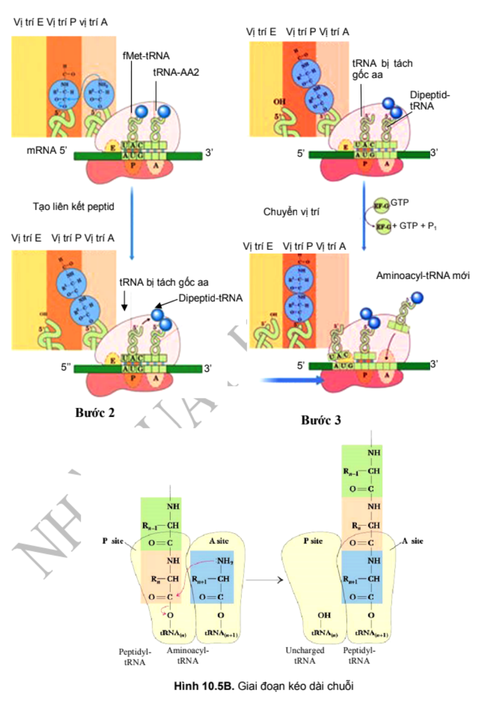
*Hình 10.5B. Cơ chế hình thành liên kết peptid và sự chuyển vị của Ribosom dọc theo phân tử mRNA.*

<!-- END FILE: pages_216_225.md -->

<!-- BEGIN FILE: pages_226_235.md -->

# CHƯƠNG 10 (TIẾP THEO): DỊCH MÃ, BIẾN ĐỔI SAU DỊCH MÃ VÀ ĐIỀU HÒA SINH TỔNG HỢP PROTEIN

---

## 1. SINH TỔNG HỢP PROTEIN Ở TẾ BÀO NHÂN SƠ (TIẾP THEO)

### 1.2. Quá trình sinh tổng hợp Protein (tiếp theo)

#### Giai đoạn 4: Kết thúc chuỗi polypeptid (Termination)
- Quá trình kéo dài chuỗi polypeptid sẽ dừng lại khi một trong 3 **bộ ba kết thúc (Stop codons / mã vô nghĩa: UAA, UAG, UGA)** xuất hiện tại vị trí A của ribosom.
- Không có phân tử $\text{tRNA}$ nào có anticodon tương ứng với các bộ ba kết thúc này. Thay vào đó, các **yếu tố giải phóng (Release Factors - RF)** sẽ nhận diện codon kết thúc và gắn vào vị trí A:
  - **$\text{RF1}$:** Nhận diện đặc hiệu codon $\text{UAA}$ và $\text{UAG}$.
  - **$\text{RF2}$:** Nhận diện đặc hiệu codon $\text{UAA}$ và $\text{UGA}$.
  - **$\text{RF3}$:** Là một protein liên kết GTP, kích hoạt sự phân ly của $\text{RF1}$ và $\text{RF2}$ sau khi chuỗi polypeptid được giải phóng.
- **Cơ chế:** Sự gắn của $\text{RF}$ làm biến đổi hoạt tính của trung tâm peptidyl transferase, chuyển sang xúc tác phản ứng **thủy phân liên kết este giữa chuỗi polypeptid với phân tử $\text{tRNA}$ cuối cùng** tại vị trí P.
- Chuỗi polypeptid hoàn chỉnh được giải phóng vào bào tương. Phân tử $\text{mRNA}$ tách ra, và ribosom $70\text{S}$ dưới tác dụng của yếu tố tái chế ribosom ($\text{RRF}$) cùng $\text{EF-G}$ và $\text{IF3}$ sẽ phân ly thành hai tiểu đơn vị rời $30\text{S}$ và $50\text{S}$ để tái sử dụng cho các chu kỳ dịch mã tiếp theo.

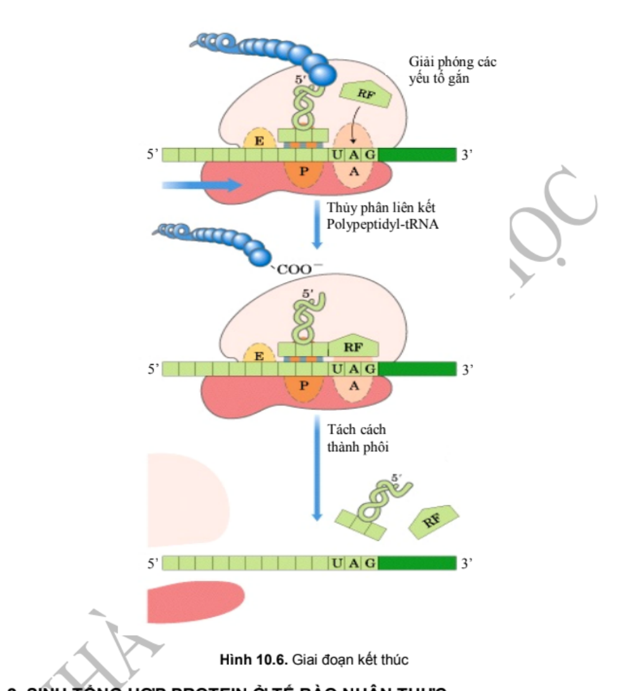
*Hình 10.6. Cơ chế giải phóng chuỗi polypeptid và phân ly phức hợp ribosom ở giai đoạn kết thúc dịch mã.*

---

## 2. SINH TỔNG HỢP PROTEIN Ở TẾ BÀO NHÂN THỰC (EUKARYOTE)

Ở tế bào nhân chuẩn (eukaryote), quá trình dịch mã có những điểm tương đồng cơ bản với sinh vật nhân sơ nhưng có sự phân tách không gian và thời gian rõ rệt:
- **Phân tách không gian:** Quá trình phiên mã diễn ra bên trong **nhân tế bào**, trong khi dịch mã diễn ra ngoài **bào tương** (trên các ribosom tự do hoặc gắn trên lưới nội chất hạt). Do đó, dịch mã ở eukaryote chỉ diễn ra sau khi phân tử $\text{mRNA}$ tiền thân (*pre-mRNA*) đã được chế bản hoàn thiện (gắn mũ $m^7\text{G}$ ở đầu $5'$, gắn đuôi poly(A) ở đầu $3'$, và cắt nối loại bỏ các đoạn intron không mã hóa). Trái lại, ở vi khuẩn, dịch mã diễn ra đồng thời ngay khi $\text{mRNA}$ đang được phiên mã (*coupled transcription-translation*).
- **Phân tử mRNA:** $\text{mRNA}$ ở eukaryote là **monocistronic** (chỉ mang thông tin mã hóa cho 1 chuỗi polypeptid duy nhất), trong khi $\text{mRNA}$ ở prokaryote là **polycistronic** (mang thông tin của nhiều gen trong cùng một operon).
- **Ribosom:** Là loại **$80\text{S}$** gồm hai tiểu phần **$40\text{S}$** và **$60\text{S}$**.
- **Acid amin mở đầu:** Luôn là **Methionin (Met)** không bị formyl hóa, được mang bởi $\text{Met-tRNA}_i^{\text{Met}}$.
- **Nhận diện mở đầu:** Tiểu phần $40\text{S}$ nhận diện mũ $m^7\text{G}$ ở đầu $5'$ nhờ phức hợp yếu tố mở đầu $\text{eIF4F}$ rồi quét dọc phân tử $\text{mRNA}$ (*scanning mechanism*) cho đến khi gặp codon $\text{AUG}$ đầu tiên nằm trong trình tự đồng thuận Kozak.

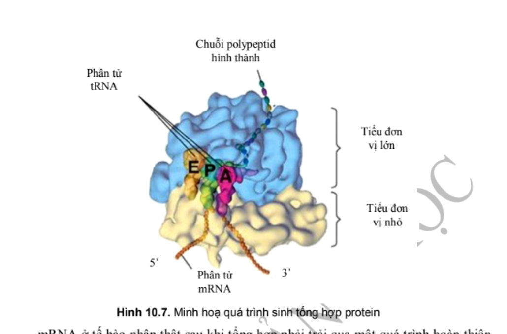
*Hình 10.7. Sơ đồ tổng quát quá trình sinh tổng hợp protein trên phân tử mRNA.*

---

## 3. SỰ BIẾN ĐỔI VÀ HOÀN THIỆN PHÂN TỬ PROTEIN SAU DỊCH MÃ (POST-TRANSLATIONAL MODIFICATIONS - PTM)

Chuỗi polypeptid mới ra khỏi ribosom cần được gấp cuộn chính xác thành cấu trúc không gian 3 chiều có hoạt tính sinh học (nhờ sự hỗ trợ của các protein chaperone/chaperonin như Hsp70). Đồng thời, phân tử protein trải qua hàng loạt các biến đổi hóa học sau dịch mã:
1. **Cắt bỏ acid amin đầu N:** Acid amin mở đầu (fMet ở vi khuẩn hoặc Met ở tế bào có nhân) cùng một số acid amin cận đầu N thường bị cắt bỏ nhờ enzym *methionin aminopeptidase*. Ở tế bào nhân thực, khoảng $50\%$ protein bị acetyl hóa nhóm $\alpha$-amino ở đầu N.
2. **Cắt bỏ đoạn peptid tín hiệu (*signal peptide*):** Đoạn trình tự kỵ nước gồm 15 - 30 acid amin ở đầu N định hướng protein đi vào lưới nội chất hoặc đích đến nội bào sẽ bị *signal peptidase* cắt bỏ sau khi protein đi qua màng.
3. **Phosphoryl hóa (*Phosphorylation*):** Gắn thuận nghịch nhóm phosphat ($\text{PO}_4^{3-}$) vào nhóm $-\text{OH}$ của các gốc **Serin, Threonin hoặc Tyrosin** nhờ các enzym protein kinase (sử dụng ATP) và khử phosphoryl hóa nhờ protein phosphatase. Đây là cơ chế điều hòa bật/tắt hoạt tính enzym và truyền tín hiệu nội bào quan trọng nhất.
4. **Carboxyl hóa (*Carboxylation*):** Gắn thêm nhóm carboxyl vào gốc Glutamat tạo $\gamma$-carboxyglutamat (Gla) nhờ enzym phụ thuộc **Vitamin K**, tạo vị trí gắn ion $\text{Ca}^{2+}$ cho các yếu tố đông máu huyết tương (Prothrombin, yếu tố VII, IX, X).
5. **Methyl hóa (*Methylation*):** Gắn nhóm methyl vào gốc Lysin hoặc Arginin (ví dụ methyl hóa histon điều hòa biểu hiện gen).
6. **Glycosyl hóa (*Glycosylation*):** Gắn các chuỗi oligosaccharid tạo thành glycoprotein:
   - **N-glycosyl hóa:** Gắn vào nguyên tử $\text{N}$ của gốc **Asparagin** (Asn) tại lưới nội chất.
   - **O-glycosyl hóa:** Gắn vào nguyên tử $\text{O}$ của nhóm $-\text{OH}$ của gốc **Serin hoặc Threonin** tại bộ máy Golgi.
7. **Hình thành cầu disulfid ($-\text{S}-\text{S}-$):** Oxi hóa nối hai gốc Cystein nội chuỗi hoặc liên chuỗi nhờ enzym *protein disulfide isomerase* (PDI) trong lòng lưới nội chất, giúp cố định cấu trúc không gian của các protein tiết (như insulin, kháng thể).
8. **Cắt tiền chất zymogen (*Proteolytic cleavage*):** Cắt bỏ một đoạn peptid ức chế để chuyển protein từ dạng tiền chất bất hoạt (*proenzyme/zymogen*) thành enzym hoạt động (ví dụ: pepsinogen $\rightarrow$ pepsin, proinsulin $\rightarrow$ insulin + C-peptid).

---

## 4. ĐIỀU HÒA SINH TỔNG HỢP PROTEIN

Tế bào kiểm soát nghiêm ngặt sự biểu hiện gen để vừa đáp ứng linh hoạt với điều kiện môi trường vừa tiết kiệm tối đa năng lượng.

### 4.1. Điều hòa ở Tế bào Nhân sơ (Mô hình Operon)

Một **Operon** là một cụm gen cấu trúc có liên quan chặt chẽ về mặt chức năng nằm liền kề nhau trên DNA vi khuẩn, chịu sự kiểm soát chung bởi một vùng khởi động (**Promoter - P**) và một vùng vận hành (**Operator - O**).

#### A. Mô hình Cảm ứng: Operon Lactose (Lac Operon) ở *E. coli*
- Cấu trúc operon Lac gồm 3 gen cấu trúc: $\text{lacZ}$ (mã hóa $\beta$-galactosidase thủy phân lactose thành glucose và galactose), $\text{lacY}$ (mã hóa lactose permease vận chuyển lactose vào tế bào) và $\text{lacA}$ (mã hóa transacetylase). Gen điều hòa $\text{lacI}$ nằm phía trước liên tục phiên mã tạo ra **protein kìm hãm (Repressor)**.
- **Khi môi trường KHÔNG có lactose:** Protein kìm hãm ở trạng thái hoạt động, gắn chặt vào vùng Operator (O), ngăn cản RNA polymerase trượt qua để phiên mã. Các gen cấu trúc bị khóa (tắt gen).

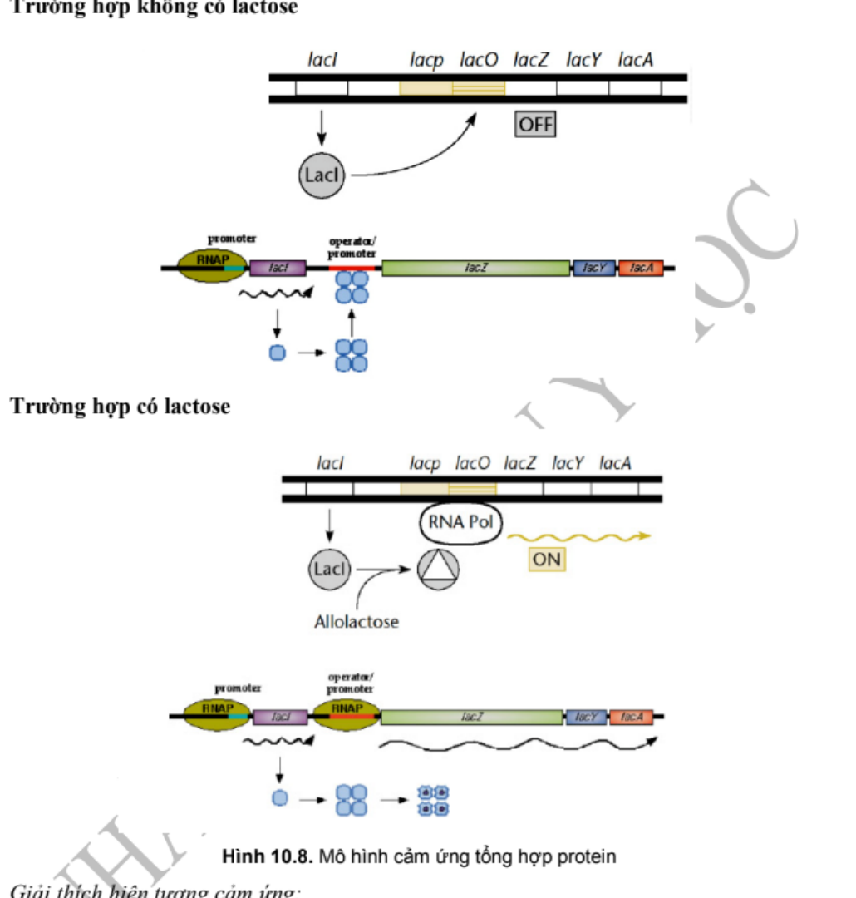
*Hình 10.8. Cơ chế điều hòa cảm ứng của Operon Lactose khi không có và khi có mặt chất cảm ứng allolactose.*

- **Khi môi trường CÓ lactose:** Một lượng nhỏ lactose được chuyển thành allolactose. **Allolactose đóng vai trò là chất cảm ứng (Inducer)**, gắn dị lập thể vào protein kìm hãm làm biến đổi cấu hình của nó, khiến protein kìm hãm mất ái lực và tách rời khỏi vùng Operator. RNA polymerase tự do phiên mã tạo ra lượng lớn các enzym chuyển hóa lactose (bật gen).
- **Hiện tượng kìm hãm dị hóa bởi Glucose (Điều hòa dương tính qua cAMP-CAP):** Khi môi trường có đồng thời cả glucose và lactose, vi khuẩn ưu tiên sử dụng glucose. Nồng độ glucose cao làm giảm nồng độ $\text{cAMP}$. Khi glucose cạn kiệt, nồng độ $\text{cAMP}$ tăng vọt, $\text{cAMP}$ kết hợp với protein hoạt hóa dị hóa **CAP (Catabolite Activator Protein)**. Phức hợp $\text{cAMP-CAP}$ gắn vào vị trí gắn phía trước promoter làm tăng mạnh ái lực của RNA polymerase, kích hoạt phiên mã operon Lac với tốc độ tối đa.

---

#### B. Mô hình Kìm hãm: Operon Tryptophan (Trp Operon) ở *E. coli*
- Operon Trp gồm 5 gen cấu trúc mã hóa cho các enzym xúc tác con đường sinh tổng hợp acid amin tryptophan.
- Gen điều hòa mã hóa cho protein kìm hãm (Apoprotein) ban đầu ở trạng thái **bất hoạt** (*inactive repressor*).
- **Khi môi trường KHÔNG có tryptophan:** Protein kìm hãm bất hoạt không gắn được vào vùng Operator (O). RNA polymerase tự do phiên mã tổng hợp các enzym tạo tryptophan để tế bào sử dụng.

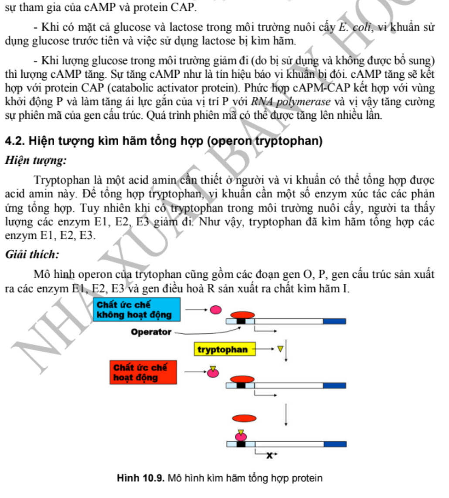
*Hình 10.9. Cơ chế kìm hãm của Operon Tryptophan khi nồng độ Tryptophan nội bào dư thừa.*

- **Khi môi trường CÓ thừa tryptophan:** Tryptophan đóng vai trò là **chất đồng kìm hãm (Corepressor)**, gắn vào protein kìm hãm làm hoạt hóa nó. Phức hợp này gắn chặt vào vùng Operator, khóa sự phiên mã để tránh lãng phí năng lượng tổng hợp khi cơ chất đã dư thừa.

---

### 4.2. Điều hòa sinh tổng hợp Protein ở Tế bào Nhân thực

Ở tế bào nhân chuẩn, sự điều hòa sinh tổng hợp protein không chỉ diễn ra ở mức độ phiên mã operon mà được kiểm soát tinh vi ở nhiều cấp độ, đặc biệt là ở **giai đoạn khởi đầu dịch mã**:
1. **Điều hòa tổng hợp Globin bởi nồng độ Hem:** Trong tế bào hồng cầu, khi thiếu Hem, enzym *Heme-Controlled Repressor (HCR)* trở nên hoạt động và phosphoryl hóa yếu tố mở đầu $\text{eIF2}$, làm bất hoạt $\text{eIF2}$ và ngừng quá trình dịch mã tổng hợp chuỗi globin. Khi có đầy đủ Hem, Hem gắn vào HCR làm bất hoạt enzym này, $\text{eIF2}$ được giải phóng tự do để khởi động dịch mã tổng hợp globin tương ứng với lượng Hem có sẵn.
2. **Điều hòa bởi Interferon chống virus:** Khi tế bào bị nhiễm virus, nó tiết ra interferon. Interferon kích hoạt một protein kinase phụ thuộc $\text{dsRNA}$ (PKR). PKR tiến hành **phosphoryl hóa yếu tố mở đầu $\text{eIF2}$**, khiến $\text{eIF2-P}$ tạo phức hợp liên kết chặt chẽ không hồi phục với $\text{eIF2B}$. Do thiếu hụt $\text{eIF2}$ tự do, toàn bộ quá trình dịch mã của tế bào bị phong bế hoàn toàn. Tế bào chấp nhận tự chết (*apoptosis*) để ngăn chặn virus nhân lên và lây lan sang các tế bào lân cận.

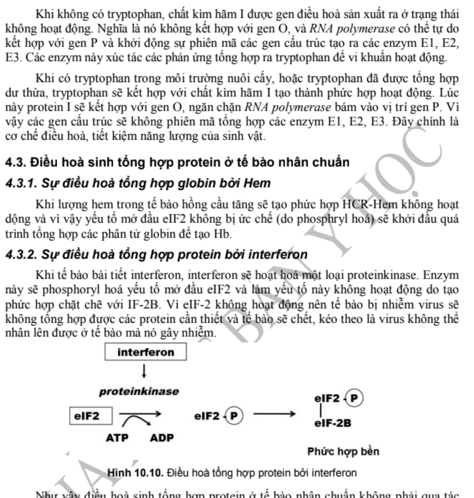
*Hình 10.10. Cơ chế bất hoạt yếu tố mở đầu eIF2 qua con đường kích hoạt Protein Kinase của Interferon.*

---

# MỞ ĐẦU CHƯƠNG 11: HÓA HỌC ACID NUCLEIC

## 1. THÀNH PHẦN HÓA HỌC CỦA ACID NUCLEIC

Acid nucleic là cơ sở vật chất lưu trữ, bảo tồn và biểu hiện thông tin di truyền của mọi sinh vật sống. Có hai loại acid nucleic chính: **DNA (Deoxyribonucleic acid)** và **RNA (Ribonucleic acid)**.

Cả DNA và RNA đều là những đại phân tử polymer sinh học mạch thẳng, không phân nhánh, được cấu tạo từ các đơn phân lặp lại là các **Nucleotide**. Các nucleotide liên kết với nhau bằng **liên kết phosphodiester** nối giữa nhóm hydroxyl ở vị trí carbon $3'$ của phân tử đường pentose trước với nhóm phosphat ở vị trí carbon $5'$ của phân tử đường pentose tiếp theo ($3',5'\text{-phosphodiester}$).

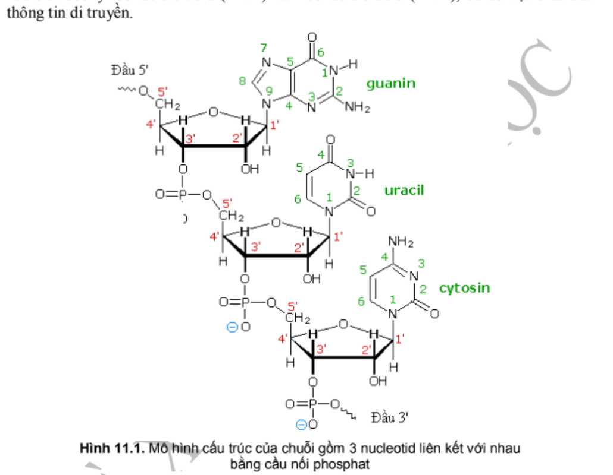
*Hình 11.1. Cấu trúc liên kết 3',5'-phosphodiester nối các nucleotide trong chuỗi polynucleotid, tạo nên khung đường - phosphat có tính phân cực với đầu 5'-phosphat và đầu 3'-hydroxyl.*

Mỗi nucleotide được cấu tạo từ 3 thành phần hóa học cơ bản:
1. **Một base nitơ dị vòng (Purin hoặc Pyrimidin).**
2. **Một phân tử đường Pentose (5 carbon dạng furanose).**
3. **Từ một đến ba nhóm Phosphat ($\text{PO}_4^{3-}$).**

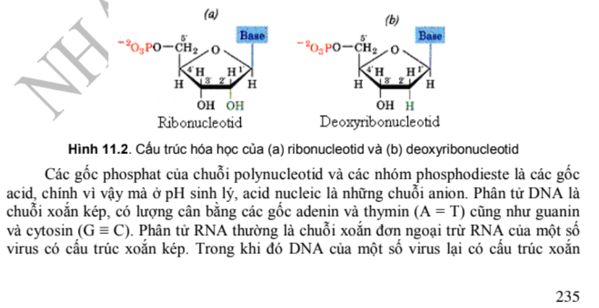
*Hình 11.2. So sánh cấu trúc hóa học giữa Ribonucleotide (chứa $\beta$-D-ribose) và Deoxyribonucleotide (chứa $\beta$-D-2-deoxyribose khuyết oxy ở vị trí C2').*

- **Đặc tính acid:** Các nhóm phosphat trong liên kết phosphodiester là các gốc acid mạnh, có $\text{pK}_a \approx 1 - 2$, do đó ở $\text{pH}$ sinh lý ($7{,}4$), các chuỗi DNA và RNA tồn tại dưới dạng **các đa anion tích điện âm rất mạnh**. Đặc điểm này cho phép DNA tương tác tĩnh điện bền vững với các protein base tích điện dương (như Histon).
- **Quy luật cấu trúc:** Phân tử DNA ở sinh vật bậc cao là chuỗi xoắn kép gồm 2 mạch bổ sung đối song, tuân thủ nghiêm ngặt **nguyên tắc bổ sung Chargaff**: số gốc Adenin luôn bằng Thymin ($\text{A} = \text{T}$) và số gốc Guanin luôn bằng Cytosin ($\text{G} = \text{C}$). Trái lại, phân tử RNA thông thường là chuỗi đơn (ngoại trừ vật chất di truyền của một số virus là RNA sợi kép).

<!-- END FILE: pages_226_235.md -->

<!-- BEGIN FILE: pages_236_245.md -->