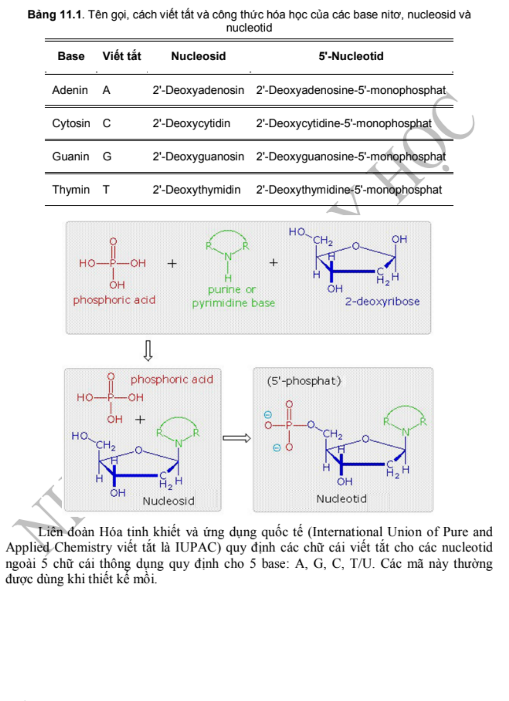
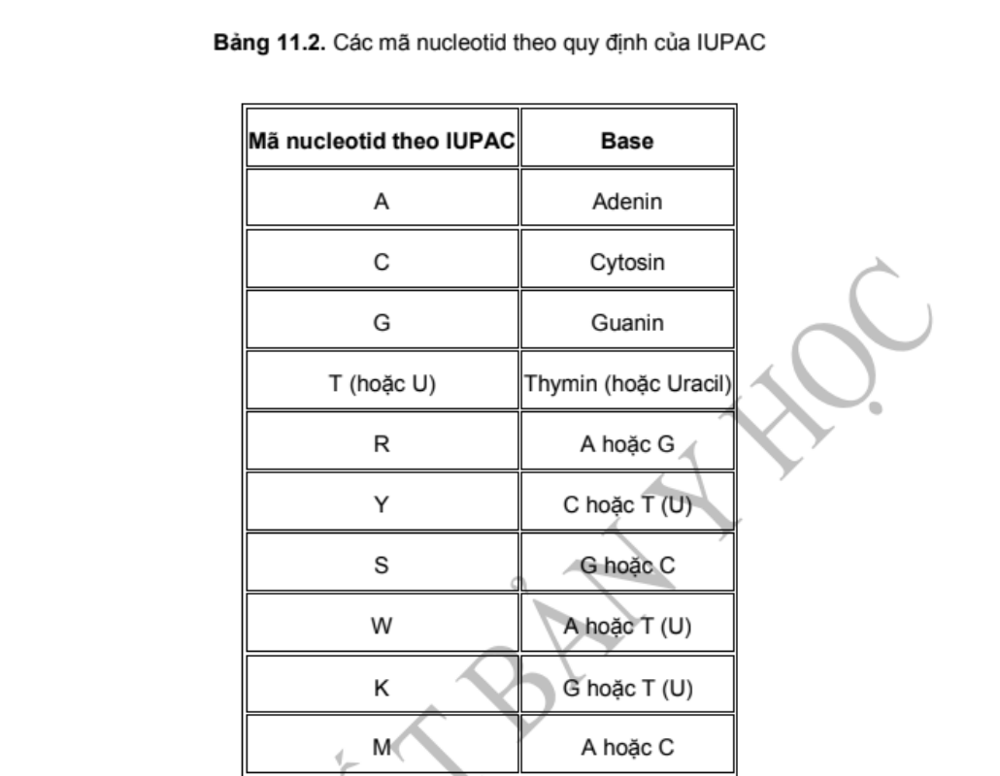
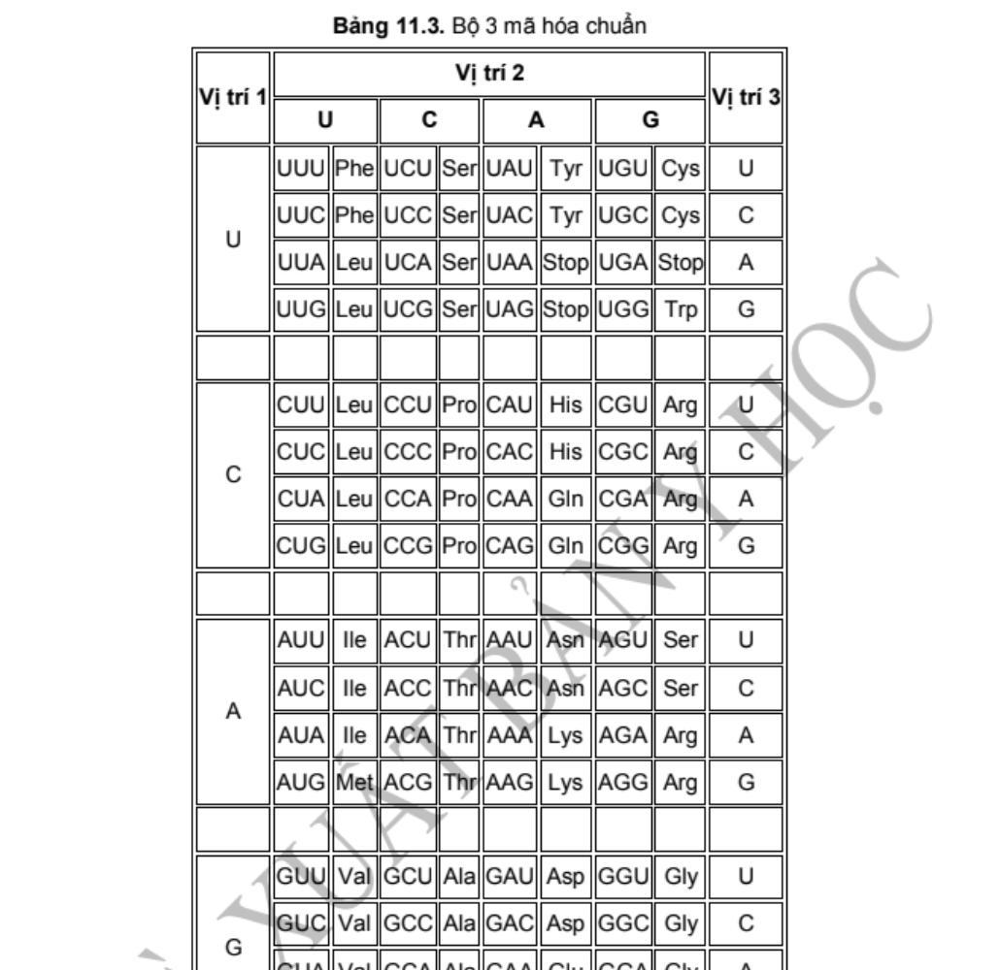
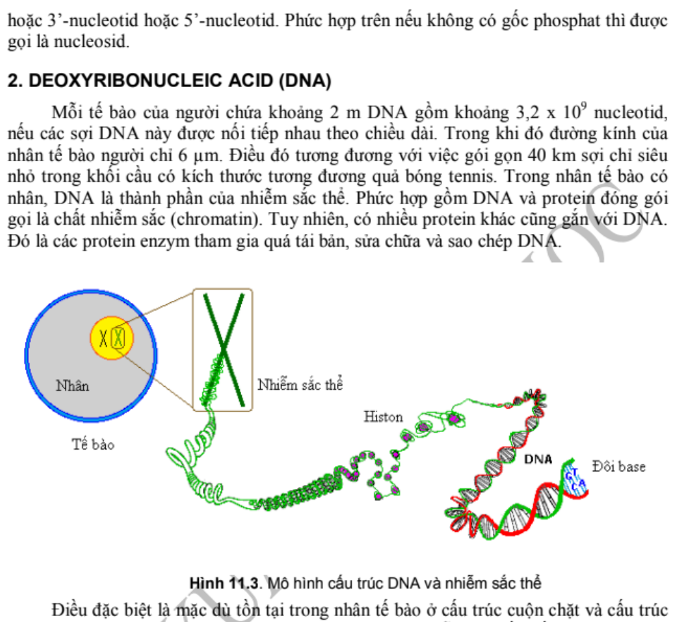
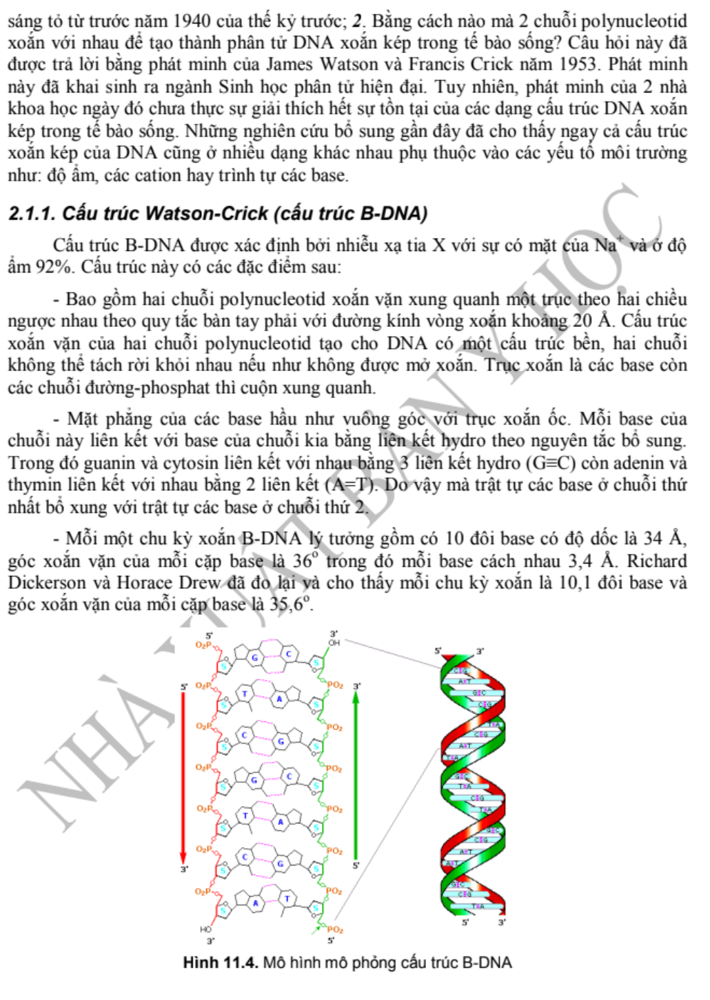
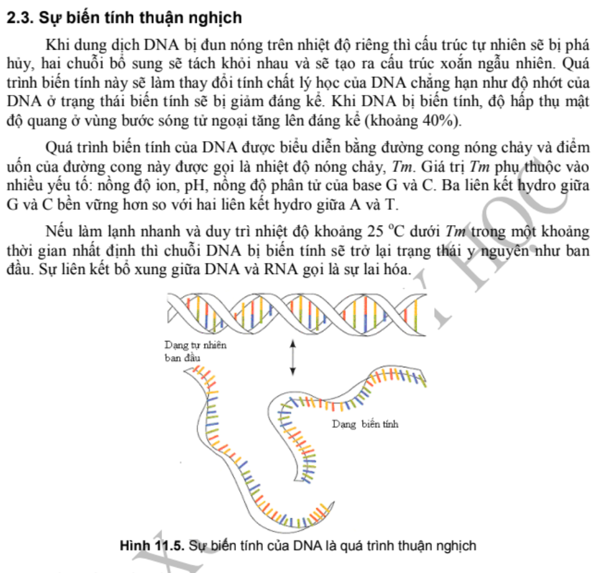
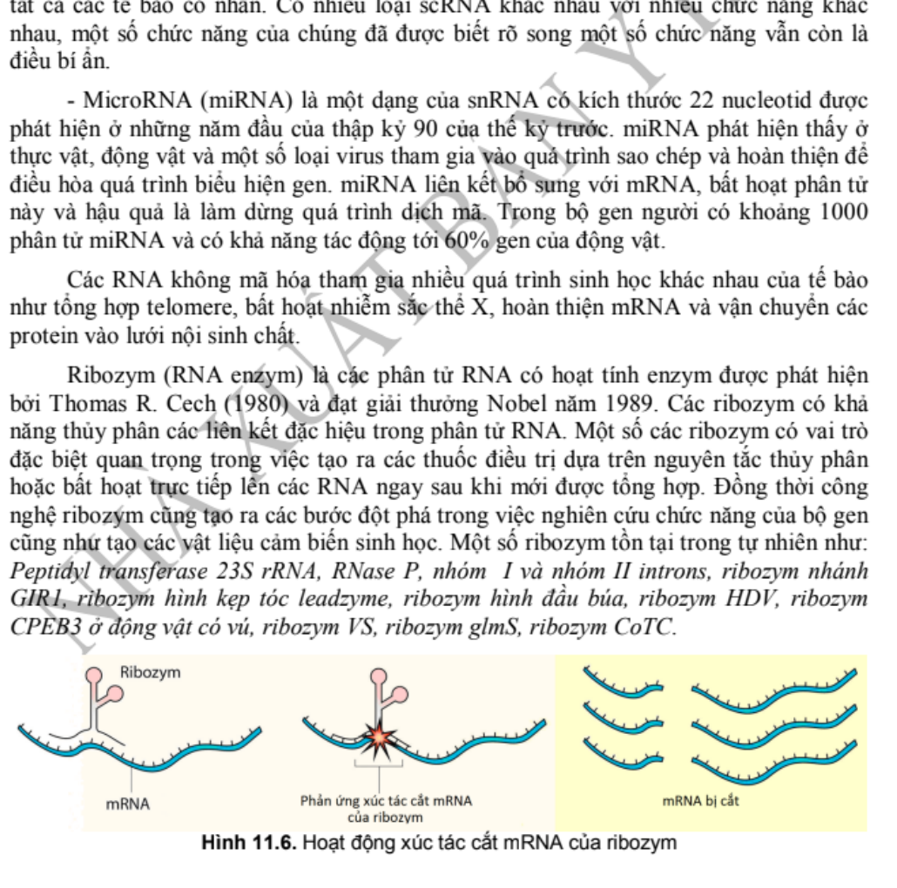

# CHƯƠNG 11: HÓA HỌC ACID NUCLEIC

---

## MỤC TIÊU HỌC TẬP
1. So sánh được thành phần cấu tạo hóa học và đặc điểm cấu trúc giữa DNA và RNA.
2. Trình bày được cấu trúc không gian chuỗi xoắn kép của DNA, các dạng cấu trúc (A, B, Z) và các lực hóa học duy trì độ bền vững của phân tử.
3. Trình bày được cấu trúc và chức năng sinh học của các loại RNA (mRNA, tRNA, rRNA, snRNA, miRNA và Ribozyme).

---

## 1. THÀNH PHẦN HÓA HỌC CỦA ACID NUCLEIC (TIẾP THEO)

### 1.1. Các Base Nitơ, Nucleosid và Nucleotid

Acid nucleic gồm hai loại chính: **DNA (Deoxyribonucleic acid)** và **RNA (Ribonucleic acid)**:
- **Base Nitơ:** Gồm hai họ dẫn xuất dị vòng thơm:
  - **Nhóm Purin (vòng đôi 9 cạnh gồm vòng pyrimidin ngưng tụ với vòng imidazol):** **Adenin (A)** và **Guanin (G)** (có ở cả DNA và RNA).
  - **Nhóm Pyrimidin (vòng đơn 6 cạnh chứa 2 nguyên tử nitơ):** **Cytosin (C)** (có ở cả DNA và RNA), **Thymin (T)** (chỉ có ở DNA, mang nhóm methyl ở C5) và **Uracil (U)** (chỉ có ở RNA).
- **Đường Pentose (furanose):**
  - **$\beta$-D-ribose:** có trong RNA (chứa nhóm hydroxyl ở cả carbon $2'$ và $3'$). Do có nhóm $2'\text{-OH}$, RNA rất nhạy cảm và dễ bị thủy phân trong môi trường kiềm tạo hỗn hợp nucleotide $2'$ và $3'$.
  - **$\beta$-D-2-deoxyribose:** có trong DNA (khuyết nguyên tử oxy ở vị trí carbon $2'$). Do không có nhóm $2'\text{-OH}$, DNA cực kỳ bền vững trong môi trường kiềm, phù hợp với chức năng bảo tồn thông tin di truyền lâu dài.
- **Nucleosid:** Phức hợp tạo bởi base nitơ liên kết với carbon $1'$ ($\text{C}1'$) của đường pentose bằng **liên kết $\text{N-}\beta\text{-glycosid}$** (với N9 của purin hoặc N1 của pyrimidin).
- **Nucleotid:** Là este phosphat của nucleosid (thường gắn gốc phosphat tại nhóm hydroxyl ở vị trí carbon $\text{C}5'$ hoặc $\text{C}3'$ của đường).

*Bảng 11.1. Danh pháp, ký hiệu viết tắt và công thức cấu tạo của các đơn phân Nucleotide trong DNA.*

| Base nitơ | Ký hiệu | Deoxynucleosid | Deoxynucleosid 5'-monophosphat (dNMP) |
| :--- | :---: | :--- | :--- |
| **Adenin** | A | 2'-Deoxyadenosin | 2'-Deoxyadenosine-5'-monophosphat (dAMP) |
| **Guanin** | G | 2'-Deoxyguanosin | 2'-Deoxyguanosine-5'-monophosphat (dGMP) |
| **Cytosin** | C | 2'-Deoxycytidin | 2'-Deoxycytidine-5'-monophosphat (dCMP) |
| **Thymin** | T | 2'-Deoxythymidin | 2'-Deoxythymidine-5'-monophosphat (dTMP) |

Liên minh Hóa học Thuần túy và Ứng dụng Quốc tế (IUPAC) quy định hệ thống các chữ cái viết tắt đại diện cho các nucleotide suy thoái (dùng phổ biến trong thiết kế mồi PCR và giải trình tự gen):

*Bảng 11.2. Bảng mã nucleotide theo chuẩn quốc tế IUPAC.*

---

### 1.2. Mã Di Truyền (Genetic Code)

Thông tin di truyền trên phân tử $\text{mRNA}$ được mã hóa dưới dạng các **bộ ba mã hóa (codon)**. Với 4 loại nucleotide (A, U, G, C), có tất cả $4^3 = 64$ bộ ba mã hóa khác nhau:
- **61 codon mã hóa cho 20 acid amin.**
- **1 codon mở đầu:** **$\text{AUG}$** (mã hóa Methionin ở eukaryote hoặc N-formylmethionin ở prokaryote).
- **3 codon kết thúc (Stop codons):** **$\text{UAA}, \text{UAG}, \text{UGA}$** (không mã hóa acid amin nào).

*Bảng 11.3. Bảng 64 bộ ba mã hóa (codon) trên phân tử mRNA.*

**Đặc điểm sinh học của mã di truyền:**
1. **Tính phổ quát (*universality*):** Hầu hết mọi sinh vật trong sinh giới (từ vi khuẩn đến con người) đều dùng chung một bộ mã di truyền.
2. **Tính thoái hóa / dư thừa (*degeneracy*):** Một acid amin có thể được mã hóa bởi nhiều codon khác nhau (ngoại trừ Trp và Met chỉ do 1 codon duy nhất mã hóa).
3. **Tính liên tục và không chồng lấn (*non-overlapping*):** Mã được đọc liên tục từ một điểm bắt đầu cố định, từng cụm 3 nucleotide không ngắt quãng và không gối lên nhau.
4. **Tính đặc hiệu (*unambiguous*):** Mỗi codon chỉ mã hóa cho duy nhất một loại acid amin.

---

## 2. DEOXYRIBONUCLEIC ACID (DNA)

Mỗi tế bào người chứa khoảng **$2\text{ mét}$ DNA** gồm khoảng **$3{,}2 \times 10^9$ cặp base**, được đóng gói siêu cuộn trong nhân tế bào chỉ có đường kính khoảng $6\text{ }\mu\text{m}$ (tương đương gói gọn $40\text{ km}$ sợi chỉ siêu nhỏ vào một quả bóng tennis). DNA kết hợp với các protein histon kiềm tính tạo thành phức hợp **chất nhiễm sắc (chromatin)** và co xoắn cực đại tạo nên **nhiễm sắc thể (NST)** trong quá trình phân bào.

*Hình 11.3. Các cấp độ đóng gói của DNA: Sợi xoắn kép DNA quấn quanh lõi Octamer Histon tạo Nucleosom, cuộn thành sợi Chromatin 30 nm và nhiễm sắc thể.*

---

### 2.1. Cấu trúc Chuỗi xoắn kép DNA (Mô hình Watson - Crick: Dạng B-DNA)

Năm 1953, James Watson và Francis Crick công bố mô hình cấu trúc không gian chuỗi xoắn kép của phân tử DNA (dạng B-DNA) dựa trên dữ liệu nhiễu xạ tia X của Rosalind Franklin và Maurice Wilkins:

*Hình 11.4. Mô hình cấu trúc không gian ba chiều của chuỗi xoắn kép B-DNA: rãnh lớn, rãnh nhỏ và sự xếp chồng của các cặp base.*

- **Hai chuỗi polynucleotid đối song (*antiparallel*):** Một chuỗi chạy theo chiều $5' \rightarrow 3'$, chuỗi đối diện chạy ngược chiều $3' \rightarrow 5'$. Hai chuỗi cuộn xoắn đồng trục theo chiều bàn tay phải (xoắn phải).
- **Khung đường - phosphat ở phía ngoài:** Tích điện âm mạnh, tiếp xúc với dung môi nước; các base nitơ kỵ nước quay vào bên trong trục xoắn.
- **Nguyên tắc bổ sung (*Complementarity*):** Các base của hai chuỗi nằm đối diện nhau và liên kết với nhau bằng **liên kết hydro**:
  - **Adenin liên kết với Thymin bằng 2 liên kết hydro ($\text{A} = \text{T}$)**.
  - **Guanin liên kết với Cytosin bằng 3 liên kết hydro ($\text{G} \equiv \text{C}$)** (bền vững hơn liên kết $\text{A}=\text{T}$).
- **Thông số hình học của dạng B-DNA chuẩn:**
  - Đường kính vòng xoắn: **$20\text{ \AA}$ ($2\text{ nm}$)**.
  - Mỗi chu kỳ xoắn hoàn chỉnh gồm **$10$ đến $10{,}5$ cặp base**.
  - Bước xoắn (chiều dài 1 chu kỳ): **$34\text{ \AA}$ ($3{,}4\text{ nm}$)**.
  - Khoảng cách giữa hai cặp base kế tiếp: **$3{,}4\text{ \AA}$ ($0{,}34\text{ nm}$)**, góc xoắn vặn giữa hai base liên tiếp khoảng $36^\circ$.
  - Cấu trúc xoắn tạo ra hai rãnh không đối xứng trên bề mặt: **Rãnh lớn (*major groove*)** rộng $22\text{ \AA}$ (nơi các protein điều hòa phiên mã và enzym tiếp cận đọc trình tự base) và **Rãnh nhỏ (*minor groove*)** hẹp $12\text{ \AA}$.

---

### 2.2. Các dạng cấu trúc xoắn khác của DNA (A-DNA và Z-DNA)

Bên cạnh dạng B-DNA sinh lý thông thường, DNA có thể chuyển đổi cấu hình tùy thuộc vào độ ẩm và thành phần muối:
1. **Dạng A-DNA:**
   - Xoắn theo chiều bàn tay phải nhưng ngắn và mập hơn dạng B.
   - Một chu kỳ xoắn gồm **$11$ cặp base**, bước xoắn ngắn hơn ($28\text{ \AA}$), các mặt phẳng base nghiêng $20^\circ$ so với trục xoắn.
   - Xuất hiện trong điều kiện mất nước nhân tạo, trong các đoạn lai RNA-DNA hoặc sợi kép RNA. Dạng này có ở bào tử vi khuẩn Gram dương giúp bảo vệ DNA chống lại bức xạ tử ngoại.
2. **Dạng Z-DNA:**
   - Xoắn theo **chiều bàn tay trái** (*left-handed helix*), có khung đường - phosphat gấp khúc hình chữ chi (zigzag).
   - Một chu kỳ xoắn gồm **$12$ cặp base**, bước xoắn dài và thanh mảnh ($45\text{ \AA}$), đường kính hẹp ($18\text{ \AA}$).
   - Thường xuất hiện ở các vùng trình tự giàu purin-pyrimidin xen kẽ ($\text{C-G}$) bị methyl hóa, đóng vai trò điều hòa tái tổ hợp và khởi động phiên mã gen.

---

### 2.3. Các lực hóa học làm bền vững cấu trúc Acid Nucleic

Độ bền và tính ổn định của chuỗi xoắn kép DNA được duy trì bởi sự phối hợp của nhiều lực tương tác yếu:
1. **Liên kết kỵ nước và Tương tác xếp chồng base (*Base stacking interactions*):** Các mặt phẳng base nitơ phẳng kỵ nước xếp chồng song song lên nhau dọc theo trục xoắn. Tương tác Van der Waals và lực đẩy kỵ nước giữa các vòng thơm xếp chồng là **yếu tố động lực chính đóng góp vào sự ổn định của cấu trúc xoắn kép** (mạnh hơn cả liên kết hydro).
2. **Liên kết hydro giữa các cặp base:** Giữ hai chuỗi đối diện với nhau, đóng vai trò quyết định **tính đặc hiệu của nguyên tắc bổ sung** (A=T, G=C).
3. **Tương tác ion và Lớp đệm cation:** Lực đẩy tĩnh điện giữa các nhóm phosphat mang điện tích âm ở khung ngoài được trung hòa bởi các cation kim loại ($\text{Mg}^{2+}, \text{Na}^+$) và protein base (histon, polyamin), giúp chuỗi kép không bị đẩy bung ra.
4. **Cấu trúc siêu xoắn (*Supercoiling*):** Ở vi khuẩn, ty thể và virus, DNA ở dạng vòng khép kín. Sự siêu xoắn vặn được điều hòa chặt chẽ bởi các enzym **Topoisomerase (Typ I và Typ II / DNA Gyrase)**.

---

### 2.4. Sự Biến tính nhiệt, Nhiệt độ nóng chảy (Tm) và Hiện tượng Hồi tính lai hóa

- **Sự biến tính (*Denaturation*):** Khi đun nóng dung dịch DNA hoặc trong môi trường kiềm cực đoan, các liên kết hydro và tương tác xếp chồng base bị phá vỡ hoàn toàn, hai chuỗi polynucleotid tách rời nhau tạo thành hai sợi đơn cuộn ngẫu nhiên. Liên kết phosphodiester cộng hóa trị ở cấu trúc bậc 1 không bị đứt gãy.
- **Hiệu ứng tăng sắc tố (*Hyperchromic effect*):** Ở trạng thái xoắn kép tự nhiên, tương tác xếp chồng base làm giảm sự hấp thụ ánh sáng tử ngoại. Khi chuỗi kép tách thành hai sợi đơn, các base nitơ lộ ra tự do làm **độ hấp thụ quang học ở bước sóng $\lambda = 260\text{ nm}$ ($OD_{260}$) tăng vọt lên khoảng $30 - 40\%$**.

*Hình 11.5. Đường cong nóng chảy của DNA và sự biến tính - hồi tính thuận nghịch.*

- **Nhiệt độ nóng chảy ($T_m$ - Melting temperature):** Là nhiệt độ mà tại đó **$50\%$ phân tử DNA bị tách thành sợi đơn**. 
  - Giá trị $T_m$ tỷ lệ thuận trực tiếp với **tỷ lệ hàm lượng cặp base $\text{G-C}$** trong phân tử DNA (do cặp $\text{G}\equiv\text{C}$ có 3 liên kết hydro và lực xếp chồng bền vững hơn cặp $\text{A}=\text{T}$).
  - $T_m$ cũng tăng khi nồng độ muối/cation trong dung dịch tăng.
- **Sự hồi tính (*Renaturation / Annealing*) và Lai hóa acid nucleic (*Hybridization*):** Khi hạ nhiệt độ từ từ xuống khoảng $25^\circ\text{C}$ dưới giá trị $T_m$, hai sợi đơn có trình tự bổ sung sẽ tự động tìm lại nhau để tái lập chuỗi xoắn kép nguyên bản. Đây là nguyên lý nền tảng của kỹ thuật PCR, lai Southern blot, Northern blot và giải trình tự gen thế hệ mới.

---

## 3. CẤU TRÚC VÀ CHỨC NĂNG CÁC LOẠI RNA

RNA thường tồn tại ở dạng mạch đơn, nhưng có thể tự cuộn lại tạo nên các cấu trúc không gian bậc 2 (kẹp tóc, vòng lặp) và bậc 3 tinh vi:

1. **mRNA (RNA thông tin):** Chiếm khoảng $2 - 5\%$ tổng lượng RNA, làm khuôn trực tiếp cho dịch mã.
2. **tRNA (RNA vận chuyển):** Chiếm khoảng $10 - 15\%$, kích thước nhỏ ($73 - 93$ nucleotide), cấu trúc lá chẻ ba chứa nhiều base biến đổi (pseudouridin, dihydrouridin, inosin).
3. **rRNA (RNA ribosom):** Chiếm lượng lớn nhất (**khoảng $80\%$ tổng lượng RNA của tế bào**), cấu tạo nên các tiểu đơn vị ribosom tham gia dịch mã.
4. **Các RNA nhỏ không mã hóa (*Small non-coding RNAs*):**
   - **snRNA (Small nuclear RNA):** Giàu uridin (U1, U2, U4, U5, U6), kết hợp với protein tạo phức hợp **Spliceosome** xúc tác cắt bỏ các intron và nối các exon trong hoàn thiện pre-mRNA ở nhân tế bào.
   - **snoRNA (Small nucleolar RNA):** Định hướng biến đổi hóa học cho rRNA tại hạch nhân.
   - **miRNA (MicroRNA) và siRNA (Small interfering RNA):** Các phân tử RNA sợi đơn ngắn (khoảng 21 - 23 nucleotide), có khả năng bắt cặp bổ sung với $\text{mRNA}$ mục tiêu để làm thoái hóa hoặc ức chế dịch mã, đóng vai trò then chốt trong **hiện tượng can thiệp gen (RNA interference - RNAi)** điều hòa biểu hiện gen ở sinh vật bậc cao.
5. **Ribozyme (RNA có hoạt tính xúc tác enzym):** 
   - Được phát hiện bởi Thomas Cech và Sidney Altman (Giải Nobel Hóa học 1989). Các phân tử RNA có khả năng xúc tác cắt hoặc nối đặc hiệu liên kết phosphodiester mà không cần sự tham gia của protein (ví dụ: Peptidyl transferase trên 23S rRNA, RNase P, intron tự cắt nhóm I và II).

*Hình 11.6. Cơ chế phân tử nhận diện và thủy phân cắt đặc hiệu phân tử mRNA đích của Ribozyme.*

---

## CÂU HỎI ÔN TẬP CHƯƠNG 11
1. So sánh chi tiết thành phần cấu tạo hóa học và đặc điểm cấu trúc không gian giữa DNA và RNA.
2. Trình bày mô hình chuỗi xoắn kép B-DNA của Watson - Crick và phân tích các lực hóa học tham gia duy trì độ bền vững của phân tử DNA.
3. Trình bày hiện tượng biến tính nhiệt của DNA, ý nghĩa của nhiệt độ nóng chảy $T_m$ và nguyên lý của kỹ thuật lai acid nucleic.
4. Trình bày cấu trúc và chức năng sinh học của các loại RNA trong tế bào (mRNA, tRNA, rRNA, snRNA, miRNA và Ribozyme).

<!-- END FILE: pages_236_245.md -->

<!-- BEGIN FILE: pages_246_255.md -->