# CHƯƠNG 12: CHUYỂN HÓA ACID NUCLEIC VÀ NUCLEOTIDE

---

## MỤC TIÊU HỌC TẬP
1. Trình bày được quá trình thoái hóa và sinh tổng hợp nucleotide (purin và pyrimidin) theo con đường tân tạo và con đường tái sử dụng (tận dụng).
2. Trình bày được ý nghĩa lâm sàng của sự thoái hóa purin: sự tạo thành acid uric, bệnh Gút và cơ chế tác dụng của thuốc điều trị (Allopurinol).
3. Nắm được nguyên lý và các giai đoạn của quá trình tái bản bán bảo tồn của DNA, các enzym tham gia và quá trình sinh tổng hợp RNA.

---

## 1. CHUYỂN HÓA NUCLEOTIDE

Nucleotide là đơn vị cấu tạo nên acid nucleic (DNA và RNA), là thành phần của các coenzym quan trọng ($\text{NAD}^+, \text{NADP}^+, \text{FAD}$, Coenzym A), chất truyền tin thứ hai của tế bào ($\text{cAMP, cGMP}$), và phương tiện dự trữ, vận chuyển năng lượng sinh học ($\text{ATP, GTP, UTP, CTP}$).

---

### 1.1. Tiêu hóa và Thoái hóa Acid Nucleic

- **Tiêu hóa acid nucleic thức ăn:**
  - Acid nucleic trong thức ăn không bị phá hủy bởi acid dịch vị dạ dày.
  - Xuống đến tá tràng và ruột non, acid nucleic bị các enzym **endonuclease (DNase, RNase) của tụy** và **phosphodiesterase của ruột** thủy phân thành các oligonucleotid và mononucleotid.
  - Các mononucleotid bị enzym **nucleotidase** khử phosphat tạo thành các **nucleosid**.
  - Các nucleosid được hấp thu qua niêm mạc ruột hoặc tiếp tục bị enzym **nucleosidase** và **nucleoside phosphorylase** phân cắt thành các base nitơ tự do (purin, pyrimidin) và đường ribose / ribose-1-phosphat.

---

### 1.2. Thoái hóa Purin Nucleotide và Bệnh Gút (Gout)

Quá trình thoái hóa các purin nucleotide nội sinh và ngoại sinh diễn ra chủ yếu ở gan qua các bước khử phosphat, khử amin và oxy hóa:

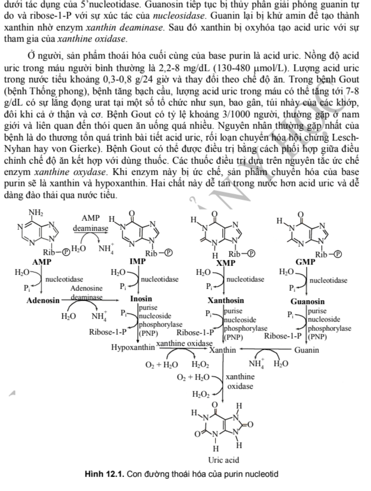
*Hình 12.1. Sơ đồ con đường thoái hóa Purin nucleotide tạo sản phẩm cuối cùng là Acid Uric.*

1. **Thoái hóa Adenylat (AMP):**
   - $\text{AMP}$ được khử phosphat thành **Adenosin**, sau đó khử amin nhờ enzym **Adenosine Deaminase (ADA)** thành **Inosin** (hoặc AMP bị khử amin trước thành $\text{IMP}$ rồi thành Inosin).
   - Inosin bị thủy phân cắt bỏ ribose nhờ enzym *purine nucleoside phosphorylase (PNP)* giải phóng base tự do là **Hypoxanthin**.
   - **Hypoxanthin** bị oxy hóa bởi enzym then chốt **Xanthin Oxidase** thành **Xanthin**.
2. **Thoái hóa Guanylat (GMP):**
   - $\text{GMP}$ được khử phosphat thành **Guanosin**, sau đó tách ribose giải phóng base **Guanin**.
   - Guanin bị khử amin bởi enzym *guanase (guanin deaminase)* để biến đổi thành **Xanthin**.
3. **Tạo Acid Uric:**
   - **Xanthin** tiếp tục bị enzym **Xanthin Oxidase** oxy hóa nấc thứ hai tạo thành **Acid Uric**.

#### Ý nghĩa lâm sàng và Bệnh Gút (Gout)
- Ở người và linh trưởng bậc cao, do thiếu enzym *urate oxidase (uricase)* nên **Acid Uric là sản phẩm thoái hóa cuối cùng của base purin**. (Ở các loài động vật có vú khác, acid uric tiếp tục bị thoái hóa thành allantoin tan tốt trong nước).
- **Nồng độ acid uric huyết thanh bình thường:**
  - Nam giới: $2{,}5 - 7{,}0\text{ mg/dL}$ ($150 - 420\text{ }\mu\text{mol/L}$).
  - Nữ giới: $1{,}5 - 6{,}0\text{ mg/dL}$ ($90 - 360\text{ }\mu\text{mol/L}$).
  - Lượng acid uric đào thải qua nước tiểu: $0{,}3 - 0{,}8\text{ g/24 giờ}$.
- **Bệnh Gút (Gout / Thống phong):**
  - Khi nồng độ acid uric trong máu tăng cao vượt quá giới hạn hòa tan ($> 7{,}0\text{ mg/dL}$ hay $> 420\text{ }\mu\text{mol/L}$), acid uric kết tinh dưới dạng các **tinh thể muối Natri Urat hình kim nhọn**.
  - Các tinh thể urat lắng đọng tại màng hoạt dịch khớp (đặc biệt là khớp ngón chân cái - khớp bàn ngón 1), kích hoạt bạch cầu đa nhân thực bào giải phóng các enzym tiêu thể gây ra cơn **viêm khớp gút cấp tính** dữ dội. Lắng đọng mạn tính tạo thành các **hạt tophi** dưới da quanh khớp làm biến dạng khớp và sỏi urat tại đường tiết niệu gây tổn thương thận gút.
- **Cơ chế tác dụng của thuốc Allopurinol:**
  - **Allopurinol** là chất có cấu trúc tương đồng (*analog*) với hypoxanthin. 
  - Allopurinol gắn vào trung tâm hoạt động của enzym **Xanthin Oxidase** và bị enzym này oxy hóa thành *Alloxanthin (Oxypurinol)*. Oxypurinol liên kết cực kỳ chặt chẽ làm **ức chế cạnh tranh bất thuận nghịch enzym Xanthin Oxidase**.
  - Khi xanthin oxidase bị ức chế, quá trình thoái hóa dừng lại ở mức **Hypoxanthin** và **Xanthin**. Hai chất này có độ hòa tan trong nước cao gấp nhiều lần so với acid uric nên dễ dàng đào thải ra ngoài theo nước tiểu mà không bị kết tinh.
  - Thuốc mới thế hệ sau: **Febuxostat** (chất ức chế chọn lọc không purin của xanthin oxidase).

---

### 1.3. Thoái hóa Pyrimidin Nucleotide

Khác với nhân purin bị oxy hóa tạo acid uric ít tan, nhân pyrimidin được mở vòng và thoái hóa bằng các phản ứng **khử** tạo ra các sản phẩm trung gian tan rất tốt trong nước:

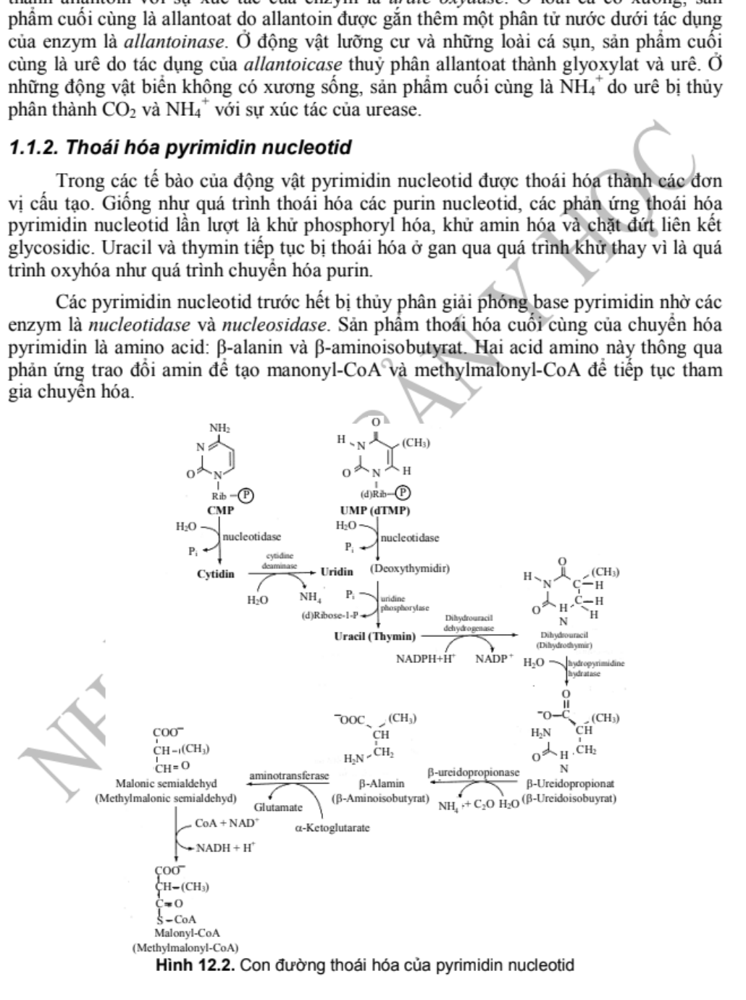
*Hình 12.2. Con đường thoái hóa Pyrimidin nucleotide thành $\beta$-Alanin và $\beta$-Aminoisobutyrat.*

- **Cytidin và Uridin (từ CMP và UMP):** Thoái hóa qua Uracil $\rightarrow$ Dihydrouracil $\rightarrow \beta$-Ureidopropionat $\rightarrow$ **$\beta$-Alanin** $+ \text{NH}_4^+ + \text{CO}_2$. $\beta$-Alanin sau đó trao đổi amin biến thành malonyl-CoA đi vào tổng hợp acid béo.
- **Deoxythymidin (từ dTMP):** Thoái hóa qua Thymin $\rightarrow$ Dihydrothymin $\rightarrow \beta$-Ureidoisobutyrat $\rightarrow$ **$\beta$-Aminoisobutyrat** $+ \text{NH}_4^+ + \text{CO}_2$. $\beta$-Aminoisobutyrat trao đổi amin biến thành methylmalonyl-CoA đi vào chu trình Krebs qua succinyl-CoA.
- Sự đào thải $\beta$-aminoisobutyrat tăng cao trong nước tiểu là dấu hiệu chỉ điểm sự phá hủy ồ ạt DNA (như trong xạ trị ung thư hoặc bệnh bạch cầu cấp).

---

### 1.4. Sinh tổng hợp Nucleotide

Tế bào tổng hợp nucleotide theo hai con đường: **Con đường tân tạo (*de novo synthesis*)** và **Con đường tái sử dụng (*salvage pathway*)**.

#### 1.4.1. Sinh tổng hợp Purin Ribonucleotide theo con đường Tân tạo (De Novo)
Nhân purin được xây dựng từng bước trực tiếp trên phân tử đường **$\alpha$-D-ribose-5-phosphat (PRPP)**:

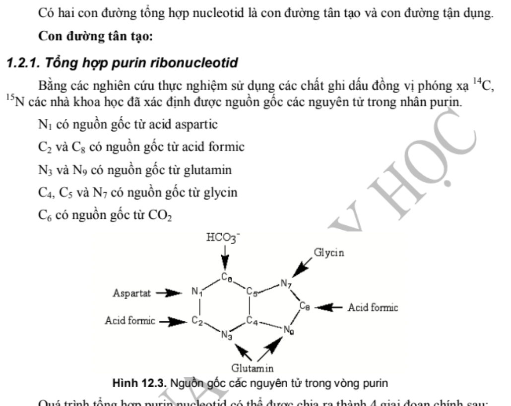
*Hình 12.3. Nguồn gốc các nguyên tử cấu thành nên khung dị vòng Purin.*

- **Nguồn gốc các nguyên tử trong vòng purin:**
  - $\text{N}1$: từ **Aspartat**.
  - $\text{C}2$ và $\text{C}8$: từ nhóm formyl của **$N^{10}\text{-formyl-tetrahydrofolat}$ (dẫn xuất Acid Folic)**.
  - $\text{N}3$ và $\text{N}9$: từ nhóm amid của **Glutamin**.
  - $\text{C}4, \text{C}5$ và $\text{N}7$: từ toàn bộ phân tử **Glycin**.
  - $\text{C}6$: từ **$\text{CO}_2$ ($\text{HCO}_3^-$)**.

Con đường gồm **11 phản ứng liên tiếp** để tạo thành nucleotide purin đầu tiên là **Inosin Monophosphat (IMP)** mang base hypoxanthin:

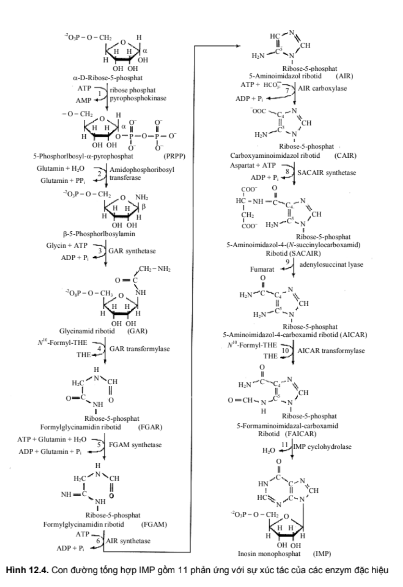
*Hình 12.4. Chuỗi 11 phản ứng sinh tổng hợp Inosin Monophosphat (IMP) từ PRPP.*

- **Phản ứng then chốt điều hòa:** Phản ứng 2, enzym **Glutamine:PRPP Amidotransferase** chuyển nhóm amino từ glutamin vào PRPP giải phóng $\text{PP}_i$ tạo $\beta$-5-phosphoribosylamin. Enzym này bị ức chế dị lập thể ngược bởi các sản phẩm cuối $\text{AMP, GMP, IMP}$.
- **Từ IMP tổng hợp thành AMP và GMP:**
  - **Tạo AMP:** IMP ngưng tụ với **Aspartat** (cần năng lượng **GTP**) nhờ enzym *adenylosuccinate synthetase*, sau đó tách fumarat nhờ *adenylosuccinate lyase* tạo **AMP**.
  - **Tạo GMP:** IMP bị oxy hóa nhờ *IMP dehydrogenase* (cần $\text{NAD}^+$) tạo XMP, sau đó nhận nhóm amino từ **Glutamin** (cần năng lượng **ATP**) nhờ enzym *GMP synthetase* tạo **GMP**.

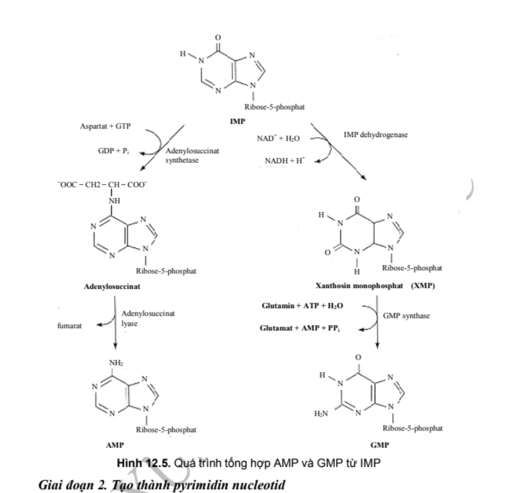
*Hình 12.5. Sự phân nhánh từ IMP tạo AMP (cần GTP) và GMP (cần ATP), thể hiện cơ chế kiểm soát cân bằng chéo giữa hai nhánh nucleotide purin.*

---

#### 1.4.2. Sinh tổng hợp Pyrimidin Ribonucleotide theo con đường Tân tạo (De Novo)
Khác với purin, **vòng pyrimidin 6 cạnh được tổng hợp hoàn chỉnh trước dưới dạng Orotat rồi mới gắn vào đường PRPP**:

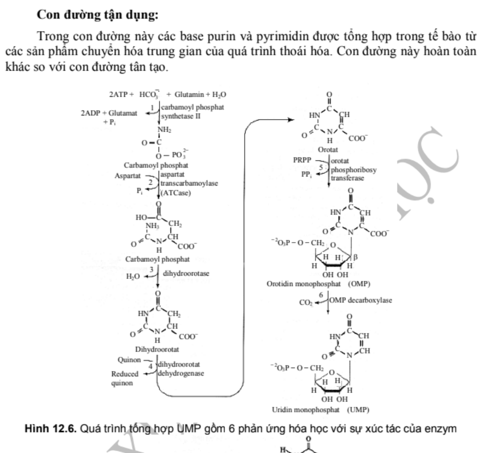
*Hình 12.6. Sơ đồ 6 phản ứng sinh tổng hợp Uridin Monophosphat (UMP).*

1. **Phản ứng 1 (Enzym then chốt):** Tổng hợp Carbamyl Phosphat ngoài **bào tương** từ Glutamin, $\text{HCO}_3^-$ và 2 ATP nhờ enzym **Carbamyl Phosphat Synthetase II (CPS-II)**. (Khác với CPS-I trong ty thể phục vụ chu trình urê).
2. **Phản ứng 2:** Ngưng tụ với **Aspartat** nhờ enzym *aspartate transcarbamoylase (ATCase)* tạo Carbamyl aspartat.
3. **Phản ứng 3 & 4:** Đóng vòng loại nước tạo Dihydroorotat, rồi bị oxy hóa nhờ *dihydroorotate dehydrogenase* (trên màng trong ty thể) tạo thành **Orotat**.
4. **Phản ứng 5:** Orotat gắn với **PRPP** nhờ enzym *orotate phosphoribosyltransferase (OPRT)* tạo **Orotidin Monophosphat (OMP)**.
5. **Phản ứng 6:** Khử carboxyl OMP nhờ *OMP decarboxylase* tạo thành **Uridin Monophosphat (UMP)**.

Từ UMP, các enzym kinase phosphoryl hóa thành $\text{UDP} \rightarrow \text{UTP}$. Sau đó enzym **CTP Synthetase** amin hóa UTP (nhận nhóm amin từ Glutamin, tiêu tốn ATP) tạo thành **Cytidin Triphosphat (CTP)**:

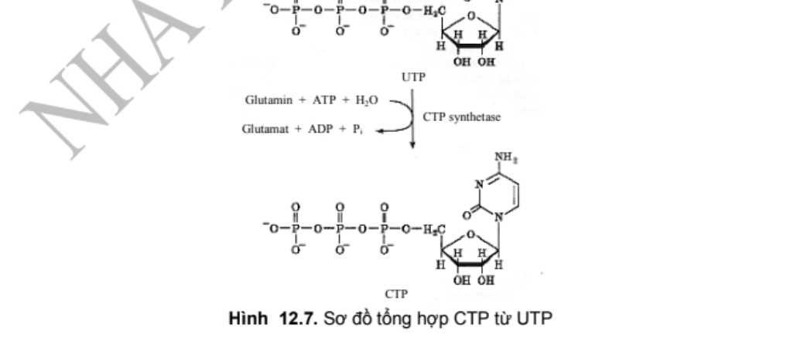
*Hình 12.7. Phản ứng amin hóa UTP tạo CTP nhờ CTP Synthetase.*

---

#### 1.4.3. Con đường Tái sử dụng Purin (Salvage Pathway) và Hội chứng Lesch-Nyhan
Con đường tái sử dụng cho phép tế bào tái gắn các base purin tự do giải phóng từ sự thoái hóa thức ăn hoặc acid nucleic nội sinh trực tiếp vào PRPP để tạo lại mononucleotide, tiết kiệm rất nhiều năng lượng ATP so với con đường tân tạo:
- **Enzym APRT (Adenine phosphoribosyltransferase):**
  $$\text{Adenin} + \text{PRPP} \longrightarrow \text{AMP} + \text{PP}_i$$
- **Enzym HGPRT (Hypoxanthine-guanine phosphoribosyltransferase):**
  $$\text{Hypoxanthin} + \text{PRPP} \longrightarrow \text{IMP} + \text{PP}_i$$
  $$\text{Guanin} + \text{PRPP} \longrightarrow \text{GMP} + \text{PP}_i$$

**Hội chứng Lesch-Nyhan:**
- Là bệnh di truyền lặn liên kết nhiễm sắc thể giới tính X do **đột biến thiếu hụt hoàn toàn enzym HGPRT**.
- Khi thiếu HGPRT, hypoxanthin và guanin không thể tái sử dụng mà bị đẩy toàn bộ vào thoái hóa tạo **acid uric tăng cực cao trong máu**, gây bệnh gút nặng ngay từ tuổi thiếu nhi, sỏi thận acid uric.
- Đồng thời nồng độ PRPP nội bào tăng vọt kích thích con đường tân tạo purin chạy mất kiểm soát.
- Bệnh nhân có các rối loạn thần kinh nghiêm trọng: co cứng, múa vờn, chậm phát triển trí tuệ và đặc biệt là **hành vi tự hủy hoại cơ thể một cách ám ảnh (tự cắn môi, lưỡi, ngón tay)**.

---

### 1.5. Sinh tổng hợp Deoxyribonucleotide (Tạo dNTP cho DNA)
Các deoxyribonucleotide không được tổng hợp mới từ đầu mà được tạo thành trực tiếp từ các ribonucleoside diphosphat ($\text{NDP: ADP, GDP, CDP, UDP}$) thông qua phản ứng **khử nhóm hydroxyl ở vị trí carbon $2'$ của đường ribose thành hydro ($-2'\text{-H}$)** nhờ phức hợp enzym **Ribonucleotide Reductase (RNR)** với chất cho hydro là protein nhỏ **Thioredoxin** (được hoàn nguyên bởi NADPH).

- Riêng **dTMP** (cho DNA) được tổng hợp từ **dUMP** thông qua phản ứng gắn nhóm methyl từ $N^5,N^{10}\text{-methylen-tetrahydrofolat}$ nhờ enzym **Thymidylate Synthase**. Đây là đích tác dụng then chốt của các thuốc chống ung thư kinh điển như **5-Fluorouracil (5-FU)** và chất ức chế folate reductase **Methotrexat (MTX)**.

---

## 2. CHUYỂN HÓA VẬT CHẤT DI TRUYỀN: TÁI BẢN DNA (REPLICATION)

Học thuyết trung tâm của sinh học phân tử (*Central Dogma*) mô tả dòng chảy thông tin di truyền: **DNA $\xrightarrow{\text{Tái bản}}$ DNA $\xrightarrow{\text{Phiên mã}}$ RNA $\xrightarrow{\text{Dịch mã}}$ Protein** (kèm theo con đường *phiên mã ngược* từ RNA sang DNA ở retrovirus):

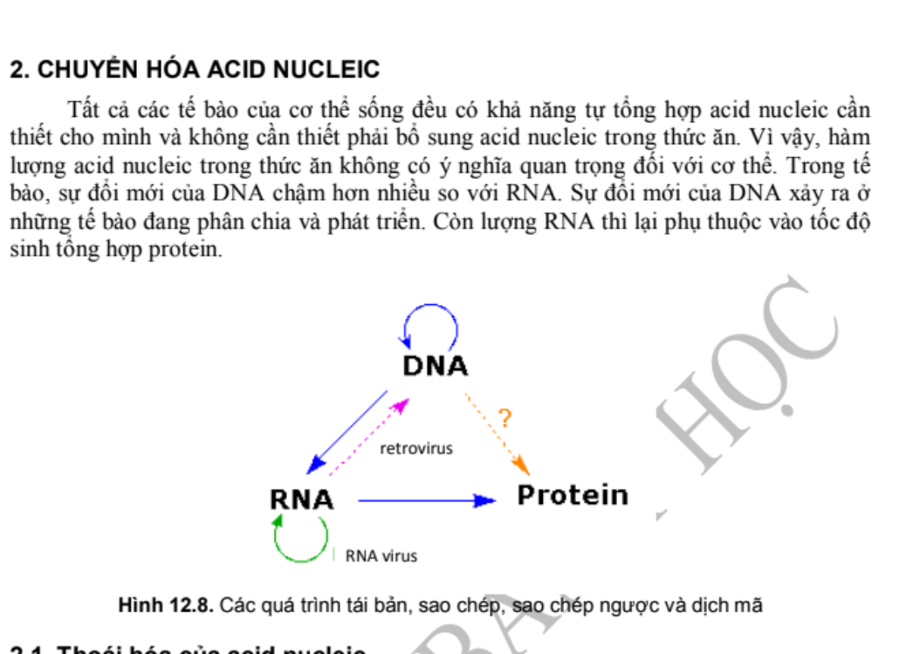
*Hình 12.8. Sơ đồ dòng truyền đạt thông tin di truyền.*

### 2.1. Quá trình Tái bản DNA (DNA Replication)

Quá trình tái bản DNA diễn ra theo cơ chế **bán bảo tồn (*semiconservative*)** (mỗi phân tử DNA con gồm 1 sợi cũ của mẹ và 1 sợi mới tổng hợp) và luôn luôn diễn ra theo chiều **$5' \rightarrow 3'$** (tức là đầu $3'\text{-OH}$ tự do là nơi kéo dài chuỗi):

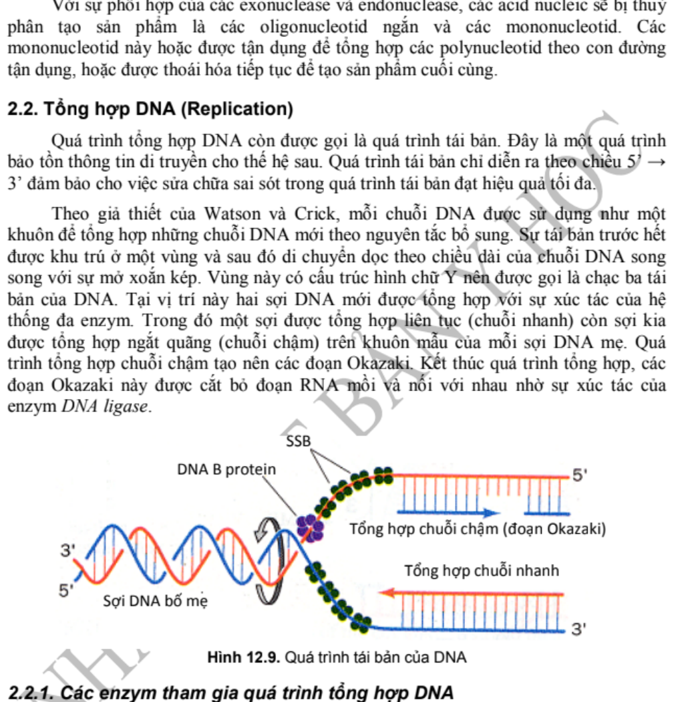
*Hình 12.9. Sơ đồ cơ chế phân tử tại chạc ba tái bản DNA: tổng hợp sợi nhanh liên tục và sợi chậm gián đoạn (đoạn Okazaki).*

#### Các thành phần enzym và protein tham gia chạc ba tái bản:
1. **DNA Helicase (DnaB protein):** Di chuyển dọc sợi khuôn sử dụng năng lượng thủy phân ATP để tách đứt các liên kết hydro, mở xoắn chuỗi kép DNA.
2. **Protein SSB (Single-Strand Binding protein):** Bám vào các sợi đơn DNA vừa tách ra để ngăn chúng liên kết bổ sung hồi tính trở lại.
3. **DNA Topoisomerase (DNA Gyrase ở vi khuẩn):** Cắt và nối lại liên kết phosphodiester phía trước chạc ba tái bản để giải phóng ứng suất xoắn vặn siêu xoắn do helicase gây ra.
4. **DNA Primase:** Enzym RNA polymerase tổng hợp các đoạn mồi RNA ngắn (khoảng 10 nucleotide) cung cấp đầu $3'\text{-OH}$ tự do cho DNA polymerase bắt đầu kéo dài.
5. **DNA Polymerase III (ở E. coli):** Enzym chính xúc tác kéo dài chuỗi DNA với tốc độ cao và có hoạt tính sửa sai đọc duyệt $3' \rightarrow 5'$ exonuclease.
6. **DNA Polymerase I:** Có hoạt tính $5' \rightarrow 3'$ exonuclease cắt bỏ đoạn mồi RNA và lấp đầy khoảng trống bằng các deoxyribonucleotide.
7. **DNA Ligase:** Nối liền các đứt gãy phosphodiester giữa các đoạn Okazaki tạo thành chuỗi polynucleotid liên tục.

- **Sợi dẫn đầu / Sợi nhanh (*Leading strand*):** Được tổng hợp liên tục theo chiều $5' \rightarrow 3'$ cùng hướng với sự di chuyển của chạc ba tái bản (chỉ cần 1 đoạn mồi RNA duy nhất).
- **Sợi đi sau / Sợi chậm (*Lagging strand*):** Được tổng hợp gián đoạn ngược chiều di chuyển của chạc ba tái bản tạo thành các đoạn ngắn gọi là **đoạn Okazaki** (mỗi đoạn cần một đoạn mồi RNA riêng biệt).

<!-- END FILE: pages_246_255.md -->

<!-- BEGIN FILE: pages_256_265.md -->

# CHƯƠNG 12 (TIẾP THEO): TÁI BẢN DNA, SỬA CHỮA DNA VÀ PHIÊN MÃ RNA

---

## 2. CHUYỂN HÓA VẬT CHẤT DI TRUYỀN (TIẾP THEO)

### 2.2. Cơ chế Tái bản DNA ở Vi khuẩn (E. coli) và Sinh vật bậc cao

#### 2.2.1. Các Enzym và Protein tham gia Tái bản DNA

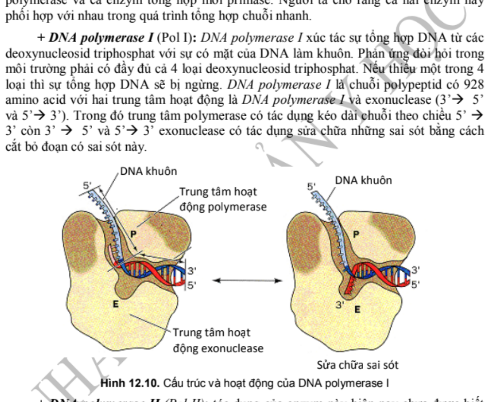
*Hình 12.10. Cấu trúc phân tử và hai trung tâm xúc tác của DNA Polymerase I: trung tâm polymerase kéo dài chuỗi và trung tâm exonuclease sửa sai.*

- **DNA Gyrase (Topoisomerase II):** Ngăn chặn hiện tượng xoắn vặn quá mức phía trước chạc ba tái bản. Các kháng sinh nhóm quinolon (như *ciprofloxacin, acid oxolinic*) và *novobiocin* ức chế đặc hiệu DNA gyrase của vi khuẩn, được ứng dụng làm thuốc kháng khuẩn mạnh.
- **DNA Primase (DnaG protein):** Thuộc nhóm RNA polymerase, xúc tác tổng hợp đoạn mồi RNA ngắn ($10 - 60$ nucleotide) cung cấp đầu $3'\text{-OH}$ tự do cho DNA polymerase.
- **DNA Polymerase I (Pol I):** Chuỗi đơn polypeptid gồm 928 acid amin có 3 hoạt tính xúc tác độc lập:
  1. *Hoạt tính $5' \rightarrow 3'$ polymerase:* kéo dài chuỗi DNA lấp khoảng trống.
  2. *Hoạt tính $3' \rightarrow 5'$ exonuclease:* cắt lùi sửa sai khi bắt cặp nhầm base.
  3. *Hoạt tính $5' \rightarrow 3'$ exonuclease (duy nhất ở Pol I):* cắt bỏ đoạn mồi RNA phía trước.
- **DNA Polymerase III (Pol III):** Là holoenzym đa tiểu đơn vị khổng lồ (phức hợp gồm 13 tiểu đơn vị), đóng vai trò enzym chủ đạo kéo dài cả sợi nhanh và sợi chậm với tốc độ cực cao (khoảng 1.000 nucleotide/giây) và có hoạt tính đọc duyệt sửa sai $3' \rightarrow 5'$ exonuclease.
- **DNA Ligase:** Xúc tác tạo liên kết phosphodiester nối đầu $3'\text{-OH}$ của đoạn Okazaki trước với đầu $5'\text{-phosphat}$ của đoạn sau (sử dụng năng lượng từ $\text{NAD}^+$ ở vi khuẩn hoặc ATP ở tế bào nhân thực).

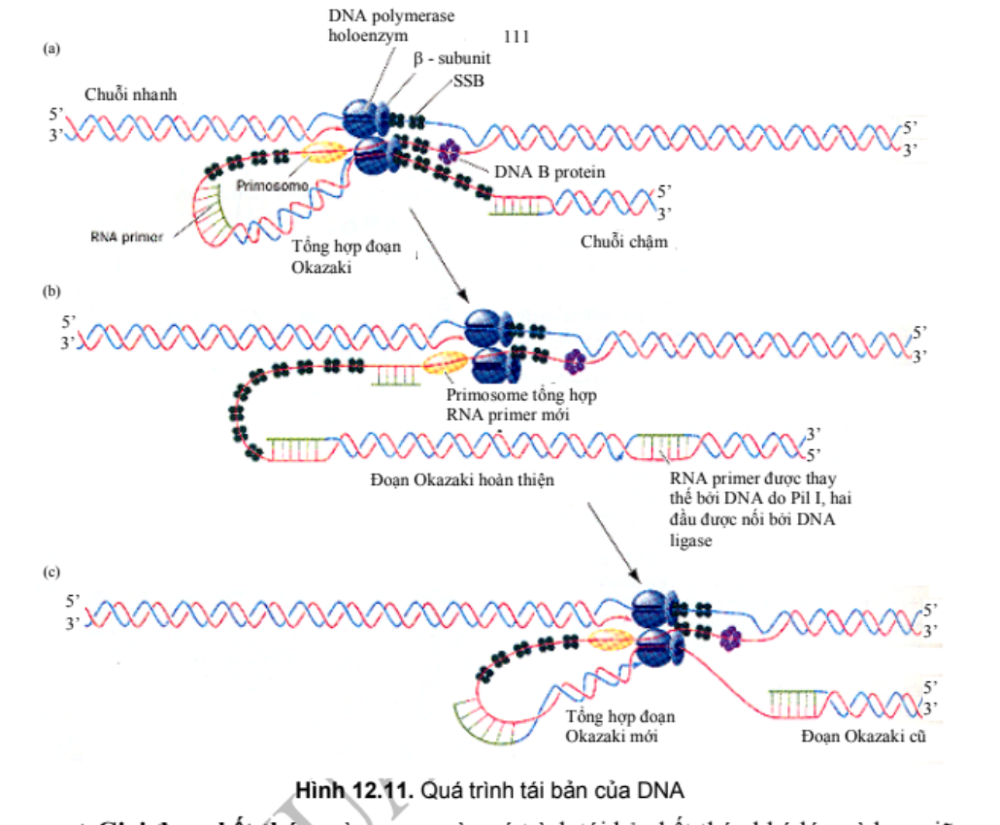
*Hình 12.11. Sơ đồ phối hợp đồng thời của Holoenzym DNA Polymerase III kéo dài sợi nhanh và sợi chậm tại chạc ba tái bản.*

---

### 2.3. Vấn đề Đầu mút Nhiễm sắc thể và Enzym Telomerase ở Eukaryote

- Ở tế bào nhân thực, phân tử DNA ở dạng sợi kép thẳng (không vòng kín như vi khuẩn). Khi tái bản sợi chậm, sau khi đoạn mồi RNA ở đầu mút tận cùng bị cắt bỏ, DNA polymerase không thể lấp đầy khoảng trống vì thiếu đầu $3'\text{-OH}$ mồi phía trước (**Vấn đề tái bản đầu mút - *End-replication problem***). Hậu quả là sau mỗi chu kỳ phân bào, phân tử DNA bị ngắn dần lại ở hai đầu mút telomere.
- **Cấu trúc Telomere:** Đầu mút nhiễm sắc thể được bảo vệ bởi trình tự lặp lại hàng nghìn lần giàu Guanin: **$5'\text{-TTAGGG-}3'$** (ở người) liên kết với phức hợp protein shelterin.
- **Enzym Telomerase:** 
  - Là một phức hợp ribonucleoprotein đặc biệt mang hoạt tính **phiên mã ngược (TERT - Telomerase Reverse Transcriptase)** kết hợp sẵn với một phân tử RNA nội sinh (TERC) đóng vai trò làm khuôn mẫu ($3'\text{-AAUCCC-}5'$).
  - Telomerase sử dụng khuôn RNA này để kéo dài sợi telomere của đầu mút DNA, giải quyết triệt để sự ngắn lại của nhiễm sắc thể.
  - *Ý nghĩa sinh học và y học:* Telomerase hoạt động mạnh ở tế bào mầm sinh dục, tế bào gốc và **hơn $85 - 90\%$ các tế bào ung thư** (giúp tế bào ung thư đạt khả năng bất tử phân chia vô hạn). Ở tế bào sinh dưỡng bình thường, telomerase bị tắt, telomere ngắn dần theo tuổi tác kích hoạt cơ chế lão hóa và chết theo chương trình (*apoptosis*).

---

### 2.4. Các Cơ chế Sửa chữa Tổn thương DNA (DNA Repair)

Tế bào sở hữu các hệ thống sửa sai tinh vi để bảo tồn tính toàn vẹn của bộ gen:
1. **Sửa sai ghép cặp lệch (Mismatch Repair - MMR):** Nhận diện và thay thế các base bắt cặp sai sót thoát khỏi sự kiểm duyệt của DNA polymerase trong quá trình tái bản. Đột biến gen MMR (MLH1, MSH2) gây **Hội chứng Lynch (ung thư đại trực tràng di truyền không polyp - HNPCC)**.
2. **Sửa sai cắt bỏ Base (Base Excision Repair - BER):** Enzym *DNA Glycosylase* nhận diện và cắt bỏ các base bị biến đổi hóa học (như uracil do khử amin cytosin, 8-oxoguanin do oxy hóa) tạo vị trí AP (apurinic/apyrimidinic). Sau đó AP endonuclease cắt khung đường, DNA pol và ligase lấp kín.
3. **Sửa sai cắt bỏ Nucleotide (Nucleotide Excision Repair - NER):** Nhận diện và cắt bỏ các tổn thương lớn làm biến dạng cấu trúc xoắn kép, đặc biệt là **dime thymin ($\text{T-T}$)** do tác động của tia tử ngoại (UV). Phức hợp excinuclease cắt một đoạn gồm 24 - 32 nucleotide chứa tổn thương, sau đó DNA pol và ligase tái tổng hợp.

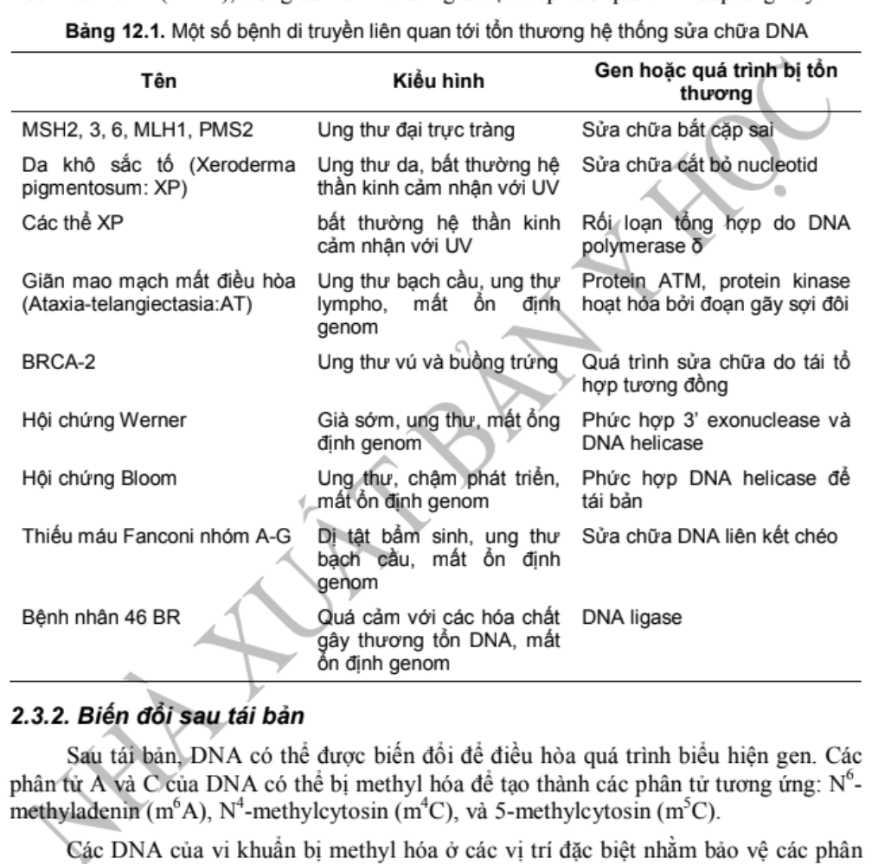
*Bảng 12.1. Các bệnh lý di truyền do đột biến khuyết tật các hệ thống sửa chữa DNA ở người.*

- **Bệnh Khô da sắc tố (*Xeroderma Pigmentosum - XP*):** Do đột biến gen của hệ thống sửa sai cắt bỏ nucleotide (NER). Bệnh nhân cực kỳ nhạy cảm với ánh sáng mặt trời, da bị bỏng loét, tàn nhang dày đặc và tăng nguy cơ ung thư da lên gấp hơn 1.000 lần trước 20 tuổi.
- **Hội chứng Ataxia Telangiectasia:** Đột biến gen ATM tham gia phát hiện đứt gãy DNA sợi kép.

---

### 2.5. Biến đổi Biểu sinh (Epigenetics): Methyl hóa DNA

Biến đổi biểu sinh là những biến đổi hóa học trên chromatin làm thay đổi mức độ biểu hiện gen mà **không làm thay đổi trình tự nucleotide của DNA**:

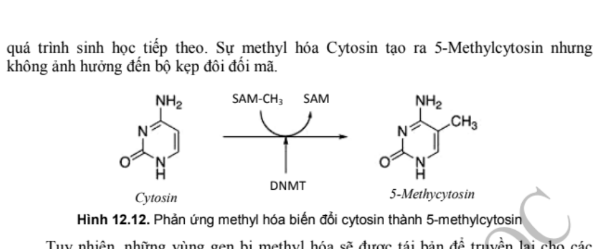
*Hình 12.12. Phản ứng methyl hóa vị trí C5 của vòng Cytosin nhờ enzym DNA Methyltransferase (DNMT) sử dụng SAM.*

- Enzym **DNA Methyltransferase (DNMT)** chuyển nhóm methyl từ S-adenosylmethionin (SAM) gắn vào carbon C5 của Cytosin tại các đảo CpG tạo thành **5-Methylcytosin**.
- **Ý nghĩa:** Sự tăng methyl hóa (hypermethylation) tại vùng khởi động (promoter) của gen sẽ làm bất hoạt, "tắt" sự biểu hiện của gen đó (ví dụ bất hoạt nhiễm sắc thể X ở phụ nữ, khóa các gen ức chế khối u trong ung thư). Ngược lại, acetyl hóa histon làm giãn chromatin kích hoạt phiên mã.

---

## 3. QUÁ TRÌNH PHIÊN MÃ (TRANSCRIPTION - SINH TỔNG HỢP RNA)

Phiên mã là quá trình tổng hợp các phân tử RNA dựa trên khuôn mẫu của một mạch đơn DNA, xúc tác bởi enzym **RNA Polymerase (phụ thuộc DNA)**:
- **Đặc điểm cơ bản:**
  - Không cần đoạn mồi (khác với DNA polymerase).
  - Di chuyển dọc sợi khuôn theo chiều $3' \rightarrow 5'$ và kéo dài chuỗi RNA theo chiều **$5' \rightarrow 3'$**.
  - Sử dụng 4 loại ribonucleoside triphosphat ($\text{ATP, GTP, CTP, UTP}$) theo nguyên tắc bổ sung: $\text{A}_{\text{DNA}} \rightarrow \text{U}_{\text{RNA}}$, $\text{T}_{\text{DNA}} \rightarrow \text{A}_{\text{RNA}}$, $\text{G}_{\text{DNA}} \rightarrow \text{C}_{\text{RNA}}$, $\text{C}_{\text{DNA}} \rightarrow \text{G}_{\text{RNA}}$.

---

### 3.1. Các Enzym RNA Polymerase

- **Ở vi khuẩn (Prokaryote):** Chỉ có một loại RNA Polymerase duy nhất tổng hợp mọi loại RNA. Gồm lõi xúc tác $\alpha_2\beta\beta'\omega$ kết hợp với **yếu tố $\sigma$ (sigma)** để nhận diện chính xác vùng khởi động (Promoter: hộp $-10$ Pribnow $\text{TATAAT}$ và hộp $-35$ $\text{TTGACA}$).
- **Ở tế bào nhân chuẩn (Eukaryote):** Có 3 loại RNA Polymerase phân bố chuyên biệt trong nhân:
  1. **RNA Polymerase I:** Nằm ở hạch nhân, tổng hợp tiền chất pre-rRNA $45\text{S}$ (cho rRNA 28S, 18S, 5,8S).
  2. **RNA Polymerase II:** Nằm trong dịch nhân, tổng hợp toàn bộ **mRNA** và hầu hết snRNA, miRNA. Rất nhạy cảm bị ức chế bởi độc tố nấm $\alpha$-amanitin.
  3. **RNA Polymerase III:** Nằm trong dịch nhân, tổng hợp **tRNA** và **rRNA 5S**.

---

### 3.2. Các Giai đoạn của Quá trình Phiên mã

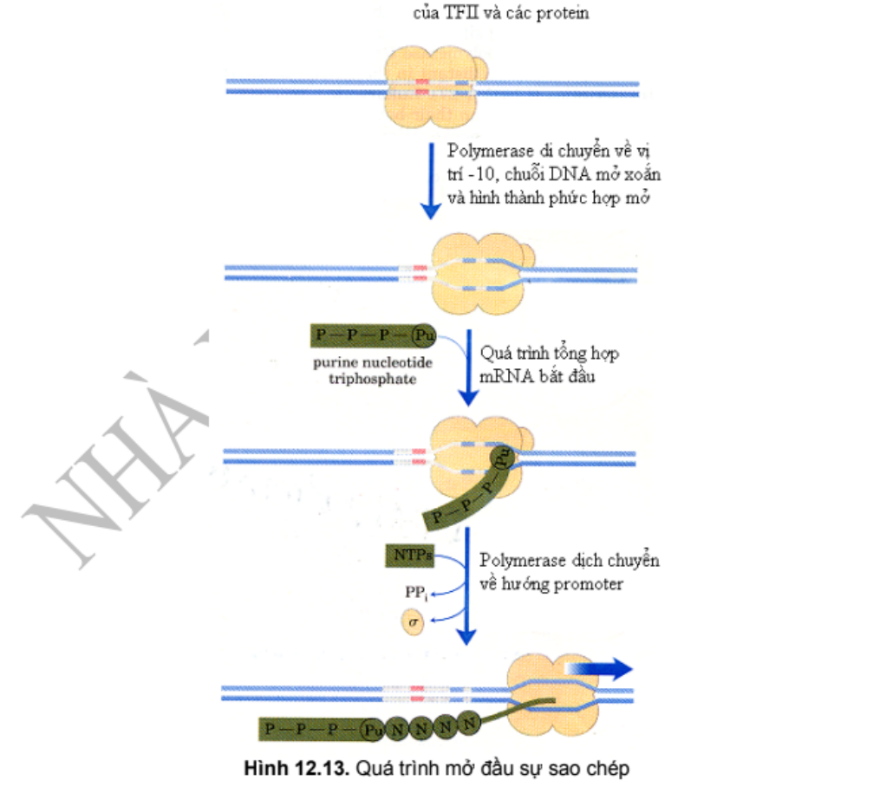
*Hình 12.13. Các giai đoạn mở đầu phiên mã: nhận diện promoter, tháo xoắn tạo bọt phiên mã và bắt đầu tổng hợp chuỗi RNA.*

1. **Giai đoạn Mở đầu (*Initiation*):**
   - RNA polymerase nhận diện và gắn vào vùng **Promoter** (nhờ yếu tố $\sigma$ ở vi khuẩn hoặc các yếu tố phiên mã chung TFIID, TFIIB, TATA-binding protein TBP ở eukaryote).
   - Tháo xoắn khoảng $14$ cặp base tạo thành "bọt phiên mã" (*transcription bubble*) và bắt đầu gắn nucleotide đầu tiên (thường là ATP hoặc GTP).
2. **Giai đoạn Kéo dài (*Elongation*):**
   - Yếu tố $\sigma$ tách rời, lõi enzym trượt dọc sợi khuôn kéo dài chuỗi RNA với tốc độ $40 - 50$ nucleotide/giây. Sợi DNA phía sau lập tức đóng xoắn kép trở lại đẩy chuỗi RNA đơn bung ra.
3. **Giai đoạn Kết thúc (*Termination*):**
   - **Kết thúc không phụ thuộc Rho (*Intrinsic / Rho-independent*):** Gặp đoạn trình tự đối xứng giàu G-C tự gập lại thành cấu trúc kẹp tóc (*hairpin loop*) theo sau bởi một dãy liên tiếp các gốc Uracil ($\text{U-U-U-U}$). Cặp lai $\text{rU-dA}$ quá yếu làm phân tử RNA tự tách khỏi khuôn DNA.
   - **Kết thúc phụ thuộc protein Rho (*Rho-dependent*):** Protein Rho trượt theo chuỗi RNA đuổi theo RNA polymerase và dùng hoạt tính helicase tháo tách chuỗi RNA khỏi khuôn DNA.

---

### 3.3. Quá trình Hoàn thiện (Chế bản) mRNA ở Tế bào Nhân thực

Phân tử $\text{mRNA}$ sơ khai (*pre-mRNA*) mới được tổng hợp trong nhân phải trải qua 3 biến đổi chế bản quan trọng trước khi xuất ra bào tương dịch mã:

1. **Gắn mũ $7\text{-Methylguanosin}$ ($m^7\text{G}$) ở đầu $5'$ (*5' Capping*):** Gắn một phân tử GTP theo liên kết bất thường $5'\text{-}5'$ triphosphat rồi methyl hóa vị trí N7 của guanin. Mũ $5'$ bảo vệ $\text{mRNA}$ khỏi sự thoái hóa của exonuclease và là tín hiệu nhận diện để gắn vào ribosom khi bắt đầu dịch mã.
2. **Gắn đuôi Poly(A) ở đầu $3'$ (*3' Polyadenylation*):** Sau khi nhận diện tín hiệu kết thúc phiên mã $\text{AAUAAA}$, enzym endonuclease cắt đầu $3'$, rồi enzym **Poly(A) Polymerase** gắn liên tiếp $100 - 250$ gốc adenylat ($\text{AMP}$) mà không cần khuôn mẫu. Đuôi Poly(A) giúp bảo vệ phân tử $\text{mRNA}$ và hỗ trợ vận chuyển qua màng nhân ra bào tương.
3. **Quá trình Cắt nối RNA (*RNA Splicing*):**
   - Gen ở eukaryote có cấu trúc phân mảnh gồm các đoạn mang mã di truyền (**Exon**) xen kẽ các đoạn không mã hóa (**Intron**).
   - Phức hợp **Spliceosome** (tạo bởi các snRNA U1, U2, U4, U5, U6 kết hợp với protein) nhận diện chính xác các vị trí cắt nối ở đầu $5'$ (rãnh $\text{GU}$) và đầu $3'$ (rãnh $\text{AG}$) của intron, uốn cong intron thành dạng dây thòng lọng (*lariat structure*), cắt bỏ intron và nối liền các exon lại với nhau thành phân tử $\text{mRNA}$ trưởng thành hoàn chỉnh.
   - **Hiện tượng Cắt nối chọn lọc (*Alternative Splicing*):** Từ một pre-mRNA ban đầu, các exon có thể được ghép nối theo nhiều tổ hợp khác nhau để tạo ra nhiều phân tử $\text{mRNA}$ và chuỗi polypeptid khác nhau tùy theo loại mô hoặc giai đoạn phát triển (ví dụ gen mã hóa calcitonin ở tuyến giáp và CGRP ở não).
4. **Biến đổi mã di truyền nội phân tử (*RNA Editing*):** Làm thay đổi một số base trên mRNA đã phiên mã (ví dụ khử amin cytosin thành uracil biến codon CAA thành codon kết thúc UAA trên mRNA của Apolipoprotein B ở ruột, tạo ra ApoB-48 ngắn hơn ApoB-100 ở gan).

<!-- END FILE: pages_256_265.md -->

<!-- BEGIN FILE: pages_266_275.md -->