# CHƯƠNG 13: HÓA SINH HORMON (NỘI TIẾT)

---

## TỔNG KẾT VÀ CÂU HỎI ÔN TẬP CHƯƠNG 12: CHUYỂN HÓA ACID NUCLEIC

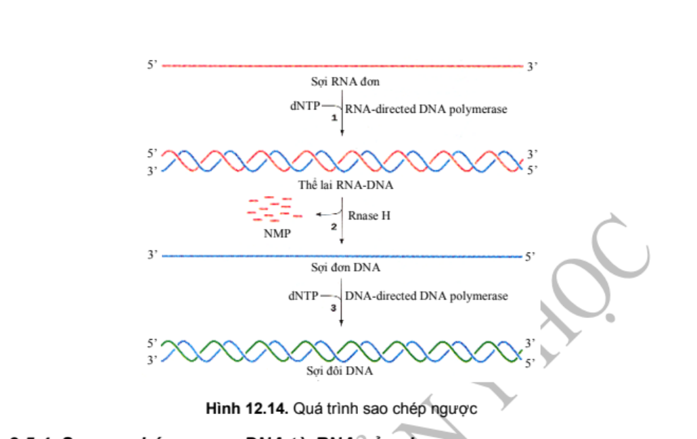
*Hình 12.14. Quá trình sao chép ngược tổng hợp DNA từ khuôn mẫu RNA của Retrovirus.*

- **Cơ chế sao chép ngược:** Ở các Retrovirus (như virus gây suy giảm miễn dịch ở người HIV, HTLV), vật chất di truyền là RNA sợi đơn. Khi xâm nhập vào tế bào vật chủ, enzym **Reverse Transcriptase (RNA-directed DNA polymerase)** xúc tác tổng hợp sợi đơn DNA bổ sung tạo thể lai $\text{RNA-DNA}$, sau đó enzym **RNase H** phân giải sợi RNA, và enzym tổng hợp tiếp sợi DNA thứ hai tạo chuỗi xoắn kép DNA (*cDNA*). Phân tử DNA này tích hợp vào bộ gen của tế bào chủ nhờ enzym *integrase*. Thuốc điều trị kháng retrovirus kinh điển như **AZT (Zidovudin)** là chất tương đồng dideoxynucleotide ức chế chuỗi phiên mã ngược.

### Câu hỏi ôn tập Chương 12
1. Trình bày quá trình sinh tổng hợp purin ribonucleotide theo con đường tân tạo (de novo).
2. Trình bày quá trình sinh tổng hợp pyrimidin ribonucleotide theo con đường tân tạo.
3. Trình bày con đường thoái hóa của purin nucleotide tạo acid uric và cơ chế bệnh sinh của bệnh Gút.
4. Trình bày con đường thoái hóa của pyrimidin nucleotide.
5. Liệt kê các enzym và protein tham gia vào chạc ba tái bản DNA.
6. Trình bày các giai đoạn của quá trình tái bản bán bảo tồn của DNA.
7. Trình bày các cơ chế sửa chữa tổn thương DNA (MMR, BER, NER) và các bệnh lý di truyền liên quan.
8. Trình bày các giai đoạn của quá trình phiên mã (sao chép RNA).
9. Trình bày quá trình hoàn thiện (chế bản) phân tử mRNA ở sinh vật nhân chuẩn.

---

# BẮT ĐẦU CHƯƠNG 13: HÓA SINH HORMON

## MỤC TIÊU HỌC TẬP
1. Trình bày được định nghĩa, phân loại hóa học và cơ chế tác dụng chung của hormon.
2. Trình bày được cấu tạo và tác dụng của các hormon có bản chất peptid và protein của một số tuyến nội tiết chính trong cơ thể.
3. Trình bày bằng sơ đồ (kèm công thức hóa học) quá trình sinh tổng hợp, tác dụng và thoái hóa của hormon tủy thượng thận và hormon tuyến giáp.
4. Nêu tên và cấu tạo hóa học của các hormon steroid đại diện cho tuyến vỏ thượng thận, tuyến sinh dục nữ và tuyến sinh dục nam.

---

## 1. ĐẠI CƯƠNG VỀ HÓA SINH HORMON

Hormon là những chất truyền tin hóa học hữu cơ được sản xuất và bài tiết với **nồng độ cực kỳ nhỏ** (ở mức nanogam $10^{-9}\text{ g}$ hoặc picogam $10^{-12}\text{ g}$) bởi các tế bào chuyên biệt của **tuyến nội tiết**. Hormon được bài tiết trực tiếp vào dòng máu tuần hoàn và vận chuyển tới các cơ quan, mô đích (*target tissues*) nằm xa nơi sản xuất. Tại cơ quan đích, hormon gắn đặc hiệu với các **thụ thể (Receptors)** tương ứng để gây ra các đáp ứng sinh học, điều hòa các chuyển hóa và duy trì sự hằng định nội môi (*homeostasis*).

### 1.1. Các phương thức truyền tín hiệu giữa các tế bào

Dựa vào khoảng cách từ vị trí bài tiết đến tế bào đích, các chất tín hiệu hóa học ngoại bào được phân chia thành 3 phương thức chính:

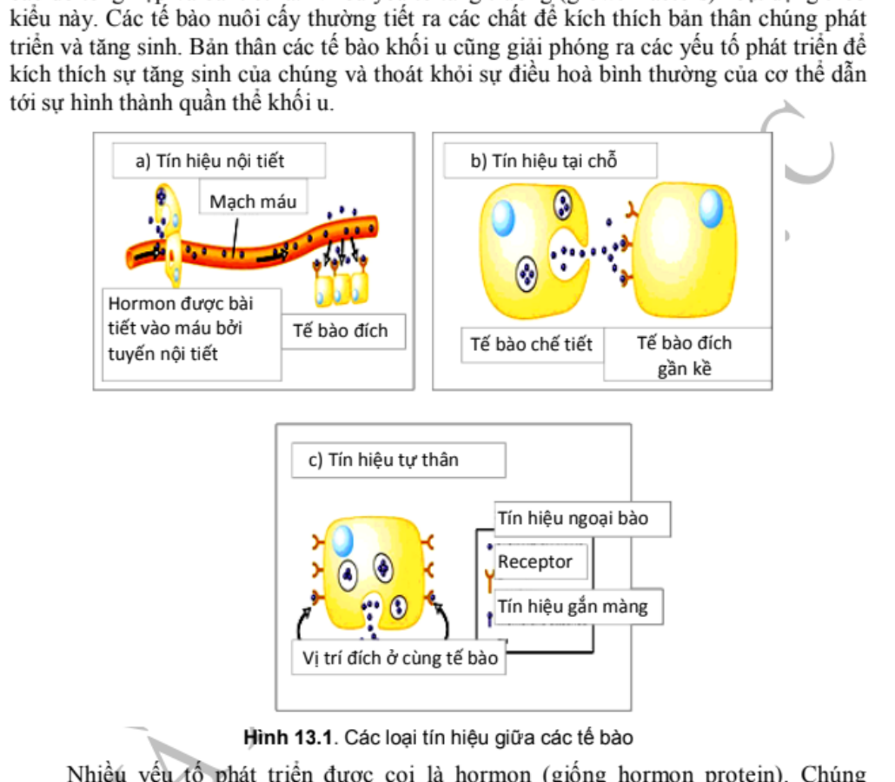
*Hình 13.1. Ba phương thức truyền tín hiệu giữa các tế bào trong cơ thể: Tín hiệu nội tiết (Endocrine), Tín hiệu cận tiết (Paracrine) và Tín hiệu tự tiết (Autocrine).*

1. **Tín hiệu Nội tiết (*Endocrine signaling*):** Hormon được bài tiết vào dòng máu tuần hoàn và tác động lên các tế bào đích nằm ở khoảng cách rất xa trong cơ thể (ví dụ: insulin từ tụy tác động lên tế bào cơ, mỡ và gan).
2. **Tín hiệu Cận tiết (*Paracrine signaling*):** Chất tín hiệu được khuếch tán vào dịch gian bào và tác động trực tiếp lên các **tế bào lân cận ngay gần kề** nơi sản xuất (ví dụ: các chất dẫn truyền thần kinh tại synap, histamin, prostaglandin).
3. **Tín hiệu Tự tiết (*Autocrine signaling*):** Tế bào đáp ứng với chính các chất tín hiệu do bản thân tế bào đó bài tiết ra (ví dụ: các yếu tố tăng trưởng kích thích tăng sinh của chính tế bào ung thư, interleukin-2 tự kích hoạt tế bào lympho T).

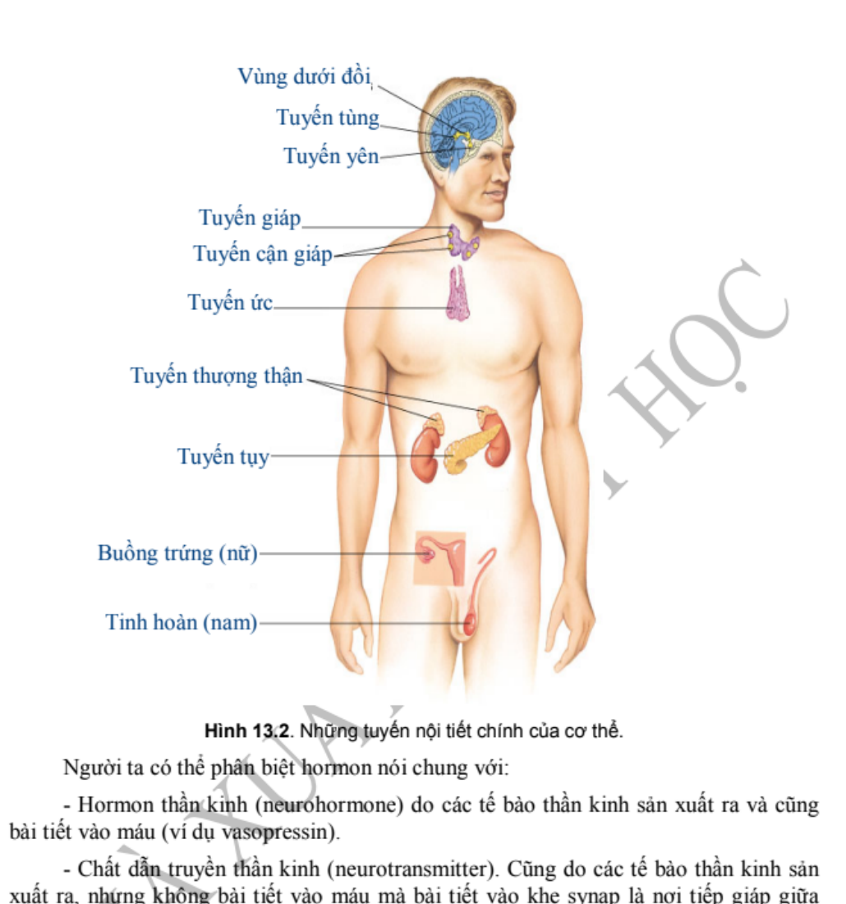
*Hình 13.2. Sơ đồ giải phẫu vị trí các tuyến nội tiết chính ở cơ thể người.*

---

### 1.2. Phân loại Hóa học của Hormon

Dựa vào cấu trúc hóa học và tính chất hòa tan, hormon được chia thành 3 nhóm lớn:

#### A. Hormon Peptid và Protein
- **Nguồn gốc:** Được tổng hợp từ vùng dưới đồi (TRH, GnRH, CRH, GHRH, Somatostatin), thùy trước tuyến yên (GH, TSH, ACTH, FSH, LH, Prolactin), thùy sau tuyến yên (Oxytocin, Vasopressin/ADH), tuyến tụy nội tiết (Insulin, Glucagon), tuyến cận giáp (PTH) và tế bào C tuyến giáp (Calcitonin).
- **Đặc điểm lý hóa:** **Tan tốt trong nước, không tan trong lipid**. Được tổng hợp dưới dạng tiền chất lớn (*preprohormone $\rightarrow$ prohormone*) rồi đóng gói tích trữ sẵn trong các bóng chế tiết ở bào tương.
- Lưu hành tự do trong huyết tương (không cần protein mang). Thời gian bán hủy trong máu ngắn (từ vài phút đến dưới một giờ).
- **Thụ thể:** Do không đi qua được lớp màng kép phospholipid của tế bào, thụ thể của chúng **bắt buộc phải nằm trên bề mặt màng tế bào**.

#### B. Hormon Dẫn xuất Acid Amin
- **Dẫn xuất từ Tyrosin:**
  - **Catecholamin (Adrenalin và Noradrenalin):** Do tủy thượng thận bài tiết. Tan trong nước, gắn thụ thể màng, thời gian bán hủy cực ngắn ($1 - 2\text{ phút}$).
  - **Hormon tuyến giáp ($T_3$ - Triiodothyronin và $T_4$ - Thyroxin):** Tan trong lipid, vận chuyển trong máu nhờ gắn chặt với protein mang (TBG - Thyroxine-Binding Globulin), gắn với **thụ thể nội bào trong nhân tế bào**, thời gian bán hủy dài (nhiều ngày).

#### C. Hormon Steroid
- **Nguồn gốc:** Do vỏ thượng thận (Cortisol, Aldosteron, DHEA) và các tuyến sinh dục (Testosteron ở tinh hoàn; Estrogen, Progesteron ở buồng trứng) sản xuất từ tiền chất **Cholesterol**.
- **Đặc điểm lý hóa:** **Tan trong lipid, không tan trong nước**. Không tích trữ trong các bóng chế tiết mà khuếch tán tự do qua màng tế bào vào máu ngay sau khi tổng hợp.
- Vận chuyển trong máu nhờ liên kết với các protein huyết tương đặc hiệu (như CBG/transcortin gắn cortisol, SHBG gắn steroid sinh dục, albumin). Chỉ một tỷ lệ nhỏ ($1 - 5\%$) ở dạng tự do có hoạt tính sinh học. Thời gian bán hủy kéo dài ($30 - 90\text{ phút}$).
- **Thụ thể:** Dễ dàng khuếch tán qua màng tế bào để gắn với **thụ thể nội bào (trong bào tương hoặc trong nhân)**.

---

## 2. CƠ CHẾ TÁC DỤNG PHÂN TỬ CỦA HORMON

### 2.1. Cơ chế Tác dụng của Hormon Tan trong Lipid (Hormon Steroid và Hormon Tuyến giáp)

Hormon steroid và hormon tuyến giáp hoạt động như **những yếu tố điều hòa phiên mã trực tiếp**:

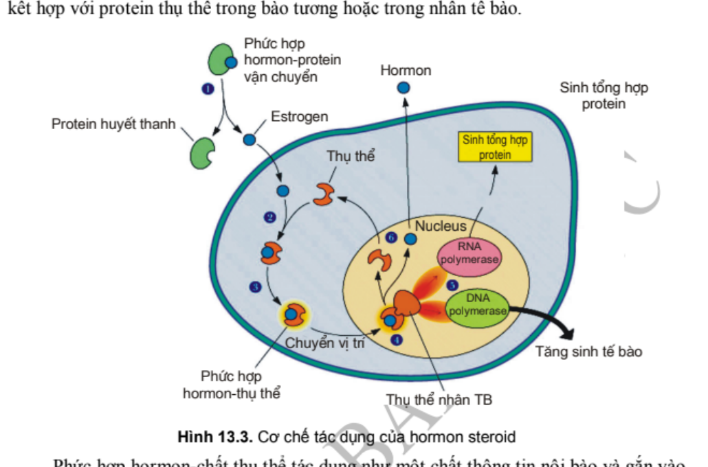
*Hình 13.3. Cơ chế thụ thể nội bào của Hormon Steroid: phức hợp Hormon - Thụ thể gắn vào HRE trên DNA để kích hoạt phiên mã.*

1. Hormon steroid dạng tự do tách khỏi protein vận chuyển huyết tương và **khuếch tán trực tiếp qua màng kép lipid** của tế bào đích.
2. Trong bào tương (hoặc trong nhân), hormon gắn đặc hiệu với thụ thể nội bào tương ứng. Sự gắn này làm thay đổi cấu hình thụ thể, giải phóng các protein ức chế (như Hsp90).
3. Phức hợp **Hormon - Thụ thể** được hoạt hóa di chuyển vào nhân, liên kết đặc hiệu với các trình tự DNA điều hòa gọi là **Yếu tố đáp ứng hormon (HRE - Hormone Response Elements)**.
4. Sự liên kết này kích hoạt hoặc ức chế sự phiên mã của các gen đặc hiệu bởi RNA polymerase II, làm tăng tổng hợp các phân tử $\text{mRNA}$ mới, dẫn đến tăng sinh tổng hợp các protein và enzym chức năng tương ứng trong tế bào.
- Do phải thông qua phiên mã và dịch mã tổng hợp protein mới, tác dụng của hormon steroid thường xuất hiện chậm (sau vài giờ đến vài ngày) nhưng duy trì bền vững kéo dài.

---

### 2.2. Cơ chế Tác dụng của Hormon Tan trong Nước (Hệ thống Thụ thể Màng và Chất truyền tin thứ hai)

Các hormon peptid, protein và catecholamin không qua được màng tế bào. Chúng gắn vào thụ thể đặc hiệu ở bề mặt ngoài màng tế bào (đóng vai trò là **chất truyền tin thứ nhất**), kích hoạt các chuỗi truyền tín hiệu qua màng để sinh ra các **chất truyền tin thứ hai (*second messengers*)** nội bào:

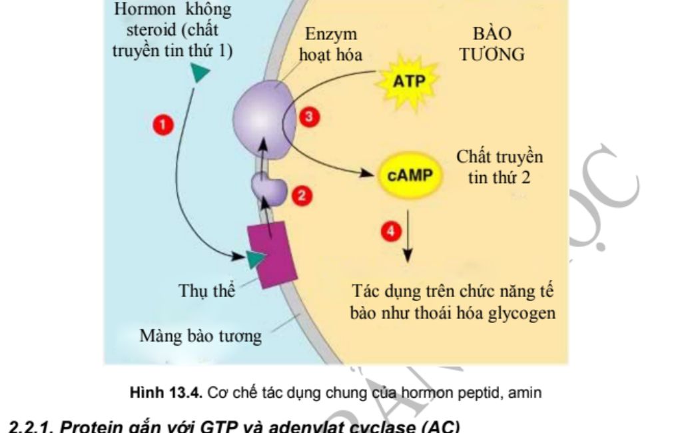
*Hình 13.4. Sơ đồ nguyên lý truyền tín hiệu qua màng: Thụ thể màng $\rightarrow$ Protein G $\rightarrow$ Enzym tạo chất truyền tin thứ hai $\rightarrow$ Protein Kinase $\rightarrow$ Đáp ứng sinh học.*

Các chất truyền tin thứ hai quan trọng nhất gồm: **$\text{cAMP, cGMP, IP}_3$ (Inositol-1,4,5-trisphosphat), DAG (Diacylglycerol)** và ion **$\text{Ca}^{2+}$**.

---

### 2.3. Hệ thống Truyền tin qua Adenylate Cyclase - cAMP và Protein G

Phần lớn các hormon peptid (như Glucagon, ACTH, TSH, FSH, LH, PTH, ADH qua thụ thể V2) và Adrenalin (qua thụ thể $\beta$-adrenergic) hoạt động qua hệ thống này:

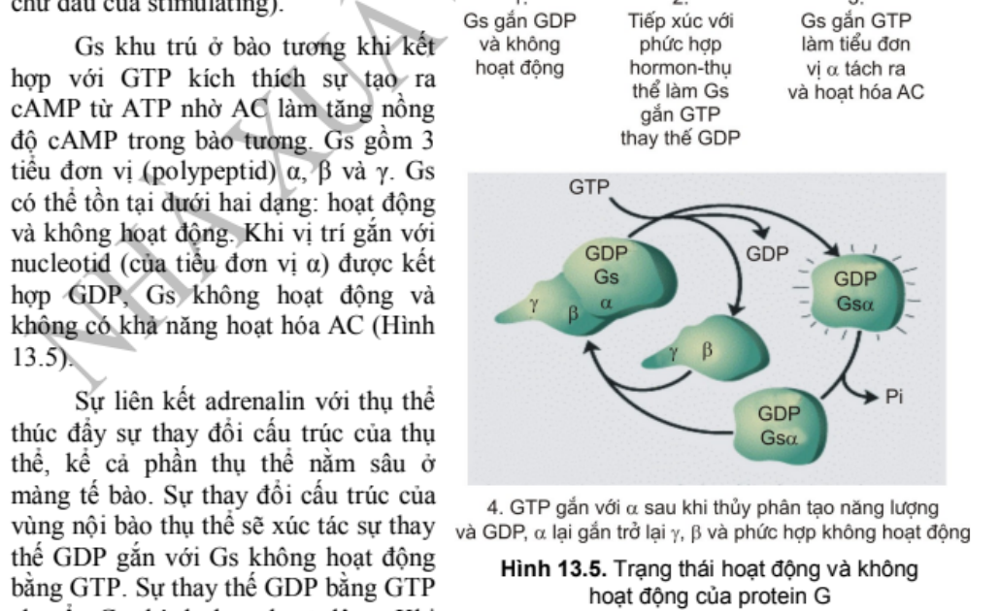
*Hình 13.5. Chu trình hoạt hóa dị lập thể của Protein G dị trimer ($G_\alpha, G_\beta, G_\gamma$) thông qua sự trao đổi GDP - GTP.*

#### A. Cấu trúc và Chu trình Hoạt hóa của Protein G
- **Protein G dị trimer (*Heterotrimeric G-protein*):** Gồm 3 tiểu đơn vị $\alpha, \beta, \gamma$:
  - Ở trạng thái nghỉ bất hoạt: tiểu đơn vị $\alpha$ liên kết với **GDP** và gắn chặt với phức hợp $\beta\gamma$.
  - Khi hormon gắn vào thụ thể xuyên màng 7 đoạn (GPCR - *G-Protein Coupled Receptor*), thụ thể thay đổi cấu hình làm xúc tác thay thế GDP bằng **GTP** trên tiểu đơn vị $\alpha$.
  - Khi gắn GTP, tiểu đơn vị $G_\alpha\text{-GTP}$ tách rời khỏi phức hợp $\beta\gamma$ và trở thành **dạng hoạt động**.
  - $G_\alpha\text{-GTP}$ di chuyển dọc theo mặt trong màng tế bào đến tương tác và hoạt hóa enzym **Adenylyl Cyclase (AC)**.
  - Tiểu đơn vị $G_\alpha$ có hoạt tính nội tại **GTPase**: sau một thời gian ngắn, nó tự thủy phân GTP thành $\text{GDP} + \text{P}_i$. Khi đã mang GDP, $G_\alpha$ trở về trạng thái bất hoạt và tái kết hợp với $\beta\gamma$ để kết thúc tín hiệu.

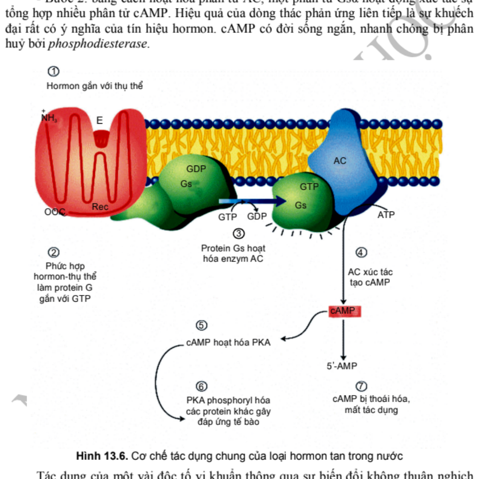
*Hình 13.6. Thác tín hiệu nội bào khuếch đại: Hormon gắn GPCR $\rightarrow G_{s\alpha}\text{-GTP} \rightarrow$ Adenylyl Cyclase chuyển ATP thành cAMP $\rightarrow$ cAMP hoạt hóa PKA $\rightarrow$ Phosphoryl hóa các enzym cơ chất gây đáp ứng tế bào.*

#### B. Thác khuếch đại Tín hiệu nội bào qua PKA
1. **Adenylyl Cyclase (AC)** sau khi được hoạt hóa sẽ xúc tác chuyển hóa ATP thành **$\text{cAMP}$** (Adenosine 3',5'-cyclic monophosphat).
2. $\text{cAMP}$ gắn vào hai tiểu đơn vị điều hòa (R) của enzym **Protein Kinase A (PKA)**, làm giải phóng hai tiểu đơn vị xúc tác (C) ở trạng thái hoạt động tự do.
3. PKA xúc tác phosphoryl hóa các enzym đích (ví dụ: phosphoryl hóa hoạt hóa glycogen phosphorylase kinase để thoái hóa glycogen, đồng thời phosphoryl hóa bất hoạt glycogen synthase).
4. Phân tử $\text{cAMP}$ nhanh chóng bị thủy phân bất hoạt thành $5'\text{-AMP}$ nhờ enzym **Phosphodiesterase (PDE)**. Các chất ức chế PDE như caffeine, theophylline duy trì nồng độ $\text{cAMP}$ cao kéo dài tác dụng kích thích.

---

### 2.4. Bệnh học Tác động của Độc tố Vi khuẩn lên Protein G

Một số độc tố vi khuẩn nguy hiểm gây bệnh thông qua sự biến đổi cộng hóa trị làm rối loạn vĩnh viễn chu trình của Protein G:

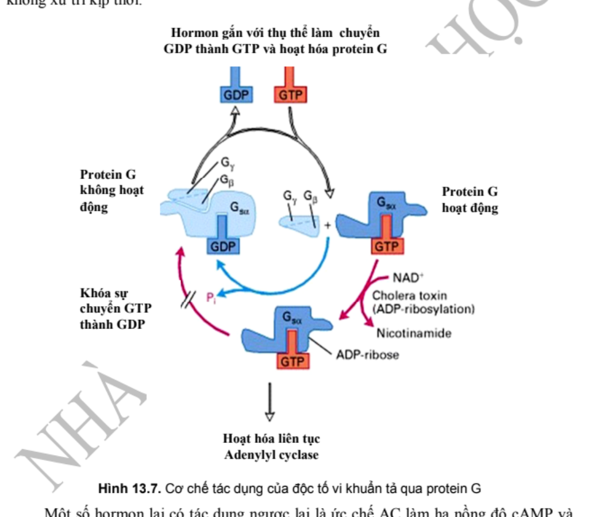
*Hình 13.7. Độc tố tả xúc tác ADP-ribosyl hóa tiểu đơn vị $G_{s\alpha}$, khóa chết hoạt tính GTPase làm tăng nồng độ cAMP liên tục gây ỉa chảy mất nước dữ dội.*

1. **Độc tố Vi khuẩn Tả (*Cholera Toxin*):**
   - Vi khuẩn *Vibrio cholerae* bài tiết độc tố tả vào lòng ruột. Tiểu đơn vị A xâm nhập vào tế bào biểu mô niêm mạc ruột non.
   - Đoạn A1 xúc tác chuyển nhóm **ADP-ribose từ $\text{NAD}^+$ gắn vào gốc Arginin của tiểu đơn vị $G_{s\alpha}$** (*hiện tượng ADP-ribosyl hóa*).
   - Sự gắn này **ức chế vĩnh viễn hoạt tính GTPase** của $G_{s\alpha}$, khiến $G_{s\alpha}$ bị khóa chết ở trạng thái hoạt động liên tục (không thể tự tắt).
   - Hậu quả: Adenylyl Cyclase bị hoạt hóa tối đa không ngừng, nồng độ $\text{cAMP}$ trong tế bào niêm mạc ruột tăng vọt lên gấp hàng trăm lần, kích hoạt mở ồ ạt kênh vận chuyển ion $\text{Cl}^-$ (CFTR) bài tiết liên tục $\text{NaCl}$ và nước vào lòng ruột, gây ra triệu chứng **tiêu chảy mất nước xối xả (phân đục như nước vo gạo)** dẫn đến sốc giảm thể tích và tử vong nhanh chóng nếu không được bù nước - điện giải kịp thời.
2. **Độc tố Vi khuẩn Ho gà (*Pertussis Toxin*):**
   - Xúc tác ADP-ribosyl hóa tiểu đơn vị protein G ức chế ($G_{i\alpha}$), ngăn cản $G_i$ tương tác với thụ thể, làm cho $G_i$ không thể ức chế được Adenylyl Cyclase, dẫn đến nồng độ $\text{cAMP}$ cũng tăng cao kéo dài.

<!-- END FILE: pages_266_275.md -->

<!-- BEGIN FILE: pages_276_285.md -->

# CHƯƠNG 13 (TIẾP THEO): CÁC HỆ THỐNG TRUYỀN TIN THỨ HAI VÀ HÓA SINH HORMON PEPTID

---

## 2. CƠ CHẾ TÁC DỤNG CỦA HORMON (TIẾP THEO)

### 2.2. Các Chất truyền tin thứ hai (Second Messengers)

#### 2.2.1. AMP vòng (cAMP) và Protein Kinase A (PKA)
- $\text{cAMP}$ là chất truyền tin thứ hai kinh điển của nhiều hormon quan trọng: Glucagon, Adrenalin (qua thụ thể $\beta$), ACTH, TSH, FSH, LH, PTH, Calcitonin, ADH (thụ thể $V_2$).
- $\text{cAMP}$ được tổng hợp từ $\text{ATP}$ nhờ enzym xuyên màng **Adenylyl Cyclase (AC)**.
- **Cơ chế hoạt hóa PKA:** Enzym PKA ở trạng thái bất hoạt là một tetramer gồm 2 tiểu đơn vị điều hòa (R) và 2 tiểu đơn vị xúc tác (C): $\text{R}_2\text{C}_2$. Khi nồng độ $\text{cAMP}$ trong bào tương tăng cao, 4 phân tử $\text{cAMP}$ gắn dị lập thể vào 2 tiểu đơn vị R làm biến đổi cấu hình, giải phóng 2 tiểu đơn vị C ở trạng thái tự do hoạt động:

$$\text{R}_2\text{C}_2\text{ (bất hoạt)} + 4\text{cAMP} \rightleftharpoons \text{R}_2(\text{cAMP})_4 + 2\text{C (hoạt động)}$$

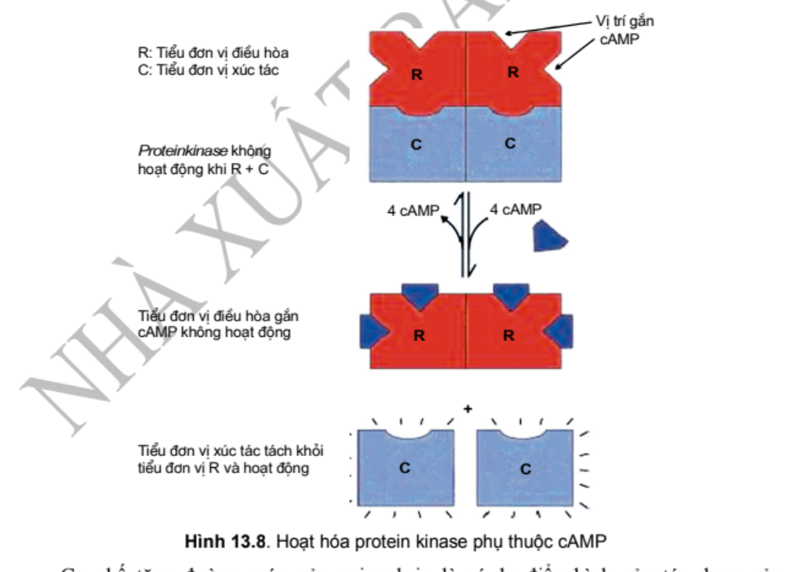
*Hình 13.8. Cơ chế phân ly và hoạt hóa tiểu đơn vị xúc tác C của Protein Kinase A (PKA) dưới tác dụng của cAMP.*

- **Thác khuếch đại tín hiệu làm tăng đường huyết của Epinephrin (Adrenalin):**
  - Năm 1950, Earl Sutherland phát hiện cơ chế epinephrin kích hoạt phân giải glycogen ở gan qua $\text{cAMP}$.
  - Chỉ 1 phân tử epinephrin gắn vào thụ thể $\beta$-adrenergic kích hoạt nhiều phân tử $G_s$, mỗi $G_s$ kích hoạt AC tạo ra hàng nghìn phân tử $\text{cAMP}$.
  - $\text{cAMP}$ hoạt hóa PKA; PKA phosphoryl hóa hoạt hóa enzym *phosphorylase kinase*; enzym này lại phosphoryl hóa hoạt hóa hàng vạn phân tử *glycogen phosphorylase $b \rightarrow a$*.
  - Kết quả là hàng triệu phân tử glucose-1-phosphat được giải phóng từ glycogen vào máu chỉ sau vài giây.

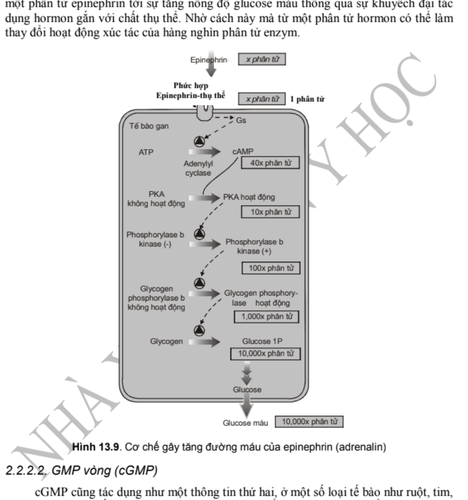
*Hình 13.9. Thác khuếch đại tín hiệu từ 1 phân tử Epinephrin tạo ra hàng triệu phân tử Glucose phóng thích vào máu.*

---

#### 2.2.2. GMP vòng (cGMP), Yếu tố Lợi niệu tâm nhĩ (ANF) và Oxyt Nitric (NO)
- $\text{cGMP}$ đóng vai trò là chất truyền tin thứ hai tại các tế bào cơ trơn mạch máu, tim, ruột và ống thận.
- $\text{cGMP}$ được tạo thành từ $\text{GTP}$ nhờ enzym **Guanylyl Cyclase (GC)**, sau đó hoạt hóa **Protein Kinase G (PKG)**:
  1. **Guanylyl Cyclase màng:** Được hoạt hóa bởi hormon **ANF (Atrial Natriuretic Factor / ANP)** do tế bào cơ tâm nhĩ tim tiết ra khi thể tích tuần hoàn tăng. ANF đến thận kích thích tạo $\text{cGMP}$ tại ống thận, gây giãn tiểu động mạch đến cầu thận, ức chế tái hấp thu $\text{Na}^+$ và nước, dẫn đến tăng bài xuất muối - nước làm hạ huyết áp.
  2. **Guanylyl Cyclase hòa tan trong bào tương:** Chứa nhân Hem, được hoạt hóa trực tiếp bởi **Oxyt Nitric (NO)**.
     - $\text{NO}$ là chất khí không phân cực được tổng hợp từ acid amin **L-Arginin** nhờ enzym **NO Synthase (NOS)** trong tế bào nội mô mạch máu.
     - $\text{NO}$ khuếch tán sang tế bào cơ trơn thành mạch kế cận, gắn vào nhân Hem của guanylyl cyclase hòa tan làm tăng vọt $\text{cGMP}$. $\text{cGMP}$ hoạt hóa PKG kích thích bơm $\text{Ca}^{2+}$ ra ngoài làm giảm nồng độ $\text{Ca}^{2+}$ nội bào, dẫn đến **giãn cơ trơn mạch máu và hạ huyết áp**.
     - *Ứng dụng lâm sàng:* Thuốc **Nitroglycerin** giải phóng $\text{NO}$ trong cơ thể giúp giãn nhanh động mạch vành, cắt cơn đau thắt ngực do thiếu máu cơ tim. Thuốc ức chế PDE-5 (Sildenafil / Viagra) ngăn thoái hóa $\text{cGMP}$ duy trì sự giãn mạch.

---

#### 2.2.3. Con đường Phospholipase C (PLC) - Inositol Trisphosphat (IP3) và Diacylglycerol (DAG)
Nhiều hormon như Oxytocin, Vasopressin (thụ thể $V_1$), TRH, GnRH, Angiotensin II, Adrenalin (thụ thể $\alpha_1$) hoạt động qua protein $G_q$ kích hoạt con đường màng kép PLC:

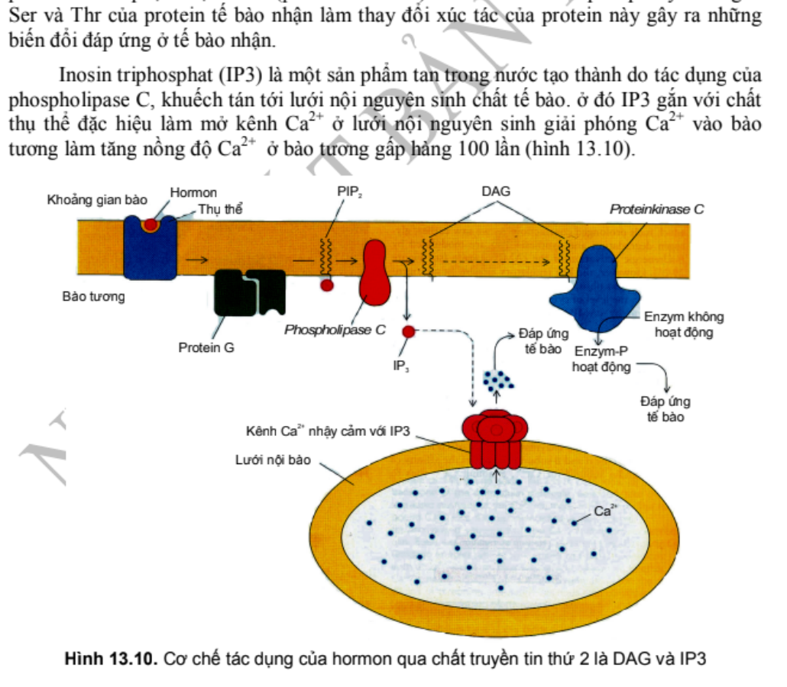
*Hình 13.10. Con đường Phospholipase C: Thủy phân $\text{PIP}_2$ thành hai chất truyền tin thứ hai độc lập là $\text{IP}_3$ và $\text{DAG}$.*

1. Hormon gắn thụ thể GPCR hoạt hóa protein **$G_q$**, $G_q$ kích hoạt enzym **Phospholipase C-$\beta$ (PLC)** bám ở mặt trong màng tế bào.
2. PLC thủy phân phospholipid màng là **$\text{PIP}_2$** (Phosphatidylinositol-4,5-bisphosphat) tạo thành hai chất truyền tin thứ hai:
   - **$\text{IP}_3$ (Inositol-1,4,5-trisphosphat):** Là chất phân cực tan trong nước, khuếch tán vào bào tương đến gắn vào thụ thể kênh $\text{Ca}^{2+}$ trên màng lưới nội chất (*endoplasmic reticulum*), **mở kênh giải phóng ồ ạt ion $\text{Ca}^{2+}$ dự trữ vào bào tương**.
   - **DAG (1,2-Diacylglycerol):** Là chất kỵ nước lưu lại trên màng tế bào, cùng với ion $\text{Ca}^{2+}$ hoạt hóa enzym **Protein Kinase C (PKC)** để phosphoryl hóa các protein điều hòa tăng sinh và biệt hóa tế bào.

---

#### 2.2.4. Ion Ca2+ và Phức hợp Calmodulin
- Nồng độ ion $\text{Ca}^{2+}$ tự do trong bào tương ở trạng thái nghỉ cực thấp ($10^{-7}\text{ M}$ so với ngoài tế bào $10^{-3}\text{ M}$).
- Khi $\text{Ca}^{2+}$ tăng vọt nhờ $\text{IP}_3$, nó liên kết với protein cảm ứng nội bào là **Calmodulin** (protein nhỏ gồm 148 acid amin có 4 vị trí gắn $\text{Ca}^{2+}$ dạng "bàn tay EF").
- Khi gắn đủ 4 ion $\text{Ca}^{2+}$, Calmodulin thay đổi cấu hình không gian, để lộ các vùng kỵ nước tương tác và kích hoạt hàng loạt enzym then chốt như **CaM Kinase (Calmodulin-dependent protein kinase)**, myosin light-chain kinase (co cơ trơn), và glycogen phosphorylase kinase.

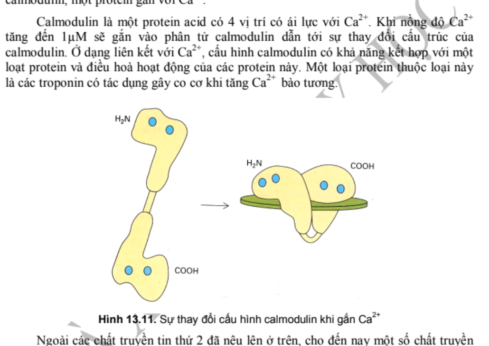
*Hình 13.11. Cấu trúc không gian của Calmodulin khi chưa gắn và khi đã gắn 4 ion $\text{Ca}^{2+}$.*

---

### 2.3. Thụ thể có hoạt tính xúc tác enzym Tyrosine Kinase: Thụ thể Insulin

Khác với các GPCR, thụ thể của **Insulin** và các yếu tố tăng trưởng (EGF, PDGF, IGF-1) có hoạt tính enzym nội tại nằm ngay trên phần xuyên màng nội bào:

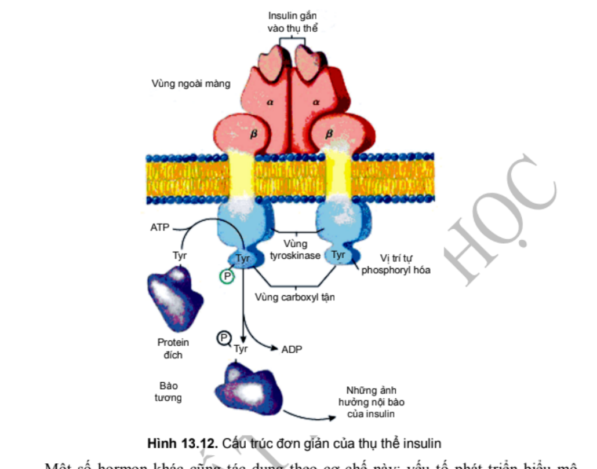
*Hình 13.12. Thụ thể Insulin dạng tetramer ($\alpha_2\beta_2$) và sự tự phosphoryl hóa chéo các gốc Tyrosin khi gắn Insulin.*

- **Cấu trúc:** Là một heterotetramer gồm **$2\text{ tiểu đơn vị }\alpha$** nằm hoàn toàn ở mặt ngoài màng (nơi gắn insulin) nối bằng cầu disulfid với **$2\text{ tiểu đơn vị }\beta$** xuyên màng (phần nội bào mang hoạt tính enzym **Tyrosine Kinase**).
- **Cơ chế hoạt hóa:**
  1. Khi insulin gắn vào tiểu đơn vị $\alpha$, nó kích hoạt sự **tự phosphoryl hóa chéo (*autophosphorylation*)** trên các gốc Tyrosin của tiểu đơn vị $\beta$.
  2. Tyrosine kinase hoạt hóa tiếp tục phosphoryl hóa các cơ chất nội bào quan trọng, đặc biệt là **IRS (Insulin Receptor Substrates)**.
  3. Phức hợp phosphoryl hóa này kích hoạt 2 nhánh truyền tín hiệu chính:
     - **Nhánh PI3K - Akt (Protein Kinase B):** Kích thích túi dự trữ chuyển kênh vận chuyển glucose **GLUT4** ra hòa nhập màng tế bào ở cơ và mô mỡ, tăng thu nhận glucose; đồng thời hoạt hóa tổng hợp glycogen và lipid.
     - **Nhánh Grb2 - Sos - Ras - Raf - MEK - MAPK:** Kích hoạt phân chia tế bào, tăng trưởng và biểu hiện gen.

---

## 3. ĐIỀU HÒA HOẠT ĐỘNG HỆ NỘI TIẾT: TRỤC NỘI TIẾT VÀ CƠ CHẾ ĐIỀU HÒA NGƯỢC (FEEDBACK)

Hệ thống nội tiết hoạt động theo một hệ thống phân cấp chặt chẽ: **Vùng dưới đồi $\rightarrow$ Tuyến yên $\rightarrow$ Tuyến nội tiết đích**:

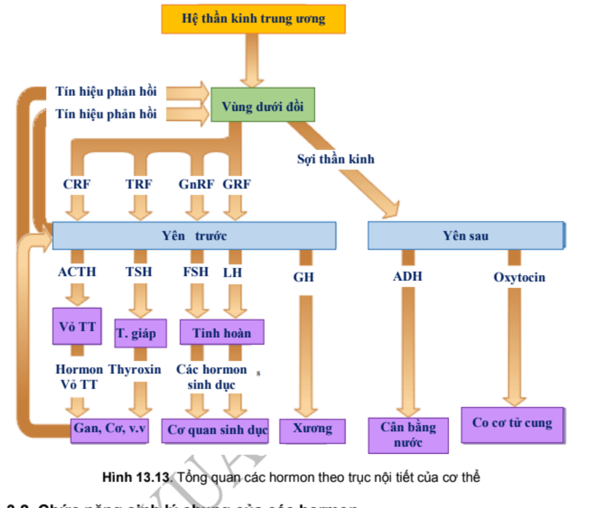
*Hình 13.13. Sơ đồ trục nội tiết Vùng dưới đồi - Tuyến yên - Tuyến đích và các vòng điều hòa ngược (Feedback) âm tính.*

- **Điều hòa ngược âm tính (*Negative feedback*):** Là cơ chế phổ biến nhất duy trì sự hằng định nội môi. Khi nồng độ hormon của tuyến đích (như $T_3/T_4$, Cortisol, Estrogen) tăng cao trong máu, chúng tác động ức chế ngược trở lại thùy trước tuyến yên (giảm tiết TSH, ACTH, FSH/LH) và vùng dưới đồi (giảm tiết TRH, CRH, GnRH) để đưa nồng độ hormon trở về giới hạn sinh lý bình thường.
- Ngược lại, khi tuyến đích suy giảm chức năng, nồng độ hormon tuyến đích hạ thấp sẽ giải phóng ức chế, làm nồng độ các hormon kích thích của tuyến yên (như TSH, ACTH) tăng vọt trong máu (tiêu chuẩn vàng chẩn đoán suy tuyến giáp hoặc suy thượng thận nguyên phát).

---

## 4. CẤU TRÚC VÀ TÁC DỤNG CÁC HORMON PROTEIN VÀ POLYPEPTID

### 4.1. Hormon Vùng dưới đồi (Hypothalamic Hormones)

Vùng dưới đồi sản xuất các hormon thần kinh (*neurohormones*) vận chuyển qua hệ mạch cửa dưới đồi - tuyến yên (*hypophyseal portal system*) để điều hòa thùy trước tuyến yên:

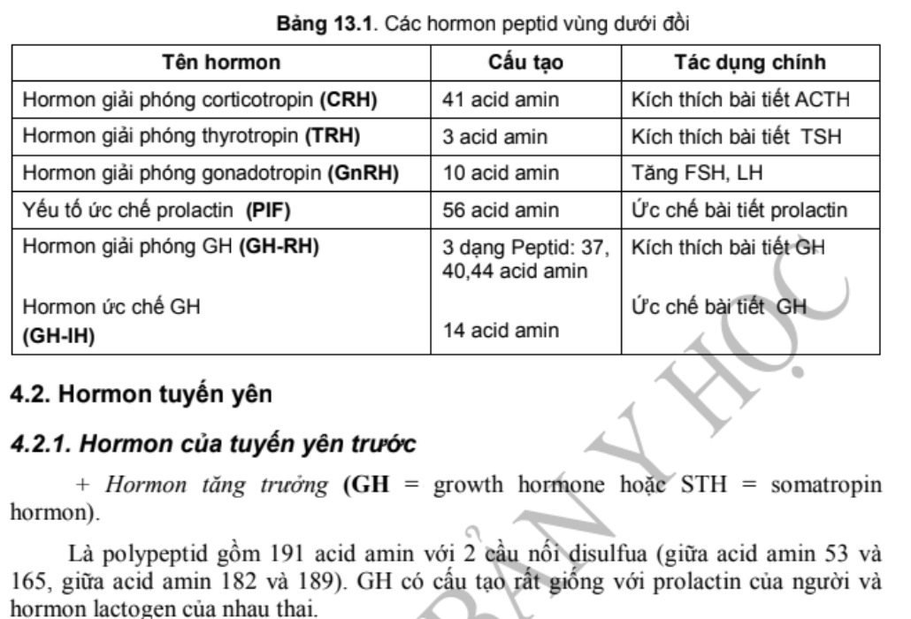
*Bảng 13.1. Cấu tạo và tác dụng chính của các hormon vùng dưới đồi.*

| Hormon | Bản chất hóa học | Tác dụng sinh học chính |
| :--- | :--- | :--- |
| **TRH** (*Thyrotropin-Releasing Hormone*) | Tripeptid (3 aa: pGlu-His-Pro-$\text{NH}_2$) | Kích thích thùy trước tuyến yên bài tiết **TSH** và Prolactin. |
| **GnRH / LHRH** | Decapeptid (10 aa) | Kích thích bài tiết **LH** và **FSH**. |
| **CRH** (*Corticotropin-Releasing Hormone*) | Polypeptid (41 aa) | Kích thích bài tiết **ACTH**. |
| **GHRH** (*Growth Hormone-RH*) | Peptid ($40 - 44$ aa) | Kích thích bài tiết hormon tăng trưởng **GH**. |
| **GHIH / Somatostatin** | Peptid (14 aa) | **Ức chế** bài tiết GH và TSH; ức chế tiết insulin, glucagon ở tụy. |
| **PIF / Dopamin** | Dẫn xuất amin / Peptid | **Ức chế** bài tiết Prolactin. |

---

### 4.2. Hormon Tuyến yên (Pituitary Hormones)

#### 4.2.1. Hormon Thùy trước Tuyến yên (Adenohypophysis)
1. **Hormon Tăng trưởng (GH - Growth Hormone / Somatotropin):**
   - Polypeptid gồm **191 acid amin** có 2 cầu disulfid nội chuỗi ($53 - 165$ và $182 - 189$), trọng lượng phân tử $22\text{ kDa}$.

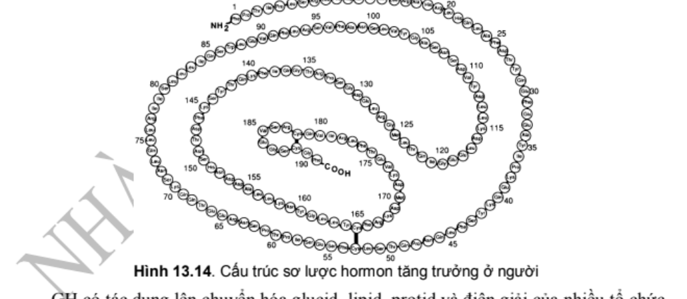
*Hình 13.14. Cấu trúc không gian của Hormon tăng trưởng (GH) ở người.*

   - *Tác dụng:* Kích thích gan sản xuất yếu tố tăng trưởng giống insulin **IGF-1 (Somatomedin C)** để kích thích phát triển sụn liên hợp và xương dài theo chiều cao, tăng khối cơ, tăng phân giải mỡ, giảm thu nhận glucose (gây tăng đường huyết). Thiếu GH ở trẻ em gây **bệnh lùn tuyến yên**; thừa GH trước tuổi dậy thì gây **bệnh khổng lồ** (*gigantism*), sau dậy thì gây **bệnh to đầu ngón** (*acromegaly*).
2. **Prolactin (PRL / LTH):** Chuỗi polypeptid gồm 199 acid amin ($23\text{ kDa}$), kích thích phát triển tuyến vú và sản xuất, bài tiết sữa sau sinh.
3. **Các Hormon Glycoprotein (FSH, LH, TSH và hCG):**
   - Đều có cấu trúc dimer gồm **2 tiểu đơn vị $\alpha$ và $\beta$**:

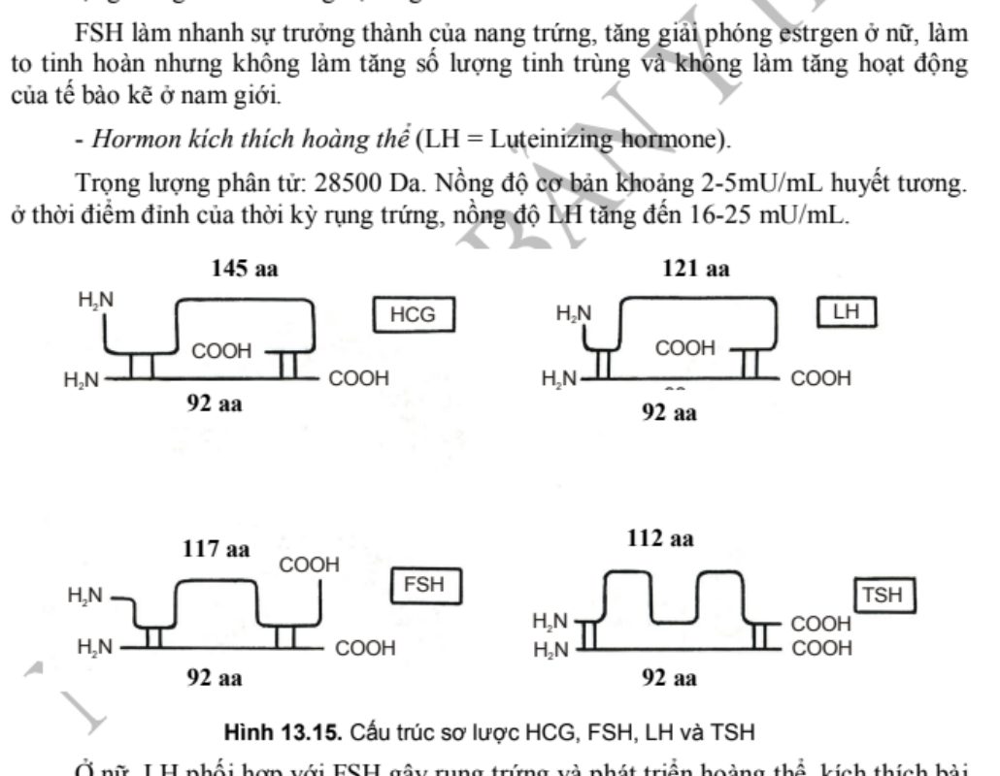
*Hình 13.15. So sánh cấu trúc: Tiểu đơn vị $\alpha$ (92 aa) hoàn toàn giống hệt nhau ở cả 4 hormon; tính đặc hiệu sinh học do tiểu đơn vị $\beta$ quyết định.*

   - **TSH (Thyroid-Stimulating Hormone):** Chuỗi $\alpha$ (92 aa) và chuỗi $\beta$ (112 aa). Kích thích toàn bộ các khâu tổng hợp và giải phóng hormon giáp $T_3, T_4$.
   - **FSH (Follicle-Stimulating Hormone):** Kích thích phát triển nang trứng ở nữ; kích thích ống sinh tinh và sản sinh tinh trùng ở nam.
   - **LH (Luteinizing Hormone):** Gây rụng trứng và hình thành hoàng thể tiết progesteron ở nữ; kích thích tế bào kẽ Leydig sản xuất testosteron ở nam.
   - **hCG (Human Chorionic Gonadotropin):** Do rau thai bài tiết trong thai kỳ để duy trì hoàng thể thai nghén; là cơ sở định lượng trong xét nghiệm thử thai.

<!-- END FILE: pages_276_285.md -->

<!-- BEGIN FILE: pages_286_295.md -->

# CHƯƠNG 13 (TIẾP THEO): HÓA SINH HORMON TUYẾN YÊN, TUYẾN TỤY, THƯỢNG THẬN VÀ TUYẾN GIÁP

---

## 4. CÁC HORMON PROTEIN VÀ POLYPEPTID (TIẾP THEO)

### 4.2. Hormon Tuyến yên (tiếp theo)

#### 4.2.1. Hormon Kích thích Tuyến vỏ thượng thận (ACTH - Adrenocorticotropic Hormone)
- Là một chuỗi polypeptid gồm **39 acid amin** ($4{,}5\text{ kDa}$). 
- Trình tự 24 acid amin đầu tiên ở đầu N hoàn toàn giống nhau ở mọi loài động vật có vú và mang toàn bộ hoạt tính sinh học của phân tử.

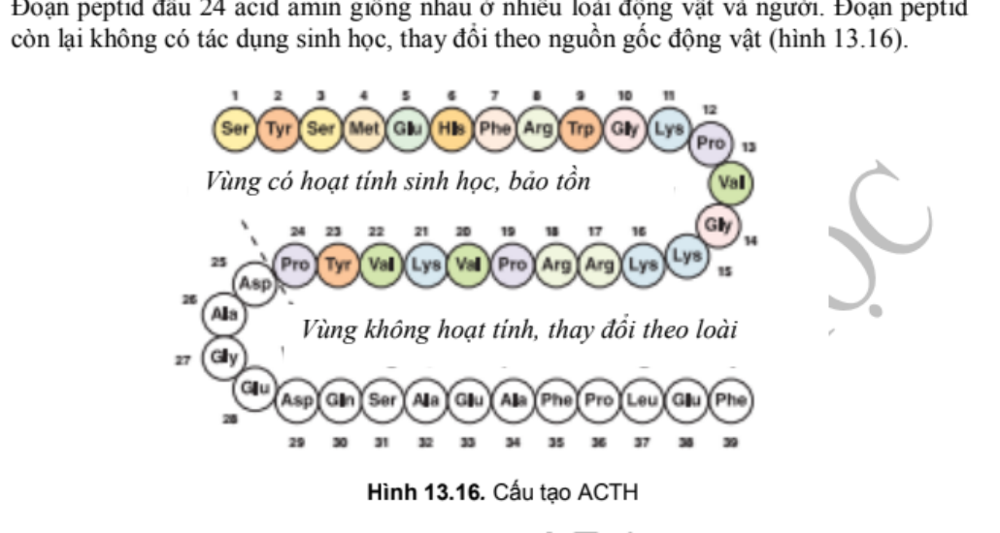
*Hình 13.16. Trình tự chuỗi acid amin của ACTH người.*

- **Tác dụng sinh học:** Kích thích vùng bó vỏ thượng thận tăng sinh và bài tiết các glucocorticoid (**Cortisol**) thông qua thụ thể GPCR gắn với $\text{cAMP}$.
- **Ý nghĩa lâm sàng:** Đoạn peptid từ acid amin số 6 đến số 10 của ACTH có cấu trúc tương đồng với hormon kích thích tế bào hắc tố ($\alpha\text{-MSH}$). Do đó, trong **bệnh Addison (suy vỏ thượng thận nguyên phát)**, nồng độ cortisol giảm sâu làm mất ức chế điều hòa ngược âm tính, tuyến yên tăng tiết ACTH cực cao dẫn đến biểu hiện lâm sàng đặc trưng là **sạm da, đen niêm mạc**.

---

#### 4.2.2. Hormon Thùy sau Tuyến yên (Neurohypophysis)
Được tổng hợp từ các nhân trên thị (*supraoptic*) và nhân cạnh não thất (*paraventricular*) của vùng dưới đồi, vận chuyển dọc theo sợi trục thần kinh đến tích trữ và giải phóng tại thùy sau tuyến yên. Vincent du Vigneaud đã tách chiết và tổng hợp thành công hai hormon này (Giải Nobel Hóa học 1955):

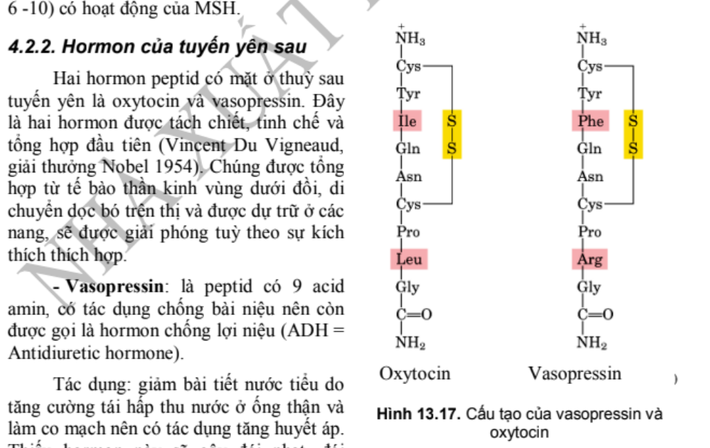
*Hình 13.17. Cấu trúc nonapeptid của Vasopressin (ADH) và Oxytocin: vòng 6 acid amin nối bởi cầu disulfid và đuôi 3 acid amin.*

1. **Vasopressin (ADH - Antidiuretic Hormone):**
   - Nonapeptid (9 acid amin: $\text{Cys-Tyr-Phe-Gln-Asn-Cys-Pro-Arg-Gly-NH}_2$).
   - **Tác dụng:** 
     - Qua thụ thể $V_2$ ở màng đáy tế bào ống góp thận $\rightarrow$ hoạt hóa $\text{cAMP} \rightarrow$ kích thích chuyển các kênh nước **Aquaporin-2** ra màng đỉnh, **tăng tái hấp thu nước**, cô đặc nước tiểu và làm giảm áp suất thẩm thấu huyết tương.
     - Qua thụ thể $V_1$ ở cơ trơn mạch máu $\rightarrow$ con đường $\text{IP}_3/\text{Ca}^{2+} \rightarrow$ gây co mạch tăng huyết áp.
   - *Bệnh lý:* Thiếu hụt ADH (do chấn thương hoặc u vùng dưới đồi - tuyến yên) gây **Bệnh Đái tháo nhạt (*Diabetes Insipidus - DI*)**: bệnh nhân đái rất nhiều ($5 - 10\text{ lít/ngày}$), nước tiểu rất loãng với tỷ trọng cực thấp ($1{,}001 - 1{,}005$) và luôn khát nước dữ dội.
2. **Oxytocin:**
   - Nonapeptid (9 acid amin, chỉ khác ADH ở vị trí số 3 là **Ile** thay cho Phe, và vị trí số 8 là **Leu** thay cho Arg).
   - **Tác dụng:** Gắn vào thụ thể GPCR qua con đường $\text{IP}_3/\text{Ca}^{2+}$ gây co thắt mạnh cơ trơn tử cung lúc chuyển dạ sinh con; đồng thời gây co bóp các tế bào biểu mô cơ quanh nang tuyến vú để tống bài xuất sữa khi trẻ bú mẹ.

---

### 4.3. Hormon Tuyến cận giáp (PTH) và Calcitonin

Cùng với vitamin D hoạt tính ($1,25\text{-(OH)}_2\text{-D}_3$), PTH và Calcitonin là hai hormon đối kháng điều hòa hằng định nồng độ calci máu ($2{,}2 - 2{,}6\text{ mmol/L}$):

1. **Hormon Tuyến cận giáp (PTH - Parathyroid Hormone):**
   - Chuỗi polypeptid gồm **84 acid amin** ($9{,}5\text{ kDa}$). Đoạn $1 - 34$ ở đầu N mang đầy đủ hoạt tính.
   - Được bài tiết khi nồng độ $\text{Ca}^{2+}$ ion hóa trong máu giảm.
   - **Tác dụng làm TĂNG Calci máu:**
     - Tại xương: Kích thích hủy cốt bào (*osteoclasts*) tiêu xương, giải phóng $\text{Ca}^{2+}$ và phosphat vào máu.
     - Tại thận: Tăng tái hấp thu $\text{Ca}^{2+}$ ở ống lượn xa, ức chế tái hấp thu phosphat ở ống lượn gần (tăng thải phosphat ra nước tiểu); đồng thời kích hoạt enzym $1\alpha$-hydroxylase biến đổi vitamin D thành dạng hoạt tính $1,25\text{-(OH)}_2\text{-D}_3$.
     - Tại ruột: Gián tiếp qua vitamin D làm tăng hấp thu $\text{Ca}^{2+}$ và phosphat từ thức ăn.
2. **Calcitonin (Thyrocalcitonin):**
   - Polypeptid gồm **32 acid amin** có một cầu disulfid nội chuỗi giữa Cys1 và Cys7, do các tế bào cận nang (tế bào C) của tuyến giáp bài tiết khi nồng độ calci máu tăng cao.

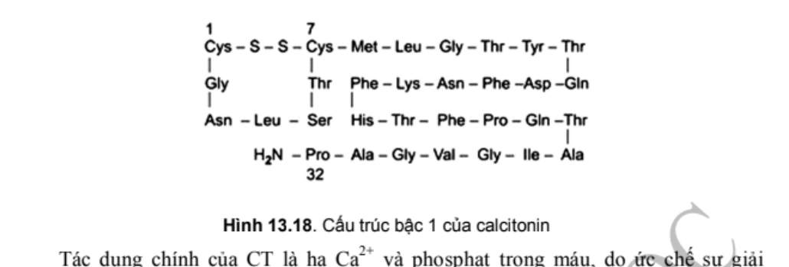
*Hình 13.18. Cấu trúc chuỗi 32 acid amin của Calcitonin người.*

   - **Tác dụng làm HẠ Calci máu:** Ức chế trực tiếp hoạt động của hủy cốt bào làm ngừng tiêu xương, tạo điều kiện lắng đọng calci vào xương; đồng thời tăng đào thải $\text{Ca}^{2+}$ qua nước tiểu.

---

### 4.4. Hormon Tuyến tụy nội tiết: Insulin và Glucagon

#### A. Insulin
Do các tế bào $\beta$ của tiểu đảo Langerhans tuyến tụy bài tiết khi nồng độ glucose máu tăng.

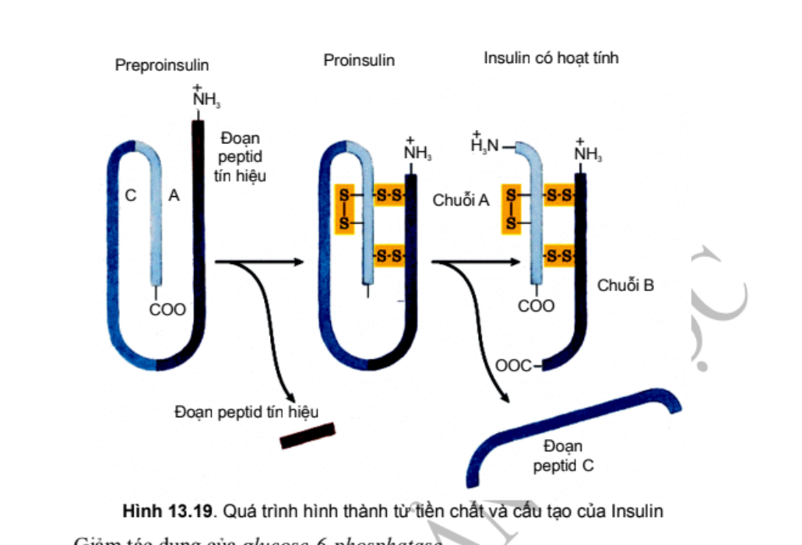
*Hình 13.19. Quá trình chế bản sinh học từ Preproinsulin $\rightarrow$ Proinsulin $\rightarrow$ Cắt bỏ đoạn C-peptid tạo phân tử Insulin hoạt động gồm chuỗi A và chuỗi B nối bởi 2 cầu disulfid.*

- **Cấu trúc:** Gồm **51 acid amin** sắp xếp trong hai chuỗi polypeptid:
  - **Chuỗi A (21 acid amin)** có một cầu disulfid nội chuỗi ($A_6 - A_{11}$).
  - **Chuỗi B (30 acid amin)**.
  - Hai chuỗi liên kết với nhau bằng **2 cầu disulfid liên chuỗi** ($A_7 - B_7$ và $A_{20} - B_{19}$).
- **Quá trình tổng hợp:** $\text{Preproinsulin} \xrightarrow{\text{cắt chuỗi tín hiệu}} \text{Proinsulin} \xrightarrow{\text{cắt C-peptid (31 aa)}} \text{Insulin} + \text{C-peptid}$. Định lượng C-peptid trong máu phản ánh chính xác chức năng bài tiết insulin nội sinh của tế bào $\beta$ tụy.
- **Tác dụng sinh học:** Là hormon đồng hóa duy nhất làm **HẠ glucose máu**:

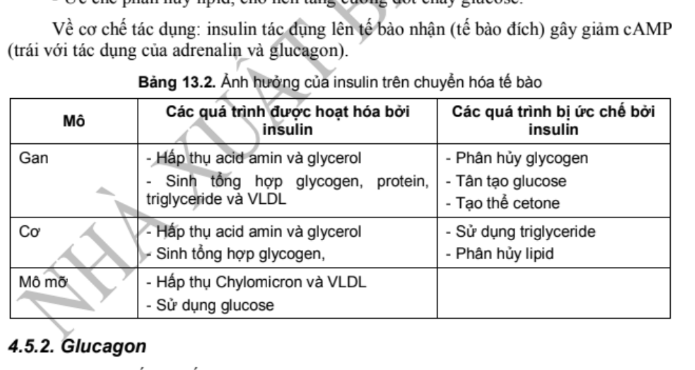
*Bảng 13.2. Tác động của Insulin lên các con đường chuyển hóa Glucose, Lipid và Protein.*

- Tăng vận chuyển glucose vào cơ và mô mỡ nhờ huy động kênh **GLUT4**.
- Tăng đường phân và hoạt hóa tổng hợp glycogen (kích hoạt glycogen synthase qua protein phosphatase-1).
- Ức chế tân tạo glucose và ức chế phân giải glycogen ở gan.
- Tăng tổng hợp acid béo và triglycerid, ức chế enzyme lipase nhạy cảm hormon (HS-lipase) chống phân giải mỡ.
- Tăng vận chuyển acid amin vào tế bào và kích thích dịch mã tổng hợp protein.

#### B. Glucagon
Do các tế bào $\alpha$ của tiểu đảo Langerhans bài tiết khi nồng độ glucose máu hạ thấp.

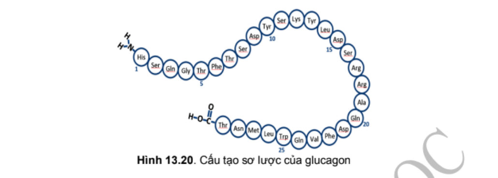
*Hình 13.20. Chuỗi đơn polypeptid gồm 29 acid amin của Glucagon.*

- **Cấu trúc:** Chuỗi đơn polypeptid thẳng gồm **29 acid amin** ($3{,}5\text{ kDa}$).
- **Tác dụng làm TĂNG glucose máu:** Tác dụng chủ yếu tại gan thông qua thụ thể GPCR gắn với $\text{cAMP} \rightarrow \text{PKA}$: kích thích phân giải glycogen thành glucose, kích hoạt mạnh mẽ con đường tân tạo glucose từ acid amin và lactat; đồng thời hoạt hóa HS-lipase phân giải triglycerid ở mô mỡ giải phóng glycerol và acid béo tự do.

---

## 5. HORMON DẪN XUẤT ACID AMIN

### 5.1. Hormon Tủy thượng thận: Catecholamin (Adrenalin và Noradrenalin)

Tủy thượng thận có nguồn gốc phôi thai từ mào thần kinh, hoạt động như một hạch giao cảm biến đổi bài tiết hai hormon thuộc nhóm catecholamin: **Epinephrin (Adrenalin)** (chiếm $80\%$) và **Norepinephrin (Noradrenalin)** (chiếm $20\%$).

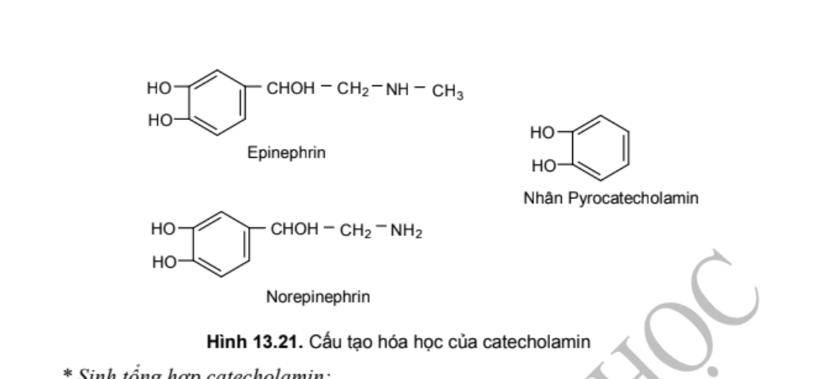
*Hình 13.21. Cấu trúc hóa học của Dopamin, Norepinephrin và Epinephrin chứa nhân catechol (vòng benzen có 2 nhóm -OH ở vị trí ortho).*

#### A. Sinh tổng hợp Catecholamin
Quá trình diễn ra từ acid amin **L-Tyrosin** qua chuỗi 4 phản ứng enzym:

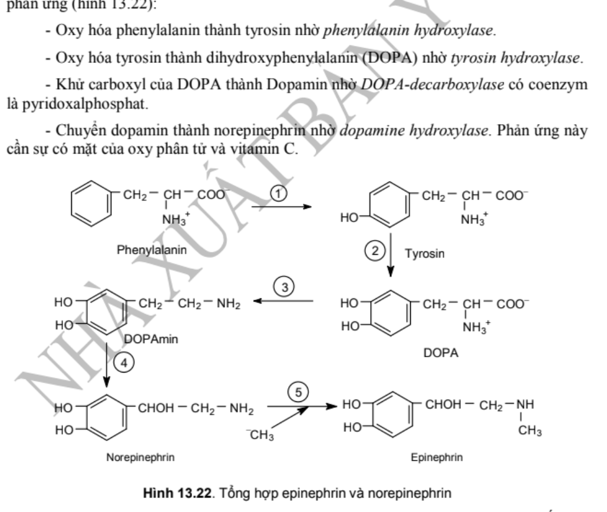
*Hình 13.22. Chuỗi phản ứng sinh tổng hợp Catecholamin từ Tyrosin qua L-DOPA và Dopamin.*

1. $\text{Tyrosin} \xrightarrow{\text{Tyrosin hydroxylase (TH, enzym then chốt, cần }\text{BH}_4\text{)}} \text{L-DOPA}$ (Dihydroxyphenylalanin).
2. $\text{L-DOPA} \xrightarrow{\text{DOPA decarboxylase (cần PLP - vit B}_6\text{)}} \text{Dopamin} + \text{CO}_2$.
3. $\text{Dopamin} \xrightarrow{\text{Dopamin }\beta\text{-hydroxylase (DBH, cần Vitamin C, trong hạt chế tiết)}} \text{Norepinephrin}$.
4. $\text{Norepinephrin} \xrightarrow{\text{PNMT (Phenylethanolamine N-methyltransferase, dùng SAM)}} \text{Epinephrin}$. Enzym PNMT được cảm ứng bởi nồng độ cao cortisol từ vỏ thượng thận đổ sang.

#### B. Thoái hóa Catecholamin và Ý nghĩa Lâm sàng
Catecholamin có thời gian bán hủy trong máu cực ngắn ($1 - 2\text{ phút}$), bị thoái hóa phối hợp bởi hai enzym:
- **COMT (*Catechol-O-methyltransferase*):** chuyển nhóm methyl từ SAM gắn vào nhóm -OH ở C3.
- **MAO (*Monoamin oxidase*):** khử amin oxy hóa nhóm amino.

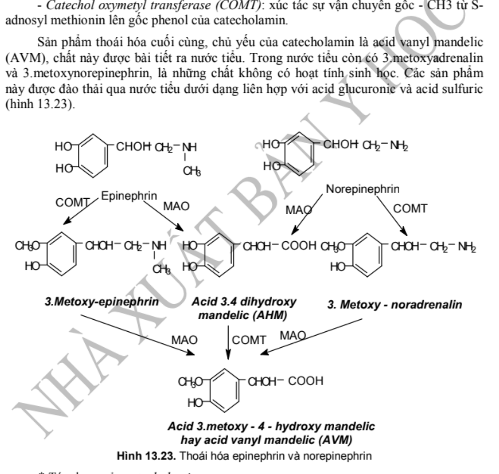
*Hình 13.23. Con đường thoái hóa Adrenalin và Noradrenalin hội tụ tạo sản phẩm đào thải cuối cùng là Acid Vanillylmandelic (VMA).*

- Sản phẩm thoái hóa đào thải cuối cùng trong nước tiểu là **Acid Vanillylmandelic (VMA)** và các **Metanephrin**.
- **Ý nghĩa lâm sàng:** Xét nghiệm định lượng nồng độ VMA và Metanephrin tự do trong nước tiểu 24 giờ là tiêu chuẩn vàng chẩn đoán **U tủy thượng thận (*Pheochromocytoma*)** — khối u tăng tiết catecholamin kịch phát gây ra các cơn tăng huyết áp ác tính đe dọa tính mạng.

---

### 5.2. Hormon Tuyến giáp ($T_3$ và $T_4$)

Tuyến giáp được cấu tạo bởi hàng triệu nang giáp (*follicles*) hình cầu chứa đầy chất keo (*colloid*) mà thành phần chính là glycoprotein **Thyroglobulin (Tg)**:

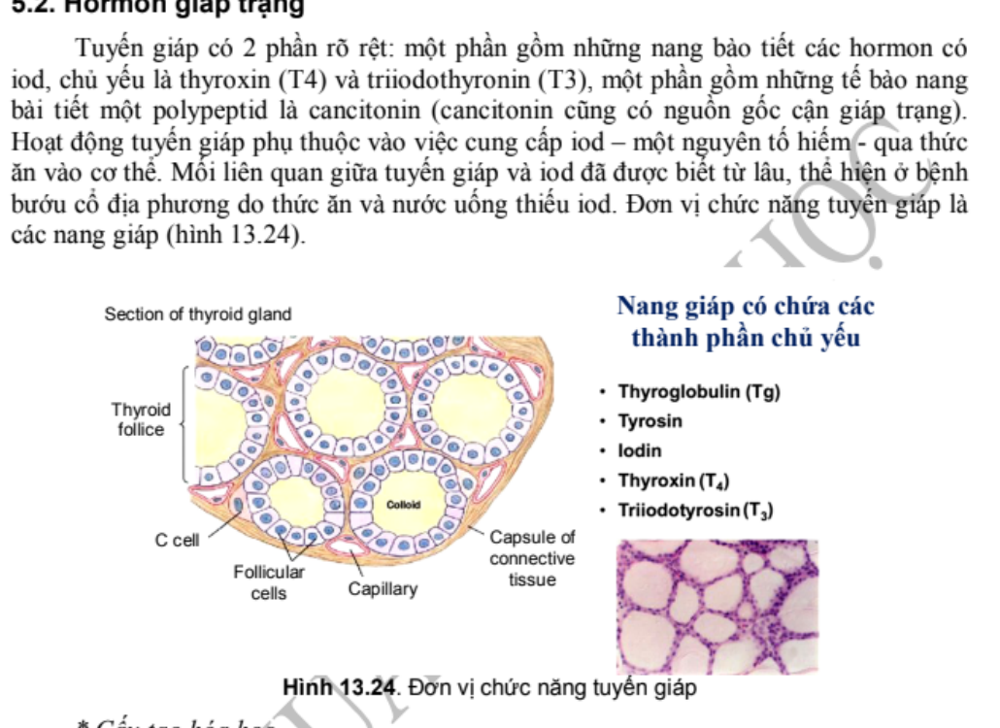
*Hình 13.24. Cấu trúc mô học vi thể của nang tuyến giáp với lớp tế bào biểu mô nang bao quanh lòng lòng chất keo chứa Thyroglobulin.*

Hai hormon tuyến giáp có hoạt tính sinh học là:
- **Thyroxin ($T_4$ - 3,5,3',5'-Tetraiodothyronin):** Chiếm $90\%$ lượng hormon bài tiết vào máu.
- **Triiodothyronin ($T_3$ - 3,5,3'-Triiodothyronin):** Chiếm $10\%$, nhưng có **hoạt tính sinh học mạnh gấp $4 - 5$ lần so với $T_4$**. Phần lớn $T_3$ trong cơ thể được tạo ra do phản ứng khử iod ở vị trí $5'$ của $T_4$ tại các mô ngoại vi (gan, thận) nhờ enzym *deiodinase*.

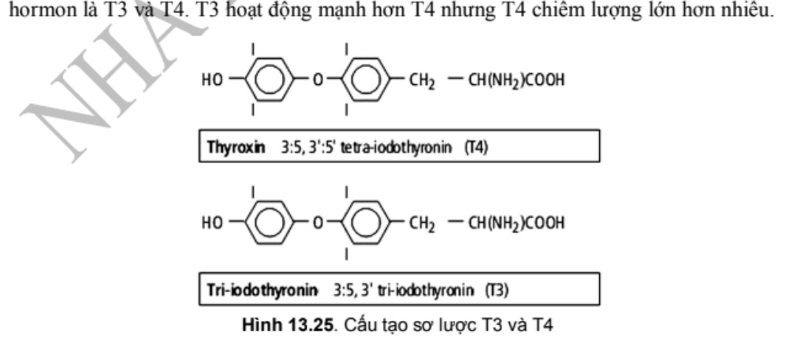
*Hình 13.25. Cấu trúc hóa học của phân tử $T_3$ và $T_4$.*

#### Quá trình Sinh tổng hợp Hormon Tuyến giáp
Diễn ra qua 4 giai đoạn phức tạp dưới sự kích thích của TSH:

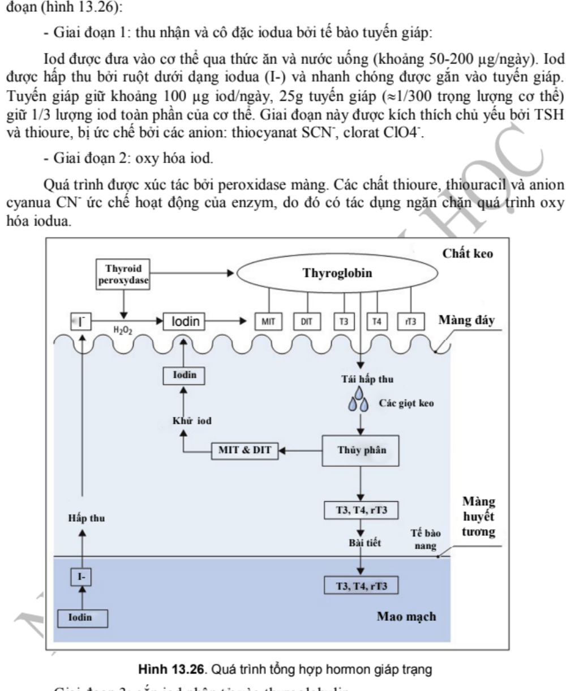
*Hình 13.26. Cơ chế phân tử 4 giai đoạn tổng hợp $T_3$ và $T_4$ tại tế bào nang giáp và lòng chất keo.*

1. **Giai đoạn 1: Bắt giữ và cô đặc Iodua ($I^-$):** Bơm đồng vận chuyển $\text{Na}^+/I^-$ (NIS) ở màng đáy tích cực vận chuyển iodua từ máu vào tế bào nang giáp (tập trung nồng độ iod cao gấp $30 - 50$ lần so với huyết tương). Bị ức chế cạnh tranh bởi các anion $\text{ClO}_4^-, \text{SCN}^-$.
2. **Giai đoạn 2: Oxy hóa Iodua ($I^- \rightarrow I^0$ hoặc $I^+$):** Tại bờ bàn chải màng đỉnh, enzym **Thyroid Peroxidase (TPO)** sử dụng $\text{H}_2\text{O}_2$ oxy hóa iodua thành dạng iod hoạt hóa. Các thuốc kháng giáp tổng hợp (như *thiamazole, PTU*) ức chế mạnh enzym TPO.
3. **Giai đoạn 3: Iod hóa Tyrosin và Phản ứng ghép cặp:** 
   - Iod hoạt hóa gắn vào các gốc Tyrosin của phân tử Thyroglobulin tạo **MIT** (Monoiodotyrosin) và **DIT** (Diiodotyrosin).
   - TPO tiếp tục xúc tác phản ứng ghép cặp:
     $$\text{DIT} + \text{DIT} \longrightarrow \text{Thyroxin } (T_4)$$
     $$\text{MIT} + \text{DIT} \longrightarrow \text{Triiodothyronin } (T_3)$$
4. **Giai đoạn 4: Ẩm bào và Giải phóng Hormon:** Khi có kích thích của TSH, tế bào nang giáp ẩm bào các giọt chất keo chứa Tg vào bào tương. Các túi tiêu thể lysosom hòa nhập và dùng protease thủy phân Tg, giải phóng $T_3$ và $T_4$ tự do khuếch tán vào máu. MIT và DIT dư thừa bị enzym *halogenase / deiodinase* khử iod thu hồi iodua tái sử dụng.
- **Tác dụng sinh học của Hormon Giáp:** Tăng chuyển hóa cơ bản, tăng sinh nhiệt và tiêu thụ oxy ở hầu hết các mô; tăng phân giải glycogen và lipid; đặc biệt tối cần thiết cho sự phát triển của hệ thần kinh trung ương và cốt hóa xương ở thai nhi và trẻ nhỏ (suy giáp bẩm sinh không điều trị sớm gây bệnh đần độn *cretinism*).

<!-- END FILE: pages_286_295.md -->

<!-- BEGIN FILE: pages_296_305.md -->

# CHƯƠNG 13 (TIẾP THEO): HORMON STEROID VÀ MỞ ĐẦU CHƯƠNG 14: HÓA SINH MÀNG TẾ BÀO

---

## 6. CÁC HORMON STEROID

Hormon steroid được sản xuất bởi tuyến vỏ thượng thận, tinh hoàn, buồng trứng và nhau thai. Tất cả đều có nguồn gốc sinh học từ **Cholesterol** và mang khung cấu trúc cơ bản là nhân **cyclopentanoperhydrophenanthren (nhân gonan - 17C)** gồm 4 vòng A, B, C, D ngưng tụ:

### 6.1. Danh pháp và Phân nhóm Hormon Steroid
Dựa trên số lượng nguyên tử carbon và nhóm thế, hormon steroid được chia thành 3 nhóm cấu trúc chính:
1. **Nhóm 18 carbon (Nhân Estran):** Có 1 nhóm methyl (C18) gắn tại C13; vòng A mang tính chất thơm với nhóm phenolic hydroxyl ở C3. Đại diện là **các Hormon sinh dục nữ (Estrogen: Estradiol, Estron, Estriol)**.
2. **Nhóm 19 carbon (Nhân Androstan):** Có 2 nhóm methyl tại C13 (C18) và C10 (C19). Đại diện là **các Hormon sinh dục nam (Androgen: Testosteron, Dihydrotestosteron - DHT)** và androgen vỏ thượng thận (DHEA, Androstenedion).
3. **Nhóm 21 carbon (Nhân Pregnan):** Ngoài 2 nhóm methyl tại C10 và C13, có thêm mạch nhánh 2 carbon ($-\text{CO}-\text{CH}_3$ hoặc $-\text{COCH}_2\text{OH}$) gắn tại C17. Đại diện là **Progesteron**, **các Glucocorticoid (Cortisol, Cortison)** và **Mineralocorticoid (Aldosteron)**.

---

### 6.2. Hormon Tuyến Vỏ thượng thận

Tuyến vỏ thượng thận về mặt mô học vi thể chia làm 3 lớp riêng biệt với chức năng sinh tổng hợp các hormon chuyên biệt:

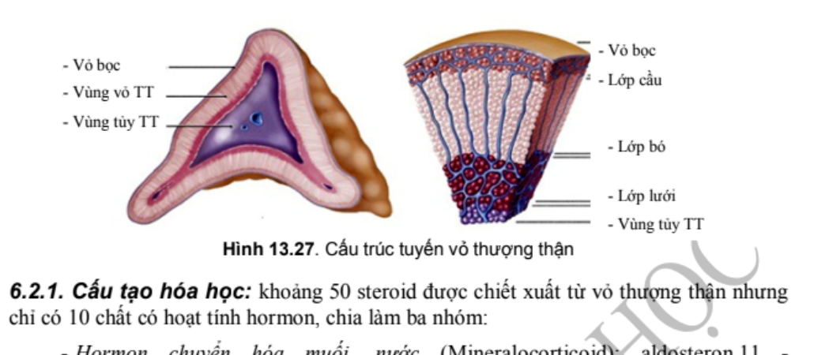
*Hình 13.27. Ba lớp của vỏ thượng thận: Lớp cầu (Glomerulosa), Lớp bó (Fasciculata), Lớp lưới (Reticularis) và vùng Tủy thượng thận.*

1. **Lớp cầu (*Zona glomerulosa* - ngoài cùng):** Chiếm $15\%$ vỏ thượng thận, là nơi duy nhất có enzym *aldosterone synthase* để tổng hợp các **Mineralocorticoid (Aldosteron)** điều hòa chuyển hóa muối nước.
2. **Lớp bó (*Zona fasciculata* - ở giữa):** Chiếm $75\%$, chịu sự kích thích của ACTH, tổng hợp các **Glucocorticoid (Cortisol, Cortison)** điều hòa chuyển hóa đường, chống viêm và chống stress.
3. **Lớp lưới (*Zona reticularis* - trong cùng):** Tiếp giáp tủy, tổng hợp các **Androgen thượng thận (DHEA, DHEA-S, Androstenedion)**.

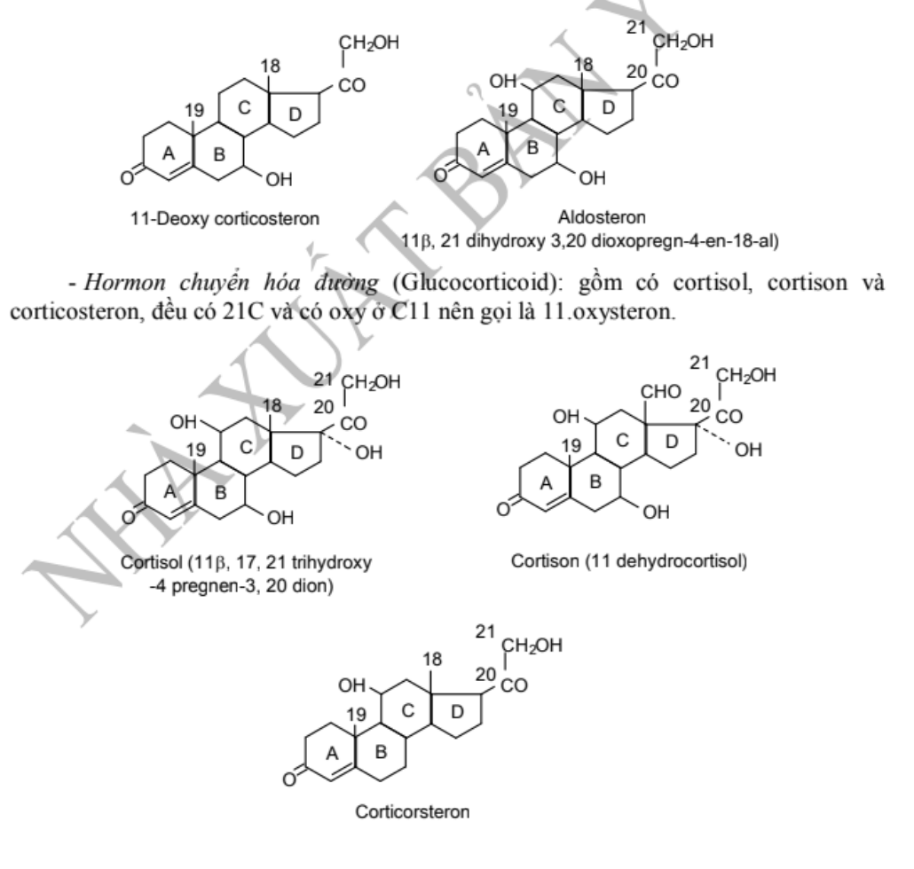
*Hình 13.27b. Sơ đồ các con đường sinh tổng hợp hormon steroid tại 3 lớp của vỏ thượng thận từ Cholesterol.*

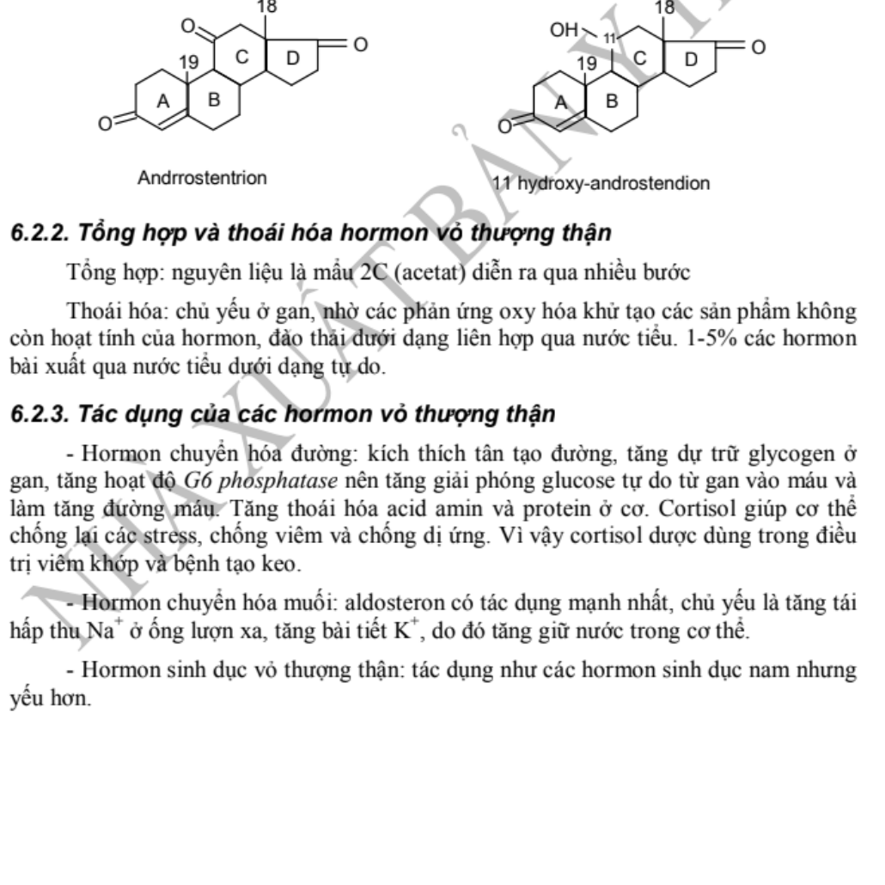
*Hình 13.28. Con đường enzym chuyển hóa chi tiết từ Pregnenolon thành Cortisol và Aldosteron.*

#### A. Mineralocorticoid: Aldosteron
- **Cấu trúc:** Steroid 21 carbon mang nhóm aldehyd ($-CHO$) ở C18 và nhóm hydroxyl ở C11.
- **Điều hòa bài tiết:** Chịu sự kiểm soát chủ yếu bởi **Hệ thống Renin - Angiotensin - Aldosteron (RAAS)** và nồng độ ion $\text{K}^+$ máu (khi $\text{K}^+$ máu tăng kích thích tiết aldosteron). ACTH chỉ đóng vai trò thứ yếu.
- **Tác dụng sinh học:** Gắn vào thụ thể mineralocorticoid (MR) nội bào ở tế bào chính ống lượn xa và ống góp thận:
  - Tăng tổng hợp và hoạt hóa bơm $\text{Na}^+/\text{K}^+\text{-ATPase}$ ở màng đáy và kênh natri biểu mô (ENaC) ở màng đỉnh.
  - **Tăng tái hấp thu $\text{Na}^+$ và nước** vào máu, đồng thời **tăng đào thải $\text{K}^+$ và $\text{H}^+$** ra nước tiểu.
- **Ý nghĩa bệnh học:** 
  - **Hội chứng Conn (Cường aldosteron nguyên phát):** Do u vỏ thượng thận làm tăng tiết aldosteron quá mức, dẫn đến tăng huyết áp, tăng thể tích tuần hoàn, **hạ kali máu** gây yếu cơ và **nhiễm kiềm chuyển hóa**.

#### B. Glucocorticoid: Cortisol (Hydrocortison)
- **Cấu trúc:** Steroid 21 carbon mang 3 nhóm hydroxyl ở vị trí $11\beta, 17\alpha, 21$ (11-oxysteroid).
- **Điều hòa bài tiết:** Hoàn toàn phụ thuộc vào trục **Vùng dưới đồi (CRH) $\rightarrow$ Tuyến yên (ACTH) $\rightarrow$ Vỏ thượng thận (Cortisol)** theo nhịp sinh học ngày đêm (cao nhất lúc 6 - 8 giờ sáng, thấp nhất lúc nửa đêm) và phản ứng với stress.
- **Tác dụng sinh học:**
  - *Trên chuyển hóa:* Tăng thoái hóa protein ở cơ giải phóng acid amin; tăng thoái hóa mỡ ở chi; kích thích mạnh mẽ con đường **tân tạo glucose** tại gan (kích hoạt enzym PEPCK, G6Pase) làm tăng glucose máu và tăng tích trữ glycogen ở gan.
  - *Tác dụng chống viêm và ức chế miễn dịch:* Ức chế enzym Phospholipase $\text{A}_2$ (thông qua tăng tổng hợp lipocortin/annexin-1) ngăn chặn giải phóng acid arachidonic sinh eicosanoid (prostaglandin, leukotrien); ức chế sản sinh các cytokine tiền viêm (IL-1, IL-6, TNF-$\alpha$); làm teo mô lympho và giảm bạch cầu ái toan, lympho bào.
- **Ý nghĩa bệnh học:**
  - **Hội chứng Cushing (Thừa cortisol):** Do dùng thuốc corticoid kéo dài hoặc do u vỏ thượng thận/u tuyến yên tiết thừa ACTH (Bệnh Cushing). Biểu hiện: béo phì trung tâm, mặt tròn như mặt trăng (*moon face*), bướu mỡ sau gáy (*buffalo hump*), da mỏng teo cơ, vết rạn da đỏ tím (*purple striae*), loãng xương và đái tháo đường thứ phát.
  - **Bệnh Addison (Suy vỏ thượng thận nguyên phát):** Do teo hoặc lao tuyến thượng thận làm thiếu hụt cả cortisol và aldosteron. Biểu hiện: hạ huyết áp tư thế, mệt mỏi suy nhược, sút cân, hạ đường huyết, hạ natri máu, tăng kali máu và **sạm da niêm mạc** do tăng tiết ACTH.

---

### 6.3. Hormon Sinh dục

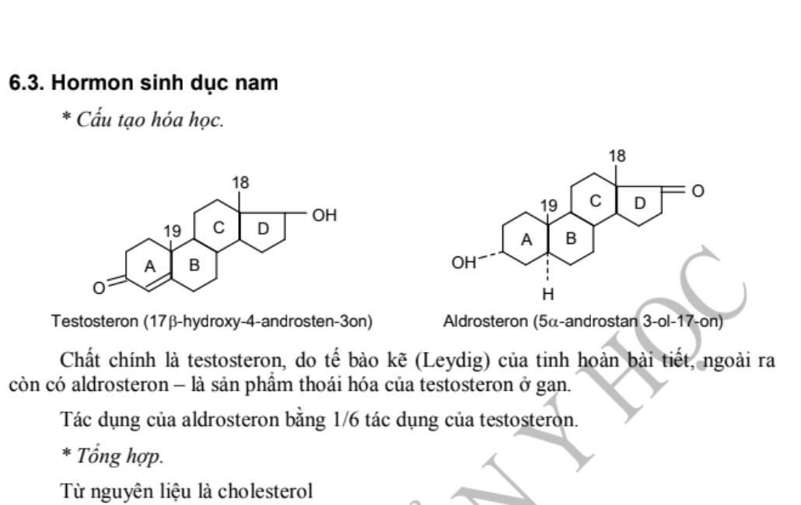
*Hình 13.29. Cấu trúc hóa học của Testosteron và các dẫn xuất Androgen.*

#### A. Hormon Sinh dục nam (Androgen): Testosteron
- Được bài tiết chủ yếu bởi **tế bào kẽ Leydig của tinh hoàn** dưới tác dụng kích thích của LH tuyến yên (một phần nhỏ do vỏ thượng thận).
- Tại các mô đích (tuyến tiền liệt, nang lông), testosteron được enzym $5\alpha$-reductase khử thành **Dihydrotestosteron (DHT)** có ái lực mạnh hơn gấp nhiều lần.
- **Tác dụng:** Phát triển cơ quan sinh dục nam thời kỳ bào thai và dậy thì; kích thích sản sinh tinh trùng; phát triển đặc tính sinh dục phụ thứ phát (giọng trầm, mọc râu lông, cơ bắp phát triển); kích thích tủy xương sinh hồng cầu và tăng đồng hóa protein.

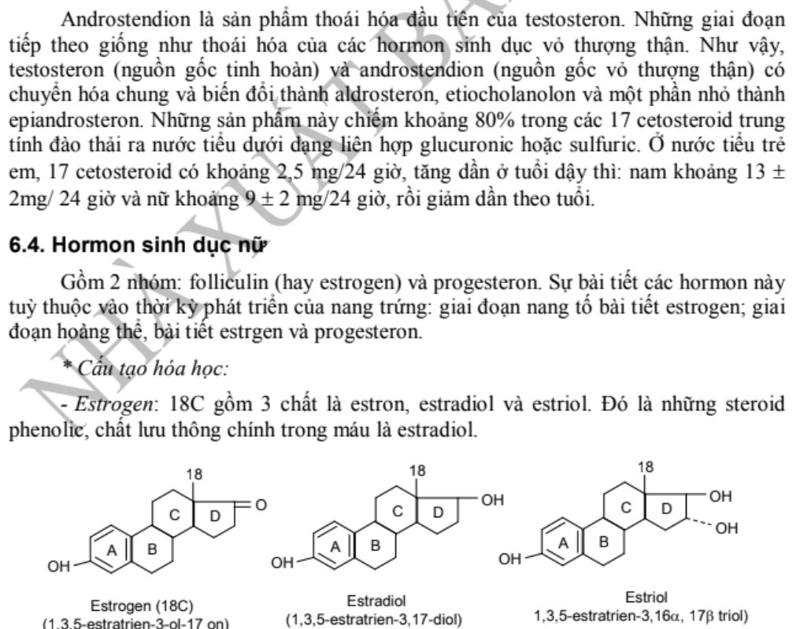
*Hình 13.30. Cấu trúc hóa học của các estrogen tự nhiên: $17\beta$-Estradiol ($E_2$), Estron ($E_1$), và Estriol ($E_3$).*

#### B. Hormon Sinh dục nữ: Estrogen và Progesteron
1. **Estrogen ($17\beta\text{-Estradiol}$):**
   - Được tổng hợp từ androgen nhờ enzym **Aromatase** tại các tế bào hạt buồng trứng dưới tác dụng của FSH.
   - **Tác dụng:** Phát triển cơ quan sinh dục nữ, niêm mạc tử cung tăng sinh trong nửa đầu chu kỳ kinh nguyệt; phát triển tuyến vú, phân bố mỡ dưới da; duy trì mật độ xương (chống tiêu xương) và bảo vệ tim mạch (tăng HDL, giảm LDL).

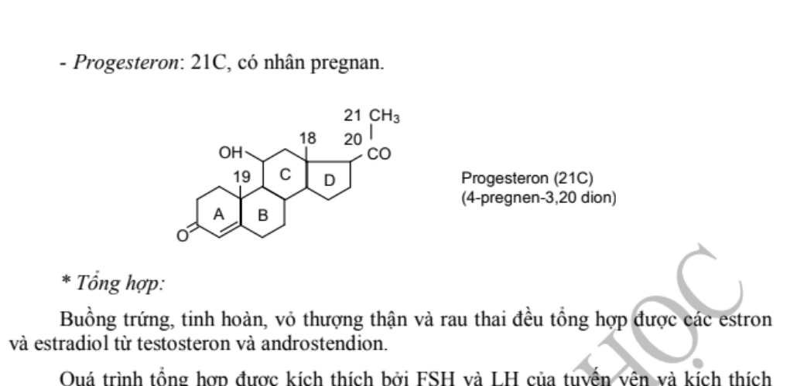
*Hình 13.31. Cấu trúc steroid 21 carbon của Progesteron.*

2. **Progesteron:**
   - Được bài tiết bởi **hoàng thể buồng trứng** ở nửa sau chu kỳ kinh nguyệt và bởi rau thai trong thai kỳ.
   - **Tác dụng:** Chuyển niêm mạc tử cung từ giai đoạn tăng sinh sang giai đoạn chế tiết giàu glycogen chuẩn bị đón trứng làm tổ; an dịu cơ tử cung chống sảy thai; kích thích phát triển nang tuyến vú chuẩn bị tiết sữa; tăng thân nhiệt nhẹ ở nửa sau chu kỳ.

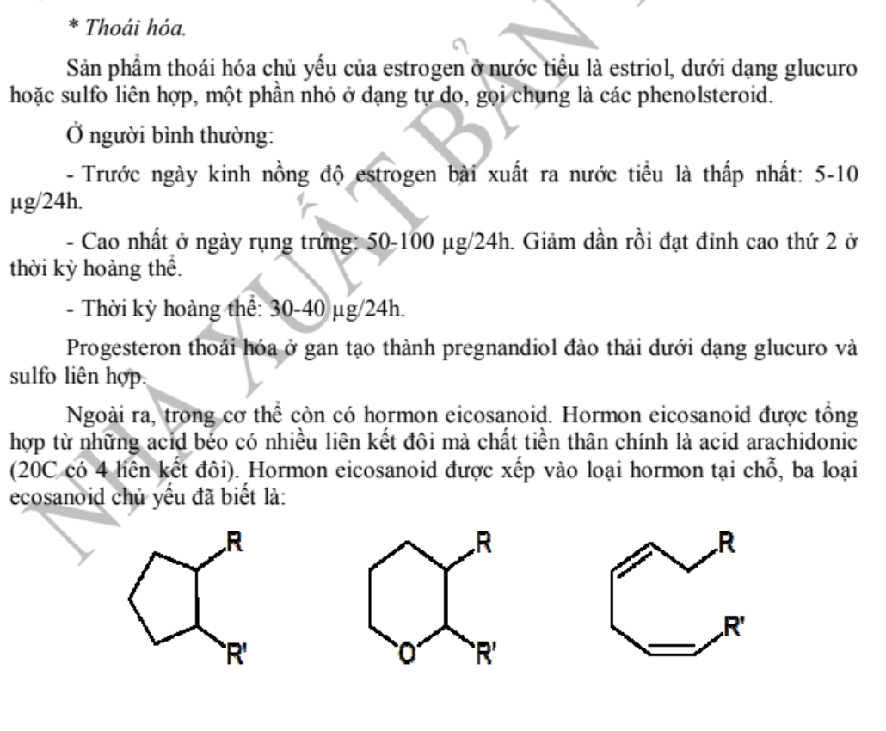
*Hình 13.32. Cấu trúc hóa học của các chất trung gian lipid tại chỗ Eicosanoid: Prostaglandin ($PGE_2$), Thromboxan ($TXA_2$) và Leukotrien ($LTC_4$).*

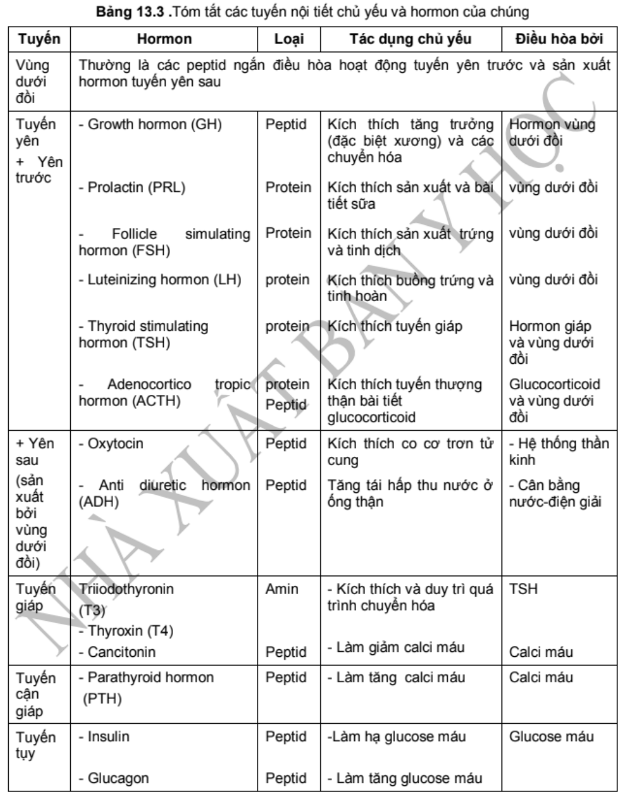
*Bảng 13.3. Bảng tổng kết phân loại, nguồn gốc, bản chất và tác dụng của các hormon chính trong cơ thể.*

---

## CÂU HỎI LƯỢNG GIÁ CHƯƠNG 13
1. Trình bày định nghĩa, phân loại hóa học của hormon và các phương thức truyền tín hiệu giữa các tế bào (nội tiết, cận tiết, tự tiết).
2. Trình bày cơ chế tác dụng phân tử của hormon tan trong lipid (hormon steroid và hormon tuyến giáp).
3. Trình bày cơ chế tác dụng của hormon tan trong nước qua hệ thống Adenylyl Cyclase - cAMP - Protein Kinase A và giải thích cơ chế gây bệnh của độc tố vi khuẩn tả trên Protein G.
4. Trình bày cơ chế tác dụng của hormon qua con đường Phospholipase C (tạo IP3, DAG và vai trò của ion Ca2+ - Calmodulin).
5. Trình bày cấu trúc và cơ chế tác dụng của thụ thể Tyrosine Kinase của Insulin.
6. Trình bày cấu tạo, nguồn gốc và tác dụng sinh học của các hormon thùy trước và thùy sau tuyến yên.
7. Trình bày bằng sơ đồ con đường sinh tổng hợp, thoái hóa của hormon tủy thượng thận (Catecholamin) và hormon tuyến giáp (T3, T4).
8. Kể tên, cấu tạo hóa học và tác dụng sinh học của các nhóm hormon steroid vỏ thượng thận và sinh dục.

---

# PHẦN II: HÓA SINH TẾ BÀO, MÔ VÀ CƠ QUAN

---