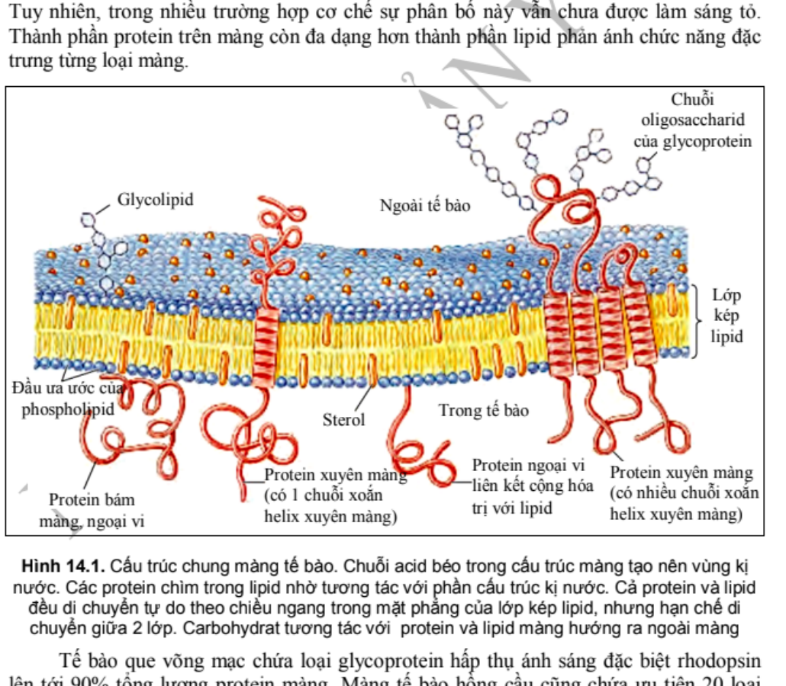
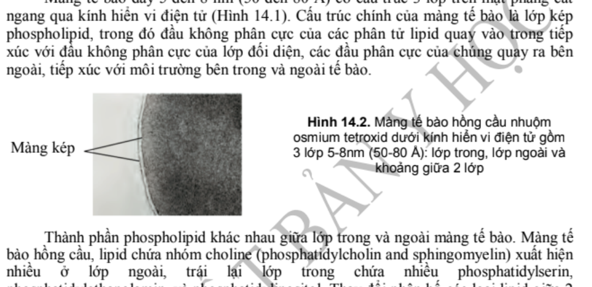
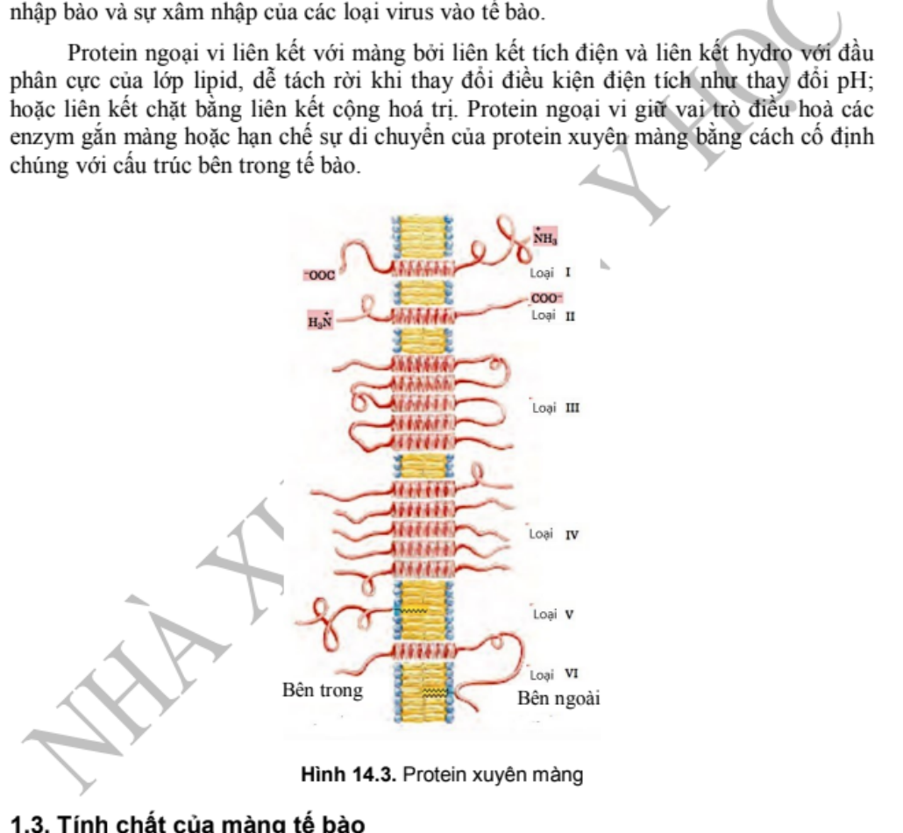
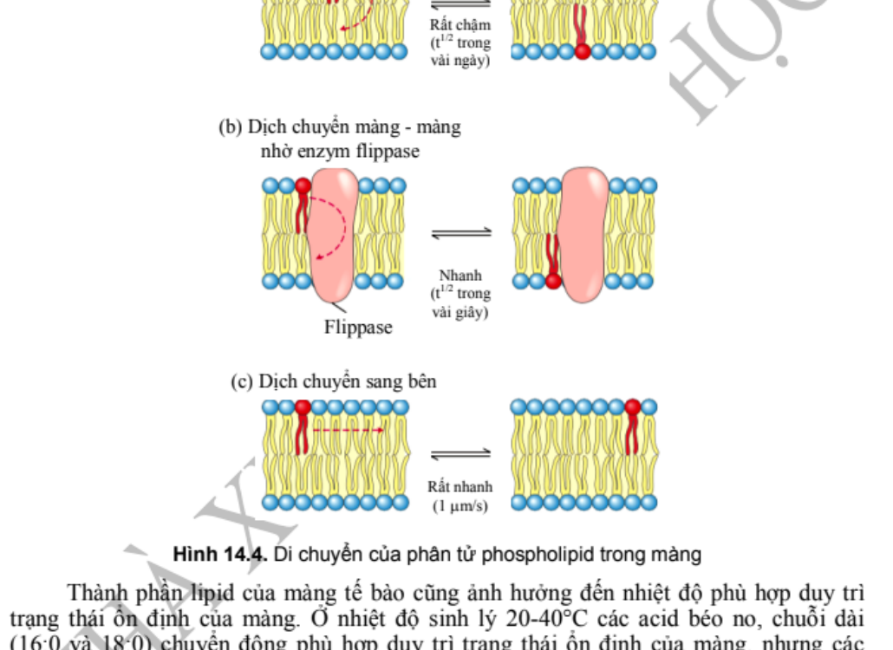
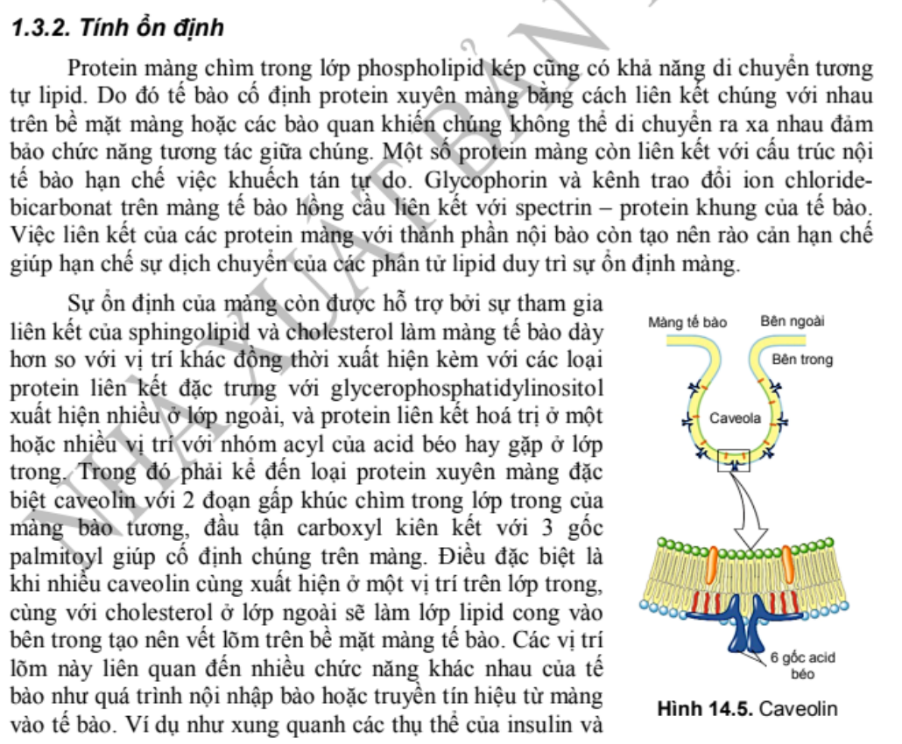
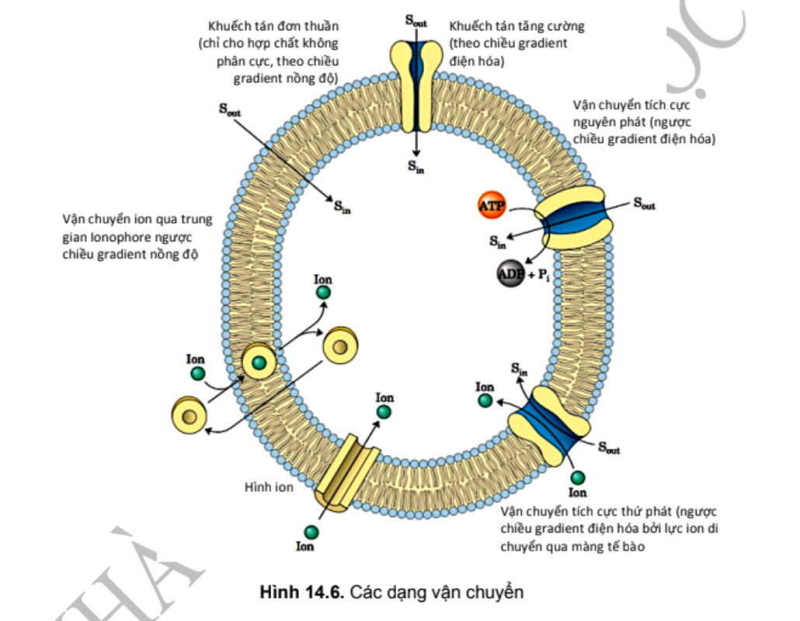
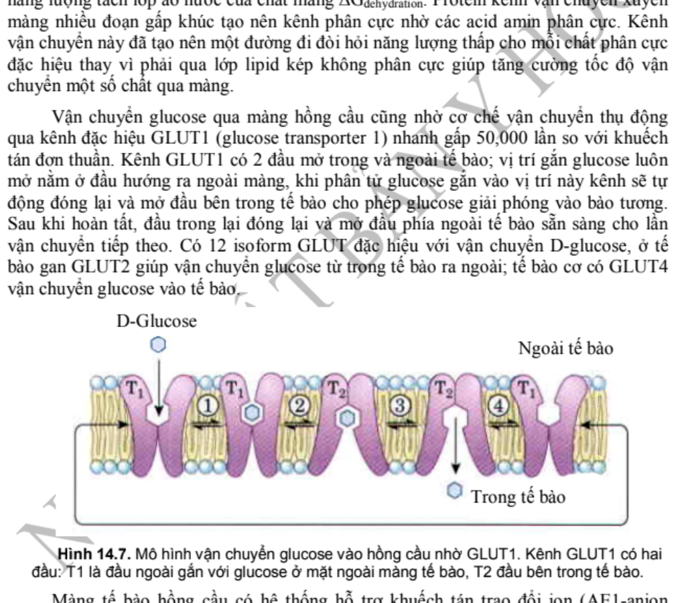
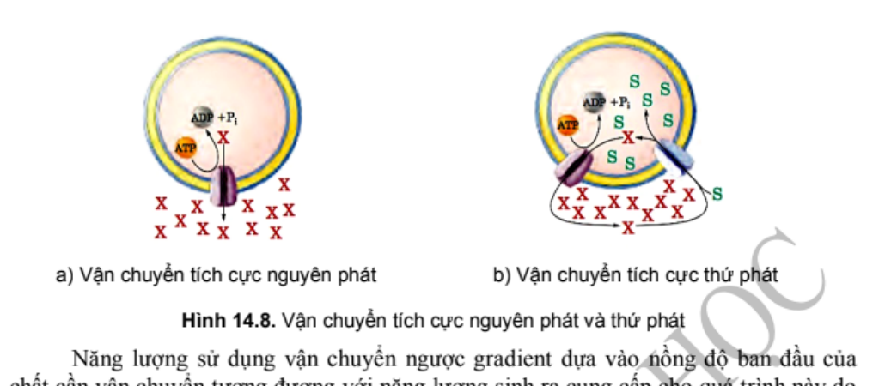
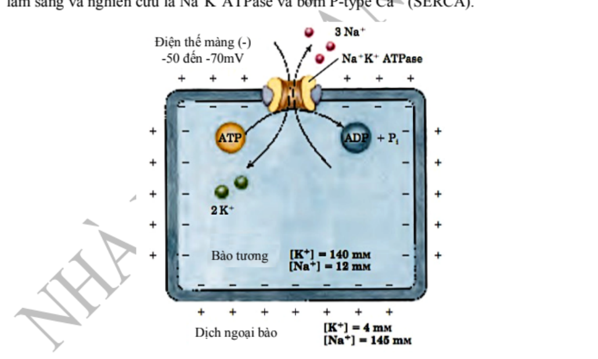
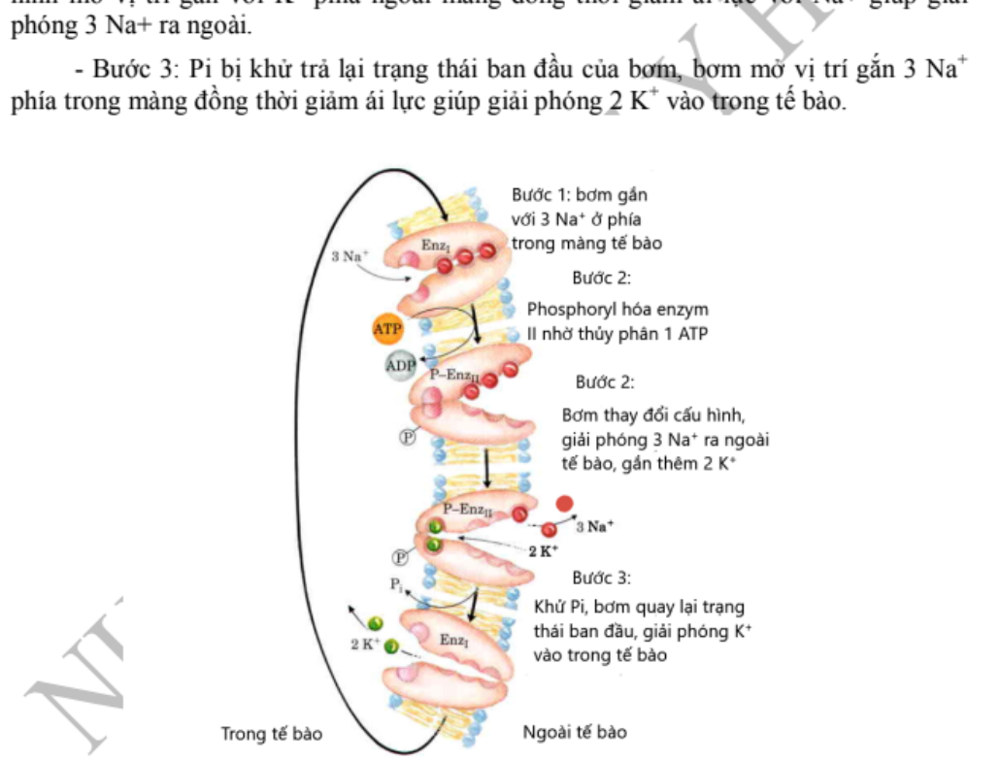

# CHƯƠNG 14: HÓA SINH MÀNG TẾ BÀO

## MỤC TIÊU HỌC TẬP
1. Trình bày được thành phần hóa học và cấu trúc của màng sinh chất tế bào.
2. Trình bày được tính chất lý hóa đặc trưng của màng tế bào (tính linh động, tính thấm chọn lọc, cấu trúc lipid raft và caveolin).
3. Trình bày được các cơ chế vận chuyển các chất qua màng tế bào: khuếch tán thụ động, khuếch tán thuận hóa và vận chuyển tích cực (nguyên phát và thứ phát).

---

## 1. THÀNH PHẦN VÀ CẤU TRÚC MÀNG TẾ BÀO

Màng tế bào (màng sinh chất) là một ranh giới mềm dẻo bao bọc tế bào, ngăn cách dịch nội bào với môi trường ngoại bào, đồng thời tạo nên các khoang bào quan riêng biệt bên trong tế bào. Màng đóng vai trò trung tâm trong tính thấm chọn lọc, duy trì gradient nồng độ ion, năng lượng sinh học và truyền tín hiệu tế bào.

Màng tế bào gồm 3 thành phần hóa học chính: **Lipid, Protein và Carbohydrat** (ở dạng glycoprotein và glycolipid):

*Hình 14.1. Mô hình khảm động (Fluid Mosaic Model) của màng tế bào: Lớp kép phospholipid với các đầu ưa nước quay ra ngoài và đuôi kỵ nước quay vào trong; các protein xuyên màng và protein ngoại vi; chuỗi carbohydrate hướng ra mặt ngoài.*

- **Lipid màng (chiếm $40 - 50\%$ trọng lượng màng):**
  - **Phospholipid:** Gồm *glycerophospholipid* (phosphatidylcholin, phosphatidylethanolamin, phosphatidylserin mang điện âm) và *sphingophospholipid* (sphingomyelin). Là phân tử lưỡng cực gồm đầu phân cực ưa nước và 2 đuôi acid béo kỵ nước.
  - **Cholesterol:** Xen kẽ giữa các phân tử phospholipid, điều hòa độ cứng nhắc và tính linh động của màng.
  - **Glycolipid (Cerebrosid, Gangliosid):** Phân bố độc quyền ở lá ngoài màng tế bào, tham gia nhận diện tế bào và thụ thể.
- **Tỷ lệ Lipid/Protein thay đổi theo chức năng:**
  - Màng Myelin thần kinh (cách điện): lipid chiếm tới $80\%$, protein $20\%$.
  - Màng trong ty thể (trung tâm chuỗi hô hấp tế bào): protein chiếm tới $75 - 80\%$, lipid chỉ $20 - 25\%$.

<!-- END FILE: pages_296_305.md -->

<!-- BEGIN FILE: pages_306_315.md -->

# CHƯƠNG 14 (TIẾP THEO): TÍNH CHẤT LÝ HÓA VÀ CƠ CHẾ VẬN CHUYỂN QUA MÀNG TẾ BÀO

---

## 1. THÀNH PHẦN VÀ CẤU TRÚC MÀNG TẾ BÀO (TIẾP THEO)

### 1.2. Đặc điểm Siêu cấu trúc và Phân bố Bất đối xứng của Màng
Dưới kính hiển vi điện tử nhuộm osmium tetroxyd, màng tế bào có độ dày khoảng **$5 - 8\text{ nm}$ ($50 - 80\text{ \AA}$)** gồm 3 lớp rõ rệt: hai lớp sẫm màu ở phía trong và phía ngoài (các đầu phân cực ưa nước) kẹp một lớp sáng ở giữa (các đuôi acid béo kỵ nước).

*Hình 14.2. Siêu cấu trúc 3 lớp của màng tế bào hồng cầu nhuộm osmium tetroxyd dưới kính hiển vi điện tử.*

- **Tính bất đối xứng (*Membrane asymmetry*):** Hai lá màng lipid kép có thành phần phospholipid và glycolipid hoàn toàn khác nhau:
  - **Lá ngoài (*outer leaflet*):** Giàu các phospholipid chứa cholin như **Phosphatidylcholin (Lecithin)** và **Sphingomyelin**, cùng toàn bộ glycolipid.
  - **Lá trong (*inner leaflet*):** Giàu **Phosphatidylserin (PS)** (mang điện tích âm), **Phosphatidylethanolamin (Cephalin)** và **Phosphatidylinositol (PI)**.
  - *Ý nghĩa sinh học:* Sự duy trì tính bất đối xứng do các enzym vận chuyển chuyên biệt kiểm soát (*Flippase, Floppase, Scramblase*). Khi tế bào đi vào quá trình chết theo chương trình (*apoptosis*), phosphatidylserin từ lá trong lật ra lá ngoài, đóng vai trò tín hiệu "hãy ăn tôi" (*eat-me signal*) cho đại thực bào thực bào. Ở màng tiểu cầu, sự lộ diện của PS ở lá ngoài là yếu tố khởi động dòng thác đông máu.

---

### 1.3. Phân loại các Protein Màng tế bào

Protein màng chiếm khoảng $50\%$ khối lượng màng tế bào, được chia thành hai nhóm chính:

*Hình 14.3. Sáu loại cấu trúc liên kết màng của Protein xuyên màng (Integral membrane proteins).*

1. **Protein Xuyên màng (*Integral / Transmembrane proteins*):** Ăn sâu hoặc xuyên qua toàn bộ bề dày của lớp lipid kép, liên kết chặt chẽ bởi tương tác kỵ nước và chỉ có thể tách chiết bằng chất tẩy rửa (*detergents*):
   - **Loại 1:** Xuyên màng 1 lần bằng 1 đoạn xoắn $\alpha$ kỵ nước (khoảng 20 aa), đầu N nằm ở ngoại bào (ví dụ: Glycophorin A của hồng cầu).
   - **Loại 2:** Xuyên màng 1 lần, đầu N nằm ở bào tương.
   - **Loại 3:** Một chuỗi đơn polypeptid xuyên màng nhiều lần (đa đoạn xoắn $\alpha$, ví dụ: các thụ thể GPCR 7 đoạn xuyên màng, Rhodopsin).
   - **Loại 4:** Phức hợp gồm nhiều chuỗi polypeptid liên kết lại tạo thành một kênh/lỗ vận chuyển xuyên màng.
   - **Loại 5:** Gắn với màng nhờ liên kết cộng hóa trị với chuỗi acid béo lipid (như myristoyl hóa, palmitoyl hóa).
   - **Loại 6:** Vừa có đoạn xoắn xuyên màng vừa có liên kết neo cộng hóa trị với gốc phospholipid (GPI anchor).
2. **Protein Ngoại vi (*Peripheral membrane proteins*):** Bám ở bề mặt trong hoặc ngoài của màng tế bào thông qua tương tác tĩnh điện và liên kết hydro với đầu phân cực của phospholipid hoặc protein xuyên màng, dễ dàng bị tách rời khi thay đổi $\text{pH}$ hoặc lực ion (ví dụ: Ankyrin, Spectrin duy trì hình đĩa lõm hai mặt của hồng cầu).

---

## 2. TÍNH CHẤT LÝ HÓA CỦA MÀNG TẾ BÀO

### 2.1. Tính Linh động của Màng (Membrane Fluidity)

Màng tế bào là một cấu trúc lỏng hai chiều (*two-dimensional fluid*), trong đó các phân tử lipid và protein có khả năng chuyển động liên tục:

*Hình 14.4. Các kiểu chuyển động của phospholipid: Khuếch tán ngang cực nhanh và Đổi lớp (Flip-flop) rất chậm.*

- **Khuếch tán ngang (*Lateral diffusion*):** Các phân tử phospholipid đổi chỗ cho nhau trong cùng một lá màng với tốc độ cực nhanh ($1 - 2\text{ }\mu\text{m/giây}$), cho phép phân tử chạy khắp chu vi tế bào vi khuẩn chỉ trong vài giây.
- **Đổi lớp / Lật màng (*Flip-flop / Transverse diffusion*):** Đầu ưa nước phải vượt qua lõi kỵ nước dày của màng sang lá đối diện. Đây là quá trình có rào cản năng lượng rất lớn nên xảy ra cực kỳ chậm trong điều kiện tự nhiên ($t_{1/2}$ tính bằng nhiều ngày). Quá trình này đòi hỏi các enzym vận chuyển phụ thuộc ATP:
  - **Flippase:** Chuyển PS và PE từ lá ngoài vào lá trong (tiêu tốn ATP).
  - **Floppase:** Chuyển phospholipid từ lá trong ra lá ngoài (thuộc họ ABC transporter, tiêu tốn ATP).
  - **Scramblase:** Trộn đảo hai chiều không tiêu tốn ATP khi có nồng độ $\text{Ca}^{2+}$ cao.
- **Các yếu tố điều hòa độ lỏng của màng:**
  - *Nhiệt độ:* Ở nhiệt độ thấp, màng chuyển sang trạng thái gel bán rắn; ở nhiệt độ cao, màng trở nên lỏng lẻo.
  - *Thành phần acid béo:* Acid béo chưa bão hòa có các liên kết đôi dạng cis tạo góc gấp khúc ngăn cản sự xếp chặt, làm **tăng tính linh động** của màng.
  - *Vai trò của Cholesterol:* Là chất đệm điều hòa tính linh động hai chiều: ở nhiệt độ cao, cholesterol cản trở chuyển động của chuỗi acyl làm giảm tính lỏng quá mức; ở nhiệt độ thấp, nó ngăn các acid béo xếp kết tinh giúp màng không bị đông cứng.

---

### 2.2. Bè Lipid (Lipid Rafts) và Caveolin

Trên màng tế bào, các phân tử không phân bố đồng nhất mà tập trung tạo thành các vi miền (*microdomains*) chuyên biệt gọi là **Bè Lipid (*Lipid Rafts*)**:

*Hình 14.5. Cấu trúc protein Caveolin bám màng tạo nên các hốc lõm Caveolae giàu Cholesterol và Sphingolipid.*

- Bè lipid rất giàu **Sphingolipid và Cholesterol**, có cấu trúc dày hơn và ít lỏng hơn phần màng xung quanh.
- Là nơi tập trung dày đặc các protein thụ thể, protein G, protein kinase phục vụ việc tiếp nhận và khuếch đại tín hiệu tế bào.
- **Caveolae:** Là các vết lõm hình chén nhỏ ($50 - 100\text{ nm}$) trên màng sinh chất được hình thành bởi protein bám màng **Caveolin**. Caveolin tạo phức hợp đa tụ liên kết chặt với cholesterol làm biến dạng màng, tham gia vào quá trình ẩm bào và dẫn truyền tín hiệu cơ học.
- **Hòa màng và Nhập bào/Xuất bào:** 
  - Virus cúm xâm nhập vào tế bào nhờ protein hòa màng Hemagglutinin (HA).
  - Sự bài xuất chất dẫn truyền thần kinh tại synap diễn ra nhờ phức hợp protein hòa màng **SNARE** (gồm $v\text{-SNARE}$ trên túi synap kết hợp với $t\text{-SNARE}$ và SNAP-25 trên màng trước synap khi có nồng độ ion $\text{Ca}^{2+}$ tăng vọt).

---

## 3. CƠ CHẾ VẬN CHUYỂN CÁC CHẤT QUA MÀNG TẾ BÀO

Do lõi kỵ nước của lớp lipid kép, màng sinh chất có **tính thấm chọn lọc cao**: các chất khí không phân cực ($\text{O}_2, \text{CO}_2, \text{N}_2$) và phân tử nhỏ không tích điện ($\text{H}_2\text{O}$, urê, ethanol) khuếch tán dễ dàng qua màng; trong khi các phân tử phân cực lớn (glucose) và tất cả các ion tích điện ($\text{Na}^+, \text{K}^+, \text{Ca}^{2+}, \text{Cl}^-$) **hoàn toàn không thể tự khuếch tán qua lớp lipid kép** mà bắt buộc phải có các protein vận chuyển chuyên biệt.

*Hình 14.6. Phân loại các cơ chế vận chuyển: Khuếch tán đơn thuần, Khuếch tán thuận hóa (qua kênh hoặc chất mang) và Vận chuyển tích cực.*

---

### 3.1. Vận chuyển Thụ động (Không tiêu tốn năng lượng)

Diễn ra xuôi theo chiều gradient nồng độ (hoặc gradient điện hóa) từ nơi có thế năng hóa học cao đến nơi có thế năng thấp:
1. **Khuếch tán đơn thuần (*Simple diffusion*):** Các phân tử không phân cực tan trong lipid tự do đi qua màng theo định luật Fick, không bị bão hòa.
2. **Khuếch tán thuận hóa (*Facilitated diffusion*):**
   - Dành cho các phân tử phân cực (như glucose) nhờ các **protein mang (Transporters / Permeases)**.
   - Có động học tương tự enzym: có tính đặc hiệu cơ chất cao, có hiện tượng bão hòa ($V_{\max}$) và có thể bị ức chế cạnh tranh.

*Hình 14.7. Cơ chế đổi cấu hình hai trạng thái $T_1$ (hướng ngoại bào) và $T_2$ (hướng nội bào) của kênh GLUT1.*

- **Protein vận chuyển Glucose (GLUT1 ở hồng cầu):** Protein xuyên màng 12 đoạn xoắn $\alpha$, hoạt động theo cơ chế luân phiên đổi cấu hình: Glucose gắn vào vị trí gắn ở trạng thái $T_1$ (mở ra ngoài), kích hoạt đổi cấu hình sang $T_2$ (mở vào trong) giải phóng glucose vào bào tương (vận chuyển đơn dòng - *Uniport*).
- **Protein trao đổi anion (Band 3 / AE1 ở hồng cầu):** Đồng vận chuyển ngược chiều (*Antiport*): vận chuyển $1\text{ ion }\text{HCO}_3^-$ ra ngoài đổi lấy $1\text{ ion }\text{Cl}^-$ đi vào trong tế bào hồng cầu, phục vụ vận chuyển $\text{CO}_2$ từ mô về phổi.
- **Kênh nước Aquaporin (AQPs):** Cho phép các phân tử nước khuếch tán cực nhanh qua màng theo gradient áp suất thẩm thấu mà ngăn chặn hoàn toàn sự rò rỉ của proton ($\text{H}^+$).
- **Kênh Ion (*Ion Channels*):** Cho phép hàng triệu ion ($\text{Na}^+, \text{K}^+, \text{Ca}^{2+}, \text{Cl}^-$) đi qua màng mỗi giây (gần tốc độ khuếch tán tự do lý thuyết, không bị bão hòa). Hoạt động đóng/mở được kiểm soát nghiêm ngặt bởi:
  - *Điện thế màng (*Voltage-gated*)*: kênh $\text{Na}^+, \text{K}^+$ trong điện thế hoạt động của sợi thần kinh.
  - *Phối tử (*Ligand-gated*)*: thụ thể nicotinic acetylcholin tại synap cơ thần kinh, thụ thể GABA.

---

### 3.2. Vận chuyển Tích cực (Active Transport - Tiêu tốn năng lượng)

Vận chuyển các chất **ngược chiều gradient nồng độ hoặc gradient điện thế**, là cơ chế thiết yếu để tạo lập và duy trì sự chênh lệch nồng độ ion sống còn của tế bào:

*Hình 14.8. Sơ đồ nguyên lý: (a) Vận chuyển tích cực nguyên phát tiêu tốn trực tiếp ATP; (b) Vận chuyển tích cực thứ phát sử dụng thế năng gradient nồng độ ion do vận chuyển nguyên phát tạo ra.*

1. **Vận chuyển Tích cực Nguyên phát (*Primary active transport*):**
   - Tiêu tốn năng lượng trực tiếp từ sự thủy phân ATP để bơm chất tan ngược gradient.
   - **Bơm $\text{Na}^+/\text{K}^+\text{-ATPase}$ (Bơm Natri - Kali):**
     - Có mặt ở màng sinh chất của mọi tế bào động vật. Thuộc họ P-type ATPase (tạo chất trung gian phosphoryl hóa tại gốc Asp).
     - Mỗi chu kỳ thủy phân **1 phân tử ATP**, bơm vận chuyển **$3\text{ ion }\text{Na}^+$ từ trong tế bào ra ngoài** và **$2\text{ ion }\text{K}^+$ từ ngoài vào trong tế bào**.
     - Duy trì nồng độ $\text{K}^+$ nội bào cao ($\approx 140\text{ mmol/L}$) và $\text{Na}^+$ ngoại bào cao ($\approx 145\text{ mmol/L}$); tạo điện thế nghỉ màng tế bào (bơm sinh điện) và duy trì thể tích tế bào (chống trương vỡ). Thuốc trợ tim nhóm Digitalis (Ouabain, Digoxin) ức chế chọn lọc bơm này.
   - **Bơm $\text{Ca}^{2+}\text{-ATPase}$ (SERCA):** Bơm $\text{Ca}^{2+}$ từ bào tương vào lòng lưới nội chất để kết thúc tín hiệu co cơ.
   - **Bơm $\text{H}^+/\text{K}^+\text{-ATPase}$:** Ở tế bào thành dạ dày bài tiết acid $\text{HCl}$ dịch vị (đích tác dụng của thuốc ức chế bơm proton PPI như Omeprazol).
2. **Vận chuyển Tích cực Thứ phát (*Secondary active transport*):**
   - Không sử dụng trực tiếp ATP. Sự vận chuyển ngược chiều của một chất được liên kết ghép cặp với sự vận chuyển xuôi chiều của một ion (thường là $\text{Na}^+$) theo gradient nồng độ do bơm $\text{Na}^+/\text{K}^+\text{-ATPase}$ đã tạo sẵn từ trước:
   - **Đồng vận chuyển cùng chiều (*Symport*):** Ví dụ kênh SGLT1 ở niêm mạc ruột non và SGLT2 ở ống lượn gần thận: đưa $2\text{ ion }\text{Na}^+$ xuôi gradient vào trong tế bào kéo theo $1\text{ phân tử Glucose}$ ngược nồng độ vào theo.
   - **Đồng vận chuyển ngược chiều (*Antiport*):** Ví dụ kênh trao đổi $\text{Na}^+/\text{Ca}^{2+}$ ở cơ tim: đưa $3\text{ ion }\text{Na}^+$ vào để tống $1\text{ ion }\text{Ca}^{2+}$ ra ngoài màng tế bào.

<!-- END FILE: pages_306_315.md -->

<!-- BEGIN FILE: pages_316_325.md -->

# CHƯƠNG 14 (TIẾP THEO) & CHƯƠNG 15: TRAO ĐỔI MUỐI NƯỚC (PHẦN 1)

---

## CHƯƠNG 14: HÓA SINH MÀNG TẾ BÀO (TIẾP THEO)

### 2.2. Vận chuyển tích cực (tiếp theo)

#### 2.2.1. Vận chuyển tích cực nguyên phát

Vận chuyển tích cực nguyên phát sử dụng năng lượng trực tiếp từ quá trình thủy phân ATP và được hỗ trợ bởi các protein vận chuyển (bơm ion). Protein vận chuyển tích cực nguyên phát có thể chia thành 4 loại chính:
1. **P-type ATPase**
2. **V-type ATPase**
3. **F-type ATPase**
4. **ABC transporter** (ATP-binding cassette transporter)

##### Nhóm P-type ATPase
Đây là loại protein vận chuyển phổ biến nhất được tìm thấy trên màng bào tương tế bào động vật. Đại diện điển hình của nhóm này là bơm $\text{Na}^+\text{-K}^+\text{-ATPase}$ và bơm $\text{Ca}^{2+}\text{-ATPase}$ (SERCA).
- **Đặc điểm chung:** Đặc trưng bởi sự tự phosphoryl hóa trực tiếp gốc aspartat (Asp) bảo tồn từ ATP, làm thay đổi cấu hình không gian của bơm để đẩy cation qua màng. Tất cả các bơm thuộc nhóm P-type đều có trình tự acid amin tương đồng cao xung quanh vị trí aspartat được phosphoryl hóa, và đều bị ức chế bởi chất tương tự phosphat (vanadate $\text{VO}_4^{3-}$, trong đó V thay thế P).
- **Cấu trúc:** Là các protein monomer gấp khúc với 10 đoạn xoắn $\alpha$ xuyên màng (đôi khi tồn tại dạng dimer). Chúng có thể vận chuyển 2 loại cation đồng thời ngược chiều nhau (ví dụ: bơm $\text{Na}^+\text{-K}^+\text{-ATPase}$ vận chuyển đồng thời $\text{Na}^+$ và $\text{K}^+$) hoặc 1 loại cation (ví dụ: bơm $\text{Ca}^{2+}\text{-ATPase}$).
- **Các đại diện quan trọng:**
  - Bơm $\text{H}^+\text{-K}^+\text{-ATPase}$ ở màng tế bào viền niêm mạc dạ dày: bài tiết ion $\text{H}^+$ vào lòng dạ dày tạo dịch vị acid.
  - Bơm kim loại nặng ở vi khuẩn: đào thải các cation kim loại nặng độc hại như $\text{Cd}^{2+}$, $\text{Cu}^{2+}$.
  - Bơm $\text{Na}^+\text{-K}^+\text{-ATPase}$ và bơm $\text{Ca}^{2+}\text{-ATPase}$ (SERCA).

*Hình 14.9. Bơm $\text{Na}^+\text{-K}^+\text{-ATPase}$ duy trì gradient nồng độ và điện thế nghỉ màng tế bào ($-50$ đến $-70\text{ mV}$). Điện thế dịch ngoại bào: $[\text{Na}^+] = 145\text{ mM}$, $[\text{K}^+] = 4\text{ mM}$; bào tương: nồng độ $\text{K}^+$ cao, $\text{Na}^+$ thấp.*

##### Bơm $\text{Na}^+\text{-K}^+\text{-ATPase}$
Là một heterodimer gồm 2 chuỗi polypeptide ($\alpha$ và $\beta$), có mặt ở màng sinh chất của tất cả các tế bào động vật:
- **Chức năng:** Duy trì nồng độ $\text{Na}^+$ thấp và $\text{K}^+$ cao trong bào tương so với môi trường ngoại bào. Mỗi chu kỳ hoạt động, bơm thủy phân 1 phân tử ATP để vận chuyển tích cực **$3\text{ Na}^+$ ra ngoài tế bào** và đưa **$2\text{ K}^+$ vào trong tế bào**.
- **Tính chất sinh điện (Electrogenic):** Do mỗi lần bơm đưa 3 điện tích dương ra ngoài và chỉ nhận 2 điện tích dương vào trong, bơm tạo ra sự chênh lệch điện thế hai bên màng. Mặt trong màng tế bào trở nên tích điện âm hơn so với mặt ngoài, duy trì điện thế màng lúc nghỉ (resting membrane potential) dao động từ $-50\text{ mV}$ đến $-70\text{ mV}$ tùy loại mô. Điện thế này giữ vai trò cốt tử trong tính hưng phấn và truyền dẫn xung thần kinh ở sợi trục neuron cũng như tế bào cơ.

*Hình 14.10. Chu kỳ 3 bước hoạt động của bơm $\text{Na}^+\text{-K}^+\text{-ATPase}$.*

##### Cơ chế hoạt động 3 bước của bơm $\text{Na}^+\text{-K}^+\text{-ATPase}$
Cơ chế biến đổi cấu hình không gian phụ thuộc vào trạng thái phosphoryl hóa của gốc Asp:
- **Bước 1 (Trạng thái $E_1$ - Chưa gắn $\text{P}_i$):** Bơm mở vị trí liên kết hướng vào trong bào tương, có ái lực cao với $\text{Na}^+$ và ái lực thấp với $\text{K}^+$. $3\text{ Na}^+$ từ bào tương gắn vào các vị trí đặc hiệu.
- **Bước 2 (Phosphoryl hóa - Chuyển sang $E_2\text{-P}$):** Thủy phân 1 phân tử $\text{ATP}$, gốc phosphat cao năng gắn vào gốc Asp của tiểu phần $\alpha$. Bơm thay đổi cấu hình sang dạng $E_2\text{-P}$, bộc lộ vị trí gắn ra ngoài tế bào. Ở cấu hình này, ái lực với $\text{Na}^+$ giảm mạnh giải phóng $3\text{ Na}^+$ ra ngoại bào; đồng thời ái lực với $\text{K}^+$ tăng cao, gắn kết $2\text{ K}^+$ từ ngoại bào.
- **Bước 3 (Khử phosphat - Quay về $E_1$):** Liên kết acyl-phosphat bị thủy phân khử $\text{P}_i$, bơm quay trở về cấu hình $E_1$ ban đầu, mở hướng vào trong bào tương, giảm ái lực với $\text{K}^+$ để giải phóng $2\text{ K}^+$ vào nội bào và sẵn sàng cho chu kỳ mới.

> [!NOTE]
> Tiêu thụ năng lượng của bơm $\text{Na}^+\text{-K}^+\text{-ATPase}$ ở toàn bộ các mô chiếm tới **25% tổng năng lượng tiêu thụ toàn thân** ở trạng thái nghỉ ngơi, chứng minh mật độ phân bố dày đặc và tầm quan trọng sống còn của bơm trong việc duy trì áp suất thẩm thấu, thể tích tế bào và gradient điện hóa.

##### Ứng dụng lâm sàng và độc chất học
- **Thuốc trợ tim Digitalis (Ouabain, Digoxin):** Các glycosid tim tự nhiên (chiết xuất từ cây mao địa hoàng *Digitalis purpurea*). Ouabain ức chế đặc hiệu bơm $\text{Na}^+\text{-K}^+\text{-ATPase}$ ở mặt ngoài tế bào bằng cách gắn vào trạng thái $E_2\text{-P}$, khóa bơm ở vị trí mở ra ngoài làm ứ trệ vận chuyển. Hậu quả là nồng độ $\text{Na}^+$ nội bào tăng lên, làm giảm gradient khử $\text{Na}^+$, từ đó ức chế kênh trao đổi ngược chiều $\text{Na}^+\text{-Ca}^{2+}$. Lượng $\text{Ca}^{2+}$ nội bào tăng lên kích thích phức hợp co sợi actin-myosin, làm tăng lực co bóp cơ tim trong điều trị suy tim sung huyết.
- **Palytoxin:** Độc tố cực mạnh từ san hô biển mềm (*Palythoa* ở Hawaii), gắn vào thụ thể bơm $\text{Na}^+\text{-K}^+\text{-ATPase}$ và chuyển nó thành kênh ion mở không chọn lọc, làm rò rỉ ồ ạt ion $\text{K}^+$ ra ngoài, triệt tiêu hoàn toàn điện thế màng dẫn đến ngừng tim và tử vong nhanh chóng.

##### Bơm P-type $\text{Ca}^{2+}\text{-ATPase}$ (SERCA và PMCA)
- Nồng độ $\text{Ca}^{2+}$ tự do trong bào tương bình thường rất thấp ($< 100\text{ nmol/L}$), thấp hơn môi trường ngoại bào từ 10.000 đến 20.000 lần. Nồng độ cực thấp này là điều kiện tiên quyết để các anion vô cơ như $\text{P}_i$, $\text{PP}_i$ không bị kết tủa và để ion $\text{Ca}^{2+}$ hoạt động như chất truyền tin thứ hai nhạy bén.
- $\text{Ca}^{2+}$ được bơm ra ngoài tế bào nhờ bơm trên màng sinh chất (PMCA - Plasma Membrane $\text{Ca}^{2+}$ ATPase) hoặc bơm vào lòng lưới nội chất/lưới cơ tương nhờ **SERCA** (*Sarcoplasmic and Endoplasmic Reticulum Calcium-ATPase*).
- Bơm SERCA chiếm tới 80% tổng lượng protein màng lưới nội chất, có độ đồng vận acid amin khoảng 65% với $\text{Na}^+\text{-K}^+\text{-ATPase}$. SERCA bị ức chế đặc hiệu bởi chất gây ung thư *thapsigargin*.

##### Bơm Proton F-type ATPase và V-type ATPase
- **F-type ATPase (ATP Synthase / $\text{F}_0\text{F}_1\text{-ATPase}$):** Khu trú tại màng trong ty thể. Hoạt động như một máy phát điện phân tử: khi cho proton $\text{H}^+$ chảy xuôi dòng gradient điện hóa từ khoang gian màng vào chất nền ty thể, nó tổng hợp ATP từ $\text{ADP} + \text{P}_i$ (phosphoryl hóa oxy hóa). Khi hoạt động đảo chiều, nó thủy phân ATP để bơm proton.
- **V-type ATPase (Vacuolar ATPase):** Có mặt trên màng các bào quan có tính acid như lysosome, endosome, túi tiết Golgi. Bơm vận chuyển proton $\text{H}^+$ từ bào tương vào lòng túi nhằm duy trì pH acid nội bào quan ($pH \approx 4{,}5 - 5{,}0$) phục vụ hoạt tính tối ưu của các enzym thủy phân acid (*acid hydrolases*). Cấu trúc gồm phần xuyên màng dẫn proton và phần gắn ngoại màng xúc tác thủy phân ATP.

##### Nhóm ABC Transporter (ATP-Binding Cassette)
Nhóm vận chuyển màng siêu lớn phụ thuộc ATP, vận chuyển một chiều các chất ra khỏi bào tương ngược gradient nồng độ (amino acid, peptid, ion, lipid, acid mật, thuốc ngoại sinh...):
- **Cấu trúc:** Gồm 2 vị trí gắn kết nucleotide/ATP (NBD - nucleotide-binding domains hay cassettes) và 2 miền xoắn xuyên màng (TMD - transmembrane domains) chứa từ 6 đến 10 chuỗi xoắn $\alpha$.
- Ở người đã phát hiện 48 gen mã hóa ABC transporter.
- **Enzym Flippase / Floppase:** Giúp vận chuyển phospholipid và cholesterol duy trì sự phân bố lipid bất đối xứng giữa hai lá màng.
- **Protein MDR1 (Multidrug Resistance Protein 1 / P-glycoprotein):** Đóng vai trò là bơm đào thải thuốc trị liệu ra khỏi tế bào khối u (adriamycin, doxorubicin, vinblastine), làm giảm nồng độ thuốc nội bào, gây ra hiện tượng đa kháng hóa chất trong điều trị ung thư.

---

#### 2.2.2. Vận chuyển tích cực thứ phát (Secondary Active Transport)

Quá trình này không tiêu thụ trực tiếp ATP tại thời điểm vận chuyển, mà lợi dụng thế năng gradient nồng độ ion $\text{Na}^+$ hoặc $\text{H}^+$ đã được thiết lập sẵn bởi hệ thống vận chuyển tích cực nguyên phát trước đó.

##### Phân loại vận chuyển tích cực thứ phát
- **Đồng vận cùng chiều (Symport):** Cation dẫn đường ($\text{Na}^+$ hoặc $\text{H}^+$) và chất được vận chuyển chuyển dịch cùng chiều qua màng.
- **Đồng vận ngược chiều (Antiport):** Cation dẫn đường và cơ chất chuyển dịch ngược chiều nhau.

##### Bảng 14.1. Vận chuyển tích cực thứ phát nhờ gradient nồng độ $\text{Na}^+$ hoặc $\text{H}^+$

| Loại tế bào | Chất vận chuyển (ngược gradient) | Chất đồng vận chuyển (xuôi gradient) | Hình thức vận chuyển |
| :--- | :--- | :--- | :--- |
| *E. coli* | Lactose | $\text{H}^+$ | Cùng chiều (Symport) |
| *E. coli* | Proline | $\text{H}^+$ | Cùng chiều (Symport) |
| *E. coli* | Dicarboxylic acid | $\text{H}^+$ | Cùng chiều (Symport) |
| Ruột non, Thận | Glucose | $\text{Na}^+$ | Cùng chiều (Symport - SGLT) |
| Ruột non, Thận | Amino acid | $\text{Na}^+$ | Cùng chiều (Symport) |
| Tế bào động vật | $\text{Ca}^{2+}$ | $\text{Na}^+$ | Ngược chiều (Antiport - $\text{NCX}$) |
| Thực vật | $\text{K}^+$ | $\text{H}^+$ | Ngược chiều (Antiport) |
| Nấm (*Neurospora*) | $\text{K}^+$ | $\text{H}^+$ | Ngược chiều (Antiport) |

##### Cơ chế hấp thu Glucose tại tế bào biểu mô niêm mạc ruột non
Quá trình này diễn ra nhờ sự phối hợp chặt chẽ của 3 hệ thống protein màng phân bố bất đối xứng:
1. **Mặt đỉnh (Apical membrane - hướng lòng ruột):** Bơm đồng vận $\text{Na}^+\text{-glucose}$ (SGLT1) gắn đồng thời $2\text{ Na}^+$ và 1 phân tử glucose. Thế năng điện hóa của $\text{Na}^+$ (nồng độ $\text{Na}^+$ lòng ruột cao, điện thế nội bào âm) kéo $\text{Na}^+$ ùa vào tế bào, cuốn theo glucose ngược gradient nồng độ, làm nồng độ glucose trong biểu mô ruột có thể cô đặc gấp 9.000 lần so với lòng ruột.
2. **Mặt đáy - bên (Basolateral membrane - tiếp giáp mao mạch):**
   - **Bơm $\text{Na}^+\text{-K}^+\text{-ATPase}$:** Liên tục đẩy $3\text{ Na}^+$ vào máu và lấy $2\text{ K}^+$ vào trong, duy trì nồng độ $\text{Na}^+$ nội bào luôn ở mức thấp để nuôi dưỡng động lực cho SGLT1 ở mặt đỉnh.
   - **Kênh khuếch tán thuận hóa GLUT2:** Đưa glucose nồng độ cao từ bào tương ra dịch kẽ và mao mạch theo cơ chế khuếch tán thụ động xuôi dòng nồng độ.

##### Độc tố phá vỡ gradient điện hóa (Ionophore - Kháng sinh Valinomycin)
Kháng sinh valinomycin là một peptid vòng nhỏ có khả năng bao bọc ion $\text{K}^+$ bằng các nhóm carbonyl phân cực quay vào trong, trong khi chuỗi bên kỵ nước quay ra ngoài. Phức hợp valinomycin-$\text{K}^+$ dễ dàng hòa tan và khuếch tán tự do qua lớp lipid kép, đưa $\text{K}^+$ ùa ra ngoài tế bào vi khuẩn, triệt tiêu điện thế màng và làm rối loạn cân bằng thẩm thấu, tiêu diệt vi khuẩn.

---

### 3. BỆNH HỌC MÀNG TẾ BÀO

#### 3.1. Bệnh lý di truyền do khiếm khuyết protein màng

##### 3.1.1. Bệnh xơ nang (Cystic Fibrosis - CF)
- **Dịch tễ & Di truyền:** Bệnh di truyền lặn trên nhiễm sắc thể thường rất phổ biến ở người da trắng (tỷ lệ mang gen dị hợp tử khoảng 5%).
- **Cơ chế phân tử:** Do đột biến gen *CFTR* (*Cystic Fibrosis Transmembrane Conductance Regulator*) trên nhiễm sắc thể số 7, mã hóa kênh vận chuyển ion $\text{Cl}^-$ thuộc họ ABC transporter. Đột biến thường gặp nhất (chiếm 70%) là mất bộ ba mã hóa cho phenylalanine ở vị trí 508 ($\Delta\text{F508}$), khiến protein bị sai lệch gấp cuộn, bị giữ lại và thoái hóa tại proteasome mà không ra được màng sinh chất.
- **Biểu hiện lâm sàng:** Mất chức năng bài xuất $\text{Cl}^-$ kéo theo giảm bài xuất nước tại màng biểu mô đường hô hấp, tiêu hóa, tuyến tụy, tuyến mồ hôi. Lớp dịch nhầy trở nên đặc quánh, làm tê liệt hoạt động của vi nhung mao phế quản, tắc nghẽn đường thở, nhiễm trùng đường hô hấp mạn tính tái diễn (*Pseudomonas aeruginosa*) và suy hô hấp dẫn đến tử vong trước 30 tuổi; kèm theo suy tụy ngoại tiết gây kém hấp thu dinh dưỡng.

##### Bảng 14.2. Một số bệnh lý di truyền do mất chức năng kênh ion màng

| Kênh ion | Gen đột biến | Bệnh lý / Triệu chứng lâm sàng |
| :--- | :--- | :--- |
| $\text{Na}^+$ (điện thế, cơ vân) | *SCN4A* | Liệt chu kỳ do tăng kali huyết (Hyperkalemic periodic paralysis) |
| $\text{Na}^+$ (điện thế, thần kinh) | *SCN1A* | Động kinh toàn thể, sốt cao co giật theo cơn (Hội chứng Dravet) |
| $\text{Na}^+$ (điện thế, cơ tim) | *SCN5A* | Hội chứng QT dài type 3 (LQT3), nhịp nhanh thất, đột tử trong khi ngủ |
| $\text{Ca}^{2+}$ (neuron thần kinh) | *CACNA1A* | Liệt nửa người có đau nửa đầu có tính gia đình, thất điều vận động |
| $\text{Ca}^{2+}$ (điện thế, võng mạc) | *CACNA1F* | Mù ban đêm bẩm sinh không tiến triển |
| $\text{Ca}^{2+}$ (polycystin-1) | *PKD1* | Bệnh thận đa nang người lớn |
| $\text{K}^+$ (thần kinh tai trong) | *KCNQ4* | Điếc tiếp nhận tiến triển có tính gia đình |
| $\text{K}^+$ (điện thế, thần kinh) | *KCNQ2* | Co giật sơ sinh lành tính có tính gia đình |
| Cation (cGMP-gated, võng mạc) | *CNCG1* | Thoái hóa võng mạc sắc tố, mất thị lực ban đêm và nhìn ngoại vi |
| Thụ thể Acetylcholin (cơ vân) | *CHRNA1* | Nhược cơ bẩm sinh (nhìn đôi, sụp mí, khó nuốt, yếu cơ toàn thân) |
| Kênh $\text{Cl}^-$ (ABC transporter) | *CFTR* | Bệnh xơ nang (Cystic Fibrosis) |

##### 3.1.2. Bệnh Tangier
Do đột biến lặn gen mã hóa chất vận chuyển **ABCA1** trên nhiễm sắc thể 9q31. Protein này chịu trách nhiệm vận chuyển tích cực cholesterol và phospholipid từ nội bào ra ApoA-I ngoại bào để tạo hạt tiền HDL. Đột biến ABCA1 làm tế bào mất khả năng giải phóng lipid dư thừa, gây tích tụ este cholesterol trong các đại thực bào ở amidan (amidan to màu vàng cam đặc trưng), lách to, thiếu máu và suy giảm nghiêm trọng hoặc gần như không đo được nồng độ HDL-C máu, dẫn tới xơ vữa động mạch sớm.

#### 3.2. Rối loạn vận chuyển qua màng thứ phát
- **Đái tháo đường type 1:** Thiếu hụt bài tiết insulin tuyệt đối từ tế bào $\beta$ đảo tụy khiến các túi chứa kênh **GLUT4** không được huy động hòa màng sinh chất ở mô cơ và mô mỡ. Tốc độ thu nhận glucose vào tế bào giảm sút tới 15 lần, dẫn đến tăng đường huyết kéo dài sau ăn và cạn kiệt năng lượng nội bào.
- **Đái tháo nhạt do thận (Nephrogenic Diabetes Insipidus):** Khiếm khuyết thụ thể $V_2$ hoặc đột biến gen kênh **Aquaporin-2 (AQP2)** tại tế bào ống góp làm thận không đáp ứng với hormon ADH. Các kênh AQP2 không được chuyển ra màng đỉnh, nước không được tái hấp thu trở lại tuần hoàn, dẫn đến tiểu nhiều (nước tiểu pha loãng từ 10 đến 20 lít/ngày), khát nhiều và mất nước ưu trương nghiêm trọng.

---

### CÂU HỎI ÔN TẬP CHƯƠNG 14

1. Trình bày 3 đặc tính cơ bản của màng tế bào (tính lỏng linh động, tính bất đối xứng, tính thấm chọn lọc). Ứng dụng của mỗi đặc tính trong nghiên cứu và điều trị.
2. Trình bày cơ chế vận chuyển chất không phân cực, nước và các ion qua màng tế bào không dùng năng lượng (khuếch tán đơn thuần, khuếch tán thuận hóa qua kênh ion và protein tải).
3. Phân biệt các hình thức vận chuyển ion qua màng: ionophore, kênh ion và bơm ion.
4. Trình bày cơ chế hấp thu glucose tại biểu mô niêm mạc ruột. Phân biệt cơ chế vận chuyển qua kênh GLUT và bơm đồng vận chuyển $\text{Na}^+\text{-glucose}$ (SGLT).
5. Trình bày cơ chế hoạt động 3 bước của bơm $\text{Na}^+\text{-K}^+\text{-ATPase}$. Nêu vai trò sinh học của bơm này trong cơ thể.
6. Trình bày cơ chế tăng glucose máu kéo dài sau ăn trong đái tháo đường (liên quan đến sự dịch chuyển chuyển vị của transporter GLUT4).
7. Trình bày cơ chế sinh bệnh học và triệu chứng lâm sàng của bệnh xơ nang (đột biến gen *CFTR*).

---