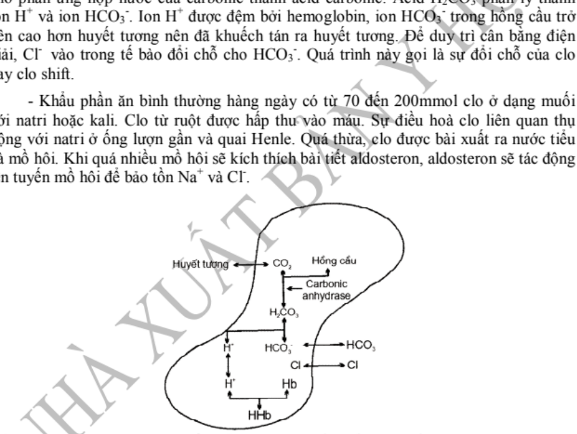
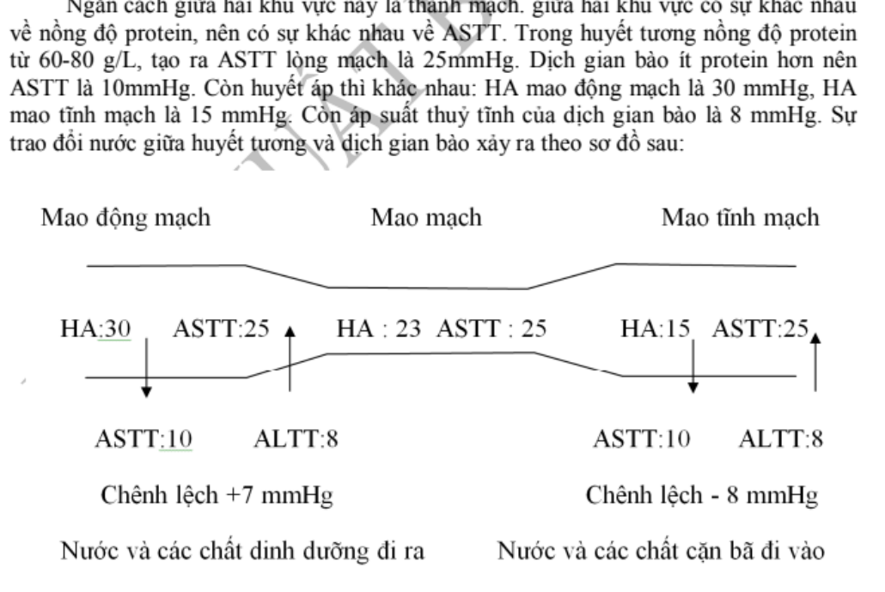
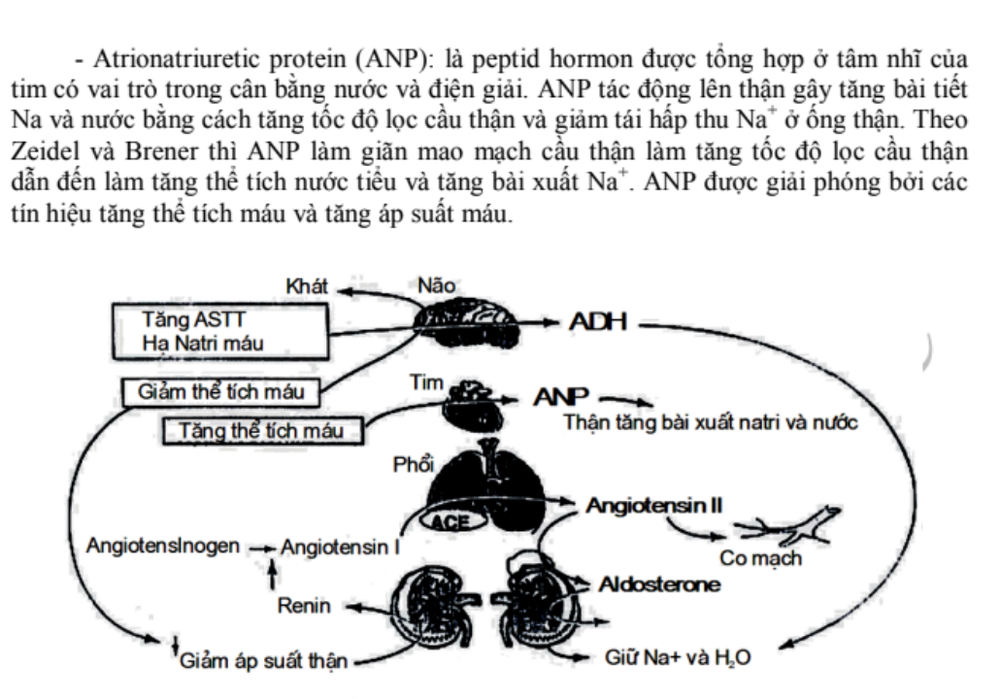

## CHƯƠNG 15: TRAO ĐỔI MUỐI NƯỚC (BẮT ĐẦU)

### MỤC TIÊU HỌC TẬP
1. Trình bày được vai trò, hàm lượng và sự phân bố của nước và các chất điện giải trong cơ thể.
2. Trình bày được các quy luật và cơ chế vận chuyển nước giữa trong và ngoài thành mạch, giữa trong và ngoài tế bào.
3. Trình bày được cơ chế điều hòa trao đổi nước và các chất điện giải trong cơ thể (thần kinh, nội tiết, huyết áp).
4. Trình bày được nguyên nhân, cơ chế sinh bệnh và hậu quả của một số rối loạn thăng bằng nước và điện giải chính trên lâm sàng.

---

### ĐẠI CƯƠNG
Nước và các chất điện giải mặc dù không tham gia chuyển hóa sinh năng lượng như glucid, lipid, protein nhưng là nền tảng hóa lý thiết yếu duy trì sự sống:
- Là môi trường dung môi diễn ra toàn bộ các phản ứng hóa sinh của tế bào.
- Đảm bảo hình dạng cấu trúc tế bào, ổn định áp suất thẩm thấu, thể tích tuần hoàn và cân bằng acid - base nội môi.
- Rối loạn trao đổi muối nước diễn biến rất nhanh, đe dọa trực tiếp tính mạng người bệnh; do đó việc nắm vững các quy luật chuyển hóa muối nước là điều kiện tiên quyết trong cấp cứu hồi sức và điều trị nội khoa.

---

### 1. NƯỚC TRONG CƠ THỂ

Trong cơ thể sống, nước tồn tại dưới hai trạng thái chính: **nước tự do** và **nước kết hợp**.

#### 1.1. Cấu tạo và đặc tính hóa lý của nước
- **Nước tự do:** Phân tử nước gồm 1 nguyên tử oxy liên kết với 2 nguyên tử hydro theo dạng góc tam giác (góc liên kết $\text{H-O-H} = 104{,}5^\circ$). Do độ âm điện của oxy lớn hơn hydro, hai liên kết $\text{O-H}$ phân cực mạnh tạo nên một lưỡng cực điện vĩnh viễn. Nhờ tính phân cực này, các phân tử nước liên kết chéo với nhau qua mạng lưới **liên kết hydro**, tạo nên hằng số điện môi lớn, nhiệt dung dung môi cao, sức căng bề mặt lớn và khả năng hòa tan tuyệt vời đối với các phân tử phân cực và các ion vô cơ. Nước tự do có nhiệt độ đông đặc ở $0^\circ\text{C}$ và nhiệt độ sôi ở $100^\circ\text{C}$; lượng nước tự do thay đổi trực tiếp theo khẩu phần ăn uống hàng ngày.
- **Nước kết hợp:** Chiếm khoảng 20-30% tổng lượng nước, không tham gia tự do vào quá trình hòa tan hay bài tiết, đóng băng ở nhiệt độ $< 0^\circ\text{C}$, gồm 2 dạng:
  - **Nước hydrat hóa:** Tạo nên lớp vỏ hydrat phân cực bao quanh các tiểu phân keo protein và micell lipid trong bào tương; cứ $10\text{ g}$ protein thì cần $5\text{ g}$ nước để tạo vỏ hydrat.
  - **Nước bị cầm (nước cấu trúc gel):** Nằm len lỏi trong các khe mạng lưới không gian ba chiều của hệ keo phân tử (proteoglycan, acid hyaluronic, chất nền ngoại bào và chất nền tế bào), làm cho gel có trạng thái nửa rắn. Nước bị cầm giúp duy trì hình dáng giải phẫu và độ vững chắc cơ học của các mô (ví dụ: mô cơ và tim chứa tới 70-80% nước nhưng ở trạng thái rắn chắc; trong khi máu chứa 83% nước nhưng không có mạng gel nên ở trạng thái lỏng lưu thông).

#### 1.2. Hàm lượng nước trong cơ thể
Lượng nước toàn phần chiếm từ **40% đến 75% trọng lượng cơ thể** (trung bình khoảng 60% ở người trưởng thành), biến thiên phụ thuộc vào 3 yếu tố chính:
- **Tuổi tác:** Tuổi càng nhỏ tỷ lệ nước càng lớn. Phôi thai 2 tháng tuổi nước chiếm tới 97%; thai 3 tháng tuổi khoảng 94%; thai 5 tháng tuổi khoảng 85%; trẻ sơ sinh chiếm khoảng 75-80%; sau 1 tuần giảm còn khoảng 60%; người trưởng thành bình thường từ 55-65%; người già lượng nước giảm dần chỉ còn khoảng 50%.
- **Giới tính:** Nam giới có tỷ lệ nước cao hơn nữ giới (nam khoảng 60%, nữ khoảng 50-55% do tỷ lệ mô mỡ ở nữ cao hơn).
- **Thành phần mô:** Mô mỡ là mô chứa ít nước nhất (chỉ 25-30%), do đó người béo phì có tỷ lệ nước toàn phần thấp hơn người gầy.

##### Bảng 15.1. Hàm lượng nước trong một số cơ quan và dịch sinh học của người trưởng thành

| Cơ quan | Hàm lượng nước (%) | Dịch sinh học | Hàm lượng nước (%) |
| :--- | :--- | :--- | :--- |
| **Thận** | 82,7 | **Nước tiểu** | 95,0 |
| **Phổi** | 79,0 | **Mồ hôi** | 99,5 |
| **Gan** | 70,0 | **Nước bọt** | 99,4 |
| **Mô cơ** | 70,0 | **Sữa mẹ** | 89,0 |
| **Xương** | 16,0 – 46,0 | **Máu toàn phần** | 80,0 – 83,0 |

#### 1.3. Sự phân bố nước trong các khu vực cơ thể
Tổng lượng nước cơ thể (Total Body Water - TBW) phân bố trong hai khu vực ngăn cách nhau bởi màng tế bào:
- **Khu vực dịch nội bào (ICF - Intracellular Fluid):** Chiếm khoảng **55% tổng lượng nước** (tương đương 30-40% trọng lượng cơ thể), chủ yếu tồn tại dưới dạng nước kết hợp.
- **Khu vực dịch ngoại bào (ECF - Extracellular Fluid):** Chiếm khoảng **45% tổng lượng nước** (tương đương 20% trọng lượng cơ thể), là môi trường lưu thông tự do của cơ thể.

##### Bảng 15.2. Tỷ lệ phân bố nước trong các khu vực của cơ thể

| Khu vực phân bố | Tỷ lệ % so với tổng lượng nước cơ thể |
| :--- | :--- |
| **Dịch nội bào (ICF)** | **55,0%** |
| **Dịch ngoại bào (ECF)**, trong đó gồm: | **45,0%** |
| - *Nước dịch gian bào (kẽ mô)* | 20,0% |
| - *Nước huyết tương và bạch huyết* | 7,5% |
| - *Nước trong mô liên kết* | 7,5% |
| - *Nước trong mô xương và sụn* | 8,0% |
| - *Nước trong các dịch sinh học (dịch não tủy, dịch khớp, dịch tiêu hóa)* | 2,0% |

#### 1.4. Nhu cầu nước của cơ thể
- Người lớn khỏe mạnh cần khoảng **$35\text{ g}$ nước/kg trọng lượng/ngày** (khoảng $2{,}0 - 2{,}5\text{ lít/ngày}$).
- Trẻ em có nhu cầu nước cao gấp 3 đến 4 lần người lớn do tốc độ chuyển hóa cơ bản cao và diện tích bề mặt cơ thể lớn so với khối lượng. Trẻ sơ sinh cần tới **$140\text{ g}$ nước/kg cân nặng/ngày**.
- Nhu cầu nước tăng cao khi sốt, thời tiết khô nóng hoặc khi lao động nặng nhọc ra nhiều mồ hôi.

#### 1.5. Cân bằng xuất nhập nước (Bilan nước)
Ở người khỏe mạnh, lượng nước nhập vào và bài xuất ra khỏi cơ thể cân bằng tuyệt đối (bilan nước bằng 0).

##### Bảng 15.3. Bảng cân bằng xuất nhập nước ở người trưởng thành (trong 24 giờ)

| Nước nhập vào | Thể tích (mL) | Nước bài xuất ra | Thể tích (mL) |
| :--- | :--- | :--- | :--- |
| Nước uống trực tiếp | 1.200 | Nước tiểu (thận) | 1.400 |
| Nước trong thức ăn | 1.000 | Thoát hơi qua mồ hôi (da) | 500 |
| Nước nội sinh từ chuyển hóa | 300 | Thoát hơi qua hơi thở (phổi) | 500 |
| | | Đào thải qua phân | 100 |
| **Tổng cộng nhập** | **2.500** | **Tổng cộng xuất** | **2.500** |

#### 1.6. Vai trò sinh học của nước
1. **Tham gia cấu trúc:** Hình thành hệ thống keo - gel nội bào và dịch gian bào duy trì hình dạng giải phẫu và độ bền vững cơ học của tế bào và mô.
2. **Dung môi phản ứng và cơ chất trực tiếp:** Là môi trường hòa tan các chất dinh dưỡng, khí, ion; tham gia trực tiếp vào các phản ứng thủy phân (*hydrolysis*), hydrat hóa (*hydration*).
3. **Vận chuyển:** Vận chuyển chất dinh dưỡng, oxy, hormon đến tế bào và thu nhận các chất đào thải (urê, creatinin, acid uric, $\text{CO}_2$) đưa đến các cơ quan bài tiết.
4. **Điều hòa thân nhiệt:** Nhờ nhiệt dung cao và nhiệt bốc hơi lớn ($540\text{ cal/g}$), nước điều hòa nhiệt độ thân nhiệt khi nhiệt độ môi trường thay đổi thông qua bài tiết mồ hôi và thông khí phổi.
5. **Bảo vệ và giảm ma sát:** Dịch não tủy bảo vệ hệ thần kinh trung ương chống va đập cơ học; dịch màng tim, màng phổi, dịch bao khớp làm trơn láng và giảm ma sát trong hoạt động cơ học liên tục.
6. **Tham gia tạo áp suất thẩm thấu và áp lực thủy tĩnh:** Quyết định sự lưu thông dòng dịch và cân bằng nội môi giữa các khoang cơ thể.

<!-- END FILE: pages_316_325.md -->

<!-- BEGIN FILE: pages_326_335.md -->

# CHƯƠNG 15: TRAO ĐỔI MUỐI NƯỚC (TIẾP THEO)

---

### 2. CÁC CHẤT VÔ CƠ (CÁC CHẤT ĐIỆN GIẢI / MUỐI KHOÁNG)

#### 2.1. Hàm lượng và sự phân bố các chất vô cơ trong cơ thể
Các chất vô cơ chiếm từ **4% đến 5% trọng lượng cơ thể** và phân bố không đồng đều giữa các mô và các khu vực:
- **Xương và răng:** Tập trung lượng lớn calci, phosphat và magnesi dưới dạng muối phức hợp không tan (tinh thể hydroxyapatit $\text{Ca}_{10}(\text{PO}_4)_6(\text{OH})_2$).
- **Dịch ngoại bào (huyết tương, dịch kẽ), da và mô liên kết:** Chứa nhiều $\text{Na}^+$ và $\text{Cl}^-$.
- **Dịch nội bào:** Tập trung chủ yếu ion $\text{K}^+$, phosphat hữu cơ và $\text{Mg}^{2+}$.
- **Tuyến giáp:** Tập trung hàm lượng rất cao iod để tổng hợp hormon $\text{T}_3, \text{T}_4$.
- **Dịch vị dạ dày:** Chứa nồng độ acid $\text{HCl}$ cao; dịch tụy chứa nồng độ $\text{HCO}_3^-$ kiềm cao.

##### Phân loại các nguyên tố vô cơ
1. **Nguyên tố đa lượng:** Tồn tại với số lượng lớn trong cơ thể ($> 0{,}01\%$ trọng lượng cơ thể), bao gồm $\text{Na}, \text{K}, \text{Cl}, \text{Ca}, \text{P}, \text{Mg}$.
2. **Nguyên tố vi lượng:** Tồn tại với nồng độ rất nhỏ ($< 0{,}01\%$), bao gồm $\text{Fe}, \text{I}, \text{Cu}, \text{Zn}, \text{Mn}, \text{Co}, \text{Br}...$
3. **Nguyên tố siêu vi lượng:** Tồn tại ở dạng vết như $\text{Cr}, \text{Se}, \text{Mo}, \text{Si}, \text{Ni}...$

#### 2.2. Nhu cầu các chất vô cơ của cơ thể

##### Bảng 15.4. Nhu cầu các chất vô cơ hàng ngày ở người trưởng thành

| Chất vô cơ | Nhu cầu / ngày | Chất vô cơ | Nhu cầu / ngày |
| :--- | :--- | :--- | :--- |
| **Natri ($\text{Na}^+$)** | $1{,}0 - 3{,}5\text{ g}$ | **Phosphat ($\text{PO}_4^{3-}$)** | $1{,}5\text{ g}$ |
| **Kali ($\text{K}^+$)** | $4{,}0\text{ g}$ | **Magnesi ($\text{Mg}^{2+}$)** | $0{,}3\text{ g}$ |
| **Calci ($\text{Ca}^{2+}$)** | $0{,}8\text{ g}$ | **Sắt ($\text{Fe}$)** | $0{,}02\text{ g}$ ($20\text{ mg}$) |
| **Clo ($\text{Cl}^-$)** | $4{,}0\text{ g}$ | **Các nguyên tố vi lượng** | Dạng vết ($\mu\text{g} - \text{mg}$) |

> [!NOTE]
> Nhu cầu chất khoáng biến đổi theo lứa tuổi và trạng thái sinh lý:
> - Trẻ em đang tuổi lớn, phụ nữ có thai và cho con bú có nhu cầu calci, phospho và sắt tăng cao rõ rệt.
> - Nhu cầu natri ở trẻ sơ sinh là $0{,}1 - 0{,}5\text{ g/ngày}$; ở trẻ em là $0{,}3 - 2{,}5\text{ g/ngày}$.

#### 2.3. Hấp thu và bài xuất chất vô cơ
- **Hấp thu:** Các ion vô cơ đưa vào theo đường tiêu hóa và được hấp thu chủ yếu tại ruột non vào máu. Các muối $\text{NaCl}$ và $\text{KCl}$ tan hoàn toàn và được hấp thu rất nhanh chóng và dễ dàng. Sau khi vào máu, chúng được vận chuyển đến các mô đích chuyên biệt (sắt về gan và tủy xương, calci-phospho về mô xương, $\text{NaCl}$ tích trữ dưới da).
- **Đào thải:**
  - **Qua nước tiểu (thận):** Là đường đào thải chủ yếu của các muối hòa tan như $\text{Na}^+, \text{K}^+, \text{Cl}^-, \text{Ca}^{2+}$, sulfat, iod, phosphat.
  - **Qua phân:** Đào thải các muối ít tan hoặc cation hóa trị hai như sắt, calci, phosphat dư thừa, magnesi và các ion kim loại nặng ($\text{Hg}, \text{Pb}, \text{Cu}$).
  - **Qua mồ hôi:** Đào thải một lượng biến thiên $\text{NaCl}$ và sulfat.

#### 2.4. Vai trò sinh học của các chất vô cơ
1. **Tham gia cấu trúc:** Hình thành khung xương, răng ($\text{Ca}, \text{P}$); cấu tạo màng sinh học và acid nucleic (phospholipid, acid phosphoric).
2. **Ổn định hệ keo và tính thấm màng tế bào:** Duy trì trạng thái hydrat hóa và độ tích điện của các phân tử protein nội bào.
3. **Tạo áp suất thẩm thấu nội môi:** Nồng độ các ion vô cơ hòa tan quyết định phần lớn áp suất thẩm thấu của máu và dịch kẽ, quyết định sự phân bố thể tích nước giữa các khoang.
4. **Hệ thống đệm duy trì pH máu:** Hai hệ đệm quan trọng nhất của cơ thể là hệ đệm bicarbonat ($\text{H}_2\text{CO}_3 / \text{HCO}_3^-$) và hệ đệm phosphat ($\text{H}_2\text{PO}_4^- / \text{HPO}_4^{2-}$).
5. **Đồng yếu tố enzym và dẫn truyền điện học:**
   - Hoạt hóa enzym: $\text{Cl}^-$ hoạt hóa amylase; $\text{Mg}^{2+}$ là coenzym của các kinase; $\text{Na}^+, \text{K}^+$ hoạt hóa bơm ATPase. Kim loại nặng ức chế enzym do tạo kết tủa với nhóm thiol $-\text{SH}$.
   - Tham gia quá trình đông máu ($\text{Ca}^{2+}$ là yếu tố IV).
   - Duy trì điện thế nghỉ và phát sinh điện thế hoạt động trong dẫn truyền xung thần kinh và co cơ.

---

#### 2.5. Đặc điểm của một số chất vô cơ chính trong cơ thể

##### 2.5.1. Natri ($\text{Na}^+$)
- **Nồng độ và phân bố:** Là cation chính chiếm tới **90% tổng số cation dịch ngoại bào**. Nồng độ bình thường trong huyết thanh là **$136 - 145\text{ mmol/L}$**, trong khi nồng độ nội bào chỉ khoảng $10 - 15\text{ mmol/L}$.
- **Vai trò thẩm thấu:** Là yếu tố quyết định áp suất thẩm thấu hiệu dụng của dịch ngoại bào. Áp suất thẩm thấu huyết tương bình thường khoảng $295\text{ mOsm/kg}$, trong đó khoảng $270\text{ mOsm/kg}$ do ion $\text{Na}^+$ và các anion đi kèm ($\text{Cl}^-, \text{HCO}_3^-$) tạo nên. Bơm $\text{Na}^+\text{-K}^+\text{-ATPase}$ liên tục bơm $3\text{ Na}^+$ ra ngoài để bảo vệ tế bào không bị phù và vỡ.
- **Điều hòa thăng bằng natri:** Thận là cơ quan điều hòa chính qua 3 cơ chế:
  1. *Cảm giác khát:* Khi áp suất thẩm thấu tăng, vùng dưới đồi kích thích cảm giác khát để tăng đưa nước vào làm loãng natri.
  2. *Hormon ADH:* Kích thích tái hấp thu nước tự do ở ống góp.
  3. *Hệ thống Aldosteron, Angiotensin II và ANP:* Bình thường 60-75% $\text{Na}^+$ được tái hấp thu ở ống lượn gần, phần còn lại tái hấp thu ở quai Henle và ống lượn xa dưới tác động của aldosterone (tăng tái hấp thu $\text{Na}^+$, tăng bài tiết $\text{K}^+$ và $\text{H}^+$). ANP từ tâm nhĩ có tác dụng đối kháng, làm tăng thải $\text{Na}^+$ qua nước tiểu.

##### 2.5.2. Kali ($\text{K}^+$)
- **Nồng độ và phân bố:** Là cation chính của dịch nội bào, chiếm tới **98% tổng lượng kali cơ thể**. Nồng độ $\text{K}^+$ trong tế bào là **$140 - 150\text{ mmol/L}$**, trong khi nồng độ ngoại bào chỉ từ **$3{,}5 - 5{,}0\text{ mmol/L}$**.
- **Vai trò sinh học:** Quyết định điện thế màng lúc nghỉ và tính hưng phấn thần kinh - cơ, dẫn truyền xung động điện tim. Tỷ lệ nồng độ kali nội bào / ngoại bào $[\text{K}^+]_i / [\text{K}^+]_e$ là yếu tố sống còn: tăng hoặc giảm kali huyết thanh đều gây rối loạn tái cực cơ tim, rung thất, ngừng tim hoặc liệt cơ mềm.
- **Mối liên quan kali và thăng bằng acid - base:**
  - Trong tình trạng **hạ kali máu**: tế bào huy động $\text{K}^+$ đi ra ngoài máu để bù trừ, đồng thời kéo $\text{Na}^+$ và $\text{H}^+$ vào trong tế bào. Hậu quả là nồng độ $\text{H}^+$ ngoại bào giảm sinh ra **nhiễm kiềm chuyển hóa**.
  - Ngược lại, trong tình trạng **toan chuyển hóa**: ion $\text{H}^+$ ùa vào tế bào đẩy $\text{K}^+$ ra ngoài, gây **tăng kali máu**.

##### 2.5.3. Clo ($\text{Cl}^-$)
- **Nồng độ và phân bố:** Là anion chính của dịch ngoại bào, nồng độ huyết thanh bình thường từ **$99 - 109\text{ mmol/L}$**.
- **Vai trò:** Trung hòa điện thế với cation $\text{Na}^+$, điều hòa thể tích dịch và cân bằng acid - base.
- **Hiện tượng đổi chỗ của Clo (Chloride Shift / Hiện tượng Hamburger):**
  - $\text{CO}_2$ từ mô khuếch tán vào hồng cầu được carbonic anhydrase (CA) hợp nước tạo thành $\text{H}_2\text{CO}_3$, phân ly thành $\text{H}^+$ (được đệm bởi DeoxyHb) và $\text{HCO}_3^-$.
  - Khi nồng độ $\text{HCO}_3^-$ trong hồng cầu tăng cao, kênh đối vận AE1 (Band 3) đẩy $\text{HCO}_3^-$ ra huyết tương để làm hệ đệm kiềm lưu thông. Để đảm bảo trung hòa điện tích, ion $\text{Cl}^-$ từ huyết tương lập tức khuếch tán vào trong hồng cầu.
  - Tại phổi, quá trình này diễn ra theo chiều ngược lại: $\text{Cl}^-$ ra khỏi hồng cầu, $\text{HCO}_3^-$ đi vào để chuyển hóa thành $\text{CO}_2$ đào thải qua hơi thở.

*Hình 15.1. Sơ đồ hiện tượng di chuyển của Clo (Chloride shift / Hamburger phenomenon) giữa hồng cầu và huyết tương tại mô ngoại vi.*

##### 2.5.4. Bicarbonat ($\text{HCO}_3^-$)
- Là anion nhiều thứ hai trong dịch ngoại bào, nồng độ huyết thanh bình thường từ **$22 - 28\text{ mmol/L}$**. Chiếm trên 90% tổng lượng $\text{CO}_2$ toàn phần trong huyết tương.
- Là thành phần kiềm dự trữ quan trọng nhất của hệ thống đệm bicarbonat $\text{CO}_2/\text{HCO}_3^-$. Thận đảm nhiệm vai trò tái hấp thu 90% $\text{HCO}_3^-$ ở ống lượn gần và bài tiết $\text{H}^+$ ở ống lượn xa.

##### 2.5.5. Calci ($\text{Ca}^{2+}$)
- **Phân bố:** Hơn **99% lượng calci nằm ở mô xương và răng**, chỉ khoảng 1% nằm trong máu và dịch gian bào. Nồng độ $\text{Ca}^{2+}$ tự do trong bào tương cực kỳ thấp ($< 100\text{ nmol/L}$), thấp hơn nồng độ huyết thanh từ 5.000 đến 10.000 lần.
- **Nồng độ calci máu toàn phần:** Bình thường từ **$2{,}15 - 2{,}60\text{ mmol/L}$** ($8{,}5 - 10{,}5\text{ mg/dL}$), tồn tại dưới 3 dạng:
  - *Calci ion hóa ($\text{Ca}^{2+}$ tự do):* Khoảng 45-50%, có hoạt tính sinh học trực tiếp.
  - *Calci liên kết protein (chủ yếu là Albumin):* Khoảng 40%.
  - *Calci phức hợp với anion hòa tan (citrat, phosphat, bicarbonat):* Khoảng 10-15%.
- **Bệnh lý:** Giảm calci máu gây cơn co cứng cơ (*Tetany*), dấu hiệu Chvostek và Trousseau dương tính; tăng calci máu thường do cường tuyến cận giáp hoặc u ác tính di căn xương.

##### 2.5.6. Phosphat ($\text{PO}_4^{3-}$)
- Nồng độ phosphat toàn phần trong máu khoảng $12\text{ mg}\%$ ($3{,}9\text{ mmol/L}$), trong đó phosphat vô cơ huyết thanh từ $3 - 4{,}5\text{ mg/dL}$ ($0{,}8 - 1{,}45\text{ mmol/L}$). Xương chiếm 80% tổng lượng phospho cơ thể.
- Thành phần cấu tạo acid nucleic, phospholipid màng, và các liên kết cao năng sinh học ($\text{ATP, GTP, Creatin phosphat, 2,3-BPG}$).

---

### 3. CƠ CHẾ TRAO ĐỔI MUỐI NƯỚC

#### 3.1. Các yếu tố quyết định sự vận chuyển và phân bố nước trong cơ thể

##### 3.1.1. Áp suất thẩm thấu (Osmotic Pressure - ASTT)
- ASTT được tạo bởi tổng nồng độ các hạt hòa tan trong dung dịch, có xu hướng **hút và giữ nước** về phía khu vực có nồng độ chất hòa tan cao hơn.
- Trong cơ thể gồm 3 nhóm hạt hòa tan:
  1. *Chất điện giải:* Quyết định 90-95% ASTT ngoại bào ($\text{Na}^+, \text{Cl}^-$) và nội bào ($\text{K}^+$, phosphat).
  2. *Chất hữu cơ phân tử lượng nhỏ (glucose, urê, acid amin):* Dễ dàng khuếch tán qua màng nên nồng độ cân bằng giữa các khoang, ít tạo chênh lệch thẩm thấu hiệu dụng trừ trường hợp tăng đường huyết cấp.
  3. *Chất hữu cơ cao phân tử (Protein):* Không qua được màng mao mạch và màng tế bào, tạo ra **áp suất thẩm thấu keo (Colloid Osmotic Pressure / Oncotic Pressure)**.

##### 3.1.2. Áp lực thủy tĩnh (Hydrostatic Pressure - ALTT)
Được tạo bởi áp lực ép cơ học của cột nước lên thành mạch hoặc màng tế bào. Áp lực thủy tĩnh có tác dụng **đẩy nước ra khỏi** lòng mạch hoặc khoang chứa.

##### 3.1.3. Cân bằng Donnan và áp suất do keo (Donnan Equilibrium)
- Trong một hệ gồm 2 ngăn ngăn cách bởi màng bán thấm cho nước và ion nhỏ ($\text{Na}^+, \text{Cl}^-$) đi qua nhưng giữ lại đại phân tử keo tích điện âm (proteinat $\text{R}^-$).
- **Định luật Donnan 1:** Khi đạt trạng thái cân bằng, tích số nồng độ các ion khuếch tán ở hai bên màng phải bằng nhau:
  $$[\text{Na}^+]_1 \times [\text{Cl}^-]_1 = [\text{Na}^+]_2 \times [\text{Cl}^-]_2$$
  Biểu thức lượng ion khuếch tán $x$ khi ban đầu ngăn 1 có $\text{NaCl}$ nồng độ $a$ và ngăn 2 có $\text{Na-protein}$ nồng độ $b$:
  $$(a - x)^2 = (b + x) \cdot x \implies x = \frac{a^2}{b + 2a}$$
- **Định luật Donnan 2:** Tổng nồng độ điện tích dương luôn bằng tổng nồng độ điện tích âm ở mỗi ngăn để đảm bảo tính trung hòa điện tích.
- **Hệ quả:** Ngăn chứa keo proteinat luôn có tổng số hạt ion cao hơn ngăn không chứa proteinat, tạo ra một áp suất thẩm thấu bổ sung gọi là **áp suất do keo**, giúp giữ một lượng nước cố định không bị thoát ra dịch gian bào.

---

#### 3.2. Quy luật trao đổi nước giữa các khu vực

##### 3.2.1. Trao đổi nước giữa huyết tương và dịch gian bào (Định luật Starling)
Ngăn cách bởi thành mao mạch. Màng mao mạch cho nước và các chất điện giải nhỏ đi qua tự do, giữ lại protein huyết tương:
- Áp suất keo huyết tương (giữ nước trong lòng mạch): $25\text{ mmHg}$.
- Áp suất keo dịch gian bào: $10\text{ mmHg}$.
- Áp lực thủy tĩnh dịch gian bào: $8\text{ mmHg}$.

*Hình 15.2. Cân bằng áp lực Starling điều hòa trao đổi nước và chất dinh dưỡng qua thành mao mạch.*

- **Tại đầu mao động mạch:**
  - Lực đẩy nước ra ngoài: Huyết áp tâm thu mao mạch ($30\text{ mmHg}$) + Áp suất keo dịch kẽ ($10\text{ mmHg}$) = $40\text{ mmHg}$.
  - Lực kéo nước vào lòng mạch: Áp suất keo huyết tương ($25\text{ mmHg}$) + Áp lực thủy tĩnh mô kẽ ($8\text{ mmHg}$) = $33\text{ mmHg}$.
  - **Chênh lệch hữu hiệu:** $+7\text{ mmHg}$ $\rightarrow$ Nước, oxy và chất dinh dưỡng được lọc đẩy ra dịch kẽ nuôi tế bào.
- **Tại đầu mao tĩnh mạch:**
  - Huyết áp mao mạch giảm xuống chỉ còn $15\text{ mmHg}$.
  - Lực đẩy ra: $15 + 10 = 25\text{ mmHg}$.
  - Lực kéo vào: $25 + 8 = 33\text{ mmHg}$.
  - **Chênh lệch hữu hiệu:** $-8\text{ mmHg}$ $\rightarrow$ Nước và sản phẩm cặn bã chuyển hóa từ dịch kẽ được tái hấp thu trở lại lòng mạch (khoảng 90%, 10% còn lại theo hệ bạch huyết về tuần hoàn).

##### 3.2.2. Trao đổi nước giữa trong và ngoài tế bào
- Màng tế bào là màng bán thấm sinh học cho nước đi qua tự do để cân bằng thẩm thấu hai bên.
- Nồng độ các chất điện giải được kiểm soát nghiêm ngặt bởi bơm $\text{Na}^+\text{-K}^+\text{-ATPase}$ và các kênh ion:
  - Bơm $\text{Na}^+\text{-K}^+\text{-ATPase}$ tiêu tốn 25% năng lượng cơ thể nghỉ ngơi để duy trì chênh lệch nồng độ ion.
  - Hiện tượng Chloride Shift vận chuyển đối vận (antiport) giữa $\text{Cl}^-$ và $\text{HCO}_3^-$.
  - Đồng vận chuyển $\text{H}^+$ cùng lactat, glucose, amino acid (symport); hoặc ngược chiều với $\text{Ca}^{2+}, \text{K}^+$ (antiport).

---

### 4. ĐIỀU HÒA TRAO ĐỔI MUỐI NƯỚC

Hệ thống duy trì cân bằng muối nước dựa trên sự phối hợp chặt chẽ giữa thần kinh, nội tiết và các cơ quan thực hiện (thận, ống tiêu hóa, da, phổi).

#### 4.1. Cơ chế thần kinh
Các thụ thể nhận cảm thẩm thấu (Osmoreceptors) và thụ thể nhận cảm thể tích/áp lực (Baroreceptors) tại vùng dưới đồi và xoang động mạch cảnh/quai động mạch chủ cực kỳ nhạy cảm:
- Khi áp suất thẩm thấu huyết tương tăng chỉ từ **$1 - 2\%$**, trung tâm khát ở vùng dưới đồi lập tức bị kích thích gây cảm giác khát uống nước, đồng thời thùy sau tuyến yên tăng tiết **ADH gấp 4 lần**.
- Ngược lại, khi ASTT giảm $1 - 2\%$, bài tiết ADH lập tức bị ức chế hoàn toàn để tăng thải nước tiểu.

#### 4.2. Cơ chế nội tiết và thể dịch
1. **Hormon chống bài niệu Vasopressin (ADH):**
   - Do vùng dưới đồi tổng hợp, dự trữ và bài tiết tại thùy sau tuyến yên.
   - Gắn lên thụ thể $V_2$ tại màng đáy tế bào ống lượn xa và ống góp, kích hoạt dòng thác $\text{cAMP-PKA}$, đưa các kênh **Aquaporin-2 (AQP2)** ra màng đỉnh để tăng cường tái hấp thu nước tự do về máu.
2. **Hệ thống Renin - Angiotensin - Aldosteron (RAAS):**
   - Khi giảm thể tích tuần hoàn hoặc giảm huyết áp qua động mạch thận, tế bào cạnh cầu thận tiết enzym **Renin**.
   - Renin thủy phân angiotensinogen từ gan thành angiotensin I; enzym chuyển ACE tại phổi chuyển thành **Angiotensin II** gây co mạch mạnh và kích thích vỏ thượng thận tiết **Aldosteron**.
   - Aldosteron tác động lên tế bào chính ống lượn xa và ống góp làm tăng tổng hợp kênh $\text{Na}^+$ (ENaC) và bơm $\text{Na}^+\text{-K}^+\text{-ATPase}$, **tăng tái hấp thu $\text{Na}^+$ và nước, tăng bài xuất $\text{K}^+$ và $\text{H}^+$**.
3. **Peptid lợi niệu nhĩ (Atrial Natriuretic Peptid - ANP):**
   - Được bài tiết từ các tế bào cơ tâm nhĩ khi thể tích tuần hoàn và áp lực buồng tim tăng căng dãn.
   - ANP làm giãn tiểu động mạch đến cầu thận, tăng tốc độ lọc cầu thận (GFR), đồng thời ức chế tái hấp thu $\text{Na}^+$ ở ống thận, dẫn tới **tăng đào thải muối natri và nước ra nước tiểu**, hạ huyết áp.

*Hình 15.3. Sơ đồ cơ chế điều hòa trao đổi muối nước qua hệ trục Renin - Angiotensin - Aldosteron (RAAS), ANP và đáp ứng tại thận.*

#### 4.3. Vai trò của huyết áp
Huyết áp điều hòa trao đổi muối nước qua 2 hệ thống đối lập:
- **Hệ thống Kallikrein - Kinin:** Tạo bradykinin gây giãn mạch, giảm huyết áp.
- **Hệ thống RAAS:** Gây co mạch và giữ muối nước, làm tăng huyết áp.

---

### 5. RỐI LOẠN CHUYỂN HÓA NƯỚC VÀ ĐIỆN GIẢI

#### 5.1. Các rối loạn thăng bằng nước trong cơ thể

##### 5.1.1. Mất nước (Dehydration)
Xảy ra khi lượng nước mất vượt quá lượng nước đưa vào cơ thể:
- **Nguyên nhân:**
  - *Mất qua thận:* Dùng thuốc lợi tiểu quá liều, suy vỏ thượng thận (bệnh Addison thiếu aldosteron), đái tháo nhạt, giai đoạn đái nhiều của suy thận cấp.
  - *Mất ngoài thận:* Nôn mửa dữ dội, tiêu chảy cấp (tả, lỵ), rò ống tiêu hóa; sốt cao, thở nhanh nông; bỏng diện rộng mất huyết tương qua da; mất dịch vào khoang thứ ba (viêm phúc mạc, tắc ruột).
- **Phân loại sinh học:**
  - *Mất nước đẳng trương:* Mất nước và muối ngang nhau, ASTT huyết tương bình thường ($280 - 295\text{ mOsm/kg}$). Thường gặp trong nôn, tiêu chảy giai đoạn đầu.
  - *Mất nước nhược trương:* Mất muối nhiều hơn mất nước, ASTT huyết tương $< 280\text{ mOsm/kg}$. Nước từ dịch kẽ di chuyển vào trong tế bào gây phù tế bào.
  - *Mất nước ưu trương:* Mất nước nhiều hơn mất muối, ASTT huyết tương $> 295\text{ mOsm/kg}$. Nước bị kéo từ nội bào ra ngoại bào làm tế bào bị teo quắt (mất nước nội bào), gây sốt cao, khát dữ dội, rối loạn tri giác.
- **Triệu chứng lâm sàng:** Khát, mệt mỏi, chuột rút, hạ huyết áp tư thế, nhịp tim nhanh, giảm độ đàn hồi da (dấu hiệu véo da nếp véo biến mất chậm), niêm mạc môi lưỡi khô ráo, tĩnh mạch cổ xẹp, thiểu niệu và sốc giảm thể tích.

##### 5.1.2. Ứ nước (Ngộ độc nước / Quá tải tuần hoàn)
- **Nguyên nhân:** Suy thận thiểu niệu/vô niệu, hội chứng tiết ADH không thích hợp (SIADH), u vỏ thượng thận tăng tiết aldosteron (hội chứng Conn), suy tim ứ huyết, truyền quá nhiều dịch nhược trương.
- **Triệu chứng:** Nhức đầu, buồn nôn, lú lẫn, co giật, hôn mê do phù não; phù toàn thân, tràn dịch màng phổi, cổ trướng; xét nghiệm thấy hematocrit (Ht) giảm, nồng độ hemoglobin và protein huyết tương giảm do pha loãng.

#### 5.2. Rối loạn nồng độ Natri máu
- **Hạ natri máu ($[\text{Na}^+] < 135\text{ mmol/L}$):** Là rối loạn điện giải thường gặp nhất ở bệnh nhân nằm viện. Gây giảm áp suất thẩm thấu ngoại bào, nước tràn vào tế bào gây phù tế bào não, biểu hiện từ ngủ gà, lẫn lộn đến co giật và tử vong nếu hạ natri máu cấp tính nặng ($< 120\text{ mmol/L}$).

<!-- END FILE: pages_326_335.md -->

<!-- BEGIN FILE: pages_336_345.md -->

# CHƯƠNG 15 (TIẾP THEO) & CHƯƠNG 16: KHÍ MÁU VÀ THĂNG BẰNG ACID - BASE (PHẦN 1)

---

## CHƯƠNG 15: TRAO ĐỔI MUỐI NƯỚC (TIẾP THEO)

### 5.2. Rối loạn nồng độ điện giải chính trong cơ thể (tiếp theo)

#### 5.2.1. Rối loạn nồng độ Natri máu (tiếp theo)

##### Hạ Natri máu (tiếp theo)
- **Giảm natri máu do pha loãng (Hyponatremia due to dilution):** Có thể gặp trong nhiều bệnh cảnh lâm sàng khác nhau:
  - Tăng áp lực thẩm thấu máu do tăng nồng độ các chất hòa tan khác (như tăng glucose máu cấp tính trong đái tháo đường kéo nước từ nội bào ra ngoại bào làm pha loãng natri; quy tắc bù: cứ tăng $100\text{ mg/dL}$ glucose máu làm natri giảm khoảng $1{,}6\text{ mmol/L}$).
  - Cung cấp lượng nước vào cơ thể quá nhiều (uống nhiều nước do tâm thần, truyền quá nhiều dịch nhược trương dextrose 5%).
  - Suy giảm độ thanh thải nước tự do của thận (suy tim ứ huyết, xơ gan cổ trướng, hội chứng thận hư).
  - Hội chứng bài tiết hormon chống bài niệu không thích hợp (**SIADH** - *Syndrome of Inappropriate Antidiuretic Hormone*): làm thận giữ lại quá nhiều nước tự do.
- **Tiếp cận chẩn đoán phân biệt hạ natri máu:**
  - Định lượng áp suất thẩm thấu (áp lực thẩm thấu) huyết tương ($Posm$) và áp lực thẩm thấu niệu ($Uosm$), cùng với nồng độ natri niệu ($UNa$):
  - Hầu hết bệnh nhân hạ natri máu đều có $Posm$ thấp ($< 280\text{ mOsm/kg}$).
  - $Uosm$ giảm ($< 100\text{ mOsm/kg}$) khi thận đáp ứng bình thường với tình trạng giảm thẩm thấu bằng cách tăng tối đa đào thải nước tự do.
  - $Uosm$ tăng cao ($> 100\text{ mOsm/kg}$) chứng tỏ có sự hiện diện của ADH không thích hợp (SIADH hoặc giảm thể tích tuần hoàn hiệu dụng).
  - $UNa > 20 - 40\text{ mmol/L}$ phản ánh tình trạng mất muối qua đường thận (dùng thuốc lợi tiểu, suy vỏ thượng thận nguyên phát bệnh Addison, bệnh thận mất muối); trong khi $UNa < 20\text{ mmol/L}$ phản ánh thận đang cố gắng bảo tồn natri (mất nước ngoài thận do nôn, ỉa chảy, hoặc ứ trệ dịch khoang thứ ba).

##### Tăng Natri máu (Hypernatremia)
- **Định nghĩa:** Khi nồng độ $\text{Na}^+$ máu $> 145\text{ mmol/L}$, dẫn đến tình trạng ưu trương và tăng áp lực thẩm thấu dịch ngoại bào.
- **Nguyên nhân:**
  - Mặc dù có thể do quá tải natri (truyền natri bicarbonat ưu trương, hội chứng Conn), phần lớn các trường hợp trên lâm sàng là do **mất nước tự do vượt quá mất muối** (sốt cao thở nhanh kéo dài, đổ mồ hôi nhiều không uống nước, mất nước qua đường tiêu hóa).
  - Thứ phát do **đái tháo nhạt** (*Diabetes Insipidus*): đái tháo nhạt trung ương do tổn thương tuyến yên/vùng dưới đồi làm giảm bài tiết ADH, hoặc đái tháo nhạt do thận do ống thận đề kháng với ADH.
- **Triệu chứng lâm sàng:** Nước bị hút mạnh từ nội bào ra khoang ngoại bào ưu trương làm tế bào thần kinh trung ương bị teo quắt (mất nước tế bào não). Biểu hiện chủ yếu là triệu chứng thần kinh: khát dữ dội, lú lẫn, bứt rứt, tăng phản xạ gân xương, rung giật cơ, co giật, xuất huyết dưới màng cứng do rách tĩnh mạch cầu nối và hôn mê.
- **Đáp ứng của thận và tiếp cận cận lâm sàng:**
  - Thận bình thường đáp ứng bằng cách cô đặc nước tiểu tối đa ($Uosm > 800\text{ mOsm/kg}$).
  - Nếu $Uosm < 800\text{ mOsm/kg}$: phản ánh suy giảm khả năng cô đặc nước tiểu của thận.
  - Nếu $Uosm < 300\text{ mOsm/kg}$ (nước tiểu nhược trương rõ rệt): hướng tới nguyên nhân đái tháo nhạt trung ương hoặc tại thận.
  - Nếu $Uosm$ trong khoảng $300 - 800\text{ mOsm/kg}$: có thể do đái tháo nhạt một phần hoặc do lợi tiểu thẩm thấu (bài xuất chất tan $> 900\text{ mOsm/ngày}$).

---

#### 5.2.2. Rối loạn nồng độ Kali máu

##### Hạ Kali máu (Hypokalemia)
- **Định nghĩa:** Nồng độ $\text{K}^+$ huyết tương $< 3{,}5\text{ mmol/L}$.
- **Nguyên nhân:**
  1. *Chuyển dịch $\text{K}^+$ từ ngoại bào vào trong nội bào:* Tình trạng nhiễm kiềm chuyển hóa (trao đổi $\text{H}^+$ nội bào ra ngoài để lấy $\text{K}^+$ vào), tăng nồng độ insulin máu (kích hoạt bơm $\text{Na}^+\text{-K}^+\text{-ATPase}$), tăng catecholamin/thuốc cường beta-2 giao cảm.
  2. *Mất $\text{K}^+$ qua thận:* Dùng thuốc lợi tiểu quai (Furosemid) hoặc Thiazid, cường aldosteron (hội chứng Conn, hội chứng Cushing), toan hóa ống thận type 1 và type 2.
  3. *Mất $\text{K}^+$ qua đường tiêu hóa:* Nôn mửa, tiêu chảy cấp, rò ruột, lạm dụng thuốc nhuận tràng.
- **Biểu hiện lâm sàng:**
  - Yếu cơ vân từ chi dưới lên chi trên, đau mỏi cơ, chuột rút; trường hợp nặng gây liệt mềm tứ chi, liệt cơ hoành dẫn đến suy hô hấp, tiêu cơ vân cấp (*Rhabdomyolysis*).
  - Giảm trương lực cơ trơn gây chướng bụng, táo bón, liệt ruột cơ năng.
  - **Biến đổi điện tâm đồ (ECG):** Sóng T dẹt hoặc đảo ngược, đoạn ST chênh xuống, xuất hiện sóng U sau sóng T, khoảng QT/QU kéo dài; nguy cơ loạn nhịp thất nguy hiểm (xoắn đỉnh, rung thất).

##### Tăng Kali máu (Hyperkalemia)
- **Định nghĩa:** Nồng độ $\text{K}^+$ huyết tương $> 5{,}0\text{ mmol/L}$.
- **Nguyên nhân:**
  1. *Chuyển dịch $\text{K}^+$ từ nội bào ra ngoại bào:* Nhiễm toan chuyển hóa ($\text{H}^+$ đi vào tế bào đẩy $\text{K}^+$ ra), thiếu hụt insulin, hủy hoại mô diện rộng (chấn thương đụng dập nặng, hội chứng vùi lấp, bỏng, tiêu cơ vân, tan máu cấp), ngộ độc digitalis, thuốc chẹn beta giao cảm.
  2. *Giảm đào thải qua thận (nguyên nhân phổ biến nhất):* Suy thận cấp vô niệu và suy thận mạn giai đoạn cuối; suy tuyến vỏ thượng thận (bệnh Addison thiếu aldosteron); thuốc làm giảm thải kali (thuốc ức chế men chuyển ACEi, thuốc chẹn thụ thể ARB, thuốc lợi tiểu giữ kali Spironolacton, kháng viêm NSAID, Cyclosporin).
  3. *Tăng cung cấp kali:* Truyền máu khối lượng lớn, truyền tĩnh mạch $\text{KCl}$ quá nhanh.
- **Biểu hiện lâm sàng và nguy cơ đe dọa tính mạng:**
  - Gây khử cực một phần màng tế bào, dẫn tới dị cảm đầu chi, yếu cơ, liệt cơ mềm tiến triển.
  - **Độc tính trên cơ tim (Cấp cứu nội khoa khẩn cấp):** Kali máu tăng cao làm mất phân cực màng tế bào cơ tim.
  - **Biến đổi ECG theo mức độ tăng kali:** Sóng T cao nhọn đối xứng đáy hẹp $\rightarrow$ Khoảng PR kéo dài, sóng P dẹt dần rồi biến mất $\rightarrow$ Phức bộ QRS giãn rộng $\rightarrow$ Sáp nhập QRS-T tạo thành sóng hình sin (*Sine wave*) $\rightarrow$ Rung thất và ngừng tim ở thì tâm trương.

---

#### 5.2.3. Rối loạn nồng độ Calci máu

##### Tăng Calci máu (Hypercalcemia)
- **Định nghĩa:** Nồng độ calci máu toàn phần $> 2{,}6\text{ mmol/L}$ (khi nồng độ albumin bình thường) hoặc nồng độ calci ion hóa ($\text{Ca}^{2+}$) $> 1{,}3\text{ mmol/L}$.
- **Nguyên nhân chính:**
  - **Cường tuyến cận giáp nguyên phát:** Chiếm phần lớn các trường hợp ngoại trú (85% do u tuyến đơn độc adenoma, 15% do quá sản cả 4 tuyến cận giáp, 1% do carcinoma).
  - **Bệnh ác tính:** Chiếm đa số các trường hợp tăng calci máu cấp cứu ở bệnh nhân nội viện (do khối u tiết peptid tương tự PTH - PTHrP như ung thư phổi tế bào vảy, ung thư vú, hoặc di căn hủy xương đa u tủy xương).
  - Các nguyên nhân khác: Ngộ độc vitamin D/A, cường giáp, bất động lâu ngày, hội chứng sữa - kiềm, tăng calci máu giảm calci niệu có tính chất gia đình (FHH).
- **Triệu chứng:** Buồn nôn, táo bón, đau bụng, loét dạ dày; sỏi thận, suy thận; lú lẫn, rối loạn tâm thần, ngủ gà, hôn mê; rút ngắn khoảng QT trên điện tâm đồ.

##### Hạ Calci máu (Hypocalcemia)
- **Định nghĩa:** Nồng độ calci máu toàn phần $< 2{,}1\text{ mmol/L}$ (khi albumin máu bình thường) hoặc calci ion hóa $< 1{,}05\text{ mmol/L}$.
- **Nguyên nhân:** Suy tuyến cận giáp (sau phẫu thuật cắt tuyến giáp), thiếu vitamin D hoặc đề kháng vitamin D, viêm tụy cấp (hiện tượng xà phòng hóa calci tại các ổ hoại tử mỡ), suy thận mạn (giảm tổng hợp $1,25(\text{OH})_2\text{D}_3$ và tăng phosphat máu gắn calci), truyền máu lượng lớn có chất chống đông citrat.
- **Biểu hiện lâm sàng:** Tăng tính kích thích thần kinh - cơ:
  - Dị cảm đầu chi, tê bì quanh miệng.
  - Cơn **Tetani**: co quắp bàn tay (dấu hiệu "bàn tay người đỡ đẻ" - dấu hiệu Trousseau dương tính), giật cơ mặt khi gõ trước nắp tai (dấu hiệu Chvostek dương tính).
  - Co thắt thanh quản gây khó thở rít, co thắt phế quản, co giật toàn thân.
  - Kéo dài khoảng QT trên ECG, nhịp tim chậm và suy tim mất bù.

---

### CÂU HỎI ÔN TẬP CHƯƠNG 15
1. Trình bày vai trò, hàm lượng và sự phân bố của các muối vô cơ trong các khu vực cơ thể.
2. Trình bày các yếu tố quyết định tới sự vận chuyển và phân bố nước giữa các khoang (áp suất thẩm thấu, áp lực thủy tĩnh, áp suất do keo và định luật Donnan).
3. Trình bày cơ chế vận chuyển nước và các chất dinh dưỡng qua thành mao mạch (cân bằng Starling) và màng sinh chất.
4. Trình bày các cơ chế thần kinh và thể dịch (ADH, hệ RAAS-Aldosteron, ANP) tham gia điều hòa trao đổi muối nước.
5. Phân tích nguyên nhân, cơ chế sinh lý bệnh và biểu hiện lâm sàng của các dạng rối loạn nước - điện giải chính: mất nước, ứ nước, hạ/tăng natri máu, hạ/tăng kali máu và hạ/tăng calci máu.

---