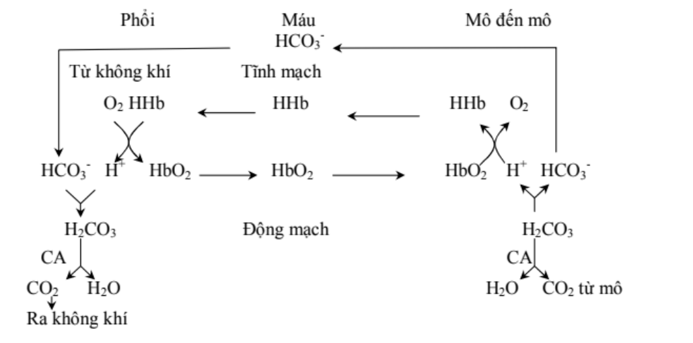

## CHƯƠNG 16: KHÍ MÁU VÀ THĂNG BẰNG ACID - BASE

### MỤC TIÊU HỌC TẬP
1. Trình bày được các hình thức và cơ chế vận chuyển khí oxy ($\text{O}_2$) và carbonic ($\text{CO}_2$) trong máu.
2. Trình bày được thành phần hóa học, cơ chế phân tử và khả năng đệm của các hệ thống đệm của máu và tế bào.
3. Phân tích được vai trò điều hòa thăng bằng acid - base của hệ hô hấp (phổi) và hệ tiết niệu (thận).
4. Định nghĩa, phân loại, nguyên nhân và cơ chế bù trừ của 4 rối loạn thăng bằng acid - base nguyên phát và các rối loạn toan kiềm hỗn hợp.

---

### ĐẠI CƯƠNG
Cơ thể sống liên tục sinh ra lượng lớn các chất acid chuyển hóa (khoảng $100\text{ mEq } \text{H}^+/24\text{h}$ acid cố định và $15.000 - 20.000\text{ mmol } \text{CO}_2/24\text{h}$ acid bay hơi). Tuy nhiên, nồng độ ion $\text{H}^+$ tự do trong máu động mạch luôn được kiểm soát trong phạm vi cực kỳ hẹp:
$$\text{pH máu động mạch} = 7{,}38 - 7{,}42 \quad (\text{trung bình } 7{,}40 \pm 0{,}05)$$
Trạng thái cân bằng acid - base của máu phản ánh trung thực trạng thái acid - base của mô bào và được duy trì nhờ sự phối hợp của 3 phòng tuyến bảo vệ:
1. **Các hệ thống đệm hóa học:** Phản ứng tức thì trong vài giây để giam giữ ion $\text{H}^+$ tự do.
2. **Cơ chế điều hòa của phổi (Hô hấp):** Điều chỉnh nồng độ $\text{CO}_2$ trong vòng vài phút đến vài giờ.
3. **Cơ chế điều hòa của thận (Chuyển hóa):** Đào thải acid cố định và tái tạo kiềm bicarbonat, đáp ứng chậm sau vài giờ đến vài ngày nhưng mang tính bền vững và triệt để.

---

### 1. SỰ VẬN CHUYỂN KHÍ TRONG MÁU

#### 1.1. Sự vận chuyển Oxy ($\text{O}_2$) trong máu

##### 1.1.1. Vai trò của Hemoglobin
- Ở $38^\circ\text{C}$, 1 lít huyết tương chỉ hòa tan vật lý được khoảng $2{,}3\text{ mL } \text{O}_2$.
- Nhờ có Hemoglobin (Hb) với nồng độ trung bình $150\text{ g/L}$ máu, 1 lít máu có thể vận chuyển tới **$200\text{ mL } \text{O}_2$** (gấp 87 lần khả năng hòa tan của huyết tương). Mỗi gam Hb gắn tối đa được **$1{,}34\text{ mL } \text{O}_2$**.
- Hb là chất vận chuyển oxy lý tưởng: đạt độ bão hòa oxy tới **98% tại phế nang phổi** và giải phóng mạnh oxy tại mô hoạt động (độ bão hòa giảm còn **35%**). Quá trình gắn oxy mang tính hợp tác đồng hóa dị lập thể (*positive cooperativity*).

##### 1.1.2. Các yếu tố ảnh hưởng đến ái lực oxy của Hemoglobin
Phương trình cân bằng dị lập thể:
$$\text{HHb} + \text{O}_2 \rightleftharpoons \text{HbO}_2 + \text{H}^+ + \text{CO}_2 + \text{2,3-DPG}$$
Ái lực của Hb với oxy **giảm** (đường cong phân ly Barcroft chuyển phải, tăng giải phóng $\text{O}_2$ cho mô) khi:
- Nồng độ chất **2,3-Diphosphoglycerat (2,3-DPG)** tăng cao: Khi lên núi cao $> 5.500\text{ m}$, thiếu oxy kích thích tăng tổng hợp 2,3-DPG trong hồng cầu để tăng nhả oxy nuôi mô.
- Phân áp khí carbonic ($\text{pCO}_2$) tăng cao.
- Nồng độ ion $[\text{H}^+]$ tăng (pH giảm) — đây chính là **Hiệu ứng Bohr**.
- Nhiệt độ mô tăng (sốt, cơ bắp co vận động).

##### Bảng 16.1. Sự khác biệt về cấu trúc chuỗi globin giữa HbA và HbF

| Đặc điểm chuỗi | HbA (Người trưởng thành) | HbF (Bào thai) |
| :--- | :--- | :--- |
| **Thành phần chuỗi** | Chuỗi $\beta$ | Chuỗi $\gamma$ |
| **Đầu N tận cùng** | $\alpha\text{-NH}_3^+$ tự do | $\alpha\text{-NH}_3^+$ tự do |
| **Vị trí 82** | $\text{Lys}^{82}$ | $\text{Lys}^{82}$ |
| **Vị trí 143** | $\text{His}^{143}$ | $\text{Ser}^{143}$ |

> [!IMPORTANT]
> Sự biến đổi gốc acid amin tích điện dương $\text{His}^{143}$ ở chuỗi $\beta$ thành gốc trung tính $\text{Ser}^{143}$ ở chuỗi $\gamma$ làm giảm số lượng liên kết ion với phân tử 2,3-DPG tích điện âm. Hậu quả là **HbF gắn 2,3-DPG kém hơn nhiều so với HbA**, làm cho ái lực của HbF với oxy cao hơn hẳn HbA. Cơ chế sinh học tinh vi này cho phép máu thai nhi "hút" oxy từ máu mẹ qua nhau thai dễ dàng.

---

#### 1.2. Sự vận chuyển $\text{CO}_2$ trong máu
Khí $\text{CO}_2$ được sinh ra liên tục từ chu trình Krebs và các phản ứng khử carboxyl tại mô ($200\text{ mL/phút} \approx 20\text{ mmol/phút}$), được vận chuyển về phổi dưới 3 hình thức:

##### Bảng 16.2. Các dạng vận chuyển $\text{CO}_2$ trong máu

| Dạng vận chuyển | Tỷ lệ % | Cơ chế phản ứng |
| :--- | :--- | :--- |
| **Dạng Bicarbonat ($\text{HCO}_3^-$)** | **78%** | Phản ứng hợp nước nhờ carbonic anhydrase: $\text{CO}_2 + \text{H}_2\text{O} \stackrel{\text{CA}}{\rightleftharpoons} \text{H}_2\text{CO}_3 \rightleftharpoons \text{H}^+ + \text{HCO}_3^-$ |
| **Dạng Carbamin ($\text{Hb-NH-COO}^-$)** | **13%** | $\text{CO}_2$ gắn trực tiếp vào nhóm amin tự do của chuỗi globin: $\text{R-NH}_2 + \text{CO}_2 \rightleftharpoons \text{R-NH-COO}^- + \text{H}^+$ |
| **Dạng $\text{CO}_2$ hòa tan vật lý** | **9%** | Hòa tan tự do trong huyết tương và bào tương hồng cầu |

##### Bảng 16.3. Các phản ứng xảy ra ở đầu tận N của chuỗi $\alpha$ và chuỗi $\beta$ của Hemoglobin

| Quá trình | Chuỗi $\alpha$ | Chuỗi $\beta$ |
| :--- | :--- | :--- |
| **Sự tạo thành hợp chất Carbamin** | Có | Có |
| **Sự gắn kết phân tử 2,3-DPG** | Không | Có |
| **Sự gắn ion $\text{H}^+$ (Hiệu ứng Bohr)** | Có | Không |

---

#### 1.3. Khả năng đệm của Hemoglobin và cơ chế đẳng hydro
Trong hồng cầu, quá trình tạo thành $\text{HCO}_3^-$ và dẫn xuất carbamin liên tục giải phóng một lượng lớn ion $\text{H}^+$. Nếu không có hệ thống đệm xử lý tức thì, pH nội bào hồng cầu sẽ tụt dốc thảm hại.
- Hemoglobin là protein đệm quan trọng nhất của máu nhờ sở hữu **38 gốc Histidin** (chứa vòng imidazol có $pK \approx 6{,}0 - 7{,}0$) trên 4 chuỗi polypeptid, cùng 4 nhóm $\alpha\text{-NH}_2$ tận cùng.

*Hình 16.2. Cơ chế đệm đẳng hydro (Isohydric transport) phối hợp giữa vận chuyển $\text{O}_2$ và $\text{CO}_2$ của Hemoglobin tại mô ngoại vi và phế nang phổi.*

##### Bảng 16.4. Các cơ chế tiếp nhận và đệm ion $\text{H}^+$ sinh ra từ quá trình vận chuyển $\text{CO}_2$

| Cách đệm ion $\text{H}^+$ | Khả năng đệm (%) |
| :--- | :--- |
| **Sự đệm hóa học bởi phân tử Hemoglobin (His, nhóm amin)** | 50% |
| **Cơ chế đệm đẳng hydro của Deoxyhemoglobin** | 40% |
| **Các hệ đệm khác (phosphat nội bào, protein huyết tương)** | 10% |

> [!NOTE]
> **Cơ chế đệm đẳng hydro (Isohydric buffer):** Khi $\text{HbO}_2$ nhường $\text{O}_2$ cho mô, nó chuyển thành dạng khử $\text{DeoxyHb}$ ($\text{HHb}$). $\text{DeoxyHb}$ là một acid yếu hơn nhiều so với $\text{HbO}_2$, có ái lực rất cao với ion $\text{H}^+$. Do đó, đúng vào thời điểm mô tạo ra $\text{CO}_2$ và sinh $\text{H}^+$, phân tử $\text{DeoxyHb}$ lập tức thu giữ trọn vẹn ion $\text{H}^+$ này mà không làm biến động pH nội bào. Khi về đến phổi, việc gắn lại $\text{O}_2$ biến $\text{HHb}$ thành acid mạnh $\text{HbO}_2$, đẩy giải phóng $\text{H}^+$ ra kết hợp với $\text{HCO}_3^-$ tạo $\text{CO}_2$ thở ra ngoài.

---

### 2. CƠ SỞ HÓA LÝ VÀ HỆ THỐNG ĐỆM ACID - BASE

#### 2.1. Cơ sở hóa lý và Phương trình Henderson - Hasselbalch
- **Khái niệm pH:** Sự phân ly của nước: $\text{H}_2\text{O} \rightleftharpoons \text{H}^+ + \text{OH}^-$. Tích số ion của nước ở $25^\circ\text{C}$:
  $$K_w = [\text{H}^+][\text{OH}^-] = 1{,}0 \times 10^{-14} \implies \text{pH} + \text{pOH} = 14$$
  Với $\text{pH} = -\log[\text{H}^+]$.
- **Phương trình Henderson - Hasselbalch:** Đối với một dung dịch acid yếu $\text{HA} \rightleftharpoons \text{H}^+ + \text{A}^-$ có hằng số phân ly $K_a$:
  $$[\text{H}^+] = K_a \cdot \frac{[\text{HA}]}{[\text{A}^-]} \implies \text{pH} = \text{p}K_a + \log\frac{[\text{A}^-]}{[\text{HA}]} = \text{p}K_a + \log\frac{[\text{Base liên hợp}]}{[\text{Acid yếu}]}$$
- Dung dịch có dung tích đệm tối ưu nhất khi $[\text{Base}] = [\text{Acid}]$, tức $\text{pH} = \text{p}K_a$.

##### Ứng dụng cho hệ đệm Bicarbonat của máu
Hệ đệm bicarbonat gồm $\text{HCO}_3^-$ (thành phần chuyển hóa do thận điều hòa) và $\text{H}_2\text{CO}_3$ (tương đương $\text{CO}_2$ hòa tan do phổi điều hòa). Theo định luật Henry:
$$[\text{CO}_2 \text{ hòa tan}] = \alpha \times \text{pCO}_2$$
Với hệ số hòa tan của $\text{CO}_2$ trong huyết tương ở $37^\circ\text{C}$ là $\alpha = 0{,}03\text{ mmol/L/mmHg}$. Với $\text{p}K_a$ của acid carbonic trong huyết tương là $6{,}1$:
$$\text{pH} = 6{,}1 + \log\frac{[\text{HCO}_3^-]}{0{,}03 \times \text{pCO}_2}$$
Ở điều kiện sinh lý bình thường: $[\text{HCO}_3^-] = 24\text{ mmol/L}$ và $\text{pCO}_2 = 40\text{ mmHg}$:
$$\text{pH} = 6{,}1 + \log\frac{24}{0{,}03 \times 40} = 6{,}1 + \log\frac{24}{1{,}2} = 6{,}1 + \log(20) = 6{,}1 + 1{,}30 = 7{,}40$$

> [!IMPORTANT]
> Tỷ lệ vàng **$\frac{[\text{HCO}_3^-]}{[\text{H}_2\text{CO}_3]} = \frac{20}{1}$** là điều kiện tiên quyết để pH máu duy trì ở mức sinh lý $7{,}40$. Mọi sự biến thiên tỷ lệ này do rối loạn ở tử số (chuyển hóa) hoặc mẫu số (hô hấp) đều dẫn tới rối loạn thăng bằng acid - base.

---

#### 2.2. Các hệ thống đệm của cơ thể

##### Bảng 16.5. Khả năng đệm của các hệ đệm trong máu toàn phần

| Hệ đệm của máu | Thành phần đệm | Khả năng đệm (%) |
| :--- | :--- | :--- |
| **Hệ đệm Hemoglobin** | $\text{KHb} / \text{HHb}$ và $\text{KHbO}_2 / \text{HHbO}_2$ | **82%** |
| **Hệ đệm Proteinat** | $\text{NaProt} / \text{HProt}$ (chủ yếu Albumin) | **10%** |
| **Hệ đệm Bicarbonat** | $\text{NaHCO}_3 / \text{H}_2\text{CO}_3$ | **7%** |
| **Hệ đệm Phosphat** | $\text{Na}_2\text{HPO}_4 / \text{NaH}_2\text{PO}_4$ | **1%** |

##### Bảng 16.6. Phân bố khả năng đệm của toàn bộ cơ thể đối với các acid chuyển hóa

| Khu vực mô đệm | Khả năng đệm (%) |
| :--- | :--- |
| **Tế bào của các mô (Nội bào - protein, phosphat)** | **52%** |
| **Dịch ngoài tế bào (Huyết tương, dịch kẽ - bicarbonat)** | **42%** |
| **Hồng cầu (Hemoglobin)** | **6%** |

<!-- END FILE: pages_336_345.md -->

<!-- BEGIN FILE: pages_346_355.md -->

# CHƯƠNG 16 (TIẾP THEO) & CHƯƠNG 17: HÓA SINH GAN (PHẦN 1)

---

## CHƯƠNG 16: KHÍ MÁU VÀ THĂNG BẰNG ACID - BASE (TIẾP THEO)

### 2.2. Sự thăng bằng Acid - Base trong cơ thể sống (tiếp theo)

#### 2.2.2. Cơ chế điều hòa sinh lý của cơ thể

##### Điều hòa bởi hệ Hô hấp (Phổi)
- Phổi biến cơ thể thành một **hệ thống mở** đối với hệ đệm bicarbonat.
- Khi một acid mạnh ($\text{HA}$, ví dụ $\text{HCl}$) xâm nhập vào tuần hoàn:
  $$\text{HCl} + \text{NaHCO}_3 \rightleftharpoons \text{NaCl} + \text{H}_2\text{CO}_3 \rightleftharpoons \text{NaCl} + \text{CO}_2 \uparrow + \text{H}_2\text{O}$$
  $\text{CO}_2$ sinh ra kích thích trung tâm hô hấp tại hành não và xoang cảnh, làm tăng thông khí phế nang để đào thải nhanh $\text{CO}_2$ ra ngoài. Do đó, $\text{pCO}_2$ máu không bị ứ đọng, tỷ lệ $[\text{HCO}_3^-] / [\text{H}_2\text{CO}_3]$ ít biến động và pH máu được bảo tồn.
- Khi một base mạnh ($\text{NaOH}$) xâm nhập:
  $$\text{NaOH} + \text{H}_2\text{CO}_3 \rightleftharpoons \text{NaHCO}_3 + \text{H}_2\text{O}$$
  Tỷ lệ kiềm tăng kích thích giảm thông khí phế nang giữ lại $\text{CO}_2$, làm tăng mẫu số $[\text{H}_2\text{CO}_3]$ cân bằng lại với tử số.
- **Đặc điểm đáp ứng:** Phổi đáp ứng rất nhanh (trong vài phút đến vài giờ), nhưng khả năng bù trừ có giới hạn (không thể giảm thông khí quá mức vì nguy cơ thiếu oxy mô).

##### Điều hòa bởi hệ Tiết niệu (Thận)
Thận kiểm soát thăng bằng acid - base qua 3 cơ chế phân tử tại ống thận nhằm bảo tồn lượng kiềm bicarbonat và đào thải acid cố định:
1. **Tái hấp thu Bicarbonat ($\text{HCO}_3^-$):**
   - Khoảng **90% $\text{HCO}_3^-$ được tái hấp thu tại ống lượn gần**, 10% còn lại tại quai Henle và ống lượn xa.
   - Tại lòng ống thận, $\text{HCO}_3^-$ kết hợp với $\text{H}^+$ bài tiết từ tế bào tạo $\text{H}_2\text{CO}_3$. Enzym Carbonic Anhydrase (CA-IV) tại diềm bàn chải phân giải thành $\text{CO}_2 + \text{H}_2\text{O}$.
   - $\text{CO}_2$ khuếch tán vào nội bào, được CA-II nội bào tái tạo thành $\text{H}_2\text{CO}_3 \rightarrow \text{H}^+ + \text{HCO}_3^-$. $\text{HCO}_3^-$ được đồng vận cùng $\text{Na}^+$ vào máu, còn $\text{H}^+$ tiếp tục được bơm ra lòng ống trao đổi với $\text{Na}^+$ qua kênh NHE3.
2. **Tái tạo Bicarbonat mới qua acid chuẩn độ (Hệ đệm Phosphat tại ống lượn xa):**
   - Tế bào biểu mô ống lượn xa bài tiết chủ động $\text{H}^+$ qua bơm $\text{H}^+\text{-ATPase}$.
   - $\text{H}^+$ trong lòng ống phản ứng với muối dinatri phosphat:
     $$\text{Na}_2\text{HPO}_4 + \text{H}^+ \rightleftharpoons \text{NaH}_2\text{PO}_4 + \text{Na}^+$$
   - $\text{Na}^+$ được tái hấp thu cùng với một phân tử $\text{HCO}_3^-$ mới được tổng hợp đưa vào máu. Muối mononatri phosphat ($\text{NaH}_2\text{PO}_4$) đào thải ra nước tiểu làm giảm pH nước tiểu xuống tới $4{,}5$. Lượng $\text{H}^+$ đào thải qua dạng này từ $10 - 30\text{ mEq/24h}$.
3. **Bài tiết $\text{H}^+$ dưới dạng muối Amoni ($\text{NH}_4^+$):**
   - Diễn ra mạnh mẽ tại ống lượn xa. Tế bào ống thận thủy phân acid amin glutamin nhờ enzym **glutaminase**:
     $$\text{Glutamin} \xrightarrow{\text{Glutaminase}} \text{Acid glutamic} + \text{NH}_3$$
   - Khí $\text{NH}_3$ không tích điện khuếch tán thụ động vào lòng ống thận, kết hợp ngay với $\text{H}^+$ tạo thành ion amoni $\text{NH}_4^+$:
     $$\text{NH}_3 + \text{H}^+ \rightleftharpoons \text{NH}_4^+ \quad (\text{kết hợp với } \text{Cl}^- \text{ tạo } \text{NH}_4\text{Cl})$$
   - Màng tế bào không cho ion $\text{NH}_4^+$ thấm ngược trở lại ("bẫy amoni"). Mỗi ion $\text{NH}_4^+$ đào thải ra ngoài đem lại 1 ion $\text{HCO}_3^-$ mới đưa vào máu. Bình thường thận đào thải từ **$30 - 50\text{ mEq } \text{H}^+/24\text{h}$** dưới dạng $\text{NH}_4^+$; khi toan chuyển hóa nặng có thể tăng vọt lên tới $500\text{ mEq/24h}$.

---

### 2.3. Các thông số khí máu động mạch đánh giá thăng bằng Acid - Base

1. **pH máu động mạch:**
   - Giá trị bình thường: **$7{,}38 - 7{,}42$** (trung bình $7{,}40$). Đo trong điều kiện kỵ khí nghiêm ngặt.
   - $\text{pH} < 7{,}35$: Tình trạng nhiễm toan (Acidemia).
   - $\text{pH} > 7{,}45$: Tình trạng nhiễm kiềm (Alkalemia).
2. **$\text{pCO}_2$ máu động mạch:**
   - Phân áp khí carbonic trong máu động mạch, phản ánh trực tiếp chức năng thông khí phế nang của phổi.
   - Giá trị bình thường: **$35 - 45\text{ mmHg}$** (trung bình $40\text{ mmHg}$).
3. **Bicarbonat thực (Actual Bicarbonate - AB):**
   - Nồng độ ion $\text{HCO}_3^-$ thực tế trong huyết tương đo ở điều kiện kỵ khí của mẫu máu tại nhiệt độ và $\text{pCO}_2$ thực tế của bệnh nhân.
   - Giá trị bình thường: **$22 - 26\text{ mmol/L}$** (trung bình $24 - 25\text{ mmol/L}$). Thông số này phụ thuộc vào hô hấp ($\text{pCO}_2$).
4. **Bicarbonat chuẩn (Standard Bicarbonate - SB):**
   - Nồng độ $\text{HCO}_3^-$ trong huyết tương được chuẩn hóa về điều kiện tiêu chuẩn: $\text{pCO}_2 = 40\text{ mmHg}$, $t = 37^\circ\text{C}$ và bão hòa oxy hoàn toàn.
   - Giá trị bình thường: **$24 \pm 2\text{ mmol/L}$**. SB loại trừ được yếu tố hô hấp và chỉ phản ánh rối loạn chuyển hóa nguyên phát.
5. **Base đệm (Buffer Base - BB):**
   - Tổng nồng độ tất cả các anion có khả năng đệm trong máu toàn phần ($[\text{HCO}_3^-] + [\text{Protein}^-] + [\text{Hb}^-] + [\text{HPO}_4^{2-}]$).
   - Giá trị bình thường: **$46 - 48\text{ mEq/L}$**.
6. **Base dư (Excess Base / Base Excess - BE):**
   - Lượng acid mạnh hoặc base mạnh (tính bằng $\text{mEq/L}$) cần thiết thêm vào 1 lít máu toàn phần để đưa pH về chính xác $7{,}40$ ở điều kiện chuẩn ($\text{pCO}_2 = 40\text{ mmHg}$, $t = 37^\circ\text{C}$).
   - Giá trị bình thường: **$0 \pm 2\text{ mmol/L}$**.
   - $\text{BE} < -2\text{ mmol/L}$: Thiếu kiềm (thừa acid cố định).
   - $\text{BE} > +2\text{ mmol/L}$: Thừa kiềm (nhiễm kiềm chuyển hóa).
   - Giúp bác sĩ tính toán chính xác lượng bicarbonat cần bù cho bệnh nhân:
     $$\text{Lượng } \text{NaHCO}_3 \text{ cần bù (mEq)} = |\text{BE}| \times 0{,}3 \times \text{Trọng lượng cơ thể (kg)}$$

---

### 3. CÁC RỐI LOẠN THĂNG BẰNG ACID - BASE

#### 3.1. Nhiễm acid chuyển hóa (Metabolic Acidosis)
- **Định nghĩa:** Rối loạn tiên phát do giảm nồng độ $\text{HCO}_3^-$ huyết tương, làm giảm tỷ lệ $[\text{HCO}_3^-] / [\text{H}_2\text{CO}_3]$, dẫn đến $\text{pH} < 7{,}35$.
- **Cận lâm sàng đặc trưng:** $\text{pH} \downarrow$, $[\text{HCO}_3^-] \downarrow$, $\text{BE} < -2$, bù trừ phổi làm $\text{pCO}_2 \downarrow$ qua kiểu thở Kussmaul (thở sâu và nhanh).

##### Bảng 16.7. Các nguyên nhân gây nhiễm toan chuyển hóa

| Cơ chế nguyên nhân | Bệnh lý / Tác nhân cụ thể |
| :--- | :--- |
| **1. Tăng sinh ion $\text{H}^+$ nội sinh (Tăng khoảng trống Anion Gap)** | - Nhiễm toan ceton: Đái tháo đường mất bù, nghiện rượu, nhịn đói kéo dài. - Nhiễm toan lactic: Sốc giảm thể tích, suy tuần hoàn, thiếu oxy mô cấp, ngộ độc phenformin/metformin. - Nhiễm độc acid ngoại sinh: Ngộ độc methanol (tạo acid formic), ethylene glycol (acid oxalic), salicylate (aspirin). - Rối loạn chuyển hóa acid hữu cơ bẩm sinh. |
| **2. Tích tụ acid cố định do giảm bài tiết $\text{H}^+$ ở thận** | - Suy thận cấp hoặc suy thận mạn tiến triển. - Toan hóa ống thận type 1 (RTA xa). |
| **3. Mất trực tiếp ion $\text{Bicarbonat}$ ($\text{HCO}_3^-$)** | - Tiêu chảy cấp mất nước nặng. - Rò tiêu hóa, dẫn lưu mật hoặc tụy. - Toan hóa ống thận type 2 (RTA gần). - Dùng thuốc ức chế carbonic anhydrase (Acetazolamid). |

- **Bù trừ:**
  - *Hô hấp:* Kích thích thụ thể hóa học tăng thông khí phế nang, làm giảm $\text{pCO}_2$ (bắt đầu sau vài phút, đạt tối đa sau $12 - 24\text{ giờ}$).
  - *Thận:* Tăng bài tiết $\text{H}^+$ và tái hấp thu $\text{HCO}_3^-$ (hoàn thành sau $2 - 4\text{ ngày}$).

---

#### 3.2. Nhiễm kiềm chuyển hóa (Metabolic Alkalosis)
- **Định nghĩa:** Rối loạn tiên phát do tăng nồng độ $\text{HCO}_3^-$ huyết tương, làm tăng tỷ lệ $[\text{HCO}_3^-] / [\text{H}_2\text{CO}_3]$, dẫn đến $\text{pH} > 7{,}45$.
- **Cận lâm sàng:** $\text{pH} \uparrow$, $[\text{HCO}_3^-] \uparrow$, $\text{BE} > +2$, bù trừ hô hấp làm $\text{pCO}_2 \uparrow$ (nhưng hiếm khi vượt quá $55 - 60\text{ mmHg}$ do nguy cơ thiếu oxy mô).

##### Bảng 16.8. Các nguyên nhân gây nhiễm kiềm chuyển hóa

| Cơ chế | Nguyên nhân cụ thể |
| :--- | :--- |
| **1. Mất ion $\text{H}^+$ qua đường tiêu hóa** | Nôn kéo dài, hẹp môn vị phì đại ở trẻ nhỏ, hút dịch dạ dày liên tục. |
| **2. Mất ion $\text{H}^+$ qua thận và cạn kiệt $\text{K}^+$** | Dùng thuốc lợi tiểu quai và Thiazid; cường aldosteron (hội chứng Conn, Cushing); cam thảo (chứa glycyrrhizin ức chế $11\beta\text{-HSD2}$). |
| **3. Đưa thừa chất kiềm từ ngoài vào** | Truyền quá nhiều natri bicarbonat trong cấp cứu, hội chứng sữa - kiềm (Burnett). |

---

#### 3.3. Nhiễm acid hô hấp (Respiratory Acidosis)
- **Định nghĩa:** Tình trạng tăng phân áp $\text{pCO}_2$ máu động mạch ($> 45\text{ mmHg}$) do suy giảm thông khí phế nang nguyên phát, làm giảm tỷ số $[\text{HCO}_3^-] / [\text{H}_2\text{CO}_3]$ và làm $\text{pH} < 7{,}35$.

##### Bảng 16.9. Các nguyên nhân gây nhiễm acid hô hấp

| Nhóm nguyên nhân | Bệnh lý cụ thể |
| :--- | :--- |
| **1. Tắc nghẽn đường thở** | Bệnh phổi tắc nghẽn mạn tính (COPD), hen phế quản ác tính, dị vật đường thở. |
| **2. Ức chế trung tâm hô hấp** | Quá liều thuốc an thần, thuốc phiện (Morphin, Heroin), chấn thương sọ não, tai biến mạch máu não vùng thân não. |
| **3. Bệnh lý thần kinh - cơ** | Bại liệt, hội chứng Guillain-Barré, nhược cơ nặng, ngộ độc độc tố uốn ván hoặc botulinum. |
| **4. Tổn thương nhu mô phổi và lồng ngực** | Viêm phổi thùy nặng, ARDS, phù phổi cấp; gù vẹo cột sống nặng, mảng sườn di động. |

- **Bù trừ của thận:** Thận tăng tái hấp thu $\text{HCO}_3^-$ và bài tiết $\text{H}^+/\text{NH}_4^+$. Bắt đầu sau $6 - 12\text{ giờ}$, đạt hiệu quả tối đa sau $3 - 5\text{ ngày}$.

---

#### 3.4. Nhiễm kiềm hô hấp (Respiratory Alkalosis)
- **Định nghĩa:** Tình trạng giảm phân áp $\text{pCO}_2$ máu động mạch ($< 35\text{ mmHg}$) do tăng thông khí phế nang quá mức, làm tăng tỷ số $[\text{HCO}_3^-] / [\text{H}_2\text{CO}_3]$ và $\text{pH} > 7{,}45$.

##### Bảng 16.10. Các nguyên nhân gây nhiễm kiềm hô hấp

| Cơ chế | Nguyên nhân cụ thể |
| :--- | :--- |
| **1. Thiếu oxy mô (Kích thích thụ thể hóa học)** | Lên núi cao, thiếu máu nặng cấp tính, bệnh tim bẩm sinh có shunt phải - trái. |
| **2. Kích thích trung tâm hô hấp** | Giai đoạn sớm ngộ độc salicylate (aspirin), sốt cao nhiễm trùng huyết vi khuẩn Gram âm, suy gan cấp, tổn thương não, trạng thái lo âu hốt hoảng (hội chứng tăng thông khí tâm căn). |
| **3. Căng dãn thụ thể phổi và thông khí cơ học** | Thở máy thể tích lưu lượng quá cao; thuyên tắc động mạch phổi, phù phổi giai đoạn đầu. |

- **Bù trừ:** Thận giảm tái hấp thu $\text{HCO}_3^-$, đồng thời hệ thống đệm giải phóng ion $\text{H}^+$ để trung hòa. $\text{H}^+$ đi ra khỏi tế bào trao đổi với $\text{K}^+$ đi vào, làm giảm nồng độ $\text{K}^+$ máu.

---

#### 3.5. Rối loạn thăng bằng Acid - Base hỗn hợp
Là tình trạng xảy ra đồng thời từ hai rối loạn toan kiềm nguyên phát trở lên:
1. **Nhiễm toan hô hấp phối hợp kiềm chuyển hóa:** Thường gặp ở bệnh nhân COPD nặng có ứ đọng $\text{CO}_2$ mạn tính được điều trị bằng thuốc lợi tiểu quai gây mất $\text{H}^+$ và $\text{K}^+$. Kết quả: cả $\text{pCO}_2$ và $\text{HCO}_3^-$ đều tăng rất cao.
2. **Nhiễm kiềm hô hấp phối hợp toan chuyển hóa:** Điển hình trong **ngộ độc Aspirin (Salicylate)**. Ban đầu thuốc kích thích trực tiếp trung tâm hô hấp gây kiềm hô hấp, sau đó các acid hữu cơ và rối loạn chuyển hóa trung gian sinh acid gây toan chuyển hóa kèm theo.
3. **Nhiễm toan hô hấp phối hợp toan chuyển hóa (Toan hỗn hợp cực kỳ nguy kịch):** Gặp trong **ngừng tim phổi, suy tuần hoàn cấp và phù phổi cấp**. Thiếu oxy mô gây toan lactic nặng nề kết hợp với ứ trệ $\text{CO}_2$ tuyệt đối; pH máu tụt dốc thảm hại ($< 7{,}00$).
4. **Nhiễm kiềm hô hấp phối hợp kiềm chuyển hóa:** Gặp ở bệnh nhân thở máy quá mức kết hợp với hút dịch dạ dày liên tục hoặc dùng thuốc lợi tiểu; pH máu vọt lên rất cao ($> 7{,}60$).

---

### CÂU HỎI ÔN TẬP CHƯƠNG 16
1. Trình bày các hình thức và cơ chế phân tử của quá trình vận chuyển oxy và carbonic trong máu.
2. Trình bày thành phần hóa học và khả năng đệm của các hệ đệm trong máu và dịch cơ thể. Nêu bản chất cơ chế đẳng hydro của Hemoglobin.
3. Phân tích vai trò điều hòa của phổi và thận trong duy trì thăng bằng acid - base.
4. Nêu định nghĩa, nguyên nhân, cơ chế bệnh sinh và sự bù trừ của 4 rối loạn thăng bằng acid - base nguyên phát.
5. Trình bày các hội chứng rối loạn toan kiềm hỗn hợp thường gặp trên lâm sàng cấp cứu.

---