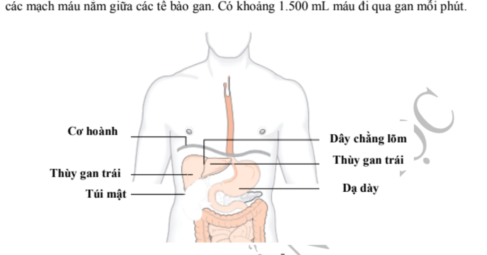
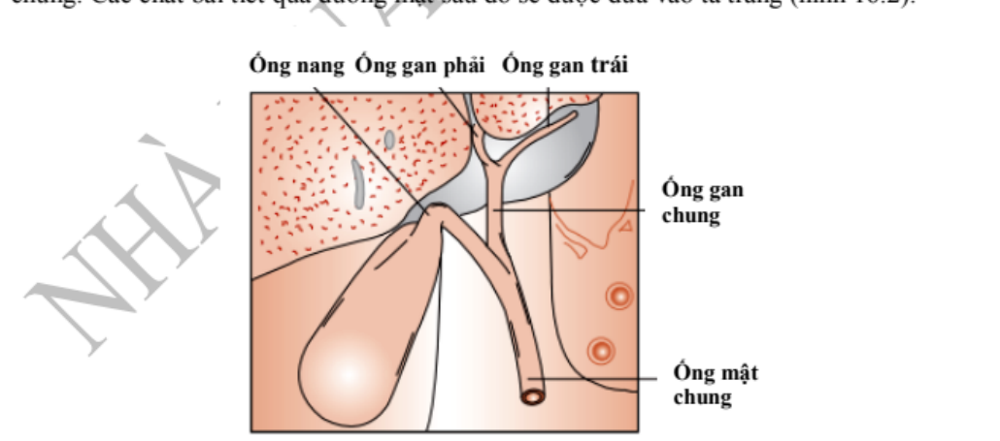
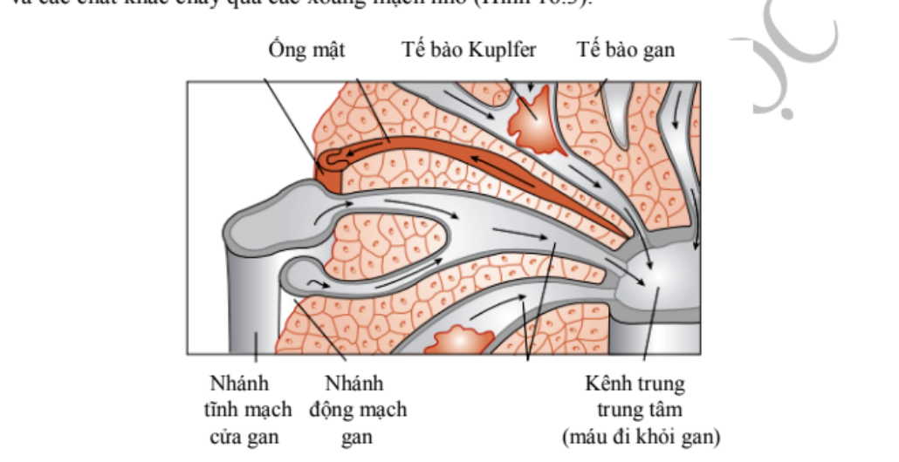

## CHƯƠNG 17: HÓA SINH GAN

### MỤC TIÊU HỌC TẬP
1. Phân tích được vai trò trung tâm của gan trong chuyển hóa Glucid, Lipid, Protein và Acid nucleic.
2. Trình bày được thành phần hóa học chính và vai trò sinh học của dịch mật.
3. Phân tích được vai trò và các cơ chế khử độc của gan (khử độc hóa học và khử độc cố định/đào thải).
4. Trình bày được nguyên lý và ý nghĩa lâm sàng của các xét nghiệm hóa sinh gan mật.

---

### ĐẠI CƯƠNG VÀ ĐẶC ĐIỂM GIẢI PHẪU - HỆ MẠCH MÁU GAN

#### Sơ lược giải phẫu gan
Gan là tạng nội quan lớn nhất của cơ thể người, nặng khoảng **$1{,}2 - 1{,}5\text{ kg}$** ở người lớn khỏe mạnh. Gan nằm ở tầng trên ổ bụng, áp sát dưới vòm hoành phải, được khung xương sườn bảo vệ. Về giải phẫu, gan chia thành thùy phải lớn gấp 6 lần thùy trái.

*Hình 17.1. Sơ đồ vị trí giải phẫu gan, cơ hoành, dây chằng liềm, túi mật và mối liên quan với dạ dày.*

#### Hệ tuần hoàn kép độc đáo của Gan
Khác với mọi cơ quan khác chỉ nhận máu từ một nguồn động mạch, gan sở hữu hệ tuần hoàn kép với lưu lượng khổng lồ **$1.500\text{ mL/phút}$** (chiếm tới 25-30% cung lượng tim):
- **Động mạch gan:** Xuất phát từ động mạch thân tạng, cung cấp máu giàu oxy nuôi nhu mô gan (chiếm khoảng **25% lưu lượng máu**).
- **Tĩnh mạch cửa (Portal vein):** Thu nhận toàn bộ dòng máu giàu chất dinh dưỡng hấp thu từ đường tiêu hóa (dạ dày, ruột non, ruột già) và lách, đưa về gan (chiếm tới **75% lưu lượng máu**).

*Hình 17.2. Hệ thống bài xuất mật: vi quản mật $\rightarrow$ ống gan phải/trái $\rightarrow$ ống gan chung kết hợp ống túi mật tạo thành ống mật chủ đổ vào tá tràng.*

#### Cấu trúc vi thể của tiểu thùy gan (Bè Remak)
- Đơn vị cấu trúc và chức năng cơ bản của gan là **tiểu thùy gan (Lobule)** hình lục lăng:
  - Ở trung tâm là **tĩnh mạch trung tâm tiểu thùy**.
  - Các dây tế bào gan (bè Remak) xếp hình nan hoa hướng tâm từ ngoại vi về tĩnh mạch trung tâm.
  - Xen giữa các bè gan là các **xoang mạch (Sinusoids)**, nơi hòa trộn giữa dòng máu động mạch gan và tĩnh mạch cửa trước khi đổ vào tĩnh mạch trung tâm.
- **Hai loại tế bào chính:**
  - **Tế bào biểu mô nhu mô gan (Hepatocytes):** Chiếm **80% thể tích gan**, là các nhà máy hóa chất khổng lồ thực hiện toàn bộ chức năng tổng hợp, chuyển hóa và khử độc.
  - **Tế bào Kupffer:** Là các đại thực bào cố định nằm lót trong thành xoang mạch, thực hiện chức năng thực bào vi khuẩn, kháng nguyên lạ, hồng cầu già và độc chất từ đường tiêu hóa.

*Hình 17.3. Cấu trúc vi thể tiểu thùy gan: Bộ ba khoảng cửa (ống mật, nhánh động mạch gan, nhánh tĩnh mạch cửa), xoang mạch lót tế bào Kupffer và tĩnh mạch trung tâm tiểu thùy.*

---

### 1. THÀNH PHẦN HÓA HỌC CỦA NHU MÔ GAN

Thành phần hóa học của mô gan biến thiên linh động tùy theo trạng thái dinh dưỡng và hoạt động chức năng của cơ thể:

##### Bảng 17.1. Thành phần hóa học của gan người trưởng thành tính theo tỷ lệ % trọng lượng tươi

| Thành phần hóa chất | Tỷ lệ % trọng lượng tươi |
| :--- | :--- |
| **Nước** | **70 – 75%** |
| **Chất khô toàn phần** | **25 – 30%** |
| - *Protein* | 12 – 15% |
| - *Glycogen* | 2 – 10% (biến thiên mạnh theo bữa ăn) |
| - *Lipid trung tính (Triglycerid)* | Khoảng 2,0% |
| - *Phospholipid* | Khoảng 2,5% |
| - *Cholesterol toàn phần* | Khoảng 0,3% |
| - *Glucose tự do* | Khoảng 0,1% |
| - *Các chất khoáng ($\text{Fe, Cu, Zn, K, P}$)* | Tỷ lệ rất thấp |
| - *Các vitamin ($\text{A, D, B}_{12}\text{, Folat}$)* | Tỷ lệ thấp (kho dự trữ sinh học lớn) |

<!-- END FILE: pages_346_355.md -->

<!-- BEGIN FILE: pages_356_365.md -->

# CHƯƠNG 17: HÓA SINH GAN (TIẾP THEO VÀ HOÀN THIỆN)

---

### 1. THÀNH PHẦN HÓA HỌC CỦA NHU MÔ GAN (TIẾP THEO)
- **Protein nhu mô gan:** Chiếm khoảng 50% trọng lượng khô của tế bào gan. Bao gồm albumin, globulin, nucleoprotein, collagen và ferritin. **Ferritin** là dạng dự trữ sắt chủ yếu của cơ thể gồm vỏ protein apoferritin bao bọc lõi tinh thể sắt hydrat hóa $(\text{FeOOH})_8$. Ngoài ra, mô gan chứa nồng độ rất cao các acid amin tự do (glutamat, aspartat, arginin, glycin, cystein, methionin, histidin).
- **Glucid gan:** Chiếm từ $2 - 10\%$ trọng lượng khô, biến thiên rất mạnh theo nhịp độ bữa ăn, tồn tại dưới dạng hạt dự trữ **glycogen**.
- **Lipid gan:** Chiếm khoảng 5% trọng lượng khô ở người bình thường ($40\%$ lipid trung tính triglycerid, $50\%$ phospholipid và $10\%$ cholesterol).
- **Enzym và Vitamin:** Gan sở hữu mạng lưới enzym chuyển hóa hoàn chỉnh và độc nhất vô nhị (glucose-6-phosphatase, arginase, glycerol kinase, các cytochrom P450, glucuronyl transferase...). Gan là kho dự trữ chiến lược các vitamin tan trong dầu ($\text{A, D, K}$) và vitamin tan trong nước ($\text{B}_1, \text{B}_2, \text{B}_{12}\text{, C}$), cùng các vi khoáng ($\text{Fe, Cu, Zn, Mg}$).

---

### 2. CHỨC NĂNG CHUYỂN HÓA CỦA GAN

#### 2.1. Chức năng chuyển hóa Glucid
Gan là cơ quan trung tâm duy nhất đảm nhiệm vai trò **"nhạc trưởng" điều hòa đường huyết** của cơ thể nhờ sở hữu enzym đặc hiệu **Glucose-6-phosphatase**:
- **Sau bữa ăn (Trạng thái no):** Glucose từ tĩnh mạch cửa ồ ạt đổ về gan. Dưới tác dụng của insulin và enzym glucokinase (ái lực thấp, dung lượng xúc tác cao), gan thu nhận glucose và tổng hợp thành **glycogen dự trữ**. Gan cũng chuyển hóa các đường đơn khác như fructose, galactose và mannose thành glucose và glycogen.
- **Giữa hai bữa ăn hoặc khi nhịn đói:** Khi đường huyết có xu hướng hạ thấp, enzym phosphorylase và **glucose-6-phosphatase** tại tế bào gan thủy phân glycogen thành glucose tự do đưa vào tuần hoàn:
  $$\text{Glycogen} \longrightarrow \text{Glucose-1-P} \rightleftharpoons \text{Glucose-6-P} \xrightarrow[\text{H}_2\text{O}]{\text{Glucose-6-phosphatase}} \text{Glucose tự do} + \text{P}_i$$
  > [!NOTE]
  > Mô cơ cũng chứa lượng lớn glycogen nhưng **cơ không thể phân giải glycogen giải phóng glucose vào máu** do tế bào cơ thiếu enzym glucose-6-phosphatase. Do đó chỉ có gan mới có chức năng duy trì đường huyết trực tiếp.
- **Tân tạo đường (Gluconeogenesis):** Khi nguồn glycogen dự trữ cạn kiệt (sau 12-24 giờ nhịn đói), gan tổng hợp glucose mới từ các tiền chất không phải glucid: lactat từ cơ (chu trình Cori), glycerol từ mô mỡ, và các acid amin sinh đường (đặc biệt là alanin qua chu trình Alanin - Glucose).
- **Tổng hợp hợp chất đặc biệt:** Gan tổng hợp acid glucuronic phục vụ khử độc và tổng hợp **heparin** (chất chống đông máu tự nhiên bản chất glycosaminoglycan).

---

#### 2.2. Chức năng chuyển hóa Lipid
- **Thoái hóa acid béo và tạo thể Ceton:**
  - Quá trình $\beta$-oxy hóa acid béo diễn ra cực kỳ mạnh mẽ tại ty thể tế bào gan, tạo lượng lớn acetyl-CoA.
  - Một phần acetyl-CoA đi vào chu trình Krebs cung cấp ATP cho gan; một phần dùng để sinh tổng hợp cholesterol và acid mật.
  - Phần lớn acetyl-CoA dư thừa được gan chuyển thành **thể ceton** (Acetoacetat, $\beta$-Hydroxybutyrat, Aceton). Do tế bào gan không có enzym $\beta$-cetoacyl-CoA transferase (Thiophorase), gan không thể tự sử dụng thể ceton mà phóng thích vào máu để vận chuyển làm nguồn năng lượng sống còn cho các mô ngoại vi (não, cơ tim, vỏ thận). Gan là cơ quan "oxy hóa acid béo hộ" toàn bộ cơ thể.
- **Sinh tổng hợp Lipid và Lipoprotein:**
  - Gan tổng hợp acid béo mới từ acetyl-CoA dư thừa của chuyển hóa glucid, este hóa thành triglycerid và phospholipid.
  - Gan tổng hợp **70% lượng cholesterol toàn thân** (khoảng $1{,}5 - 2{,}0\text{ g/ngày}$) nhờ enzym kiểm soát chốt chặn **HMG-CoA Reductase**.
  - Gan este hóa cholesterol nội bào (nhờ ACAT) và tiết enzym **LCAT** (*Lecithin-Cholesterol Acyltransferase*) vào huyết tương để este hóa cholesterol trên HDL (tỷ lệ este hóa bình thường chiếm $60 - 70\%$ cholesterol toàn phần).
  - Gan tổng hợp và bài xuất các hạt **VLDL** (vận chuyển triglycerid nội sinh ra ngoại vi) và **tiền HDL** (ApoA-I). Khi chức năng gan suy giảm, quá trình bài xuất VLDL bị ứ trệ dẫn tới bệnh lý **gan nhiễm mỡ**.

---

#### 2.3. Chức năng chuyển hóa Protein và Hợp chất chứa Nitơ
Gan là cơ quan trọng yếu trong chuyển hóa đạm của toàn bộ cơ thể:
1. **Sinh tổng hợp Protein huyết tương:**
   - Gan tổng hợp **100% Albumin huyết thanh** (khoảng $12\text{ g/ngày}$, thời gian bán hủy $t_{1/2} \approx 20\text{ ngày}$), quyết định áp suất thẩm thấu keo của máu.
   - Gan tổng hợp hầu hết các $\alpha$-globulin ($\alpha_1$-antitrypsin, ceruloplasmin, haptoglobin), $\beta$-globulin (transferrin, hemopexin). *(Lưu ý: $\gamma$-globulin do tương bào lympho B tổng hợp).*
   - Gan tổng hợp toàn bộ các **yếu tố đông máu huyết tương**: Fibrinogen (yếu tố I), Prothrombin (yếu tố II), các yếu tố V, VII, IX, X (trong đó các yếu tố II, VII, IX, X phụ thuộc vitamin K).
2. **Thoái hóa Acid amin và Chu trình Urê (Khử độc $\text{NH}_3$):**
   - Gan chứa mạng lưới transaminase phong phú xúc tác trao đổi amin (AST, ALT) và enzym khử amin oxy hóa GLDH.
   - Amoniac ($\text{NH}_3$) sinh ra cực độc với não. **Gan là cơ quan duy nhất trong cơ thể có đầy đủ enzym của Chu trình Urê (Krebs-Henseleit)** để biến đổi $\text{NH}_3$ độc hại thành Urê hòa tan không độc đào thải qua nước tiểu. Khả năng dự trữ của chu trình Urê rất lớn: chỉ khi hoại tử trên $75\%$ nhu mô gan thì nồng độ $\text{NH}_3$ máu mới bắt đầu tăng vọt.
3. **Chuyển hóa Hemoglobin:** Tế bào Kupffer và tế bào gan phân giải nhân Hem thành Bilirubin tự do, sau đó tế bào gan liên hợp với acid glucuronic tạo **Bilirubin liên hợp** bài xuất vào dịch mật.

---

### 3. CHỨC NĂNG TẠO MẬT VÀ BÀI TIẾT DỊCH MẬT

Gan sản xuất liên tục dịch mật khoảng **$800 - 1.000\text{ mL/ngày}$**, đưa xuống dự trữ và cô đặc tại túi mật (thể tích cô đặc 5 - 10 lần nhờ tái hấp thu nước và điện giải).

##### Bảng 17.2. Đặc tính lý hóa và thành phần hóa học của Mật ống gan và Mật túi mật

| Chỉ số / Thành phần hóa học | Mật ống gan (Mật tươi) | Mật túi mật (Mật cô đặc) |
| :--- | :--- | :--- |
| **Tỷ trọng** | $1{,}009 - 1{,}013$ | $1{,}026 - 1{,}048$ |
| **pH** | $7{,}5$ (Hơi kiềm) | $6{,}8$ (Hơi acid nhẹ do cô đặc) |
| **Hàm lượng nước** | $97{,}6\%$ | $86{,}0\%$ |
| **Chất khô toàn phần** | $2{,}4\%$ | $14{,}0\%$ |
| **Muối mật** | $0{,}6\%$ | **$7{,}0\%$** |
| **Sắc tố mật & Mucin** | $0{,}5\%$ | **$4{,}1\%$** |
| **Cholesterol** | $0{,}15\%$ | **$0{,}6\%$** |
| **Phospholipid (Lecithin)** | $0{,}05\%$ | **$0{,}2\%$** |
| **Chất béo trung tính** | $0{,}3\%$ | $1{,}9\%$ |
| **Các ion vô cơ ($\text{Na}^+, \text{K}^+, \text{Cl}^-, \text{HCO}_3^-$)** | $0{,}7\%$ | $0{,}8\%$ |

#### 3.1. Acid mật và Muối mật
- **Sinh tổng hợp:** Acid mật là sản phẩm thoái hóa cuối cùng của cholesterol tại gan qua enzym giới hạn tốc độ $7\alpha$-hydroxylase.
  - *Acid mật nguyên phát:* Acid Cholic và Acid Chenodeoxycholic.
  - *Acid mật thứ phát (do vi khuẩn ruột biến đổi):* Acid Deoxycholic và Acid Lithocholic.
- **Tạo muối mật:** Tại tế bào gan, acid mật được liên hợp với acid amin **Glycin** hoặc dẫn xuất sulfonic **Taurin**, kết hợp với cation $\text{Na}^+$ hoặc $\text{K}^+$ tạo thành **muối mật** ($\text{Natri Glycocholat, Natri Taurocholat}$).
- **Chu trình gan - ruột (Enterohepatic circulation):** Khoảng **$90 - 95\%$ muối mật** được tái hấp thu chủ động tại đoạn cuối hồi tràng, theo tĩnh mạch cửa trở về gan để tái bài tiết. Chỉ khoảng 5% ($0{,}5\text{ g/ngày}$) bị đào thải qua phân.

#### 3.2. Vai trò sinh lý của dịch mật
1. **Nhũ tương hóa lipid thức ăn:** Nhờ cấu trúc lưỡng ái phân tử (một đầu kỵ nước gắn lipid, một đầu ưa nước hướng ra ngoài), muối mật làm giảm sức căng bề mặt hạt mỡ, xé nhỏ các giọt lipid lớn thành các micell siêu vi ($d < 0{,}5\ \mu\text{m}$), làm tăng diện tích tiếp xúc với enzym Lipase tụy lên hàng ngàn lần.
2. **Hòa tan và hấp thu vitamin tan trong dầu:** Cần thiết cho sự hấp thu các vitamin $\text{A, D, E, K}$.
3. **Hòa tan Cholesterol trong mật:** Cholesterol vốn không tan trong nước; nó chỉ được giữ ở trạng thái hòa tan nhờ tạo phức micell hỗn hợp với muối mật và phospholipid (lecithin). Nếu tỷ lệ muối mật + lecithin giảm sút, cholesterol sẽ kết tinh tạo thành **sỏi mật cholesterol**.
4. **Tăng nhu động ruột và đào thải độc chất:** Kích thích nhu động đại tràng và đào thải các sắc tố mật, kim loại nặng, thuốc qua đường phân.

---

### 4. CHỨC NĂNG KHỬ ĐỘC CỦA GAN

Gan đóng vai trò là "người gác cổng" chuyển hóa, trung hòa toàn bộ các chất độc nội sinh (sinh ra từ chuyển hóa tế bào: $\text{NH}_3, \text{H}_2\text{O}_2$, bilirubin tự do) và chất độc ngoại sinh (thuốc men, rượu ethanol, độc tố vi khuẩn, hóa chất bảo vệ thực vật).

#### 4.1. Khử độc theo cơ chế cố định và thải trừ
Gan bắt giữ các chất độc không tan hoặc kim loại nặng ($\text{Cu, Pb, Hg}$), một số chất màu phẩm nhuộm, cố định tạm thời trong tế bào Kupffer/nhu mô gan rồi bài xuất nguyên vẹn qua đường mật ra phân mà **không làm biến đổi cấu trúc hóa học**.
> [!TIP]
> *Ứng dụng lâm sàng:* Nghiệm pháp đào thải chất màu **Bromosulfophthalein (BSP)** thăm dò chức năng bài tiết của gan.

#### 4.2. Khử độc theo cơ chế hóa học
Là phương thức khử độc chủ yếu và tinh vi nhất của gan, biến đổi chất độc kỵ nước thành chất không độc, phân cực, dễ tan trong nước để đào thải qua nước tiểu hoặc mật. Diễn ra qua 2 pha liên tiếp:

##### Pha 1: Phản ứng biến đổi hóa học chức năng (Functionalization Reactions)
Gắn hoặc làm bộc lộ các nhóm phân cực ($-\text{OH}, -\text{COOH}, -\text{NH}_2, -\text{SH}$) trên phân tử chất độc:
- **Phản ứng oxy hóa:** Thực hiện bởi hệ enzym **Cytochrom P450 monooxygenase** (CYP450) tại màng lưới nội chất trơn, đòi hỏi $\text{NADPH}$ và oxy phân tử:
  $$\text{R-H} + \text{O}_2 + \text{NADPH} + \text{H}^+ \xrightarrow{\text{CYP450}} \text{R-OH} + \text{H}_2\text{O} + \text{NADP}^+$$
  - Oxy hóa chuỗi thẳng: Rượu ethanol bị oxy hóa nhờ Alcol dehydrogenase (ADH) thành Acetaldehyd, rồi qua Aldehyd dehydrogenase (ALDH) thành Acid acetic không độc.
  - Oxy hóa nhân thơm: Acetanilid $\rightarrow$ Paracetamol (para-hydroxyacetanilid).
  - Khử amin oxy hóa, N-oxy hóa các amin bậc 3.
- **Phản ứng khử:** Khử nhóm carbonyl cloral $\rightarrow$ tricloroethanol; khử nhóm nitro của kháng sinh cloramphenicol.
- **Phản ứng thủy phân:** Thủy phân liên kết ester của procain thành acid para-aminobenzoic (PABA) và diethylaminoethanol.
- **Phân hủy $\text{H}_2\text{O}_2$:** Enzym **Catalase** tại peroxisome gan phân giải tức thì gốc oxy hóa độc hại:
  $$2\text{ H}_2\text{O}_2 \xrightarrow{\text{Catalase}} 2\text{ H}_2\text{O} + \text{O}_2$$

##### Pha 2: Các phản ứng liên hợp (Conjugation Reactions)
Liên hợp nhóm chức vừa tạo thành ở pha 1 với một phân tử nội sinh phân cực cao:
1. **Liên hợp với Acid Glucuronic (Phổ biến và quan trọng nhất):**
   - Dùng cơ chất hoạt hóa **UDP-Glucuronat (UDP-GA)** dưới sự xúc tác của enzym **UDP-Glucuronosyltransferase (UGT)**.
   - Khử độc Bilirubin tự do tạo Bilirubin liên hợp (diglucuronid); khử độc morphin, steroid, phenol, salicylate.
2. **Liên hợp với Acid Sulfuric:** Dùng cơ chất **PAPS** (*3'-Phosphoadenosin-5'-phosphosulfat*), xúc tác bởi Sulfotransferase. Khử độc phenol, indol, cresol từ ruột tạo thành este phenylsulfat đào thải qua nước tiểu.
3. **Liên hợp Acetyl hóa:** Dùng **Acetyl-CoA**, xúc tác bởi N-acetyltransferase (NAT). Khử độc các sulfamid kháng khuẩn, isoniazid (INH), acid para-aminobenzoic.
4. **Liên hợp với Glycin:** Acid benzoic kết hợp với glycin tạo thành **Acid Hippuric** không độc đào thải qua nước tiểu (ứng dụng trong nghiệm pháp Quick đánh giá chức năng gan).
5. **Liên hợp với Glutathion (GSH):** Qua enzym **Glutathion S-transferase (GST)**, liên hợp với các chất chuyển hóa ái điện tử độc hại (như NAPQI của ngộ độc Paracetamol) tạo dẫn xuất acid mercapturic.

---

### 5. CÁC XÉT NGHIỆM SINH HÓA ĐÁNH GIÁ CHỨC NĂNG GAN MẬT

#### 5.1. Nhóm xét nghiệm đánh giá tổn thương hoại tử tế bào gan
- **AST (GOT) và ALT (GPT):**
  - Giá trị sinh lý bình thường ở $37^\circ\text{C}$: Nam $10 - 50\text{ U/L}$; Nữ $10 - 35\text{ U/L}$.
  - **ALT đặc hiệu cho gan hơn AST** vì ALT khu trú chủ yếu ở bào tương tế bào gan; trong khi AST có cả ở bào tương và ty thể của gan, tim, cơ xương, thận, hồng cầu.
  - *Ý nghĩa lâm sàng:* Trong viêm gan virus cấp hoặc ngộ độc paracetamol, ALT và AST tăng vọt rất cao ($> 1.000\text{ U/L}$, gấp hàng chục đến hàng trăm lần). Tỷ số De Ritis ($\text{AST}/\text{ALT}$): bình thường $\approx 0{,}8 - 1{,}0$; trong viêm gan rượu hoặc xơ gan tiến triển $\text{AST}/\text{ALT} > 2{,}0$ (do rượu gây độc ty thể giải phóng AST ty thể).
- **Glutamat Dehydrogenase (GLDH):** Khu trú thuần túy trong ty thể tế bào gan. Tăng vọt trong hoại tử nhu mô gan sâu, thiếu máu cục bộ gan nặng.
- **Lactat Dehydrogenase (LDH):** Isoenzym **$\text{LDH}_5$** chiếm ưu thế ở mô gan, tăng cao trong ung thư gan hoặc hoại tử tế bào gan cấp.

<!-- END FILE: pages_356_365.md -->

<!-- BEGIN FILE: pages_366_375.md -->

# CHƯƠNG 17 (TIẾP THEO) & CHƯƠNG 18: HÓA SINH THẬN VÀ NƯỚC TIỂU (PHẦN 1)

---

## CHƯƠNG 17: HÓA SINH GAN (TIẾP THEO)

### 5. CÁC XÉT NGHIỆM SINH HÓA ĐÁNH GIÁ CHỨC NĂNG GAN MẬT (TIẾP THEO)

#### 5.2. Nhóm xét nghiệm đánh giá tình trạng ứ mật và chức năng bài tiết

##### 5.2.1. Phosphatase kiềm (Alkaline Phosphatase - ALP)
- Là metalloenzym chứa kẽm ($\text{Zn}^{2+}$), xúc tác thủy phân các este phosphat hữu cơ ở môi trường kiềm ($pH \approx 9 - 10$).
- **Phân bố:** Khu trú nhiều nhất tại màng vi quản mật của tế bào gan, tế bào biểu mô ống mật; tạo cốt bào xương; biểu mô ruột và rau thai.
- **Giá trị sinh lý bình thường:** $30 - 90\text{ U/L}$ ở cả hai giới.
- **Ý nghĩa lâm sàng:**
  - Tăng rất mạnh (gấp 3 đến 10 lần) trong **tắc mật ngoài gan** (sỏi ống mật chủ, u đầu tụy chèn ép, ung thư đường mật) và **tắc mật trong gan** (xơ gan ứ mật nguyên phát PBC, viêm đường mật xơ hóa nguyên phát PSC, tắc mật do thuốc).
  - Tăng vừa phải trong viêm gan, xơ gan. Tăng kèm theo trong ung thư gan di căn.
  - *Lưu ý sinh lý:* ALP tăng cao tự nhiên ở trẻ em đang tuổi phát triển xương (do tăng hoạt động tạo cốt bào) và phụ nữ mang thai 3 tháng cuối (do ALP nguồn gốc nhau thai).

##### 5.2.2. $\gamma$-Glutamyltransferase ($\gamma$-GT / GGT)
- Enzym màng xúc tác chuyển nhóm $\gamma$-glutamyl từ glutathion sang các amino acid và peptid. Nồng độ cao nhất ở tế bào biểu mô trụ ống dẫn mật và tế bào gan.
- **Giá trị bình thường:** Nam $9 - 40\text{ U/L}$; Nữ $9 - 35\text{ U/L}$.
- **Ý nghĩa lâm sàng:**
  - Là xét nghiệm cực kỳ nhạy bén đối với các bệnh lý gan mật.
  - **Phân biệt tăng ALP do gan hay do xương:** Nếu cả ALP và GGT cùng tăng $\rightarrow$ Bệnh lý gan mật; nếu ALP tăng đơn độc mà GGT hoàn toàn bình thường $\rightarrow$ Bệnh lý xương (bệnh Paget, di căn xương, còi xương).
  - **Chỉ điểm nghiện rượu mạn tính:** Rượu cảm ứng mạnh mẽ sinh tổng hợp GGT tại lưới nội chất; GGT tăng đơn độc giúp sàng lọc và theo dõi cai nghiện rượu. GGT cũng tăng khi dùng thuốc chống động kinh cảm ứng enzym (Phenobarbital, Phenytoin).

##### 5.2.3. Bilirubin huyết thanh
- Đánh giá khả năng thu nhận, liên hợp và bài tiết của gan đối với sản phẩm thoái hóa của Hemoglobin.

##### Bảng 17.3. Khoảng giá trị tham chiếu của Bilirubin huyết thanh

| Nhóm đối tượng | Phân loại Bilirubin | Khoảng tham chiếu sinh lý |
| :--- | :--- | :--- |
| **Người lớn trưởng thành** | - *Bilirubin liên hợp (trực tiếp)* - *Bilirubin tự do (gián tiếp)* - *Bilirubin toàn phần* | $0{,}0 - 0{,}2\text{ mg/dL}$ ($0 - 3\ \mu\text{mol/L}$) $0{,}2 - 0{,}8\text{ mg/dL}$ ($3 - 14\ \mu\text{mol/L}$) **$0{,}1 - 1{,}0\text{ mg/dL}$** ($3 - 17\ \mu\text{mol/L}$) |
| **Trẻ sơ sinh đẻ non** | - *Toàn phần ở 24 giờ đầu* - *Toàn phần ở 48 giờ* - *Toàn phần ở ngày thứ 3 - 5* | $1 - 6\text{ mg/dL}$ $6 - 8\text{ mg/dL}$ $10 - 12\text{ mg/dL}$ |
| **Trẻ sơ sinh đủ tháng** | - *Toàn phần ở 24 giờ đầu* - *Toàn phần ở 48 giờ* - *Toàn phần ở ngày thứ 3 - 5* | $2 - 6\text{ mg/dL}$ $6 - 7\text{ mg/dL}$ $4 - 6\text{ mg/dL}$ |

- **Ý nghĩa phân loại Vàng da (Jaundice):**
  - *Tăng ưu thế Bilirubin tự do ($> 80\%$ toàn phần):* Vàng da trước gan do tan máu cấp/mạn; vàng da sơ sinh sinh lý; hội chứng di truyền thiếu hụt UGT (Crigler-Najjar, Gilbert).
  - *Tăng ưu thế Bilirubin liên hợp ($> 50\%$ toàn phần):* Vàng da sau gan do tắc nghẽn cơ học đường mật (sỏi, u); hội chứng Dubin-Johnson, Rotor.
  - *Tăng hỗn hợp:* Tổn thương nhu mô gan cấp (viêm gan virus, xơ gan mất bù).

##### 5.2.4. Bilirubin và Urobilinogen trong nước tiểu
- Bình thường nước tiểu không chứa Bilirubin. Bilirubin xuất hiện trong nước tiểu **luôn luôn là Bilirubin liên hợp** vì dạng này tan trong nước và được lọc qua cầu thận. Bilirubin tự do gắn chặt với albumin nên không bao giờ qua được màng lọc cầu thận.
- Nước tiểu có sắc tố mật phản ánh tình trạng tắc mật hoặc tổn thương tế bào gan.

---

#### 5.3. Nhóm xét nghiệm đánh giá chức năng tổng hợp của gan

##### 5.3.1. Nghiệm pháp bài tiết chất màu Bromosulfophthalein (BSP)
- Tiêm tĩnh mạch liều $5\text{ mg/kg}$ cân nặng. Sau 45 phút lấy máu định lượng chất màu còn lại:
  - Bình thường: Gan đào thải $> 95\%$ lượng BSP qua đường mật, **lượng BSP tồn dư sau 45 phút $< 5\%$**.
  - Nếu lượng tồn dư $> 5\%$: Tỷ lệ thuận với mức độ suy giảm chức năng thanh lọc bài tiết của nhu mô gan.

##### 5.3.2. Định lượng Albumin và Protein huyết thanh
- **Nồng độ Albumin huyết thanh bình thường:** **$35 - 50\text{ g/L}$** (chiếm 55-65% protein toàn phần huyết thanh $65 - 80\text{ g/L}$).
- Do thời gian bán hủy của albumin dài ($t_{1/2} \approx 20\text{ ngày}$), sự suy giảm tổng hợp albumin chỉ bộc lộ rõ rệt sau 2 - 3 tuần tổn thương gan. Do đó, nồng độ albumin máu phản ánh **bệnh lý suy chức năng gan mạn tính** (xơ gan, suy gan mạn) hơn là tổn thương cấp tính. Khi suy gan nặng, tỷ số $\text{Albumin}/\text{Globulin}$ ($\text{A/G}$) bị đảo ngược ($< 1{,}0$).
- **Điện di Protein huyết thanh:** $\gamma$-globulin tăng đa dòng trong xơ gan sau hoại tử; tăng $\text{IgG}$ trong viêm gan tự miễn; tăng $\text{IgM}$ trong xơ gan ứ mật nguyên phát; tăng $\text{IgA}$ trong bệnh gan do rượu.

##### 5.3.3. Các yếu tố đông máu và Thời gian Prothrombin (PT / INR)
- Fibrinogen ($t_{1/2} = 4 - 5\text{ ngày}$) và Prothrombin (yếu tố II, $t_{1/2} \approx 60\text{ giờ}$), cùng các yếu tố VII ($t_{1/2} \approx 6\text{ giờ}$).
- **Thời gian Prothrombin (PT) / INR:** Do yếu tố VII có đời sống cực ngắn, **PT kéo dài là chỉ số sinh hóa nhạy bén nhất phản ánh suy gan cấp tính và tiên lượng tử vong**.
- *Chẩn đoán phân biệt nghiệm pháp Kohler:* Tiêm vitamin K bắp. Nếu PT cải thiện $> 30\% \rightarrow$ Tắc mật làm giảm hấp thu vitamin K tại ruột (chức năng gan còn bù); nếu PT không cải thiện $\rightarrow$ Tế bào gan đã suy kiệt khả năng tổng hợp (suy tế bào gan nặng).

##### 5.3.4. Định lượng Amoniac ($\text{NH}_3$) huyết tương và Bệnh não gan
- Khi tế bào gan bị hoại tử nặng hoặc có luồng thông cửa - chủ (shunt Portosystemic trong xơ gan tăng áp lực tĩnh mạch cửa), $\text{NH}_3$ từ đường ruột không được gan chuyển thành urê mà đi thẳng lên não.
- $\text{NH}_3$ qua hàng rào máu não kích thích tế bào sao (astrocyte), kết hợp với glutamat tạo glutamin làm phù tế bào não, gây hội chứng **Bệnh não gan (Hôn mê gan)**: run vỗ cánh (*Asterixis*), rối loạn giấc ngủ, lẫn lộn, hôn mê sâu.
- **Giá trị tham chiếu $\text{NH}_3$ huyết tương:** Người lớn $11 - 32\ \mu\text{mol/L}$; Trẻ sơ sinh $64 - 107\ \mu\text{mol/L}$.
  > [!IMPORTANT]
  > Mẫu máu xét nghiệm $\text{NH}_3$ phải dùng chất chống đông EDTA/Heparin, để ngay vào xô đá lạnh và đo ngay trong vòng 15-30 phút để ngăn hồng cầu giải phóng $\text{NH}_3$ (nội bào hồng cầu chứa nồng độ $\text{NH}_3$ gấp 2-3 lần huyết tương).

---

#### 5.4. Các dấu ấn sinh học ung thư gan (Tumor Markers)

1. **Alpha-fetoprotein (AFP):**
   - Là glycoprotein do gan và túi noãn hoàng bào thai tổng hợp, biến mất sau sinh ($< 10\text{ ng/mL}$ ở người lớn).
   - Tăng vọt hàng trăm đến hàng ngàn lần ($> 400\text{ ng/mL}$) trong ung thư biểu mô tế bào gan nguyên phát (HCC).
2. **AFP-L3 (Lectinhóa):**
   - Đồng phân của AFP có gắn thêm gốc $\alpha\text{-1,6-fucose}$ tại đầu tận N-acetylglucosamine, có ái lực cao với lectin Lens culinaris agglutinin (LCA).
   - **Đặc hiệu tuyệt đối cho tế bào ung thư gan**. Khi tỷ lệ $\text{AFP-L3} \ge 10\%$ trên tổng số AFP, nguy cơ xuất hiện khối u HCC tăng gấp 7 lần trong vòng 21 tháng.
3. **PIVKA-II (Protein Induced by Vitamin K Absence or Antagonist-II / DCP - Des-$\gamma$-carboxyprothrombin):**
   - Prothrombin bất thường thiếu nhóm carboxyl hóa tại gốc acid glutamic.
   - Do chính tế bào ung thư gan tổng hợp bất thường do khiếm khuyết enzym carboxylase. Phối hợp giữa AFP-L3 và PIVKA-II đem lại độ nhạy và độ đặc hiệu chẩn đoán ung thư gan sớm vượt trội.

---

### CÂU HỎI ÔN TẬP CHƯƠNG 17
1. Vì sao nói gan là cơ quan duy nhất trong cơ thể trực tiếp điều hòa và ổn định nồng độ glucose máu?
2. Nêu ý nghĩa sinh học của quá trình tổng hợp thể ceton tại gan và vai trò của gan trong chuyển hóa lipoprotein huyết tương.
3. Trình bày thành phần hóa học của dịch mật. Phân tích vai trò của muối mật trong quá trình tiêu hóa và hấp thu lipid tại ruột.
4. Trình bày các cơ chế khử độc của gan. Nêu ví dụ các phản ứng thuộc Pha 1 (CYP450) và Pha 2 (liên hợp acid glucuronic, sulfat, glutathion).
5. Phân tích nguyên lý và ý nghĩa lâm sàng của các nhóm xét nghiệm hóa sinh gan mật:
   - Nhóm enzym hoại tử tế bào gan (AST, ALT, GLDH, tỷ số De Ritis).
   - Nhóm ứ mật (ALP, GGT, Bilirubin toàn phần và trực tiếp).
   - Nhóm suy giảm tổng hợp (Albumin, PT/INR, Fibrinogen, $\text{NH}_3$).
   - Dấu ấn ung thư gan nguyên phát (AFP, AFP-L3, PIVKA-II).

---