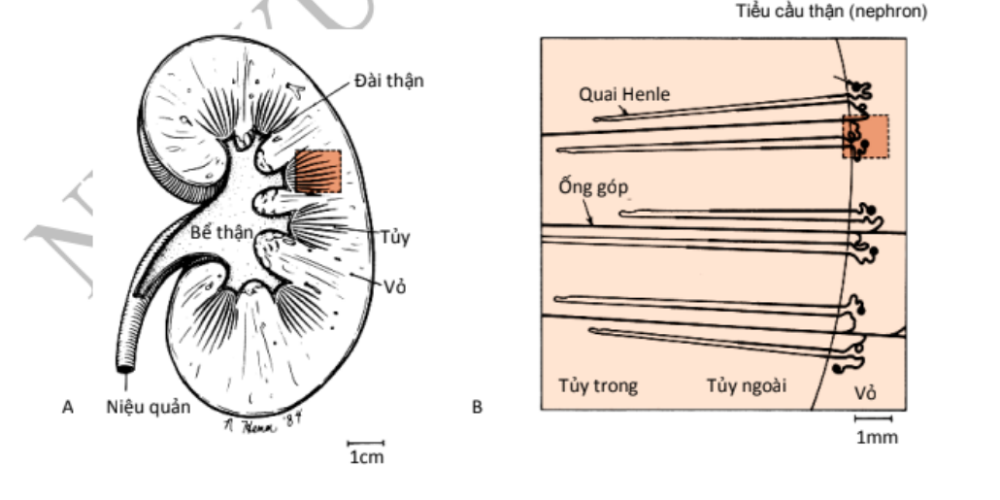
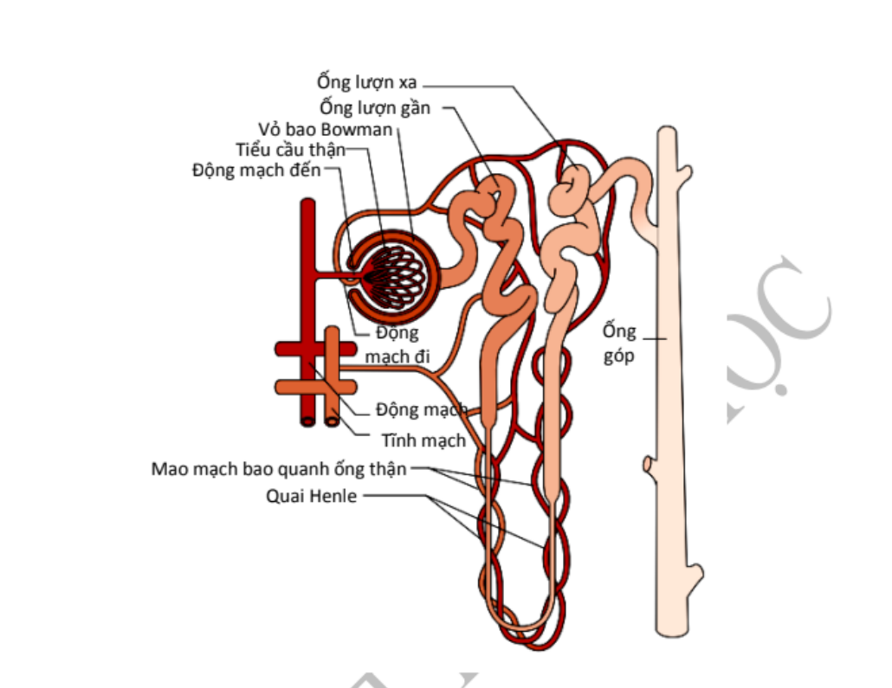
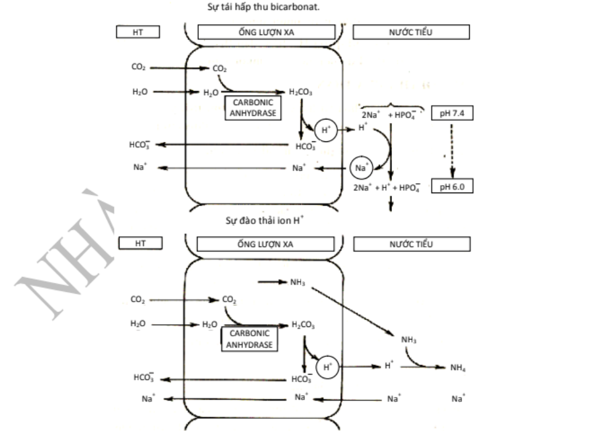
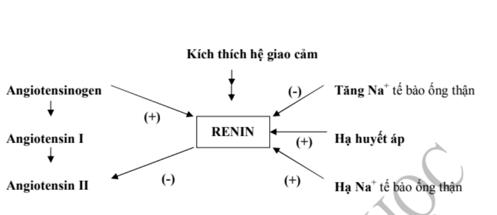
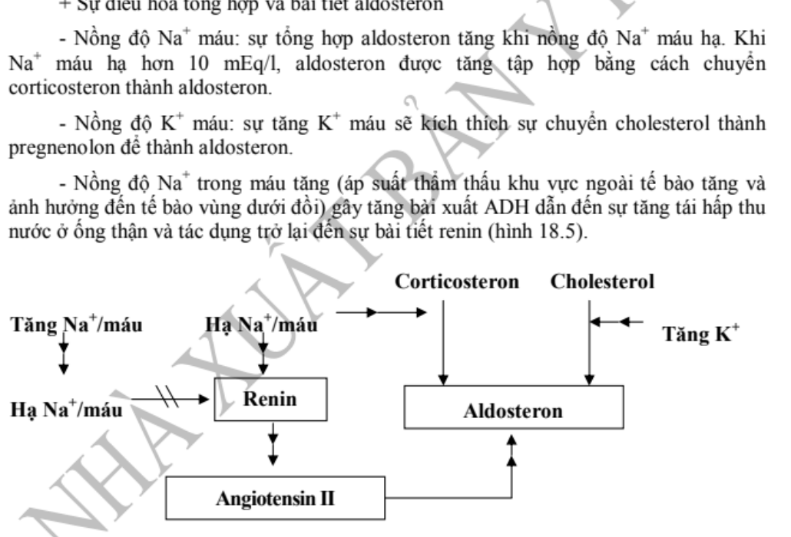

## CHƯƠNG 18: HÓA SINH THẬN VÀ NƯỚC TIỂU

### MỤC TIÊU HỌC TẬP
1. Trình bày được đặc điểm giải phẫu chức năng, tuần hoàn thận và cơ chế siêu lọc tại cầu thận.
2. Trình bày được các cơ chế tái hấp thu và bài tiết chọn lọc của các đoạn ống thận (ống lượn gần, quai Henle, ống lượn xa, ống góp).
3. Phân tích được vai trò của thận trong điều hòa thăng bằng nước, điện giải và thăng bằng acid - base nội môi.
4. Liệt kê và giải thích cơ chế xuất hiện các thành phần bất thường trong nước tiểu bệnh lý.

---

### 1. ĐẶC ĐIỂM GIẢI PHẪU VÀ CHỨC NĂNG CỦA THẬN

Hệ tiết niệu gồm 4 phần: hai quả thận, hai niệu quản, bàng quang và niệu đạo.

*Hình 18.1. Giải phẫu cấu tạo thận người: Vùng vỏ thận, tủy thận với các tháp Malpighi, đài bể thận và niệu quản.*

#### Đặc điểm tuần hoàn và chuyển hóa của thận
- Hai quả thận ở người trưởng thành nặng khoảng **$300\text{ g}$** (chiếm 0,5% trọng lượng cơ thể), nhưng tiêu thụ tới **$8 - 10\%$ tổng lượng oxy tiêu thụ của toàn cơ thể**.
- Hàng ngày có **$1.000 - 1.500\text{ lít}$ máu chảy qua thận** ($1{,}2\text{ lít/phút}$, tương đương 20-25% cung lượng tim).
- Trong dòng máu qua thận, 10% phục vụ nhu cầu dinh dưỡng nuôi nhu mô thận, còn **90% thực hiện nhiệm vụ lọc sạch huyết tương và bài tiết nước tiểu**.

---

### 2. CƠ CHẾ SINH HỌC TẠO THÀNH NƯỚC TIỂU TẠI NEPHRON

Đơn vị cấu tạo và chức năng của thận là **Nephron**. Mỗi quả thận chứa khoảng **$1{,}0 - 1{,}5\text{ triệu}$ nephron**.

*Hình 18.2. Sơ đồ cấu tạo một đơn vị Nephron: Cầu thận (bó mao mạch và bao Bowman), tiểu động mạch đến/đi, ống lượn gần, quai Henle (nhánh xuống, nhánh lên), ống lượn xa và ống góp.*

Mỗi nephron gồm hai phần chính:
1. **Tiểu cầu thận (Renal Corpuscle / Malpighi):** Gồm cuộn mao mạch Malpighi nằm lọt trong bao Bowman. Điểm đặc biệt duy nhất trong cơ thể là cuộn mao mạch này nằm giữa hai tiểu động mạch: **tiểu động mạch đến** và **tiểu động mạch đi** (đường kính tiểu động mạch đến lớn hơn tiểu động mạch đi giúp duy trì áp lực lọc mao mạch rất cao khoảng $60\text{ mmHg}$).
2. **Hệ thống ống thận:** Ống lượn gần $\rightarrow$ Quai Henle (nhánh xuống mỏng, nhánh lên dày) $\rightarrow$ Ống lượn xa $\rightarrow$ Ống góp.

---

#### 2.1. Quá trình lọc tại cầu thận (Cơ chế Siêu lọc)

##### Cấu trúc màng lọc cầu thận 3 lớp
Màng lọc cầu thận là một phễu siêu lọc sinh học tinh vi gồm 3 lớp từ trong ra ngoài:
1. **Lớp tế bào nội mô mao mạch cầu thận:** Có vô số lỗ thủng tròn (*fenestrae*) với đường kính $500 - 1.000\text{ \AA}$ ($50 - 100\text{ nm}$). Giữ lại các tế bào máu (hồng cầu, bạch cầu, tiểu cầu).
2. **Màng đáy cầu thận (Glomerular Basement Membrane - GBM):** Dày khoảng $3.200\text{ \AA}$ ($320\text{ nm}$), cấu tạo bởi mạng lưới sợi collagen type IV, laminin và proteoglycan mang điện tích âm mạnh (heparan sulfat). Đây là hàng rào lọc chính về kích thước và **hàng rào tích điện âm** đẩy lùi các protein tích điện âm (như Albumin).
3. **Lớp tế bào biểu mô có chân (Podocytes) của bao Bowman:** Các nhánh chân bào tương đan cài vào nhau tạo thành các **khe lọc (filtration slits)** có kích thước hẹp $250 - 500\text{ \AA}$ ($25 - 50\text{ nm}$), được bắc cầu bởi màng ngăn khe lọc (*slit diaphragm*) chứa nephrin và podocin.

> [!IMPORTANT]
> Màng lọc cầu thận cho phép nước và các phân tử hòa tan có trọng lượng phân tử **$< 50.000\text{ Da}$** đi qua tự do. Các chất có kích thước $50.000 - 70.000\text{ Da}$ bị cản trở bởi điện tích âm. Albumin ($M_r = 69.000\text{ Da}$) mặc dù có kích thước bằng khe lọc nhưng do tích điện âm mạnh nên bị màng đáy đẩy lại, hầu như không qua được nước tiểu ban đầu.

##### Nước tiểu ban đầu (Dịch lọc cầu thận)
- Mỗi phút thận lọc được khoảng **$120 - 125\text{ mL}$ dịch lọc**, tương đương **$180\text{ lít}$ nước tiểu ban đầu/24 giờ** (gấp 4 lần tổng lượng nước toàn cơ thể).
- Thành phần dịch lọc cầu thận gần như giống hệt huyết tương khử protein: chứa nước, glucose ($1\text{ g/L}$), urê, acid uric, creatinin, acid amin và các ion điện giải ($\text{Na}^+, \text{K}^+, \text{Cl}^-, \text{HCO}_3^-$), nồng độ protein cực thấp ($< 10\text{ mg/dL}$).
- **Mức lọc cầu thận (Glomerular Filtration Rate - GFR):** Là thông số vàng định lượng chức năng thận, được tính toán thông qua độ thanh thải creatinin hoặc các công thức ước tính eGFR (CKD-EPI, MDRD).

---

#### 2.2. Quá trình tái hấp thu chọn lọc tại các ống thận
Từ $180\text{ lít}$ dịch lọc ban đầu, sau khi đi qua hệ thống ống thận chỉ còn lại khoảng **$1{,}0 - 1{,}5\text{ lít}$ nước tiểu chính thức/24 giờ** (tái hấp thu tới **$99\%$ lượng nước**).

1. **Ống lượn gần (Tái hấp thu khối lượng lớn nhất):**
   - Tái hấp thu **$80\%$ thể tích nước và muối $\text{NaCl}$** (tái hấp thu đẳng trương bắt buộc đi kèm nhau).
   - Tái hấp thu **$100\%$ Glucose** nhờ đồng vận chuyển chủ động thứ phát với $\text{Na}^+$ (bơm SGLT2 và SGLT1). Glucose chỉ xuất hiện trong nước tiểu khi đường huyết vượt quá **ngưỡng thận của glucose ($1{,}8\text{ g/L} \approx 10\text{ mmol/L}$)**.
   - Tái hấp thu **$100\%$ acid amin**, vitamin và $90\%$ ion $\text{HCO}_3^-$.
   - Tái hấp thu lượng nhỏ protein qua ẩm bào (*endocytosis*).
   - Tiêu thụ năng lượng khổng lồ cho bơm $\text{Na}^+\text{-K}^+\text{-ATPase}$ màng đáy (chiếm tới 90% lượng oxy tiêu thụ của thận).
2. **Quai Henle (Cơ chế tăng nồng độ ngược dòng):**
   - *Nhánh xuống mỏng:* Thấm nước rất mạnh nhưng không thấm chất tan; nước bị kéo ra dịch kẽ tủy thận ưu trương làm dịch lọc cô đặc dần tới đỉnh quai ($1.200\text{ mOsm/kg}$).
   - *Nhánh lên dày:* Hoàn toàn không thấm nước nhưng tái hấp thu tích cực muối qua bơm đồng vận **$\text{Na}^+\text{-K}^+\text{-2Cl}^-$ (NKCC2)**. Muối được bơm liên tục vào dịch kẽ tủy thận tạo môi trường ưu trương sâu sắc nuôi dưỡng cơ chế cô đặc nước tiểu. Bơm này bị ức chế bởi thuốc lợi tiểu quai (Furosemid).
3. **Ống lượn xa và Ống góp (Điều hòa tinh tế theo thể dịch):**
   - Tái hấp thu nước có điều hòa phụ thuộc **hormon ADH**: ADH gắn thụ thể $V_2$ huy động các kênh Aquaporin-2 (AQP2) ra màng đỉnh giúp tái hấp thu $10 - 19\%$ lượng nước còn lại.
   - Tái hấp thu $\text{Na}^+$ và bài tiết $\text{K}^+/\text{H}^+$ phụ thuộc **hormon Aldosteron** qua kênh ENaC.
   - Creatinin và inulin không được tái hấp thu.

<!-- END FILE: pages_366_375.md -->

<!-- BEGIN FILE: pages_376_385.md -->

# CHƯƠNG 18: HÓA SINH THẬN VÀ NƯỚC TIỂU (TIẾP THEO VÀ HOÀN THIỆN)

---

### 1. CHỨC NĂNG CỦA THẬN (TIẾP THEO)

#### 1.1. Quá trình tái hấp thu và bài tiết tại ống thận (tiếp theo)
- **Tái hấp thu Urê:** Urê được tái hấp thu thụ động từ $40 - 50\%$ tại ống lượn gần và ống góp tủy thận, phụ thuộc thuận chiều theo tốc độ dòng nước tiểu và nồng độ urê máu.
- **Tái hấp thu Protein:** Thận bảo tồn tối đa protein: $99\%$ lượng albumin và các peptide nhỏ lọt qua màng lọc cầu thận đều được tế bào biểu mô ống lượn gần thu hồi trọn vẹn qua cơ chế ẩm bào (*endocytosis*) và giáng hóa thành acid amin trả về máu. Do đó, nước tiểu bình thường đào thải lượng protein cực thấp ($< 150\text{ mg/24h}$), không phát hiện được bằng các xét nghiệm thông thường.
- **Quá trình bài tiết tích cực tại ống thận:**
  - Bài tiết các ion: $\text{H}^+, \text{NH}_4^+, \text{K}^+$, acid uric và các anion/cation hữu cơ.
  - Bài tiết thuốc và độc chất ngoại sinh: Đa số thuốc (kháng sinh penicillin, cephalosporin, thuốc cản quang, salicylate) liên kết với protein huyết tương nên không qua được màng lọc cầu thận; chúng được các tế bào ống thận chủ động bắt giữ và bài tiết tích cực vào lòng ống qua các chất vận chuyển OAT (*Organic Anion Transporter*) và OCT (*Organic Cation Transporter*).
  - **Động học Acid Uric và Creatinin:** Acid uric được lọc khoảng $6\text{ mg/phút}$, ống thận bài tiết $6\text{ mg/phút}$ và tái hấp thu $98\%$, lượng bài xuất thực tế ra nước tiểu khoảng $0{,}33\text{ mg/phút}$ ($600\text{ mg/24h}$). Trong khi đó, **creatinin được lọc tự do qua cầu thận và hầu như không được tái hấp thu** (chỉ bài tiết thêm một lượng rất nhỏ ở ống lượn gần khi suy thận nặng), do đó độ thanh thải creatinin là tiêu chuẩn vàng đánh giá mức lọc cầu thận trên lâm sàng.

---

#### 1.2. Chức năng chuyển hóa của mô Thận
Mặc dù thận chỉ chiếm $0{,}5\%$ trọng lượng cơ thể nhưng tiêu thụ tới **$10\%$ lượng oxy toàn thân**, phản ánh tốc độ chuyển hóa năng lượng cực lớn để vận hành các bơm ion màng:
- **Chuyển hóa Glucid:** Đường phân yếm khí diễn ra chủ yếu ở vùng tủy thận (nơi phân áp oxy thấp); trong khi vỏ thận có khả năng **tân tạo đường** (gluconeogenesis) từ glutamin và lactat, đặc biệt tăng mạnh trong tình trạng nhiễm toan mạn tính.
- **Chuyển hóa Lipid:** Thận thoái hóa hoàn toàn các thể ceton làm nguồn năng lượng cho tế bào biểu mô ống thận; khử phosphat của lecithin nhờ enzym glycerophosphatase.
- **Chuyển hóa Protid và Hợp chất chứa Nitơ:** Tế bào thận chứa mạng lưới enzym khử amin phong phú. Giống như gan, thận tham gia vào quá trình khử nước đóng vòng tạo creatinin từ creatinphosphat, và liên hợp acid benzoic với glycin tạo thành acid hippuric.

---

#### 1.3. Vai trò của Thận trong Thăng bằng Nước - Điện giải và Acid - Base

##### Thăng bằng Nước
- Thận là cơ quan điều hòa chính duy trì cân bằng giữa lượng nước nhập và nước xuất qua trung gian hormon **ADH** (Vasopressin):
  - Khi cơ thể mất nước hoặc ASTT huyết tương tăng $\rightarrow$ Kích thích vùng dưới đồi tiết ADH $\rightarrow$ Tăng tái hấp thu nước tối đa tại ống lượn xa và ống góp $\rightarrow$ Nước tiểu cô đặc với thể tích ít, ASTT niệu có thể đạt tới **$1.200\text{ mOsm/kg}$**.
  - Khi thừa nước $\rightarrow$ Ức chế bài tiết ADH $\rightarrow$ Ống thận không tái hấp thu nước $\rightarrow$ Đào thải lượng lớn nước tiểu pha loãng, ASTT niệu tụt xuống chỉ còn **$50\text{ mOsm/kg}$**.

##### Cân bằng Điện giải
- **Natri ($\text{Na}^+$):** Cation chính ngoại bào. Thận kiểm soát toàn bộ lượng natri đào thải qua hệ thống **RAAS** (Renin - Angiotensin - Aldosteron) và ANP. Lượng natri bài xuất bình thường trong nước tiểu là $100 - 150\text{ mEq/24h}$.
- **Kali ($\text{K}^+$):** Cation chính nội bào. Được lọc tự do qua cầu thận, tái hấp thu hầu hết ở ống lượn gần và quai Henle. Tại ống lượn xa và ống góp, aldosteron kích thích bài xuất $\text{K}^+$ để đổi lấy $\text{Na}^+$. $\text{K}^+$ cạnh tranh trực tiếp với $\text{H}^+$ trong quá trình trao đổi với $\text{Na}^+$.
- **Chlorid ($\text{Cl}^-$):** Tái hấp thu thụ động song hành với $\text{Na}^+$ ở ống gần, và tái hấp thu tích cực qua bơm đồng vận $\text{Na}^+\text{-K}^+\text{-2Cl}^-$ (NKCC2) ở nhánh lên quai Henle (bị ức chế bởi Furosemid).
- **Calci, Phosphat và Magnesi:** Được lọc qua cầu thận và tái hấp thu dưới sự điều hòa của hormon tuyến cận giáp (**PTH**): PTH làm tăng tái hấp thu calci tại ống lượn xa nhưng ức chế tái hấp thu phosphat tại ống lượn gần (làm tăng phosphat niệu, hạ phosphat máu).

##### Thăng bằng Acid - Base
Thận đào thải mỗi ngày từ **$50 - 100\text{ mEq } \text{H}^+$** acid cố định không bay hơi (acid sulfuric từ protein, acid phosphoric từ phospholipid, thể ceton, acid lactic). Do pH tối thiểu của nước tiểu chỉ đạt tới $4{,}5$, lượng ion $\text{H}^+$ tự do không thể bài xuất đơn độc mà phải thông qua 3 cơ chế phân tử:

*Hình 18.3. Sơ đồ 3 cơ chế điều hòa thăng bằng acid - base tại ống lượn gần và ống lượn xa: Tái hấp thu $\text{HCO}_3^-$, tạo acid chuẩn độ ($\text{NaH}_2\text{PO}_4$) và bài tiết muối amoni ($\text{NH}_4^+$).*

1. **Tái hấp thu $90\%$ $\text{HCO}_3^-$ tại ống lượn gần:** Bơm $\text{Na}^+\text{-H}^+$ (NHE3) bài tiết $\text{H}^+$ vào lòng ống kết hợp với $\text{HCO}_3^-$ dịch lọc tạo $\text{H}_2\text{CO}_3$. Enzym Carbonic Anhydrase (CA) phân giải thành $\text{CO}_2 + \text{H}_2\text{O}$ khuếch tán vào nội bào để tái tạo lại $\text{NaHCO}_3$ đưa vào máu.
2. **Đào thải $\text{H}^+$ dưới dạng muối acid chuẩn độ ($\text{NaH}_2\text{PO}_4$):** Tại ống lượn xa, $\text{H}^+$ được bơm chủ động vào lòng ống trao đổi với $\text{Na}^+$, biến muối dinatri phosphat kiềm thành muối mononatri phosphat acid:
   $$\text{Na}_2\text{HPO}_4 + \text{H}^+ \rightleftharpoons \text{NaH}_2\text{PO}_4 + \text{Na}^+ \quad (\text{đào thải } 10 - 30\text{ mEq } \text{H}^+/24\text{h})$$
3. **Đào thải $\text{H}^+$ dưới dạng muối Amoni ($\text{NH}_4^+$):** Enzym glutaminase thủy phân glutamin tạo $\text{NH}_3$. Khí $\text{NH}_3$ khuếch tán vào lòng ống kết hợp với $\text{H}^+$ tạo thành ion amoni $\text{NH}_4^+$ ("bẫy amoni") đào thải ra ngoài ($30 - 50\text{ mEq } \text{H}^+/24\text{h}$, có thể tăng vọt gấp 10 lần khi nhiễm toan nặng).

---

#### 1.4. Chức năng Nội tiết của Thận

##### 1. Hệ thống Renin - Angiotensin - Aldosteron (RAAS)
- **Tế bào cạnh cầu thận (JGA):** Nằm ở thành tiểu động mạch đến, tổng hợp và bài tiết enzym **Renin** (glycoprotein $M_r = 40.000\text{ Da}$) vào tĩnh mạch thận khi có kích thích:
  - Giảm áp lực tưới máu thận (hạ huyết áp, hẹp động mạch thận, giảm thể tích tuần hoàn).
  - Giảm nồng độ $\text{NaCl}$ đi qua vết đặc (macula densa) tại ống lượn xa.
  - Kích thích thần kinh giao cảm thận qua thụ thể $\beta_1$-adrenergic.

*Hình 18.4. Sơ đồ các yếu tố điều hòa bài tiết Renin từ phức hợp cạnh cầu thận.*

- **Thác hoạt hóa sinh học:**
  $$\text{Angiotensinogen (Gan)} \xrightarrow{\text{Renin}} \text{Angiotensin I (Decapeptid)} \xrightarrow[\text{Phổi}]{\text{ACE}} \text{Angiotensin II (Octapeptid)}$$
  - **Angiotensin II:** Co thắt tiểu động mạch mạnh gấp 50 lần adrenalin làm tăng huyết áp toàn thân; co tiểu động mạch đi cầu thận để duy trì GFR; kích thích lớp cầu vỏ thượng thận tăng tổng hợp và bài tiết **Aldosteron**.
  - **Angiotensin III:** Được tạo thành khi aminopeptidase cắt bỏ gốc Asp đầu N của Angiotensin II, có tác dụng kích thích tiết aldosteron tương đương Angiotensin II.

*Hình 18.5. Cơ chế feedback điều hòa bài tiết Aldosteron qua nồng độ $\text{Na}^+, \text{K}^+$ máu, ADH và hệ RAAS.*

##### 2. Erythropoietin (EPO)
- Hormon glycoprotein được sản xuất bởi các tế bào sợi quanh ống thận ở vùng vỏ thận để đáp ứng với tình trạng thiếu oxy mô ($\text{pO}_2$ thấp).
- EPO tác động lên các tế bào tiền thân dòng hồng cầu (CFU-E) trong tủy xương kích thích tăng sinh và biệt hóa thành hồng cầu trưởng thành.
- **Ứng dụng lâm sàng:** Trong suy thận mạn, nhu mô thận bị xơ hóa làm giảm sản xuất EPO gây ra **thiếu máu mạn tính đẳng sắc đẳng bào**. Điều trị bằng chế phẩm EPO tái tổ hợp (*rHuEPO*) giúp cải thiện rõ rệt tình trạng thiếu máu ở bệnh nhân suy thận.

##### 3. Hoạt hóa Vitamin D ($1,25\text{-(OH)}_2\text{-D}_3$ / Calcitriol)
- Tế bào ống lượn gần chứa enzym **$1\alpha$-hydroxylase** phụ thuộc PTH, xúc tác chuyển $25\text{-OH-D}_3$ (từ gan) thành dạng hormon có hoạt tính sinh học cao nhất: **$1,25\text{-(OH)}_2\text{-D}_3$ (Calcitriol)**.
- Calcitriol kích thích hấp thu calci và phosphat tại ruột non, huy động khoáng hóa xương. Trong suy thận mạn, thiếu hụt calcitriol dẫn đến hạ calci máu, cường cận giáp thứ phát và bệnh lý xương do thận (*Renal osteodystrophy* / nhuyễn xương).

##### 4. Prostaglandin và Hệ Kallikrein - Kinin tại Thận
- Tế bào tủy thận tổng hợp $\text{PGE}_2$ và $\text{PGI}_2$ (Prostacyclin) từ acid arachidonic. Chúng gây giãn tiểu động mạch đến, tăng lưu lượng dòng máu thận, tăng bài tiết muối nước và đối kháng lại tác dụng co mạch của Angiotensin II.
- Dùng thuốc giảm đau chống viêm non-steroid (NSAID) ức chế COX làm giảm prostaglandin thận, dẫn đến co thắt động mạch đến gây suy thận cấp thể thiếu máu cục bộ.

---

### 2. HÓA SINH NƯỚC TIỂU

#### 2.1. Tính chất lý hóa của nước tiểu bình thường
1. **Thể tích nước tiểu 24 giờ:**
   - Người lớn bình thường: **$1.000 - 1.400\text{ mL/24h}$** ($18 - 20\text{ mL/kg/ngày}$).
   - *Đa niệu (Polyuria):* $> 2.500\text{ mL/24h}$ (đái tháo đường, đái tháo nhạt, giai đoạn hồi phục suy thận cấp).
   - *Thiểu niệu (Oliguria):* $< 500\text{ mL/24h}$ (suy thận cấp, mất nước nặng, sốc).
   - *Vô niệu (Anuria):* $< 100\text{ mL/24h}$ (hoại tử ống thận cấp, tắc nghẽn đường tiểu hoàn toàn).
2. **Màu sắc và Độ trong:**
   - Bình thường có màu vàng rơm đến vàng hổ phách trong suốt, do các sắc tố nội sinh: **Urochrome, Urobilin** và uroerythrin.
   - Nước tiểu để lạnh có thể xuất hiện tủa đục sinh lý: tủa muối urat (tan khi đun nóng) hoặc tủa phosphat/carbonat (tan khi nhỏ acid acetic).
   - *Bệnh lý:* Màu đỏ/hồng (đái máu, hemoglobin niệu); màu nâu sẫm/vàng sậm như nước vối (sắc tố mật bilirubin trong tắc mật); đục như nước vo gạo (dưỡng chấp niệu do giun chỉ *Wuchereria bancrofti*, hoặc đái mủ).
3. **Độ sánh và Mùi:**
   - Nước tiểu sánh hơn nước; khi có nhiều protein hoặc dưỡng chấp sẽ sánh đặc và lắc lên có nhiều bọt lâu tan.
   - Nước tiểu tươi có mùi thơm nhẹ đặc trưng; để lâu ngoài không khí có mùi khai nồng do vi khuẩn phân hủy urê thành $\text{NH}_3$. Trong nhiễm toan ceton có mùi thơm hoa quả chín/táo thối.
4. **Tỷ trọng nước tiểu (Specific Gravity):**
   - Bình thường dao động từ **$1{,}015 - 1{,}025$** (biến thiên từ $1{,}005$ khi uống nhiều nước đến $1{,}030$ khi mất mồ hôi).
   - Tỷ trọng tăng cao ($> 1{,}030$): Đái tháo đường (do chứa nhiều glucose).
   - Tỷ trọng cố định thấp ($1{,}010 - 1{,}012$ bằng tỷ trọng dịch lọc cầu thận ban đầu - *Isosthenuria*): Bệnh suy thận mạn giai đoạn cuối mất hoàn toàn khả năng cô đặc và pha loãng nước tiểu.
5. **pH nước tiểu:**
   - Bình thường hơi acid nhẹ: **$\text{pH} \approx 5{,}5 - 6{,}5$** (trung bình $5{,}8$).
   - Thay đổi theo chế độ ăn: ăn nhiều thịt $\rightarrow$ pH toan; ăn chay nhiều rau quả $\rightarrow$ pH kiềm.
   - pH kiềm bệnh lý gặp trong nhiễm trùng đường tiểu do vi khuẩn sinh urease (*Proteus mirabilis*) phân hủy urê thành amoniac kiềm hóa nước tiểu.

---

#### 2.2. Thành phần hóa học của nước tiểu 24 giờ

##### Bảng 18.1. Thành phần trung bình các chất trong nước tiểu 24 giờ của người trưởng thành

| Thành phần Anion (g/24h) | Khối lượng | Thành phần Cation (g/24h) | Khối lượng | Thành phần Hữu cơ (g/24h) | Khối lượng |
| :--- | :--- | :--- | :--- | :--- | :--- |
| **Clorua ($\text{Cl}^-$)** | $6 - 12\text{ g}$ | **Natri ($\text{Na}^+$)** | $4{,}0 - 6{,}0\text{ g}$ | **Urê** | **$20 - 30\text{ g}$** |
| **Phosphat ($\text{PO}_4^{3-}$)** | $2{,}5 - 4{,}0\text{ g}$ | **Kali ($\text{K}^+$)** | $2{,}0 - 3{,}0\text{ g}$ | **Creatinin** | **$1{,}0 - 1{,}8\text{ g}$** |
| **Sulfat ($\text{SO}_4^{2-}$)** | $2{,}0 - 3{,}5\text{ g}$ | **Amoni ($\text{NH}_4^+$)** | $0{,}3 - 1{,}2\text{ g}$ | **Acid Uric** | **$0{,}4 - 0{,}8\text{ g}$** |
| | | **Calci ($\text{Ca}^{2+}$)** | $0{,}15 - 0{,}25\text{ g}$ | **Acid amin toàn phần** | $2{,}0 - 4{,}0\text{ g}$ |
| | | **Magnesi ($\text{Mg}^{2+}$)** | $0{,}10 - 0{,}20\text{ g}$ | **Acid Hippuric** | $0{,}1 - 1{,}0\text{ g}$ |

- **Urê:** Chiếm tới **$80 - 85\%$ tổng lượng nitơ đào thải** trong nước tiểu, phản ánh chế độ ăn giàu đạm và tốc độ thoái hóa protid cơ thể.
- **Creatinin:** Bài xuất rất hằng định ở mỗi cá thể (**$20 - 25\text{ mg/kg}$ cân nặng ở nam**, $15 - 20\text{ mg/kg}$ ở nữ), tỷ lệ trực tiếp với khối lượng cơ vân. Dùng để kiểm tra độ tin cậy của mẫu thu thập nước tiểu 24 giờ.
- **Acid Uric:** Sản phẩm thoái hóa purin, tăng cao trong bệnh Gút, hội chứng ly giải u cấp tính.

---

#### 2.3. Các chất bất thường trong nước tiểu bệnh lý
Là các thành phần sinh lý bình thường không có hoặc chỉ có ở dạng vết không đo được, nhưng xuất hiện rõ rệt trong các bệnh cảnh lâm sàng:
1. **Protein niệu (Proteinuria):**
   - Tiêu chuẩn bệnh lý: **Protein niệu $> 150\text{ mg/24h}$** (hoặc tỷ số $\text{Protein/Creatinin niệu} > 200\text{ mg/g}$).
   - *Albumin niệu vi lượng (Microalbuminuria):* $30 - 300\text{ mg/24h}$, dấu hiệu tổn thương thận sớm nhất ở bệnh nhân đái tháo đường và tăng huyết áp.
   - *Protein niệu chọn lọc (chủ yếu là Albumin $> 80\%$):* Hội chứng thận hư nguyên phát tổn thương tối thiểu do mất lớp tích điện âm của màng đáy.
   - *Protein niệu không chọn lọc (xuất hiện cả IgG, transferrin):* Viêm cầu thận màng, viêm cầu thận tiến triển nhanh phá hủy cấu trúc lỗ lọc.
   - *Protein niệu quá tải (Overflow proteinuria - Protein Bence-Jones):* Chuỗi nhẹ globulin miễn dịch đơn dòng ($\kappa$ hoặc $\lambda$) trong bệnh **Đa u tủy xương (Multiple Myeloma)**; có đặc tính lý hóa độc nhất: kết tủa đông vón ở nhiệt độ $50 - 60^\circ\text{C}$ và tan trở lại khi đun sôi lên $100^\circ\text{C}$.
2. **Glucose niệu (Glycosuria):**
   - Xuất hiện khi nồng độ glucose máu vượt quá **ngưỡng thận của glucose ($1{,}8\text{ g/L} \approx 10\text{ mmol/L}$)** trong bệnh đái tháo đường.
   - Glucose niệu với đường huyết bình thường: Gặp trong bệnh đái tháo đường do thận (*Renal glycosuria* do khiếm khuyết bẩm sinh kênh SGLT2) hoặc tổn thương ống lượn gần (hội chứng Fanconi).
3. **Thể Ceton niệu (Ketonuria):**
   - Xuất hiện acid acetoacetic, $\beta$-hydroxybutyric và aceton trong nước tiểu. Gặp trong **nhiễm toan ceton do đái tháo đường mất bù**, nhịn đói kéo dài, nôn mửa thai nghén nặng.
4. **Sắc tố mật (Bilirubin liên hợp) và Muối mật:**
   - Dấu hiệu điển hình của vàng da tắc mật cơ học trong hoặc ngoài gan, viêm gan cấp hoại tử tế bào gan.
5. **Hồng cầu niệu (Hematuria) và Hemoglobin niệu:**
   - *Hồng cầu niệu:* Nước tiểu có hồng cầu nguyên vẹn soi thấy dưới kính hiển vi. Nguyên nhân: sỏi tiết niệu, viêm vi cầu thận cấp, lao thận, u hệ tiết niệu.
   - *Hemoglobin niệu:* Nước tiểu màu đỏ xá xị hoặc nâu đen không có hồng cầu lắng cặn. Gặp trong tan máu nội mạch cấp tính (sốt rét ác tính đái huyết cầu tố, truyền nhầm nhóm máu hệ ABO, ngộ độc nọc rắn).
6. **Nitrit niệu:**
   - Que thử phát hiện phản ứng Griess đổi màu hồng khi có enzym nitrat reductase của vi khuẩn Gram âm ($\text{E. coli, Klebsiella, Proteus}$) khử nitrat thành nitrit, chỉ điểm **nhiễm trùng đường tiết niệu**.
7. **Dưỡng chấp niệu (Chyluria):**
   - Do vỡ lỗ rò hệ thống bạch huyết vào đài bể thận hoặc niệu quản do giun chỉ ký sinh.

---

### CÂU HỎI ÔN TẬP CHƯƠNG 18
1. Trình bày cấu trúc màng lọc cầu thận 3 lớp và cơ chế siêu lọc tạo thành nước tiểu ban đầu.
2. Phân tích các cơ chế tái hấp thu chọn lọc tại ống lượn gần, quai Henle và ống lượn xa. Nêu vai trò của hormon ADH và Aldosteron.
3. Trình bày chi tiết 3 cơ chế phân tử của thận trong việc duy trì thăng bằng acid - base nội môi.
4. Nêu các chức năng nội tiết của thận: hệ thống RAAS, hormon Erythropoietin và quá trình hoạt hóa Calcitriol.
5. Phân tích ý nghĩa lâm sàng của các chất bất thường trong nước tiểu: Protein niệu (các thể lâm sàng và protein Bence-Jones), Glucose niệu, Thể ceton, Bilirubin niệu và Hemoglobin niệu.

<!-- END FILE: pages_376_385.md -->

<!-- BEGIN FILE: pages_386_395.md -->