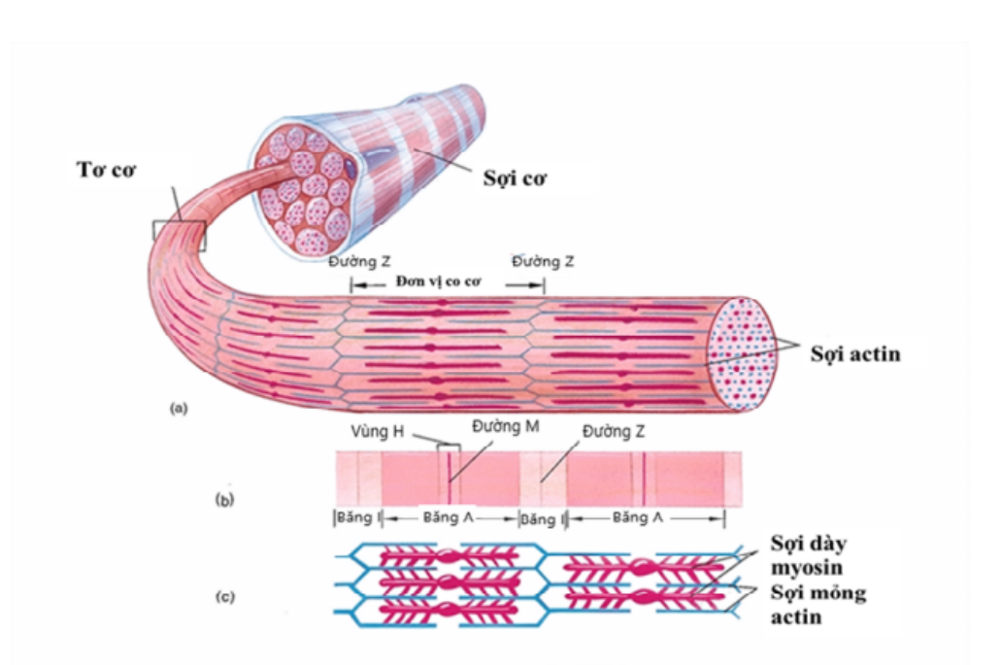
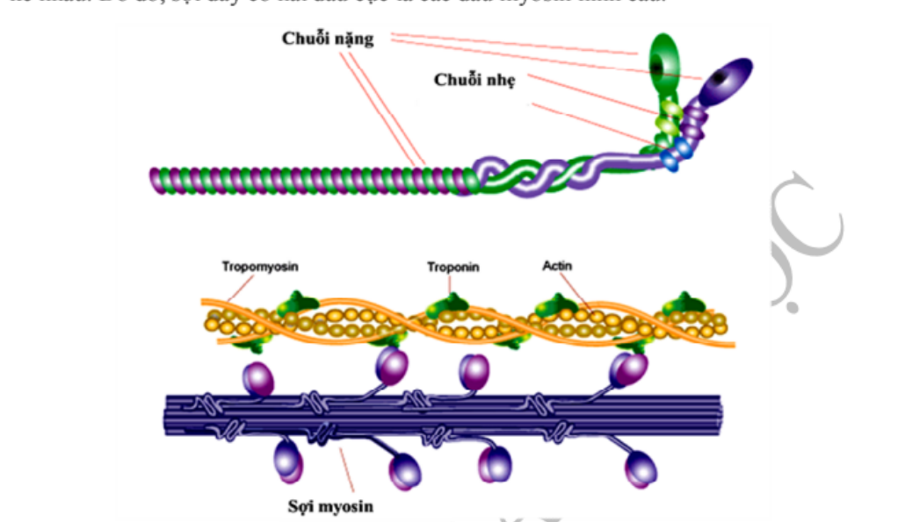
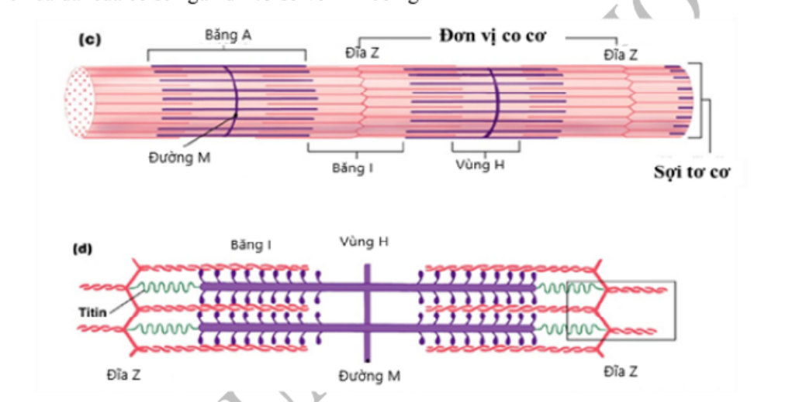
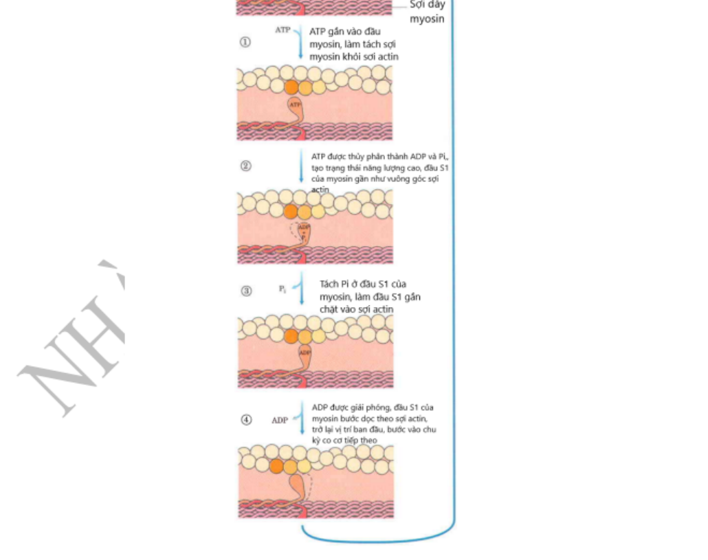

# CHƯƠNG 20: HÓA SINH CƠ

---

### MỤC TIÊU HỌC TẬP
1. Trình bày được đặc điểm thành phần hóa học và chuyển hóa đặc thù của mô cơ.
2. Trình bày được cấu trúc siêu vi của cơ vân, cấu trúc phân tử của các protein co cơ (myosin, actin, tropomyosin, troponin).
3. Phân tích được cơ chế phân tử của sự co cơ vân và vai trò điều hòa của ion $\text{Ca}^{2+}$ và ATP.
4. Trình bày các nguồn cung cấp năng lượng cho hoạt động co cơ (creatin phosphat, đường phân, thoái hóa lipid) và cơ chế co cơ trơn.

---

### 1. ĐẶC ĐIỂM THÀNH PHẦN HÓA HỌC VÀ CHUYỂN HÓA TRONG CƠ

Trong cơ thể người có hơn **$600$ cơ bắp**, chiếm tới **$40\%$ trọng lượng cơ thể** ở nam giới trưởng thành. Mô cơ được chia thành 3 loại: **cơ vân** (cơ xương chịu sự điều khiển theo ý muốn), **cơ tim** và **cơ trơn** (hoạt động tự động không theo ý muốn).

#### 1.1. Thành phần cấu tạo hóa học của mô cơ
Mô cơ chứa khoảng **$75\%$ nước** và **$25\%$ chất khô**:
- **Protein mô cơ:** Chiếm tới **$16{,}5 - 20{,}9\%$ trọng lượng tươi** (tương đương $80\%$ chất khô), gồm các protein co cơ của tơ cơ (myosin, actin, tropomyosin, troponin) và các protein chất nền cơ tương (myoglobin, các enzym đường phân, creatin kinase).
- **Lipid mô cơ:** Chiếm khoảng $1\%$ trọng lượng cơ, gồm triglycerid xen kẽ, phospholipid và cholesterol màng sợi cơ. Mô cơ tim chứa hàm lượng phospholipid và cholesterol cao gấp 2 lần cơ vân do mật độ ty thể và màng lưới nội chất dày đặc.
- **Glycogen mô cơ:** Chiếm **$0{,}3 - 2{,}0\%$** trọng lượng cơ, là kho dự trữ năng lượng glucid tại chỗ lớn nhất của cơ thể (khoảng $300 - 400\text{ g}$ glycogen toàn thân).
- **Các hợp chất chứa nitơ đặc biệt:**
  - **ATP tự do:** Hợp chất cung cấp năng lượng trực tiếp cho hoạt động co cơ ($5\ \mu\text{mol/g}$ cơ tươi).
  - **Creatin phosphat (Phosphocreatin):** Hợp chất cao năng dự trữ phosphate đặc hiệu cho mô cơ ($15 - 20\ \mu\text{mol/g}$ cơ tươi, cao gấp 3-4 lần nồng độ ATP).
  - **Creatinin:** Sản phẩm thoái hóa thoái biến không hồi phục của creatin phosphat, khuếch tán ra máu bài tiết qua thận.
  - **Myoglobin (Mb):** Hemoprotein đơn chuỗi (153 acid amin) chứa 1 nhân Hem, dự trữ oxy tại chỗ cho cơ hoạt động, có ái lực với oxy cao hơn nhiều so với Hemoglobin máu.
  - **Acid Lactic:** Sản phẩm của đường phân yếm khí khi cơ co mạnh thiếu oxy; được máu vận chuyển về gan tái tạo glucose qua **chu trình Cori**.
- **Chất khoáng và Ion:** Cơ chứa lượng lớn các ion $\text{K}^+, \text{Na}^+, \text{Mg}^{2+}, \text{Ca}^{2+}, \text{Cl}^-$. Nồng độ $\text{K}^+$ trong sợi cơ rất cao ($150\text{ mmol/L}$); nếu chế độ ăn thiếu natri thừa kali kéo dài sẽ gây yếu cơ và giảm trương lực cơ.

---

#### 1.2. Đặc điểm chuyển hóa thích nghi của mô cơ
Chuyển hóa của mô cơ thay đổi linh hoạt theo trạng thái nghỉ ngơi hoặc co cơ cực độ:
- **Khi cơ nghỉ ngơi hoặc hoạt động nhẹ:** Nhu cầu năng lượng được đáp ứng chủ yếu ($> 90\%$) bởi quá trình oxy hóa hiếu khí **acid béo tự do** và **thể ceton**. Glucose được thu nhận và tích lũy thành glycogen dự trữ; $\text{O}_2$ được dự trữ trong myoglobin và creatin được phosphoryl hóa thành creatin phosphat.
- **Khi cơ co bóp dữ dội (chạy nước rút, nâng tạ nặng):** Sự co thắt cơ chèn ép các mao mạch nội cơ, làm lưu lượng máu và oxy bị cắt đứt tạm thời. Cơ lập tức huy động:
  1. *ATP tự do nội bào:* Tiêu thụ hết trong $1 - 2\text{ giây}$.
  2. *Creatin phosphat:* Chuyển gốc phosphat sang ADP duy trì co cơ thêm $6 - 8\text{ giây}$.
  3. *Đường phân yếm khí (Anaerobic glycolysis):* Phân giải glycogen cơ thành glucose-6-phosphat rồi thành **acid lactic**, tạo 2 ATP/phân tử glucose. Tích tụ acid lactic làm giảm pH nội cơ gây mệt mỏi cơ và đau cơ sau vận động.
- **Tốc độ đổi mới protein cơ:** Diễn ra rất chậm, thời gian bán hủy của Actin là $67\text{ ngày}$ (so với Albumin máu chỉ 19 ngày).

---

### 2. CẤU TRÚC SIÊU VI CỦA CƠ VÂN VÀ CÁC PROTEIN CO CƠ

Cơ vân được cấu tạo từ các bó sợi cơ ($d = 20 - 100\ \mu\text{m}$). Mỗi sợi cơ là một hợp bào đa nhân khổng lồ dài tới $30\text{ cm}$. Bào tương của sợi cơ chứa hàng ngàn **tơ cơ (Myofibrils)** chạy song song suốt chiều dài tế bào.

*Hình 20.1. Sơ đồ tổ chức cơ vân từ bó cơ, sợi cơ, tơ cơ đến đơn vị co cơ (Sarcomere) với các dải sáng tối xen kẽ.*

- **Đơn vị co cơ (Sarcomere):** Là đơn vị cấu trúc và chức năng cơ bản của tơ cơ, dài khoảng **$2{,}5 - 3{,}0\ \mu\text{m}$** khi cơ giãn:
  - **Băng A (Anisotropic):** Dải sẫm màu, chứa toàn bộ chiều dài sợi dày myosin và phần lồng vào của sợi mỏng actin. Ở giữa băng A là **vùng H** (chỉ có sợi dày), và trung tâm vùng H là **đường M** (nơi neo giữ các sợi dày).
  - **Băng I (Isotropic):** Dải sáng màu, chỉ chứa sợi mỏng actin. Ở chính giữa băng I là **đĩa Z** (Z-line, protein $\alpha$-actinin).
  - Một sarcomere được giới hạn bởi **2 đĩa Z liên tiếp** (gồm 1 băng A ở giữa và 2 nửa băng I ở hai đầu).

---

#### 2.1. Cấu trúc phân tử của Sợi dày (Myosin)
Sợi dày được tạo nên duy nhất bởi phân tử protein khổng lồ **Myosin** ($M_r = 520\text{ kDa}$):
- **Cấu tạo tiểu phần:** Gồm **6 chuỗi polypeptid**:
  - **2 chuỗi nặng (Heavy chains):** Mỗi chuỗi $220\text{ kDa}$, phần đuôi cuộn xoắn kép $\alpha$ hình gậy dài $160\text{ nm}$, phần đầu N cuộn lại thành 2 đầu hình cầu hình hạt đậu.
  - **4 chuỗi nhẹ (Light chains):** Gồm 2 cặp chuỗi nhẹ ($18\text{ kDa}$ và $20\text{ kDa}$) quấn quanh cổ đầu myosin, có vai trò điều hòa và tăng tốc độ hoạt tính ATPase của đầu myosin.

*Hình 20.2. Cấu trúc phân tử Myosin: Chuỗi nặng xoắn kép, vùng cổ, đầu hình cầu phân đoạn HMM S-1 (chứa vị trí gắn actin và trung tâm xúc tác ATPase).*

- **Thủy phân thực nghiệm bằng enzym:**
  - *Trypsin:* Cắt myosin thành đoạn **Meromyosin nhẹ (LMM)** hình gậy dài $85\text{ nm}$ (tạo nên trục sợi dày) và đoạn **Meromyosin nặng (HMM)**.
  - *Papain:* Tiếp tục cắt đoạn HMM thành đoạn **HMM S-2** hình cổ gậy và hai đầu **HMM S-1**.
  - **Phân đoạn HMM S-1:** Là trung tâm hoạt động chức năng cốt lõi của myosin, mang:
    1. Vị trí gắn kết đặc hiệu với sợi Actin.
    2. Trung tâm hoạt tính enzym **ATPase** thủy phân ATP chuyển hóa năng lượng hóa học thành công cơ học.
- Một sợi dày hoàn chỉnh gồm khoảng **vài trăm phân tử myosin** sắp xếp so le đối xứng hai đầu qua đường M, với hàng trăm đầu S-1 thò ra ngoài tạo thành các **cầu nối ngang (cross-bridges)**.

---

#### 2.2. Cấu trúc phân tử của Sợi mỏng (Actin, Tropomyosin, Troponin)

##### 1. Actin ($M_r = 42\text{ kDa}$)
- Ở môi trường lực ion thấp, actin tồn tại ở dạng monome hình cầu mang 2 thùy gọi là **G-actin** (Globular actin), mỗi monome gắn 1 phân tử ATP.
- Ở điều kiện sinh lý, G-actin tự trùng hợp kèm thủy phân ATP thành ADP để tạo thành chuỗi xoắn kép dạng sợi **F-actin** (Filamentous actin) dài $1\ \mu\text{m}$.
- F-actin là trục cốt lõi của sợi mỏng. Mỗi monome actin trên chuỗi F-actin sở hữu 1 vị trí gắn đặc hiệu với đầu S-1 của myosin. Các sợi mỏng xuất phát từ đĩa Z hướng về phía đường M.

##### 2. Tropomyosin ($M_r = 66\text{ kDa}$)
- Phân tử hình que mảnh dài $40\text{ nm}$ gồm 2 chuỗi xoắn $\alpha$ song song.
- Nằm lọt vào rãnh xoắn của chuỗi F-actin, cứ mỗi phân tử tropomyosin che phủ **7 monome actin liên tiếp**, có nhiệm vụ che lấp các vị trí gắn myosin trên actin khi cơ ở trạng thái nghỉ.

##### 3. Troponin ($M_r = 76\text{ kDa}$)
Là một phức hợp gồm 3 tiểu đơn vị hình cầu gắn định kỳ trên mỗi phân tử tropomyosin:
- **Troponin T (TnT, $37\text{ kDa}$):** Chịu trách nhiệm gắn phức hợp troponin vào phân tử Tropomyosin.
- **Troponin I (TnI, $23\text{ kDa}$):** Có tác dụng ức chế (Inhibitory), ngăn chặn đầu S-1 của myosin tiếp xúc với actin khi cơ nghỉ.
- **Troponin C (TnC, $18\text{ kDa}$):** Tiểu đơn vị gắn ion $\text{Ca}^{2+}$ (có cấu trúc tương đồng cao với Calmodulin), mỗi phân tử TnC gắn tối đa **$4\text{ ion } \text{Ca}^{2+}$**. Khi nồng độ $\text{Ca}^{2+}$ tăng, TnC gắn $\text{Ca}^{2+}$ làm biến đổi cấu hình không gian toàn bộ phức hợp, kéo chệch tropomyosin để bộc lộ vị trí hoạt động trên actin.

> [!IMPORTANT]
> **Dấu ấn tổn thương cơ tim (hs-cTnI và hs-cTnT):** Troponin I và Troponin T của cơ tim có trình tự acid amin đặc hiệu khác biệt với cơ vân. Khi tế bào cơ tim bị hoại tử trong **Nhồi máu cơ tim cấp**, cTnI và cTnT được giải phóng ồ ạt vào máu sau $3 - 4\text{ giờ}$ và tồn tại kéo dài $7 - 14\text{ ngày}$, là tiêu chuẩn vàng chẩn đoán xác định nhồi máu cơ tim.

---

#### 2.3. Các Protein cấu trúc khung đỡ phụ trợ của sợi cơ
- **$\alpha$-Actinin:** Protein đĩa Z neo giữ cố định các sợi mỏng actin.
- **Titin (Connectin):** Đại phân tử protein lớn nhất cơ thể người ($3.600\text{ kDa}$, gồm $36.000$ acid amin), nối từ đĩa Z đến đường M của sợi dày, hoạt động như một chiếc lò xo phân tử giữ sợi dày ở chính giữa sarcomere và tạo độ đàn hồi thụ động cho cơ.
- **Nebulin ($800\text{ kDa}$):** Chạy dọc suốt chiều dài sợi actin, đóng vai trò "thước đo phân tử" kiểm soát chiều dài chính xác của sợi mỏng.
- **Desmin và Vimentin:** Protein sợi trung gian liên kết các đĩa Z của các tơ cơ lân cận với nhau và với màng tế bào.

---

### 3. CƠ CHẾ SINH HỌC PHÂN TỬ CỦA SỰ CO CƠ VÂN

#### 3.1. Thuyết Trượt Sợi (Sliding Filament Theory của Huxley)
Khi cơ co bóp, chiều dài của sợi dày myosin và sợi mỏng actin hoàn toàn không thay đổi. Sự co ngắn của sarcomere (ngắn đi tới $1/3$ chiều dài nghỉ) là do **các sợi mỏng trượt sâu vào khoảng giữa các sợi dày về phía đường M**:
- Băng I thu hẹp lại; Vùng H hẹp dần rồi biến mất hoàn toàn.
- Hai đĩa Z bị kéo sát lại gần nhau; Băng A giữ nguyên độ dài cố định.

*Hình 20.3. Sơ đồ biến đổi hình học của các dải trong Sarcomere giữa trạng thái nghỉ (trên) và trạng thái co cơ (dưới): Vùng H và băng I co ngắn lại.*

---

#### 3.2. Chu kỳ 4 bước co cơ phân tử (Ghép cặp Hóa - Cơ)

Khởi đầu từ trạng thái cơ bị khóa cứng khi thiếu ATP (phức hợp Rigor), chu trình hoạt động của đầu myosin S-1 diễn ra qua 4 bước liên hoàn:

*Hình 20.4. Chu trình 4 bước phân tử co cơ vân: Gắn ATP làm tách myosin khỏi actin $\rightarrow$ Thủy phân ATP dựng đầu S-1 $\rightarrow$ Gắn vào actin và giải phóng $\text{P}_i$ sinh cú đập tạo lực $\rightarrow$ Thải ADP sẵn sàng chu kỳ mới.*

1. **Bước 1 (Gắn ATP và Phân ly Cầu nối):**
   - Một phân tử **ATP gắn vào vị trí gắn nucleotide** trên đầu S-1 của myosin. Sự gắn này làm biến đổi cấu hình, mở khe hở tiếp xúc actin, làm **đầu S-1 tách rời khỏi sợi actin**.
2. **Bước 2 (Thủy phân ATP và "Lên Cò" Năng lượng cao):**
   - Trung tâm ATPase của đầu S-1 thủy phân ATP thành $\text{ADP} + \text{P}_i$, nhưng cả hai sản phẩm vẫn bị giữ chặt tại đầu myosin.
   - Năng lượng giải phóng được chuyển hóa làm quay gập cổ myosin khoảng $60^\circ$, đưa đầu S-1 vào trạng thái "dựng đứng năng lượng cao", hướng vuông góc với sợi actin và dịch chuyển về phía đĩa Z gắn vào 1 monome actin mới.
3. **Bước 3 (Giải phóng $\text{P}_i$ và Cú đập tạo lực - Power Stroke):**
   - Đầu S-1 gắn vào vị trí mới trên actin kích hoạt sự **giải phóng gốc $\text{P}_i$**.
   - Việc tách $\text{P}_i$ làm khép chặt khe tiếp xúc và kích hoạt **"cú đập sinh lực" (Power stroke)**: đầu S-1 quay gập mạnh một góc $45^\circ$, kéo trượt sợi actin một đoạn **$60\text{ - }100\text{ \AA}$** ($6 - 10\text{ nm}$) về phía đường M trung tâm.
4. **Bước 4 (Giải phóng ADP và Tái lập trạng thái Rigor):**
   - Phân tử **ADP được phóng thích** khỏi đầu S-1. Đầu myosin gắn chặt với actin ở trạng thái năng lượng thấp sẵn sàng tiếp nhận một phân tử ATP mới để lặp lại chu kỳ.

> [!NOTE]
> Mỗi sợi dày có khoảng **$500$ đầu S-1** hoạt động độc lập không đồng thời với tần số đập khoảng $5\text{ lần/giây}$, tạo nên lực kéo trượt liên tục, mượt mà của sợi mỏng.
> Khi cơ thể chết, nguồn ATP nội bào cạn kiệt hoàn toàn, chu trình dừng lại vĩnh viễn ở cuối Bước 4: đầu S-1 không thể tách khỏi actin, gây nên hiện tượng **co cứng tử thi (Rigor Mortis)** sau tử vong $2 - 6\text{ giờ}$.

---

#### 3.3. Cơ chế Điều hòa Co cơ bởi ion $\text{Ca}^{2+}$
- **Khi cơ nghỉ:** Bơm $\text{Ca}^{2+}\text{-ATPase}$ (SERCA) trên màng lưới cơ tương liên tục bơm $\text{Ca}^{2+}$ từ dịch bào vào lòng túi dự trữ, duy trì nồng độ $\text{Ca}^{2+}$ dịch bào cực thấp ($< 10^{-7}\text{ M}$). Trong lòng lưới cơ tương, protein **calsequestrin** ($55\text{ kDa}$) gắn giữ tới 40 ion $\text{Ca}^{2+}$.
- **Khi có xung động thần kinh:**
  - Điện thế hoạt động lan truyền qua ống T ($\text{T-tubules}$) kích hoạt thụ thể dihydropyridine (DHPR), mở kênh giải phóng calci ryanodine (**RyR1**) trên lưới cơ tương.
  - $\text{Ca}^{2+}$ ùa ra bào tương, nồng độ vọt lên **$> 10^{-5}\text{ M}$**.
  - $\text{Ca}^{2+}$ gắn vào **Troponin C**, gây biến đổi cấu hình kéo chệch Tropomyosin vào sâu trong rãnh xoắn, bộc lộ vị trí gắn myosin trên actin và chu trình co cơ bùng nổ.
- **Khi dứt xung động:** Kênh RyR1 đóng, bơm SERCA thu hồi nhanh $\text{Ca}^{2+}$ trở lại túi dự trữ ($< 10^{-7}\text{ M}$), Tropomyosin che lấp trở lại vị trí gắn myosin và cơ giãn ra.

---

### 4. NĂNG LƯỢNG HÓA HỌC CHO HOẠT ĐỘNG CO CƠ

Cơ tiêu thụ năng lượng khổng lồ. Năng lượng giải phóng từ các cơ chất chuyển hóa khác nhau được tính toán theo bảng sau:

##### Bảng 20.1. Biến thiên năng lượng tự do ($\Delta G^\circ$) và giá trị sinh năng lượng của các cơ chất

| Cơ chất chuyển hóa | Khối lượng phân tử ($M_r$) | $\Delta G^\circ$ tiêu chuẩn (kcal/mol) | Giá trị năng lượng sinh học (kcal/g) |
| :--- | :--- | :--- | :--- |
| **Glucose** | 180 | $-686$ | **$3{,}81\text{ kcal/g}$** |
| **Acid Lactic** | 90 | $-326$ | **$3{,}62\text{ kcal/g}$** |
| **Palmitat (Acid béo)** | 256 | $-2.380$ | **$9{,}30\text{ kcal/g}$** |
| **Tripalmitin (Triglycerid)**| 807 | $-7.510$ | **$9{,}30\text{ kcal/g}$** |
| **Glycin (Acid amin)** | 75 | $-234$ | **$3{,}12\text{ kcal/g}$** |

> [!TIP]
> Lipid sinh năng lượng cao gấp gần 3 lần glucid ($9{,}3\text{ kcal/g}$ so với $3{,}8\text{ kcal/g}$) do các nguyên tử carbon trong chuỗi acid béo nằm ở trạng thái khử sâu nhất ($-\text{CH}_2-$), khi bị oxy hóa hoàn toàn sẽ giải phóng số đương lượng khử ($\text{H}^+ + \text{e}^-$) đi vào chuỗi hô hấp tế bào ty thể nhiều hơn gấp 3 lần so với glucid.

##### Các nguồn năng lượng theo thời gian:
1. **Hệ ATP - Phosphocreatin (Hệ Phosphagen):** Xúc tác bởi enzym **Creatin Kinase (CK / CPK)**, cung cấp ATP tức thời trong $8 - 10\text{ giây}$ đầu:
   $$\text{Creatin phosphat} + \text{ADP} \xrightleftharpoons{\text{Creatin kinase (CK)}} \text{Creatin} + \text{ATP}$$
2. **Phản ứng Myokinase (Adenylat kinase):** Khi nồng độ ADP nội cơ tăng cao:
   $$2\text{ ADP} \xrightleftharpoons{\text{Adenylat kinase}} \text{ATP} + \text{AMP}$$
3. **Đường phân yếm khí:** Cung cấp ATP cho hoạt động cường độ cao kéo dài $1 - 2\text{ phút}$.
4. **Hệ thống Oxy hóa hiếu khí (Ty thể):** Oxy hóa acid béo và glucose hiếu khí, cung cấp **$> 95\%$ tổng năng lượng** cho các hoạt động bền bỉ kéo dài nhiều giờ.

---

### 5. CƠ CHẾ CO CƠ TRƠN VÀ SỰ CHUYỂN ĐỘNG CỦA CÁC TẾ BÀO KHÁC

#### 5.1. Cơ chế Co Cơ Trơn
- Cơ trơn (thành mạch máu, đường tiêu hóa, phế quản, tử cung) gồm các tế bào đơn nhân hình thoi không có cấu trúc sarcomere vân ngang.
- **Đặc điểm phân tử:** Sợi mỏng của cơ trơn **không có phức hợp Troponin** mà chỉ có Actin và Tropomyosin.
- **Cơ chế khởi động bằng $\text{Ca}^{2+}$ - Calmodulin:**
  - Kích thích làm tăng $\text{Ca}^{2+}$ nội bào ($> 10^{-6}\text{ M}$). $\text{Ca}^{2+}$ gắn vào protein **Calmodulin** tạo phức hợp $\text{Ca}^{2+}\text{-Calmodulin}$.
  - Phức hợp này hoạt hóa enzym **MLCK** (*Myosin Light Chain Kinase*).
  - MLCK phosphoryl hóa gốc Serine trên chuỗi nhẹ của đầu myosin, làm bộc lộ trung tâm ATPase và kích hoạt sự tương tác myosin với actin gây co cơ trơn.
  - Khi $\text{Ca}^{2+}$ hạ thấp ($< 10^{-7}\text{ M}$), enzym **MLCP** (*Myosin Light Chain Phosphatase*) khử phosphat làm cơ trơn giãn ra.
- **Điều hòa qua hormon (Epinephrine / Thuốc giãn phế quản):** Epinephrine gắn thụ thể $\beta_2$-adrenergic làm tăng $\text{cAMP} \rightarrow$ Hoạt hóa PKA $\rightarrow$ Phosphoryl hóa bất hoạt enzym MLCK $\rightarrow$ Giãn cơ trơn phế quản (ứng dụng khí dung điều trị cơn hen phế quản cấp).

#### 5.2. Chuyển động ở các tế bào không phải mô cơ
- Phức hợp Actomyosin đảm nhiệm quá trình **phân chia tế bào** (tạo vòng thắt co rút actomyosin ở mặt phẳng xích đạo phân chia tế bào mẹ thành hai tế bào con trong kỳ cuối phân bào).
- Actin dạng vi sợi (vi sợi actin) đảm nhiệm sự di chuyển chân giả của bạch cầu và amip, sự thực bào của đại thực bào, và sự vươn dài của sợi trục thần kinh.
- Đầu tinh trùng chứa lượng lớn phức hợp profiactin (profilin gắn G-actin). Khi tiếp xúc vỏ noãn, profiactin phân ly giải phóng bùng nổ F-actin đâm xuyên qua màng trứng mở đầu thụ tinh.

---

### 6. MỘT SỐ BỆNH LÝ CHUYỂN HÓA CƠ DI TRUYỀN

Theo Hiệp hội Loạn dưỡng cơ quốc tế (MDA), các bệnh cơ chuyển hóa xuất phát từ khiếm khuyết gen mã hóa các enzym đường phân, thoái hóa glycogen hoặc chuỗi hô hấp ty thể:
1. **Bệnh Pompe (Bệnh ứ đọng Glycogen type II):** Thiếu hụt enzym $\alpha\text{-1,4-glucosidase}$ acid (acid maltase) trong lysosome. Glycogen không thoái hóa được ứ đọng khổng lồ trong lysosome của tế bào cơ tim và cơ vân, gây bệnh cơ tim phì đại nặng nề, yếu cơ tiến triển và tử vong sớm ở trẻ nhỏ.
2. **Bệnh McArdle (Bệnh ứ đọng Glycogen type V):** Thiếu hụt enzym glycogen phosphorylase đặc hiệu của mô cơ. Bệnh nhân không thể phân giải glycogen cơ để lấy glucose khi vận động, biểu hiện đau cơ dữ dội, chuột rút sớm khi tập luyện và tiêu cơ vân cấp (myoglobin niệu).
3. **Bệnh loạn dưỡng cơ Duchenne (DMD):** Đột biến gen liên kết nhiễm sắc thể giới tính X mã hóa protein khung đỡ **Dystrophin**, làm rách vỡ màng sợi cơ khi co bóp, dẫn tới thoái hóa cơ tiến triển và tăng vọt nồng độ enzym Creatin Kinase (CK) huyết thanh gấp hàng chục đến hàng trăm lần.

---

### CÂU HỎI ÔN TẬP CHƯƠNG 20
1. Trình bày đặc điểm thành phần hóa học của mô cơ và sự khác biệt chuyển hóa glucid giữa cơ và gan.
2. Mô tả cấu trúc siêu vi của một Sarcomere và cấu trúc phân tử của sợi dày Myosin (chuỗi nặng, chuỗi nhẹ, đoạn HMM S-1).
3. Trình bày cấu trúc phân tử sợi mỏng Actin và phức hợp điều hòa Troponin - Tropomyosin. Phân tích giá trị lâm sàng của Troponin tim (cTnI, cTnT).
4. Trình bày chi tiết chu trình 4 bước phân tử co cơ vân theo thuyết trượt sợi của Huxley. Giải thích hiện tượng co cứng tử thi (Rigor Mortis).
5. Phân tích các nguồn cung cấp năng lượng cho sự co cơ vân và so sánh cơ chế co cơ trơn (vai trò của hệ $\text{Ca}^{2+}\text{-Calmodulin}$ và enzym MLCK) với cơ vân.

<!-- END FILE: pages_406_415.md -->

<!-- BEGIN FILE: pages_416_425.md -->

# CHƯƠNG 20 (TIẾP THEO) & CHƯƠNG 21: HÓA SINH THẦN KINH (PHẦN 1)

---

## CHƯƠNG 20: HÓA SINH CƠ (TIẾP THEO VÀ HOÀN THIỆN)

### 6. CÁC BỆNH LÝ CHUYỂN HÓA CƠ DI TRUYỀN (TIẾP THEO)

Theo Hiệp hội Loạn dưỡng cơ quốc tế (MDA - Muscular Dystrophy Association), các bệnh lý chuyển hóa cơ chủ yếu do đột biến gen di truyền gây khiếm khuyết các enzym chuyển hóa glycogen, acid béo hoặc chuỗi hô hấp ty thể:

#### 1. Bệnh Pompe (Rối loạn chuyển hóa Glycogen type II)
- **Cơ chế:** Do thiếu hụt enzym $\alpha\text{-1,4-glucosidase}$ acid (acid maltase) trong lysosome. Glycogen không thể thoái hóa, tích tụ ồ ạt trong lysosome phá hủy tế bào cơ bắp và cơ tim.
- **Di truyền:** Di truyền lặn trên nhiễm sắc thể thường.
- **Biểu hiện lâm sàng:**
  - *Thể sơ sinh khởi phát sớm:* Xuất hiện trong vài tháng đầu sau sinh; trẻ mềm nhẽo, không nâng được đầu; bệnh cơ tim phì đại tắc nghẽn, suy tim và suy hô hấp tử vong trước 1 tuổi.
  - *Thể khởi phát muộn (trẻ lớn và người lớn):* Yếu cơ gốc chi tiến triển chậm, khó khăn khi đi lại và leo cầu thang, cuối cùng phụ thuộc xe lăn và thở máy.
  - Năm 2016, liệu pháp enzym thay thế **Myozyme** (alglucosidase alfa) đã được phê duyệt điều trị hiệu quả bệnh Pompe.

#### 2. Bệnh Cori / Forbes (Rối loạn chuyển hóa Glycogen type III)
- **Nguyên nhân:** Thiếu hụt enzym cắt nhánh **Amylo-1,6-glucosidase**, khiến cơ thể tạo ra các phân tử glycogen có cấu trúc nhánh bất thường (dextrin giới hạn) không thể ly giải thành glucose tự do.
- **Di truyền:** Lặn trên nhiễm sắc thể thường.
- **Triệu chứng:** Gan to, chậm lớn, hạ đường huyết lúc đói, co giật; yếu cơ tiến triển, teo cơ và tổn thương cơ tim.

#### 3. Bệnh McArdle (Rối loạn chuyển hóa Glycogen type V)
- **Nguyên nhân:** Thiếu hụt enzym **Glycogen Phosphorylase** đặc hiệu của mô cơ vân (*Myophosphorylase*).
- **Di truyền:** Lặn trên nhiễm sắc thể thường.
- **Triệu chứng:** Hội chứng không dung nạp gắng sức (*Exercise intolerance*): đau cơ dữ dội, chuột rút sớm khi vận động gắng sức. Tiêu cơ vân giải phóng myoglobin gây **nước tiểu màu đỏ tía (Myoglobin niệu)** làm tắc ống thận suy thận cấp.

#### 4. Bệnh Tarui (Rối loạn chuyển hóa Glycogen type VII)
- **Nguyên nhân:** Thiếu hụt enzym **Phosphofructokinase-1 (PFK-1)** của mô cơ, ngăn cản phản ứng phosphoryl hóa Fructose-6-phosphat thành Fructose-1,6-bisphosphat trong đường phân.
- **Triệu chứng:** Tương tự bệnh McArdle; kèm theo thiếu máu tan máu tán huyết và tăng bilirubin máu do thiếu PFK trong hồng cầu.

#### 5. Bệnh thiếu hụt Phosphoglycerate Kinase (Type IX) và Phosphoglycerate Mutase (Type X)
- Gây rối loạn các bước cuối của đường phân, biểu hiện đau cơ, chuột rút, myoglobin niệu sau gắng sức; type IX liên kết NST giới tính X có kèm chậm phát triển trí tuệ và động kinh.

#### 6. Bệnh thiếu hụt Lactat Dehydrogenase (LDH cơ - Type XI)
- Không chuyển được lactat thành pyruvat, gây mỏi cơ sớm, myoglobin niệu và ban da.

#### 7. Rối loạn chuyển hóa Lipid cơ (Thiếu hụt Carnitin và CPT)
- **Thiếu hụt Carnitin:** Không vận chuyển được acid béo chuỗi dài qua màng ty thể vào chất nền; gây bệnh cơ tim, yếu cơ gốc chi (mông, vai, đùi). Điều trị bù Carnitin cho kết quả tốt.
- **Thiếu hụt Carnitine Palmitoyl Transferase (CPT-I và CPT-II):** Đau cơ, cứng khớp và myoglobin niệu xảy ra vài giờ sau gắng sức kéo dài hoặc khi nhịn đói lâu.

#### 8. Thiếu hụt Myoadenylat Deaminase (AMPD1)
- Khiến AMP không chuyển thành IMP để đi vào chu trình purin nucleotid tạo fumarat cho chu trình Krebs, dẫn tới giảm sản sinh ATP khi vận động, gây đau mỏi cơ sau gắng sức.

---

### CÂU HỎI ÔN TẬP CHƯƠNG 20
1. Trình bày cấu trúc siêu vi của cơ vân và vai trò sinh học của từng loại protein (Myosin, Actin, Tropomyosin, Troponin).
2. Trình bày cơ chế phân tử 4 bước của sự co cơ vân theo thuyết trượt sợi Huxley.
3. Phân tích các nguồn cung cấp năng lượng cho hoạt động co cơ (ATP, Creatin phosphat, đường phân, thoái hóa lipid).

---