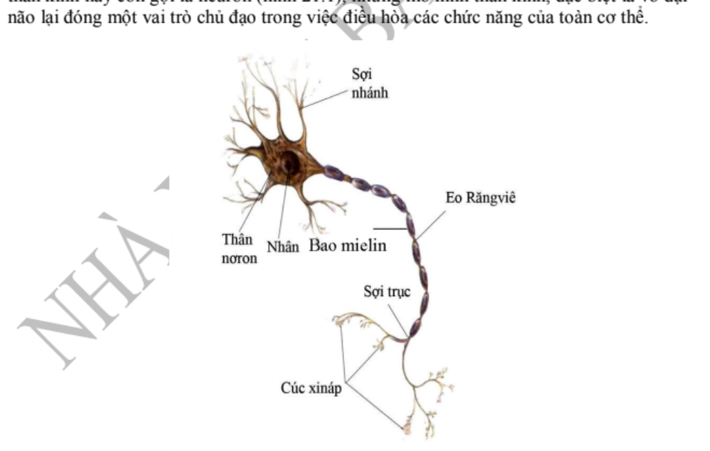
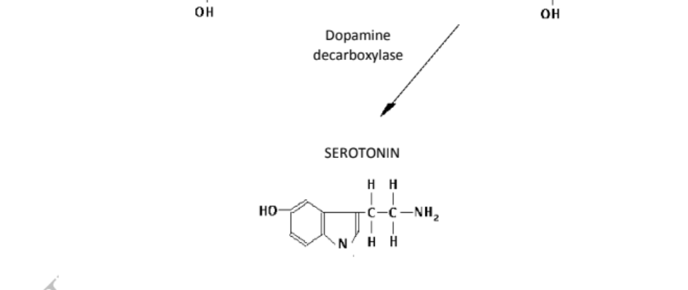
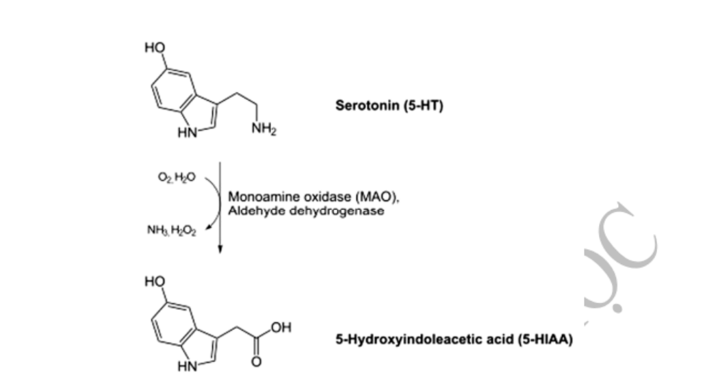
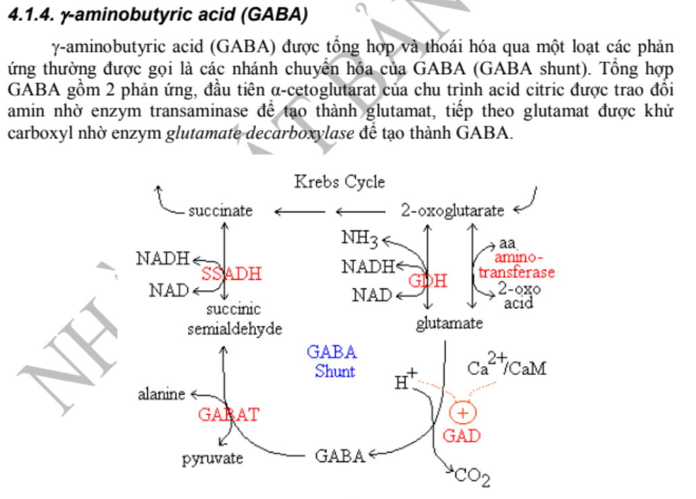

## CHƯƠNG 21: HÓA SINH THẦN KINH

### MỤC TIÊU HỌC TẬP
1. Trình bày được đặc điểm cấu tạo hóa học và chuyển hóa đặc thù của tổ chức mô thần kinh.
2. Trình bày được cơ chế dẫn truyền xung động thần kinh trên sợi trục và qua khớp Synap.
3. Trình bày được quá trình sinh tổng hợp, thoái hóa và vai trò của các chất dẫn truyền thần kinh phân tử nhỏ và các neuropeptid phân tử lớn.

---

### ĐẠI CƯƠNG
Mô thần kinh (não, tủy sống, thần kinh ngoại biên) là hệ thống có tổ chức cấu trúc và chức năng phức tạp nhất trong cơ thể sống. Não bộ người nặng khoảng $1{,}3 - 1{,}4\text{ kg}$ (chiếm $2\%$ trọng lượng cơ thể), chứa khoảng **$10^{11} - 10^{12}$ tế bào thần kinh (Neuron)** và số lượng tế bào thần kinh đệm (Glia) gấp 10 lần.

*Hình 21.1. Cấu tạo một neuron điển hình: Thân nơron, nhân, đuôi gai thu nhận tín hiệu, sợi trục dẫn truyền bọc bao myelin và các eo Ranvier.*

---

### 1. CẤU TẠO HÓA HỌC CỦA TỔ CHỨC THẦN KINH

Mô thần kinh chứa trung bình **$78\%$ nước** và **$22\%$ chất khô** (protein, lipid, acid amin, khoáng). Tỷ lệ này phân bố không đồng đều giữa các vùng giải phẫu:

##### Bảng 21.1. Tỷ lệ thành phần cấu tạo của tổ chức thần kinh

| Vùng tổ chức | Nước (%) | Protein (%) | Lipid (%) |
| :--- | :--- | :--- | :--- |
| **Chất xám (Vỏ não - thân neuron)** | **84,2%** | **7,5%** | **4,9%** |
| **Chất trắng (Dưới vỏ - sợi trục myelin)** | **70,6%** | **8,0%** | **13,9 – 23,1%** |
| **Tủy sống** | $60 - 70\%$ | $8,8 - 10\%$ | $15,5 - 22,7\%$ |
| **Dây thần kinh ngoại biên** | $56 - 71\%$ | $11 - 15\%$ | $14 - 23\%$ |

> [!NOTE]
> Chất xám có tốc độ chuyển hóa rất mạnh nên chứa tỷ lệ nước và protein cao; trong khi chất trắng gồm các sợi trục thần kinh bọc myelin nên chứa hàm lượng lipid cao vượt trội.

#### 1.1. Các Lipid đặc thù của mô Thần kinh
- **Gangliosid:** Nồng độ trong chất xám vỏ não cao gấp hàng trăm lần các mô khác. Tập trung nhiều ở màng synap, liên kết với bơm $\text{Na}^+\text{-K}^+\text{-ATPase}$. Rối loạn thoái hóa gangliosid do đột biến gen enzym hexosaminidase A gây **bệnh Tay-Sachs** (thoái hóa thần kinh nặng nề dẫn đến mù lòa, sa sút trí tuệ và tử vong ở trẻ nhỏ).
- **Myelin:** Cấu tạo bao bọc sợi trục do tế bào Schwann (ngoại biên) hoặc tế bào ít nhánh (trung ương) tạo thành. Lipid chiếm tới **$70 - 80\%$ chất khô của myelin**, gồm cholesterol tự do (không este hóa), phospholipid (lecithin, cephalin, sphingomyelin) và galactolipid (cerebrosid chiếm 90%). Myelin đóng vai trò là lớp vỏ cách điện tuyệt hảo giúp xung động thần kinh dẫn truyền nhảy cóc qua các **eo Ranvier** với tốc độ cực nhanh.

#### 1.2. Các Protein và Peptid đặc biệt của Não bộ
- **Yếu tố phát triển thần kinh (NGF - Nerve Growth Factor):** Kích thích sự phì đại, biệt hóa và sống còn của neuron cảm giác và giao cảm.
- **Protein S-100 và Protein 14-3-2:** Có nồng độ cao gấp hàng ngàn lần trong mô não so với các mô khác, tham gia biệt hóa tế bào và dẫn truyền xung động.
- **Các peptid trí nhớ:** Các chuỗi oligopeptid liên quan đến trí nhớ và cảm xúc (scotophobin gây sợ bóng tối, ametilin...).

---

### 2. ĐẶC ĐIỂM CHUYỂN HÓA CỦA MÔ THẦN KINH

Mô thần kinh có tốc độ chuyển hóa oxy và năng lượng cao nhất trong toàn bộ cơ thể:
- **Tiêu thụ Oxy:** Mặc dù chỉ chiếm $2\%$ thể tích cơ thể, **não tiêu thụ tới $20 - 25\%$ tổng lượng oxy toàn thân lúc nghỉ ngơi** ($3{,}3\text{ mL } \text{O}_2/100\text{ g mô/phút}$, gấp 20 lần mô cơ lúc nghỉ).
- **Độ nhạy cảm thiếu oxy:** Não hầu như không có dự trữ oxy và glucid. Não chỉ chịu đựng được tình trạng thiếu oxy hoàn toàn trong **$5 - 6\text{ phút}$**; quá thời gian này sẽ gây hoại tử tế bào thần kinh không hồi phục.

#### 2.1. Chuyển hóa Glucid
- Trong điều kiện sinh lý bình thường, **Glucose là nguồn nhiên liệu duy nhất của não bộ**.
- Não tiêu thụ khoảng **$100 - 120\text{ g}$ glucose/ngày** ($0{,}3\ \mu\text{mol/phút/g mô}$).
- Năng lượng ATP ($20{,}4\text{ mol/ngày}$) được sản xuất gần như tối đa qua **chu trình Krebs hiếu khí** tại ty thể tế bào não. Phần lớn ATP sinh ra dùng để vận hành bơm $\text{Na}^+\text{-K}^+\text{-ATPase}$ nhằm duy trì điện thế màng và phục vụ tái hấp thu, tổng hợp các chất dẫn truyền thần kinh.
- *(Lưu ý: Khi nhịn đói kéo dài $> 2 - 3\text{ tuần}$, não có khả năng thích nghi chuyển sang sử dụng thể ceton acetoacetat và $\beta$-hydroxybutyrat đáp ứng tới $50\%$ nhu cầu năng lượng).*

#### 2.2. Chuyển hóa Lipid và Protein
- **Lipid não:** Tốc độ đổi mới rất chậm (acid béo não chỉ đổi mới 20% trong 1 tuần, trong khi ở gan đổi mới 50% trong 24 giờ). Cholesterol não ở người trưởng thành hoàn toàn không este hóa.
- **Protein não:** Tốc độ quay vòng protein tương đối nhanh. Chứa lượng lớn acid amin tự do (đặc biệt là glutamat, aspartat, GABA) đóng vai trò chất dẫn truyền thần kinh.

---

### 3. CƠ CHẾ DẪN TRUYỀN XUNG ĐỘNG THẦN KINH

#### 3.1. Dẫn truyền trên Sợi trục (Điện thế màng)
- **Điện thế nghỉ (Resting Potential):** Mặt trong màng tế bào thần kinh tích điện âm hơn mặt ngoài khoảng **$-70\text{ mV}$**. Điện thế này được duy trì liên tục nhờ bơm $\text{Na}^+\text{-K}^+\text{-ATPase}$ (bơm $3\text{ Na}^+$ ra ngoài, $2\text{ K}^+$ vào trong).
- **Khử cực và Điện thế hoạt động (Action Potential):** Khi có kích thích vượt ngưỡng, kênh $\text{Na}^+$ mở nhanh làm $\text{Na}^+$ tràn ồ ạt vào trong nội bào $\rightarrow$ đảo cực màng ($+30\text{ mV}$) $\rightarrow$ Kênh $\text{Na}^+$ đóng, kênh $\text{K}^+$ mở cho $\text{K}^+$ đi ra để tái phân cực.
- **Dẫn truyền nhảy cóc (Saltatory Conduction):** Trên sợi trục có bao myelin, dòng điện không rò rỉ qua lớp myelin mà nhảy cóc từ eo Ranvier này sang eo Ranvier kế tiếp, giúp tốc độ dẫn truyền tăng vọt lên tới **$100 - 120\text{ m/giây}$** và tiết kiệm tối đa năng lượng tiêu thụ ATP.

---

#### 3.2. Dẫn truyền qua Khớp Synap
Synap là cấu trúc nối tiếp giữa hai tế bào thần kinh gồm: màng tiền synap, khe synap ($20\text{ nm}$) và màng hậu synap.
- **Cơ chế giải phóng hóa học:**
  - Xung động thần kinh đến đầu tận tiền synap mở kênh $\text{Ca}^{2+}$ điện thế.
  - $\text{Ca}^{2+}$ ùa vào tế bào kích hoạt phức hợp $\text{Ca}^{2+}\text{-Calmodulin}$ $\rightarrow$ Hoạt hóa CaMKII phosphoryl hóa **Synapsin I** (protein neo giữ túi synap vào khung actin).
  - Túi synap được giải phóng, tiến tới hòa màng màng tiền synap (qua phức hợp protein SNARE) và giải phóng chất dẫn truyền thần kinh vào khe synap theo cơ chế **xuất bào (exocytosis)**.
- **Đáp ứng hậu synap:**
  - Chất dẫn truyền kích thích (Acetylcholin, Glutamat) mở kênh $\text{Na}^+/\text{Ca}^{2+}$ gây khử cực tạo điện thế kích thích hậu synap (**EPSP**).
  - Chất dẫn truyền ức chế (GABA, Glycin) mở kênh $\text{Cl}^-$ làm $\text{Cl}^-$ tràn vào trong tế bào gây ưu phân cực màng (điện thế âm hơn, ví dụ $-80\text{ mV}$) tạo điện thế ức chế hậu synap (**IPSP**), dập tắt xung thần kinh.

##### Bảng 21.2. Phân loại các chất dẫn truyền thần kinh chính

| Nhóm chức năng | Tên các chất dẫn truyền thần kinh |
| :--- | :--- |
| **Kích thích (Excitatory)** | **Acetylcholin**, **Glutamat**, **Aspartat**, **Dopamin**, **Noradrenalin**, **Adrenalin**, **Serotonin**, **Histamin**, **ATP** |
| **Ức chế (Inhibitory)** | **GABA** ($\gamma$-aminobutyric acid - ở não), **Glycin** (ở tủy sống và thân não), **Taurin** |

<!-- END FILE: pages_416_425.md -->

<!-- BEGIN FILE: pages_426_440.md -->

# CHƯƠNG 21 (TIẾP THEO), CHƯƠNG 22: HÓA SINH DỊCH SINH VẬT & TỔNG KẾT TOÀN BỘ GIÁO TRÌNH

---

## CHƯƠNG 21: HÓA SINH THẦN KINH (TIẾP THEO VÀ HOÀN THIỆN)

### 4. CÁC CHẤT DẪN TRUYỀN THẦN KINH

#### 4.1. Các chất dẫn truyền thần kinh phân tử nhỏ (Tác động nhanh)

##### 1. Acetylcholin (ACh)
- **Sinh tổng hợp:** Diễn ra tại bào tương cúc tận cùng tiền synap:
  $$\text{Cholin} + \text{Acetyl-CoA} \xrightarrow{\text{Cholin acetyltransferase (ChAT)}} \text{Acetylcholin} + \text{CoA-SH}$$
  - Cholin hấp thu từ thức ăn và tái hấp thu từ khe synap.
  - Acetyl-CoA sinh ra từ sự khử carboxyl oxy hóa pyruvat trong ty thể tế bào thần kinh.
- **Thụ thể:** Thụ thể Nicotinic (kênh ion $\text{Na}^+$) và Thụ thể Muscarinic (gắn protein G).
- **Thoái hóa kết thúc tác dụng:** Tại khe synap, enzym **Acetylcholinesterase (AChE)** thủy phân tức thì ACh thành cholin và acetat trong vòng chưa đầy $1\text{ phần nghìn giây}$:
  $$\text{Acetylcholin} + \text{H}_2\text{O} \xrightarrow{\text{Acetylcholinesterase}} \text{Cholin} + \text{Acid Acetic}$$
  Cholin được màng tiền synap bắt giữ tái sử dụng.
  > [!NOTE]
  > Thuốc trừ sâu phospho hữu cơ và chất độc thần kinh (Sarin, VX) ức chế không hồi phục AChE, làm ứ trệ acetylcholin gây cường phó giao cảm cấp tính, co thắt phế quản, rung giật cơ và tử vong do suy hô hấp.

##### 2. Các Catecholamin (Dopamin, Noradrenalin, Adrenalin)
- Được sinh tổng hợp từ Tyrosin qua L-DOPA.
- **Thoái hóa:** Diễn ra qua 2 hệ enzym:
  - **COMT** (*Catechol-O-methyltransferase*): Methyl hóa nhóm $-\text{OH}$ nhân catechol.
  - **MAO** (*Monoamin oxidase*): Khử amin oxy hóa chuỗi bên thành dẫn xuất aldehyd.
  - Sản phẩm thoái hóa cuối cùng của Noradrenalin và Adrenalin là **VMA** (*Vanillylmandelic acid*); của Dopamin là **HVA** (*Homovanillic acid*), đào thải qua nước tiểu.
- **Cơ chế tác dụng của Cocain:** Ức chế chất vận chuyển DAT (*Dopamine Active Transporter*), ngăn cản tái hấp thu dopamin vào tiền synap, làm dopamin ứ đọng kéo dài trong khe synap kích thích sảng khoái và gây nghiện.

##### 3. Serotonin (5-Hydroxytryptamin / 5-HT)

*Hình 21.2. Chuỗi phản ứng sinh tổng hợp Serotonin từ Tryptophan qua enzym Tryptophan hydroxylase và L-Aromatic amino acid decarboxylase.*

- **Sinh tổng hợp:**
  $$\text{Tryptophan} \xrightarrow[\text{THB}]{\text{Tryptophan hydroxylase}} \text{5-Hydroxytryptophan} \xrightarrow[\text{PLP}]{\text{Decarboxylase}} \text{Serotonin (5-HT)}$$
- **Vai trò:** Điều hòa giấc ngủ, cảm xúc, nhiệt độ cơ thể, cảm giác thèm ăn.
- **Thoái hóa:** Enzym MAO khử amin, sau đó aldehyd dehydrogenase oxy hóa tạo thành **Acid 5-Hydroxyindoleacetic (5-HIAA)** đào thải qua nước tiểu:

*Hình 21.3. Sơ đồ chuyển hóa thoái hóa Serotonin thành sản phẩm đào thải 5-HIAA nhờ enzym MAO và Aldehyd dehydrogenase.*

##### 4. Acid $\gamma$-Aminobutyric (GABA) và Chu trình GABA Shunt
- **Bản chất:** Chất dẫn truyền thần kinh **ức chế chủ yếu và mạnh nhất của não bộ**.
- **Sinh tổng hợp và Chu trình GABA Shunt:**

*Hình 21.4. Chu trình chuyển hóa rẽ nhánh GABA Shunt liên kết giữa chu trình Krebs và tổng hợp/thoái hóa GABA tại mô não.*

1. $\alpha$-Ketoglutarat từ chu trình Krebs chuyển amin thành Glutamat.
2. Glutamat được enzym **GAD** (*Glutamat decarboxylase*) khử carboxyl tạo thành **GABA**:
   $$\text{Glutamat} \xrightarrow[\text{PLP (Vitamin B}_6\text{)}]{\text{GAD}} \text{GABA} + \text{CO}_2$$
3. Sau khi giải phóng, GABA được chuyển amin bởi GABA transaminase (GABA-T) tạo Succinat semialdehyd, rồi bị oxy hóa thành **Succinat** quay trở lại chu trình Krebs tiếp tục sinh năng lượng.
- **Ứng dụng dược lý:** Các thuốc an thần gây ngủ nhóm Benzodiazepin (Diazepam) và Barbiturat gắn vào vị trí dị lập thể trên thụ thể $\text{GABA}_A$, làm tăng cường dòng $\text{Cl}^-$ vào tế bào, gây ức chế thần kinh trung ương và chống co giật.

---

#### 4.2. Các Peptid Thần kinh Phân tử Lớn (Neuropeptides)
Được tổng hợp từ thân neuron qua bộ máy ribosome - lưới nội chất dưới dạng tiền chất lớn (*prepro-peptid*), sau đó đóng gói vào các túi tiết và vận chuyển dọc sợi trục ($1 - 400\text{ mm/ngày}$) xuống cúc tận cùng. Tác dụng chậm, kéo dài, điều hòa các cảm xúc sâu sắc và cảm giác đau:
1. **Chất P (Substance P):** Gồm 11 acid amin ($\text{Arg-Pro-Lys-Pro-Gln-Gln-Phe-Phe-Gly-Leu-Met-NH}_2$), là chất dẫn truyền kích thích dẫn truyền cảm giác đau từ ngoại vi về tủy sống và não bộ.
2. **Các Endorphin ($\beta$-Endorphin):** Opioid nội sinh gồm 31 acid amin có nguồn gốc từ tiền chất pro-opiomelanocortin (POMC) của tuyến yên. Gắn vào thụ thể $\mu$-opioid của não, có tác dụng **giảm đau nội sinh cực mạnh (mạnh gấp hàng trăm lần morphin)** và mang lại cảm giác hưng phấn, sảng khoái.
3. **Các Enkephalin:** Pentapeptid gồm **Met-enkephalin** ($\text{Tyr-Gly-Gly-Phe-Met}$) và **Leu-enkephalin** ($\text{Tyr-Gly-Gly-Phe-Leu}$), ức chế dẫn truyền cảm giác đau tại sừng sau tủy sống.
4. **Somatostatin (14 acid amin):** Do vùng dưới đồi tiết ra, ức chế giải phóng hormon tăng trưởng GH và TSH.
5. **Angiotensin II (8 acid amin):** Tác động lên hệ thần kinh trung ương gây cảm giác khát và kích thích giải phóng ADH.

---

### CÂU HỎI ÔN TẬP CHƯƠNG 21
1. Trình bày đặc điểm thành phần cấu tạo hóa học và chuyển hóa đặc thù của mô não (tiêu thụ oxy, chuyển hóa glucose, lipid).
2. Trình bày cơ chế dẫn truyền điện thế hoạt động trên sợi trục có bao myelin và cơ chế dẫn truyền qua synap hóa học.
3. Phân biệt cơ chế tác động của chất dẫn truyền thần kinh kích thích (Acetylcholin, Glutamat) và ức chế (GABA, Glycin).
4. Trình bày sơ đồ sinh tổng hợp và thoái hóa của: Acetylcholin, Serotonin và chu trình GABA Shunt.
5. Nêu cấu tạo và tác dụng sinh học của các neuropeptid: Chất P, $\beta$-Endorphin và Enkephalin.

---