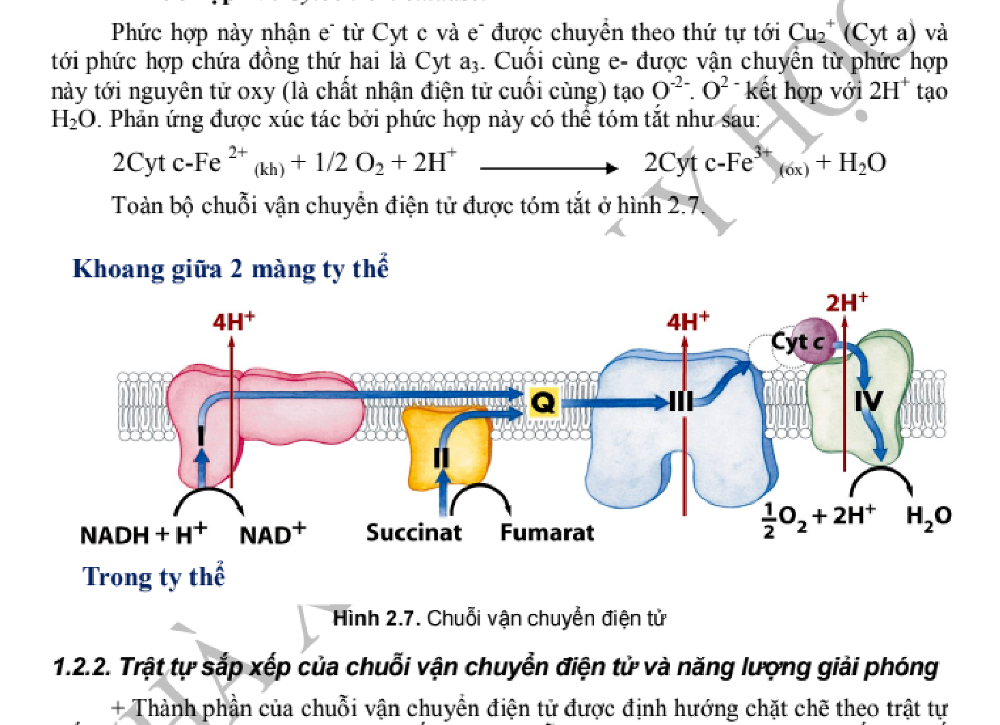
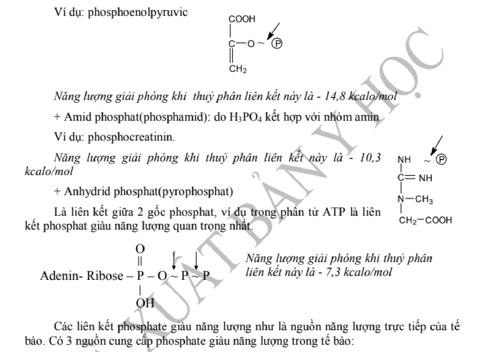
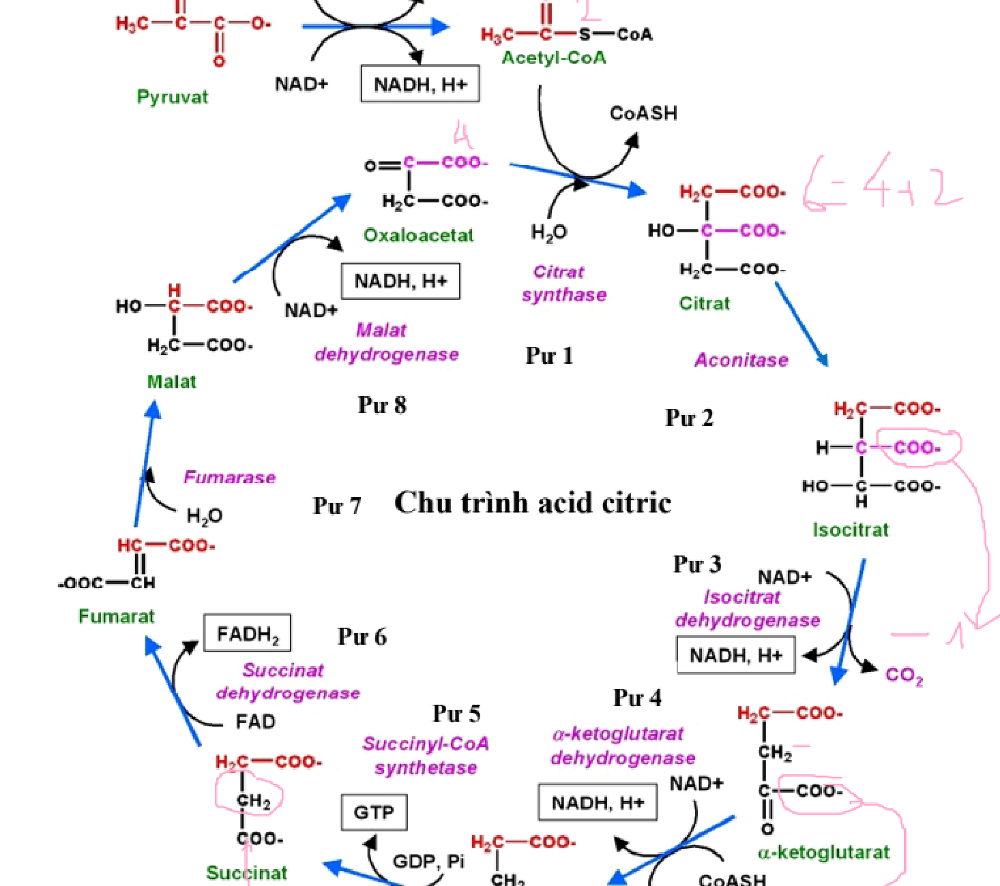

# HS-02 · HÔ HẤP TẾ BÀO, PHOSPHORYL-OXY HÓA VÀ CHU TRÌNH ACID CITRIC
> **Tác giả:** PGS. TS. BS. Phạm Thiện Ngọc — Bộ môn Hóa sinh, Trường Đại học Y Hà Nội
> **Chủ biên chương trình:** GS. TS. BS. Tạ Thành Văn — Trường Đại học Y Hà Nội
> **Nguồn trích xuất chuẩn mực:** Giáo trình Hóa sinh Y học (GS. TS. BS. Tạ Thành Văn chủ biên, Tái bản lần thứ 7, Nhà xuất bản Y học, Tr. 43 – 64) kết hợp Harper's Illustrated Biochemistry (32nd Ed) & Lehninger Principles of Biochemistry (8th Ed)
> **Đối tượng học tập:** Sinh viên Bác sĩ Y khoa, Bác sĩ Nội trú và Học viên Sau đại học
> **Chuẩn mực:** Khoa học chứng cứ (EBM), Danh pháp Quốc tế IUBMB, KaTeX hóa 100% công thức - phương trình năng lượng, Sạch 100% rác OCR.

---

## MỤC TIÊU HỌC TẬP CHUẨN ĐẦU RA (LEARNING OBJECTIVES)

Sau khi hoàn thành bài học chuyên sâu này, người học cần đạt được 6 chuẩn đầu ra cốt lõi sau:

1. **Phân tích bản chất nhiệt động học của năng lượng sinh học và các liên kết phosphat giàu năng lượng:** Trình bày rõ các định luật nhiệt động học áp dụng cho hệ thống sống ($\Delta G, \Delta H, \Delta S$); so sánh bản chất và động học giữa quá trình đốt cháy sinh học (oxy hóa sinh học từng bậc) với đốt cháy hóa lý ngoài cơ thể; phân tích cấu trúc, năng lượng tự do thủy phân chuẩn ($\Delta G^{\circ\prime}$) và vai trò sinh học trung tâm của ATP cùng các hợp chất cao năng khác (Phosphoenolpyruvat, 1,3-Bisphosphoglycerat, Phosphocreatin, Acetyl-CoA).
2. **Trình bày chi tiết tổ chức siêu vi ty thể và cơ chế vận chuyển điện tử của 4 phức hợp hô hấp:** Mô tả đặc tính hóa lý của các cấu trúc ty thể (màng ngoài, xoang gian màng, màng trong giàu cardiolipin và chất nền); giải thích tuần tự dòng điện tử qua Phức hợp I ($NADH:ubiquinon\ oxidoreductase$), Phức hợp II ($succinat:ubiquinon\ oxidoreductase$), Phức hợp III ($ubiquinon:cytochrom\ c\ oxidoreductase$) và Phức hợp IV ($cytochrom\ c\ oxidase$), phối hợp với hai chất mang linh động Ubiquinon ($CoQ$) và Cytochrom $c$, làm rõ vai trò của các trung tâm oxy hóa khử ($FMN, FAD$, cụm $Fe-S$, các loại Hem $b_L, b_H, c_1, c, a, a_3$ và các ion đồng $Cu_A, Cu_B$).
3. **Luận giải Thuyết hóa thẩm thấu Mitchell, cấu trúc - cơ chế quay phân tử của ATP Synthase và hạch toán tỷ lệ P/O:** Phân tích lực đẩy proton ($pmf$), thành phần chênh lệch điện thế màng ($\Delta\psi$) và gradient hóa học ($\Delta\text{pH}$); mô tả chi tiết kiến trúc phân tử của Phức hợp V (tiểu phần $F_0$ và $F_1$), cơ chế biến đổi ái lực liên kết quay 3 pha của Paul Boyer (Open, Loose, Tight); giải thích cơ chế phối hợp vận chuyển của Adenin Nucleotid Translocase (ANT) và Phosphat Translocase; xác định chính xác tỷ lệ $P/O$ hiện đại ($2.5\ \text{ATP}/NADH$ và $1.5\ \text{ATP}/FADH_2$).
4. **Phân loại, giải thích cơ chế phân tử và ý nghĩa ứng dụng của các chất ức chế chuỗi hô hấp và chất phá ghép:** Phân biệt cơ chế tác động vị trí của các chất ức chế Phức hợp I (Rotenon, Amytal), Phức hợp II (Malonat), Phức hợp III (Antimycin A), Phức hợp IV ($CN^-, CO, NaN_3, H_2S$), ức chế ATP synthase (Oligomycin); đối chiếu cơ chế phá ghép của các chất hóa học ($2,4-DNP, FCCP$) với protein sinh nhiệt sinh lý $UCP-1$ (Thermogenin) trong mô mỡ nâu ($BAT$) ở trẻ sơ sinh và động vật ngủ đông.
5. **So sánh cơ chế vận chuyển hydro và năng lượng của hai hệ thống con thoi xuyên màng ty thể:** Phân tích chi tiết chuỗi phản ứng enzym và cơ chế chất mang của thoi Malat - Aspartat (hoạt động chủ yếu ở tim, gan, thận, thu hồi $2.5\ \text{ATP}/NADH$ bào tương) và thoi Glycerol - 3 - phosphat (hoạt động chủ yếu ở cơ vân và não bộ, thu hồi $1.5\ \text{ATP}/NADH$ bào tương qua $FADH_2$).
6. **Lập luận chuyển hóa toàn diện chu trình acid citric (Krebs) và các bệnh học lâm sàng liên quan:** Trình bày cấu trúc phức hợp đa enzym Pyruvat Dehydrogenase (PDH), cơ chế phản ứng bản lề và 5 coenzym ($TPP$, Lipoat, $CoA-SH, FAD, NAD^+$); phân tích 8 bước enzym của chu trình Krebs kèm hạch toán năng lượng ($10\ \text{ATP}/Acetyl-CoA$); giải thích bản chất lưỡng cực (amphibolic) và các phản ứng bổ sung cơ chất (anaplerotic); ứng dụng giải thích triệu chứng, cơ chế phân tử và nguyên tắc điều trị cấp cứu ngộ độc Cyanid, $CO$, fluoroacetat (chất độc 1080) và các bệnh học ty thể di truyền ($MELAS, MERRF, LHON$).

---

## 1. ĐẠI CƯƠNG VỀ NĂNG LƯỢNG SINH HỌC VÀ HÔ HẤP TẾ BÀO (BIOENERGETICS & CELLULAR RESPIRATION)

### 1.1. Khái niệm và nguyên lý nhiệt động học trong sinh học

**Năng lượng sinh học (Bioenergetics)** là phân ngành hóa sinh nghiên cứu các biến đổi năng lượng, quá trình thu nhận, chuyển dạng và sử dụng năng lượng tự do trong các hệ thống tế bào sống. Khác với các hệ vô cơ, cơ thể sống là **hệ thống nhiệt động học mở (open thermodynamic system)**, hoạt động ở điều kiện đẳng nhiệt (nhiệt độ cơ thể hằng định $\approx 37^\circ\text{C} = 310\,\text{K}$), đẳng áp ($P \approx 1\,\text{atm}$) và duy trì một **trạng thái dừng động (dynamic steady state)**, liên tục trao đổi vật chất và năng lượng với môi trường xung quanh nhằm chống lại xu hướng phân rã entropy tự nhiên.

Hệ thống sống tuân thủ nghiêm ngặt hai định luật cơ bản của nhiệt động học:
- **Định luật thứ nhất (Bảo toàn năng lượng):** Năng lượng tổng cộng của vũ trụ là hằng định. Năng lượng không tự nhiên sinh ra hay mất đi mà chỉ chuyển hóa từ dạng này sang dạng khác (quang năng $\to$ hóa năng $\to$ cơ năng, điện năng, nhiệt năng).
- **Định luật thứ hai (Quy luật Entropy):** Mọi quá trình tự phát trong vũ trụ đều làm tăng độ mất trật tự tổng cộng (entropy, $S$). Để duy trì trật tự cấu trúc nội bào cao độ (entropy thấp), tế bào sống phải liên tục tiêu thụ năng lượng tự do từ thức ăn và giải phóng năng lượng vô ích (nhiệt) cùng các sản phẩm thoái hóa đơn giản ra ngoại bào.

Mối liên hệ giữa năng lượng tự do Gibbs ($G$), enthalpy ($H$), nhiệt độ tuyệt đối ($T$) và entropy ($S$) được biểu diễn bằng phương trình kinh điển:
$$\Delta G = \Delta H - T\Delta S$$

Trong hóa sinh y học, điều kiện chuẩn sinh học được quy ước ở $pH = 7.0$ (nồng độ ion $[H^+] = 10^{-7}\,\text{mol/L}$ thay vì $1\,\text{mol/L}$ của hóa học vô cơ), nhiệt độ $25^\circ\text{C}$ ($298\,\text{K}$), áp suất $1\,\text{atm}$ và hoạt độ nước bằng $1$. Ký hiệu năng lượng tự do chuẩn sinh học là $\Delta G^{\circ\prime}$:
$$\Delta G^{\circ\prime} = -RT \ln K^\prime_{\text{eq}}$$
Trong đó:
- $R$: Hằng số khí lý tưởng ($8.314\,\text{J}/\text{mol}\cdot\text{K}$).
- $T$: Nhiệt độ tuyệt đối ($298\,\text{K}$ hoặc $310\,\text{K}$).
- $K^\prime_{\text{eq}}$: Hằng số cân bằng hóa học biểu kiến ở điều kiện chuẩn sinh học.

Ý nghĩa lâm sàng và chuyển hóa của giá trị $\Delta G$:
- $\Delta G < 0$: Phản ứng **tỏa năng lượng (exergonic)**, diễn ra tự phát theo chiều thuận; giải phóng năng lượng tự do hữu ích.
- $\Delta G > 0$: Phản ứng **thu năng lượng (endergonic)**, không thể tự phát diễn ra; bắt buộc phải được ghép đôi (coupling) với một phản ứng tỏa năng lượng mạnh hơn.
- $\Delta G = 0$: Hệ thống đạt trạng thái cân bằng động (tế bào sống chỉ đạt $\Delta G = 0$ khi đã chết).

### 1.2. So sánh quá trình đốt cháy sinh học (oxy hóa sinh học) và đốt cháy ngoài cơ thể

Sự oxy hóa các chất hữu cơ (Glucid, Lipid, Protid) trong cơ thể sinh vật và sự đốt cháy một nhiên liệu trong động cơ nhiệt hay ngọn lửa ngoài cơ thể đều tạo ra sản phẩm cuối cùng là $CO_2, H_2O$ và giải phóng một lượng năng lượng tổng cộng tương đương nhau (theo định luật Hess). Tuy nhiên, cơ chế thực hiện giữa hai quá trình hoàn toàn khác biệt về mặt hóa lý và sinh học:

| Đặc tính | Đốt cháy ngoài cơ thể (Quá trình hóa lý) | Đốt cháy sinh học (Hô hấp tế bào) |
| :--- | :--- | :--- |
| **Bản chất xúc tác** | Không có xúc tác sinh học; cần nhiệt độ kích hoạt cao (châm lửa) | Hệ enzym và coenzym đặc hiệu cao xúc tác ở từng phản ứng cụ thể |
| **Nhiệt độ môi trường** | Nhiệt độ rất cao (hàng trăm đến hàng nghìn độ Celsius) | Nhiệt độ cơ thể hằng định đẳng nhiệt ($37^\circ\text{C}$) |
| **Tốc độ và tính chất giải phóng năng lượng** | Năng lượng giải phóng ồ ạt, bùng nổ tức thời trong một giai đoạn | Giải phóng năng lượng từng bước, tuần tự qua chuỗi các phản ứng bậc thang |
| **Dạng năng lượng tạo ra** | Toàn bộ năng lượng chuyển thành nhiệt năng và quang năng (tia lửa) | Khoảng $40-42\%$ năng lượng được bẫy vào liên kết cao năng ATP; phần còn lại tỏa nhiệt duy trì thân nhiệt |
| **Cơ chế gắn oxy** | Oxy phân tử trực tiếp tác dụng mãnh liệt với phân tử nhiên liệu hữu cơ | Tách hydro (khử hydro bởi Dehydrogenase) chuyển qua chuỗi chuyền điện tử tới oxy ở bước cuối cùng |
| **Khả năng kiểm soát sinh học** | Khó điều hòa, phản ứng dây chuyền khó hãm lại | Được kiểm soát tinh vi bởi cơ chế feedback dị lập thể và nồng độ ADP/ATP nội bào |

### 1.3. Khái niệm và phân loại các liên kết phosphat giàu năng lượng (High-energy bonds)

Trong cơ thể sống, năng lượng tự do không tồn tại dưới dạng nhiệt tự do mà được tích trữ và trung chuyển thông qua các hợp chất đặc biệt mang **liên kết giàu năng lượng (high-energy phosphate compounds)**. Theo quy ước của Fritz Lipmann (1941), một liên kết được coi là "giàu năng lượng" (kí hiệu dấu ngã $\sim$) khi năng lượng tự do chuẩn của phản ứng thủy phân nó mang giá trị $\Delta G^{\circ\prime} \le -21\,\text{kJ/mol}$ (hoặc $-5\,\text{kcal/mol}$).

#### 1.3.1. Cấu trúc và vai trò "Đồng tiền năng lượng" của ATP

**Adenosin Triphosphat (ATP)** là chất trung gian vận chuyển năng lượng tự do phổ biến nhất trong mọi dạng sống tế bào. Cấu trúc của ATP gồm một gốc base nitơ adenin gắn với đường ribose qua liên kết $\beta-N-$glycosid, tạo thành adenosin; chuỗi ba nhóm phosphat ($\alpha, \beta, \gamma$) gắn liên tiếp với carbon $C_5^\prime$ của ribose:
- Liên kết giữa $C_5^\prime$ của ribose và nhóm $\alpha$-phosphat là một liên kết **phosphoester thông thường** (năng lượng thấp, $\Delta G^{\circ\prime} \approx -14\,\text{kJ/mol}$).
- Hai liên kết giữa $\alpha - \beta$ và $\beta - \gamma$ là hai liên kết **phosphoanhydrid giàu năng lượng** ($\sim P$).

Phản ứng thủy phân liên kết phosphoanhydrid tận cùng của ATP:
$$\text{ATP}^{4-} + \text{H}_2\text{O} \xrightarrow{\text{Mg}^{2+}} \text{ADP}^{3-} + \text{P}_i^{2-} + \text{H}^+ \quad (\Delta G^{\circ\prime} = -30.5\,\text{kJ/mol} = -7.3\,\text{kcal/mol})$$

Tại sao phản ứng thủy phân ATP lại tỏa năng lượng tự do lớn như vậy?
1. **Sự giải tỏa sức đẩy tĩnh điện:** Ở $pH = 7.0$, ATP mang 4 điện tích âm nằm kế cận nhau trên chuỗi phosphat, tạo ra một sức đẩy tĩnh điện nội phân tử cực lớn. Khi liên kết phosphoanhydrid bị cắt đứt, các điện tích âm được tách xa nhau, làm giảm mạnh thế năng đẩy tĩnh điện.
2. **Sự ổn định cộng hưởng (Resonance stabilization):** Các sản phẩm thủy phân gồm phosphat vô cơ ($P_i$) và ADP có cấu trúc cộng hưởng bền vững hơn nhiều so với phân tử ATP ban đầu. Nhóm $P_i$ có thể tồn tại ở 4 cấu trúc cộng hưởng đồng lượng.
3. **Sự hydrat hóa vượt trội của sản phẩm:** Các ion sản phẩm ($ADP^{3-}$ và $P_i^{2-}$) tương tác thuận lợi hơn với các phân tử nước trong dung môi so với một phân tử ATP duy nhất.

*Lưu ý sinh học:* Trong điều kiện thực tế nội bào (nồng độ sinh lý của ATP, ADP, $P_i$ và $Mg^{2+}$), giá trị năng lượng tự do thủy phân thực tế ($\Delta G_p$, gọi là thế năng phosphoryl hóa) dao động trong khoảng $-50$ đến $-65\,\text{kJ/mol}$, cao hơn đáng kể so với điều kiện chuẩn.

#### 1.3.2. Bảng năng lượng tự do chuẩn thủy phân các hợp chất phospho sinh học quan trọng

Dựa trên giá trị năng lượng tự do chuẩn thủy phân $\Delta G^{\circ\prime}$, các hợp chất phospho sinh học được chia thành hai nhóm chính:
- Hợp chất có thế năng truyền nhóm phosphat cao hơn ATP (High-potential group).
- Hợp chất có thế năng truyền nhóm phosphat thấp hơn ATP (Low-potential group).

| Hợp chất sinh học | Loại liên kết hóa học | $\Delta G^{\circ\prime}$ (kJ/mol) | $\Delta G^{\circ\prime}$ (kcal/mol) |
| :--- | :--- | :--- | :--- |
| **Phosphoenolpyruvat (PEP)** | Enol-phosphat | $-61.9$ | $-14.8$ |
| **1,3-Bisphosphoglycerat (1,3-BPG)** | Acyl-phosphat | $-49.3$ | $-11.8$ |
| **Phosphocreatin (Creatin-P)** | Guanidino-phosphat | $-43.0$ | $-10.3$ |
| **Acetyl-CoA** | Thioester (không chứa phosphat) | $-31.4$ | $-7.5$ |
| **ATP $\to$ ADP + $\text{P}_i$** | Phosphoanhydrid | $-30.5$ | $-7.3$ |
| **ATP $\to$ AMP + $\text{PP}_i$** | Phosphoanhydrid | $-45.6$ | $-10.9$ |
| **Glucose-1-phosphat (G-1-P)** | Phosphoester bán acetal | $-20.9$ | $-5.0$ |
| **Fructose-6-phosphat (F-6-P)** | Phosphoester thường | $-15.9$ | $-3.8$ |
| **Glucose-6-phosphat (G-6-P)** | Phosphoester thường | $-13.8$ | $-3.3$ |
| **Glycerol-3-phosphat** | Phosphoester thường | $-9.2$ | $-2.2$ |

Vị trí trung tâm của ATP trong thang thế năng này có ý nghĩa tiến hóa tuyệt đối: ATP đóng vai trò chất vận chuyển trung gian lý tưởng. Các chất có thế năng cao hơn (PEP, 1,3-BPG, Phosphocreatin) có thể dễ dàng chuyển nhóm phosphat cho ADP để tái tạo ATP (gọi là **phosphoryl-hóa ở mức cơ chất - substrate-level phosphorylation**). Ngược lại, ATP có thể chuyển nhóm phosphat cho các chất nhận thế năng thấp (như Glucose biến thành G-6-P) để kích hoạt chuyển hóa tế bào.

- **Phosphocreatin và hệ đệm năng lượng cơ vân:** Tại cơ vân và mô não, nồng độ ATP chỉ đủ duy trì co cơ tối đa trong khoảng 1-2 giây. Phosphocreatin tồn tại với nồng độ gấp 4-6 lần ATP, đóng vai trò là kho đệm năng lượng tức thời nhờ phản ứng thuận nghịch được xúc tác bởi **Creatin Kinase (CK)**:
$$\text{Phosphocreatin} + \text{ADP} \underset{\text{CK}}{\rightleftharpoons} \text{Creatin} + \text{ATP}$$
- **Liên kết Thioester của Acetyl-CoA:** Mặc dù không phải hợp chất chứa phospho, liên kết thioester ($-\text{C}(=\text{O})-\text{S}-\text{CoA}$) giữa gốc acetyl và nhóm thiol ($-SH$) của Coenzym A có năng lượng tự do thủy phân rất lớn ($\Delta G^{\circ\prime} = -31.4\,\text{kJ/mol}$). Nguyên nhân là do liên kết thioester thiếu sự ổn định cộng hưởng như trong ester thông thường ($-\text{C}(=\text{O})-\text{O}-$), do kích thước obitan của carbon và lưu huỳnh không tương thích nhau để tạo liên kết $\pi$ đôi bền vững.

### 1.4. Ba giai đoạn thoái hóa sinh học của các chất hữu cơ

Sự thoái hóa và giải phóng năng lượng từ ba đại phân tử sinh học cơ bản (Carbohydrat, Lipid, Protein) được tổ chức thành 3 giai đoạn phân cấp tuần tự:

1. **Giai đoạn I (Thủy phân sơ bộ các đại phân tử):**
   - Xảy ra chủ yếu ở đường tiêu hóa hoặc trong các lysosom nội bào.
   - Polysaccharid được thủy phân thành các Monosaccharid (Glucose, Fructose, Galactose); Triacylglycerol được thủy phân thành Glycerol và các Acid béo; Protein được thủy phân thành các Acid amin.
   - Năng lượng giải phóng trong giai đoạn này rất nhỏ ($< 1\%$ tổng năng lượng hóa học) và hầu như tiêu tán dưới dạng nhiệt, không tạo ra ATP.
2. **Giai đoạn II (Chuyển hóa trung gian thành các hợp chất hai hoặc ba carbon):**
   - Các monosaccharid, glycerol và acid amin tiếp tục bị thoái hóa qua các con đường dị hóa đặc thù (đường phân thoái hóa glucose thành pyruvat; $\beta$-oxy hóa thoái hóa acid béo; khử amin và thoái hóa khung carbon acid amin).
   - Tất cả các dòng chuyển hóa phân kỳ này đều hội tụ về một sản phẩm chung cốt lõi là **Acetyl-CoA** (hoặc một số chất trung gian của chu trình Krebs).
   - Một phần năng lượng được giữ lại dưới dạng một vài phân tử ATP (phosphoryl-hóa mức cơ chất) và các coenzym khử ($NADH, FADH_2$).
3. **Giai đoạn III (Oxy hóa hoàn toàn qua Chu trình Krebs và Chuỗi hô hấp tế bào):**
   - Diễn ra hoàn toàn bên trong ty thể tế bào.
   - Nhóm acetyl của Acetyl-CoA đi vào **Chu trình Acid Citric (Krebs)**, bị oxy hóa hoàn toàn thành hai phân tử $CO_2$.
   - Các nguyên tử hydro và điện tử giàu năng lượng được tách ra và nạp vào các coenzym $NAD^+$ và $FAD$ để tạo thành $NADH$ và $FADH_2$.
   - Sau đó, các coenzym khử này đi vào **Chuỗi chuyền điện tử ty thể (ETC)**, truyền điện tử đến oxy phân tử để tạo thành $H_2O$, đồng thời ghép đôi với quá trình bơm proton để tổng hợp lượng lớn ATP qua **Phosphoryl-oxy hóa (Oxidative Phosphorylation)**. Đây là nguồn cung cấp hơn $90\%$ tổng năng lượng cho cơ thể sống hiếu khí.

---

## 2. CHUỖI HÔ HẤP TẾ BÀO (CHUỖI VẬN CHUYỂN ĐIỆN TỬ TY THỂ - MITOCHONDRIAL RESPIRATORY CHAIN)

### 2.1. Cấu trúc siêu vi và đặc tính phân vùng hóa lý của Ty thể

Ty thể (Mitochondria) là "nhà máy năng lượng" của tế bào nhân thực, sở hữu bộ máy di truyền riêng (mtDNA) và hệ thống hai lớp màng lipid với cấu trúc và chức năng sinh hóa hoàn toàn biệt hóa:

1. **Màng ngoài ty thể (Outer Mitochondrial Membrane - OMM):**
   - Tỷ lệ Protein/Lipid $\approx 1:1$ (tương tự màng tế bào chất).
   - Chứa một lượng lớn các protein xuyên màng tạo kênh lớn gọi là **Porin (VDAC - Voltage-Dependent Anion Channel)**. Porin cho phép các phân tử và ion có trọng lượng phân tử nhỏ hơn $5.000\,\text{Da}$ (bao gồm ion vô cơ, acid amin, pyruvat, ATP, ADP, $P_i$) khuếch tán tự do qua lại. Do đó, thành phần ion và chất tan trong xoang gian màng gần như tương đương với dịch bào tương.
2. **Xoang gian màng (Intermembrane Space - IMS):**
   - Khoang nằm giữa màng ngoài và màng trong.
   - Là nơi tích tụ các proton ($H^+$) được các phức hợp hô hấp bơm từ chất nền ra trong quá trình vận chuyển điện tử, tạo nên gradient điện hóa proton.
   - Chứa các enzym đặc hiệu như **Adenylat Kinase** (xúc tác phản ứng: $\text{AMP} + \text{ATP} \rightleftharpoons 2\,\text{ADP}$) và là nơi cư trú sinh lý của **Cytochrom $c$** cùng các protein khởi động con đường chết theo chương trình apoptosis (Apaf-1, Procaspase-9, Smac/DIABLO).
3. **Màng trong ty thể (Inner Mitochondrial Membrane - IMM):**
   - Tỷ lệ Protein/Lipid cực cao (khoảng $3:1$ hay $> 75\%$ khối lượng là protein), phản ánh mật độ dày đặc của các phức hợp chuỗi chuyền điện tử và hệ thống enzym vận chuyển.
   - Gấp nếp sâu tạo thành vô số các **mào ty thể (cristae)** nhằm tăng diện tích bề mặt tiếp xúc lên gấp hàng chục lần.
   - **Tính thấm chọn lọc tuyệt đối:** Hoàn toàn không thấm đối với hầu hết các ion ($H^+, Na^+, K^+, Cl^-$) và các phân tử phân cực (như $NADH$, ATP, ADP, pyruvat) nếu không có hệ thống protein mang vận chuyển đặc hiệu.
   - **Thành phần lipid đặc biệt:** Giàu **Cardiolipin (Diphosphatidylglycerol)**, chiếm hơn $20\%$ tổng lượng phospholipid màng trong. Cardiolipin có cấu trúc chứa 4 chuỗi acyl và 2 nhóm phosphat tích điện âm, đóng vai trò sống còn trong việc "dán kín" màng ngăn rò rỉ ion $H^+$, đồng thời tạo vi môi trường tối ưu giúp ổn định cấu trúc bậc bốn của các siêu phức hợp hô hấp (respirasomes) và ATP Synthase.
4. **Chất nền ty thể (Mitochondrial Matrix):**
   - Môi trường gel đậm đặc chứa hàng trăm loại enzym hòa tan tham gia vào các chuyển hóa cốt lõi: Chu trình acid citric (Krebs), chu trình urê (giai đoạn đầu), con đường $\beta$-oxy hóa acid béo, oxy hóa thoái hóa khung carbon acid amin, phức hợp Pyruvat Dehydrogenase.
   - Chứa DNA ty thể (mtDNA mạch vòng kép), RNA vận chuyển (tRNA), ribosom ty thể (70S) để tự tổng hợp 13 chuỗi polypeptid cốt lõi của chuỗi hô hấp.

### 2.2. Dòng điện tử và thế năng khử chuẩn (Standard Reduction Potential - $E^{\circ\prime}$)

Chuỗi vận chuyển điện tử hô hấp là một chuỗi bậc thang gồm các chất mang điện tử gắn trên màng trong ty thể, được sắp xếp theo thứ tự **thế năng khử chuẩn ($E^{\circ\prime}$) tăng dần** (từ chất có ái lực với điện tử yếu nhất đến chất có ái lực mạnh nhất):
- Cặp oxy hóa khử khởi đầu: $\text{NAD}^+/\text{NADH}$ có $E^{\circ\prime} = -0.320\,\text{V}$.
- Cặp oxy hóa khử tận cùng: $\frac{1}{2}\text{O}_2/\text{H}_2\text{O}$ có $E^{\circ\prime} = +0.816\,\text{V}$.

Độ chênh lệch thế năng khử chuẩn giữa hai đầu chuỗi:
$$\Delta E^{\circ\prime} = E^{\circ\prime}(\text{chất nhận tận cùng}) - E^{\circ\prime}(\text{chất cho đầu tiên}) = +0.816\,\text{V} - (-0.320\,\text{V}) = +1.136\,\text{V}$$

Theo định luật nhiệt động học Nernst, sự biến thiên năng lượng tự do chuẩn liên hệ trực tiếp với độ chênh thế năng khử:
$$\Delta G^{\circ\prime} = -nF\Delta E^{\circ\prime}$$
Trong đó:
- $n = 2$ (số mol điện tử chuyển giao trong một cặp $NADH$).
- $F = 96.485\,\text{kJ}/\text{V}\cdot\text{mol}$ (hằng số Faraday).

Thay số tính toán:
$$\Delta G^{\circ\prime} = -2 \times 96.485 \times 1.136 = -219.2\,\text{kJ/mol} \quad (-52.4\,\text{kcal/mol})$$

Nguồn năng lượng tự do khổng lồ $-219.2\,\text{kJ/mol}$ này không giải phóng bùng nổ mà được phân bố thành từng bậc giảm thế năng qua các phức hợp I, III và IV. Tại mỗi bước chuyển này, năng lượng giải phóng được sử dụng trực tiếp để biến đổi cấu hình không gian của phức hợp, bơm proton ($H^+$) ngược chiều gradient từ chất nền ra xoang gian màng.

### 2.3. Cấu tạo chi tiết và cơ chế phân tử của 4 Phức hợp hô hấp

Hệ thống vận chuyển điện tử gồm 4 phức hợp đa protein cố định (I, II, III, IV) và 2 chất mang linh động khuếch tán tự do trong màng hoặc bề mặt màng (Ubiquinon và Cytochrom $c$).

#### 2.3.1. Phức hợp I: $NADH:ubiquinon\ oxidoreductase$ (NADH Dehydrogenase)

- **Đặc điểm phân tử:** Là phức hợp protein lớn nhất trong chuỗi hô hấp (khối lượng phân tử $\approx 1.000\,\text{kDa}$), cấu tạo từ 45 chuỗi polypeptid khác nhau (ở động vật có vú), có hình chữ "L" đặc trưng với một cánh vươn vào chất nền ty thể (chứa các trung tâm oxy hóa khử) và một cánh kỵ nước nằm vùi trong màng trong ty thể (đảm nhiệm chức năng bơm proton).
- **Các nhóm ngoại (Prosthetic groups):**
  - Một phân tử **Flavin Mononucleotid (FMN)** gắn không cộng hóa trị. FMN đóng vai trò chất biến đổi tín hiệu điện tử then chốt: có khả năng nhận cùng lúc 2 điện tử từ $NADH$, nhưng sau đó giải phóng từng điện tử một ($1 e^-$) qua dạng trung gian gốc tự do semiquinon.
  - Ít nhất 8-9 cụm **Sắt - Lưu huỳnh (Iron-Sulfur clusters - Fe-S)** thuộc loại $[2\text{Fe}-2\text{S}]$ và $[4\text{Fe}-4\text{S}]$. Dòng điện tử nhảy qua chuỗi dây dẫn dây chuyền $Fe-S$ từ cánh hòa tan tiến dần về phía vị trí gắn CoQ gần màng.
- **Trình tự dòng điện tử:**
  $$\text{NADH} + \text{H}^+ + \text{FMN} \to \text{NAD}^+ + \text{FMNH}_2$$
  $$\text{FMNH}_2 \to \text{Chuỗi Fe-S (N1a} \to \text{N3} \to \text{N1b} \to \text{N4} \to \text{N5} \to \text{N6a} \to \text{N6b} \to \text{N2)} \to \text{Q}$$
- **Cơ chế bơm proton:** Sự khử Ubiquinon ($Q$) thành Ubiquinol ($QH_2$) tại cụm $N2$ kích hoạt một làn sóng biến đổi cấu hình cơ học dọc theo trục xoắn $\alpha$ nằm ngang của cánh màng (tương tự chuyển động piston cơ học). Chuyển động này đóng mở 4 kênh dẫn proton độc lập vùi trong màng, bơm chính xác **$4\,\text{H}^+$ từ chất nền ra xoang gian màng** cho mỗi cặp điện tử chuyển giao:
  $$\text{NADH} + 5\text{H}^+_{\text{matrix}} + \text{Q} \to \text{NAD}^+ + \text{QH}_2 + 4\text{H}^+_{\text{IMS}}$$

#### 2.3.2. Phức hợp II: $succinat:ubiquinon\ oxidoreductase$ (Succinat Dehydrogenase)

- **Đặc điểm phân tử:** Khối lượng phân tử $\approx 140\,\text{kDa}$, gồm 4 tiểu phần polypeptid (SdhA, SdhB, SdhC, SdhD). Điểm đặc biệt sinh học duy nhất: Phức hợp II vừa là một thành phần cố định của chuỗi chuyền điện tử ty thể, vừa là enzym tham gia trực tiếp phản ứng thứ 6 của Chu trình Acid Citric (Krebs). Toàn bộ 4 tiểu phần đều do bộ gen trong nhân mã hóa.
- **Các nhóm ngoại:**
  - Tiểu phần hòa tan SdhA chứa một phân tử **Flavin Adenin Dinucleotid (FAD)** liên kết cộng hóa trị với gốc Histidin.
  - Tiểu phần SdhB chứa 3 cụm $Fe-S$: $[2\text{Fe}-2\text{S}]$, $[4\text{Fe}-4\text{S}]$, và $[3\text{Fe}-4\text{S}]$.
  - Hai tiểu phần xuyên màng SdhC và SdhD chứa một nhóm **Hem $b_{560}$** (giúp hạn chế sự rò rỉ điện tử sinh gốc tự do ROS) và vị trí gắn cơ chất Ubiquinon ($Q$).
- **Trình tự dòng điện tử:**
  $$\text{Succinat} + \text{FAD (E)} \to \text{Fumarat} + \text{FADH}_2\text{ (E)}$$
  $$\text{FADH}_2 \to \text{Cụm Fe-S} \to \text{Q} \to \text{QH}_2$$
- **Hệ quả nhiệt động học:** Do độ chênh lệch thế năng khử giữa cặp $\text{Fumarat}/\text{Succinat}$ ($E^{\circ\prime} = +0.031\,\text{V}$) và $\text{Q}/\text{QH}_2$ ($E^{\circ\prime} = +0.045\,\text{V}$) rất nhỏ ($\Delta E^{\circ\prime} \approx +0.014\,\text{V}$, tương ứng $\Delta G^{\circ\prime} \approx -2.7\,\text{kJ/mol}$), năng lượng giải phóng không đủ để thực hiện công vận chuyển tích cực. Do đó, **Phức hợp II hoàn toàn KHÔNG bơm proton ($0\,\text{H}^+$)** ra xoang gian màng.

*Lưu ý các nguồn điện tử khác nạp vào CoQ:* Ngoài phức hợp II, các điện tử từ quá trình $\beta$-oxy hóa acid béo (thông qua Acyl-CoA dehydrogenase $\to$ Electron-transferring flavoprotein ETF $\to$ ETF:ubiquinon oxidoreductase) và từ con thoi Glycerol-3-phosphat dehydrogenase ty thể cũng chuyển trực tiếp điện tử vào bể Ubiquinon ($Q$) mà không qua Phức hợp I.

#### 2.3.3. Ubiquinon (Coenzym Q - CoQ)

Ubiquinon là một dẫn xuất benzoquinon gắn với một chuỗi bên isoprenoid dài gồm 10 đơn vị năm carbon ở người (gọi là $CoQ_{10}$). Do chuỗi polyisoprenoid cực kỳ kỵ nước, CoQ hòa tan và khuếch tán linh động tự do trong lớp màng lipid kép của màng trong ty thể.
- CoQ có khả năng nhận cả $2\,e^-$ và $2\,H^+$, chuyển hóa qua ba trạng thái oxy hóa khử:
  1. Dạng oxy hóa hoàn toàn: **Ubiquinon ($Q$)**.
  2. Dạng gốc tự do trung gian: **Semiquinon ($\cdot Q^-$ hoặc $\cdot QH$)**.
  3. Dạng khử hoàn toàn: **Ubiquinol ($QH_2$)**.
- Vai trò: Thu nhận điện tử từ Phức hợp I, Phức hợp II, ETF-QO và Glycerol-3-phosphat dehydrogenase, sau đó di chuyển tự do đến nạp điện tử cho Phức hợp III.

#### 2.3.4. Phức hợp III: $ubiquinon:cytochrom\ c\ oxidoreductase$ (Phức hợp Cytochrom $bc_1$)

- **Đặc điểm phân tử:** Tồn tại dưới dạng homodimer đối xứng trong màng trong ty thể (mỗi monomer khối lượng $\approx 248\,\text{kDa}$, gồm 11 tiểu phần protein).
- **Các nhóm ngoại:**
  - Cytochrom $b$: Chứa hai nhóm hem khác biệt về môi trường hóa lý và thế năng khử là **Hem $b_L$** (Low-potential, $-0.100\,\text{V}$) và **Hem $b_H$** (High-potential, $+0.050\,\text{V}$).
  - Protein sắt - lưu huỳnh Rieske ($Fe-S\,\text{Rieske}$): Chứa cụm $[2\text{Fe}-2\text{S}]$ độc đáo gắn với 2 gốc Histidin thay vì Cystein thông thường.
  - Cytochrom $c_1$: Chứa một nhóm hem loại $c$ liên kết cộng hóa trị.
- **Chu trình Q (The Q Cycle) - Cơ chế phân nhánh điện tử:**
  Do phân tử $QH_2$ mang $2\,e^-$, trong khi chất nhận kế tiếp là Cytochrom $c$ chỉ có thể nhận duy nhất $1\,e^-$, Phức hợp III bắt buộc phải vận hành theo một chu trình hai vòng tinh vi gọi là **Chu trình Q**:
  - **Vòng 1:** Một phân tử $QH_2$ gắn vào vị trí $Q_o$ (gần phía xoang gian màng IMS). $QH_2$ giải phóng $2\,\text{H}^+$ vào xoang gian màng.
    + Điện tử thứ nhất ($1\,e^-$) truyền qua cụm $Fe-S\,\text{Rieske} \to$ Hem $c_1 \to$ Cytochrom $c$ (Cytochrom $c$ bị khử và rời đi).
    + Điện tử thứ hai ($1\,e^-$) truyền qua Hem $b_L \to$ Hem $b_H \to$ khử một phân tử $Q$ đang gắn tại vị trí $Q_i$ (phía chất nền) để tạo thành gốc trung gian semiquinon ($\cdot Q^-_i$).
  - **Vòng 2:** Một phân tử $QH_2$ thứ hai tiếp tục gắn vào vị trí $Q_o$, giải phóng thêm $2\,\text{H}^+$ vào IMS.
    + Điện tử thứ nhất truyền qua $Fe-S\,\text{Rieske} \to$ Hem $c_1 \to$ khử một phân tử Cytochrom $c$ thứ hai.
    + Điện tử thứ hai truyền qua Hem $b_L \to$ Hem $b_H \to$ khử gốc semiquinon ($\cdot Q^-_i$) tại vị trí $Q_i$, đồng thời lấy $2\,\text{H}^+$ từ chất nền để tái tạo hoàn chỉnh một phân tử $QH_2$.
- **Phương trình tổng cộng chu trình Q:**
  $$\text{QH}_2 + 2\text{Cyt } c\,(\text{Fe}^{3+}) + 2\text{H}^+_{\text{matrix}} \to \text{Q} + 2\text{Cyt } c\,(\text{Fe}^{2+}) + 4\text{H}^+_{\text{IMS}}$$
- **Hiệu ứng bơm proton:** Đối với mỗi cặp điện tử đi qua Phức hợp III, có thực tế **$4\,\text{H}^+$ được giải phóng ra xoang gian màng** ($2\,\text{H}^+$ từ $QH_2$ ban đầu và $2\,\text{H}^+$ do tái hấp thu từ chất nền).

#### 2.3.5. Cytochrom $c$

- Là một protein hình cầu nhỏ tan trong nước (khối lượng phân tử $12.4\,\text{kDa}$), nằm ở mặt ngoài của màng trong ty thể (hướng vào xoang gian màng).
- Chứa một nhóm ngoại **Hem $c$** gắn cộng hóa trị với chuỗi polypeptid qua hai liên kết thioester với các gốc Cystein ($Cys14$ và $Cys17$).
- Nguyên tử sắt trung tâm dao động thuận nghịch giữa hai trạng thái hóa trị:
  $$\text{Fe}^{3+} + 1e^- \rightleftharpoons \text{Fe}^{2+}$$
- Đóng vai trò con thoi đơn điện tử linh động: Nhận $1\,e^-$ từ phức hợp III, trượt trên bề mặt màng mào ty thể để vận chuyển đến nạp cho Phức hợp IV.

#### 2.3.6. Phức hợp IV: $cytochrom\ c\ oxidase$

- **Đặc điểm phân tử:** Khối lượng phân tử $\approx 204\,\text{kDa}$, ở động vật gồm 13 tiểu phần protein (trong đó 3 tiểu phần I, II, III do bộ gen ty thể mtDNA mã hóa, tạo nên lõi xúc tác chức năng).
- **Các trung tâm kim loại oxy hóa khử:**
  - **Trung tâm đồng $Cu_A$:** Nằm ở tiểu phần II, gồm hai nguyên tử đồng liên kết với nhau qua các cầu nối lưu huỳnh của cystein (tương tự một cụm $2\text{Fe}-2\text{S}$).
  - **Hem $a$:** Nằm ở tiểu phần I, nhận điện tử từ $Cu_A$.
  - **Trung tâm nhị nhân (Binuclear Center) Hem $a_3 - Cu_B$:** Nhận điện tử từ Hem $a$. Đây là vị trí trực tiếp gắn kết và khử phân tử oxy ($O_2$).
- **Trình tự dòng điện tử và cơ chế khử oxy:**
  Để khử hoàn toàn 1 phân tử oxy ($O_2$) thành 2 phân tử nước ($H_2O$) mà không giải phóng các dạng oxy phản ứng độc hại (như superoxide $\cdot O_2^-$, hydro peroxyd $H_2O_2$), Phức hợp IV cần tiếp nhận liên tiếp **$4\,e^-$** từ 4 phân tử Cytochrom $c$:
  $$4\text{Cyt } c\,(\text{Fe}^{2+}) \to 4\text{Cu}_A \to 4\text{Hem } a \to [\text{Hem } a_3 - \text{Cu}_B] \to \text{O}_2$$
  Oxy phân tử gắn vào giữa $Fe^{2+}$ của Hem $a_3$ và ion $Cu_B^+$, tạo thành phức hợp peroxy trung gian, sau đó nhanh chóng bị cắt liên kết $O-O$ và nhận $4\,\text{H}^+$ từ chất nền để tạo thành 2 phân tử $H_2O$:
  $$\text{O}_2 + 4\text{H}^+_{\text{matrix}} + 4e^- \to 2\text{H}_2\text{O}$$
- **Bơm proton:** Bên cạnh $4\,\text{H}^+$ từ chất nền được tiêu thụ để tạo nước (gọi là proton hóa học), năng lượng giải phóng từ phản ứng oxy hóa khử mãnh liệt này được dùng để bơm thêm **$4\,\text{H}^+$ ra xoang gian màng** cho mỗi phân tử $O_2$ (tương đương **$2\,\text{H}^+$ cho mỗi cặp điện tử $2e^-$** có nguồn gốc từ 1 phân tử $NADH$ ban đầu).
- **Phương trình tổng cộng cho 1 cặp điện tử ($2e^-$):**
  $$2\text{Cyt } c\,(\text{Fe}^{2+}) + \frac{1}{2}\text{O}_2 + 4\text{H}^+_{\text{matrix}} \to 2\text{Cyt } c\,(\text{Fe}^{3+}) + \text{H}_2\text{O} + 2\text{H}^+_{\text{IMS}}$$

---

## 3. THUYẾT HÓA THẨM THẤU MITCHELL & CẤU TRÚC CHỨC NĂNG CỦA ATP SYNTHASE

### 3.1. Thuyết hóa thẩm thấu của Peter Mitchell (Chemiosmotic Hypothesis)

Năm 1961, nhà hóa sinh người Anh **Peter Mitchell** đề xuất Thuyết hóa thẩm thấu (đoạt giải Nobel Hóa học năm 1978), giải quyết một trong những bí ẩn lớn nhất của sinh học: Quá trình vận chuyển điện tử tỏa năng lượng được ghép đôi như thế nào với phản ứng tổng hợp ATP thu năng lượng?

Nội dung cốt lõi của thuyết Mitchell bao gồm 4 tiên đề thực nghiệm:
1. **Màng trong ty thể phải nguyên vẹn và bất thấm tự do đối với các ion:** Đặc biệt là ion $H^+$, ngăn cản sự rò rỉ tự phát của proton.
2. **Dòng vận chuyển điện tử đi kèm với sự bơm proton có định hướng:** Các phức hợp I, III và IV đóng vai trò là những bơm proton hoạt hóa bởi dòng điện tử, vận chuyển proton từ chất nền (matrix) sang xoang gian màng (IMS).
3. **Sự hình thành Lực đẩy proton (Proton Motive Force - pmf):** Quá trình bơm proton liên tục tích lũy proton ở xoang gian màng, thiết lập nên một gradient điện hóa proton xuyên màng trong ty thể.
4. **ATP Synthase sử dụng năng lượng tự do từ dòng proton chảy ngược:** Khi các proton quay trở lại chất nền ty thể qua kênh dẫn của enzym ATP Synthase (Phức hợp V), năng lượng giải phóng từ lực đẩy proton được chuyển đổi thành cơ năng và hóa năng để tổng hợp ATP từ ADP và $P_i$.

#### Biểu thức nhiệt động học của Lực đẩy proton ($pmf$)
Gradient điện hóa xuyên màng bao gồm hai thành phần độc lập:
- **Thành phần điện thế (Chênh lệch điện thế màng, $\Delta\psi$):** Do sự chênh lệch phân bố các ion mang điện tích dương và âm qua màng. Mặt ngoài (xoang gian màng) tích điện dương ($+$), mặt trong (chất nền) tích điện âm ($-$). Ở ty thể động vật có vú, $\Delta\psi \approx 0.15$ đến $0.18\,\text{V}$ ($150 - 180\,\text{mV}$).
- **Thành phần hóa học (Chênh lệch nồng độ ion hydro, $\Delta\text{pH}$):** Do nồng độ proton ở xoang gian màng cao hơn chất nền. Thường $\text{pH}_{\text{IMS}} \approx 7.0 - 7.2$ trong khi $\text{pH}_{\text{matrix}} \approx 7.8 - 8.0$, tạo ra độ chênh $\Delta\text{pH} = \text{pH}_{\text{matrix}} - \text{pH}_{\text{IMS}} \approx 0.75 - 1.0\,\text{đơn vị pH}$.

Biểu thức định lượng lực đẩy proton $\Delta p$ (tính theo đơn vị Volt):
$$\Delta p = \Delta\psi - \left(\frac{2.303 RT}{F}\right) \Delta\text{pH}$$

Ở nhiệt độ cơ thể $37^\circ\text{C}$ ($310\,\text{K}$), hệ số $\frac{2.303 RT}{F} \approx 0.06\,\text{V} = 60\,\text{mV}$. Do đó:
$$\Delta p = \Delta\psi - (0.06) \Delta\text{pH}$$

Với $\Delta\psi \approx 170\,\text{mV}$ và $\Delta\text{pH} \approx -0.8$, ta có:
$$\Delta p \approx 170\,\text{mV} - 60(-0.8)\,\text{mV} = 170 + 48 = 218\,\text{mV} \approx 0.22\,\text{V}$$

Thế năng nhiệt động học tự do tương ứng khi $1\,\text{mol}$ proton chảy từ xoang gian màng trở lại chất nền:
$$\Delta G = -F\Delta p = -(96.5\,\text{kJ/V}\cdot\text{mol}) \times (0.22\,\text{V}) \approx -21.2\,\text{kJ/mol}$$

Đây là nguồn động lực năng lượng tự do trực tiếp vận hành cỗ máy phân tử ATP Synthase.

### 3.2. Cấu trúc không gian và cơ chế quay phân tử của Phức hợp V (ATP Synthase)

ATP Synthase ty thể ($F_oF_1-\text{ATP Synthase}$) là một cỗ máy phân tử quay nano tinh xảo nhất trong tự nhiên, gồm hai khối cấu trúc chức năng liên kết chặt chẽ với nhau:

#### 3.2.1. Khối $F_o$ (Oligomycin-sensitive factor - Nằm vùi trong màng trong ty thể)
- Tên gọi "$F_o$" bắt nguồn từ chữ cái "o" (Oligomycin), không phải số 0, do vị trí này bị ức chế đặc hiệu bởi kháng sinh oligomycin.
- **Vòng $c$ (c-ring rotor):** Là một vòng tròn đối xứng cấu tạo từ 8 tiểu phần $c$ ở động vật có vú (khoảng 8-10 ở nấm men, 10-14 ở vi khuẩn). Mỗi tiểu phần $c$ là một chuỗi xoắn kỵ nước xuyên màng uốn hình chữ U, mang một gốc acid amin carboxylat then chốt (**Aspartat-61** hoặc **Glutamat-59**) nằm chính giữa lớp kép lipid.
- **Tiểu phần $a$ (Stator màng):** Nằm áp sát bên ngoài vòng $c$. Tiểu phần $a$ không tạo thành một kênh xuyên màng hoàn chỉnh mà chứa hai **nửa kênh proton (half-channels)** không thông trực tiếp với nhau:
  + Một nửa kênh mở ra phía xoang gian màng (IMS - nồng độ $H^+$ cao).
  + Một nửa kênh mở ra phía chất nền ty thể (Matrix - nồng độ $H^+$ thấp).
- **Tiểu phần $b_2, d, F_6$, OSCP (Stator cố định bên ngoài):** Tạo thành một cột chống vững chắc (stator stalk) chạy dọc từ bề mặt màng lên đến đỉnh khối $F_1$, giữ cố định khối xúc tác không bị xoay tròn theo trục.

#### 3.2.2. Khối $F_1$ (Phức hợp xúc tác hòa tan vươn vào chất nền)
- Gồm 5 loại tiểu phần với tỷ lệ cân bằng hóa học: $\alpha_3\beta_3\gamma\delta\epsilon$.
- **Vòng dị dimer $(\alpha\beta)_3$:** Ba dị dimer $\alpha\beta$ xếp xen kẽ nhau thành một vòng hoa lục giác rỗng tâm. Trung tâm hoạt động xúc tác tổng hợp ATP nằm độc quyền trên ba tiểu phần $\beta$. Ba tiểu phần $\beta$ bị giữ cố định bởi cột stator bên ngoài, không hề xoay chuyển.
- **Trục quay $\gamma-\epsilon$ (Central stalk rotor):** Là một trục xoắn dài không đối xứng, một đầu cắm chặt vào vòng $c$ của $F_o$, đầu kia chui sâu vào lòng vòng hoa lục giác $(\alpha\beta)_3$. Khi vòng $c$ xoay, trục $\gamma$ xoay đồng bộ theo.

#### 3.2.3. Cơ chế tạo chuyển động quay của $F_o$ nhờ dòng proton
Cơ chế chuyển động Brown định hướng của vòng $c$ dựa trên sự proton hóa và khử proton của gốc carboxylat:
1. Một proton ($H^+$) từ xoang gian màng đi vào nửa kênh thứ nhất của tiểu phần $a$, đến trung hòa điện tích của gốc carboxylat ($-\text{COO}^- + \text{H}^+ \to -\text{COOH}$) trên một tiểu phần $c$.
2. Ở trạng thái trung hòa điện tích kỵ nước ($-\text{COOH}$), tiểu phần $c$ có thể dễ dàng xoay tròn tiến vào sâu trong môi trường lipid kỵ nước của màng mào ty thể.
3. Đồng thời ở nửa kênh đối diện, khi một tiểu phần $c$ đã đi trọn một vòng quay tiếp cận nửa kênh thứ hai (thông với chất nền có $pH$ cao hơn), gốc carboxylat bị khử proton ($-\text{COOH} \to -\text{COO}^- + \text{H}^+$), giải phóng proton vào chất nền ty thể.
4. Lực đẩy tĩnh điện giữa ion $Arg310$ mang điện dương trên tiểu phần $a$ và gốc carboxylat tích điện âm ngăn cản vòng $c$ quay ngược chiều, đảm bảo chuyển động quay chỉ diễn ra **theo một chiều duy nhất**.

#### 3.2.4. Cơ chế Biến đổi ái lực liên kết của Paul Boyer (Binding-Change Mechanism)
Khám phá đột phá của **Paul Boyer** (Nobel Hóa học 1997) chứng minh rằng: **Năng lượng từ lực đẩy proton không dùng để tạo ra liên kết ATP, mà dùng để làm quay trục $\gamma$, làm biến đổi cấu hình không gian của ba tiểu phần $\beta$, từ đó giải phóng phân tử ATP đã tổng hợp ra khỏi trung tâm hoạt động.**

Tại bất kỳ thời điểm nào, ba tiểu phần $\beta$ luôn tồn tại ở 3 trạng thái cấu hình không gian khác nhau:
1. **Cấu hình Mở (Open - O):** Trung tâm hoạt động có ái lực rất yếu với các nucleotid; tại cấu hình này, phân tử ATP vừa tổng hợp được giải phóng ra chất nền, và một cặp cơ chất mới (ADP và $P_i$) có thể tự do đi vào tiếp cận trung tâm hoạt động.
2. **Cấu hình Lỏng lẻo (Loose - L):** Giữ chặt các cơ chất ADP và $P_i$ trong trung tâm hoạt động, chuẩn bị sẵn sàng cho phản ứng kết hợp nhưng chưa có hoạt tính xúc tác.
3. **Cấu hình Chặt chẽ (Tight - T):** Trung tâm hoạt động ép chặt ADP và $P_i$ với ái lực cực cao, làm thay đổi hằng số cân bằng phản ứng khiến ATP được tự phát tạo thành ngay tại trung tâm hoạt động mà chưa cần cung cấp năng lượng ngoài:
   $$\text{ADP} + \text{P}_i \rightleftharpoons \text{ATP} + \text{H}_2\text{O}$$

Khi dòng proton làm trục quay $\gamma$ xoay một góc $120^\circ$:
- Bề mặt không đối xứng của trục $\gamma$ tương tác cơ học với các tiểu phần $\beta$, ép cả ba tiểu phần biến đổi trạng thái đồng thời:
  $$\text{Cấu hình T} \to \text{Cấu hình O} \quad (\text{Giải phóng 1 ATP})$$
  $$\text{Cấu hình L} \to \text{Cấu hình T} \quad (\text{Tổng hợp 1 ATP})$$
  $$\text{Cấu hình O} \to \text{Cấu hình L} \quad (\text{Bắt giữ ADP} + \text{P}_i)$$
- Như vậy, khi trục $\gamma$ hoàn thành **một vòng quay trọn vẹn $360^\circ$**, cả 3 tiểu phần $\beta$ đều lần lượt trải qua 3 trạng thái cấu hình, xúc tác tổng hợp và **giải phóng chính xác 3 phân tử ATP**.

### 3.3. Hệ thống vận chuyển cơ chất qua màng trong ty thể

Màng trong ty thể bất thấm hoàn toàn với ATP, ADP và $P_i$. Để chu trình tổng hợp ATP diễn ra liên tục, ty thể phải sử dụng hai hệ thống protein mang đặc hiệu:

1. **Adenin Nucleotid Translocase (ANT - ADP/ATP Carrier):**
   - Là một protein đối vận chuyển (antiporter), vận chuyển $1\,\text{ATP}^{4-}$ từ chất nền ra xoang gian màng đổi lấy $1\,\text{ADP}^{3-}$ từ xoang gian màng vào chất nền.
   - Do có sự chênh lệch thuần $1$ điện tích âm di chuyển từ trong ra ngoài (chất nền mất $1$ điện tích âm), quá trình này tiêu tốn năng lượng từ thành phần điện thế màng ($\Delta\psi$).
   - Chất ức chế đặc hiệu: **Atractylosid** (chất độc từ thực vật chẹn mặt ngoài của ANT) và **Acid Bongkrekic** (độc tố vi khuẩn *Burkholderia gladioli* chẹn mặt trong của ANT). Khi ANT bị ức chế, ATP ứ đọng trong chất nền và ADP cạn kiệt, chuỗi hô hấp và phosphoryl-oxy hóa lập tức ngừng trệ hoàn toàn.
2. **Phosphat Translocase:**
   - Là một protein đồng vận chuyển (symporter), vận chuyển $1\,\text{H}_2\text{PO}_4^-$ cùng với $1\,\text{H}^+$ từ xoang gian màng vào chất nền ty thể (hoặc đối vận chuyển $\text{H}_2\text{PO}_4^-$ với ion $\text{OH}^-$).
   - Quá trình này tiêu tốn năng lượng từ thành phần chênh lệch hóa học ($\Delta\text{pH}$).
   - Bị ức chế bởi hợp chất cơ ngân **Mersalyl**.

### 3.4. Hạch toán năng lượng và Tỷ lệ P/O hiện đại

Tỷ lệ P/O (Phosphorus-to-Oxygen ratio) là số phân tử ATP được tổng hợp trên mỗi $2\,e^-$ chuyển đến khử một nguyên tử oxy ($\\frac{1}{2}\text{O}_2$).

Dựa trên cấu trúc tinh thể học tia X và kính hiển vi điện tử nghiệm lạnh (cryo-EM) hiện đại:
- **Số proton cần để tổng hợp 1 ATP:**
  + Vòng $c$ của ATP Synthase ở động vật có vú gồm **8 tiểu phần $c$**. Do đó, một vòng quay $360^\circ$ cần chính xác **$8\,\text{H}^+$** chảy qua $F_o$, và tạo ra **$3\,\text{ATP}$**. Tương đương $\frac{8}{3} \approx 2.67\,\text{H}^+$ cho mỗi ATP tổng hợp tại khối $F_1$.
  + Thêm **$1\,\text{H}^+$** tiêu thụ bởi Phosphat Translocase để đưa $1\,\text{P}_i$ vào chất nền ty thể.
  + Do đó, tổng chi phí năng lượng để tổng hợp và xuất khẩu $1\,\text{ATP}$ ra tế bào chất là:
    $$\text{Chi phí cho 1 ATP} = \frac{8}{3} + 1 = 3.67\,\text{H}^+ \quad (\text{quy ước chuẩn lâm sàng là } 4\,\text{H}^+/\text{ATP})$$
- **Hạch toán số proton được bơm bởi chuỗi hô hấp:**
  + Khi $1\,\text{NADH}$ bị oxy hóa qua Phức hợp I, III, IV:
    $$\text{Tổng } \text{H}^+ \text{ được bơm} = 4\,(\text{Phức hợp I}) + 4\,(\text{Phức hợp III}) + 2\,(\text{Phức hợp IV}) = 10\,\text{H}^+$$
    $$\text{Tỷ lệ P/O cho NADH} = \frac{10\,\text{H}^+}{4\,\text{H}^+/\text{ATP}} = \mathbf{2.5\,\text{ATP}}$$
  + Khi $1\,\text{FADH}_2$ (hoặc succinat) bị oxy hóa (bỏ qua Phức hợp I):
    $$\text{Tổng } \text{H}^+ \text{ được bơm} = 0\,(\text{Phức hợp II}) + 4\,(\text{Phức hợp III}) + 2\,(\text{Phức hợp IV}) = 6\,\text{H}^+$$
    $$\text{Tỷ lệ P/O cho FADH}_2 = \frac{6\,\text{H}^+}{4\,\text{H}^+/\text{ATP}} = \mathbf{1.5\,\text{ATP}}$$

*(Lưu ý: Các giáo trình cũ trước đây thường ước tính tỷ lệ P/O tròn là 3 cho NADH và 2 cho FADH2; tuy nhiên toàn bộ y học hiện đại và các kỳ thi chuẩn hóa quốc tế như USMLE, IFOM đều áp dụng chuẩn mực EBM chính xác là 2.5 và 1.5).*

---

## 4. CÁC CHẤT ỨC CHẾ CHUỖI HÔ HẤP VÀ CHẤT PHÁ GHÉP (INHIBITORS & UNCOUPLERS)

Sự toàn vẹn của chuỗi hô hấp và quá trình phosphoryl-oxy hóa có thể bị gián đoạn bởi các độc chất hóa học hoặc các protein điều hòa sinh lý theo ba cơ chế khác biệt: (1) Ức chế chuỗi vận chuyển điện tử, (2) Ức chế trực tiếp ATP Synthase, và (3) Phá ghép quá trình hóa thẩm thấu.

### 4.1. Các chất ức chế chuỗi vận chuyển điện tử (Electron Transport Inhibitors)

Chất ức chế gắn đặc hiệu vào một phức hợp hô hấp, ngăn cản dòng chuyển giao điện tử. Hệ quả kinh điển:
- Tất cả các chất mang điện tử nằm **trước điểm ức chế** sẽ bị dồn ứ điện tử và rơi vào trạng thái **khử tối đa (fully reduced)**.
- Tất cả các chất mang điện tử nằm **sau điểm ức chế** sẽ mất nguồn cung cấp điện tử và rơi vào trạng thái **oxy hóa tối đa (fully oxidized)**.
- Quá trình bơm proton ngừng trệ, tiêu thụ oxy ($O_2$) giảm về 0 và phản ứng tổng hợp ATP bị triệt tiêu hoàn toàn.

| Điểm tác động | Chất ức chế kinh điển | Nguồn gốc / Cơ chế phân tử |
| :--- | :--- | :--- |
| **Phức hợp I** | **Rotenon** | Độc chất chiết xuất từ rễ cây họ Đậu (*Derris elliptica*), dùng làm thuốc trừ sâu và thuốc diệt cá; gắn cạnh tranh vào vị trí gắn CoQ của Phức hợp I. |
| | **Amytal & Secobarbital** | Thuốc ngủ nhóm barbiturat; ức chế chuyển điện tử từ cụm $Fe-S\,\text{N2}$ sang CoQ. |
| | **Piericidin A** | Kháng sinh cấu trúc tương tự CoQ, ức chế cạnh tranh với CoQ tại Phức hợp I. |
| **Phức hợp II** | **Malonat** | Chất ức chế cạnh tranh kinh điển đối với cơ chất succinat tại vị trí hoạt động của Succinat Dehydrogenase (do có cấu trúc tương đồng nhưng chỉ có 3 carbon: $^-\text{OOC}-\text{CH}_2-\text{COO}^-$). |
| | **Thenoyltrifluoroaceton (TTFA)** | Gắn chẹn vị trí gắn CoQ trên Phức hợp II. |
| **Phức hợp III** | **Antimycin A** | Kháng sinh từ xạ khuẩn *Streptomyces*; gắn đặc hiệu vào vị trí $Q_i$ (phía chất nền) của Phức hợp III, ngăn chặn sự tái tạo $QH_2$ và làm ngừng chu trình Q. |
| | **Myxothiazol & Stigmatellin** | Gắn vào vị trí $Q_o$ (phía xoang gian màng), ngăn cản chuyển điện tử từ $QH_2$ sang cụm $Fe-S\,\text{Rieske}$. |
| **Phức hợp IV** | **Cyanid ($CN^-$)** | Gắn chặt không thuận nghịch vào ion sắt hóa trị ba ($\text{Fe}^{3+}$) của Hem $a_3$ trong trung tâm hoạt động của Cytochrom $c$ Oxidase. |
| | **Carbon monoxyd ($CO$)** | Gắn cạnh tranh với oxy vào ion sắt hóa trị hai ($\text{Fe}^{2+}$) của Hem $a_3$. |
| | **Natri Azid ($NaN_3$)** | Tác dụng tương tự cyanid, phong bế Hem $a_3\,(\text{Fe}^{3+})$. |
| | **Hydro sulfua ($H_2S$)** | Độc khí công nghiệp; gắn ức chế cực mạnh vào Hem $a_3$ tương tự cyanid. |

### 4.2. Các chất ức chế trực tiếp ATP Synthase

- **Oligomycin:** Kháng sinh tự nhiên chiết xuất từ *Streptomyces diastatochromogenes*. Cơ chế: Oligomycin gắn đặc hiệu vào tiểu phần $c$ của khối $F_o$, bịt kín kênh dẫn proton qua màng.
- **Hệ quả ghép đôi:** Khi Oligomycin bịt kín kênh $F_o$, các proton không thể chảy ngược vào chất nền ty thể, làm gradient điện hóa proton ($Delta p$) tăng vọt lên mức cực đại. Lực phản áp proton này ngăn cản các phức hợp I, III, IV tiếp tục bơm thêm proton. Kết quả là **cả quá trình tổng hợp ATP VÀ quá trình tiêu thụ oxy của chuỗi chuyền điện tử đều bị ức chế hoàn toàn**.
- *Chẩn đoán phân biệt thực nghiệm:* Nếu bổ sung chất phá ghép (như DNP) vào một hệ ty thể đang bị ức chế bởi Oligomycin, tốc độ tiêu thụ oxy sẽ lập tức phục hồi và tăng vọt trở lại (do dòng proton đã có lối thoát qua màng mà không cần đi qua $F_o$), chứng minh chuỗi chuyền điện tử vẫn nguyên vẹn.

### 4.3. Chất phá ghép (Uncoupling Agents)

Chất phá ghép là các tác nhân hóa học hoặc sinh học làm **tách rời (uncouple) hai quá trình**: Chuỗi vận chuyển điện tử vẫn tiếp tục diễn ra mãnh liệt, tiêu thụ oxy tối đa, nhưng năng lượng giải phóng không được dùng để tổng hợp ATP mà bị tiêu tán hoàn toàn dưới dạng **nhiệt năng**.

#### 4.3.1. Các chất phá ghép hóa học (Chemical Uncouplers)
- **2,4-Dinitrophenol (2,4-DNP):** Là một acid yếu thân dầu (lipophilic weak acid, $pK_a \approx 4.1$).
  + Cơ chế "con thoi proton": Ở xoang gian màng (nơi $pH$ thấp hơn), dạng phenolat tích điện âm nhận một proton để trở thành dạng phân tử trung hòa điện tích ($DNP-\text{H}$). Nhờ tính kỵ nước cao, $DNP-\text{H}$ dễ dàng khuếch tán thụ động xuyên qua lớp lipid kép của màng trong ty thể vào chất nền.
  + Tại chất nền (nơi $pH$ cao hơn $\approx 8.0$), phân tử nhả proton ($DNP-\text{H} \to DNP^- + \text{H}^+$). Ion $DNP^-$ sau đó lại bị hút ngược ra phía ngoài bởi điện thế màng $\Delta\psi$ dương.
  + Quá trình tuần hoàn này nhanh chóng phá hủy hoàn toàn gradient điện hóa proton (cả $\Delta\psi$ và $\Delta\text{pH} \to 0$).
  + Không còn lực đẩy proton, ATP Synthase ngừng quay, tế bào cạn kiệt ATP. Chuỗi chuyền điện tử mất đi lực phản áp nên chạy ở tốc độ cực đại, tiêu thụ sạch oxy và glycogen dự trữ, giải phóng lượng nhiệt khổng lồ gây sốt cao ác tính và tử vong.
- **FCCP (Carbonyl cyanide-p-trifluoromethoxyphenylhydrazone):** Tác nhân phá ghép proton cực mạnh trong nghiên cứu sinh học thực nghiệm, hoạt động tương tự DNP với hoạt lực gấp hàng trăm lần.

#### 4.3.2. Chất phá ghép sinh lý: Protein sinh nhiệt UCP-1 (Thermogenin)
- Không phải mọi hiện tượng phá ghép đều gây hại; cơ thể động vật có vú sở hữu một cơ chế phá ghép sinh lý tinh vi phục vụ cho **sự sinh nhiệt không run (non-shivering thermogenesis)**.
- **UCP-1 (Uncoupling Protein 1, hay Thermogenin):** Là một protein xuyên màng được biểu hiện đặc hiệu và đậm đặc trên màng trong ty thể của **mô mỡ nâu (Brown Adipose Tissue - BAT)**.
- **Đặc điểm mô mỡ nâu:** Mô mỡ nâu chứa vô số giọt lipid nhỏ và mật độ ty thể cực cao (tạo nên màu nâu đặc trưng do chứa lượng lớn cytochrom có nhân hem).
- **Cơ chế điều hòa sinh học:**
  + Khi cơ thể tiếp xúc với môi trường lạnh, hệ thần kinh giao cảm bị kích thích, giải phóng **Noradrenalin**.
  + Noradrenalin gắn vào thụ thể $\beta_3$-adrenergic trên màng tế bào mỡ nâu, hoạt hóa enzym Adenylyl Cyclase $\to$ tăng nồng độ $cAMP$ nội bào $\to$ hoạt hóa Protein Kinase A (PKA).
  + PKA phosphoryl-hóa hoạt hóa enzym Lipase nhạy cảm hormon (HSL), phân giải triacylglycerol giải phóng các **Acid béo tự do (FFA)**.
  + Các acid béo tự do trực tiếp mở kênh UCP-1, cho phép dòng proton từ xoang gian màng ùa vào chất nền ty thể mà không đi qua ATP Synthase.
  + Toàn bộ năng lượng của lực đẩy proton được chuyển hóa thành **nhiệt năng thuần túy**, làm ấm dòng máu chảy qua các mao mạch phong phú của mô mỡ nâu, sưởi ấm cho các cơ quan sinh tồn trung tâm (tim, não, thận).
- **Ý nghĩa lâm sàng:** Cơ chế này đóng vai trò sống còn ở trẻ sơ sinh (chưa có phản xạ run cơ và tỷ lệ diện tích bề mặt/thể tích lớn dễ mất nhiệt) và động vật ngủ đông khi thức giấc. Ở người trưởng thành, mô mỡ nâu vẫn tồn tại ở vùng cổ, thượng đòn, dọc tủy sống và đang là mục tiêu nghiên cứu đột phá trong điều trị béo phì và đái tháo đường typ 2.

---

## 5. CÁC HỆ THỐNG CON THOI VẬN CHUYỂN NADH BÀO TƯƠNG VÀO TY THỂ (SHUTTLE SYSTEMS)

Trong quá trình thoái hóa glucose theo con đường đường phân (Glycolysis) tại bào tương, phản ứng oxy hóa glyceraldehyd-3-phosphat tạo ra $2\,\text{NADH}$ cho mỗi phân tử glucose:
$$\text{Glyceraldehyd-3-P} + \text{NAD}^+ + \text{P}_i \xrightarrow{\text{GAPDH}} \text{1,3-Bisphosphoglycerat} + \text{NADH} + \text{H}^+$$

Để tái tạo $NAD^+$ duy trì tốc độ đường phân hiếu khí, $NADH$ bào tương phải chuyển các tương đương khử ($2e^-$ và $H^+$) vào chuỗi chuyền điện tử bên trong ty thể. Tuy nhiên, **màng trong ty thể hoàn toàn bất thấm đối với cả $NADH$ lẫn $NAD^+$** (không có chất mang nucleotid nicotinamid). Để khắc phục rào cản này, tế bào sử dụng hai hệ thống con thoi vận chuyển đặc thù mô:

### 5.1. Con thoi Malat - Aspartat (Malate-Aspartate Shuttle)

- **Phân bố giải phẫu:** Hoạt động chủ yếu ở các mô có hoạt tính trao đổi chất và nhu cầu năng lượng cao liên tục: **Cơ tim, Gan và Thận**.
- **Thành phần tham gia:**
  + 2 enzym Malat Dehydrogenase (MDH): $MDH_{\text{cyt}}$ (bào tương) và $MDH_{\text{mit}}$ (ty thể).
  + 2 enzym Aspartat Transaminase (AST, hay GOT): $AST_{\text{cyt}}$ và $AST_{\text{mit}}$.
  + 2 protein vận chuyển xuyên màng trong ty thể:
    * Chất mang Malat - $\alpha$-Cetoglutarat (đối vận chuyển Malat vào $\leftrightarrow$ $\alpha$-Cetoglutarat ra).
    * Chất mang Glutamat - Aspartat (đối vận chuyển Glutamat vào $\leftrightarrow$ Aspartat ra).

#### Chu trình phản ứng tuần tự:
1. **Tại bào tương:** $NADH$ bào tương khử Oxaloacetat thành Malat nhờ enzym $MDH_{\text{cyt}}$, giải phóng $NAD^+$ tự do cho đường phân:
   $$\text{Oxaloacetat} + \text{NADH} + \text{H}^+ \xrightarrow{MDH_{\text{cyt}}} \text{Malat} + \text{NAD}^+$$
2. **Xuyên màng vào ty thể:** Malat đi qua màng trong ty thể vào chất nền qua chất mang Malat - $\alpha$-Cetoglutarat.
3. **Tại chất nền ty thể:** Malat bị oxy hóa trở lại thành Oxaloacetat bởi enzym $MDH_{\text{mit}}$, đồng thời chuyển $2e^-$ cho $NAD^+$ nội ty thể để tạo thành **$NADH$ ty thể**:
   $$\text{Malat} + \text{NAD}^+_{\text{mit}} \xrightarrow{MDH_{\text{mit}}} \text{Oxaloacetat} + \text{NADH}_{\text{mit}} + \text{H}^+$$
4. **Tái sinh chất mang:** Do oxaloacetat không thể tự xuyên màng ra bào tương, nó phải trải qua phản ứng trao đổi amin với Glutamat dưới xúc tác của $AST_{\text{mit}}$:
   $$\text{Oxaloacetat} + \text{Glutamat} \xrightarrow{AST_{\text{mit}}} \text{Aspartat} + \alpha\text{-Cetoglutarat}$$
5. **Xuyên màng ra bào tương:** Aspartat và $\alpha$-Cetoglutarat được đưa ra ngoài bào tương qua các chất mang tương ứng.
6. **Tái lập tại bào tương:** $AST_{\text{cyt}}$ xúc tác phản ứng trao đổi amin ngược lại để tái tạo Oxaloacetat và Glutamat:
   $$\text{Aspartat} + \alpha\text{-Cetoglutarat} \xrightarrow{AST_{\text{cyt}}} \text{Oxaloacetat} + \text{Glutamat}$$

- **Hạch toán năng lượng:** Các tương đương khử từ $NADH$ bào tương được chuyển giao nguyên vẹn cho $NAD^+$ bên trong ty thể để tạo ra **$NADH$ ty thể**. Phân tử $NADH$ này đi vào Phức hợp I của chuỗi hô hấp, bơm $10\,\text{H}^+$ và tổng hợp được **$2.5\,\text{ATP}$**.

### 5.2. Con thoi Glycerol - 3 - phosphat (Glycerol-3-Phosphate Shuttle)

- **Phân bố giải phẫu:** Hoạt động chủ yếu ở **Cơ vân** (đặc biệt khi vận động cường độ cao) và **Não bộ** (mô thần kinh đòi hỏi tái tạo $NAD^+$ cực nhanh bất chấp hao hụt một phần năng lượng).
- **Thành phần tham gia:**
  + Enzym Glycerol-3-phosphat dehydrogenase bào tương ($cGDH$), sử dụng coenzym hòa tan $NAD^+$.
  + Enzym Glycerol-3-phosphat dehydrogenase ty thể ($mGDH$), là một flavoprotein gắn chặt ở mặt ngoài của màng trong ty thể (hướng vào xoang gian màng), chứa coenzym $FAD$ liên kết cộng hóa trị.

#### Chu trình phản ứng:
1. **Tại bào tương:** $NADH$ khử Dihydroxyaceton phosphat (DHAP - một chất trung gian của đường phân) thành Glycerol-3-phosphat dưới xúc tác của $cGDH$:
   $$\text{DHAP} + \text{NADH} + \text{H}^+ \xrightarrow{cGDH} \text{Glycerol-3-phosphat} + \text{NAD}^+$$
2. **Tại mặt ngoài màng trong ty thể:** Glycerol-3-phosphat dễ dàng đi qua porin màng ngoài, tiếp cận enzym $mGDH$ trên màng trong. Tại đây, Glycerol-3-phosphat bị oxy hóa trở lại thành DHAP, hai nguyên tử hydro được chuyển giao trực tiếp cho nhóm ngoại $FAD$ của enzym tạo thành $FADH_2$:
   $$\text{Glycerol-3-phosphat} + \text{E-FAD} \xrightarrow{mGDH} \text{DHAP} + \text{E-FADH}_2$$
3. **Nạp điện tử vào chuỗi hô hấp:** Coenzym $FADH_2$ của $mGDH$ không đi vào Phức hợp I mà chuyển trực tiếp cặp điện tử cho **Ubiquinon ($CoQ$)** trong màng trong ty thể:
   $$\text{E-FADH}_2 + \text{Q} \to \text{E-FAD} + \text{QH}_2$$
4. Phân tử DHAP tái sinh quay trở lại bào tương để tiếp tục chu trình con thoi mới.

- **Hạch toán năng lượng:** Vì các điện tử từ $NADH$ bào tương được chuyển giao sang $FAD$ rồi đi thẳng vào CoQ (bỏ qua Phức hợp I), dòng điện tử chỉ đi qua Phức hợp III và Phức hợp IV (chỉ bơm $6\,\text{H}^+$). Do đó, mỗi $NADH$ bào tương đi qua thoi glycerol-3-phosphat chỉ thu hồi được **$1.5\,\text{ATP}$**.
- **Ý nghĩa sinh học:** Mặc dù "lỗ" $1\,\text{ATP}$ so với thoi Malat-Aspartat, thoi Glycerol-3-phosphat là phản ứng một chiều không thuận nghịch, có tốc độ vận hành cực nhanh, cho phép mô cơ vân và mô não duy trì tốc độ đường phân tối đa ngay cả khi nồng độ $NADH$ bào tương rất thấp.

### 5.3. Bảng so sánh tổng hợp hai hệ thống con thoi

| Tiêu chí | Con thoi Malat - Aspartat | Con thoi Glycerol - 3 - phosphat |
| :--- | :--- | :--- |
| **Cơ quan ưu thế** | Tim, Gan, Thận | Cơ vân, Não bộ |
| **Tính thuận nghịch** | Thuận nghịch, phụ thuộc tỷ số $NADH/NAD^+$ ty thể và bào tương | Thực tế một chiều, không thuận nghịch |
| **Chất nhận điện tử trong ty thể** | $NAD^+$ trong chất nền ty thể | $FAD$ gắn trên enzym màng trong ty thể |
| **Vị trí nạp điện tử vào ETC** | Phức hợp I ($NADH:ubiquinon\ oxidoreductase$) | Bể Ubiquinon ($CoQ$) qua Phức hợp III |
| **Số proton bơm ra xoang gian màng** | $10\,\text{H}^+$ | $6\,\text{H}^+$ |
| **Hiệu suất thu hồi năng lượng** | **$2.5\,\text{ATP}$** cho mỗi $NADH$ bào tương | **$1.5\,\text{ATP}$** cho mỗi $NADH$ bào tương |
| **Tổng ATP từ 1 Glucose hiếu khí** | $32\,\text{ATP}$ | $30\,\text{ATP}$ |

---

## 6. CHU TRÌNH ACID CITRIC (CHU TRÌNH KREBS / TCA CYCLE)

Chu trình Acid Citric (còn gọi là **Chu trình Krebs** theo tên nhà khoa học Hans Krebs - Nobel Sinh lý & Y học 1953, hay **Chu trình Acid Tricarboxylic - TCA**) là con đường oxy hóa chung cuối cùng của mọi nhiên liệu hữu cơ (Carbohydrat, Lipid và Protein). Toàn bộ chu trình diễn ra bên trong **chất nền ty thể** ở tế bào nhân thực.

### 6.1. Phản ứng bản lề: Khử carboxyl-oxy hóa Pyruvat thành Acetyl-CoA

Pyruvat sinh ra từ con đường đường phân ở bào tương được vận chuyển qua màng trong ty thể nhờ protein đồng vận chuyển **MPC (Mitochondrial Pyruvate Carrier)** kèm theo một proton. Tại chất nền ty thể, Pyruvat bị khử carboxyl-oxy hóa không thuận nghịch thành Acetyl-CoA dưới sự xúc tác của một cỗ máy đa enzym khổng lồ: **Phức hợp Pyruvat Dehydrogenase (PDH Complex)**.

$$\text{Pyruvat} + \text{CoA-SH} + \text{NAD}^+ \xrightarrow{\text{Phức hợp PDH}} \text{Acetyl-CoA} + \text{CO}_2 + \text{NADH} + \text{H}^+ \quad (\Delta G^{\circ\prime} = -33.4\,\text{kJ/mol})$$

#### Cấu trúc 3 tiểu phần enzym của Phức hợp PDH:
1. **$E_1$ (Pyruvat Dehydrogenase / Decarboxylase):** Chứa coenzym **Thiamin Pyrophosphat (TPP - dẫn xuất Vitamin $B_1$)** liên kết chặt chẽ. Xúc tác phản ứng cắt bỏ nhóm carboxyl ($-COO^-$) của pyruvat dưới dạng $CO_2$ và gắn gốc hydroxyethyl hai carbon vào TPP tạo thành phức hợp trung gian $hydroxyethyl-TPP$.
2. **$E_2$ (Dihydrolipoyl Transacetylase):** Chứa nhóm ngoại **Acid Lipoic (Lipoat)** liên kết cộng hóa trị với chuỗi bên của một gốc Lysin, tạo thành một cánh tay đòn linh động dài gọi là "Lipoamid". Xúc tác chuyển nhóm acetyl từ TPP sang lipoamid (đồng thời oxy hóa nhóm hydroxyethyl thành acetyl và khử cầu disulfide của lipoat thành hai nhóm thiol $-SH$), sau đó chuyển tiếp gốc acetyl này sang coenzym tự do **Coenzym A ($CoA-SH$ - dẫn xuất Vitamin $B_5$)** để giải phóng **Acetyl-CoA**.
3. **$E_3$ (Dihydrolipoyl Dehydrogenase):** Chứa nhóm ngoại **Flavin Adenin Dinucleotid (FAD - dẫn xuất Vitamin $B_2$)**. Xúc tác tái oxy hóa hai nhóm thiol của dihydrolipoamid trở lại thành cầu disulfide của lipoamid ban đầu bằng cách chuyển hai nguyên tử hydro cho FAD tạo thành $FADH_2$. Sau đó, $FADH_2$ chuyển tiếp cặp điện tử cho coenzym hòa tan **$NAD^+$ (dẫn xuất Vitamin $B_3$)** để tạo ra phân tử $NADH + H^+$.

#### Tóm tắt vai trò của 5 Coenzym thiết yếu trong phức hợp PDH:
- **TPP (Thiamin pyrophosphat - Vitamin $B_1$):** Cắt carboxyl và bẫy gốc hydroxyethyl. Khi thiếu Vitamin $B_1$ (bệnh Beriberi, hội chứng Wernicke-Korsakoff ở người nghiện rượu), PDH bị tê liệt, pyruvat ứ đọng chuyển thành acid lactic gây toan lactic nghiêm trọng và thoái hóa myelin thần kinh.
- **Lipoamid (Acid lipoic):** Vừa là chất oxy hóa vừa là cánh tay đòn cơ học trung chuyển gốc acetyl giữa $E_1, E_2$ và $E_3$. Là mục tiêu tấn công của độc chất asen (thạch tín / arsenit) và thủy ngân, tạo phức chelat vòng 5 cạnh bền vững với hai nhóm thiol của lipoat, làm tê liệt hoàn toàn PDH.
- **Coenzym A (CoA-SH - Vitamin $B_5$ Pantothenat):** Nhận gốc acetyl từ lipoamid tạo thành Acetyl-CoA mang liên kết thioester giàu năng lượng.
- **FAD (Flavin adenin dinucleotid - Vitamin $B_2$ Riboflavin):** Nhận điện tử từ dihydrolipoamid tại $E_3$.
- **$NAD^+$ (Nicotinamid adenin dinucleotid - Vitamin $B_3$ Niacin):** Chất nhận điện tử hòa tan tận cùng tại $E_3$, đưa $NADH$ vào chuỗi chuyền điện tử.

#### Điều hòa hoạt tính phức hợp PDH:
- **Cơ chế dị lập thể (Allosteric regulation):**
  + Ức chế dị lập thể: Nồng độ cao của các sản phẩm phản ứng ($Acetyl-CoA, NADH$) và tỷ lệ năng lượng cao ($ATP$).
  + Kích hoạt dị lập thể: Nồng độ cơ chất cao ($AMP, NAD^+, CoA-SH$) và ion $Ca^{2+}$.
- **Cơ chế biến đổi cộng hóa trị (Covalent modification) - Trục Kinase/Phosphatase:**
  + **PDH Kinase:** Gắn nhóm phosphat từ ATP vào gốc Serin trên tiểu phần $E_1$, làm **bất hoạt PDH**. PDH Kinase được hoạt hóa mạnh bởi $NADH, Acetyl-CoA, ATP$; và bị ức chế bởi Pyruvat, $ADP, NAD^+, CoA-SH$.
  + **PDH Phosphatase:** Cắt bỏ nhóm phosphat gắn trên $E_1$, làm **tái hoạt hóa PDH**. PDH Phosphatase được hoạt hóa mạnh mẽ bởi ion **$Ca^{2+}$** (tín hiệu co cơ ở cơ vân và tim) và hormon **Insulin** (ở mô mỡ và gan, thúc đẩy chuyển hóa carbohydrate dư thừa thành acid béo).

### 6.2. Tám phản ứng enzym tuần tự của Chu trình Acid Citric

Chu trình bắt đầu bằng sự ngưng tụ phân tử hai carbon (Acetyl-CoA) với phân tử bốn carbon (Oxaloacetat) để tạo thành phân tử sáu carbon (Citrat), sau đó trải qua một loạt phản ứng oxy hóa và cắt bỏ hai carbon dưới dạng $CO_2$, cuối cùng tái tạo lại Oxaloacetat.

#### Phản ứng 1: Ngưng tụ tạo Citrat (Citrat Synthase)
- **Cơ chế:** Phản ứng ngưng tụ aldol giữa nhóm methyl của Acetyl-CoA và nhóm carbonyl ($C=O$) của Oxaloacetat, tạo thành hợp chất trung gian Citryl-CoA gắn trên enzym. Sau đó, liên kết thioester của citryl-CoA bị thủy phân ngay lập tức, giải phóng Citrat tự do và Coenzym A ($CoA-SH$).
$$\text{Acetyl-CoA} + \text{Oxaloacetat} + \text{H}_2\text{O} \xrightarrow{\text{Citrat Synthase}} \text{Citrat} + \text{CoA-SH} \quad (\Delta G^{\circ\prime} = -32.2\,\text{kJ/mol})$$
- **Nhiệt động học:** Do sự thủy phân liên kết thioester tỏa năng lượng cực lớn, phản ứng này hoàn toàn một chiều, kéo toàn bộ chu trình vận hành theo chiều thuận ngay cả khi nồng độ Oxaloacetat nội ty thể cực kỳ thấp ($< 1\,\mu\text{M}$).
- **Điều hòa:** Bị ức chế dị lập thể bởi ATP, NADH, Succinyl-CoA và Citrat.

#### Phản ứng 2: Đồng phân hóa Citrat thành Isocitrat (Aconitase)
- **Cơ chế:** Nhóm hydroxyl ($-OH$) trên phân tử Citrat nằm ở vị trí carbon bậc ba, không thể bị oxy hóa trực tiếp. Enzym **Aconitase** (Aconitat hydratase, chứa cụm $[4\text{Fe}-4\text{S}]$ tham gia trực tiếp vào việc định hướng cơ chất) xúc tác phản ứng hai bước thuận nghịch: Đầu tiên tách một phân tử nước tạo chất trung gian gắn trên enzym là *cis-Aconitat*, sau đó cộng nước trở lại theo hướng ngược lại để tạo **Isocitrat** (chuyển nhóm $-OH$ sang carbon bậc hai):
$$\text{Citrat} \underset{-\text{H}_2\text{O}}{\overset{\text{Aconitase}}{\rightleftharpoons}} \text{cis-Aconitat} \underset{+\text{H}_2\text{O}}{\overset{\text{Aconitase}}{\rightleftharpoons}} \text{Isocitrat} \quad (\Delta G^{\circ\prime} = +13.3\,\text{kJ/mol})$$
- Mặc dù $\Delta G^{\circ\prime} > 0$, phản ứng vẫn diễn ra liên tục theo chiều thuận do Isocitrat được tiêu thụ ngay lập tức ở phản ứng kế tiếp.

#### Phản ứng 3: Khử carboxyl-oxy hóa Isocitrat thành $\alpha$-Cetoglutarat (Isocitrat Dehydrogenase - IDH)
- **Cơ chế:** Đây là bước kiểm soát tốc độ chính (rate-limiting step) của toàn bộ chu trình Krebs. Gồm hai giai đoạn: Đầu tiên oxy hóa nhóm $-OH$ của Isocitrat thành nhóm ketone tạo chất trung gian *Oxalosuccinat* gắn trên enzym, giải phóng $1\,\text{NADH}$. Sau đó, ion $Mn^{2+}$ hoặc $Mg^{2+}$ ổn định dạng enol để cắt bỏ nhóm carboxyl giải phóng phân tử **$CO_2$ đầu tiên**, tạo ra phân tử năm carbon là **$\alpha$-Cetoglutarat**:
$$\text{Isocitrat} + \text{NAD}^+ \xrightarrow{\text{Isocitrat Dehydrogenase}} \alpha\text{-Cetoglutarat} + \text{CO}_2 + \text{NADH} + \text{H}^+ \quad (\Delta G^{\circ\prime} = -20.9\,\text{kJ/mol})$$
- **Điều hòa:** Enzym IDH ty thể là enzym dị lập thể kinh điển:
  + Được hoạt hóa mạnh mẽ bởi **ADP** (tín hiệu cạn kiệt năng lượng) và ion **$Ca^{2+}$**.
  + Bị ức chế dị lập thể bởi **ATP** và **NADH**. Khi tế bào no năng lượng (tỷ số $ATP/ADP$ cao), IDH bị ức chế, dẫn đến ứ đọng Citrat trong ty thể. Citrat vượt màng ty thể ra ngoài bào tương, tại đây nó ức chế enzym then chốt của đường phân (PFK-1) đồng thời kích hoạt enzym tổng hợp acid béo (Acetyl-CoA Carboxylase).

#### Phản ứng 4: Khử carboxyl-oxy hóa $\alpha$-Cetoglutarat thành Succinyl-CoA ($\alpha$-Cetoglutarat Dehydrogenase Complex)
- **Cơ chế:** Phản ứng cắt bỏ phân tử **$CO_2$ thứ hai** và bảo tồn năng lượng dưới dạng liên kết thioester giàu năng lượng của Succinyl-CoA. Được xúc tác bởi **Phức hợp $\alpha$-Cetoglutarat Dehydrogenase**, một cỗ máy đa enzym có cấu trúc và cơ chế xúc tác giống hệt phức hợp PDH (gồm 3 tiểu phần và cần đủ 5 coenzym: TPP, Lipoat, CoA-SH, FAD, $NAD^+$):
$$\alpha\text{-Cetoglutarat} + \text{CoA-SH} + \text{NAD}^+ \xrightarrow{\alpha\text{-KGDH}} \text{Succinyl-CoA} + \text{CO}_2 + \text{NADH} + \text{H}^+ \quad (\Delta G^{\circ\prime} = -33.5\,\text{kJ/mol})$$
- **Điều hòa:** Phản ứng hoàn toàn một chiều; bị ức chế bởi sản phẩm (Succinyl-CoA và NADH) cùng ATP; được hoạt hóa bởi ion $Ca^{2+}$.

#### Phản ứng 5: Cắt liên kết Thioester và Phosphoryl-hóa mức cơ chất (Succinyl-CoA Synthetase)
- **Cơ chế:** Phân tử bốn carbon Succinyl-CoA mang liên kết thioester có năng lượng tự do thủy phân lớn ($\Delta G^{\circ\prime} \approx -36\,\text{kJ/mol}$). Enzym **Succinyl-CoA Synthetase** (còn gọi là *Succinat Thiokinase*) sử dụng nguồn năng lượng này để thực hiện phản ứng **phosphoryl-hóa ở mức cơ chất duy nhất trong chu trình Krebs**:
  + Nhóm phosphat vô cơ ($P_i$) tấn công liên kết thioester tạo phức hợp enzyme-succinyl phosphat.
  + Gốc phosphat được chuyển sang một gốc Histidin trên phân tử enzym tạo phosphohistidin.
  + Cuối cùng, phosphohistidin chuyển nhóm phosphat cho GDP (ở mô gan, thận) hoặc ADP (ở mô cơ tim, não) để tạo **GTP** hoặc **ATP**:
$$\text{Succinyl-CoA} + \text{GDP (hoặc ADP)} + \text{P}_i \xrightarrow{\text{Succinyl-CoA Synthetase}} \text{Succinat} + \text{CoA-SH} + \text{GTP (hoặc ATP)} \quad (\Delta G^{\circ\prime} = -2.9\,\text{kJ/mol})$$
- Phân tử GTP dễ dàng chuyển nhóm phosphat sang ADP nhờ enzym *Nucleosid diphosphat kinase*: $\text{GTP} + \text{ADP} \rightleftharpoons \text{GDP} + \text{ATP}$. Do đó, phản ứng này tương đương tạo ra **$1\,\text{ATP}$**.

#### Phản ứng 6: Oxy hóa Succinat thành Fumarat (Succinat Dehydrogenase - Phức hợp II)
- **Cơ chế:** Succinat bị khử hydro tạo liên kết đôi dạng *trans* là Fumarat. Enzym **Succinat Dehydrogenase (SDH)** gắn cố định trên màng trong ty thể (chính là Phức hợp II của chuỗi hô hấp), chứa nhóm ngoại FAD và cụm $Fe-S$:
$$\text{Succinat} + \text{E-FAD} \underset{\text{SDH}}{\rightleftharpoons} \text{Fumarat} + \text{E-FADH}_2 \quad (\Delta G^{\circ\prime} = 0\,\text{kJ/mol})$$
- Coenzym $FADH_2$ sinh ra nạp điện tử trực tiếp cho Ubiquinon ($CoQ$) của chuỗi chuyền điện tử.
- Enzym bị ức chế cạnh tranh mạnh mẽ bởi chất đồng đẳng cấu trúc là **Malonat**.

#### Phản ứng 7: Hydrat hóa Fumarat thành L-Malat (Fumarase)
- **Cơ chế:** Enzym **Fumarase** (Fumarat hydratase) xúc tác phản ứng cộng nước lập thể đặc hiệu tuyệt đối: Chỉ tác dụng trên đồng phân dạng *trans* (Fumarat, hoàn toàn không tác dụng trên dạng *cis* là Maleat) và chỉ tạo ra duy nhất đồng phân quang học dạng **L-Malat**:
$$\text{Fumarat} + \text{H}_2\text{O} \underset{\text{Fumarase}}{\rightleftharpoons} \text{L-Malat} \quad (\Delta G^{\circ\prime} = -3.8\,\text{kJ/mol})$$

#### Phản ứng 8: Oxy hóa L-Malat tái tạo Oxaloacetat (Malat Dehydrogenase)
- **Cơ chế:** Khử hydro của L-Malat để oxy hóa nhóm $-OH$ thành nhóm carbonyl ketone của Oxaloacetat, sử dụng coenzym $NAD^+$:
$$\text{L-Malat} + \text{NAD}^+ \underset{\text{MDH}}{\rightleftharpoons} \text{Oxaloacetat} + \text{NADH} + \text{H}^+ \quad (\Delta G^{\circ\prime} = +29.7\,\text{kJ/mol})$$
- **Đặc điểm nhiệt động học:** Phản ứng có $\Delta G^{\circ\prime}$ dương rất lớn ($+29.7\,\text{kJ/mol}$), về mặt lý thuyết cân bằng hóa học sẽ lệch hẳn về phía bên trái (tạo Malat). Tuy nhiên trong tế bào sống, phản ứng vẫn liên tục diễn ra theo chiều oxy hóa tạo oxaloacetat vì sản phẩm Oxaloacetat bị "hút" ngay lập tức vào phản ứng ngưng tụ số 1 của Citrat Synthase (vốn có $\Delta G^{\circ\prime} = -32.2\,\text{kJ/mol}$).

### 6.3. Hạch toán năng lượng chi tiết của Chu trình Krebs

Cho mỗi phân tử **Acetyl-CoA** đi vào chu trình Krebs và bị oxy hóa hoàn toàn thành $2\,\text{CO}_2$:

| Phản ứng enzym | Sản phẩm giàu năng lượng | Số ATP thu được (P/O chuẩn) |
| :--- | :--- | :--- |
| **Phản ứng 3 (Isocitrat DH)** | $1\,\text{NADH} + \text{H}^+$ | $2.5\,\text{ATP}$ |
| **Phản ứng 4 ($\alpha$-Cetoglutarat DH)** | $1\,\text{NADH} + \text{H}^+$ | $2.5\,\text{ATP}$ |
| **Phản ứng 5 (Succinyl-CoA Synthetase)** | $1\,\text{GTP}$ (hoặc $1\,\text{ATP}$) | $1.0\,\text{ATP}$ (mức cơ chất) |
| **Phản ứng 6 (Succinat DH)** | $1\,\text{FADH}_2$ | $1.5\,\text{ATP}$ |
| **Phản ứng 8 (Malat DH)** | $1\,\text{NADH} + \text{H}^+$ | $2.5\,\text{ATP}$ |
| **TỔNG CỘNG CHO 1 ACETYL-CoA** | **$3\,\text{NADH} + 1\,\text{FADH}_2 + 1\,\text{GTP} + 2\,\text{CO}_2$** | **$\mathbf{10.0\,\text{ATP}}$** |

*Hạch toán toàn diện từ 1 phân tử Glucose đến oxy hóa hoàn toàn:*
1. **Đường phân (Bào tương):** $1\,\text{Glucose} \to 2\,\text{Pyruvat} + 2\,\text{ATP} + 2\,\text{NADH}_{\text{cyt}}$.
   - $2\,\text{ATP}$ mức cơ chất.
   - $2\,\text{NADH}_{\text{cyt}} \to 5.0\,\text{ATP}$ (nếu dùng thoi Malat-Aspartat) hoặc $3.0\,\text{ATP}$ (nếu dùng thoi Glycerol-3-phosphat).
2. **Khử carboxyl-oxy hóa Pyruvat (Chất nền ty thể):** $2\,\text{Pyruvat} \to 2\,\text{Acetyl-CoA} + 2\,\text{CO}_2 + 2\,\text{NADH}_{\text{mit}}$.
   - $2\,\text{NADH}_{\text{mit}} \times 2.5 = 5.0\,\text{ATP}$.
3. **Chu trình Krebs (Chất nền ty thể):** $2\,\text{Acetyl-CoA} \to 4\,\text{CO}_2 + 6\,\text{NADH} + 2\,\text{FADH}_2 + 2\,\text{GTP}$.
   - $6\,\text{NADH} \times 2.5 = 15.0\,\text{ATP}$.
   - $2\,\text{FADH}_2 \times 1.5 = 3.0\,\text{ATP}$.
   - $2\,\text{GTP} = 2.0\,\text{ATP}$.
   - Tổng chu trình Krebs = $20.0\,\text{ATP}$.
- **TỔNG CỘNG:** Oxy hóa hoàn toàn 1 phân tử Glucose tạo ra **$32\,\text{ATP}$** (khi sử dụng thoi Malat-Aspartat) hoặc **$30\,\text{ATP}$** (khi sử dụng thoi Glycerol-3-phosphat).

### 6.4. Tính chất Lưỡng cực (Amphibolic) và các Phản ứng Bổ sung cơ chất (Anaplerotic Reactions)

Chu trình Krebs không đơn thuần là một con đường dị hóa (catabolic) để đốt cháy nhiên liệu lấy ATP, mà còn là một **con đường chuyển hóa lưỡng cực (amphibolic pathway)** - vừa thực hiện chức năng dị hóa, vừa cung cấp các tiền chất carbon quan trọng cho các con đường đồng hóa (anabolic):
- **Citrat:** Được vận chuyển ra bào tương, phân cắt bởi enzym *ATP-Citrat Lyase* thành Acetyl-CoA và Oxaloacetat, cung cấp nguồn Acetyl-CoA duy nhất cho quá trình sinh tổng hợp acid béo và cholesterol.
- **$\alpha$-Cetoglutarat:** Tham gia trao đổi amin tạo thành **Glutamat**, từ đó tổng hợp nên Glutamin, Prolin, Arginin và các base purin của acid nucleic.
- **Succinyl-CoA:** Ngưng tụ với Glycin dưới xúc tác của enzym *$\delta$-Aminolevulinat Synthase (ALAS)* để khởi đầu con đường sinh tổng hợp vòng porphyrin và **Hem** (thành phần thiết yếu của Hemoglobin, Myoglobin và các Cytochrom).
- **Oxaloacetat:** Tham gia trao đổi amin tạo thành **Aspartat**, từ đó tổng hợp Asparagin, Methionin, Threonin, Lysin và các base pyrimidin; đồng thời là cơ chất trung gian then chốt của con đường tân tạo glucose (Gluconeogenesis).

#### Các phản ứng bổ sung cơ chất (Anaplerotic Reactions):
Khi các chất trung gian của chu trình Krebs bị "rút ruột" phục vụ cho các phản ứng đồng hóa ngoại vi, nồng độ của Oxaloacetat và các chất trung gian sẽ cạn kiệt, khiến chu trình Krebs có nguy cơ ngừng hoạt động. Để bảo toàn tốc độ chu trình, tế bào bắt buộc phải vận hành các **phản ứng bổ sung cơ chất (anaplerosis)**:

1. **Phản ứng carboxyl-hóa Pyruvat (Pyruvat Carboxylase - PC):**
   - Là phản ứng bổ sung cơ chất **quan trọng bậc nhất** ở mô gan, thận và tế bào thần kinh đệm.
   - Enzym **Pyruvat Carboxylase** nằm trong chất nền ty thể, chứa coenzym **Biotin (Vitamin $B_7$)**, sử dụng $1\,\text{ATP}$ để gắn một nhóm carboxyl từ bicarbonat ($HCO_3^-$) vào Pyruvat:
     $$\text{Pyruvat} + \text{HCO}_3^- + \text{ATP} \xrightarrow{\text{Pyruvat Carboxylase, Biotin}} \text{Oxaloacetat} + \text{ADP} + \text{P}_i$$
   - **Cơ chế kiểm soát:** Pyruvat Carboxylase có tính chất phụ thuộc dị lập thể tuyệt đối vào **Acetyl-CoA**. Khi Acetyl-CoA tích tụ nhiều (do $\beta$-oxy hóa acid béo mạnh mẽ) nhưng thiếu hụt Oxaloacetat để ngưng tụ, nồng độ cao của Acetyl-CoA sẽ hoạt hóa mạnh mẽ Pyruvat Carboxylase, nhanh chóng tạo ra Oxaloacetat bổ sung cho chu trình Krebs.
2. **Phản ứng bổ sung qua Phosphoenolpyruvat (PEP Carboxykinase / PEP Carboxylase):**
   - Ở cơ tim và cơ vân, enzym PEP Carboxykinase có thể xúc tác phản ứng ngược để chuyển PEP thành Oxaloacetat khi cần thiết.
3. **Phản ứng của Enzym Malic (Malic Enzyme):**
   - Xúc tác phản ứng carboxyl-hóa khử thuận nghịch Pyruvat thành Malat trong bào tương hoặc ty thể:
     $$\text{Pyruvat} + \text{HCO}_3^- + \text{NADPH} + \text{H}^+ \rightleftharpoons \text{Malat} + \text{NADP}^+ + \text{H}_2\text{O}$$
4. **Phản ứng khử amin oxy hóa của Glutamat (Glutamat Dehydrogenase - GDH):**
   - Khử amin Glutamat tạo trực tiếp $\alpha$-Cetoglutarat bổ sung vào chu trình:
     $$\text{Glutamat} + \text{NAD(P)}^+ + \text{H}_2\text{O} \rightleftharpoons \alpha\text{-Cetoglutarat} + \text{NH}_4^+ + \text{NAD(P)H} + \text{H}^+$$

---

## 7. LIÊN HỆ BỆNH HỌC LÂM SÀNG SÂU SẮC (CLINICAL CORRELATIONS)

Rối loạn chuyển hóa năng lượng sinh học, ngộ độc các phức hợp hô hấp và đột biến ty thể là những vấn đề cốt tử trong cấp cứu hồi sức, nội khoa thần kinh và di truyền y học:

### 7.1. Ngộ độc cấp tính Cyanid ($CN^-$) và Carbon Monoxyd ($CO$): Nghẹt thở mô nội bào

Ngộ độc Cyanid và CO là các ví dụ kinh điển về tình trạng **nghẹt thở mô (histotoxic hypoxia)**: Phân áp oxy trong máu động mạch ($PaO_2$) và độ bão hòa oxy động mạch ($SaO_2$) có thể hoàn toàn bình thường, nhưng các mô và tế bào không thể sử dụng được oxy do chuỗi hô hấp ty thể bị phong bế.

#### 7.1.1. Cơ chế ngộ độc Cyanid
- **Nguồn tiếp xúc:** Khói cháy nhà (đốt cháy các vật liệu chứa polyacrylonitril, nhựa tổng hợp, len), công nghiệp mạ kim loại, khai thác vàng, hoặc ăn các loại hạt chứa glycosid sinh cyanid (hạnh nhân đắng, củ sắn/khoai mì cao sản chế biến không kỹ chứa linamarin và lotaustralin).
- **Cơ chế phân tử:** Ion $CN^-$ có ái lực cực mạnh với ion $\text{Fe}^{3+}$ trong nhóm Hem $a_3$ của Phức hợp IV (Cytochrom $c$ Oxidase). Khi $CN^-$ gắn vào, dòng điện tử bị chặn đứng ngay lập tức tại Phức hợp IV.
- **Hệ quả sinh hóa:** Chuỗi chuyền điện tử bị tê liệt hoàn toàn, ngừng bơm proton, ngừng tổng hợp ATP. Để sống sót, tế bào buộc phải chuyển sang đường phân kỵ khí cực đại, giải phóng lượng lớn acid lactic vào máu, dẫn đến **toan chuyển hóa tăng khoảng trống anion nghiêm trọng (severe high anion gap metabolic acidosis)**. Máu tĩnh mạch không bị các mô chiết tách oxy nên trở nên đỏ tươi giống máu động mạch (nồng độ oxy bão hòa tĩnh mạch trung tâm $ScvO_2$ tăng vọt $> 90\%$).
- **Phác đồ giải độc sinh hóa cấp cứu hiện đại:**
  1. **Hydroxocobalamin (Cyanokit - Lựa chọn hàng đầu):** Hydroxocobalamin (tiền chất Vitamin $B_{12}$) chứa ion coban trung tâm $\text{Co}^{3+}$. Coban có ái lực với $CN^-$ mạnh hơn nhiều so với $\text{Fe}^{3+}$ của Cytochrom $a_3$. Khi tiêm truyền tĩnh mạch, hydroxocobalamin "giật" lấy ion $CN^-$ tạo thành **Cyanocobalamin (Vitamin $B_{12}$ không độc)**, chất này được đào thải an toàn qua nước tiểu (làm nước tiểu có màu đỏ cam).
  2. **Bộ kit Nitrit / Natri Thiosulfat (Phương pháp kinh điển):**
     - Tiêm truyền **Natri Nitrit ($NaNO_2$)** hoặc hít Amyl Nitrit: Nitrit oxy hóa một phần ion $\text{Fe}^{2+}$ của hemoglobin trong máu thành ion $\text{Fe}^{3+}$, tạo thành **Methemoglobin**. Methemoglobin mang ion $\text{Fe}^{3+}$ nên đóng vai trò là "mồi nhử" có ái lực cao với $CN^-$, cạnh tranh kéo $CN^-$ ra khỏi Cytochrom $a_3$ trong ty thể tạo thành *Cyanmethemoglobin*.
     - Sau đó tiêm truyền **Natri Thiosulfat ($Na_2S_2O_3$)**: Cung cấp cơ chất lưu huỳnh cho enzym ty thể **Rhodanese** (thiosulfat sulfurtransferase tại gan), xúc tác phản ứng chuyển cyanmethemoglobin thành **Thiocyanat ($SCN^-$)** ít độc gấp hàng trăm lần và đào thải qua thận:
       $$\text{CN}^- + \text{S}_2\text{O}_3^{2-} \xrightarrow{\text{Rhodanese}} \text{SCN}^- + \text{SO}_3^{2-}$$
     - *Cảnh báo lâm sàng:* Không dùng bộ kit nitrit cho bệnh nhân ngộ độc khói hỏa hoạn nghi ngờ đồng ngộ độc CO, vì methemoglobin làm giảm nặng thêm dung tích vận chuyển oxy của máu vốn đã bị CO phá hủy.

#### 7.1.2. Cơ chế ngộ độc Carbon Monoxyd ($CO$)
- **Nguồn tiếp xúc:** Khí thải động cơ xe máy/ô tô, sưởi ấm bằng than tổ ong/than củi trong phòng kín, khói hỏa hoạn.
- **Cơ chế tác động kép:**
  + *Tác động ngoại ty thể:* CO gắn với ái lực gấp $200-250$ lần oxy vào ion $\text{Fe}^{2+}$ của Hemoglobin tạo **Carboxyhemoglobin (COHb)**. CO gắn vào một vị trí hem sẽ làm biến đổi cấu hình allosteric của Hb, khóa ba vị trí hem còn lại ở trạng thái ái lực cao (dạng R - relaxed state), làm dịch chuyển đường cong phân ly oxy - hemoglobin sang trái (hiệu ứng Haldane). Kết quả là oxy gắn quá chặt và không thể giải phóng cho các mô thiếu máu.
  + *Tác động nội ty thể:* CO hòa tan khuếch tán vào bên trong tế bào, cạnh tranh với oxy và gắn trực tiếp vào ion $\text{Fe}^{2+}$ của Hem $a_3$ trong Cytochrom $c$ Oxidase (Phức hợp IV), ức chế hô hấp ty thể và kích thích bùng phát các gốc tự do ROS gây hoại tử tế bào thần kinh và cơ tim.
- **Biểu hiện lâm sàng và tổn thương đặc hiệu:** Đau đầu, chóng mặt, buồn nôn, lú lẫn, hôn mê, da niêm mạc có thể có màu "đỏ quả anh đào" (cherry-red). Trên phim chụp cộng hưởng từ sọ não (MRI), dấu hiệu kinh điển là **tổn thương hoại tử đối xứng hai bên nhân bèo (globus pallidus)** của hạch nền.
- **Xử trí:** Thở oxy $100\%$ qua mặt nạ không thở lại (rút ngắn thời gian bán thải của COHb từ 320 phút xuống còn khoảng 80 phút). Trong các trường hợp nặng (COHb $> 25\%$, hôn mê, toan máu nặng, có biểu hiện tổn thương tim hoặc thần kinh), chỉ định bắt buộc là **Oxy cao áp (Hyperbaric Oxygen - HBO)** ở áp suất $2.5 - 3.0\,\text{atm}$ (rút ngắn thời gian bán hủy COHb xuống còn 20 phút và tăng hòa tan oxy trực tiếp trong huyết tương).

### 7.2. Các bệnh lý di truyền ty thể (Mitochondrial Diseases)

DNA ty thể ở người (mtDNA) là một phân tử DNA mạch vòng kép gồm 16.569 cặp base, mã hóa cho 37 gen (13 chuỗi polypeptid của các phức hợp hô hấp I, III, IV, V; 22 tRNA và 2 rRNA). Do mtDNA không có protein histon bảo vệ và nằm ngay sát nguồn sinh gốc tự do ROS (Phức hợp I và III), tốc độ đột biến của mtDNA cao gấp 10-20 lần DNA nhân.

#### Đặc điểm di truyền học ty thể:
- **Di truyền theo dòng mẹ (Maternal inheritance):** Hợp tử chỉ nhận ty thể từ noãn của mẹ (ty thể của tinh trùng nằm ở phần đuôi bị tiêu biến sau thụ tinh). Người mẹ mang đột biến sẽ truyền bệnh cho $100\%$ con cái (cả trai lẫn gái), nhưng chỉ con gái mới có khả năng tiếp tục truyền bệnh cho thế hệ sau.
- **Hiện tượng Dị chất ty thể (Heteroplasmy):** Trong một tế bào hoặc một mô chứa đồng thời cả các phân tử mtDNA bình thường (wild-type) và đột biến.
- **Hiệu ứng Ngưỡng bệnh lý (Threshold effect):** Triệu chứng bệnh lâm sàng chỉ biểu hiện khi tỷ lệ mtDNA đột biến trong một mô vượt qua một ngưỡng nhất định (thường là $60 - 80\%$). Các cơ quan có nhu cầu năng lượng ATP cao nhất trong cơ thể là những cơ quan bị tổn thương nặng nề nhất: Não bộ (Central Nervous System), Cơ vân và Cơ tim (Neuromuscular system), Mắt và Thận.

#### Các hội chứng lâm sàng kinh điển:
1. **Hội chứng MELAS (Mitochondrial Encephalomyopathy, Lactic Acidosis, and Stroke-like episodes):**
   - Đột biến điểm phổ biến nhất nằm ở vị trí $m.3243A>G$ trên gen $MT-TL1$ mã hóa cho $tRNA^{Leu(UUR)}$.
   - Biểu hiện lâm sàng: Bệnh não cơ ty thể, các cơn đột quỵ tái diễn ở người trẻ tuổi (stroke-like episodes, thường ở thùy chẩm và thái dương, không tương ứng với phân bố giải phẫu của các nhánh mạch máu não lớn), co giật, đau đầu kiểu migraine và nồng độ acid lactic trong máu và dịch não tủy luôn tăng cao.
   - Sinh thiết cơ vân: Nhuộm hóa mô Gomori trichrome thấy các **sợi cơ đỏ rách rưới (Ragged-red fibers - RRF)** do sự tăng sinh bù trừ quá mức của các ty thể bất thường dưới màng tế bào cơ.
2. **Hội chứng MERRF (Myoclonic Epilepsy with Ragged-Red Fibers):**
   - Đột biến điểm $m.8344A>G$ trên gen $MT-TK$ mã hóa cho $tRNA^{Lys}$.
   - Biểu hiện: Động kinh giật cơ (myoclonus), thất điều tiểu não, điếc tiếp nhận, yếu cơ tiến triển và hình ảnh sợi cơ đỏ rách rưới đặc thù trên sinh thiết cơ.
3. **Bệnh thần kinh thị giác di truyền Leber (LHON - Leber Hereditary Optic Neuropathy):**
   - Do các đột biến điểm nhầm nghĩa trên các gen mã hóa tiểu phần của Phức hợp I ($m.11778G>A$ trên gen $ND4$, $m.3460G>A$ trên $ND1$, hoặc $m.14484T>C$ trên $ND6$).
   - Biểu hiện lâm sàng: Mất thị lực trung tâm tiến triển không đau, hai mắt liên tiếp ở nam thanh niên trẻ tuổi (thường khởi phát từ 15-35 tuổi) do thoái hóa chọn lọc các tế bào hạch võng mạc và teo dây thần kinh thị giác.

### 7.3. Ngộ độc Hợp chất Fluoroacetat: Cơ chế "Tổng hợp tự sát" (Lethal Synthesis)

- **Nguồn gốc:** Hợp chất Natri Fluoroacetat (được biết đến với tên thương mại là **Chất độc 1080**) là một độc chất cực mạnh dùng làm bả diệt chuột và động vật ăn thịt hoang dã; cũng được tìm thấy tự nhiên trong một số loài thực vật độc ở Nam Phi và Úc (*Dichapetalum cymosum*).
- **Cơ chế "Tổng hợp tự sát" (Suicide substrate / Lethal synthesis):**
  + Bản thân phân tử fluoroacetat ($F-\text{CH}_2-\text{COO}^-$) không có hoạt tính độc trực tiếp lên bất kỳ enzym nào.
  + Tuy nhiên, do nguyên tử Fluor có bán kính van der Waals gần tương đương nguyên tử Hydro, bộ máy enzym tế bào bị "đánh lừa". Fluoroacetat được enzym Acetyl-CoA synthetase hoạt hóa thành **Fluoroacetyl-CoA**.
  + Phân tử fluoroacetyl-CoA đi vào phản ứng thứ nhất của chu trình Krebs, ngưng tụ với Oxaloacetat dưới sự xúc tác của Citrat Synthase để tạo thành **Fluorocitrat**.
  + **Sự ức chế cơ chế:** Fluorocitrat gắn cực kỳ chặt vào trung tâm hoạt động của enzym **Aconitase** (phản ứng số 2 của chu trình Krebs). Cụm $Fe-S$ và các gốc acid amin của aconitase tương tác với nguyên tử fluor, khóa cứng enzym ở trạng thái bất hoạt không thuận nghịch.
- **Hệ quả sinh hóa và lâm sàng:**
  + Toàn bộ chu trình Krebs bị chặn đứng ngay sau bước 1. Nồng độ **Citrat tăng vọt hàng trăm lần** và tích tụ ồ ạt trong tim, não và máu.
  + Nồng độ cao của citrat tạo phức chelat mạnh với các ion kim loại hóa trị hai trong máu, gây **hạ calci máu cấp tính (severe hypocalcemia)**.
  + Bệnh nhân tử vong nhanh chóng do loạn nhịp tim trơ, co giật toàn thể và suy đa tạng do cạn kiệt toàn bộ nguồn dự trữ ATP.

---

## 8. CÂU HỎI TỰ LƯỢNG GIÁ & BAREM ĐÁP ÁN CHI TIẾT (MCQs & CLINICAL VIGNETTES)

### Câu 1 (Mức độ Hiểu - Nhiệt động học & Bơm proton)
Trong chuỗi vận chuyển điện tử ty thể, phức hợp nào sau đây KHÔNG có khả năng bơm proton ($H^+$) từ chất nền ty thể sang xoang gian màng?
- A. Phức hợp I ($NADH:ubiquinon\ oxidoreductase$).
- B. Phức hợp II ($succinat:ubiquinon\ oxidoreductase$).
- C. Phức hợp III ($ubiquinon:cytochrom\ c\ oxidoreductase$).
- D. Phức hợp IV ($cytochrom\ c\ oxidase$).

> **Đáp án:** **B**
> **Giải thích chi tiết:** Phức hợp II (Succinat Dehydrogenase) xúc tác oxy hóa succinat thành fumarat và chuyển điện tử cho FAD rồi sang bể CoQ. Do độ chênh lệch thế năng khử chuẩn giữa cặp Fumarat/Succinat ($E^{\circ\prime} = +0.031\,\text{V}$) và $Q/QH_2$ ($E^{\circ\prime} = +0.045\,\text{V}$) là quá nhỏ ($\Delta E^{\circ\prime} \approx +0.014\,\text{V}$, tương ứng $\Delta G^{\circ\prime} \approx -2.7\,\text{kJ/mol}$), năng lượng giải phóng không đủ để thực hiện công bơm proton xuyên màng. Trong khi đó, Phức hợp I bơm $4\,\text{H}^+$, Phức hợp III bơm $4\,\text{H}^+$, và Phức hợp IV bơm $2\,\text{H}^+$ cho mỗi cặp điện tử ($2e^-$).

### Câu 2 (Mức độ Vận dụng - Cơ chế tác dụng của độc chất)
Một nhà nghiên cứu tiến hành đo tốc độ tiêu thụ oxy và nồng độ ATP trong huyền phù ty thể cô lập được cung cấp đầy đủ cơ chất pyruvat và ADP. Khi thêm hợp chất X vào hệ thống, tốc độ tiêu thụ oxy giảm gần như về 0 và quá trình tổng hợp ATP ngừng lại. Tuy nhiên, khi tiếp tục bổ sung thêm 2,4-dinitrophenol (2,4-DNP) vào môi trường, tốc độ tiêu thụ oxy lập tức tăng vọt trở lại mức tối đa, nhưng nồng độ ATP vẫn không được tạo ra. Hợp chất X nhiều khả năng nhất là chất nào sau đây?
- A. Rotenon.
- B. Antimycin A.
- C. Natri Cyanid.
- D. Oligomycin.

> **Đáp án:** **D**
> **Giải thích chi tiết:** Oligomycin là chất ức chế trực tiếp khối $F_o$ của ATP Synthase, bịt kín kênh dẫn proton qua màng. Do proton không thể chảy ngược vào chất nền, lực đẩy proton tăng cực đại tạo lực phản áp ngăn các phức hợp hô hấp bơm thêm proton, kéo theo sự ngừng trệ tiêu thụ oxy. Khi thêm chất phá ghép 2,4-DNP, DNP đóng vai trò chất mang proton qua màng lipid kép, giải tỏa gradient proton mà không cần qua $F_o$. Dòng điện tử được giải phóng lực hãm nên tiêu thụ oxy tối đa, nhưng ATP vẫn không được tổng hợp vì proton bị thất thoát qua màng mà không sinh công quay cho ATP Synthase. Các chất ức chế chuỗi hô hấp (A, B, C) nếu đã ức chế thì DNP không thể phục hồi sự tiêu thụ oxy.

### Câu 3 (Tình huống lâm sàng - Cấp cứu chống độc)
Bệnh nhân nam 28 tuổi, lính cứu hỏa, được đồng đội đưa vào khoa Cấp cứu sau khi tham gia dập tắt một đám cháy lớn tại xưởng sản xuất nệm mút và đồ nhựa công nghiệp. Bệnh nhân nhập viện trong tình trạng hôn mê sâu, thở nhanh sâu ($36\,\text{lần/phút}$), da niêm mạc hồng hào tươi tắn. Khí máu động mạch: $pH = 7.12$, $PaO_2 = 98\,\text{mmHg}$, $PaCO_2 = 24\,\text{mmHg}$, $HCO_3^- = 8\,\text{mmol/L}$, Lactat máu tăng vọt $14.5\,\text{mmol/L}$ (khoảng trống anion tăng cao). Nồng độ oxy bão hòa máu tĩnh mạch trung tâm ($ScvO_2$) đo được là $92\%$ (rất cao). Thuốc giải độc đặc hiệu nào sau đây là lựa chọn hàng đầu và an toàn nhất cần được chỉ định ngay lập tức cho bệnh nhân?
- A. Natri Nitrit.
- B. Hydroxocobalamin.
- C. Methylen Blue.
- D. N-acetylcystein.

> **Đáp án:** **B**
> **Giải thích chi tiết:** Bệnh nhân bị ngộ độc cấp tính Cyanid sinh ra từ quá trình đốt cháy vật liệu polyme chứa nitơ trong vụ cháy. Bệnh cảnh kinh điển: Toan lactic cực nặng (Lactat $14.5\,\text{mmol/L}$), thở toan Kussmaul, da đỏ hồng, $ScvO_2$ tăng vọt do mô bị phong bế Phức hợp IV (Cytochrom $c$ Oxidase) không thể lấy oxy từ máu. **Hydroxocobalamin (Cyanokit)** là lựa chọn hàng đầu vì coban kết hợp trực tiếp với cyanid tạo cyanocobalamin vô hại đào thải qua thận, tác dụng cực nhanh và đặc biệt an toàn, không gây methemoglobin máu (tránh nguy cơ làm nặng thêm tình trạng thiếu oxy mô nếu bệnh nhân có hít phải khí CO đồng thời).

### Câu 4 (Mức độ Vận dụng cao - Chuyển hóa và điều hòa enzym)
Trong chu trình acid citric (Krebs), phản ứng nào sau đây được coi là bước giới hạn tốc độ (rate-limiting step) của toàn bộ chu trình và được điều hòa dị lập thể dương bởi ADP và ion $Ca^{2+}$?
- A. Ngưng tụ Acetyl-CoA và Oxaloacetat tạo Citrat bởi Citrat Synthase.
- B. Đồng phân hóa Citrat thành Isocitrat bởi Aconitase.
- C. Khử carboxyl-oxy hóa Isocitrat thành $\alpha$-Cetoglutarat bởi Isocitrat Dehydrogenase.
- D. Khử carboxyl-oxy hóa $\alpha$-Cetoglutarat thành Succinyl-CoA bởi Phức hợp $\alpha$-Cetoglutarat Dehydrogenase.

> **Đáp án:** **C**
> **Giải thích chi tiết:** Isocitrat Dehydrogenase (IDH) ty thể là enzym kiểm soát tốc độ chính của chu trình Krebs. Phản ứng cắt bỏ phân tử $CO_2$ đầu tiên và tạo $1\,\text{NADH}$. Enzym này chịu sự điều hòa dị lập thể kinh điển: Bị ức chế mạnh bởi nồng độ cao của sản phẩm năng lượng là ATP và NADH; được hoạt hóa dị lập thể mạnh mẽ bởi ADP (tín hiệu tế bào đói năng lượng) và ion $Ca^{2+}$ (tín hiệu hoạt hóa thần kinh - cơ).

### Câu 5 (Tình huống lâm sàng - Di truyền học chuyển hóa)
Bé trai 14 tuổi được mẹ đưa đi khám vì xuất hiện các đợt yếu cơ tăng dần, thị lực giảm sút, đau đầu từng cơn và gần đây xuất hiện cơn co giật nửa người kèm suy giảm nhận thức thoáng qua giống đột quỵ não. Xét nghiệm máu lúc đói ghi nhận nồng độ acid lactic tăng cao liên tục ($4.8\,\text{mmol/L}$, bình thường $< 2.0\,\text{mmol/L}$). Chụp MRI sọ não cho thấy tổn thương tăng tín hiệu trên chuỗi xung T2 ở vùng vỏ não thùy chẩm và thái dương, không phân bố theo diện tưới máu của động mạch não. Bác sĩ chỉ định sinh thiết cơ vân và nhuộm Gomori trichrome, phát hiện hình ảnh các sợi cơ đỏ rách rưới (Ragged-red fibers). Cơ chế di truyền nào sau đây giải thích chính xác nhất về bệnh lý của bệnh nhân?
- A. Di truyền lặn liên kết nhiễm sắc thể giới tính X.
- B. Di truyền trội trên nhiễm sắc thể thường do đột biến gen nhân.
- C. Đột biến gen trên DNA ty thể (mtDNA) di truyền độc quyền theo dòng mẹ.
- D. Đột biến gen mã hóa enzym tổng hợp glycogen ở lysosom.

> **Đáp án:** **C**
> **Giải thích chi tiết:** Bệnh cảnh mô tả kinh điển Hội chứng MELAS (Mitochondrial Encephalomyopathy, Lactic Acidosis, and Stroke-like episodes) - một bệnh lý ty thể di truyền theo dòng mẹ do đột biến trên mtDNA (phổ biến nhất là đột biến $m.3243A>G$ trên gen $MT-TL1$ mã hóa $tRNA^{Leu}$). Đột biến làm suy giảm quá trình dịch mã tổng hợp protein của chuỗi hô hấp ty thể, gây cạn kiệt ATP và ứ đọng acid lactic mạn tính. Hình ảnh sinh thiết cơ Gomori trichrome thấy các "sợi cơ đỏ rách rưới" (Ragged-red fibers) là do ty thể bất thường tăng sinh phản ứng lắng đọng dày đặc dưới màng bào tương cơ. Toàn bộ gen ty thể được di truyền độc quyền từ mẹ sang con.
