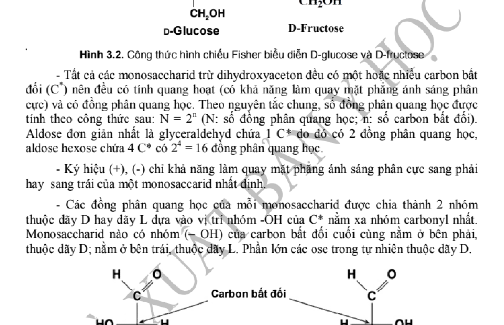
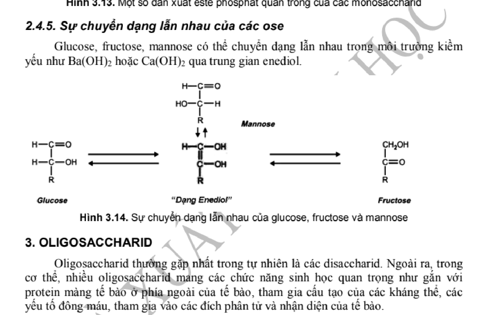
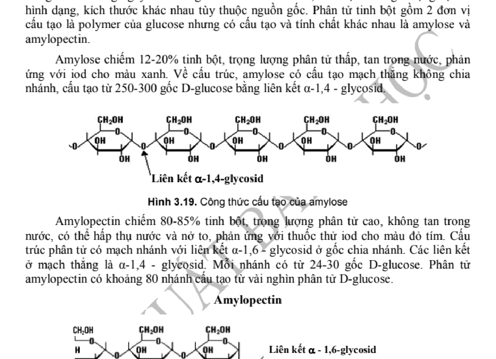

# HS-03 · CẤU TRÚC VÀ TÍNH CHẤT MONOSACCHARID, OLIGOSACCHARID, POLYSACCHARID

> **Tác giả:** ThS. BS. Trần Khánh Chi, PGS. TS. BS. Trần Huy Thịnh — ĐHY Hà Nội  
> **Nguồn trích xuất:** Giáo trình Hóa sinh Y học (GS. TS. BS. Tạ Thành Văn chủ biên, Tái bản lần thứ 7, Tr. 65 – 84)  
> **Chuẩn mực:** EBM, Cấu trúc phân tử & Ứng dụng lâm sàng

---

## MỤC TIÊU HỌC TẬP

1. **Trình bày được** định nghĩa, cách phân loại và công thức cấu tạo của các monosaccharid phổ biến (D-glucose, D-fructose, D-galactose).
2. **Giải thích được** các hiện tượng đồng phân quang học (D/L), đồng phân anomer ($\alpha/\beta$), cấu tạo vòng pyranose và furanose.
3. **Trình bày được** cấu trúc hóa học và liên kết glycosid của các disaccharid quan trọng: Maltose, Lactose, Saccarose; giải thích nguyên nhân tính khử.
4. **Phân tích được** cấu trúc và vai trò sinh học của các polysaccharid thuần (Glycogen, Tinh bột, Cellulose) và polysaccharid tạp (Glycosaminoglycan - GAG, Proteoglycan).

---

## 1. MONOSACCHARID

Monosaccharid là các polyhydroxy aldehyd (aldose) hoặc polyhydroxy ceton (cetose) không thể thủy phân thành các chất glucid đơn giản hơn.

*Hình 3.1. Cấu trúc đồng phân dạng mạch thẳng và dạng mạch vòng $\alpha, \beta$-D-glucopyranose.*

### 1.1. Các dạng đồng phân quan trọng:
* **Đồng phân D và L:** Dựa trên vị trí nhóm $-OH$ ở carbon bất đối ($C^*$) xa nhóm carbonyl nhất (carbon $C_5$ ở hexose). Phần lớn monosaccharid tự nhiên ở động vật có vú là **D-đường**.
* **Đồng phân anomer ($\alpha$ và $\beta$):** Khi đóng vòng bán acetal tạo ra carbon bất đối mới tại $C_1$ (carbon anomer). Nhóm $-OH$ bán acetal nằm dưới mặt phẳng vòng là dạng $\alpha$, nằm trên mặt phẳng vòng là dạng $\beta$.
* **Đồng phân Epimer:** Khác nhau chỉ ở cấu hình của 1 carbon bất đối: D-Glucose và D-Galactose là epimer ở $C_4$; D-Glucose và D-Mannose là epimer ở $C_2$.

---

## 2. OLIGOSACCHARID (DISACCHARID)

Disaccharid được tạo thành do 2 phân tử monosaccharid kết hợp với nhau qua **liên kết glycosid**, loại đi 1 phân tử nước.

*Hình 3.2. Cấu trúc Maltose ($\alpha-1,4$), Lactose ($\beta-1,4$) và Saccarose ($\alpha-1, \beta-2$).*

### Bảng 3.1. So sánh các Disaccharid quan trọng

| Tên Disaccharid | Đơn vị cấu tạo | Bản chất liên kết glycosid | Tính khử | Vai trò lâm sàng |
| :--- | :--- | :---: | :---: | :--- |
| **Maltose** | $\alpha$-D-Glucose + $\alpha$-D-Glucose | $\alpha-1,4\text{-glycosid}$ | **Còn tính khử** | Sản phẩm thủy phân tinh bột bởi amylase tụy. |
| **Lactose** | $\beta$-D-Galactose + D-Glucose | $\beta-1,4\text{-glycosid}$ | **Còn tính khử** | Đường sữa mẹ và động vật; thiếu enzym lactase gây **Hội chứng bất dung nạp lactose**. |
| **Saccarose** | $\alpha$-D-Glucose + $\beta$-D-Fructose | $\alpha-1, \beta-2\text{-glycosid}$ | **Mất tính khử** | Đường mía, củ cải đường; hai nhóm anomer tham gia liên kết nên không còn nhóm khử tự do. |

---

## 3. POLYSACCHARID

### 3.1. Polysaccharid thuần (Homopolysaccharid)
* **Glycogen:** Polysaccharid dự trữ glucose ở động vật (nhiều nhất ở gan $5-8\%$ và cơ vân $1-2\%$). Cấu tạo từ các gốc $\alpha$-D-glucose nối với nhau bằng liên kết $\alpha-1,4$ và phân nhánh bằng liên kết $\alpha-1,6$ (cứ mỗi 8-12 gốc glucose lại có 1 điểm phân nhánh).

*Hình 3.3. Cấu trúc mạng lưới phân nhánh đa tầng của đại phân tử Glycogen.*

* **Tinh bột (Starch):** Polysaccharid dự trữ ở thực vật, gồm 2 thành phần: Amylose (chuỗi thẳng $\alpha-1,4$, xoắn ốc) và Amylopectin (chuỗi phân nhánh $\alpha-1,4$ và $\alpha-1,6$).
* **Cellulose:** Cấu tạo từ các gốc $\beta$-D-glucose qua liên kết $\beta-1,4\text{-glycosid}$ dạng mạch thẳng kéo dài. Người không có enzym cellulase để phân giải nên cellulose đóng vai trò chất xơ kích thích nhu động ruột.

### 3.2. Polysaccharid tạp (Heteropolysaccharid)
* **Glycosaminoglycan (GAG):** Acid hyaluronic (dịch khớp, thủy tinh thể), Chondroitin sulfat (sụn khớp), Heparin (chất chống đông sinh lý tự nhiên do tế bào mast bài tiết).

---

## CÂU HỎI ÔN TẬP VÀ ĐÁP ÁN BAREM CHI TIẾT (ĐHY HÀ NỘI)

💡 HƯỚNG DẪN TRẢ LỜI &amp; ĐÁP ÁN GỢI Ý (CHƯƠNG 3)

  
    1. Phân loại 20 acid amin thường gặp:
    
      Dựa vào độ phân cực của chuỗi bên (-R) ở pH sinh lý 7.4 chia thành 5 nhóm:
        
          Nhóm kỵ nước, không phân cực: Gly, Ala, Val, Leu, Ile, Pro, Met.
          Nhóm nhân thơm: Phe, Tyr, Trp (hấp thụ cực đại tia cực tím tại bước sóng 280 nm).
          Nhóm phân cực không tích điện: Ser, Thr, Cys (chứa nhóm -SH tạo cầu disulfur), Asn, Gln.
          Nhóm tích điện dương (kiềm): Lys, Arg, His (vòng imidazol đệm sinh học tốt nhất).
          Nhóm tích điện âm (acid): Asp, Glu (mang 2 nhóm carboxyl).
        
      
      Acid amin cần thiết (8 loại ở người lớn, 10 loại ở trẻ em): Val, Leu, Ile, Thr, Met, Phe, Trp, Lys (thêm His, Arg ở trẻ em).
    

    2. Các bậc cấu trúc của phân tử protein và lực làm bền:
    
      **Cấu trúc bậc 1:** Trật tự sắp xếp tuyến tính của các gốc acid amin nối với nhau bằng liên kết cộng hóa trị peptid (-CO-NH-). Quyết định toàn bộ các bậc cấu trúc cao hơn và tính chất sinh học của protein.
      **Cấu trúc bậc 2:** Sự cuộn xoắn hoặc gấp nếp có chu kỳ của chuỗi polypeptid (chuỗi xoắn α và phiến gấp nếp β), được làm bền chủ yếu bằng liên kết hydro giữa nhóm -C=O và -NH- của khung xương polypeptid.
      **Cấu trúc bậc 3:** Cấu trúc không gian ba chiều hoàn chỉnh của một chuỗi polypeptid đơn lẻ, tạo nên các túi hoạt động chức năng; được làm bền bởi cầu nối disulfur (-S-S-), liên kết ion (cầu muối), tương tác kỵ nước và liên kết van der Waals.
      **Cấu trúc bậc 4:** Sự sắp xếp và phối hợp không gian của 2 hay nhiều chuỗi polypeptid (tiểu đơn vị) có cấu trúc bậc 3 liên kết phi cộng hóa trị với nhau (ví dụ: Hemoglobin gồm 4 tiểu đơn vị α₂β₂).
    

    3. Cấu tạo và tính chất kết hợp khí của Hemoglobin:
    
      **Cấu tạo:** Gồm 4 tiểu đơn vị (2α 141 aa + 2β 146 aa), mỗi tiểu đơn vị gắn 1 nhân Hem (Protoporphyrin IX gắn Fe²⁺ tại tâm).
      **Kết hợp Oxy (O₂):** 1 phân tử Hb gắn tối đa 4 O₂: Hb + 4 O₂ ⇌ Hb(O₂)₄. Tính hợp tác dị lập thể tạo đường cong phân ly O₂ dạng sigma chữ S. Khi Fe²⁺ bị oxy hóa thành Fe³⁺ sẽ tạo Methemoglobin mất khả năng vận chuyển O₂.
      **Kết hợp CO (Carbon monoxid):** Ái lực của Hb với CO cao gấp 210-250 lần so với O₂, tạo Carboxyhemoglobin (HbCO) rất bền vững, chiếm chỗ gắn O₂ và ngăn Hb nhả O₂ cho mô, gây ngạt thở tế bào cấp tính đe dọa tính mạng.
      **Hiệu ứng Bohr:** Khi mô hoạt động sinh nhiều CO₂ và H⁺ (giảm pH), H⁺ gắn vào các gốc histidin của globin làm ổn định dạng T, kích thích Hb nhả O₂ cho mô. Ngược lại tại phổi, pO₂ cao kích thích nhả H⁺ để tái tạo CO₂ đào thải ra ngoài.
