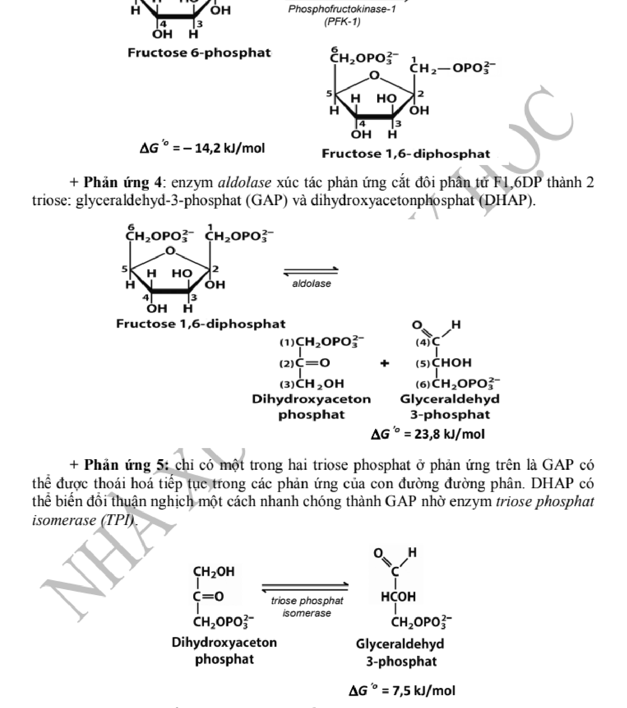
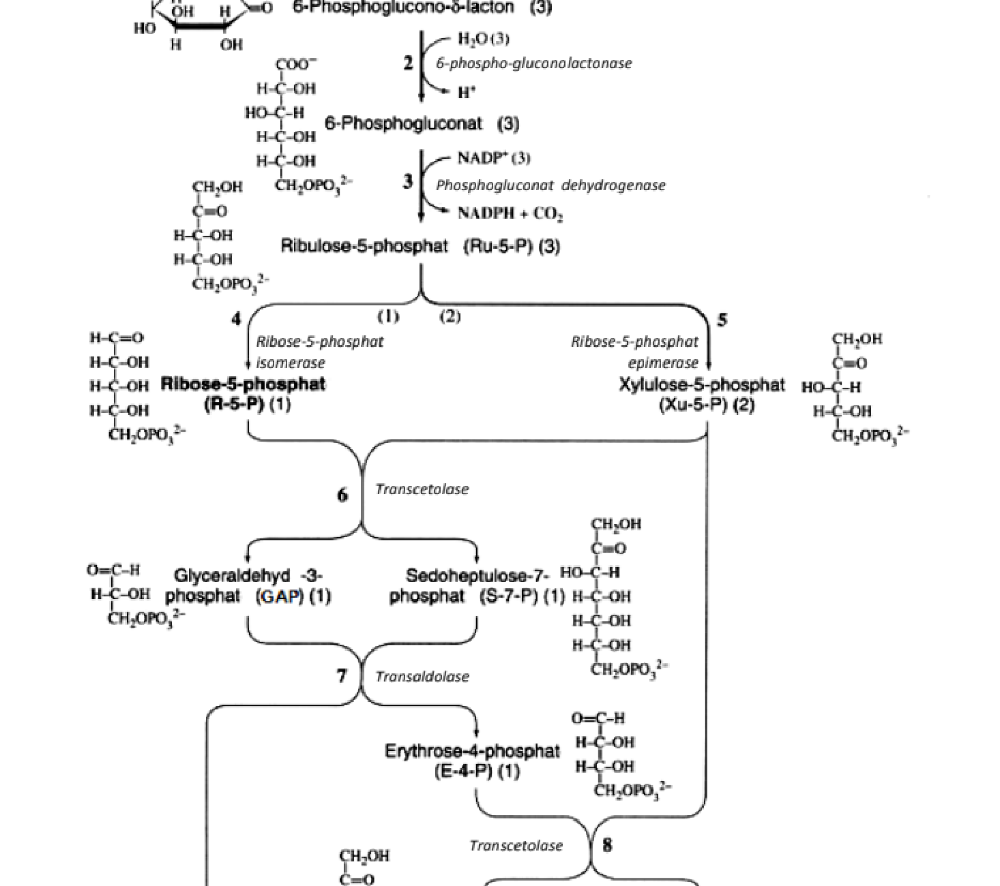
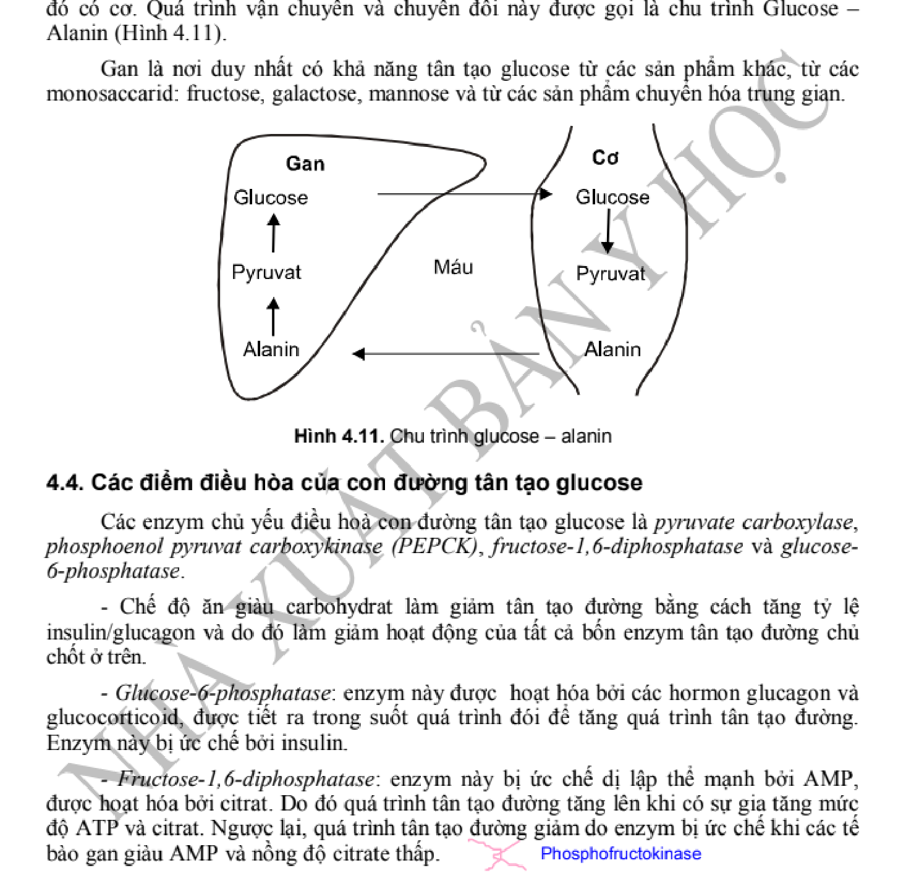
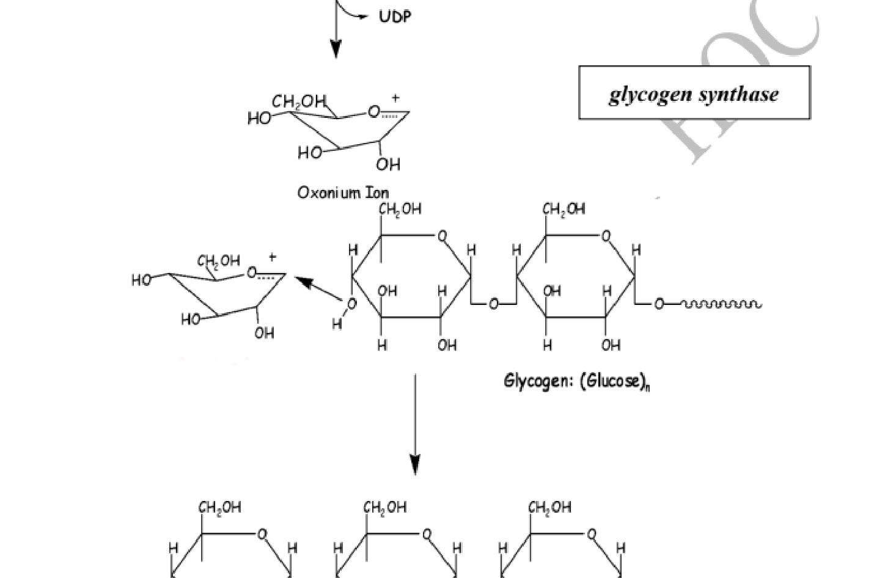

# HS-04 · CHUYỂN HÓA CARBOHYDRAT: ĐƯỜNG PHÂN, CHU TRÌNH PENTOSE PHOSPHAT, TÂN TẠO ĐƯỜNG, CHUYỂN HÓA GLYCOGEN VÀ ĐIỀU HÒA ĐƯỜNG HUYẾT

> **Tác giả:** ThS. BS. Trần Khánh Chi, PGS. TS. BS. Đặng Thị Ngọc Dụng — Bộ môn Hóa sinh, Trường Đại học Y Hà Nội  
> **Chủ biên chương trình:** GS. TS. BS. Tạ Thành Văn — Trường Đại học Y Hà Nội  
> **Nguồn trích xuất chuẩn mực:** Giáo trình Hóa sinh Y học (Tái bản lần thứ 7, Nhà xuất bản Y học, Tr. 85 – 115) kết hợp Harper's Illustrated Biochemistry (32nd Ed), Lehninger Principles of Biochemistry (8th Ed) & Hướng dẫn Chẩn đoán Điều trị Đái tháo đường Bộ Y tế / ADA 2024  
> **Đối tượng học tập:** Sinh viên Bác sĩ Đa khoa (Y khoa), Bác sĩ Răng Hàm Mặt, Dược sĩ Đại học, Bác sĩ Nội trú và Học viên Sau đại học Chuyên ngành Hóa sinh - Huyết học - Nội tiết  
> **Chuẩn mực:** Khoa học chứng cứ (EBM), Danh pháp Quốc tế IUBMB, KaTeX hóa 100% công thức - phương trình chuyển hóa, Tích hợp Bệnh học Lâm sàng & Không tồn đọng ký tự rác OCR

---

## MỤC TIÊU HỌC TẬP CHUẨN ĐẦU RA

Sau khi hoàn thành chương học này, học viên cần đạt được các năng lực cốt lõi sau:
1. **Phân tích chi tiết 10 phản ứng của con đường đường phân (Glycolysis / Embden - Meyerhof - Parnas):** Trình bày rõ 2 giai đoạn (tiêu tốn năng lượng và sinh năng lượng), bản chất hóa học, enzym xúc tác, coenzym và ý nghĩa nhiệt động học của 3 phản ứng không thuận nghịch (Hexokinase/Glucokinase, PFK-1, Pyruvat kinase).
2. **So sánh cơ chế phân tử và động học:** Phân biệt rõ sự khác nhau giữa Hexokinase và Glucokinase về ái lực cơ chất ($K_m$), vị trí phân bố mô, chất ức chế và cơ chế điều hòa bởi protein điều hòa GKRP; Phân tích cơ chế điều hòa allosteric đa tầng tại trạm kiểm soát then chốt PFK-1 bởi enzym lưỡng chức năng PFK-2/FBPase-2.
3. **Lập luận số phận của Pyruvat:** Phân biệt quá trình thoái hóa hiếu khí (qua phức hợp đa enzym Pyruvat Dehydrogenase - PDH trong ty thể) và thoái hóa yếm khí (khử thành Lactat nhờ Lactat Dehydrogenase - LDH để tái sinh $\text{NAD}^+$ bào tương duy trì đường phân); Tính toán chính xác hiệu suất năng lượng ATP thu được từ 1 phân tử Glucose trong cả 2 điều kiện.
4. **Giải thích chu trình Pentose Phosphat (HMP Shunt):** Trình bày 2 pha (pha oxy hóa không thuận nghịch tạo NADPH và Ribulose-5-P; pha không oxy hóa thuận nghịch hoán đổi đường nhờ Transketolase - cần Thiamin pyrophosphat TPP và Transaldolase); Phân tích 4 vai trò sinh học thiết yếu của NADPH và cơ chế bệnh sinh của bệnh thiếu hụt enzym G6PD gây tan máu cấp (Favism / ngộ độc thuốc oxy hóa).
5. **Trình bày chuyển hóa Glycogen:** Mô tả toàn bộ các bước thoái hóa glycogen (Glycogen phosphorylase cần Vitamin B6 - PLP, enzym cắt nhánh debranching enzyme) và sinh tổng hợp glycogen (tạo UDP-Glucose, mồi Glycogenin, Glycogen synthase, enzym tạo nhánh branching enzyme); Phân tích sâu cơ chế điều hòa đối kháng qua tầng phosphoryl hóa/khử phosphoryl chịu sự chỉ huy của Adrenalin / Glucagon vs Insulin.
6. **Làm sáng tỏ con đường Tân tạo đường (Gluconeogenesis):** Xác định các cơ chất đầu vào (Lactat từ chu trình Cori, Alanin từ chu trình Glucose-Alanin, Glycerol từ mô mỡ, các acid amin sinh đường); Trình bày chi tiết cơ chế vượt qua 3 hàng rào nhiệt động học của đường phân (Pyruvat carboxylase + PEPCK, FBPase-1, Glucose-6-phosphatase); Hạch toán chi phí năng lượng tân tạo đường.
7. **Tích hợp Bệnh học Lâm sàng & Rối loạn chuyển hóa Carbohydrat:** Phân tích cơ chế bệnh sinh phân tử và biểu hiện lâm sàng của:
   - Đái tháo đường Typ 1, Typ 2, Nhiễm toan ceton đái tháo đường (DKA), Hội chứng tăng áp lực thẩm thấu máu (HHS), con đường Sorbitol và biến chứng mạch máu do AGEs.
   - Các thể bệnh ứ đọng glycogen bẩm sinh (GSD): von Gierke (Typ I), Pompe (Typ II), Cori (Typ III), McArdle (Typ V).
   - Rối loạn chuyển hóa Monosaccharid bẩm sinh: Không dung nạp fructose di truyền (HFI do thiếu Aldolase B) và Galactosemia kinh điển (thiếu GALT).
8. **Vận dụng chẩn đoán & xử trí:** Giải quyết hoàn chỉnh 5 ca bệnh lâm sàng thực tế thông qua các chỉ số xét nghiệm sinh hóa máu, khí máu động mạch và định lượng enzym.

---

## TỔNG QUAN VỀ Ý NGHĨA CHUYỂN HÓA GLUCID TRONG CƠ THỂ

Carbohydrat (Glucid) là nguồn nhiên liệu chuyển hóa năng lượng hàng đầu và nhanh nhất của cơ thể sống, chiếm khoảng $50\% - 60\%$ tổng nhu cầu năng lượng hàng ngày của cơ thể người trưởng thành. Quá trình oxy hóa hoàn toàn $1\,\text{g}$ carbohydrat cung cấp xấp xỉ $4\,\text{kcal}$ ($16,7\,\text{kJ}$).

Bên cạnh vai trò cung cấp năng lượng tức thời dưới dạng adenosin triphosphat (ATP), carbohydrat đóng vai trò sinh học trung tâm trong mạng lưới chuyển hóa vật chất của tế bào:
- **Duy trì nguồn năng lượng sống còn bắt buộc cho các mô đặc thù:** Tế bào hồng cầu trưởng thành hoàn toàn không có ty thể, do đó $100\%$ năng lượng ATP để duy trì hình thái đĩa lõm hai mặt và vận hành bơm $\text{Na}^+/\text{K}^+$-ATPase phụ thuộc tuyệt đối vào con đường đường phân yếm khí sinh lactat. Mô não người tiêu thụ khoảng $120\,\text{g}$ glucose mỗi ngày (chiếm $>60\%$ mức tiêu thụ glucose toàn cơ thể lúc nghỉ ngơi); glucose là cơ chất năng lượng thông thường duy nhất vượt qua được hàng rào máu - não một cách dễ dàng.
- **Dự trữ năng lượng dưới dạng Glycogen:** Được tích lũy tại gan ($70 - 100\,\text{g}$, chiếm $5 - 8\%$ khối lượng gan) để điều hòa ổn định đường huyết giữa các bữa ăn và khi nhịn đói qua đêm; và tại cơ vân ($300 - 400\,\text{g}$, chiếm $1 - 2\%$ khối lượng cơ) để cung cấp nhiên liệu co cơ tại chỗ khi vận động khẩn cấp.
- **Cung cấp các phân tử tiền thân cho quá trình sinh tổng hợp (Anabolism):** 
  - Ribose-5-phosphat từ chu trình pentose phosphat là bộ khung đường không thể thiếu để tổng hợp nên các nucleotid, acid nucleic (RNA, DNA), các coenzym tự do ($\text{ATP}, \text{NAD}^+, \text{NADP}^+, \text{FAD}, \text{CoA}$).
  - NADPH tạo ra từ con đường pentose phosphat cung cấp lực khử điện tử cho quá trình sinh tổng hợp acid béo, triglycerid, cholesterol, hormon steroid sinh dục, hormon vỏ thượng thận, và duy trì hệ thống chống oxy hóa bảo vệ màng tế bào.
  - Dihydroxyaceton phosphat (DHAP) từ đường phân có thể khử thành Glycerol-3-phosphat để ester hóa với các acid béo tạo mỡ trung tính dự trữ.
  - Các dẫn xuất amino đường (glucosamin, galactosamin) và acid sialic tham gia kiến tạo các glycosaminoglycan (GAGs), proteoglycan, glycoprotein và glycolipid tạo nên khuôn gel ngoại bào, chất bôi trơn dịch khớp, màng nhầy và các kháng nguyên bề mặt tế bào.

---

## 1. CON ĐƯỜNG ĐƯỜNG PHÂN (GLYCOLYSIS / CON ĐƯỜNG EMBDEN - MEYERHOF - PARNAS)

Đường phân (Glycolysis, bắt nguồn từ tiếng Hy Lạp *glykys* nghĩa là ngọt và *lysis* nghĩa là phân giải) là con đường chuyển hóa cổ xưa nhất và bảo tồn cao độ nhất trong sinh học tiến hóa. Quá trình này diễn ra hoàn toàn trong **bào tương (cytosol)** của mọi tế bào nhân chuẩn cũng như sinh vật nhân sơ, không cần sự tham gia của oxy phân tử ($\text{O}_2$).

*Hình 4.1. Sơ đồ tổng thể 10 phản ứng của con đường Đường phân (Glycolysis) chia thành 2 giai đoạn: Giai đoạn tiêu tốn năng lượng (phản ứng 1–5) và Giai đoạn sinh năng lượng (phản ứng 6–10).*

Toàn bộ con đường đường phân gồm **10 phản ứng hóa sinh liên hoàn**, chuyển đổi 1 phân tử Glucose ($6\,\text{C}$) thành 2 phân tử Pyruvat ($3\,\text{C}$), được phân thành hai giai đoạn rõ rệt:
1. **Giai đoạn 1 (Giai đoạn tiêu tốn / đầu tư năng lượng - Preparatory phase):** Gồm 5 phản ứng đầu tiên ($1 \to 5$). Phân tử Glucose được phosphoryl hóa hai lần và cắt đôi thành 2 phân tử đường ba carbon (triose phosphat), tiêu tốn **$2\,\text{ATP}$**.
2. **Giai đoạn 2 (Giai đoạn sinh lời năng lượng - Payoff phase):** Gồm 5 phản ứng tiếp theo ($6 \to 10$). Hai phân tử triose phosphat được oxy hóa và biến đổi thành 2 phân tử Pyruvat, sinh ra **$4\,\text{ATP}$** bằng cơ chế phosphoryl hóa mức cơ chất và **$2\,\text{NADH} + 2\,\text{H}^+$**.

---

### 1.1. Chi tiết 10 phản ứng hóa sinh của con đường Đường phân

#### 1.1.1. Giai đoạn 1: Tiêu tốn năng lượng (Phản ứng 1 đến 5)

##### Phản ứng 1: Phosphoryl hóa Glucose thành Glucose-6-phosphat (G-6-P)
Đây là phản ứng mở đầu, đưa glucose từ dịch kẽ vào bên trong tế bào và "bẫy" glucose lại trong bào tương vì màng sinh chất không có chất mang để vận chuyển các phân tử phosphat mang điện tích âm ra ngoài.
$$\text{D-Glucose} + \text{ATP} \xrightarrow[\text{Mg}^{2+}]{{\text{Hexokinase / Glucokinase}}} \text{D-Glucose-6-phosphat} + \text{ADP} + \text{H}^+ \quad (\Delta G^{\circ\prime} = -16,7\,\text{kJ/mol})$$

- **Enzym xúc tác:** **Hexokinase** (ở hầu hết các mô) hoặc **Glucokinase** (ở tế bào nhu mô gan và tế bào beta đảo tụy).
- **Đặc điểm:** Phản ứng có năng lượng tự do âm lớn ($\Delta G^{\circ\prime} < 0$), do đó là **phản ứng một chiều, không thuận nghịch** trong điều kiện sinh lý tế bào. Đây là một trong 3 phản ứng điều hòa then chốt của đường phân. Ion $\text{Mg}^{2+}$ là đồng yếu tố bắt buộc vì cơ chất đích thực của enzym là phức hợp $\text{Mg-ATP}^{2-}$.

##### Phản ứng 2: Đồng phân hóa Glucose-6-phosphat thành Fructose-6-phosphat (F-6-P)
Chuyển hóa một aldose (G-6-P) thành một ketose (F-6-P) để chuẩn bị cho việc gắn nhóm phosphat thứ hai tại vị trí $\text{C-1}$ ở phản ứng tiếp theo.
$$\text{D-Glucose-6-phosphat} \xrightleftharpoons{\text{Phosphoglucose isomerase (PGI)}} \text{D-Fructose-6-phosphat} \quad (\Delta G^{\circ\prime} = +1,7\,\text{kJ/mol})$$

- **Enzym xúc tác:** **Phosphoglucose isomerase** (hay Glucose-6-phosphat isomerase).
- **Cơ chế:** Phản ứng thuận nghịch, diễn ra qua chất trung gian mạch hở cis-enediol. Enzym cần $\text{Mg}^{2+}$ để xúc tác phản ứng mở vòng, chuyển vị proton và đóng vòng furanose 5 cạnh.

##### Phản ứng 3: Phosphoryl hóa Fructose-6-phosphat thành Fructose-1,6-bisphosphat (F-1,6-BP)
Đây là phản ứng **then chốt nhất của toàn bộ con đường đường phân**, xác định phân tử đường sẽ bị phân giải hoàn toàn mà không thể rẽ sang các con đường chuyển hóa khác (điểm cam kết - committed step).
$$\text{D-Fructose-6-phosphat} + \text{ATP} \xrightarrow[\text{Mg}^{2+}]{{\text{PFK-1}}} \text{D-Fructose-1,6-bisphosphat} + \text{ADP} + \text{H}^+ \quad (\Delta G^{\circ\prime} = -14,2\,\text{kJ/mol})$$

- **Enzym xúc tác:** **Phosphofructokinase-1 (PFK-1)**, một enzym allosteric (dị lập thể) phức tạp gồm 4 tiểu đơn vị.
- **Đặc điểm:** Phản ứng một chiều, không thuận nghịch. Nhóm phosphat thứ hai được gắn vào nguyên tử carbon $\text{C-1}$ của phân tử F-6-P, tạo ra tính đối xứng phân tử trước khi bị chặt đôi.

##### Phản ứng 4: Cắt đôi Fructose-1,6-bisphosphat thành hai Triose phosphat
Phân tử hexose đối xứng được bẻ gãy liên kết $\text{C-C}$ để tạo thành 2 phân tử đường 3 carbon.
$$\text{D-Fructose-1,6-bisphosphat} \xrightleftharpoons{\text{Aldolase}} \text{Glyceraldehyd-3-phosphat (GAP)} + \text{Dihydroxyaceton phosphat (DHAP)} \quad (\Delta G^{\circ\prime} = +23,8\,\text{kJ/mol})$$

- **Enzym xúc tác:** **Fructose-1,6-bisphosphat aldolase** (thường gọi ngắn gọn là **Aldolase**).
- **Cơ chế phân tử:** Ở động vật bậc cao, Aldolase typ A (cơ và hầu hết các mô) và Aldolase typ B (ở gan, chuyển hóa cả F-1,6-BP và Fructose-1-P) thuộc Lớp I, sử dụng gốc Lysin tại trung tâm hoạt động để tạo liên kết base Schiff trung gian cộng hóa trị với nhóm carbonyl của cơ chất trước khi bẻ gãy liên kết giữa $\text{C-3}$ và $\text{C-4}$.
- **Ý nghĩa nhiệt động học:** Mặc dù $\Delta G^{\circ\prime}$ tiêu chuẩn dương lớn, trong điều kiện nội bào, do nồng độ sản phẩm GAP và DHAP liên tục bị kéo vào các phản ứng kế tiếp rất thấp nên $\Delta G$ thực tế xấp xỉ $0$, phản ứng diễn ra thuận nghịch một cách trơn tru.

##### Phản ứng 5: Đồng phân hóa giữa hai Triose phosphat
Chỉ có Glyceraldehyd-3-phosphat (GAP) là cơ chất trực tiếp đi tiếp vào Giai đoạn 2 của đường phân. Do đó, toàn bộ phân tử Dihydroxyaceton phosphat (DHAP) sinh ra cần được chuyển đổi nhanh chóng thành GAP.
$$\text{Dihydroxyaceton phosphat} \xrightleftharpoons{\text{Triose phosphat isomerase (TPI)}} \text{Glyceraldehyd-3-phosphat} \quad (\Delta G^{\circ\prime} = +7,5\,\text{kJ/mol})$$

- **Enzym xúc tác:** **Triose phosphat isomerase (TPI)**.
- **Đặc điểm:** TPI là một enzym "hoàn hảo về xúc tác động học" (catalytically perfect enzyme), tốc độ phản ứng bị giới hạn duy nhất bởi tốc độ khuếch tán cơ chất vào trung tâm hoạt động. Sau phản ứng 5, từ $1\,\text{phân tử Glucose}$ ban đầu đã biến đổi thành **$2\,\text{phân tử Glyceraldehyd-3-phosphat}$**.

---

#### 1.1.2. Giai đoạn 2: Sinh năng lượng (Phản ứng 6 đến 10)
*(Lưu ý: Vì từ 1 Glucose tạo ra 2 GAP, tất cả các hệ số phản ứng trong Giai đoạn 2 đều được tính nhân đôi).*

##### Phản ứng 6: Oxy hóa và Phosphoryl hóa Glyceraldehyd-3-phosphat tạo 1,3-Bisphosphoglycerat (1,3-BPG)
Đây là phản ứng oxy hóa khử duy nhất của con đường đường phân, tạo ra liên kết acyl phosphat giàu năng lượng đồng thời tạo ra lực khử $\text{NADH}$.
$$\text{GAP} + \text{NAD}^+ + \text{P}_i \xrightleftharpoons{\text{GAPDH}} \text{1,3-Bisphosphoglycerat} + \text{NADH} + \text{H}^+ \quad (\Delta G^{\circ\prime} = +6,3\,\text{kJ/mol})$$

- **Enzym xúc tác:** **Glyceraldehyd-3-phosphat dehydrogenase (GAPDH)**.
- **Cơ chế xúc tác:** Trung tâm hoạt động của GAPDH chứa một gốc Cystein mang nhóm thiol ($-\text{SH}$) hoạt động:
  1. Nhóm $-\text{SH}$ của Cys tấn công vào nhóm aldehyd của GAP tạo chất trung gian hemithioacetal.
  2. Phức hợp này bị oxy hóa bởi $\text{NAD}^+$ gắn chặt trên enzym, ion hydride ($\text{H}^-$) chuyển sang $\text{NAD}^+$ tạo liên kết thioester giàu năng lượng và $\text{NADH}$.
  3. $\text{NADH}$ được thay thế bởi $\text{NAD}^+$ mới.
  4. Một ion phosphat vô cơ ($\text{P}_i$) tự do trong bào tương tấn công bẻ gãy liên kết thioester (phosphorolysis), giải phóng sản phẩm **1,3-Bisphosphoglycerat** mang liên kết acyl phosphat cao năng tại vị trí $\text{C-1}$.
- **Độc chất học lâm sàng:** GAPDH bị ức chế bất thuận nghịch bởi **Iodoacetat** và ion kim loại nặng như Thủy ngân ($\text{Hg}^{2+}$) do tạo phức liên kết cộng hóa trị với nhóm $-\text{SH}$ của Cystein. Độc chất **Arsenat** ($\text{AsO}_4^{3-}$) cạnh tranh với $\text{P}_i$, tạo ra 1-arseno-3-phosphoglycerat tự thủy phân không sinh ATP, gây "ngắt mạch" phosphoryl hóa mức cơ chất.

##### Phản ứng 7: Chuyển nhóm phosphat từ 1,3-BPG sang ADP tạo ATP (Phosphoryl hóa mức cơ chất lần 1)
Phản ứng thu hồi lại năng lượng đầu tư ban đầu, tạo ra ATP đầu tiên của đường phân mà không cần chuỗi truyền điện tử ty thể.
$$\text{1,3-Bisphosphoglycerat} + \text{ADP} \xrightleftharpoons[\text{Mg}^{2+}]{{\text{Phosphoglycerat kinase (PGK)}}} \text{3-Phosphoglycerat} + \text{ATP} \quad (\Delta G^{\circ\prime} = -18,5\,\text{kJ/mol})$$

- **Enzym xúc tác:** **Phosphoglycerat kinase (PGK)**.
- **Cơ chế:** Nhóm acyl-phosphat cao năng ở $\text{C-1}$ của 1,3-BPG có thế năng chuyển đổi nhóm phosphat rất cao ($\Delta G^{\circ\prime} = -49,3\,\text{kJ/mol}$), lớn hơn nhiều so với năng lượng cần để tổng hợp ATP từ ADP ($\Delta G^{\circ\prime} = +30,5\,\text{kJ/mol}$). Do đó phản ứng ghép đôi này chuyển trực tiếp nhóm phosphat sang ADP tạo ATP.
- **Cân bằng năng lượng:** Với 2 phân tử 1,3-BPG từ 1 glucose, phản ứng này sinh ra **$2\,\text{ATP}$**, bù đắp hoàn toàn 2 ATP đã tiêu tốn ở phản ứng 1 và 3.

##### Phản ứng 8: Chuyển vị nhóm phosphat từ C-3 sang C-2 của Phosphoglycerat
Chuyển đổi este phosphat có thế năng thấp thành dạng có cấu hình sẵn sàng tạo liên kết cao năng.
$$\text{3-Phosphoglycerat} \xrightleftharpoons[\text{Mg}^{2+}]{{\text{Phosphoglycerat mutase (PGM)}}} \text{2-Phosphoglycerat} \quad (\Delta G^{\circ\prime} = +4,4\,\text{kJ/mol})$$

- **Enzym xúc tác:** **Phosphoglycerat mutase (PGM)**.
- **Cơ chế:** Enzym mang một gốc Histidin đã được phosphoryl hóa tại trung tâm hoạt động. Phosphat từ His được chuyển đến vị trí $\text{C-2}$ của 3-PG để tạo chất trung gian 2,3-Bisphosphoglycerat (2,3-BPG), sau đó phosphat ở vị trí $\text{C-3}$ được chuyển ngược lại cho His của enzym, giải phóng **2-Phosphoglycerat (2-PG)**.

##### Phản ứng 9: Khử nước của 2-Phosphoglycerat tạo Phosphoenolpyruvat (PEP)
Tạo ra phân tử có liên kết phosphat cao năng thứ hai của đường phân.
$$\text{2-Phosphoglycerat} \xrightleftharpoons[\text{Mg}^{2+}]{{\text{Enolase}}} \text{Phosphoenolpyruvat (PEP)} + \text{H}_2\text{O} \quad (\Delta G^{\circ\prime} = +7,5\,\text{kJ/mol})$$

- **Enzym xúc tác:** **Enolase** (2-phosphoglycerat dehydratase).
- **Cơ chế:** Tách một phân tử nước làm tái phân bố mật độ điện tích bên trong phân tử, biến liên kết este phosphat năng lượng thấp của 2-PG thành liên kết enol-phosphat có thế năng chuyển phosphat cực đại ($\Delta G^{\circ\prime} = -61,9\,\text{kJ/mol}$).
- **Ứng dụng y học thực hành:** Enolase bị ức chế mạnh bởi ion **Fluorid ($\text{F}^-$)** khi có mặt phosphat (tạo phức hợp bền $\text{Mg}^{2+}\text{-Fluorophosphat}$ cạnh tranh trung tâm hoạt động). Trong xét nghiệm sinh hóa máu, ống lấy máu định lượng Glucose huyết tương luôn chứa chất chống đông kèm **Natri Fluorid (NaF)** nhằm ức chế enolase, ngăn chặn hồng cầu và bạch cầu tiêu thụ glucose trong mẫu máu sau khi lấy, bảo toàn chính xác nồng độ glucose huyết tương lúc lấy máu.

##### Phản ứng 10: Chuyển nhóm phosphat từ PEP sang ADP tạo Pyruvat và ATP (Phosphoryl hóa mức cơ chất lần 2)
Phản ứng kết thúc con đường đường phân, tạo ra sản phẩm Pyruvat và sinh lời thuần $2\,\text{ATP}$.
$$\text{Phosphoenolpyruvat} + \text{ADP} + \text{H}^+ \xrightarrow[\text{Mg}^{2+}, \text{K}^+]{{\text{Pyruvat kinase (PK)}}} \text{Pyruvat} + \text{ATP} \quad (\Delta G^{\circ\prime} = -31,4\,\text{kJ/mol})$$

- **Enzym xúc tác:** **Pyruvat kinase (PK)**.
- **Cơ chế:** Khi nhóm phosphat được chuyển sang ADP tạo ATP, sản phẩm trung gian tạo thành là Enolpyruvat. Enolpyruvat nhanh chóng và tự phát hỗ biến đồng phân hóa (tautomerization) thành dạng ceton bền vững là Pyruvat. Sự hỗ biến enol $\to$ ceton này giải phóng một lượng năng lượng tự do cực lớn ($\Delta G^{\circ\prime} \approx -46\,\text{kJ/mol}$), kéo phản ứng diễn ra một chiều tuyệt đối theo hướng tạo ATP và pyruvat.
- **Ý nghĩa:** Đây là **phản ứng một chiều, không thuận nghịch thứ 3** và là trạm kiểm soát allosteric thứ 3 của đường phân. Với 2 PEP, phản ứng này sinh thêm **$2\,\text{ATP}$**.

---

### Bảng 4.1. Bảng đối chiếu 10 phản ứng của con đường Đường phân (Glycolysis)

| STT | Phản ứng hóa học | Enzym xúc tác | Phân loại & Đặc điểm nhiệt động | Năng lượng / Sản phẩm tạo thành |
| :---: | :--- | :--- | :---: | :---: |
| **1** | $\text{Glucose} + \text{ATP} \to \text{G-6-P} + \text{ADP}$ | **Hexokinase / Glucokinase** | Không thuận nghịch (Trạm kiểm soát 1) | **$-1\,\text{ATP}$** |
| **2** | $\text{G-6-P} \rightleftharpoons \text{F-6-P}$ | Phosphoglucose isomerase | Thuận nghịch, đồng phân hóa Aldose $\to$ Ketose | $0$ |
| **3** | $\text{F-6-P} + \text{ATP} \to \text{F-1,6-BP} + \text{ADP}$ | **Phosphofructokinase-1 (PFK-1)** | Không thuận nghịch (Trạm kiểm soát 2 - Then chốt) | **$-1\,\text{ATP}$** |
| **4** | $\text{F-1,6-BP} \rightleftharpoons \text{GAP} + \text{DHAP}$ | Aldolase | Thuận nghịch, bẻ gãy phân tử $6\,\text{C} \to 2 \times 3\,\text{C}$ | $0$ |
| **5** | $\text{DHAP} \rightleftharpoons \text{GAP}$ | Triose phosphat isomerase | Thuận nghịch, cân bằng động học hoàn hảo | Chuyển toàn bộ thành 2 GAP |
| **6** | $2\,\text{GAP} + 2\,\text{NAD}^+ + 2\,\text{P}_i \rightleftharpoons 2\,\text{1,3-BPG} + 2\,\text{NADH} + 2\,\text{H}^+$ | GAPDH | Thuận nghịch, oxy hóa và phosphoryl hóa | **$+2\,\text{NADH} + 2\,\text{H}^+$** |
| **7** | $2\,\text{1,3-BPG} + 2\,\text{ADP} \rightleftharpoons 2\,\text{3-PG} + 2\,\text{ATP}$ | Phosphoglycerat kinase | Thuận nghịch, phosphoryl hóa mức cơ chất 1 | **$+2\,\text{ATP}$** (hòa vốn) |
| **8** | $2\,\text{3-PG} \rightleftharpoons 2\,\text{2-PG}$ | Phosphoglycerat mutase | Thuận nghịch, chuyển vị nhóm phosphat $\text{C3} \to \text{C2}$ | $0$ |
| **9** | $2\,\text{2-PG} \rightleftharpoons 2\,\text{PEP} + 2\,\text{H}_2\text{O}$ | Enolase | Thuận nghịch, khử nước tạo liên kết enol-phosphat | Bị ức chế bởi $\text{NaF}$ |
| **10** | $2\,\text{PEP} + 2\,\text{ADP} \to 2\,\text{Pyruvat} + 2\,\text{ATP}$ | **Pyruvat kinase** | Không thuận nghịch (Trạm kiểm soát 3) | **$+2\,\text{ATP}$** |
| **Tổng** | $\text{Glucose} + 2\,\text{NAD}^+ + 2\,\text{ADP} + 2\,\text{P}_i \to 2\,\text{Pyruvat} + 2\,\text{NADH} + 2\,\text{H}^+ + 2\,\text{ATP} + 2\,\text{H}_2\text{O}$ | | | **Thuần: $+2\,\text{ATP}, +2\,\text{NADH}, +2\,\text{Pyruvat}$** |

---

### 1.2. Ba phản ứng không thuận nghịch và Cơ chế điều hòa phân tử then chốt

Trong số 10 phản ứng của đường phân, có 3 phản ứng có độ biến thiên năng lượng tự do âm rất lớn ($\Delta G \ll 0$), diễn ra một chiều thực tế trong tế bào. Đây chính là ba điểm van điều hòa tốc độ (flux control points) của toàn bộ con đường:

#### 1.2.1. Phản ứng 1: Hexokinase vs Glucokinase (Isoenzym I, II, III vs IV)
Phản ứng phosphoryl hóa Glucose được xúc tác bởi 4 isoenzym khác nhau với các đặc tính động học và phân bố mô hoàn toàn chuyên biệt:

##### So sánh Hexokinase (Typ I - III) và Glucokinase (Typ IV):
1. **Hexokinase (Typ I, II, III):**
   - **Vị trí phân bố:** Có mặt ở hầu hết các mô ngoại vi (não, hồng cầu, cơ vân, thận...).
   - **Ái lực cơ chất:** $K_m$ rất thấp ($K_m \approx 0,05 - 0,1\,\text{mmol/L}$). Vì nồng độ glucose máu sinh lý bình thường lúc đói là $3,9 - 5,6\,\text{mmol/L}$, Hexokinase luôn hoạt động ở trạng thái bão hòa cơ chất ($v \approx V_{\max}$). Điều này đảm bảo các mô ưu tiên sống còn (như não và hồng cầu) luôn thu nhận và phân giải glucose liên tục kể cả khi đường huyết hạ thấp.
   - **Tốc độ tối đa:** $V_{\max}$ tương đối thấp, tránh làm cạn kiệt phosphat nội bào.
   - **Cơ chế ức chế:** Bị ức chế điều hòa ngược (feedback inhibition) mạnh mẽ bởi chính sản phẩm **Glucose-6-phosphat (G-6-P)**. Khi PFK-1 bị ức chế, G-6-P tích tụ sẽ lập tức khóa hoạt tính của Hexokinase.

2. **Glucokinase (Typ IV):**
   - **Vị trí phân bố:** Khu trú chuyên biệt tại **tế bào nhu mô gan (hepatocyte)** và **tế bào beta đảo tụy**.
   - **Ái lực cơ chất:** $K_m$ rất cao ($K_m \approx 5 - 10\,\text{mmol/L}$), đường cong động học có dạng sigmoid (hợp tác dương). Ở mức đường huyết bình thường lúc đói ($5\,\text{mmol/L}$), Glucokinase hoạt động rất yếu. Khi đường huyết sau ăn tăng cao qua tĩnh mạch cửa ($>10\,\text{mmol/L}$), enzym này mới được huy động tối đa.
   - **Tốc độ tối đa:** $V_{\max}$ rất cao, cho phép gan "dọn dẹp" và tích trữ lượng lớn glucose từ máu tĩnh mạch cửa sau bữa ăn dồi dào carbohydrat.
   - **Không bị ức chế bởi G-6-P:** Điều này cho phép gan tiếp tục phosphoryl hóa glucose ngay cả khi nồng độ G-6-P trong tế bào đã lên rất cao để chuyển sang tổng hợp Glycogen dự trữ hoặc tổng hợp acid béo.
   - **Điều hòa bởi Protein điều hòa Glucokinase (GKRP):** Trong nhân tế bào gan, Glucokinase liên kết chặt với GKRP (Glucokinase Regulatory Protein) và bị bất hoạt. 
     - Khi nồng độ **Fructose-6-phosphat (F-6-P)** cao (dấu hiệu ứ đọng đường), GKRP gắn chặt và kéo Glucokinase vào trong nhân tế bào, cách ly khỏi bào tương.
     - Khi nồng độ **Glucose** trong máu và bào tương gan tăng vọt, Glucose gắn vào Glucokinase làm giải phóng nó khỏi GKRP, Glucokinase chuyển vị ra bào tương để hoạt động.
     - **Insulin** kích thích phiên mã gen tổng hợp Glucokinase, trong khi **Glucagon** ức chế biểu hiện gen này.
   - **Ý nghĩa tại tế bào beta đảo tụy:** Glucokinase đóng vai trò là "Cảm biến nồng độ glucose" (Glucose sensor). Tốc độ đường phân qua Glucokinase quyết định tỷ lệ $\text{ATP}/\text{ADP}$ nội bào, điều khiển đóng kênh $\text{K}_{\text{ATP}}$, gây khử cực màng, mở kênh $\text{Ca}^{2+}$ điện thế và kích hoạt bài tiết Insulin. Đột biến dị hợp tử mất chức năng gen Glucokinase (*GCK*) gây bệnh đái tháo đường khởi phát ở người trẻ typ 2 (MODY 2).

---

#### 1.2.2. Phản ứng 3: Phosphofructokinase-1 (PFK-1) — Trạm kiểm soát tốc độ chính
PFK-1 là enzym dị lập thể quan trọng bậc nhất, đóng vai trò "người gác cổng" (pacemaker) điều hòa lưu lượng phân tử đi vào con đường đường phân.

##### Cơ chế điều hòa allosteric đa tầng tại PFK-1:
- **Các chất ức chế Allosteric:**
  - **ATP:** Mặc dù ATP là cơ chất của phản ứng, khi nồng độ ATP trong tế bào tăng cao, ATP sẽ gắn vào vị trí dị lập thể riêng biệt ngoài trung tâm hoạt động, làm giảm mạnh ái lực của PFK-1 đối với F-6-P. Đây là cơ chế tiết kiệm năng lượng: khi tế bào đã dư thừa năng lượng, đường phân bị ngưng trệ.
  - **Citrat:** Nồng độ citrat tăng cao trong ty thể báo hiệu chu trình Krebs đã bão hòa và các tiền thân sinh tổng hợp acid béo đã dồi dào. Citrat khuếch tán ra bào tương và hiệp đồng với ATP ức chế PFK-1.
  - **$\text{H}^+$ (pH giảm):** Khi đường phân yếm khí sinh nhiều acid lactic, ion $\text{H}^+$ ức chế PFK-1 nhằm bảo vệ tế bào khỏi bị phá hủy do nhiễm toan lactic quá mức.
- **Các chất hoạt hóa Allosteric:**
  - **AMP và ADP:** Nồng độ AMP tăng phản ánh tế bào đang cạn kiệt năng lượng. AMP gắn vào PFK-1, hóa giải tác dụng ức chế của ATP, kích hoạt enzym tăng tốc đường phân.
  - **Fructose-2,6-bisphosphat (F-2,6-BP) — Chất hoạt hóa dị lập thể mạnh nhất:**

##### Cơ chế phân tử của F-2,6-BP và Enzym lưỡng chức năng PFK-2 / FBPase-2:
F-2,6-BP không phải là chất trung gian của con đường đường phân mà là một phân tử tín hiệu điều hòa nội bào thuần túy. F-2,6-BP được sinh ra và giáng hóa bởi một phức hợp enzym đồng di phân (homodimer) mang hai hoạt tính xúc tác đối kháng nhau trên cùng một chuỗi polypeptid: **Enzym lưỡng chức năng PFK-2 / FBPase-2**:
1. **Tại gan - Đáp ứng với tín hiệu hormon đói/no:**
   - **Khi đói (Glucagon tăng cao):** Glucagon gắn vào thụ thể bắt cặp protein G ($G_s$), kích hoạt Adenylate cyclase làm tăng $\text{cAMP} \implies$ hoạt hóa **Protein Kinase A (PKA)**. PKA phosphoryl hóa enzym lưỡng chức năng tại gốc Serin-32:
     - Làm **bất hoạt miền PFK-2** và **hoạt hóa miền FBPase-2**.
     - Kết quả: Nồng độ $\text{F-2,6-BP}$ giảm mạnh $implies$ mất tác dụng kích hoạt PFK-1 (đường phân bị ức chế) đồng thời giải phóng ức chế trên FBPase-1 (tân tạo đường được kích hoạt tối đa để phóng thích glucose vào máu).
   - **Khi no (Insulin tăng cao):** Tỷ lệ Insulin/Glucagon cao kích hoạt **Phosphoprotein Phosphatase (PP1)** khử phosphoryl hóa enzym lưỡng chức năng:
     - Làm **hoạt hóa miền PFK-2** và **bất hoạt miền FBPase-2**.
     - Kết quả: Tăng vọt nồng độ $\text{F-2,6-BP} \implies$ kích hoạt cực mạnh PFK-1, thúc đẩy đường phân để chuyển hóa lượng đường dồi dào sau bữa ăn.

---

#### 1.2.3. Phản ứng 10: Pyruvat Kinase (PK) — Điểm chốt chặn cuối cùng
Pyruvat kinase kiểm soát sự thoát ra của các chất trung gian khỏi đường phân sang chuyển hóa tiếp theo.

##### Cơ chế điều hòa Pyruvat kinase:
- **Cơ chế Feed-forward (Kích hoạt đón đầu):** Sản phẩm của phản ứng 3 là **Fructose-1,6-bisphosphat (F-1,6-BP)** kích hoạt allosteric mạnh mẽ Pyruvat kinase. Cơ chế này đảm bảo khi "dòng thác" đường phân đã mở ở phía trên, van xả phía dưới lập tức mở toang để ngăn ngừa sự ứ đọng các chất trung gian phosphat.
- **Ức chế allosteric:** Bị ức chế bởi **ATP**, **Acetyl-CoA** và các acid béo chuỗi dài (dấu hiệu giàu năng lượng), và đặc biệt bởi acid amin **Alanin** (sản phẩm chuyển amin của pyruvat, báo hiệu nguyên liệu tạo đường đã đầy đủ).
- **Điều hòa bằng phosphoryl hóa cộng hóa trị (chuyên biệt tại isoenzym L ở gan):**
  - **Glucagon $\implies$ PKA phosphoryl hóa Pyruvat kinase typ L $\implies$ Bất hoạt enzym.** Cơ chế này khóa đường phân tại gan khi nhịn đói, ngăn không cho Phosphoenolpyruvat (PEP) vừa được tạo ra từ tân tạo đường bị phân giải ngược lại thành Pyruvat (tránh chu trình tiêu tốn vô ích - futile cycle).
  - **Insulin $\implies$ PP1 khử phosphoryl hóa PK typ L $\implies$ Hoạt hóa enzym**, tái lập đường phân.

---

### 1.3. Số phận chuyển hóa của Pyruvat: Hiếu khí vs Yếm khí

Pyruvat sinh ra từ đường phân tại bào tương là điểm rẽ chuyển hóa trung tâm. Tùy thuộc vào sự hiện diện của oxy phân tử và trạng thái ty thể của mô, pyruvat sẽ đi theo các ngả khác nhau:

#### 1.3.1. Thoái hóa Yếm khí (Anaerobic Glycolysis) — Lên men tạo Lactat
Xảy ra trong các điều kiện:
- **Tế bào không có ty thể:** Điển hình là **tế bào hồng cầu trưởng thành**, giác mạc, thủy tinh thể, tủy thận.
- **Mô bị thiếu oxy tương đối hoặc tuyệt đối:** Cơ vân co rút cường độ cao (vận động gắng sức), mô cơ tim trong thiếu máu cục bộ, mô ung thư phát triển nhanh thiếu tưới máu.

##### Phản ứng xúc tác bởi Lactat Dehydrogenase (LDH):
$$\text{Pyruvat} + \text{NADH} + \text{H}^+ \xrightleftharpoons{\text{Lactat Dehydrogenase (LDH)}} \text{L-Lactat} + \text{NAD}^+ \quad (\Delta G^{\circ\prime} = -25,1\,\text{kJ/mol})$$

- **Ý nghĩa sinh học cốt tử:** Con đường đường phân chỉ có thể tiếp diễn nếu có sẵn phân tử $\text{NAD}^+$ tự do để tham gia vào Phản ứng 6 (GAPDH). Trong điều kiện yếm khí hoặc không có ty thể, chuỗi truyền điện tử không hoạt động, $\text{NADH}$ không thể tái oxy hóa qua màng ty thể. Phản ứng LDH giải quyết khủng hoảng này bằng cách dùng pyruvat làm chất nhận điện tử để **tái sinh ngay lập tức $\text{NAD}^+$ bào tương**, giữ cho con đường sinh ATP của đường phân không bị tắc nghẽn.
- **Hạch toán năng lượng yếm khí:**
  $$\text{Glucose} + 2\,\text{ADP} + 2\,\text{P}_i \to 2\,\text{Lactat} + 2\,\text{ATP} + 2\,\text{H}_2\text{O}$$
  **Hiệu suất năng lượng: Thu được duy nhất $2\,\text{ATP}$ trên 1 phân tử Glucose.**

#### 1.3.2. Thoái hóa Hiếu khí (Aerobic Oxidation) — Oxy hóa hoàn toàn qua Ty thể
Xảy ra khi tế bào có đầy đủ oxy và ty thể nguyên vẹn (não, tim, gan, cơ vân khi nghỉ ngơi):
1. **Pyruvat được vận chuyển qua màng ty thể:** Nhờ chất đồng vận chuyển $\text{H}^+$/Pyruvat (Pyruvate translocase) trên màng trong ty thể.
2. **Khử carboxyl oxy hóa thành Acetyl-CoA:** Xúc tác bởi phức hợp đa enzym **Pyruvat Dehydrogenase (PDH)** bên trong chất nền ty thể:
   $$\text{Pyruvat} + \text{CoA-SH} + \text{NAD}^+ \xrightarrow{\text{Phức hợp PDH}} \text{Acetyl-CoA} + \text{CO}_2 + \text{NADH} + \text{H}^+$$
   Phức hợp PDH cần 5 coenzym thiết yếu: Thiamin pyrophosphat (**TPP - Vitamin B1**), Lipoamid, Coenzym A (**CoA - Vitamin B5**), $\text{FAD}$ (**Vitamin B2**), và $\text{NAD}^+$ (**Vitamin B3**).
3. **Acetyl-CoA đi vào Chu trình Krebs (TCA):** Bị oxy hóa hoàn toàn thành $\text{CO}_2$ và $\text{H}_2\text{O}$, giải phóng các coenzym khử $\text{NADH}$ và $\text{FADH}_2$.
4. **Coenzym khử đi vào Chuỗi truyền điện tử ty thể (ETC):** Phosphoryl-oxy hóa tạo lượng lớn ATP.

---

### Bảng 4.2. Hạch toán năng lượng ATP chi tiết từ 1 phân tử Glucose trong điều kiện Hiếu khí

| Giai đoạn chuyển hóa | Phản ứng sinh / tiêu thụ | Cơ chế tạo ATP | Số ATP tạo thành (Hệ số P/O hiện đại) |
| :--- | :--- | :--- | :---: |
| **Đường phân (Bào tương)** | Phản ứng 1 (Hexokinase) | Tiêu thụ ATP | **$-1$** |
| | Phản ứng 3 (PFK-1) | Tiêu thụ ATP | **$-1$** |
| | Phản ứng 7 ($2 \times$ PGK) | Phosphoryl hóa mức cơ chất | **$+2$** |
| | Phản ứng 10 ($2 \times$ PK) | Phosphoryl hóa mức cơ chất | **$+2$** |
| | Phản ứng 6 ($2 \times$ GAPDH) | $2\,\text{NADH}$ bào tương: | |
| | - Qua **Con thoi Malat - Aspartat** (gan, tim, thận) | $2 \times 2,5\,\text{ATP}$ | **$+5$** (Tổng đường phân: $7\,\text{ATP}$) |
| | - Hoặc qua **Con thoi Glycerol-3-phosphat** (cơ vân, não) | $2 \times 1,5\,\text{ATP}$ | **$+3$** (Tổng đường phân: $5\,\text{ATP}$) |
| **Khử carboxyl Pyruvat (Ty thể)** | $2\,\text{Pyruvat} \to 2\,\text{Acetyl-CoA} + 2\,\text{CO}_2$ | $2\,\text{NADH}$ ty thể ($2 \times 2,5\,\text{ATP}$) | **$+5$** |
| **Chu trình Krebs ($2 \times$ Acetyl-CoA)** | $2 \times$ Succinyl-CoA synthetase | Phosphoryl hóa mức cơ chất ($2\,\text{GTP} \approx 2\,\text{ATP}$) | **$+2$** |
| | $2 \times (3\,\text{NADH})$ | $6\,\text{NADH}$ ty thể ($6 \times 2,5\,\text{ATP}$) | **$+15$** |
| | $2 \times (1\,\text{FADH}_2)$ | $2\,\text{FADH}_2$ ty thể ($2 \times 1,5\,\text{ATP}$) | **$+3$** |
| **Tổng kết toàn bộ quá trình** | $\text{Glucose} + 6\,\text{O}_2 \to 6\,\text{CO}_2 + 6\,\text{H}_2\text{O}$ | **Tổng năng lượng hiếu khí thu được:** | **$30\,\text{đến}\;32\,\text{ATP}$** |

*Nhận xét:* Quá trình thoái hóa glucose hiếu khí hoàn toàn sinh ra lượng năng lượng gấp **15 đến 16 lần** so với thoái hóa yếm khí ($30 - 32\,\text{ATP}$ so với $2\,\text{ATP}$).

---

## 2. CHU TRÌNH PENTOSE PHOSPHAT (CON ĐƯỜNG HEXOSE MONOPHOSPHAT - HMP SHUNT)

Chu trình Pentose Phosphat (HMP Shunt hay con đường Phosphogluconat) là một con đường chuyển hóa nhánh song song với đường phân, diễn ra hoàn toàn trong **bào tương** của tế bào. Con đường này không nhằm mục đích tạo năng lượng ATP mà có hai chức năng sinh học tối thượng:
1. Sản xuất lực khử **$\text{NADPH} + \text{H}^+$** phục vụ các phản ứng đồng hóa khử và hệ thống chống oxy hóa tế bào.
2. Sản xuất đường 5 carbon **D-Ribose-5-phosphat** làm nguyên liệu tổng hợp acid nucleic (RNA, DNA) và các coenzym tự do.

*Hình 4.2. Sơ đồ Chu trình Pentose Phosphat (HMP Shunt): Phân định rõ Pha oxy hóa không thuận nghịch tạo NADPH và Pha không oxy hóa thuận nghịch hoán đổi các phân tử đường phosphat.*

Con đường gồm hai pha tách biệt về mặt nhiệt động học và xúc tác:

---

### 2.1. Pha Oxy hóa Không thuận nghịch (Oxidative Irreversible Phase)
Từ 1 phân tử Glucose-6-phosphat qua 3 phản ứng oxy hóa liên tiếp giải phóng $1\,\text{CO}_2$, tạo ra **$2\,\text{phân tử NADPH}$** và $1\,\text{phân tử D-Ribulose-5-phosphat}$:

1. **Phản ứng 1: Oxy hóa G-6-P thành 6-Phosphoglucono-$\delta$-lacton (Bước giới hạn tốc độ):**
   $$\text{D-Glucose-6-P} + \text{NADP}^+ \xrightarrow{\text{G6PD}} \text{6-Phosphoglucono-}\delta\text{-lacton} + \text{NADPH} + \text{H}^+$$
   - **Enzym xúc tác:** **Glucose-6-phosphat dehydrogenase (G6PD)**.
   - **Đặc điểm:** Đây là phản ứng điều hòa then chốt của toàn bộ chu trình. Tỷ lệ $\text{NADP}^+/\text{NADPH}$ nội bào là yếu tố kiểm soát dị lập thể mạnh nhất: khi $\text{NADPH}$ được sử dụng nhiều (tỷ lệ $\text{NADP}^+/\text{NADPH}$ tăng cao), G6PD được hoạt hóa mạnh; ngược lại khi $\text{NADPH}$ dư thừa, nó ức chế cạnh tranh với $\text{NADP}^+$ trên enzym.

2. **Phản ứng 2: Thủy phân vòng lacton thành 6-Phosphogluconat:**
   $$\text{6-Phosphoglucono-}\delta\text{-lacton} + \text{H}_2\text{O} \xrightarrow[\text{Mg}^{2+}]{{\text{6-Phosphogluconolactonase}}} \text{6-Phosphogluconat} + \text{H}^+$$

3. **Phản ứng 3: Khử carboxyl oxy hóa 6-Phosphogluconat tạo D-Ribulose-5-phosphat:**
   $$\text{6-Phosphogluconat} + \text{NADP}^+ \xrightarrow[\text{Mg}^{2+}]{{\text{6-Phosphogluconat dehydrogenase}}} \text{D-Ribulose-5-P} + \text{CO}_2 + \text{NADPH} + \text{H}^+$$

---

### 2.2. Pha Không oxy hóa Thuận nghịch (Non-oxidative Reversible Phase)
Pha này đóng vai trò như một "trạm trung chuyển linh hoạt", kết nối các đường pentose phosphat với các chất trung gian của con đường đường phân (Glyceraldehyd-3-P và Fructose-6-P). Các phản ứng hoàn toàn thuận nghịch:

1. **Đồng phân hóa và Epimer hóa Ribulose-5-phosphat:**
   - **Ribose-5-phosphat isomerase:** Chuyển Ribulose-5-P (ketose) $\rightleftharpoons$ **Ribose-5-P** (aldose, đi vào tổng hợp RNA, DNA, ATP).
   - **Ribulose-5-phosphat 3-epimerase:** Đảo cấu hình tại C-3 chuyển Ribulose-5-P $\rightleftharpoons$ **Xylulose-5-P**.

2. **Các phản ứng hoán đổi carbon xúc tác bởi Transketolase và Transaldolase:**
   - **Phản ứng Transketolase lần 1 (Chuyển mảnh $2\,\text{C}$):**
     $$\text{Xylulose-5-P}\,(5\text{C}) + \text{Ribose-5-P}\,(5\text{C}) \xrightleftharpoons{\text{Transketolase (TPP)}} \text{Sedoheptulose-7-P}\,(7\text{C}) + \text{GAP}\,(3\text{C})$$
     - **Coenzym bắt buộc:** **Thiamin pyrophosphat (TPP - dẫn xuất Vitamin B1)**.
     - **Ý nghĩa lâm sàng:** Hoạt độ enzym **Transketolase trong hồng cầu** là xét nghiệm chẩn đoán xác định tình trạng **thiếu hụt Vitamin B1** trong hội chứng bệnh não Wernicke-Korsakoff và bệnh Beriberi (nếu thêm TPP ngoại sinh vào mẫu máu làm tăng hoạt độ transketolase $>15 - 25\% \implies$ chẩn đoán xác định thiếu Thiamin).
   - **Phản ứng Transaldolase (Chuyển mảnh $3\,\text{C}$):**
     $$\text{Sedoheptulose-7-P}\,(7\text{C}) + \text{GAP}\,(3\text{C}) \xrightleftharpoons{\text{Transaldolase}} \text{Erythrose-4-P}\,(4\text{C}) + \text{Fructose-6-P}\,(6\text{C})$$
   - **Phản ứng Transketolase lần 2 (Chuyển mảnh $2\,\text{C}$):**
     $$\text{Xylulose-5-P}\,(5\text{C}) + \text{Erythrose-4-P}\,(4\text{C}) \xrightleftharpoons{\text{Transketolase (TPP)}} \text{Fructose-6-P}\,(6\text{C}) + \text{GAP}\,(3\text{C})$$

**Phương trình tổng quát của Pha không oxy hóa:**
$$3\,\text{Pentose-5-P}\,(15\text{C}) \rightleftharpoons 2\,\text{Fructose-6-P}\,(12\text{C}) + 1\,\text{Glyceraldehyd-3-P}\,(3\text{C})$$
Khi tế bào cần nhiều NADPH hơn là Ribose-5-P (như tế bào mô mỡ hay gan), các đường F-6-P và GAP tạo ra sẽ quay trở lại con đường tân tạo đường hoặc đường phân để tái tạo Glucose-6-P, tạo thành một chu trình khép kín oxy hóa hoàn toàn glucose thành $\text{CO}_2$ và $\text{NADPH}$:
$$\text{Glucose-6-P} + 12\,\text{NADP}^+ + 7\,\text{H}_2\text{O} \to 6\,\text{CO}_2 + 12\,\text{NADPH} + 12\,\text{H}^+ + \text{P}_i$$

---

### 2.3. Bốn vai trò sinh học sống còn của NADPH

Mặc dù $\text{NADH}$ và $\text{NADPH}$ chỉ khác biệt nhau bởi duy nhất một nhóm phosphat tại vị trí $2^{\prime}$ của vòng ribose gắn adenin, các enzym trong tế bào phân biệt tuyệt đối giữa hai phân tử này: $\text{NADH}$ được dành riêng cho các phản ứng dị hóa sinh ATP qua ty thể, trong khi $\text{NADPH}$ là đồng tiền thế năng khử phục vụ các mục đích chuyên biệt:

1. **Sinh tổng hợp khử (Reductive Biosynthesis):** Cung cấp các electron giàu năng lượng để tổng hợp các đại phân tử:
   - Sinh tổng hợp **Acid béo** và triglycerid (tại gan, tuyến sữa thời kỳ cho con bú, mô mỡ).
   - Sinh tổng hợp **Cholesterol** và muối mật (tại gan).
   - Sinh tổng hợp các **Hormon steroid** sinh dục và vỏ thượng thận (tại tinh hoàn, buồng trứng, vỏ tuyến thượng thượng thận).
2. **Hệ thống Cytochrom P450 Monooxygenase giải độc tại microsom gan:**
   $$\text{R-H} + \text{O}_2 + \text{NADPH} + \text{H}^+ \xrightarrow{\text{CYP450}} \text{R-OH} + \text{H}_2\text{O} + \text{NADP}^+$$
   Hydroxyl hóa các hợp chất kỵ nước, thuốc và độc chất nội ngoại sinh thành dạng phân cực tan trong nước để đào thải qua mật và nước tiểu.
3. **Bùng nổ hô hấp (Respiratory Burst / Oxidative Burst) diệt khuẩn trong bạch cầu:**
   Trong bạch cầu đa nhân trung tính và đại thực bào, enzym **NADPH Oxidase** sử dụng NADPH để khử oxy phân tử tạo ra gốc tự do anion Superoxid ($\text{O}_2^{\bullet-}$), tiền thân tạo ra $\text{H}_2\text{O}_2$ và acid hypochlorous ($\text{HOCl}$ nhờ Myeloperoxidase) để tiêu diệt vi khuẩn và nấm thực bào. Đột biến mất chức năng gen NADPH Oxidase gây bệnh u hạt mạn tính (Chronic Granulomatous Disease - CGD).
4. **Bảo vệ tế bào chống stress oxy hóa qua hệ thống Glutathion:**
   Đặc biệt quan trọng tại **tế bào hồng cầu** (xem chi tiết mục bệnh học G6PD dưới đây).

---

### 2.4. Bệnh lý thiếu men G6PD (G6PD Deficiency) — Bệnh học Phân tử & Lâm sàng

- **Di truyền học:** Thiếu hụt G6PD là bệnh lý enzym phổ biến nhất ở loài người, ảnh hưởng đến hơn 400 triệu người trên toàn thế giới, di truyền **lặn liên kết nhiễm sắc thể X (X-linked recessive)**. Nam giới mang một alen bệnh ($X^b Y$) biểu hiện bệnh đầy đủ; nữ giới mang gen dị hợp tử ($X^B X^b$) thường không có triệu chứng nhưng có thể biểu hiện mức độ nhẹ tùy theo hiện tượng bất hoạt nhiễm sắc thể X (lyonization).
- **Cơ chế bệnh sinh phân tử trong hồng cầu:**
  1. Tế bào hồng cầu không có nhân, không có ribosome để tổng hợp protein mới và hoàn toàn không có ty thể. Chu trình Pentose Phosphat là **nguồn duy nhất** cung cấp $\text{NADPH}$ cho hồng cầu.
  2. Trong quá trình vận chuyển oxy, hemoglobin liên tục bị tự oxy hóa tạo ra một lượng nhỏ methemoglobin và gốc tự do oxy hóa độc hại $\text{H}_2\text{O}_2$.
  3. Để triệt tiêu $\text{H}_2\text{O}_2$, enzym **Glutathion Peroxidase** oxy hóa tripeptid Glutathion khử ($2\,\text{GSH}$) thành Glutathion disulfid oxy hóa ($\text{GSSG}$):
     $$2\,\text{GSH} + \text{H}_2\text{O}_2 \xrightarrow{\text{Glutathion Peroxidase (chứa Selen)}} \text{GSSG} + 2\,\text{H}_2\text{O}$$
  4. Để tái sinh lại $\text{GSH}$, enzym **Glutathion Reductase** bắt buộc phải sử dụng $\text{NADPH}$ từ G6PD:
     $$\text{GSSG} + \text{NADPH} + \text{H}^+ \xrightarrow{\text{Glutathion Reductase (chứa FAD)}} 2\,\text{GSH} + \text{NADP}^+$$
  5. Khi thiếu hụt G6PD, nồng độ $\text{NADPH}$ sụt giảm nghiêm trọng $\implies$ không tái tạo được $\text{GSH}$ $\implies$ $\text{H}_2\text{O}_2$ và các gốc tự do ROS tích tụ ồ ạt:
     - Gây peroxy hóa lipid màng hồng cầu, làm màng hồng cầu cứng đơ và dễ vỡ.
     - Oxy hóa các nhóm $-\text{SH}$ của chuỗi globin trong hemoglobin, làm hemoglobin bị kết tủa thành các thể vón bám chặt vào mặt trong màng hồng cầu gọi là **Thể Heinz (Heinz bodies)**.
     - Khi hồng cầu đi qua các xoang lách, các đại thực bào tại lách nhận diện thể Heinz và thực bào "cắn xé" phần màng chứa thể vón này, tạo ra các tế bào hồng cầu bị cắn khuyết đặc trưng gọi là **Tế bào cắn (Bite cells / Degmacytes)**. Hậu quả là hồng cầu bị tan máu nội mạch cấp tính và tan máu ngoài mạch dữ dội tại lách.

- **Các yếu tố kích hoạt cơn tan máu cấp:**
  Bệnh nhân thường hoàn toàn không có triệu chứng cho đến khi tiếp xúc với stress oxy hóa:
  1. **Nhiễm trùng cấp tính:** Là nguyên nhân kích hoạt phổ biến nhất (do bạch cầu phóng thích ROS trong phản ứng viêm).
  2. **Thuốc có tính oxy hóa cao:** Thuốc chống sốt rét (**Primaquin**, Chloroquin), kháng sinh nhóm **Sulfamid** (Sulfamethoxazol / Co-trimoxazol), **Nitrofurantoin**, **Dapsone** (điều trị phong), Thuốc hạ sốt giảm đau liều cao hoặc phenacetin.
  3. **Ăn đậu tằm (Favism):** Trong hạt đậu tằm (*Vicia faba*) chứa các glucosid vicine và convicine, khi thủy phân tại ruột tạo thành divicine và isouramil có tính oxy hóa cực mạnh.
- **Biểu hiện lâm sàng và Cận lâm sàng:**
  - Cơn tan máu cấp xuất hiện $1 - 3\,\text{ngày}$ sau tiếp xúc tác nhân oxy hóa: sốt nhẹ, đau lưng/đau bụng, da niêm mạc nhợt nhạt nhanh, vàng mắt vàng da rõ rệt, tiểu sẫm màu như nước vối hoặc xá xị (tiểu ra hemoglobin do tan máu nội mạch).
  - Cận lâm sàng: Thiếu máu đẳng sắc tế bào bình thường, hồng cầu lưới máu ngoại vi tăng vọt ($>5 - 10\%$ sau vài ngày), Bilirubin gián tiếp (tự do) huyết thanh tăng cao, Haptoglobin máu giảm gần bằng 0 (do gắn hết với Hb tự do), nghiệm pháp tìm thể Heinz dương tính trên tiêu bản nhuộm tím methyl.
  - Định lượng hoạt độ G6PD hồng cầu: Lưu ý không định lượng trong cơn tan máu cấp vì các hồng cầu già yếu thiếu G6PD nặng nhất đã vỡ hết, các hồng cầu lưới mới sinh ra có hoạt độ enzym tương đối cao gây kết quả âm tính giả; cần định lượng lại sau cơn cấp $2 - 3\,\text{tháng}$.

---

## 3. THOÁI HÓA VÀ SINH TỔNG HỢP GLYCOGEN (GLYCOGEN METABOLISM)

Glycogen là dạng dự trữ carbohydrat chính của cơ thể động vật, là một polymer phân nhánh cấu tạo từ các gốc $\alpha\text{-D-glucose}$ liên kết với nhau bằng liên kết glycosid $\alpha(1\to 4)$ ở mạch thẳng và phân nhánh bằng liên kết $\alpha(1\to 6)$ sau mỗi $8 - 12$ gốc glucose.

Hai cơ quan dự trữ glycogen chủ yếu trong cơ thể có chức năng sinh học hoàn toàn khác nhau:
- **Glycogen ở gan:** Chiếm khoảng $5 - 8\%$ trọng lượng gan ($70 - 100\,\text{g}$). Chức năng duy nhất là phân giải giải phóng glucose tự do vào đại tuần hoàn để **duy trì nồng độ glucose máu ổn định** trong khoảng giữa các bữa ăn và khi ngủ qua đêm (cạn kiệt sau $12 - 24\,\text{giờ}$ nhịn đói hoàn toàn).
- **Glycogen ở cơ vân:** Chiếm khoảng $1 - 2\%$ trọng lượng cơ, nhưng do khối lượng cơ lớn nên tổng lượng đạt $300 - 400\,\text{g}$. Chức năng là **cung cấp nhiên liệu $\text{ATP}$ tại chỗ cho sự co cơ** khi vận động; cơ vân hoàn toàn không có enzym Glucose-6-phosphatase nên glycogen cơ không bao giờ trực tiếp tạo glucose tự do đưa vào máu.

---

### 3.1. Con đường Thoái hóa Glycogen (Glycogenolysis)

Thoái hóa glycogen không phải là sự thủy phân đơn thuần mà là quá trình **phosphoryl phân (phosphorolysis)** bẻ gãy liên kết glycosid bằng phosphat vô cơ, bảo tồn năng lượng liên kết dưới dạng este phosphat mà không tiêu tốn ATP:

1. **Tác dụng của Glycogen Phosphorylase:**
   - Enzym **Glycogen Phosphorylase** sử dụng phosphat vô cơ ($\text{P}_i$) để tấn công bẻ gãy liên kết $\alpha(1\to 4)$ từ đầu không khử của chuỗi glycogen, giải phóng từng phân tử **Glucose-1-phosphat (G-1-P)**:
     $$(\text{Glucose})_n + \text{P}_i \xrightarrow{\text{Glycogen Phosphorylase}} (\text{Glucose})_{n-1} + \text{Glucose-1-P}$$
   - **Coenzym bắt buộc:** **Pyridoxal phosphat (PLP - dẫn xuất Vitamin B6)** gắn cộng hóa trị vào gốc Lysin của enzym.
   - **Giới hạn tác dụng:** Glycogen phosphorylase chỉ có thể cắt liên kết $\alpha(1\to 4)$ cho đến khi còn lại đúng **4 gốc glucose** cách điểm phân nhánh $\alpha(1\to 6)$. Cấu trúc còn lại bị chặn này được gọi là dextrin giới hạn (limit dextrin).

2. **Tác dụng của Enzym Cắt Nhánh (Debranching Enzyme):**
   Là một enzym đa chức năng (bifunctional enzyme) mang hai hoạt tính xúc tác độc lập trên cùng một chuỗi polypeptid:
   - **Hoạt tính Transferase (Oligo-$\alpha(1\to 4)\to\alpha(1\to 4)$-glucan transferase):** Chuyển một đoạn gồm 3 gốc glucose từ nhánh ngoài sang đầu không khử của mạch chính, để lộ ra duy nhất 1 gốc glucose đơn độc gắn bằng liên kết $\alpha(1\to 6)$ tại điểm nhánh.
   - **Hoạt tính $\alpha(1\to 6)$-Glucosidase (Amylo-$\alpha(1\to 6)$-glucosidase):** Thủy phân liên kết $\alpha(1\to 6)$ bằng một phân tử nước, giải phóng ra **1 phân tử Glucose tự do**.
   - *Tỷ lệ sản phẩm:* Cứ phân giải glycogen hoàn toàn, có khoảng $90\%$ sản phẩm tạo ra là **Glucose-1-P** (từ mạch thẳng do phosphorylase) và $10\%$ sản phẩm tạo ra là **Glucose tự do** (từ điểm nhánh do $\alpha(1\to 6)$-glucosidase).

3. **Số phận của Glucose-1-phosphat:**
   - Xúc tác bởi **Phosphoglucomutase**, G-1-P chuyển đổi thuận nghịch thành **Glucose-6-phosphat (G-6-P)**:
     $$\text{Glucose-1-P} \xrightleftharpoons{\text{Phosphoglucomutase}} \text{Glucose-6-P}$$
   - **Tại gan:** Tế bào gan sở hữu enzym **Glucose-6-phosphatase** khu trú tại màng lưới nội chất nhẵn (SER). Enzym này thủy phân G-6-P giải phóng glucose tự do:
     $$\text{Glucose-6-P} + \text{H}_2\text{O} \xrightarrow{\text{Glucose-6-phosphatase (Gan)}} \text{D-Glucose} + \text{P}_i$$
     Glucose tự do được chất vận chuyển **GLUT-2** đưa ra khỏi tế bào gan vào máu, làm tăng đường huyết.
   - **Tại cơ vân:** Cơ vân **thiếu hoàn toàn enzym Glucose-6-phosphatase**. Do đó G-6-P không thể ra khỏi tế bào cơ mà đi thẳng vào con đường đường phân tại chỗ để tạo ATP phục vụ co cơ. Điều này giải thích tại sao cơ vân không thể cứu vãn tình trạng hạ đường huyết của cơ thể.

---

### 3.2. Con đường Sinh tổng hợp Glycogen (Glycogenesis)

Tổng hợp glycogen xảy ra khi cơ thể ở trạng thái no, dồi dào năng lượng sau bữa ăn. Quá trình này không thể đảo ngược phản ứng phosphorylase mà phải đi qua một con đường hoạt hóa riêng biệt tiêu tốn năng lượng:

1. **Tổng hợp Glucose-1-P:** Glucose vào tế bào được Hexokinase/Glucokinase phosphoryl hóa thành G-6-P, sau đó Phosphoglucomutase chuyển thành G-1-P.
2. **Hoạt hóa Glucose thành UDP-Glucose (Đồng tiền đường hoạt hóa):**
   $$\text{Glucose-1-P} + \text{UTP} \xrightleftharpoons{\text{UDP-glucose pyrophosphorylase}} \text{UDP-Glucose} + \text{PP}_i$$
   - Phân tử pyrophosphat vô cơ ($\text{PP}_i$) sinh ra lập tức bị enzym **Inorganic Pyrophosphatase** thủy phân thành $2\,\text{P}_i$ ($\Delta G^{\circ\prime} = -19,2\,\text{kJ/mol}$). Phản ứng thủy phân $\text{PP}_i$ cực kỳ tỏa nhiệt này đã kéo toàn bộ phản ứng tổng hợp UDP-glucose diễn ra một chiều tuyệt đối.
3. **Mồi tổng hợp — Vai trò của Protein Glycogenin:**
   Enzym Glycogen synthase không thể tự gắn các phân tử glucose tự do lại với nhau nếu không có sẵn một đoạn mồi ban đầu. Glycogenin là một protein enzym tự xúc tác (autocatalytic):
   - Nhóm $-\text{OH}$ của gốc Tyrosin-194 trên Glycogenin nhận gốc glucose đầu tiên từ UDP-glucose.
   - Sau đó nó tiếp tục tự gắn thêm 7 gốc glucose nữa liên kết bằng cầu nối $\alpha(1\to 4)$ để tạo thành một chuỗi oligomer ngắn gồm 8 gốc glucose làm mồi cho Glycogen synthase.
4. **Kéo dài mạch thẳng — Tác dụng của Glycogen Synthase:**
   - **Glycogen Synthase** là enzym điều hòa then chốt của quá trình tổng hợp glycogen.
   - Enzym xúc tác chuyển gốc glucosyl từ UDP-glucose gắn vào nhóm $\text{C4-OH}$ ở đầu không khử của chuỗi mồi, tạo thành liên kết $\alpha(1\to 4)$:
     $$\text{UDP-Glucose} + (\text{Glucose})_n \xrightarrow{\text{Glycogen Synthase}} \text{UDP} + (\text{Glucose})_{n+1}$$
5. **Tạo nhánh — Enzym Tạo Nhánh (Branching Enzyme):**
   - Khi mạch thẳng dài ra ít nhất 11 gốc glucose, **Enzym tạo nhánh** (Amylo-$\alpha(1\to 4)\to\alpha(1\to 6)$-transglucosidase) cắt một đoạn gồm $6 - 7$ gốc glucose từ đầu không khử của chuỗi mang đến gắn vào nhóm $\text{C6-OH}$ của một gốc glucose bên trong mạch để tạo liên kết $\alpha(1\to 6)$.
   - *Ý nghĩa sinh học của phân nhánh:* Làm tăng độ tan của glycogen trong bào tương và tạo ra vô số các đầu không khử tận cùng. Điều này cho phép Glycogen phosphorylase và Glycogen synthase có thể gắn vào giải phóng hoặc tổng hợp hàng ngàn phân tử glucose cùng một lúc, đáp ứng cực nhanh với biến động chuyển hóa.

---

### 3.3. Cơ chế Điều hòa Chuyển hóa Glycogen: Tầng tín hiệu Đối kháng Adrenalin/Glucagon vs Insulin

Quá trình tổng hợp và thoái hóa glycogen được kiểm soát chặt chẽ bằng cơ chế biến đổi cộng hóa trị (Phosphoryl hóa / Khử phosphoryl) phối hợp nhịp nhàng với điều hòa allosteric, chịu sự chỉ huy của hệ thần kinh - thể dịch:

#### 1. Trạng thái Đói hoặc Stress (Glucagon và Adrenalin chỉ huy):
- **Glucagon** (đặc hiệu tại gan khi đói) hoặc **Adrenalin** (tại cả cơ và gan khi stress, hạ đường huyết cấp, phản ứng chiến đấu hay bỏ chạy) gắn vào thụ thể $G_s \implies$ hoạt hóa Adenylate cyclase $\implies$ tăng vọt $\text{cAMP} \implies$ hoạt hóa **Protein Kinase A (PKA)**.
- **PKA kích hoạt tầng phosphoryl hóa:**
  1. PKA phosphoryl hóa hoạt hóa enzym **Phosphorylase Kinase**.
  2. Phosphorylase Kinase lại phosphoryl hóa **Glycogen Phosphorylase b** (dạng kém hoạt động) thành **Glycogen Phosphorylase a** (dạng hoạt động mạnh). Hậu quả: **Kích hoạt mạnh mẽ thoái hóa glycogen**.
  3. Đồng thời, PKA trực tiếp phosphoryl hóa **Glycogen Synthase a** (dạng hoạt động) thành **Glycogen Synthase b** (dạng bất hoạt). Hậu quả: **Tắt hoàn toàn tổng hợp glycogen**.
  - *Nhờ đó, một phân tử hormon ban đầu được khuếch đại hàng triệu lần, đồng thời ngăn chặn tuyệt đối hai con đường xảy ra cùng lúc gây lãng phí năng lượng.*

#### 2. Trạng thái No (Insulin chỉ huy):
- Khi nồng độ Glucose máu tăng sau bữa ăn, tế bào beta tụy tiết **Insulin**.
- Insulin gắn vào thụ thể Tyrosine kinase, qua dòng thác tín hiệu IRS-1 / PI3K / Akt kích hoạt **Protein Phosphatase-1 (PP1)**:
  1. PP1 khử phosphat của Glycogen Synthase b chuyển thành **Glycogen Synthase a (Hoạt động)** $\implies$ **Thúc đẩy tích trữ Glycogen**.
  2. PP1 khử phosphat của Glycogen Phosphorylase a và Phosphorylase kinase biến chúng thành dạng bất hoạt $\implies$ **Khóa thoái hóa Glycogen**.

#### 3. Điều hòa Dị lập thể (Allosteric) tại Cơ vân và Gan:
- **Tại Cơ vân:** 
  - Khi cơ co rút khẩn cấp, ion $\text{Ca}^{2+}$ từ lưới nội chất tương ùa vào bào tương gắn vào tiểu đơn vị calmodulin của Phosphorylase Kinase, kích hoạt enzym này ngay lập tức mà không cần đợi cAMP.
  - Nồng độ **AMP** tăng vọt trong cơ khi vận động gắn trực tiếp vào Glycogen Phosphorylase b, chuyển nó sang trạng thái hoạt động ngay cả khi chưa bị phosphoryl hóa.
- **Tại Gan:** Nồng độ **Glucose tự do** trong máu cao gắn trực tiếp vào Glycogen Phosphorylase a, gây biến đổi cấu hình làm lộ gốc phosphat để PP1 khử phosphat bất hoạt enzym, làm gan lập tức ngừng phân giải glycogen ngay khi đường huyết đã đủ.

---

## 4. CON ĐƯỜNG TÂN TẠO ĐƯỜNG (GLUCONEOGENESIS)

Tân tạo đường (Gluconeogenesis) là quá trình sinh tổng hợp glucose mới từ các tiền chất không phải carbohydrat (non-carbohydrate precursors). 

- **Vị trí giải phẫu:** Xảy ra chủ yếu tại **gan** (chiếm khoảng $90\%$) và một phần nhỏ tại **vỏ thận** (chiếm khoảng $10\%$, nhưng có thể tăng lên đến $40\%$ trong tình trạng nhịn đói kéo dài hoặc nhiễm toan chuyển hóa).
- **Ý nghĩa sinh lý sống còn:** Nguồn dự trữ glycogen tại gan chỉ đủ duy trì đường huyết trong vòng $12 - 24\,\text{giờ}$. Khi nhịn đói qua ngày thứ hai trở đi, tân tạo đường là con đường duy nhất duy trì nồng độ glucose máu ổn định để nuôi dưỡng mô não, hồng cầu, tủy thận và võng mạc, ngăn chặn hôn mê hạ đường huyết tử vong.

*Hình 4.3. Sơ đồ Con đường Tân tạo đường (Gluconeogenesis): Đối chiếu các phản ứng thuận nghịch dùng chung với đường phân và 3 "đường vòng" vượt qua các hàng rào nhiệt động học.*

---

### 4.1. Các Cơ chất Tân tạo đường Đầu vào

1. **Lactat (Chu trình Cori):**
   - Sinh ra từ sự đường phân yếm khí liên tục trong **hồng cầu** và từ **cơ vân** hoạt động gắng sức.
   - Lactat theo máu về gan, được enzym **LDH gan** oxy hóa trở lại thành Pyruvat:
     $$\text{L-Lactat} + \text{NAD}^+ \xrightleftharpoons{\text{LDH gan}} \text{Pyruvat} + \text{NADH} + \text{H}^+$$
   - Pyruvat sau đó được tân tạo thành Glucose tự do rồi đổ vào máu quay trở lại nuôi cơ và hồng cầu. Vòng tuần hoàn khép kín này gọi là **Chu trình Cori (Lactat cycle)**.

*Hình 4.4. Chu trình Cori: Mối quan hệ tương hỗ chuyển hóa giữa mô cơ vân / hồng cầu và gan trong việc tái sinh Glucose từ Lactat.*

2. **Alanin (Chu trình Glucose - Alanin):**
   - Trong quá trình nhịn đói, protein cơ bị dị hóa thành các acid amin. Nhóm amin ($-\text{NH}_2$) được chuyển cho Pyruvat tạo thành **Alanin** nhờ enzym Alanin Aminotransferase (ALT).
   - Alanin theo máu về gan, tại đây ALT gan khử amin tái tạo Pyruvat đi vào tân tạo đường, còn nhóm amin được đưa vào Chu trình Urê để đào thải độc tính.

3. **Glycerol:**
   - Được giải phóng từ sự thủy phân triglycerid tại **mô mỡ** khi đói (dưới tác dụng của Hormon-Sensitive Lipase do Glucagon và Adrenalin kích hoạt).
   - Glycerol theo máu về gan, được enzym **Glycerol kinase** (chỉ có ở gan, không có ở mô mỡ) phosphoryl hóa:
     $$\text{Glycerol} + \text{ATP} \xrightarrow{\text{Glycerol kinase}} \text{Glycerol-3-phosphat} + \text{ADP}$$
     $$\text{Glycerol-3-P} + \text{NAD}^+ \xrightleftharpoons{\text{Glycerol-3-P dehydrogenase}} \text{DHAP} + \text{NADH} + \text{H}^+$$
   - DHAP đi thẳng vào phản ứng aldolase của tân tạo đường để tạo Glucose.

4. **Các Acid amin sinh đường (Glucogenic Amino Acids):**
   - Hầu hết các acid amin (ngoại trừ **Leucin** và **Lysin** thuần túy sinh ceton) đều có thể thoái hóa tạo ra các chất trung gian của chu trình Krebs ($\alpha\text{-Ketoglutarat}$, Succinyl-CoA, Fumarat, Oxaloacetat) hoặc Pyruvat để đi vào tân tạo đường.

---

### 4.2. Cơ chế Vượt qua 3 "Hàng rào Nhiệt động học" của Đường phân

Tân tạo đường sử dụng lại 7 phản ứng thuận nghịch của đường phân. Tuy nhiên, 3 phản ứng có $\Delta G \ll 0$ của đường phân (phản ứng 1, 3, 10) là những "hàng rào nhiệt động học" một chiều không thể đảo ngược trực tiếp. Tân tạo đường vượt qua 3 nút thắt này bằng **4 enzym đường vòng đặc hiệu**:

#### 4.2.1. Hàng rào 1: Đảo ngược phản ứng Pyruvat Kinase (Tạo PEP từ Pyruvat)
Đây là con đường vòng phức tạp nhất, đi xuyên qua hai bào quan (Ty thể và Bào tương), đòi hỏi sự tham gia của 2 enzym tiêu tốn 1 ATP và 1 GTP cho mỗi phân tử Pyruvat:

1. **Bước 1 (Trong chất nền Ty thể): Carboxyl hóa Pyruvat thành Oxaloacetat (OAA):**
   $$\text{Pyruvat} + \text{CO}_2 + \text{ATP} + \text{H}_2\text{O} \xrightarrow[\text{Biotin, }\text{Mg}^{2+}]{\text{Pyruvat carboxylase}} \text{Oxaloacetat} + \text{ADP} + \text{P}_i$$
   - **Enzym xúc tác:** **Pyruvat carboxylase** (chỉ khu trú trong ty thể).
   - **Coenzym:** **Biotin (Vitamin B7/H)** gắn cộng hóa trị với enzym, đóng vai trò là "cánh tay mang $\text{CO}_2$".
   - **Chất hoạt hóa dị lập thể bắt buộc:** **Acetyl-CoA**. Khi acid béo bị $\beta$-oxy hóa mạnh mẽ trong tế bào gan lúc đói sinh ra thừa mứa Acetyl-CoA, nó sẽ khóa phức hợp PDH (ngừng đốt pyruvat) và kích hoạt mạnh mẽ Pyruvat carboxylase để chuyển hướng toàn bộ pyruvat sang tân tạo đường.

2. **Bước 2: Con thoi Malat vận chuyển Oxaloacetat qua màng ty thể:**
   - Màng trong ty thể không có chất mang để đưa Oxaloacetat trực tiếp ra bào tương. Do đó:
     - Trong ty thể, **Malat Dehydrogenase ty thể** khử OAA thành **Malat** (tiêu thụ $1\,\text{NADH}$):
       $$\text{Oxaloacetat} + \text{NADH} + \text{H}^+ \xrightleftharpoons{} \text{L-Malat} + \text{NAD}^+$$
     - Malat đi qua màng ty thể ra ngoài bào tương nhờ chất mang dicarboxylat.
     - Tại bào tương, **Malat Dehydrogenase bào tương** oxy hóa Malat tái tạo lại OAA và giải phóng **$1\,\text{NADH} + \text{H}^+$** cho bào tương. Quá trình này đồng thời "xuất khẩu" lực khử $\text{NADH}$ ra bào tương để phục vụ cho phản ứng khử GAPDH của tân tạo đường.

3. **Bước 3 (Tại Bào tương): Khử carboxyl và Phosphoryl hóa OAA tạo Phosphoenolpyruvat (PEP):**
   $$\text{Oxaloacetat} + \text{GTP} \xrightarrow{\text{PEPCK}} \text{Phosphoenolpyruvat (PEP)} + \text{GDP} + \text{CO}_2$$
   - **Enzym xúc tác:** **Phosphoenolpyruvat carboxykinase (PEPCK)**.
   - **Điều hòa:** Gen mã hóa PEPCK được kích thích phiên mã mạnh mẽ bởi hormon **Glucagon** và **Cortisol** qua trung gian cAMP/CREB, và bị ức chế biểu hiện gen bởi **Insulin**.

#### 4.2.2. Hàng rào 2: Đảo ngược phản ứng PFK-1 (Khử phosphat của F-1,6-BP thành F-6-P)
Thay vì chuyển phosphat ngược lại cho ADP (vốn không thể xảy ra do năng lượng tự do), enzym tân tạo đường dùng một phân tử nước để thủy phân đơn thuần:
$$\text{D-Fructose-1,6-bisphosphat} + \text{H}_2\text{O} \xrightarrow[\text{Mg}^{2+}]{{\text{Fructose-1,6-bisphosphatase-1 (FBPase-1)}}} \text{D-Fructose-6-P} + \text{P}_i \quad (\Delta G^{\circ\prime} = -16,3\,\text{kJ/mol})$$

- **Enzym xúc tác:** **Fructose-1,6-bisphosphatase-1 (FBPase-1)**.
- **Cơ chế điều hòa:** Đây là trạm điều hòa tốc độ quan trọng nhất của tân tạo đường:
  - Bị **ức chế mạnh mẽ bởi AMP** và **Fructose-2,6-bisphosphat (F-2,6-BP)**.
  - Khi tỷ lệ Insulin/Glucagon giảm (lúc đói), enzym lưỡng chức năng bị phosphoryl hóa làm nồng độ F-2,6-BP sụt giảm nghiêm trọng, giải phóng hoàn toàn sự ức chế lên FBPase-1, đưa dòng thác tân tạo đường tăng tốc tối đa.
  - Được hoạt hóa bởi **Citrat** (dấu hiệu nguyên liệu oxy hóa đã bão hòa).

#### 4.2.3. Hàng rào 3: Đảo ngược phản ứng Hexokinase (Tạo Glucose tự do từ G-6-P)
Sau khi F-6-P đồng phân hóa thành G-6-P, bước giải phóng glucose tự do vào máu được xúc tác bởi một enzym đặc hiệu khu trú trên màng lưới nội chất:
$$\text{D-Glucose-6-phosphat} + \text{H}_2\text{O} \xrightarrow{\text{Glucose-6-phosphatase}} \text{D-Glucose} + \text{P}_i \quad (\Delta G^{\circ\prime} = -13,8\,\text{kJ/mol})$$

- **Enzym xúc tác:** **Glucose-6-phosphatase**.
- **Vị trí khu trú:** Là một phức hợp đa protein neo chặt trên màng **lưới nội chất trơn (SER)** của tế bào gan và vỏ thận. G-6-P từ bào tương được kênh T1 đưa vào lòng túi SER, enzym xúc tác thủy phân nhả Glucose và $\text{P}_i$, sau đó kênh T2 và T3 đưa chúng trở lại bào tương để glucose khuếch tán vào máu qua chất vận chuyển GLUT-2.
- **Tính đặc hiệu cơ quan:** Enzym này **chỉ có ở Gan và Vỏ thận**, hoàn toàn vắng mặt ở Cơ vân và Não. Do đó cơ vân và não không thể giải phóng glucose tự do vào đại tuần hoàn.

---

### 4.3. Hạch toán Chi phí Năng lượng của Con đường Tân tạo đường

Quá trình tổng hợp 1 phân tử Glucose từ 2 phân tử Pyruvat đòi hỏi chi phí năng lượng rất cao:
$$2\,\text{Pyruvat} + 4\,\text{ATP} + 2\,\text{GTP} + 2\,\text{NADH} + 2\,\text{H}^+ + 4\,\text{H}_2\text{O} \to \text{Glucose} + 4\,\text{ADP} + 2\,\text{GDP} + 6\,\text{P}_i + 2\,\text{NAD}^+$$

- **Tổng năng lượng tiêu tốn cho 1 phân tử Glucose:**
  - **$4\,\text{ATP}$** ($2\,\text{ATP}$ cho phản ứng Pyruvat carboxylase, $2\,\text{ATP}$ cho phản ứng Phosphoglycerat kinase đảo ngược).
  - **$2\,\text{GTP}$** ($2\,\text{GTP}$ cho phản ứng PEPCK).
  - **$2\,\text{NADH}$** (cho phản ứng GAPDH đảo ngược).
- Nguồn ATP và GTP dồi dào để cung cấp cho quá trình tân tạo đường tại gan lúc đói được sinh ra từ **sự $\beta$-oxy hóa các acid béo** giải phóng từ mô mỡ.

---

## 5. ĐIỀU HÒA ĐƯỜNG HUYẾT VÀ BỆNH HỌC LÂM SÀNG CHUYÊN SÂU

### 5.1. Hệ thống Điều hòa Đường huyết Sinh lý

Nồng độ glucose máu (đường huyết) ở người khỏe mạnh lúc đói được duy trì cực kỳ chặt chẽ trong một giới hạn hẹp từ **$3,9 - 5,6\,\text{mmol/L}$** ($70 - 100\,\text{mg/dL}$), và không vượt quá $7,8\,\text{mmol/L}$ ($140\,\text{mg/dL}$) sau bữa ăn thông thường.

Sự cân bằng nội môi này là kết quả của sự tương tác nhịp nhàng giữa gan (cơ quan điều hòa thể tích glucose) và hệ thống nội tiết:

#### 1. Insulin — Hormon Hạ Đường Huyết Duy Nhất Của Cơ Thể:
- Được tiết ra từ **tế bào beta đảo tụy** khi nồng độ glucose máu tĩnh mạch cửa tăng cao ($>5,5\,\text{mmol/L}$).
- **Cơ chế tác động phân tử:** Gắn vào thụ thể **Tyrosine Kinase** trên màng tế bào đích $\implies$ tự phosphoryl hóa thụ thể $\implies$ hoạt hóa các protein cơ chất thụ thể Insulin (IRS-1, IRS-2) $\implies$ kích hoạt con đường **PI3K / Akt (PKB)**:
  - **Tại cơ vân và mô mỡ:** Thúc đẩy sự chuyển vị của các túi chứa chất vận chuyển **GLUT-4** từ nội bào hòa màng vào màng sinh chất, làm tăng độ nhạy và tốc độ thu nhận glucose vào tế bào lên gấp $10 - 20\,\text{lần}$.
  - **Tại tế bào gan:** Kích thích tổng hợp men Glucokinase; hoạt hóa enzym lưỡng chức năng (tăng F-2,6-BP) thúc đẩy đường phân; hoạt hóa PP1 chuyển hóa Glycogen Synthase thành dạng hoạt động để tăng tích trữ Glycogen; đồng thời kích hoạt enzym Acetyl-CoA carboxylase chuyển hóa glucose dư thừa thành acid béo và VLDL.
  - **Ức chế tân tạo đường:** Ức chế biểu hiện gen của PEPCK và Glucose-6-phosphatase.

#### 2. Các Hormon Đối kháng Gây Tăng Đường Huyết:
- **Glucagon (tế bào alpha tụy):** Tiết ra khi hạ đường huyết hoặc stress; chỉ tác động chủ yếu trên tế bào gan qua thụ thể $G_s / \text{cAMP} / \text{PKA}$; thúc đẩy thoái hóa glycogen và tân tạo đường, ức chế đường phân.
- **Adrenalin / Epinephrin (tủy thượng thận):** Tiết ra trong phản ứng khẩn cấp (Fight or Flight); kích thích thoái hóa glycogen tức thì ở cả cơ vân và gan; ức chế tế bào beta tụy tiết insulin, kích thích phân giải lipid mô mỡ tạo glycerol và acid béo.
- **Cortisol (vỏ thượng thận):** Tác động qua thụ thể nhân, tăng dị hóa protein cơ để cung cấp acid amin (alanin) cho gan, kích thích phiên mã gen PEPCK để thúc đẩy tân tạo đường kéo dài, giảm thu nhận glucose ở mô ngoại vi (gây kháng insulin sinh lý).
- **Growth Hormone (GH - thùy trước tuyến yên):** Đối kháng insulin, giảm thu nhận glucose ở cơ và mô mỡ, thúc đẩy phân giải mỡ.

---

### 5.2. Bệnh Đái tháo đường (Diabetes Mellitus) — Cơ chế Phân tử & Biến chứng Cấp / Mạn tính

Đái tháo đường là một nhóm các rối loạn chuyển hóa đặc trưng bởi tình trạng **tăng glucose máu mạn tính** do khiếm khuyết trong tiết insulin, tác động của insulin hoặc cả hai:
- **ĐTĐ Typ 1 (Chiếm $5 - 10\%$):** Phá hủy tự miễn các tế bào beta đảo tụy do tự kháng thể (anti-GAD65, anti-IA2, IAA, ZnT8), dẫn đến thiếu hụt insulin tuyệt đối. Thường khởi phát ở trẻ em, thanh thiếu niên, bệnh nhân thể trạng gầy, phụ thuộc insulin ngoại sinh để sống.
- **ĐTĐ Typ 2 (Chiếm $90 - 95\%$):** Đặc trưng bởi tình trạng **kháng insulin (insulin resistance)** ở mô đích (cơ, gan, mỡ) kết hợp với suy giảm tiết insulin tiến triển của tế bào beta tụy. Liên quan chặt chẽ với béo phì (đặc biệt béo bụng), lối sống tĩnh tại và gen di truyền.

#### 5.2.1. Biến chứng Cấp tính: Nhiễm toan Ceton đái tháo đường (DKA) vs Hội chứng Tăng áp lực thẩm thấu máu (HHS)

##### Cơ chế bệnh sinh phân tử của Nhiễm toan Ceton ĐTĐ (Diabetic Ketoacidosis - DKA):
1. Thường xảy ra trên bệnh nhân **ĐTĐ Typ 1** khi thiếu hụt insulin tuyệt đối (bỏ tiêm insulin, nhiễm trùng cấp tính, nhồi máu cơ tim, stress ngoại khoa):
2. **Thiếu hụt insulin tuyệt đối + Tăng vọt hormon đối kháng (Glucagon, Cortisol, Catecholamin):**
   - Sự vắng mặt của insulin làm mô mỡ mất khả năng ức chế lipase nhạy cảm hormon (HSL) $\implies$ **Phân giải triglycerid ồ ạt**, giải phóng lượng lớn các acid béo tự do (FFA) vào máu đổ về gan.
   - Tại tế bào gan, Glucagon làm giảm nồng độ Malonyl-CoA $\implies$ giải phóng sự ức chế lên enzym **Carnitine Palmitoyltransferase-1 (CPT-1)** $\implies$ các acid béo ùa vào bên trong chất nền ty thể và bị **$\beta$-oxy hóa dữ dội**, tạo ra một lượng dư thừa khổng lồ phân tử **Acetyl-CoA**.
3. **Cạn kiệt Oxaloacetat (OAA) và Khủng hoảng chu trình Krebs:**
   - Trong ty thể gan, sự thiếu hụt glucose nội bào làm tăng tốc tối đa con đường tân tạo đường, kéo toàn bộ phân tử **Oxaloacetat (OAA)** ra ngoài bào tương để tạo glucose.
   - Không còn đủ OAA để ngưng tụ với Acetyl-CoA đưa vào chu trình Krebs. Đồng thời, tỷ lệ $\text{NADH}/\text{NAD}^+$ từ $\beta$-oxy hóa quá cao cũng ức chế chu trình Krebs.
4. **Bùng nổ Sinh tổng hợp Thể Ceton (Ketogenesis):**
   - Lượng lớn Acetyl-CoA ứ đọng bắt buộc phải rẽ sang con đường tổng hợp thể ceton (qua enzym HMG-CoA synthase ty thể), sinh ra 3 thể ceton: **Acetoacetat**, **$\beta$-Hydroxybutyrat** và **Aceton** (Aceton không mang tính acid nhưng bay hơi qua phổi tạo **hơi thở có mùi hoa quả thối / táo chín đặc trưng**).
   - Acetoacetat và $\beta$-hydroxybutyrat là các acid hữu cơ tương đối mạnh ($pK_a \approx 3,8 - 4,4$), khi đổ vào đại tuần hoàn chúng phân ly hoàn toàn thành anion ceton và giải phóng ion $\text{H}^+$.
   - Lượng lớn $\text{H}^+$ trung hòa kiệt quệ hệ đệm bicarbonat ($\text{HCO}_3^-$) của huyết tương, dẫn đến **Toan chuyển hóa tăng khoảng trống Anion (High Anion Gap Metabolic Acidosis - HAGMA)**:
     $$\text{Anion Gap} = [\text{Na}^+] - ([\text{Cl}^-] + [\text{HCO}_3^-]) > 12\,\text{mmol/L} \quad (\text{thường } >16 - 20\,\text{mmol/L})$$
5. **Tam chứng lâm sàng kinh điển của DKA:**
   - **Tăng đường huyết:** Thường từ $13,9 - 33,3\,\text{mmol/L}$ ($250 - 600\,\text{mg/dL}$), gây lợi niệu thẩm thấu, mất nước nội và ngoại bào nghiêm trọng ($5 - 7\,\text{lít}$).
   - **Nhiễm toan chuyển hóa tăng Anion Gap:** $\text{pH}$ máu động mạch $<7,30$, $\text{HCO}_3^- < 15\,\text{mmol/L}$. Đáp ứng bù trừ hô hấp là **kiểu thở Kussmaul** (thở rất sâu và nhanh để đào thải tối đa $\text{CO}_2$).
   - **Thể Ceton máu và niệu dương tính mạnh:** Xét nghiệm Nitroprussid phản ứng mạnh với acetoacetat (lưu ý: $\beta$-hydroxybutyrat là dạng chiếm ưu thế gấp 3-5 lần trong DKA nặng nhưng không phản ứng với que thử thông thường; cần định lượng trực tiếp $\beta$-hydroxybutyrat huyết thanh).
   - Đau bụng cấp giống ngoại khoa (do kích thích phúc mạc bởi toan máu và giảm tưới máu mạc treo), nôn mửa, rối loạn tri giác tiến triển đến hôn mê.

##### Hội chứng Tăng áp lực thẩm thấu máu (Hyperosmolar Hyperglycemic State - HHS):
- Thường gặp ở bệnh nhân **ĐTĐ Typ 2 cao tuổi**, có bệnh lý nhiễm trùng cấp hoặc tai biến mạch máu não kèm theo uống không đủ nước.
- **Đặc điểm phân biệt với DKA:** Ở bệnh nhân ĐTĐ Typ 2 vẫn còn một lượng nhỏ insulin nội sinh đủ để **ức chế sự phân giải mỡ ồ ạt** tại mô mỡ, do đó **không có hiện tượng tăng sinh thể ceton và không có toan máu** (Anion Gap bình thường, $\text{pH} > 7,30$, $\text{HCO}_3^- > 18\,\text{mmol/L}$).
- Tuy nhiên lượng insulin này hoàn toàn không đủ để đưa glucose vào tế bào cơ và ức chế tân tạo đường ở gan, dẫn đến đường huyết tăng cực cao (thường **$>33,3\,\text{mmol/L}$**, có thể lên tới $50 - 60\,\text{mmol/L}$). Tình trạng này gây lợi niệu thẩm thấu dữ dội, mất nước nặng nề ($8 - 12\,\text{lít}$), làm **Áp lực thẩm thấu máu hiệu dụng tăng vọt $>320\,\text{mOsm/kg}$**, dẫn đến co rút thể tích tế bào não, hôn mê sâu và tỷ lệ tử vong cao hơn DKA.

#### 5.2.2. Biến chứng Mạn tính: Cơ chế AGEs và Con đường Sorbitol
Tình trạng tăng đường huyết mạn tính gây tổn thương mạch máu lớn (xơ vữa động mạch, nhồi máu cơ tim, đột quỵ) và mạch máu nhỏ (bệnh võng mạc, bệnh thận đái tháo đường, bệnh lý thần kinh ngoại biên) qua hai cơ chế phân tử cốt lõi:

1. **Sự hình thành các Sản phẩm Tận Glycat hóa Nâng cao (Advanced Glycation End-products - AGEs):**
   - Glucose tự do trong máu phản ứng không cần enzym với các nhóm amin tự do ($-\text{NH}_2$) của các protein huyết tương (như Hemoglobin tạo **$	ext{HbA}_{1c}$**, Albumin) và protein cấu trúc màng đáy mạch máu (Collagen, Laminin). Phản ứng tạo bazơ Schiff thuận nghịch, sau đó tự sắp xếp Amadori thành các hợp chất AGEs liên kết chéo cộng hóa trị không thuận nghịch.
   - **Hậu quả bệnh học:**
     - Glycat hóa collagen màng đáy cầu thận làm màng đáy dày lên bất thường nhưng mất điện tích âm, gây thoát protein qua nước tiểu (**vi đạm niệu / microalbumin niệu** $\to$ suy thận mạn giai đoạn cuối).
     - Glycat hóa thành mạch bẫy các phân tử LDL, thúc đẩy quá trình oxy hóa LDL và tạo mảng xơ vữa động mạch sớm.
     - Các AGEs gắn vào thụ thể chuyên biệt **RAGE** (Receptor for AGE) trên bề mặt đại thực bào và tế bào nội mô, kích hoạt tầng tín hiệu NF-$\kappa$B phóng thích các cytokine tiền viêm (IL-1, TNF-$\alpha$, VEGF), gây tăng sinh tân mạch bất thường ở võng mạc dẫn đến xuất huyết dịch kính và mù lòa.

2. **Con đường Polyol (Sorbitol Pathway):**
   - Ở các mô không phụ thuộc insulin để thu nhận glucose (thủy tinh thể mắt, tế bào Schwann bao myelin dây thần kinh, tế bào nội mô và tế bào gian mao mạch cầu thận), khi đường huyết tăng cao, nồng độ glucose nội bào tăng tương ứng.
   - Glucose dư thừa bị enzym **Aldose Reductase** chuyển đổi thành **Sorbitol** (sử dụng NADPH):
     $$\text{Glucose} + \text{NADPH} + \text{H}^+ \xrightarrow{\text{Aldose Reductase}} \text{Sorbitol} + \text{NADP}^+$$
   - Enzym tiếp theo là **Sorbitol Dehydrogenase** (chuyển Sorbitol thành Fructose) có hoạt tính rất yếu hoặc vắng mặt ở các mô này. Sorbitol là một chất có tính thẩm thấu rất mạnh nhưng không thể khuếch tán qua màng tế bào:
     - Sorbitol tích tụ kéo nước ồ ạt vào bên trong tế bào thủy tinh thể, làm trương nở vỡ sợi thấu kính gây **Đục thủy tinh thể đái tháo đường (Diabetic cataract)**.
     - Phản ứng Aldose reductase tiêu thụ kiệt quệ nguồn **NADPH** nội bào, làm giảm tái tạo Glutathion khử (GSH), khiến các tế bào thần kinh và nội mô mất khả năng chống đỡ các gốc tự do ROS, dẫn đến thoái hóa myelin sợi trục gây **Bệnh lý đa dây thần kinh ngoại biên** (tê bì, mất cảm giác đau nhiệt kiểu mang găng - mang bốt, loét bàn chân đái tháo đường).

---

### 5.3. Các Bệnh Ứ Đọng Glycogen Bẩm Sinh (Glycogen Storage Diseases - GSD)

Là nhóm bệnh di truyền đơn gen lặn trên nhiễm sắc thể thường, do đột biến các gen mã hóa các enzym tham gia vào quá trình thoái hóa hoặc tổng hợp glycogen, dẫn đến sự tích tụ bất thường về số lượng hoặc cấu trúc glycogen tại các mô:

#### 1. Bệnh von Gierke (GSD Typ I):
- **Cơ chế phân tử:** Thiếu hụt enzym **Glucose-6-phosphatase** tại gan và thận (Typ Ia: thiếu tiểu đơn vị xúc tác; Typ Ib: thiếu chất vận chuyển G-6-P translocase T1 qua màng lưới nội chất).
- **Hậu quả chuyển hóa:** Gan hoàn toàn mất khả năng giải phóng glucose tự do vào máu từ cả hai con đường: thoái hóa glycogen và tân tạo đường.
- **Tứ chứng kinh điển:**
  1. **Hạ đường huyết nghiêm trọng khi đói:** Xuất hiện rất sớm chỉ sau $2 - 4\,\text{giờ}$ nhịn ăn (trẻ co giật, run rẩy, lơ mơ).
  2. **Gan và thận to khổng lồ:** Do ứ đọng một lượng lớn glycogen có cấu trúc bình thường trong tế bào gan và ống lượn thận. Trẻ có bộ mặt búp bê (doll-like facies) tròn trịa, bụng ỏng đít teo, chậm lớn rõ rệt.
  3. **Tăng Acid Lactic máu dữ dội (Lactic Acidosis):** Do G-6-P ứ đọng không thể tạo glucose, bị đẩy toàn bộ vào con đường đường phân tạo ra lượng lớn Pyruvat, pyruvat bị LDH gan khử thành acid lactic đổ vào máu. Toan lactic gây thở nhanh sâu và mệt lả.
  4. **Tăng Acid Uric máu (Bệnh Gout sớm):** Do $\text{P}_i$ bị giam giữ trong các este phosphat (G-6-P) làm giảm nồng độ ATP nội bào, kích hoạt thoái hóa AMP theo con đường purin tạo acid uric; đồng thời acid lactic trong máu cạnh tranh với acid uric tại ống thận làm giảm đào thải acid uric.
  - Ngoài ra còn kèm theo **Tăng lipid máu nặng** (tăng triglycerid và cholesterol do gan tăng tổng hợp acid béo từ acetyl-CoA dư thừa, gây u vàng xanthelasma trên da).

#### 2. Bệnh Pompe (GSD Typ II):
- **Cơ chế phân tử:** Thiếu hụt enzym **$\alpha$-1,4-Glucosidase lysosome** (Acid Maltase). Đây là bệnh lysosome duy nhất trong nhóm GSD.
- **Hậu quả bệnh học:** Glycogen bị bắt giữ vào các không bào lysosome không thể thoái hóa, tích tụ làm phình to phá vỡ lysosome ở hầu hết các mô, nặng nề nhất là **Cơ tim** và **Cơ vân**.
- **Lâm sàng:** Khởi phát sớm ở trẻ nhũ nhi: **Bệnh cơ tim phì đại tiến triển nhanh (Hypertrophic cardiomyopathy)**, tim to khổng lồ hình bóng nước trên X-quang, suy tim xung huyết dẫn đến tử vong sớm trước 1 tuổi; kèm theo yếu cơ toàn thân (floppy infant). *Lưu ý: Nồng độ đường huyết của bệnh nhân hoàn toàn bình thường vì hệ thống phosphorylase và glucose-6-phosphatase bào tương vẫn nguyên vẹn.*

#### 3. Bệnh Cori / Forbes (GSD Typ III):
- **Cơ chế phân tử:** Thiếu hụt enzym **Cắt nhánh (Debranching Enzyme)**.
- **Hậu quả chuyển hóa:** Glycogen chỉ thoái hóa được phần vỏ ngoài bằng phosphorylase, để lại các phân tử glycogen có nhánh ngoài cực ngắn (dextrin giới hạn / limit dextrin) ứ đọng trong gan và cơ.
- **Lâm sàng:** Biểu hiện hạ đường huyết lúc đói mức độ nhẹ đến trung bình, gan to, yếu cơ. Điểm phân biệt với Von Gierke: **Nồng độ Acid Lactic và Acid Uric máu hoàn toàn bình thường** (vì con đường tân tạo đường từ acid amin vẫn hoạt động nguyên vẹn để bù đắp).

#### 4. Bệnh McArdle (GSD Typ V):
- **Cơ chế phân tử:** Thiếu hụt isoenzym **Glycogen Phosphorylase cơ vân (Myophosphorylase)**. Enzym phosphorylase tại gan hoàn toàn bình thường.
- **Hậu quả chuyển hóa:** Cơ vân mất khả năng phân giải glycogen dự trữ thành glucose-1-P để cung cấp ATP tại chỗ trong các hoạt động gắng sức kịch liệt ban đầu ($10 - 30\,\text{giây}$ đầu).
- **Biểu hiện lâm sàng kinh điển:**
  - Bệnh nhân trẻ tuổi xuất hiện đau cơ dữ dội, cứng cơ, chuột rút sau các đợt tập thể dục nặng hoặc nâng vật nặng.
  - Sau vài phút nghỉ ngơi, bệnh nhân có thể vận động trở lại nhẹ nhàng hơn nhờ hiện tượng "Gió hồi lần hai" (**Second-wind phenomenon**) do cơ thể chuyển sang sử dụng acid béo tự do từ máu và glucose do gan đưa đến.
  - Trong vận động nặng, do thiếu năng lượng ATP để duy trì bơm ion màng tế bào cơ, các sợi cơ bị phá hủy hàng loạt gây **Tiêu cơ vân cấp (Rhabdomyolysis)**, phóng thích myoglobin qua nước tiểu làm nước tiểu có màu đỏ nâu sẫm như coca-cola (**Myoglobin niệu**), có thể gây suy thận cấp tắc ống thận.
  - **Nghiệm pháp co cơ thiếu máu cục bộ cánh tay (Ischemic forearm exercise test):** Sau vận động co cơ khi ga-rô cánh tay, **nồng độ Lactat máu không tăng** (do cơ không phân giải được glycogen thành lactat), trong khi nồng độ Amoniac máu tăng vọt (do tăng thoái hóa nucleotid adenin).

---

### 5.4. Rối loạn Chuyển hóa Monosaccharid: Fructose và Galactose

#### 5.4.1. Chuyển hóa Fructose và Bệnh Không dung nạp Fructose Di truyền (HFI)
- Fructose từ chế độ ăn (mật ong, hoa quả, đường saccarose) được chuyển hóa chủ yếu tại **gan** qua con đường chuyên biệt:
  $$\text{Fructose} + \text{ATP} \xrightarrow{\text{Fructokinase}} \text{Fructose-1-phosphat} + \text{ADP}$$
  $$\text{Fructose-1-P} \xrightleftharpoons{\text{Aldolase B (Gan)}} \text{DHAP} + \text{D-Glyceraldehyd}$$
- **Bệnh Không dung nạp Fructose Di truyền (Hereditary Fructose Intolerance - HFI):**
  - **Cơ chế:** Đột biến gen lặn trên NST thường gây thiếu hụt enzym **Aldolase B**.
  - **Hậu quả chuyển hóa:** Khi trẻ bắt đầu ăn dặm hoa quả hoặc sữa có đường saccarose, Fructose-1-P bị "bẫy" và tích tụ ồ ạt trong tế bào gan. Toàn bộ lượng phosphat vô cơ ($\text{P}_i$) nội bào bị giam giữ trong F-1-P, dẫn đến **cạn kiệt nghiêm trọng ATP** (không thể phosphoryl hóa ADP thành ATP do thiếu $\text{P}_i$).
  - Nồng độ ATP giảm mạnh làm tê liệt bơm ion, ức chế tổng hợp protein gan và gây hoại tử tế bào gan (vàng da, suy gan cấp).
  - Đồng thời, nồng độ cao của F-1-P và cạn kiệt ATP **ức chế cả hai enzym Glycogen Phosphorylase và FBPase-1**, làm gan không thể thoái hóa glycogen và không thể tân tạo đường $\implies$ **Hạ đường huyết kịch phát dữ dội sau ăn fructose**.
  - *Điều trị:* Loại bỏ tuyệt đối Fructose, Saccarose và Sorbitol khỏi khẩu phần ăn suốt đời.

#### 5.4.2. Chuyển hóa Galactose và Bệnh Galactosemia Kinh điển
- Galactose từ đường sữa (lactose) được chuyển hóa tại gan qua con đường Leloir:
  $$\text{Galactose} + \text{ATP} \xrightarrow{\text{Galactokinase (GALK)}} \text{Galactose-1-phosphat} + \text{ADP}$$
  $$\text{Galactose-1-P} + \text{UDP-Glucose} \xrightleftharpoons{\text{GALT}} \text{UDP-Galactose} + \text{Glucose-1-P}$$
- **Bệnh Galactosemia Kinh điển (Classic Galactosemia - Typ I):**
  - **Cơ chế:** Đột biến gen lặn trên NST thường gây thiếu hụt enzym **Galactose-1-phosphat Uridylyltransferase (GALT)**.
  - **Hậu quả chuyển hóa & Biểu hiện lâm sàng:**
    - Xuất hiện ngay trong những tuần đầu sau sinh khi trẻ bú mẹ hoặc uống sữa công thức chứa lactose: trẻ bú kém, nôn mửa, tiêu chảy, vàng da kéo dài, gan to hoại tử, suy thận, đục thủy tinh thể sớm và chậm phát triển tâm thần vận động.
    - Galactose-1-P tích tụ gây độc tế bào gan và ống thận tương tự cơ chế giam giữ phosphat của HFI.
    - Galactose tự do trong máu tích tụ tràn vào mắt, bị enzym **Aldose Reductase** tại thể thủy tinh khử thành rượu đường **Galactitol**. Galactitol không thể thoát ra ngoài, hút nước gây phù sợi thể thủy tinh tạo nên **Đục thủy tinh thể hình giọt dầu (Oil-droplet cataract)** đặc trưng.
    - Trẻ bị Galactosemia có nguy cơ cực kỳ cao nhiễm trùng huyết sơ sinh tối cấp do vi khuẩn **Escherichia coli** (do nồng độ galactose cao ức chế chức năng thực bào của bạch cầu).
  - *Chẩn đoán:* Tìm chất khử trong nước tiểu dương tính (nhưng que thử Glucose Oxidase âm tính), định lượng hoạt độ enzym GALT trong hồng cầu.
  - *Điều trị:* Cắt bỏ sữa mẹ và sữa có lactose ngay lập tức, thay bằng sữa công thức làm từ đạm đậu nành hoàn toàn không chứa galactose.

---

## 6. CÂU HỎI TỰ LƯỢNG GIÁ & BAREM ĐÁP ÁN CHI TIẾT

### Ca Lâm Sàng 1: Nhiễm toan Ceton đái tháo đường (DKA)
**Bệnh cảnh:** Một nữ sinh viên 19 tuổi có tiền sử Đái tháo đường Typ 1 đang điều trị tiêm Insulin Glargine và Insulin Lispro ngắt quãng. Hai ngày nay bệnh nhân bị sốt, ho có đờm đục và tự ý ngừng tiêm insulin vì "ăn ít đi sợ bị hạ đường huyết". Chiều nay người nhà đưa bệnh nhân vào viện trong tình trạng lơ mơ, da niêm mạc khô ráp, mắt trũng sâu, thở nhanh sâu có mùi hoa quả thối (kiểu thở Kussmaul), huyết áp $90/60\,\text{mmHg}$, mạch nhanh $120\,\text{lần/phút}$. 
Kết quả xét nghiệm cấp cứu:
- Glucose huyết tương tĩnh mạch: $28,5\,\text{mmol/L}$
- Khí máu động mạch: $\text{pH} = 7,12$; $\text{pCO}_2 = 18\,\text{mmHg}$; $\text{HCO}_3^- = 6,2\,\text{mmol/L}$
- Điện giải đồ: $\text{Na}^+ = 132\,\text{mmol/L}$; $\text{K}^+ = 5,4\,\text{mmol/L}$; $\text{Cl}^- = 94\,\text{mmol/L}$
- Thể ceton máu ($eta$-hydroxybutyrat): $6,8\,\text{mmol/L}$ (Bình thường $<0,5\,\text{mmol/L}$)
- Nước tiểu: Glucose $(++++)$, Ceton $(++++)$.

**Yêu cầu:**
1. Tính khoảng trống Anion (Anion Gap) của bệnh nhân và nêu chẩn đoán xác định rối loạn thăng bằng kiềm toan.
2. Dưới góc độ hóa sinh chuyển hóa, giải thích tại sao sự thiếu hụt insulin tuyệt đối kết hợp tăng hormon đối kháng lại dẫn tới sự tích tụ ồ ạt của các thể ceton và gây toan chuyển hóa máu.
3. Giải thích cơ chế vì sao nồng độ Kali máu của bệnh nhân ban đầu thường bình thường hoặc tăng nhẹ ($5,4\,\text{mmol/L}$), nhưng trong quá trình truyền Insulin và bù dịch cấp cứu bệnh nhân lại có nguy cơ tử vong rất cao do hạ Kali máu nếu không được bù kali kịp thời?

* **Đáp án barem chi tiết:**
  1. **Tính Anion Gap và Chẩn đoán:**
     $$\text{Anion Gap} = [\text{Na}^+] - ([\text{Cl}^-] + [\text{HCO}_3^-]) = 132 - (94 + 6,2) = 31,8\,\text{mmol/L}$$
     Giá trị bình thường là $8 - 12\,\text{mmol/L}$. Bệnh nhân có $\text{Anion Gap} = 31,8\,\text{mmol/L}$ (tăng rất cao). Chẩn đoán xác định: **Nhiễm toan chuyển hóa tăng khoảng trống Anion (HAGMA) có bù trừ một phần qua hô hấp (thở nhanh sâu Kussmaul đào thải $\text{CO}_2$) do Nhiễm toan ceton đái tháo đường (DKA) mức độ nặng.**
  2. **Cơ chế hóa sinh tích tụ thể ceton:**
     - Thiếu hụt insulin tuyệt đối làm mất ức chế men Lipase nhạy cảm hormon (HSL) tại mô mỡ $\implies$ triglycerid bị phân giải giải phóng ồ ạt acid béo tự do (FFA) về gan.
     - Glucagon tăng cao làm giảm Malonyl-CoA, kích hoạt CPT-1 đưa acid béo vào ty thể gan để thực hiện $\beta$-oxy hóa cấp tập, sinh ra lượng cực lớn Acetyl-CoA.
     - Ở trạng thái thiếu insulin, tân tạo đường tại gan hoạt động tối đa đã kéo toàn bộ Oxaloacetat (OAA) trong ty thể ra bào tương, làm cạn kiệt OAA ty thể $\implies$ Acetyl-CoA không thể ngưng tụ để đi vào chu trình Krebs.
     - Dư thừa Acetyl-CoA buộc phải rẽ sang con đường Ketogenesis tại ty thể gan tạo Acetoacetat và $\beta$-hydroxybutyrat. Hai acid này phân ly giải phóng ion $\text{H}^+$, trung hòa cạn kiệt hệ đệm $\text{HCO}_3^-$ gây toan chuyển hóa nặng.
  3. **Cơ chế biến động Kali trong DKA:**
     - Ban đầu Kali máu tăng hoặc bình thường do: Tình trạng toan máu làm tế bào trao đổi ion đẩy $\text{H}^+$ vào trong tế bào và kéo $\text{K}^+$ ra ngoài khoang ngoại bào; đồng thời thiếu insulin và tình trạng tăng áp lực thẩm thấu làm nước và kali thoát ra khỏi tế bào. Tuy nhiên, tổng lượng Kali toàn cơ thể thực tế đang bị cạn kiệt nghiêm trọng do mất qua nước tiểu (lợi niệu thẩm thấu).
     - Khi truyền Insulin cấp cứu: Insulin gắn vào thụ thể kích hoạt mạnh mẽ bơm $\text{Na}^+/\text{K}^+$-ATPase đưa Kali ồ ạt từ huyết tương trở lại vào bên trong tế bào; đồng thời khi toan chuyển hóa được sửa chữa, $\text{K}^+$ cũng di chuyển vào nội bào. Hiện tượng này làm nồng độ Kali máu ngoại bào sụt giảm cực nhanh, có thể dẫn đến ngừng tim do hạ Kali máu nếu không theo dõi sát và bù Kali kịp thời.

---

### Ca Lâm Sàng 2: Bệnh Ứ đọng Glycogen Typ I (Bệnh von Gierke)
**Bệnh cảnh:** Một bé trai 6 tháng tuổi được mẹ đưa đến khám vì bụng to bè bất thường, chậm phát triển thể chất và hay xuất hiện những cơn vã mồ hôi, co giật, lơ mơ vào lúc sáng sớm khi chuẩn bị bú mẹ. Khám lâm sàng thấy trẻ có khuôn mặt tròn trĩnh như búp bê, tay chân khẳng khiu, gan to mấp mé mào chậu (mép gan dưới bờ sườn phải $6\,\text{cm}$), lách không sờ thấy.
Kết quả xét nghiệm cận lâm sàng lúc đói:
- Glucose máu: $2,1\,\text{mmol/L}$ (Hạ rất nặng)
- Acid Lactic máu: $7,8\,\text{mmol/L}$ (Tăng rất cao, bình thường $<2,0\,\text{mmol/L}$)
- Acid Uric máu: $580\,\mu\text{mol/L}$ (Tăng cao)
- Triglycerid máu: $8,9\,\text{mmol/L}$ (Tăng rất cao)
- Nghiệm pháp kích thích bằng Glucagon: Sau khi tiêm glucagon, nồng độ glucose máu không hề tăng lên, nhưng nồng độ acid lactic máu lại tăng vọt.

**Yêu cầu:**
1. Trẻ bị thiếu hụt enzym nào trong con đường chuyển hóa carbohydrat? Nêu chẩn đoán xác định bệnh học.
2. Dựa vào sơ đồ chuyển hóa hóa sinh, giải thích cơ chế phân tử của:
   - Tình trạng hạ đường huyết nghiêm trọng lúc đói và vì sao tiêm glucagon không làm tăng đường huyết.
   - Tình trạng tăng acid lactic máu và tăng acid uric máu.
3. Nêu nguyên tắc dinh dưỡng can thiệp cơ bản để kiểm soát đường huyết và ngăn ngừa biến chứng cho bệnh nhi này.

* **Đáp án barem chi tiết:**
  1. **Enzym khiếm khuyết & Chẩn đoán:**
     - Trẻ bị thiếu hụt enzym **Glucose-6-phosphatase** (tại màng lưới nội chất tế bào gan). Chẩn đoán xác định: **Bệnh ứ đọng glycogen bẩm sinh Typ I (Bệnh von Gierke / GSD Typ Ia)**.
  2. **Giải thích cơ chế chuyển hóa phân tử:**
     - *Hạ đường huyết khi đói:* Glucose-6-phosphatase là "cửa ngõ cuối cùng" duy nhất để giải phóng glucose tự do vào máu từ cả hai con đường: Thoái hóa Glycogen và Tân tạo đường. Khi thiếu enzym này, gan hoàn toàn mất chức năng tạo glucose nội sinh, khiến đường huyết sụt giảm nghiêm trọng khi lượng thức ăn từ ruột đã hấp thu hết. Tiêm Glucagon chỉ kích hoạt phân giải glycogen tạo thêm Glucose-6-P nhưng không thể cắt nhóm phosphat để phóng thích glucose vào máu.
     - *Tăng Acid Lactic máu:* Lượng lớn Glucose-6-phosphat bị bẫy lại trong tế bào gan buộc phải đi vào con đường đường phân, tạo thành lượng lớn Pyruvat. Pyruvat dư thừa bị LDH gan khử thành Acid Lactic và đổ vào đại tuần hoàn gây toan lactic máu dữ dội.
     - *Tăng Acid Uric máu:* $\text{P}_i$ bị giam giữ trong G-6-P gây giảm nồng độ ATP nội bào, kích hoạt con đường dị hóa nucleotid adenin sinh acid uric; đồng thời nồng độ acid lactic cao trong máu cạnh tranh vị trí đào thải với acid uric tại ống thận, làm giảm bài tiết acid uric niệu.
  3. **Nguyên tắc dinh dưỡng:**
     - Cho ăn nhiều bữa nhỏ liên tục cả ngày lẫn đêm (chia nhỏ mỗi 2 - 3 giờ) giàu carbohydrat phức.
     - Cho uống **bột ngô sống (uncooked cornstarch)** giữa các cữ bú và trước khi đi ngủ: Bột ngô sống chứa tinh bột tiêu hóa rất chậm, giải phóng glucose đều đặn vào ruột trong $4 - 6\,\text{giờ}$, giúp duy trì đường huyết ổn định qua đêm.
     - Kiêng tuyệt đối Fructose, Saccarose và Galactose/Lactose (vì các đường này chuyển hóa qua gan đều tạo G-6-P, làm bệnh gan và toan lactic trầm trọng thêm mà không tạo được glucose).

---

### Ca Lâm Sàng 3: Thiếu men G6PD và Cơn tan máu cấp sau điều trị sốt rét
**Bệnh cảnh:** Một nam quân nhân 22 tuổi trở về từ vùng biên giới lưu hành sốt rét, được chẩn đoán mắc sốt rét do *Plasmodium vivax*. Bác sĩ điều trị cho dùng phác đồ gồm Chloroquin kèm theo **Primaquin** liều $0,5\,\text{mg/kg/ngày}$ trong 14 ngày để diệt thể phân liệt trong gan chống tái phát. Sau khi uống Primaquin được 3 ngày, bệnh nhân xuất hiện sốt nhẹ, mệt lả, chóng mặt, đau thắt lưng, da niêm mạc nhợt nhanh, củng mạc mắt vàng sẫm và đi tiểu nước tiểu có màu như nước coca-cola sẫm màu.
Kết quả xét nghiệm:
- Hemoglobin máu: tụt nhanh từ $142\,\text{g/L}$ xuống còn $86\,\text{g/L}$.
- Bilirubin toàn phần: $88\,\mu\text{mol/L}$, trong đó Bilirubin gián tiếp: $76\,\mu\text{mol/L}$.
- Nước tiểu: Sắc tố mật âm tính, Urobilinogen tăng mạnh, que thử nước tiểu dương tính với Hemoglobin tự do.
- Tiêu bản máu ngoại vi nhuộm tím methyl: Thấy nhiều tế bào hồng cầu có **thể Heinz** và tế bào bị khuyết mép màng (**Bite cells**).

**Yêu cầu:**
1. Nêu chẩn đoán xác định bệnh lý căn nguyên của bệnh nhân.
2. Trình bày chi tiết cơ chế phân tử tại sao hồng cầu của bệnh nhân này lại bị vỡ hàng loạt khi sử dụng Primaquin?
3. Tại sao trong giai đoạn tan máu cấp này, nếu tiến hành xét nghiệm định lượng hoạt độ G6PD hồng cầu thì kết quả có thể bình thường hoặc chỉ giảm nhẹ (âm tính giả)? Khi nào nên làm lại xét nghiệm để có kết quả chính xác?

* **Đáp án barem chi tiết:**
  1. **Chẩn đoán:** **Cơn tan máu nội mạch cấp tính do Thiếu hụt enzym Glucose-6-phosphat dehydrogenase (G6PD) khởi phát sau khi dùng thuốc oxy hóa Primaquin.**
  2. **Cơ chế phân tử vỡ hồng cầu:**
     - Primaquin là thuốc có tính oxy hóa cực mạnh, khi chuyển hóa trong cơ thể tạo ra một lượng lớn các gốc tự do phản ứng oxy (ROS) và $\text{H}_2\text{O}_2$ trong lòng hồng cầu.
     - Ở hồng cầu bình thường, $\text{H}_2\text{O}_2$ bị khử độc bởi Glutathion Peroxidase tiêu tốn $2\,\text{GSH} \to \text{GSSG}$. Sau đó Glutathion Reductase dùng **NADPH** sinh ra từ con đường Pentose Phosphat (nhờ G6PD) để tái sinh $\text{GSH}$.
     - Ở bệnh nhân này, thiếu men G6PD làm hồng cầu không thể sản xuất đủ NADPH $\implies$ cạn kiệt Glutathion khử ($	ext{GSH}$) $\implies$ $\text{H}_2\text{O}_2$ không được triệt tiêu sẽ oxy hóa trực tiếp màng lipid hồng cầu và làm biến tính kết tủa các chuỗi globin tạo thành **Thể Heinz**. Thể Heinz làm màng hồng cầu cứng đơ, khi qua lách bị đại thực bào cắn xé tạo **Bite cells** và vỡ tan máu nội mạch ồ ạt.
  3. **Hiện tượng âm tính giả của định lượng G6PD:**
     - Trong cơn tan máu cấp, những tế bào hồng cầu già nhất có nồng độ G6PD thấp nhất đã bị vỡ và phá hủy đầu tiên. Tủy xương đáp ứng bằng cách tăng sinh phóng thích ồ ạt các **hồng cầu lưới non** ra máu ngoại vi. Các hồng cầu lưới này có nồng độ enzym G6PD cao hơn bình thường, dẫn tới hoạt độ enzym đo được trong mẫu máu toàn phần có thể nằm trong giới hạn bình thường giả tạo.
     - Thời điểm làm lại xét nghiệm: Sau khi cơn tan máu cấp đã ổn định hoàn toàn từ **$2 - 3\,\text{tháng}$** (khi quần thể hồng cầu đã trở lại trạng thái phân bố tuổi thọ bình thường).

---

### Ca Lâm Sàng 4: Bệnh Không Dung Nạp Fructose Di Truyền (HFI)
**Bệnh cảnh:** Một bé gái 5 tháng tuổi trước đây hoàn toàn khỏe mạnh khi được nuôi hoàn toàn bằng sữa mẹ. Khi người mẹ bắt đầu cho trẻ ăn dặm bằng bột ngọt pha nước ép táo và chuối nghiền, trẻ bắt đầu xuất hiện những đợt nôn ói dữ dội sau ăn $30\,\text{phút}$, vã mồ hôi, co giật toàn thân và ngủ li bì. Khi đưa vào viện cấp cứu, bác sĩ ghi nhận đường huyết tĩnh mạch lúc co giật là $1,8\,\text{mmol/L}$. Sau khi tiêm truyền Glucose $10\%$, trẻ tỉnh táo trở lại hoàn toàn. Xét nghiệm sau các bữa ăn có fructose phát hiện men gan ALT và AST tăng gấp 4 lần, Bilirubin máu tăng, xét nghiệm nước tiểu có chất khử dương tính nhưng que thử Glucose oxidase âm tính.

**Yêu cầu:**
1. Trẻ bị bệnh lý gì và enzym nào bị khiếm khuyết?
2. Dưới góc độ chuyển hóa, giải thích tại sao việc ăn Fructose lại dẫn tới:
   - Tình trạng hạ đường huyết kịch phát dữ dội sau bữa ăn (trái ngược với quy luật ăn vào thì tăng đường huyết).
   - Tổn thương hoại tử tế bào gan (tăng men gan, vàng da).
3. Hướng tư vấn dinh dưỡng và chăm sóc lâu dài cho trẻ.

* **Đáp án barem chi tiết:**
  1. **Chẩn đoán:** **Bệnh không dung nạp fructose di truyền (Hereditary Fructose Intolerance - HFI)** do đột biến gen lặn trên NST thường gây thiếu hụt enzym **Aldolase B** tại tế bào gan.
  2. **Cơ chế chuyển hóa phân tử:**
     - *Hạ đường huyết kịch phát sau ăn:* Khi dung nạp fructose, Fructokinase phosphoryl hóa fructose tạo **Fructose-1-phosphat (F-1-P)**. Do thiếu Aldolase B, F-1-P không thể phân giải và tích tụ với nồng độ cực cao trong tế bào gan.
     - F-1-P ứ đọng là chất ức chế dị lập thể mạnh đối với hai enzym then chốt: **Glycogen Phosphorylase** (khóa hoàn toàn thoái hóa glycogen) và **FBPase-1** (khóa hoàn toàn con đường tân tạo đường). Cả hai nguồn cung cấp glucose nội sinh của gan đều bị phong bế cùng lúc, dẫn tới hạ đường huyết cấp tính dữ dội sau ăn.
     - *Tổn thương tế bào gan:* Quá trình phosphoryl hóa fructose không ngừng giam giữ toàn bộ nguồn phosphat vô cơ ($	ext{P}_i$) nội bào vào F-1-P $implies$ cạn kiệt phosphat để tổng hợp ATP $implies$ nồng độ **ATP nội bào tụt dốc nghiêm trọng**. Tế bào gan mất năng lượng vận hành bơm ion màng tế bào, ức chế tổng hợp protein gan, dẫn đến trương phù và hoại tử tế bào gan phóng thích men gan vào máu.
  3. **Tư vấn dinh dưỡng:**
     - Cắt bỏ vĩnh viễn và tuyệt đối các loại đường: **Fructose**, **Saccarose** (đường mía vì thủy phân tạo glucose + fructose), và **Sorbitol** (vì sorbitol bị dehydrogenase gan chuyển thành fructose) khỏi chế độ ăn suốt đời của trẻ.
     - Không cho trẻ ăn hoa quả ngọt, mật ong, nước ngọt đóng chai, các loại siro ho có chứa tá dược saccarose/sorbitol.
     - Bổ sung vitamin tổng hợp tan trong nước (đặc biệt Vitamin C vì kiêng ăn trái cây tươi).

---

### Ca Lâm Sàng 5: Bệnh McArdle (GSD Typ V)
**Bệnh cảnh:** Một thanh niên 20 tuổi đến khám tại phòng khám Nội cơ xương khớp vì triệu chứng đau thắt cơ, cứng bắp chân dữ dội và chuột rút xuất hiện mỗi khi anh tham gia chạy nước rút hoặc nâng tạ nặng trong phòng gym. Bệnh nhân nhận thấy nếu sau khi bắt đầu đau cơ mà anh đi chậm lại hoặc nghỉ ngơi khoảng 5-10 phút thì sau đó anh có thể tiếp tục tập luyện nhẹ nhàng hơn mà không thấy đau nhiều nữa. Chiều hôm qua, sau một buổi thi đấu bóng đá gắng sức, anh thấy hai bắp chân sưng to, đau cứng dữ dội và đi tiểu ra nước tiểu màu nâu sẫm như coca-cola.
Kết quả xét nghiệm:
- Creatine Kinase huyết thanh (CK toàn phần): $45.000\,\text{U/L}$ (Tăng cực cao, bình thường $<195\,\text{U/L}$)
- Nước tiểu: Que thử Dipstick dương tính với "Máu" $(++++)$, nhưng soi kính hiển vi quang học cặn lắng nước tiểu chỉ thấy $0 - 1\,\text{hồng cầu/vi trường}$.
- Nghiệm pháp co cơ thiếu máu cục bộ cẳng tay (Ischemic forearm test): Cho bệnh nhân bóp bóng gắng sức liên tục trong tình trạng ga-rô huyết áp cẳng tay. Đo nồng độ Lactat và Amoniac máu tĩnh mạch trước và sau vận động: Nồng độ Lactat máu hoàn toàn không tăng, trong khi nồng độ Amoniac máu tăng gấp 5 lần so với ban đầu.

**Yêu cầu:**
1. Bệnh nhân mắc bệnh lý gì? Nêu tên enzym bị đột biến khiếm khuyết.
2. Giải thích kết quả xét nghiệm nước tiểu: Tại sao que thử máu dương tính rất mạnh mà soi cặn nước tiểu lại không thấy hồng cầu?
3. Giải thích hiện tượng "Gió hồi lần hai" (Second-wind phenomenon) và tại sao trong nghiệm pháp co cơ thiếu máu cục bộ, nồng độ Lactat máu của bệnh nhân không tăng lên?

* **Đáp án barem chi tiết:**
  1. **Chẩn đoán:** **Bệnh ứ đọng glycogen Typ V (Bệnh McArdle / GSD Typ V)** do thiếu hụt isoenzym **Glycogen Phosphorylase cơ vân (Myophosphorylase)**, di truyền lặn trên NST thường.
  2. **Giải thích xét nghiệm nước tiểu:**
     - Bệnh nhân bị biến chứng **Tiêu cơ vân cấp (Rhabdomyolysis)** do các sợi cơ thiếu năng lượng ATP bị hoại tử hàng loạt trong lúc vận động kịch liệt, phóng thích lượng cực lớn protein **Myoglobin** vào máu rồi đào thải qua nước tiểu (**Myoglobin niệu**).
     - Que thử nước tiểu dipstick hoạt động dựa trên hoạt tính pseudo-peroxidase của nhóm Hem. Do Myoglobin cũng chứa nhân Hem giống Hemoglobin, que thử phản ứng dương tính rất mạnh với Myoglobin. Tuy nhiên vì không có hồng cầu nguyên vẹn lọt qua màng lọc cầu thận nên soi kính hiển vi cặn nước tiểu hoàn toàn không thấy hồng cầu. Hiện tượng phân ly "Que thử máu dương tính mạnh nhưng soi cặn không có hồng cầu" là dấu hiệu chỉ điểm kinh điển của Myoglobin niệu do tiêu cơ vân.
  3. **Giải thích hiện tượng lâm sàng và nghiệm pháp:**
     - *Tại sao Lactat máu không tăng trong nghiệm pháp co cơ thiếu máu:* Trong điều kiện cơ co rút yếm khí, cơ vân bình thường phân giải glycogen nội bào thành Glucose-1-P $\to$ đường phân tạo Pyruvat $\to$ khử thành Lactat giải phóng vào máu. Ở bệnh nhân McArdle, do thiếu phosphorylase cơ nên không thể phân giải glycogen thành glucose, đường phân yếm khí bị ngưng trệ hoàn toàn $\implies$ không tạo ra Lactat, dẫn tới nồng độ Lactat máu không thay đổi sau vận động. Việc tăng amoniac phản ánh cơ phải thoái hóa các nucleotid adenin (AMP $\to$ IMP + $\text{NH}_3$) để cố gắng duy trì năng lượng.
     - *Hiện tượng "Gió hồi lần hai" (Second-wind phenomenon):* Trong những phút đầu vận động gắng sức, cơ vân phụ thuộc vào glycogen dự trữ tại chỗ để tạo ATP. Do thiếu men, cơ cạn kiệt năng lượng gây co cứng cơ đau đớn. Sau khi nghỉ ngơi vài phút, các mạch máu nuôi cơ giãn ra, tăng cường đưa **Acid béo tự do từ mô mỡ** và **Glucose do gan tân tạo đưa tới**. Cơ vân chuyển sang sử dụng hai nguồn nhiên liệu ngoại sinh này để sản xuất ATP qua ty thể, cho phép bệnh nhân tiếp tục vận động nhẹ nhàng mà không còn đau cơ.

---
*Tài liệu học tập và nghiên cứu chuẩn mực Hóa sinh Y khoa — Đại học Y Hà Nội & Hệ thống HungMed.*
