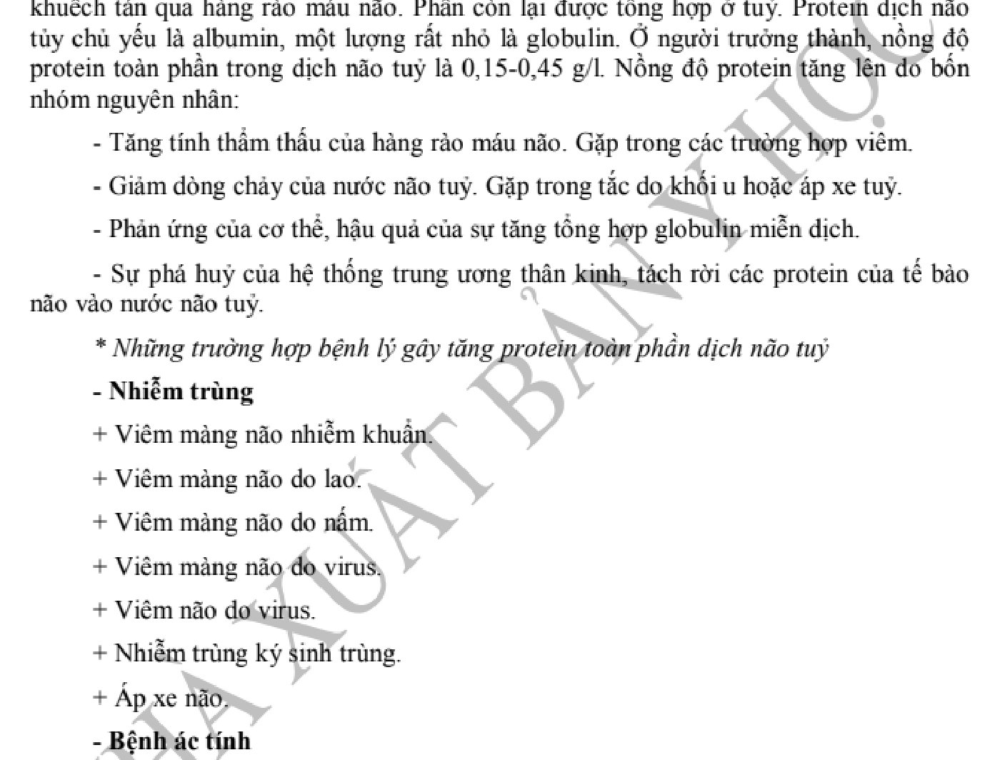

# HS-22 · HÓA SINH DỊCH SINH VẬT: DỊCH NÃO TỦY, DỊCH TRÀN MÀNG, DỊCH TIÊU HÓA VÀ CÁC DỊCH TIẾT CƠ THỂ

> **Tác giả:** ThS. BS. Trần Khánh Chi, PGS. TS. BS. Phạm Thiện Ngọc — Bộ môn Hóa sinh, Trường Đại học Y Hà Nội
> **Nguồn trích xuất:** Giáo trình Hóa sinh Y học (GS. TS. BS. Tạ Thành Văn chủ biên, Tái bản lần thứ 7, Nhà xuất bản Y học, Tr. 433 – 438) kết hợp Harper's Illustrated Biochemistry 32nd Edition & Tiêu chuẩn Hội Hóa sinh Lâm sàng Hoa Kỳ (AACC/ADLM)
> **Đối tượng:** Bác sĩ Y khoa, Bác sĩ Đa khoa, Học viên Sau đại học & Bác sĩ Nội trú Bệnh viện
> **Chuẩn mực:** Khoa học chứng cứ (EBM), Danh pháp Hóa sinh IUBMB, Hoàn thiện cơ chế phân tử & Biện luận thực hành lâm sàng

---

## MỤC TIÊU HỌC TẬP

1. **Trình bày được cơ chế tạo thành, tuần hoàn, tái hấp thu và hàng rào máu - não (BBB)** đối với dịch não tủy (CSF); phân tích đặc tính lý hóa và thành phần sinh hóa bình thường (protein, glucose, clorid, lactat, áp lực mở).
2. **Biện luận được biến đổi sinh hóa dịch não tủy trong các bệnh lý màng não kinh điển:** Viêm màng não mủ vi khuẩn, viêm màng não lao, viêm màng não virus (viêm màng não vô khuẩn), xuất huyết dưới nhện và phân ly đạm - tế bào trong hội chứng Guillain-Barré.
3. **Phân tích cơ chế sinh lý bệnh hình thành dịch khoang thanh mạc** (màng phổi, màng bụng, màng ngoài tim) theo phương trình Starling; phân biệt triệt để bản chất dịch thấm (*transudate*) và dịch tiết (*exudate*).
4. **Vận dụng thuần thục Tiêu chuẩn Light (*Light's criteria*)** trong chẩn đoán tràn dịch màng phổi tiết; phân tích độ chênh Albumin huyết thanh - Dịch báng (**SAAG**) trong chẩn đoán tăng áp lực tĩnh mạch cửa so với các nguyên nhân màng bụng khác.
5. **Nêu được ý nghĩa các chỉ điểm sinh hóa đặc hiệu trong dịch màng:** Amylase, Adenosine Deaminase (ADA), Triglyceride, Pro-BNP, pH và Lactat.
6. **Trình bày cơ chế sinh hóa bài tiết acid dịch vị ($HCl$) của tế bào viền** qua bơm proton $H^+/K^+$-ATPase, cơ chế điều hòa thần kinh - thể dịch (Gastrin, Histamin $H_2$, Acetylcholin qua thụ thể $M_3$, Somatostatin, Prostaglandin $E_2$) và thăm dò chức năng dịch vị (Zollinger-Ellison).
7. **Phân tích thành phần hóa sinh và hệ enzym của dịch tụy, dịch mật;** cơ chế tự bảo vệ của tụy chống tự tiêu hủy, cân bằng tam giác Admirand-Small giữa acid mật - lecithin - cholesterol và cơ chế hình thành sỏi mật cholesterol.
8. **Trình bày đặc điểm hóa sinh đặc thù của sữa mẹ và dịch bạch huyết;** phân tích sự vượt trội sinh học và miễn dịch của sữa mẹ đối với trẻ sơ sinh.

---

## 1. ĐẠI CƯƠNG VỀ DỊCH SINH VẬT VÀ PHÂN BỐ NƯỚC CƠ THỂ

Cơ thể người trưởng thành chứa khoảng 60% trọng lượng là nước ($42\,\text{L}$ ở người $70\,\text{kg}$), phân bố chủ yếu thành hai khu vực lớn:
- **Dịch nội bào (ICF - Intracellular Fluid):** Chiếm khoảng $40\%$ trọng lượng cơ thể (khoảng $28\,\text{L}$), giàu ion $K^+$, $Mg^{2+}$, phosphat hữu cơ và protein.
- **Dịch ngoại bào (ECF - Extracellular Fluid):** Chiếm khoảng $20\%$ trọng lượng cơ thể (khoảng $14\,\text{L}$), giàu ion $Na^+$, $Cl^-$, $HCO_3^-$. ECF lại bao gồm:
  + *Dịch kẽ (Interstitial Fluid):* Chiếm $15\%$ trọng lượng cơ thể (khoảng $10,5\,\text{L}$).
  + *Huyết tương (Plasma):* Chiếm $5\%$ trọng lượng cơ thể (khoảng $3,5\,\text{L}$).
  + *Dịch xuyên bào (Transcellular Fluid):* Chiếm khoảng $1 - 2\%$ trọng lượng cơ thể (khoảng $1 - 2\,\text{L}$), bao gồm các dịch lỏng khu trú trong các khoang giải phẫu chuyên biệt được ngăn cách với tuần hoàn chung bởi các lớp tế bào biểu mô chuyên hóa: **Dịch não tủy (CSF)**, dịch màng phổi, màng ngoài tim, màng bụng (khoang thanh mạc), dịch khớp (hoạt dịch), thủy dịch, dịch tiêu hóa và dịch tiết tuyến (sữa, mồ hôi).

Mỗi loại dịch xuyên bào đảm nhận những chức năng sinh lý đặc hiệu: đệm chống sang chấn cơ học, bôi trơn giảm ma sát, nuôi dưỡng mô biệt hóa nghèo mạch máu, môi trường tiêu hóa - hấp thu cơ chất hoặc bài tiết chất cặn bã. Sự biến đổi thành phần sinh hóa và tính chất lý hóa của các dịch này phản ánh trực tiếp tình trạng chuyển hóa, tổn thương cấu trúc hàng rào tế bào và viêm nhiễm tại cơ quan tương ứng.

---

## 2. HÓA SINH DỊCH NÃO TỦY (CEREBROSPINAL FLUID - CSF)

### 2.1. Sinh lý học tạo thành, lưu thông và tái hấp thu dịch não tủy

Dịch não tủy (CSF) là chất dịch sinh học trong suốt lấp đầy các não thất, ống trung tâm tủy sống và khoang dưới nhện bao quanh não và tủy sống. CSF thực hiện 3 chức năng cốt lõi:
1. **Bảo vệ cơ học:** Đóng vai trò như một đệm thủy tĩnh giảm chấn. Bộ não nặng khoảng $1400\,\text{g}$ trong không khí nhưng chìm trong CSF chỉ có trọng lượng hiệu dụng tương đương khoảng $50\,\text{g}$ (theo định luật Archimedes), ngăn ngừa nhu mô não bị đè bẹp dưới đáy hộp sọ.
2. **Duy trì hằng định nội môi:** Cung cấp môi trường ion tối ưu cho hoạt động phát xung điện thế của nơron và tế bào đệm; CSF phản ánh trực tiếp môi trường kẽ của não bộ.
3. **Thải trừ chất chuyển hóa (Hệ thống Glymphatic):** Dọn dẹp các sản phẩm thoái hóa chuyển hóa của mô thần kinh (như protein $\beta$-amyloid, tau, acid lactic) đổ về tuần hoàn tĩnh mạch qua dòng đối lưu dịch kẽ và khoang quanh mạch Virchow-Robin.

```
       [Đám rối màng mạch (Choroid Plexus) Não thất bên]
                              │
                              ▼ (Lỗ Monro)
                      [Não thất III]
                              │
                              ▼ (Cống Sylvius)
                      [Não thất IV]
                       │          │
   (Lỗ Luschka hai bên)▼          ▼ (Lỗ Magendie đường giữa)
            [Khoang dưới nhện (Subarachnoid Space)]
           Bao quanh bán cầu đại não và tủy sống lưng
                              │
                              ▼ (Siêu lọc 1 chiều theo gradient áp lực)
        [Các hạt màng nhện (Arachnoid Villi / Granulations)]
                              │
                              ▼
            [Xoang tĩnh mạch màng cứng (Dural Sinuses)]
```


*Hình 22.1: Sơ đồ nguồn gốc bài tiết, tuần hoàn qua các não thất và tái hấp thu dịch não tủy qua các hạt màng nhện vào xoang tĩnh mạch màng cứng.*


#### Cơ chế bài tiết tại đám rối màng mạch (Choroid Plexus)
- Khoảng $70 - 80\%$ CSF được sản xuất chủ động bởi **đám rối màng mạch (choroid plexus)** nằm trong các não thất bên, não thất III và não thất IV. Khoảng $20 - 30\%$ còn lại bắt nguồn từ dòng dịch kẽ não qua lớp tế bào biểu mô màng ống nội tủy (ependymal cells).
- Ở người trưởng thành bình thường, tốc độ sản xuất CSF đạt khoảng $0,35 - 0,40\,\text{mL/phút}$, tương đương khoảng **$500\,\text{mL/ngày}$**. Tổng thể tích CSF lưu hành trong hệ thống não thất và khoang dưới nhện ở người lớn là khoảng **$130 - 150\,\text{mL}$** (ở trẻ sơ sinh: $30 - 60\,\text{mL}$; trẻ 1 tuổi: $\sim 100\,\text{mL}$). Như vậy, toàn bộ thể tích CSF được thay mới và luân chuyển liên tục từ $3 - 4$ lần mỗi ngày.
- Quá trình tạo thành CSF không đơn thuần là siêu lọc thụ động mà là **quá trình bài tiết chủ động có kiểm soát cao độ** qua lớp tế bào biểu mô đám rối màng mạch có các liên kết vòng bịt chặt (*tight junctions* - tạo nên Hàng rào máu - dịch não tủy / *Blood-CSF Barrier*):
  + Bơm $Na^+/K^+$-ATPase nằm ở màng đỉnh (apical membrane - hướng về lòng não thất) chủ động bơm ion $Na^+$ ra khoang não thất để tạo gradient thẩm thấu kéo nước theo qua các kênh aquaporin-1 ($AQP1$).
  + Enzym **Carbonic anhydrase (CA)** nội bào xúc tác phản ứng hydrat hóa:
    $$CO_2 + H_2O \xrightleftharpoons{\text{Carbonic Anhydrase}} H_2CO_3 \xrightleftharpoons{} H^+ + HCO_3^-$$
  + Ion $HCO_3^-$ và $Cl^-$ được đồng vận chuyển ra lòng não thất cùng $Na^+$, tạo nên dịch có tính đẳng trương thẩm thấu nhưng có nồng độ $Cl^-$ cao hơn và protein thấp hơn rất nhiều so với huyết tương.

#### Hàng rào máu - não (Blood-Brain Barrier - BBB)
Hàng rào máu - não là cấu trúc chức năng ngăn cách lòng mao mạch não với khoang kẽ nhu mô não, cấu tạo bởi 3 thành phần liên kết chặt chẽ:
1. **Tế bào nội mô mao mạch não:** Không có lỗ thủng (*non-fenestrated*), liên kết chặt chẽ với nhau bởi phức hợp liên kết vòng bịt (*tight junctions* chứa claudin-5, occludin, JAMs), ức chế hiện tượng ẩm bào (*pinocytosis*).
2. **Màng đáy nội mô dày:** Chứa proteoglycan tích điện âm.
3. **Chân tận cùng của tế bào hình sao (Astrocyte end-feet):** Bao bọc mặt ngoài mao mạch tới $>95\%$ diện tích, điều hòa biểu hiện các thụ thể và kênh vận chuyển qua màng.

Các chất muốn qua BBB phải khuếch tán qua màng lipid (khí $O_2, CO_2$, phân tử thân dầu tan trong mỡ, ethanol) hoặc qua hệ thống protein tải đặc hiệu: chất vận chuyển glucose **GLUT-1**, hệ thống vận chuyển acid amin $L$-system (LAT1), ion vận chuyển tích cực. Ngược lại, các đại phân tử ưa nước, protein có khối lượng lớn, độc chất và phần lớn thuốc kháng sinh tan trong nước không thể tự do qua BBB khi hàng rào còn nguyên vẹn. Khi có viêm nhiễm màng não, các cytokine tiền viêm ($TNF-\alpha, IL-1\beta, IL-6$) phá vỡ cấu trúc liên kết vòng bịt, làm tăng vọt tính thấm mao mạch màng não, giải phóng protein huyết tương và thuốc kháng sinh khuếch tán vào CSF.

#### Tuần hoàn và Tái hấp thu CSF
CSF lưu thông từ các não thất bên qua **lỗ Monro** vào não thất III $\rightarrow$ qua **cống Sylvius** hẹp vào não thất IV $\rightarrow$ thoát ra khoang dưới nhện qua **2 lỗ Luschka** (ở hai góc bên) và **1 lỗ Magendie** (ở đường giữa). Tại khoang dưới nhện, dòng CSF dâng lên bao phủ các bán cầu đại não và đi xuống ống tủy sống.
Quá trình tái hấp thu CSF diễn ra tại **các hạt màng nhện (arachnoid villi / granulations)** nhô vào lòng các xoang tĩnh mạch màng cứng (đặc biệt là xoang tĩnh mạch dọc trên). Các hạt màng nhện đóng vai trò như các van vi thể một chiều: khi áp lực CSF vượt áp lực tĩnh mạch xoang (chênh áp từ $3 - 5\,\text{cmH}_2\text{O}$), CSF mở van tự do đổ vào máu tĩnh mạch; khi áp lực tĩnh mạch tăng cao, van đóng lại ngăn máu chảy ngược vào khoang dưới nhện.

---

### 2.2. Tính chất lý hóa và thành phần sinh hóa bình thường của CSF

Việc phân tích CSF thu thập bằng thủ thuật chọc dò tủy sống thắt lưng (thường ở khe liên đốt L3-L4 hoặc L4-L5) là phương pháp chẩn đoán bắt buộc khi nghi ngờ nhiễm trùng hệ thần kinh trung ương, xuất huyết dưới nhện hoặc bệnh thoái hóa myelin.

### Bảng 22.1. Các thông số sinh hóa và tế bào học CSF bình thường ở người trưởng thành

| Thông số | Giá trị tham chiếu bình thường | Ý nghĩa sinh lý & Cơ chế kiểm soát |
| :--- | :--- | :--- |
| **Áp lực mở (Opening Pressure)** | $80 - 180\,\text{mmH}_2\text{O}$ ($6 - 13\,\text{mmHg}$) | Đo ở tư thế nằm nghiêng, người bệnh thả lỏng cơ; phản ánh áp lực nội sọ |
| **Màu sắc & Độ trong** | Trong suốt, không màu ("như nước cất") | Không có hồng cầu, bạch cầu $<5/\mu\text{L}$; không có sắc tố bilirubin |
| **Tế bào học** | $0 - 5\,\text{tế bào}/\mu\text{L}$ (chủ yếu $Lympho >70\%$) | Bạch cầu đa nhân thoái hóa bình thường $= 0$; không có hồng cầu |
| **Protein toàn phần** | $15 - 45\,\text{mg/dL}$ ($0,15 - 0,45\,\text{g/L}$) | Bằng khoảng $1/200 - 1/250$ nồng độ protein huyết tương |
| **Albumin CSF** | $10 - 30\,\text{mg/dL}$ ($0,10 - 0,30\,\text{g/L}$) | Toàn bộ Albumin trong CSF đều từ huyết tương qua BBB khuếch tán vào |
| **Tỷ số Albumin CSF/HT** | $Q_{\text{Alb}} = \frac{\text{Albumin}_{\text{CSF}}}{\text{Albumin}_{\text{Huyết thanh}}} < 9 \times 10^{-3}$ | Chỉ số vàng đánh giá tính toàn vẹn của Hàng rào máu - não (BBB) |
| **Immunoglobulin G (IgG)** | $1 - 4\,\text{mg/dL}$ ($10 - 40\,\text{mg/L}$) | Bình thường qua lọc thụ động rất ít; chỉ số IgG index $< 0,7$ |
| **Glucose** | $2,2 - 4,2\,\text{mmol/L}$ ($40 - 75\,\text{mg/dL}$) | Chiếm $60 - 70\%$ nồng độ glucose máu tĩnh mạch thử cùng thời điểm |
| **Tỷ số Glucose CSF/Máu** | $\text{Tỷ số} = \frac{\text{Glucose}_{\text{CSF}}}{\text{Glucose}_{\text{Máu}}} = 0,60 - 0,65$ | Phản ánh vận chuyển glucose qua chất tải GLUT-1 vào CSF |
| **Clorid ($Cl^-$)** | $118 - 132\,\text{mmol/L}$ (mEq/L) | Cao hơn huyết thanh ($98 - 106\,\text{mmol/L}$) để cân bằng điện tích Donnan |
| **Lactat** | $1,1 - 2,4\,\text{mmol/L}$ ($10 - 22\,\text{mg/dL}$) | Phản ánh chuyển hóa đường phân kỵ khí của mô não độc lập với máu |
| **pH** | $7,31 - 7,35$ | Hơi acid hơn pH máu động mạch ($7,35 - 7,45$) do $pCO_2$ CSF cao hơn |
| **Lactate Dehydrogenase (LDH)**| $5 - 30\,\text{U/L}$ ($< 10\%$ LDH huyết thanh) | Chỉ thị phá hủy mô não hoặc thâm nhiễm tế bào viêm |

#### Phân tích chi tiết các thành phần sinh hóa:
1. **Protein:** 
   - Protein CSF có nguồn gốc chính ($>80\%$) từ sự khuếch tán thụ động của protein huyết tương qua thành mao mạch màng não, phần còn lại ($<20\%$) do các tế bào thần kinh đệm và biểu mô màng mạch tổng hợp nội tại (như transthyretin, $\beta$-trace protein).
   - Vì mao mạch não chỉ cho phép các phân tử protein kích thước nhỏ lọt qua, nồng độ từng phân đoạn protein trong CSF tỷ lệ nghịch với khối lượng phân tử ($M_r$): Albumin ($M_r \approx 66\,\text{kDa}$) chiếm tỷ lệ cao nhất ($55 - 65\%$), tiếp đến là Transferrin ($M_r \approx 80\,\text{kDa}$), IgG ($M_r \approx 150\,\text{kDa}$). Các phân tử cồng kềnh như IgM ($M_r \approx 900\,\text{kDa}$) và Fibrinogen ($M_r \approx 340\,\text{kDa}$) bình thường hoàn toàn không thể vượt qua hàng rào máu - não. Do đó, **CSF bình thường không bao giờ tự đông thành cục**.
2. **Glucose:**
   - Glucose vận chuyển qua BBB vào CSF nhờ cơ chế khuếch tán thuận lợi có chất mang qua protein tải **GLUT-1** (được biểu hiện đậm đặc trên tế bào nội mô mao mạch thần kinh). Nồng độ glucose trong CSF bình thường cân bằng ở mức khoảng $60 - 70\%$ nồng độ glucose huyết thanh.
   - Quá trình khuếch tán và thiết lập cân bằng nồng độ glucose giữa máu và CSF cần thời gian trễ sinh học khoảng $2 - 4$ giờ. Do đó, để định lượng tỷ số Glucose CSF/Máu chính xác, **phải luôn lấy mẫu máu tĩnh mạch đo glucose cùng thời điểm hoặc ngay trước lúc chọc tủy sống**.
3. **Clorid ($Cl^-$) và Cân bằng Donnan:**
   - Trong CSF, nồng độ ion $Cl^-$ đạt $118 - 132\,\text{mmol/L}$, cao hơn rõ rệt so với huyết tương ($98 - 106\,\text{mmol/L}$). Hiện tượng này được giải thích bởi **Cân bằng Gibbs - Donnan**: Vì nồng độ protein trong huyết tương rất cao ($60 - 80\,\text{g/L}$) và ở pH sinh lý $7,4$ protein mang điện tích âm thuần ($Prot^-$), các ion âm nhỏ như $Cl^-$ bị lực đẩy tĩnh điện di chuyển qua màng sang khoang dịch có nồng độ protein cực thấp là CSF để thiết lập trạng thái cân bằng điện tích và cân bằng thẩm thấu.
4. **Lactat CSF:**
   - Lactat trong CSF không khuếch tán tự do qua BBB mà phản ánh chủ yếu tốc độ đường phân yếm khí nội tại của nhu mô não, bạch cầu và vi khuẩn hiện diện trong khoang dưới nhện. Khi mô não bị thiếu oxy cục bộ, hoặc khi có vi khuẩn tiêu thụ glucose qua con đường lên men lactic kèm theo sự thực bào hoạt tính cao của bạch cầu đa nhân, nồng độ lactat trong CSF tăng vọt vượt ngưỡng $3,5 - 4,0\,\text{mmol/L}$.

---

### 2.3. Biến đổi bệnh lý sinh hóa của CSF trong các bệnh lý thần kinh kinh điển

Phân tích CSF đóng vai trò sống còn trong cấp cứu thần kinh và truyền nhiễm. Sự thay đổi kết hợp của các chỉ số sinh hóa (Protein, Glucose, Clorid, Lactat) cùng tế bào học tạo nên bức tranh lâm sàng đặc trưng cho từng căn nguyên bệnh lý.

### Bảng 22.2. Bảng đối chiếu toàn diện biến đổi dịch não tủy trong các bệnh lý màng não kinh điển

| Tiêu chuẩn / Bệnh cảnh | Bình thường | Viêm màng não mủ (Vi khuẩn) | Viêm màng não do Lao | Viêm màng não do Virus (Vô khuẩn) | Viêm màng não do Nấm (*Cryptococcus*) | Xuất huyết dưới nhện (SAH) | Hội chứng Guillain-Barré |
| :--- | :--- | :--- | :--- | :--- | :--- | :--- | :--- |
| **Áp lực mở ($mmH_2O$)** | $80 - 180$ | Tăng rất cao ($>250 - 500$) | Tăng cao ($>250 - 400$) | Bình thường hoặc tăng nhẹ ($<250$) | Tăng rất cao ($>300$) | Tăng cao | Bình thường |
| **Màu sắc & Độ trong** | Trong suốt như nước cất | Đục mờ, đục như nước vo gạo, vàng xỉn | Vàng chanh, tạo **màng váng fibrin** khi để lạnh | Trong suốt hoặc ánh khói nhẹ | Trong suốt hoặc hơi mờ đục | Đỏ đồng nhất 3 ống, **vàng rơm (xanthochromia)** sau ly tâm | Trong suốt, không màu |
| **Số lượng tế bào (BC/$\mu L$)** | $0 - 5$ | Tăng rất cao: $1000 - 10.000+$ | Tăng vừa: $100 - 500$ | Tăng nhẹ: $50 - 500$ | Tăng nhẹ - vừa: $20 - 500$ | Hồng cầu tăng rất cao; BC/HC tỷ lệ theo máu | Bình thường ($<10$, thường $<5$) |
| **Công thức bạch cầu** | Lympho chiếm $>70\%$ | **Đa nhân trung tính (PMN) chiếm $>80\%$** | **Lympho chiếm ưu thế ($>70 - 80\%$)** | **Lympho chiếm ưu thế ($>80\%$)** | **Lympho chiếm ưu thế** | Hồng cầu nguyên vẹn hoặc thoái hóa | Lympho đơn nhân |
| **Protein toàn phần ($g/L$)** | $0,15 - 0,45$ | **Tăng rất cao ($>1,0 - 5,0+$)** | **Tăng rất cao ($>1,0 - 5,0$)** | Tăng nhẹ hoặc BT ($0,5 - 1,0$) | Tăng cao ($0,5 - 2,0$) | Tăng cao do lẫn máu toàn phần | **Tăng rất cao ($1,0 - 5,0+$) (Phân ly đạm - tế bào)** |
| **Glucose CSF ($mmol/L$)** | $2,2 - 4,2$ | **Giảm sâu ($<2,2$, có thể $= 0$)** | **Giảm rõ rệt ($<2,2$)** | **Hoàn toàn bình thường** | Giảm vừa đến giảm nặng | Bình thường hoặc tăng nhẹ do lẫn máu | Hoàn toàn bình thường |
| **Tỷ số Glucose CSF/Máu** | $0,60 - 0,65$ | **Giảm rất sâu ($<0,40$, thường $<0,20$)** | **Giảm sâu ($<0,30$)** | **Bình thường ($>0,60$)** | **Giảm ($<0,40$)** | Bình thường | Bình thường |
| **Clorid ($Cl^-$) ($mmol/L$)** | $118 - 132$ | Giảm nhẹ ($105 - 115$) | **Giảm sâu đặc thù ($<110$, có thể $<100$)** | Bình thường | Giảm nhẹ | Bình thường | Bình thường |
| **Lactat CSF ($mmol/L$)** | $1,1 - 2,4$ | **Tăng vọt ($>3,5 - 4,2$)** | Tăng cao ($>3,0 - 4,0$) | **Bình thường ($<2,5$)** | Tăng vừa ($>2,8$) | Tăng do thiếu máu cục bộ | Bình thường |
| **Chỉ thị đặc hiệu khác** | Không có | Nhuộm Gram (+) hoặc (-); Cấy vi khuẩn dương tính | **ADA $>9 - 10\,\text{U/L}$**, soi Ziehl-Neelsen, GeneXpert MTB (+) | PCR Virus (Enterovirus, HSV-1/2, VZV) (+) | Nhuộm mực tàu (India ink) thấy vi nấm có bao nang, Cryptococcal Ag (+) | Tỷ lệ HC/BC $= 500-1000:1$; Bilirubin quang phổ đỉnh $415-460\,\text{nm}$ | **Hiện tượng phân ly đạm - tế bào (Albuminocytologic dissociation)** |

#### Phân tích cơ chế bệnh sinh của các bất thường sinh hóa then chốt:

1. **Cơ chế giảm sâu Glucose trong Viêm màng não mủ và Viêm màng não Lao (*Hypoglycorrhachia*):**
   - Sự sụt giảm nồng độ glucose trong CSF không chỉ đơn thuần là do vi khuẩn tiêu thụ carbohydrate. Trên thực tế, có sự phối hợp của ba cơ chế bệnh sinh phân tử:
     + *Ức chế hệ vận chuyển GLUT-1:* Các nội độc tố (LPS), acid lipoteichoic và các cytokine gây viêm màng não ($TNF-\alpha, IL-1\beta$) trực tiếp ức chế biểu hiện và chức năng của protein tải glucose GLUT-1 tại tế bào nội mô mao mạch não, làm giảm tốc độ vận chuyển glucose từ máu vào khoang CSF.
     + *Tiêu thụ glucose cực mạnh của bạch cầu đa nhân trung tính:* Để phục vụ hiện tượng thực bào và tạo ra "bùng nổ oxy hóa" (*respiratory burst*) qua enzyme NADPH oxidase, các tế bào bạch cầu đa nhân tiêu thụ một lượng glucose khổng lồ thông qua con đường Hexose Monophosphat (HMP) và đường phân yếm khí.
     + *Chuyển hóa của chính vi sinh vật gây bệnh:* Vi khuẩn nhân lên nhanh chóng trong khoang dưới nhện và tiêu thụ glucose trực tiếp từ CSF.
   - Ngược lại, trong **Viêm màng não do Virus**, virus là ký sinh trùng nội bào bắt buộc, không có cấu trúc tế bào độc lập, không có enzym chuyển hóa năng lượng riêng và không tiêu thụ glucose ngoài tế bào; đồng thời đáp ứng viêm chủ yếu là lympho nên không gây bùng nổ oxy hóa tiêu hao glucose. Do đó, **nồng độ glucose CSF và tỷ số Glucose CSF/Máu luôn ở mức bình thường ($>0,60$)** — đây là tiêu chuẩn sinh hóa bản lề để loại trừ viêm màng não do vi khuẩn.

2. **Dấu hiệu giảm sâu Clorid ($Cl^-$) đặc thù trong Viêm màng não Lao:**
   - Trong viêm màng não do lao (*Tuberculous Meningitis*), nồng độ clorid trong CSF thường sụt giảm rất nặng, xuống dưới $110\,\text{mmol/L}$, thậm chí rơi xuống $<100\,\text{mmol/L}$. 
   - *Cơ chế:* Bệnh cảnh viêm màng não lao tiến triển bán cấp hoặc mạn tính với xuất tiết dịch viêm giàu fibrinogen và protein ở đáy não cực kỳ phong phú (tạo thành lớp dầy đặc quanh dây thần kinh sọ và cuống não). Nồng độ protein CSF tăng vọt rất cao làm biến đổi cân bằng Gibbs-Donnan; đồng thời, phản ứng viêm lao toàn thân và tại hệ thần kinh kích thích mạnh mẽ sự bài tiết ADH không thích hợp (hội chứng SIADH), gây giữ nước tự do và hạ natri máu, hạ clo máu toàn thân. Sự phối hợp của hạ clo máu toàn thân và biến đổi điện thế màng thanh mạc làm clorid CSF giảm sâu hơn bất kỳ thể viêm màng não nào khác.
   - *Mạng nhện Fibrin (Fibrin Web / Froin's phenomenon):* Khi chọc dò CSF ở bệnh nhân lao màng não, dịch lấy ra có màu vàng chanh (do hàm lượng protein cao và biến thoái của hemoglobin thành bilirubin). Nếu để ống nghiệm yên tĩnh trong tủ lạnh ($4^\circ\text{C}$) sau $12 - 24$ giờ, dịch sẽ xuất hiện một **màng váng tơ mỏng nổi lơ lửng như mạng nhện (fibrin web)** do fibrinogen khuếch tán vào dịch được thrombin tại chỗ hoạt hóa chuyển thành các sợi huyết fibrin.

3. **Ý nghĩa phân biệt của nồng độ Lactat CSF:**
   - Lactat CSF là một công cụ sinh hóa có giá trị chẩn đoán phân biệt cực cao giữa viêm màng não do vi khuẩn và viêm màng não do virus:
     + Trong viêm màng não vi khuẩn: Chuyển hóa kỵ khí của bạch cầu và vi khuẩn, phối hợp với tình trạng thiếu oxy mô do viêm mạch tắc mạch não đẩy nồng độ lactat tăng vọt $>3,5\,\text{mmol/L}$ (thường $>4,0\,\text{mmol/L}$).
     + Trong viêm màng não do virus: Lactat CSF hầu như luôn duy trì ở mức $<2,5\,\text{mmol/L}$.
   - Đo nồng độ Lactat CSF có độ nhạy $>95\%$ và độ đặc hiệu $>95\%$ để phân biệt hai thể bệnh, đặc biệt hữu ích khi người bệnh đã được sử dụng kháng sinh trước đó làm kết quả cấy vi khuẩn bị âm tính giả (viêm màng não vi khuẩn cụt).

4. **Hiện tượng phân ly đạm - tế bào (Albuminocytologic Dissociation):**
   - Điển hình trong **Hội chứng Guillain-Barré** (bệnh viêm đa rễ và dây thần kinh hủy myelin cấp tính tự miễn): Nồng độ Protein trong CSF tăng rất cao (thường từ $1,0 - 5,0\,\text{g/L}$ hoặc cao hơn sau tuần đầu của bệnh), nhưng **số lượng tế bào CSF hoàn toàn bình thường ($<10\,\text{tế bào}/\mu\text{L}$, phần lớn $<5\,\text{tế bào}/\mu\text{L}$)**.
   - *Cơ chế:* Quá trình tự miễn kháng các kháng nguyên bao myelin rễ thần kinh (hạch thần kinh và rễ thần kinh tủy sống nằm trong khoang dưới nhện) dẫn đến viêm xuất tiết khu trú tại rễ thần kinh và làm tăng tính thấm mao mạch rễ thần kinh, giải phóng một lượng lớn protein và kháng thể vào CSF. Tuy nhiên, tổn thương không có sự thâm nhiễm bạch cầu đa nhân hay tăng sinh ồ ạt tế bào miễn dịch tự do trong khoang dưới nhện.

5. **Phân biệt Xuất huyết dưới nhện (SAH) và Tai biến chạm mạch do chọc tủy sống:**
   - Khi chọc dò CSF thấy dịch có màu đỏ, bác sĩ lâm sàng bắt buộc phải phân biệt giữa chảy máu khoang dưới nhện thực sự và chấn thương mạch máu do mũi kim chạm mạch (*traumatic tap*):

### Bảng 22.3. Bảng phân biệt Xuất huyết dưới nhện (SAH) và Chạm mạch do thủ thuật

| Đặc điểm đối chiếu | Chảy máu khoang dưới nhện (SAH) | Tai biến chạm mạch do chọc dò (*Traumatic Tap*) |
| :--- | :--- | :--- |
| **Nghiệm pháp 3 ống nghiệm** | Màu đỏ đồng nhất, độ đục và màu máu không đổi từ ống 1 đến ống 3 | Màu đỏ đậm ở ống 1, nhạt dần rõ rệt ở ống 2 và trong trở lại ở ống 3 |
| **Sự đông máu của CSF** | **Không bao giờ đông** (máu đã bị defibrin hóa trong khoang dưới nhện) | **Có thể hình thành cục máu đông** do có fibrinogen tươi nguyên vẹn |
| **Màu sắc dịch nổi sau ly tâm ngay** | **Vàng rơm (*Xanthochromia*)** do hồng cầu đã vỡ thoái hóa thành oxyhemoglobin & bilirubin | **Trong suốt hoàn toàn không màu** (hồng cầu vừa mới rơi vào, chưa kịp vỡ) |
| **Thời gian xuất hiện vàng rơm** | Xuất hiện từ $2 - 4$ giờ sau khởi phát chảy máu, đạt đỉnh sau $12 - 24$ giờ, kéo dài $2 - 4$ tuần | Âm tính (trừ khi để mẫu lắng quá $2 - 4$ giờ trong phòng xét nghiệm trước ly tâm) |
| **Quang phổ kế (*Spectrophotometry*)** | Phát hiện đỉnh hấp thụ của Oxyhemoglobin ($415\,\text{nm}$) và Bilirubin ($450 - 460\,\text{nm}$) | Hoàn toàn không có đỉnh hấp thụ bilirubin |

---

## 3. HÓA SINH DỊCH KHOANG THANH MẠC (MÀNG PHỔI, MÀNG BỤNG, MÀNG NGOÀI TIM)

### 3.1. Cơ chế sinh lý học hình thành dịch thanh mạc theo phương trình Starling

Các khoang thanh mạc (khoang màng phổi, màng tim, màng bụng) là những "khoang ảo" được lót bởi một lớp tế bào biểu mô trung mô mỏng (*mesothelial cells*). Bình thường, trong các khoang này chỉ chứa một lượng rất nhỏ dịch sinh lý (khoảng $5 - 15\,\text{mL}$ ở màng phổi, $15 - 50\,\text{mL}$ ở màng tim, và $<50 - 100\,\text{mL}$ ở màng bụng) đóng vai trò chất bôi trơn để các tạng trượt lên nhau êm ái khi cử động hô hấp, co bóp cơ tim hay nhu động ruột.

Sự hình thành và hấp thu dịch qua màng thanh mạc tuân thủ nghiêm ngặt **Định luật cân bằng Starling** về sự trao đổi dịch qua mao mạch:

$$J_v = K_f \cdot \left[ (P_c - P_{if}) - \sigma \cdot (\pi_c - \pi_{if}) \right] - Q_{\text{lymphatic}}$$

Trong đó:
- $J_v$: Tốc độ dòng dịch chuyển ròng qua màng ($mL/phút$).
- $K_f$: Hệ số siêu lọc của mao mạch (phụ thuộc diện tích bề mặt và tính thấm nước của thành mạch).
- $P_c$: Áp lực thủy tĩnh trong lòng mao mạch màng thanh mạc (lực đẩy nước ra ngoài khoang).
- $P_{if}$: Áp lực thủy tĩnh trong khoang kẽ / khoang thanh mạc (ở màng phổi thường mang giá trị âm, khoảng $-3$ đến $-5\,\text{cmH}_2\text{O}$).
- $\sigma$: Hệ số phản xạ của màng đối với protein huyết tương ($0 \le \sigma \le 1$; ở thành mạch bình thường $\sigma \approx 0,9 - 0,95$, nghĩa là giữ hầu như toàn bộ protein lại trong lòng mạch).
- $\pi_c$: Áp lực keo của huyết tương trong mao mạch (do albumin quyết định chủ yếu, khoảng $25 - 28\,\text{mmHg}$, lực giữ nước trong lòng mạch).
- $\pi_{if}$: Áp lực keo của dịch trong khoang thanh mạc (do nồng độ protein dịch màng rất thấp, khoảng $2 - 5\,\text{mmHg}$).
- $Q_{\text{lymphatic}}$: Tốc độ dẫn lưu dịch trở về tuần hoàn của hệ bạch mạch thanh mạc.

Tràn dịch màng (tích tụ dịch bất thường trong khoang thanh mạc) xảy ra khi có sự mất cân bằng giữa các yếu tố trên:
1. **Tăng áp lực thủy tĩnh mao mạch ($P_c$ tăng cao):** Gặp trong suy tim ứ huyết, tăng áp lực tĩnh mạch cửa (xơ gan), hội chứng tắc tĩnh mạch trên gan (Budd-Chiari).
2. **Giảm áp lực keo huyết tương ($\pi_c$ sụt giảm do hạ albumin máu nặng):** Gặp trong hội chứng thận hư, suy dinh dưỡng nặng (Kwashiorkor), xơ gan giai đoạn mất bù.
3. **Tăng tính thấm thành mao mạch ($K_f$ tăng, $\sigma$ giảm do tổn thương nội mô):** Gặp trong viêm nhiễm cấp hoặc mạn tính (viêm phổi mủ màng phổi, viêm lao màng, viêm tụy hoại tử), bệnh tự miễn (Lupus ban đỏ, viêm khớp dạng thấp), hoặc di căn ác tính của tế bào ung thư.
4. **Tắc nghẽn đường dẫn lưu bạch huyết ($Q_{\text{lymphatic}}$ bị phong tỏa):** Khối u chèn ép ống ngực hoặc hạch bạch huyết màng phổi/trung thất, giun chỉ bạch huyết.

---

### 3.2. Phân biệt Dịch thấm (Transudate) và Dịch tiết (Exudate)

Bước đầu tiên và quyết định nhất trong tiếp cận chẩn đoán mọi trường hợp tràn dịch màng là phân loại dịch thành **Dịch thấm** (*Transudate*) hoặc **Dịch tiết** (*Exudate*):
- **Dịch thấm (*Transudate*):** Hình thành do sự rối loạn các yếu tố cơ học toàn thân (tăng áp lực thủy tĩnh hoặc giảm áp lực keo huyết tương) trong khi tính toàn vẹn và độ thấm của màng thanh mạc hoàn toàn bình thường. Dịch thấm không có phản ứng viêm tại chỗ, nồng độ protein và enzym rất thấp. Căn nguyên kinh điển là suy tim, xơ gan, hội chứng thận hư.
- **Dịch tiết (*Exudate*):** Hình thành do tổn thương viêm hoặc thâm nhiễm tại chỗ tại chính màng thanh mạc, làm tăng mạnh tính thấm của thành mao mạch và mở rộng các khe giữa các tế bào nội mô, cho phép các phân tử protein lớn, enzym và bạch cầu ùa vào khoang màng. Căn nguyên điển hình là nhiễm trùng (vi khuẩn, lao, virus), bệnh ác tính di căn ung thư màng, tắc mạch phổi hoặc bệnh lý mô liên kết.

### Bảng 22.4. Bảng phân biệt toàn diện giữa Dịch thấm (Transudate) và Dịch tiết (Exudate)

| Tiêu chuẩn xét nghiệm | Dịch thấm (*Transudate*) | Dịch tiết (*Exudate*) | Ý nghĩa sinh lý bệnh |
| :--- | :--- | :--- | :--- |
| **Bản chất bệnh sinh** | Rối loạn áp lực thủy tĩnh hoặc áp lực keo toàn thân; màng thanh mạc lành lặn | Viêm hoặc xâm lấn khối u gây tăng tính thấm mao mạch tại màng thanh mạc | Quyết định hướng điều trị: điều trị bệnh toàn thân vs tìm kiếm ổ tổn thương tại chỗ |
| **Màu sắc & Độ trong** | Trong suốt, màu vàng rơm nhạt, dịch lỏng loãng | Đục, vàng đậm, đục mủ, hồng, đỏ máu hoặc đục như sữa | Dịch tiết chứa nhiều tế bào viêm, protein biến tính, lipid hoặc hồng cầu vỡ |
| **Sự đông tụ** | **Không đông** (hầu như không chứa Fibrinogen) | **Dễ tự đông thành thỏi** (giàu Fibrinogen và các yếu tố đông máu) | Tính thấm tăng cho phép fibrinogen kích thước lớn ($340\,\text{kDa}$) thoát ra |
| **Tỷ trọng (*Specific Gravity*)**| $< 1,015$ (thường $1,008 - 1,015$) | $> 1,018$ (thường $1,018 - 1,035$) | Tỷ lệ thuận với tổng nồng độ các chất hòa tan, chủ yếu là protein |
| **Protein toàn phần** | $< 30\,\text{g/L}$ ($< 3,0\,\text{g/dL}$) | $> 30\,\text{g/L}$ ($> 3,0\,\text{g/dL}$) | Ngưỡng phân định protein kinh điển |
| **Phản ứng Rivalta** | **Âm tính ($-$)** (không tạo đám khói tủa) | **Dương tính ($+$)** (tạo vệt khói tủa trắng như khói thuốc lá) | Phát hiện protein có khối lượng phân tử lớn, đặc biệt là seromucin |
| **Tỷ số Protein dịch / Protein HT**| $\le 0,5$ | $> 0,5$ | Thành phần quan trọng số 1 của Tiêu chuẩn Light |
| **Tỷ số LDH dịch / LDH HT** | $\le 0,6$ | $> 0,6$ | Thành phần quan trọng số 2 của Tiêu chuẩn Light |
| **LDH dịch màng** | $\le 2/3$ giới hạn trên bình thường (ULN) của LDH huyết thanh | $> 2/3$ giới hạn trên bình thường (ULN) của LDH huyết thanh | Thành phần quan trọng số 3 của Tiêu chuẩn Light |
| **Số lượng bạch cầu** | Thấp ($< 1000/\mu\text{L}$), chủ yếu tế bào đơn nhân | Cao ($> 1000/\mu\text{L}$, mủ màng phổi $> 50.000/\mu\text{L}$) | Bạch cầu được hóa ứng động đến ổ viêm thanh mạc |
| **Glucose** | Tương đương nồng độ glucose máu | Giảm thấp ($< 3,3\,\text{mmol/L}$ hoặc $< 60\,\text{mg/dL}$) | Vi khuẩn và bạch cầu tiêu thụ mạnh glucose trong ổ dịch tiết viêm |
| **Cholesterol trong dịch** | $< 1,16\,\text{mmol/L}$ ($< 45\,\text{mg/dL}$) | $> 1,16\,\text{mmol/L}$ ($> 45\,\text{mg/dL}$) | Chỉ số bổ sung có độ chính xác cao khi bệnh nhân dùng lợi tiểu |
| **Albumin chênh lệch (Huyết thanh - Dịch)**| $> 12\,\text{g/L}$ ($> 1,2\,\text{g/dL}$) | $\le 12\,\text{g/L}$ ($\le 1,2\,\text{g/dL}$) | Dùng khi tiêu chuẩn Light bị phân loại nhầm do dùng thuốc lợi tiểu |

---

### 3.3. Tiêu chuẩn Light (Light's Criteria) trong Tràn dịch màng phổi

Được công bố bởi Bác sĩ Richard W. Light vào năm 1972, **Tiêu chuẩn Light** cho đến nay vẫn là tiêu chuẩn vàng kinh điển của y học thế giới để phân loại dịch màng phổi.

#### Ba tiêu chí của Tiêu chuẩn Light:
Chỉ cần dịch màng phổi thỏa mãn **ít nhất một trong ba tiêu chuẩn** sau, dịch được chẩn đoán xác định là **DỊCH TIẾT (EXUDATE)**:
1. **Tỷ số Protein dịch màng phổi / Protein huyết thanh $> 0,5$**
2. **Tỷ số LDH dịch màng phổi / LDH huyết thanh $> 0,6$**
3. **LDH dịch màng phổi $> \frac{2}{3}$ giới hạn trên của nồng độ LDH bình thường trong huyết thanh** (Ví dụ: nếu giới hạn trên của LDH huyết thanh của phòng xét nghiệm là $250\,\text{U/L}$, thì ngưỡng này là $> 167\,\text{U/L}$).

- **Hiệu quả chẩn đoán:** Tiêu chuẩn Light đạt độ nhạy cực cao ($sim 98\%$) trong việc phát hiện dịch tiết, đảm bảo hầu như không bỏ sót bất kỳ bệnh nhân nào có tổn thương viêm hoặc ác tính màng phổi.
- **Hiện tượng phân loại nhầm dịch tiết giả (*Pseudo-exudate*):** Ở những bệnh nhân suy tim ứ huyết đang được điều trị tích cực bằng thuốc lợi tiểu (Furosemide), sự bài tiết nước qua thận diễn ra nhanh hơn nhiều so với tốc độ thanh thải protein qua hệ bạch huyết màng phổi. Hậu quả là dịch thấm bị cô đặc lại, làm tăng nồng độ protein và LDH trong dịch, khiến khoảng $20 - 25\%$ bệnh nhân suy tim bị phân loại nhầm thành dịch tiết theo tiêu chuẩn Light.
- **Giải pháp khắc phục:** Khi lâm sàng nghĩ nhiều đến suy tim nhưng kết quả theo Light là dịch tiết, xét nghiệm bổ sung:
  $$\Delta_{\text{Albumin}} = \text{Albumin}_{\text{Huyết thanh}} - \text{Albumin}_{\text{Dịch màng phổi}}$$
  + Nếu $\Delta_{\text{Albumin}} > 1,2\,\text{g/dL}$ ($> 12\,\text{g/L}$): Khẳng định chắc chắn là **Dịch thấm (Transudate)** bị cô đặc do lợi tiểu.
  + Nếu $\Delta_{\text{Albumin}} \le 1,2\,\text{g/dL}$: Giữ nguyên chẩn đoán là **Dịch tiết (Exudate)**.

---

### 3.4. Độ chênh Albumin Huyết thanh - Dịch báng (SAAG) trong Tràn dịch màng bụng

Trong dịch màng bụng (cổ trướng / dịch báng), việc phân chia theo kiểu dịch thấm - dịch tiết kinh điển thường bộc lộ nhiều hạn chế và kém chính xác. Từ thập niên 1990, Hiệp hội Nghiên cứu Bệnh Gan Hoa Kỳ (AASLD) đã thay thế hoàn toàn bằng khái niệm **Độ chênh Albumin Huyết thanh - Dịch báng (Serum-Ascites Albumin Gradient - SAAG)**.

$$SAAG = \text{Albumin}_{\text{Huyết thanh}} - \text{Albumin}_{\text{Dịch báng}} \quad (\text{g/dL})$$
*(Lưu ý: Mẫu máu và dịch báng phải được rút cùng thời điểm và định lượng bằng cùng một phương pháp xét nghiệm).*

### Bảng 22.5. Phân loại nguyên nhân dịch báng theo thang đo SAAG (Độ chính xác $\ge 97\%$)

| Phân nhóm SAAG | Cơ chế sinh học bệnh sinh | Nguyên nhân lâm sàng thường gặp | Phối hợp nồng độ Protein toàn phần dịch báng |
| :--- | :--- | :--- | :--- |
| **SAAG $\ge 1,1\,\text{g/dL}$ ($11\,\text{g/L}$)** <br> *(Tăng áp lực tĩnh mạch cửa)* | Áp lực thủy tĩnh trong các xoang mạch cửa tăng cao đẩy nước và các chất điện giải qua màng xoang gan vào ổ bụng, trong khi giữ phần lớn albumin lại trong lòng mạch tạo độ chênh lớn. | - **Xơ gan (chiếm $>80\%$)** <br> - Suy tim ứ huyết, viêm màng ngoài tim co thắt <br> - Hội chứng Budd-Chiari (tắc tĩnh mạch trên gan) <br> - Tắc tĩnh mạch cửa <br> - Thai nghén, nhiễm độc thai nghén | - **Protein dịch báng $< 25\,\text{g/L}$:** Xơ gan không biến chứng (do tế bào gan xơ hóa suy giảm tổng hợp albumin nghiêm trọng). <br> - **Protein dịch báng $\ge 25\,\text{g/L}$:** Suy tim ứ huyết, hội chứng Budd-Chiari (gan còn nguyên chức năng tổng hợp albumin nhưng áp lực xoang tăng ứ trệ). |
| **SAAG $< 1,1\,\text{g/dL}$ ($< 11\,\text{g/L}$)** <br> *(Không tăng áp lực tĩnh mạch cửa)* | Tính thấm của màng phúc mạc tăng mạnh do viêm, nhiễm trùng hoặc ung thư làm albumin ùa vào dịch màng bụng; hoặc hạ albumin máu toàn thân nặng nề. Không có tăng áp lực trong hệ tĩnh mạch cửa. | - **Ung thư di căn màng bụng (Carcinomatosis phúc mạc)** <br> - **Lao màng bụng** <br> - **Hội chứng thận hư** <br> - Viêm tụy cấp / rò ống tụy vào ổ bụng <br> - Viêm thanh mạc trong Lupus ban đỏ (SLE) | - **Protein dịch báng $\ge 25 - 30\,\text{g/L}$:** Ung thư phúc mạc, lao màng bụng, viêm tụy. <br> - **Protein dịch báng $< 25\,\text{g/L}$:** Hội chứng thận hư (mất qua nước tiểu, albumin huyết thanh giảm sâu tương ứng). |

---

### 3.5. Các chỉ điểm sinh hóa chuyên sâu trong chẩn đoán dịch màng

1. **Amylase dịch màng:**
   - Nồng độ Amylase trong dịch màng phổi hoặc dịch màng bụng bình thường thấp hơn nồng độ trong huyết thanh.
   - Amylase dịch màng tăng cao vượt giới hạn trên của huyết thanh hoặc tỷ số Amylase dịch / Amylase huyết thanh $> 1,0$ chỉ điểm:
     + *Trong dịch màng bụng:* Viêm tụy cấp, nang giả tụy vỡ, thủng tạng rỗng (thủng dạ dày - tá tràng), hoại tử ruột.
     + *Trong dịch màng phổi trái:* Rò ống tụy vào màng phổi, viêm tụy hoại tử kích ứng vòm hoành, hoặc **vỡ thực quản (hội chứng Boerhaave)** - trong vỡ thực quản, amylase tăng cao là isoenzyme nước bọt kèm theo $pH$ dịch màng phổi tụt dốc acid $<6,0$.
2. **Adenosine Deaminase (ADA):**
   - ADA là enzym tham gia vào quá trình giáng hóa purine (chuyển adenosine thành inosine), có hoạt tính nổi trội trong các tế bào lympho T được hoạt hóa.
   - Hoạt độ ADA trong dịch màng phổi hoặc màng bụng **$> 40\,\text{U/L}$** (ở CSF $> 9 - 10\,\text{U/L}$) là chỉ thị sinh hóa có độ nhạy $>90\%$ và độ đặc hiệu $>95\%$ cho chẩn đoán **Viêm thanh mạc do Lao (Lao màng phổi, Lao màng bụng, Lao màng ngoài tim)**.
3. **Triglyceride và Chylomicron (Tràn dịch dưỡng chấp - Chylothorax / Chyloperitoneum):**
   - Dịch có màu trắng đục như sữa, không tách lớp sau ly tâm.
   - Nồng độ Triglyceride trong dịch màng **$> 1,24\,\text{mmol/L}$ ($> 110\,\text{mg/dL}$)** và sự hiện diện của hạt vi thể **Chylomicron** (xác định qua điện di lipoprotein) xác nhận chắc chắn chẩn đoán tràn dịch dưỡng chấp do vỡ hoặc tắc nghẽn ống ngực (chấn thương lồng ngực, phẫu thuật, lymphoma xâm lấn).
   - Ngược lại, nếu Triglyceride $< 0,56\,\text{mmol/L}$ ($< 50\,\text{mg/dL}$) và nồng độ Cholesterol cao ($> 5,18\,\text{mmol/L}$ hay $> 200\,\text{mg/dL}$), soi kính hiển vi thấy tinh thể cholesterol hình chữ nhật khuyết góc: chẩn đoán là **Tràn dịch giả dưỡng chấp (*Pseudochylothorax*)** do dịch ứ đọng mạn tính thoái hóa tế bào trong viêm khớp dạng thấp hoặc lao xơ cũ.
4. **Độ $pH$ và Glucose dịch màng phổi:**
   - Bình thường $pH$ dịch màng phổi khoảng $7,60 - 7,64$.
   - Trong tràn dịch màng phổi cận viêm phổi (*parapneumonic effusion*):
     + $pH < 7,20$, Glucose $< 2,2\,\text{mmol/L}$ ($< 40\,\text{mg/dL}$) và LDH $> 1000\,\text{U/L}$: Báo hiệu **Tràn dịch màng phổi cận viêm biến chứng (*Complicated Parapneumonic Effusion*) hoặc Mủ màng phổi (*Empyema*)**, bắt buộc phải đặt ống dẫn lưu màng phổi cấp cứu phối hợp kháng sinh để tránh dày dính vôi hóa màng phổi.

---

## 4. HÓA SINH CÁC DỊCH TIÊU HÓA (DỊCH VỊ, DỊCH TỤY, DỊCH MẬT)

### 4.1. Hóa sinh dịch vị và cơ chế bài tiết acid dịch vị ($HCl$)

Trong 24 giờ, niêm mạc dạ dày tiết ra khoảng $2,0 - 3,0\,\text{L}$ dịch vị. Dịch vị là chất lỏng trong suốt, không màu hoặc vàng nhạt, có tính acid cực mạnh với $pH \approx 1,0 - 2,0$, chứa $99\%$ nước và $1\%$ chất hòa tan (bao gồm $HCl$, chất nhầy mucin, enzym tiêu hóa pepsinogen, yếu tố nội tại và các muối vô cơ).

#### Các loại tế bào bài tiết chuyên biệt tại niêm mạc dạ dày:
1. **Tế bào viền (Parietal cells / Oxyntic cells):** Phân bố chủ yếu ở vùng đáy và thân dạ dày, đảm nhiệm bài tiết acid hydrochloric ($HCl$) và **Yếu tố nội tại Castle (Intrinsic Factor - IF)** (glycoprotein gắn kết bảo vệ vitamin $B_{12}$ khỏi sự phá hủy của dịch vị và giúp hấp thu tại hồi tràng).
2. **Tế bào chính (Chief cells / Peptic cells):** Tiết tiền enzym **Pepsinogen I và II**.
3. **Tế bào nhầy bề mặt và tế bào cổ tuyến (Mucous neck cells):** Tiết chất nhầy **Mucin** (glycoprotein giàu oligosaccarid) và dịch kiềm giàu **Bicarbonate ($HCO_3^-$)** tạo nên hàng rào màng nhầy - kiềm bảo vệ niêm mạc dày khoảng $0,2\,\text{mm}$.
4. **Tế bào nội tiết dạ dày:** 
   - *Tế bào G (vùng hang vị):* Tiết peptid hormon **Gastrin**.
   - *Tế bào giống enterocromaffin (ECL cells - Enterochromaffin-like cells):* Tiết amin sinh học **Histamin**.
   - *Tế bào D:* Tiết **Somatostatin** (chất ức chế bài tiết acid mạnh nhất theo cơ chế cận tiết / paracrine).

#### Cơ chế sinh hóa phân tử bài tiết $HCl$ tại tế bào viền:
Tế bào viền bài tiết ion $H^+$ vào lòng dạ dày ngược chiều gradient nồng độ cực kỳ dốc (nồng độ $H^+$ trong lòng dạ dày cao gấp hơn $1.000.000$ lần trong bào tương và máu: từ $pH = 7,4$ xuống $pH = 1,0$). Quá trình này đòi hỏi tiêu tốn năng lượng ATP khổng lồ:

```
   MÁU / DỊCH KẼ                    TẾ BÀO VIỀN (PARIETAL CELL)               LÒNG DẠ DÀY
                                                                   
   CO2 ───────────────────────────► CO2                           
                                     │ (Carbonic Anhydrase)        
                                     ├ + H2O ◄────── H2O           
                                     ▼                             
                                  H2CO3                            
                                   │                               
                                   ├──► H+ ───────────────────────► [ H+ / K+ - ATPase ] ──► H+
                                   │                                     ▲ (Bơm Proton)
                                   │                                     │     ▼
                                   │                                     K+ ───┴───────────► K+
                                   ▼                                                            
   HCO3- ◄─────────────────────── HCO3-                            
    ▲     (Trao đổi HCO3-/Cl-)                                      
    │                              Cl- ───────────────────────────────────────────────────► Cl-
   Cl- ──────────────────────────►                                    (Kênh Cl-)          
                                                                                           
 [Thủy triều kiềm]                                                                        [ HCl ]
```

1. **Tạo $H^+$ nội bào:** Khí $CO_2$ sinh ra từ chuyển hóa tế bào hoặc khuếch tán từ máu kết hợp với $H_2O$ dưới sự xúc tác của enzym **Carbonic Anhydrase (CA)** tạo thành acid carbonic ($H_2CO_3$), chất này phân ly tức thì giải phóng $H^+$ và $HCO_3^-$:
   $$CO_2 + H_2O \xrightleftharpoons{\text{Carbonic Anhydrase}} H_2CO_3 \xrightleftharpoons{} H^+ + HCO_3^-$$
2. **Bơm proton $H^+/K^+$-ATPase tại màng đỉnh:** Bơm tiêu tốn phân tử $ATP$ để chủ động vận chuyển $1\,H^+$ ra ngoài lòng ống tuyến đổi lấy $1\,K^+$ đi vào trong tế bào. Kênh kali ($K^+$ channel) tại màng đỉnh cho phép $K^+$ rò rỉ ngược trở lại lòng dạ dày để tiếp tục chu trình bơm.
3. **Sự thoát Clorid và hiện tượng "Thủy triều kiềm" (*Alkaline Tide*):**
   - Ion $HCO_3^-$ sinh ra trong tế bào viền được protein đối vận chuyển $AE2$ tại màng đáy - bên đưa ra máu để đổi lấy ion $Cl^-$ đi vào tế bào viền.
   - Khi tế bào viền bài tiết một lượng lớn $HCl$ vào lòng dạ dày sau bữa ăn, một lượng tương đương $HCO_3^-$ được phóng thích vào tĩnh mạch dạ dày, làm $pH$ máu tĩnh mạch dạ dày tăng lên tạm thời và kiềm hóa nước tiểu sau ăn — hiện tượng này gọi là **Thủy triều kiềm sau ăn (*Postprandial Alkaline Tide*)**.
   - Ion $Cl^-$ trong tế bào sau đó khuếch tán theo gradient điện thế qua kênh clorid ($Cl^-$ channel) ở màng đỉnh ra ngoài lòng dạ dày, kết hợp cùng $H^+$ tạo nên dung dịch acid hydrochloric ($HCl$).

#### Điều hòa sinh hóa quá trình bài tiết acid:
- **Ba chất kích thích bài tiết acid:**
  1. *Gastrin:* Tiết từ tế bào G hang vị khi có thức ăn (đặc biệt là peptid, acid amin thơm), tác động lên thụ thể **$CCK_B$** kích hoạt con đường $G_q \rightarrow PLC \rightarrow IP_3/Ca^{2+}$.
  2. *Histamin:* Tiết từ tế bào ECL khi được kích thích bởi Gastrin và dây thần kinh X, tác động lên thụ thể **$H_2$** ở tế bào viền, hoạt hóa protein $G_s \rightarrow Adenylate\,Cyclase \rightarrow cAMP \rightarrow PKA$. Đây là con đường kích thích bài tiết acid mạnh nhất trên thực tế lâm sàng.
  3. *Acetylcholin (ACh):* Giải phóng từ đầu tận sợi phó giao cảm (dây X), gắn lên thụ thể **$M_3$** trên tế bào viền kích hoạt con đường $G_q \rightarrow IP_3/Ca^{2+}$.
- **Cơ chế ức chế bài tiết acid:**
  - *Somatostatin:* Tiết từ tế bào D khi $pH$ dạ dày xuống quá thấp ($pH < 2,0 - 1,5$), gắn lên thụ thể $SSTR_2$ kích hoạt protein $G_i$, ức chế Adenylate Cyclase làm giảm $cAMP$, phong tỏa bài tiết acid (cơ chế điều hòa ngược âm tính bảo vệ).
  - *Prostaglandin $E_2$ ($PGE_2$) và Prostacyclin ($PGI_2$):* Do cyclooxygenase (COX-1) tổng hợp tại niêm mạc, gắn vào thụ thể $EP_3$ kích hoạt $G_i$, ức chế bơm proton, đồng thời kích thích mạnh mẽ tế bào cổ bài tiết chất nhầy mucin và $HCO_3^-$, tăng lưu lượng máu vi tuần hoàn niêm mạc. (Thuốc chống viêm không steroid NSAIDs ức chế COX-1 làm triệt tiêu $PGE_2$, gây viêm loét và xuất huyết tiêu hóa nghiêm trọng).

#### Thăm dò chức năng dịch vị và Hội chứng Zollinger-Ellison:
- **Độ toan dịch vị:** Định lượng bằng chuẩn độ dung dịch $NaOH\,0,1\,\text{N}$:
  + *Độ toan tự do (Free acidity):* Chỉ lượng $HCl$ tự do không kết hợp, bình thường $20 - 40\,\text{mmol/L}$ ($mEq/L$).
  + *Độ toan toàn phần (Total acidity):* Bao gồm $HCl$ tự do, $HCl$ liên kết với protein/mucin và các acid hữu cơ yếu ($acid\,lactic, butyric$), bình thường $40 - 60\,\text{mmol/L}$.
  + *Bài tiết acid cơ bản (BAO - Basal Acid Output):* Lượng acid tiết trong 1 giờ lúc đói, bình thường $1,5 - 5,0\,\text{mmol/giờ}$.
  + *Bài tiết acid tối đa (MAO - Maximal Acid Output):* Lượng acid tiết sau kích thích tối đa bằng Pentagastrin, bình thường $15 - 30\,\text{mmol/giờ}$.
- **Hội chứng Zollinger-Ellison (ZES - Gastrinoma):**
  - Khối u thần kinh nội tiết (thường nằm ở tụy hoặc tá tràng trong tam giác Passaro) bài tiết gastrin liên tục và mất kiểm soát tự động.
  - *Biểu hiện sinh hóa:* Nồng độ Gastrin huyết thanh lúc đói tăng vọt ($> 1000\,\text{pg/mL}$; bình thường $< 100\,\text{pg/mL}$), nồng độ acid dịch vị $BAO > 15\,\text{mmol/giờ}$ (hoặc tỷ số $BAO/MAO > 0,6$).
  - Gây loét dạ dày - tá tràng đa ổ, loét ở vị trí không điển hình (hỗng tràng), kháng trị với thuốc kháng acid thông thường và gây tiêu chảy mỡ (do acid dư thừa làm bất hoạt enzym lipase tụy tại tá tràng).

---

### 4.2. Hóa sinh dịch tụy và cơ chế tự bảo vệ chống tự tiêu hủy

Dịch tụy là chất dịch ngoại tiết được bài tiết từ các tế bào nang tụy (*acinar cells*) và tế bào biểu mô ống bài xuất tụy (*ductal cells*), với thể tích khoảng $1,5 - 2,0\,\text{L/ngày}$. Dịch tụy có tính kiềm cao ($pH \approx 8,0 - 8,5$), giữ hai vai trò cốt lõi:
1. Trung hòa dịch vị acid từ dạ dày tống xuống tá tràng, tạo môi trường $pH$ tối ưu ($7,0 - 8,0$) cho hoạt động của các enzym tiêu hóa ruột non.
2. Cung cấp hệ enzym tiêu hóa hoàn chỉnh nhất cơ thể, có khả năng thủy phân toàn bộ các nhóm đại phân tử: glucid, lipid, protein và acid nucleic.

#### Thành phần sinh hóa của dịch tụy:
- **Tế bào biểu mô ống bài xuất (Ductal cells):** Tiết dung dịch nước đẳng trương giàu **Bicarbonate ($HCO_3^-$)** dưới sự kích thích của peptid hormon **Secretin** (tiết từ tế bào S tá tràng khi có acid tràn vào tá tràng). Nồng độ $HCO_3^-$ trong dịch tụy có thể đạt tới $120 - 140\,\text{mmol/L}$ (gấp 5 lần huyết tương).
- **Tế bào nang tụy (Acinar cells):** Tiết các protein enzym tiêu hóa dưới sự kích thích của **Cholecystokinin (CCK)** (từ tế bào I tá tràng khi có lipid và peptid) và dây thần kinh X:
  + *Enzym tiêu hóa Glucid:* **$\alpha$-Amylase tụy** (tiết dưới dạng hoạt động, thủy phân liên kết $\alpha-1,4$-glucosidic của tinh bột và glycogen thành maltose, maltotriose và dextrin giới hạn).
  + *Enzym tiêu hóa Lipid:* **Lipase tụy** (thủy phân triglycerid tại vị trí $1$ và $3$ thành $2$-monoglycerid và acid béo tự do; cần sự hiện diện của **Colipase** để bộc lộ trung tâm hoạt động trước sự bao phủ của muối mật), **Phospholipase $A_2$** (tiết dạng tiền chất prophospholipase $A_2$), và **Cholesterol esterase**.
  + *Enzym tiêu hóa Protein (Endopeptidase & Exopeptidase):* Toàn bộ đều được tiết dưới dạng tiền chất không hoạt động (**Zymogen**):
    * *Trypsinogen* (dạng zymogen của Trypsin)
    * *Chymotrypsinogen* (dạng zymogen của Chymotrypsin)
    * *Proelastase* (tiền chất của Elastase)
    * *Procarboxypeptidase A và B* (tiền chất của Carboxypeptidase - enzym cắt đầu $C$ của peptid).

#### Chuỗi hoạt hóa enzym tại tá tràng:
```
   LÒNG TÁ TRÀNG:
   Trypsinogen (Dịch tụy)
           │
           │ ◄── Enteropeptidase (Enterokinase) ở vi nhung mao niêm mạc ruột non
           ▼     (Cắt chuỗi hexapeptid Val-Asp-Asp-Asp-Asp-Lys ở đầu N)
        TRYPSIN (Dạng hoạt động)
           │
           ├──► Tự hoạt hóa: Trypsinogen ────────────────────────► TRYPSIN
           │
           ├──► Hoạt hóa: Chymotrypsinogen ──────────────────────► CHYMOTRYPSIN
           │
           ├──► Hoạt hóa: Proelastase ───────────────────────────► ELASTASE
           │
           ├──► Hoạt hóa: Procarboxypeptidase A, B ──────────────► CARBOXYPEPTIDASE A, B
           │
           ├──► Hoạt hóa: Prophospholipase A2 ───────────────────► PHOSPHOLIPASE A2
           │
           └──► Hoạt hóa: Procolipase ───────────────────────────► COLIPASE
```

- **Enteropeptidase (Enterokinase):** Là enzym then chốt nằm gắn trên màng tế bào biểu mô diềm bàn chải tá tràng. Khi dịch tụy đổ vào tá tràng, enteropeptidase nhận diện và cắt bỏ chuỗi peptid bất hoạt của Trypsinogen để biến thành **Trypsin hoạt động**.
- Sau khi được tạo thành, chính **Trypsin đóng vai trò là "ngòi nổ trung tâm"** vừa tự xúc tác hoạt hóa thêm các phân tử Trypsinogen khác, vừa cắt đứt các đoạn ức chế của toàn bộ các tiền chất zymogen còn lại (Chymotrypsinogen, Proelastase, Procarboxypeptidase, Prophospholipase $A_2$).

#### Cơ chế tự bảo vệ hoàn hảo của tụy chống hiện tượng "Tự tiêu hủy" (*Autodigestion*):
Tuyến tụy chứa đầy các enzym tiêu đạm và mỡ có khả năng phá hủy hoàn toàn mô sống chỉ trong vài phút. Để tránh tự hủy hoại, tụy đã tiến hóa 5 cơ chế phòng vệ sinh hóa cực kỳ nghiêm ngặt:
1. **Bài tiết dưới dạng tiền chất bất hoạt (Zymogens):** Toàn bộ các protease phá hủy mô đều tồn tại dưới dạng zymogen hoàn toàn trơ về mặt xúc tác trong tế bào và lòng ống tụy.
2. **Khu trú cách ly trong các hạt chế tiết (Zymogen granules):** Sau khi tổng hợp tại mạng lưới nội sinh chất hạt, zymogen được bao bọc trong màng túi chế tiết không thấm protein, ngăn cách tiếp xúc với dịch bào tương.
3. **Sự hiện diện của Chất ức chế Trypsin (PSTI - Pancreatic Secretory Trypsin Inhibitor / SPINK1):** Tế bào nang tụy đồng tổng hợp và đóng gói peptid PSTI (Serine Peptidase Inhibitor Kazal-type 1) cùng với trypsinogen trong các hạt chế tiết theo tỷ lệ $1:10$. Nếu chẳng may có một phân tử trypsinogen nào bị tự hoạt hóa sớm thành trypsin trong mô tụy, PSTI sẽ gắn chặt vào trung tâm hoạt động của trypsin với ái lực cực mạnh, bất hoạt trypsin tức thì.
4. **Cơ chế tự tiêu hủy của Trypsin (Chymotrypsin C phân hủy Trypsin):** Phân tử trypsin người có vị trí cắt nhạy cảm với enzym Chymotrypsin C ($CTRC$). Khi nồng độ trypsin trong tế bào vượt ngưỡng an toàn, $CTRC$ sẽ phân cắt và triệt tiêu trypsin.
5. **Độ $pH$ acid thấp trong các túi zymogen:** Môi trường bên trong hạt chế tiết có $pH \approx 5,5 - 6,0$, ở mức $pH$ này hoạt tính của trypsin và protease bị ức chế tới $>90\%$.

#### Bệnh sinh Hóa sinh của Viêm tụy cấp (Acute Pancreatitis):
- Khi có sự tắc nghẽn ống tụy (do sỏi kẹt bóng Vater) hoặc độc chất kích thích (rượu bia, tăng calci máu, tăng triglyceride máu $> 11,3\,\text{mmol/L}$ hay $> 1000\,\text{mg/dL}$):
  - Xảy ra hiện tượng **trộn lẫn túi lysosome chứa Cathepsin B với các hạt zymogen (Lysosomal-zymogen colocalization)**.
  - Enzym lysosome **Cathepsin B** phân cắt và **hoạt hóa sớm Trypsinogen thành Trypsin ngay bên trong bào tương tế bào nang tụy**.
  - Trypsin vượt quá khả năng ức chế của PSTI/SPINK1, lập tức hoạt hóa ồ ạt chuỗi zymogen nội tại:
    + *Elastase:* Phá hủy thành mạch máu gây xuất huyết mô tụy nghiêm trọng.
    + *Phospholipase $A_2$:* Phân giải phospholipid màng tế bào nang tụy tạo ra lysophosphatidylcholin gây độc tế bào và hoại tử mô tụy.
    + *Lipase:* Thoát ra mô mỡ quanh tụy, thủy phân triglycerid thành các acid béo tự do; các acid béo này kết hợp với ion $Ca^{2+}$ tạo thành các đám **xà phòng hóa calci (*fat necrosis / saponification*)**, gây sụt giảm mạnh calci máu.
- **Chẩn đoán Hóa sinh Lâm sàng Viêm tụy cấp:**
  + **Amylase huyết thanh:** Tăng nhanh sau $2 - 12$ giờ khởi phát, đạt đỉnh sau $24$ giờ, trở về bình thường sau $3 - 5$ ngày (thời gian bán hủy ngắn, bị bài tiết qua thận). Tăng $\ge 3$ lần giới hạn trên bình thường.
  + **Lipase huyết thanh:** Tăng sau $4 - 8$ giờ, đạt đỉnh sau $24$ giờ, **kéo dài từ $8 - 14$ ngày**. Lipase tụy có **độ nhạy ($95 - 100\%$) và độ đặc hiệu ($99\%$) vượt trội hơn Amylase**, đặc biệt ở bệnh nhân đến viện muộn hoặc viêm tụy do rượu bia (khi amylase có thể đã thoái giáng về mức bình thường).

---

### 4.3. Hóa sinh dịch mật và Cân bằng tạo sỏi cholesterol

Gan bài tiết liên tục khoảng $500 - 1000\,\text{mL}$ dịch mật mỗi ngày. Dịch mật sau đó được cô đặc từ $5 - 10$ lần tại túi mật nhờ quá trình hấp thu chủ động nước và điện giải ($Na^+, Cl^-$) qua niêm mạc túi mật. Dịch mật túi mật có màu vàng nâu hoặc xanh thẫm, $pH \approx 6,5 - 7,5$.

#### Thành phần sinh hóa của dịch mật:
1. **Acid mật và Muối mật ($65 - 70\%$ chất khô):** 
   - Tổng hợp từ cholesterol tại tế bào gan. Các acid mật nguyên phát (**Acid cholic** và **Acid chenodeoxycholic**) được liên hợp với Glycin hoặc Taurin tạo thành các **Muối mật** (Glycocholat, Taurocholat).
   - Muối mật là phân tử lưỡng cực (*amphipathic*), có một mặt thân nước và một mặt thân dầu, đóng vai trò hạ sức căng bề mặt, nhũ tương hóa lipid thức ăn và tạo các hạt micelle hòa tan mỡ để ruột hấp thu.
2. **Phospholipid ($20 - 25\%$ chất khô):** Chủ yếu là **Lecithin (Phosphatidylcholin)**. Lecithin phối hợp chặt chẽ với muối mật để tạo thành các cấu trúc micelle hỗn hợp (*mixed micelles*) có khả năng bao bọc và hòa tan cholesterol.
3. **Cholesterol tự do ($4 - 8\%$ chất khô):** Cholesterol hoàn toàn không tan trong dung dịch nước; toàn bộ cholesterol bài tiết vào mật chỉ có thể duy trì ở trạng thái hòa tan nhờ được giấu kín bên trong lõi kỵ nước của các hạt micelle muối mật - lecithin.
4. **Sắc tố mật (Bilirubin diglucuronide):** Tạo nên màu sắc vàng cam đặc trưng của mật.
5. **Chất điện giải và Nước:** $Na^+, K^+, Ca^{2+}, Cl^-, HCO_3^-$.

#### Cân bằng tam giác Admirand-Small và Cơ chế hình thành sỏi mật cholesterol:
Năm 1968, Admirand và Small đã mô tả sự hòa tan của cholesterol trong dịch mật bằng một biểu đồ tọa độ tam giác gồm 3 thành phần: **Muối mật (Bile Salts) - Lecithin (Phospholipids) - Cholesterol**:

```
                         Cholesterol (100%)
                                 ▲
                                / \
                               /   \
                              /     \
                             / VÙNG  \
                            / SỎI TỦA \
                           / MẬT QUÁ   \
                          /   BÃO HÒA   \
                         /───────────────\
                        / VÙNG HÒA TAN   \
                       /  MICELLE BỀN     \
                      /───────────────────\
                     ◄─────────────────────►
        Muối mật (100%)                   Lecithin (100%)
```

- **Vùng micelle bền vững:** Khi tỷ lệ tương đối giữa Muối mật, Lecithin và Cholesterol nằm bên trong vùng giới hạn hòa tan, toàn bộ cholesterol được dung nạp hoàn hảo trong các micelle hỗn hợp, dịch mật trong suốt và không có tinh thể kết tủa.
- **Chỉ số bão hòa Cholesterol (CSI - Cholesterol Saturation Index):**
  $$CSI = \frac{\text{Nồng độ Cholesterol thực tế trong mật}}{\text{Nồng độ Cholesterol tối đa có thể hòa tan}}$$
  + Khi $CSI \le 1,0$: Dịch mật chưa bão hòa, an toàn tuyệt đối.
  + Khi $CSI > 1,0$: **Dịch mật quá bão hòa cholesterol (*Lithogenic bile*)**, mầm mống hình thành sỏi mật bắt đầu xuất hiện.
- **Ba bước sinh bệnh học hình thành sỏi mật Cholesterol:**
  1. *Dịch mật quá bão hòa cholesterol:* Xảy ra do tăng tiết cholesterol quá mức vào mật (gặp ở người béo phì, chế độ ăn giàu calo/cholesterol, dùng thuốc hạ lipid nhóm fibrat ức chế enzym $7\alpha$-hydroxylase) hoặc giảm tiết muối mật và lecithin (suy giảm chức năng gan, bệnh lý viêm teo hồi tràng làm mất muối mật qua phân).
  2. *Sự tạo nhân và kết tinh (*Nucleation & Crystallization*):* Cholesterol dư thừa tách ra khỏi micelle tạo thành các túi phospholipid - cholesterol không bền, sau đó kết tủa thành các vi tinh thể cholesterol monohydrat hình thoi mỏng. Quá trình này được thúc đẩy bởi các yếu tố tiền tạo nhân như mucin túi mật, glycoprotein và canxi.
  3. *Ứ trệ vận động túi mật và phát triển sỏi (*Gallbladder Hypomotility & Stone Growth*):* Túi mật giảm co bóp làm các vi tinh thể lắng đọng, bị bẫy trong lớp bùn mật (biliary sludge) và dần dần tích tụ kết khối thành các viên sỏi cholesterol cứng chắc trong lòng túi mật.

---

## 5. HÓA SINH SỮA MẸ VÀ DỊCH BẠCH HUYẾT

### 5.1. Hóa sinh Sữa mẹ và Giá trị miễn dịch học độc quyền

Sữa mẹ là chất dịch sinh học hoàn hảo nhất, được tiến hóa tối ưu để đáp ứng toàn diện mọi nhu cầu dinh dưỡng, chuyển hóa và miễn dịch của trẻ sơ sinh và trẻ nhỏ. Sữa mẹ cung cấp khoảng $65 - 70\,\text{kcal}/100\,\text{mL}$, có $pH$ hơi acid nhẹ ($6,6 - 7,0$), tỷ trọng $1,028 - 1,032$.

#### Sự biến đổi theo các giai đoạn tiết sữa:
1. **Sữa non (Colostrum):** Tiết ra trong $3 - 5$ ngày đầu sau sinh. Sữa non có màu vàng đặc sánh, nồng độ protein cực cao (lên tới $20 - 30\,\text{g/L}$), rất giàu các globulin miễn dịch (**sIgA chiếm $40 - 50\%$ tổng protein**), lactoferrin, vitamin tan trong dầu (vitamin A, E, carotenoid) và các yếu tố tăng trưởng biểu mô ($EGF$), nhưng lượng chất béo và lactose thấp hơn sữa vĩnh viễn, rất phù hợp với dung tích dạ dày nhỏ và chức năng thận non nớt của trẻ mới sinh.
2. **Sữa chuyển tiếp (Transitional milk):** Tiết từ ngày thứ 6 đến ngày thứ 14 sau sinh. Lượng protein và kháng thể giảm dần, trong khi lượng lactose, chất béo và tổng năng lượng tăng dần.
3. **Sữa trưởng thành (Mature milk):** Tiết từ sau 2 tuần sau sinh. Thành phần ổn định để nuôi dưỡng sự phát triển thể chất và não bộ của trẻ.

### Bảng 22.6. So sánh chi tiết thành phần hóa sinh giữa Sữa mẹ và Sữa bò

| Thành phần dinh dưỡng | Sữa mẹ (Mature Human Milk) | Sữa bò (Bovine Milk) | Ý nghĩa sinh lý & Ưu thế sinh học của Sữa mẹ |
| :--- | :--- | :--- | :--- |
| **Năng lượng** | $65 - 70\,\text{kcal}/100\,\text{mL}$ | $65 - 70\,\text{kcal}/100\,\text{mL}$ | Cung cấp năng lượng tương đương nhưng chất lượng chuyển hóa khác biệt |
| **Protein toàn phần** | **$9 - 12\,\text{g/L}$ ($1,0 - 1,2\,\text{g/dL}$)** | **$32 - 35\,\text{g/L}$ ($3,3 - 3,5\,\text{g/dL}$)** | Sữa bò có lượng đạm quá cao gây quá tải thẩm thấu cho thận non của trẻ sơ sinh |
| **Tỷ lệ Whey / Casein** | **$60 / 40$** (giai đoạn đầu $80 / 20$) | **$20 / 80$** | **Đạm Whey hòa tan, tạo tủa lỏng mịn** dễ tiêu hóa rỗng dạ dày nhanh ($1,5\,\text{h}$ vs $4\,\text{h}$ ở sữa bò do casein bò đông vón thành thỏi to cứng chắc) |
| **Casein đặc thù** | $\beta$-casein mềm, phospho thấp | $\alpha_{s1}$-casein cứng, giàu phospho | Giúp trẻ bú mẹ không bị táo bón hay đầy bụng khó tiêu |
| **Taurine & Acid amin tự do**| Rất phong phú | Rất thấp | Cần thiết cho sự phát triển não bộ, võng mạc và liên hợp muối mật |
| **Lipid toàn phần** | $35 - 45\,\text{g/L}$ ($3,5 - 4,5\,\text{g/dL}$) | $35 - 40\,\text{g/L}$ ($3,5 - 4,0\,\text{g/dL}$) | Cung cấp khoảng $50\%$ tổng năng lượng của sữa |
| **Acid béo thiết yếu chuỗi dài**| **Giàu DHA, ARA, EPA, Acid Linoleic**| Hầu như không có DHA và ARA | **DHA và ARA là thành phần cấu trúc cốt lõi của màng tế bào thần kinh và võng mạc mắt** |
| **Enzym Lipase sẵn có (BSSL)** | **Có Enzym Lipase kích thích bởi muối mật**| Hoàn toàn không có | Trẻ tự tiêu hóa và hấp thu mỡ hoàn hảo dù lipase tụy của trẻ sơ sinh chưa trưởng thành |
| **Carbohydrate chính** | **Lactose cao: $70\,\text{g/L}$ ($7,0\,\text{g/dL}$)** | **Lactose thấp: $45 - 48\,\text{g/L}$** | Cung cấp galactose cấu tạo ganglioside mô não; tạo môi trường acid ruột |
| **HMO (Human Milk Oligosaccharides)**| **Rất phong phú ($10 - 15\,\text{g/L}$)** | Chỉ có dạng vết ($< 1\,\text{g/L}$) | Đóng vai trò là prebiotic nuôi dưỡng *Bifidobacterium infantis* và bẫy vi khuẩn gây bệnh |
| **Calci / Phospho** | $30\,\text{mg} / 15\,\text{mg}$ (**Tỷ lệ $Ca/P \approx 2:1$**) | $120\,\text{mg} / 95\,\text{mg}$ (**Tỷ lệ $Ca/P \approx 1,2:1$**) | Tỷ lệ $Ca/P = 2:1$ ở sữa mẹ giúp hấp thu canxi tối ưu, tránh lắng đọng gây cơn tetany hạ canxi máu |
| **Sắt (Fe)** | $0,5 - 1,0\,\text{mg/L}$ (**Hấp thu $50\%$**) | $0,5 - 1,0\,\text{mg/L}$ (**Hấp thu $< 10\%$**) | Sắt trong sữa mẹ liên kết lactoferrin, sinh khả dụng cực cao, không làm vi khuẩn ruột sinh sôi |

#### Các yếu tố miễn dịch sinh học độc quyền của Sữa mẹ:
1. **Kháng thể sIgA (Secretory Immunoglobulin A):**
   - Là phân tử dimer được bọc lớp polypeptide secretory component chống lại sự thoái biến của acid dạ dày và enzym tiêu hóa.
   - Hoạt động như một "tấm khiên sinh học" phủ kín niêm mạc ruột và đường hô hấp của trẻ, trung hòa độc tố vi khuẩn, ngăn chặn virus và vi khuẩn xâm nhập vào tế bào biểu mô (hiện tượng loại trừ miễn dịch / *immune exclusion*).
2. **Lactoferrin:**
   - Glycoprotein liên kết với 2 nguyên tử sắt ($Fe^{3+}$) với ái lực cực kỳ mãnh liệt.
   - Cạnh tranh và tước đoạt triệt để ion sắt tự do trong lòng ruột, kìm hãm sự phát triển của các vi khuẩn gây bệnh cần sắt như *E. coli, Salmonella, Candida albicans*; đồng thời trực tiếp phá hủy vách tế bào vi khuẩn.
3. **Lysozyme:**
   - Enzym thủy phân liên kết $\beta-1,4$-glycosidic giữa $N$-acetylglucosamine và acid $N$-acetylmuramic trong vách peptidoglycan của vi khuẩn gram dương, hiệp đồng tác dụng diệt khuẩn với lactoferrin và sIgA.
4. **Hệ thống HMO (Human Milk Oligosaccharides):**
   - Các chuỗi polymer đường phức tạp chứa $L$-fucose, acid sialic, $N$-acetylglucosamine. 
   - HMO không bị tiêu hóa bởi enzym ruột của trẻ mà đi xuống đại tràng: một mặt đóng vai trò mồi nhử gắn kết các thụ thể của vi khuẩn và độc tố vi khuẩn, cuốn chúng theo phân ra ngoài; mặt khác là nguồn thức ăn độc quyền nuôi dưỡng chủng vi khuẩn có lợi *Bifidobacterium longum subsp. infantis*, tạo môi trường acid lactic bảo vệ đường ruột non nớt.
5. **Tế bào miễn dịch sống:** Mỗi mililit sữa mẹ chứa hàng triệu tế bào sống: $80\%$ là đại thực bào chứa sẵn lysozyme và ferritin, cùng các tế bào lympho T, lympho B sản xuất kháng thể tại chỗ.

---

### 5.2. Hóa sinh Dịch Bạch huyết (Lymph)

Dịch bạch huyết (Lymph) là chất dịch sinh học lưu hành bên trong hệ thống mạch bạch huyết. Dịch bạch huyết bắt nguồn từ dịch kẽ ngoại bào được các mao mạch bạch huyết hấp thu qua các khe hở nội mô một chiều có van.

- **Lưu lượng:** Khoảng $2 - 3\,\text{L/ngày}$ dịch bạch huyết được thu gom từ khắp cơ thể và đổ về tuần hoàn tĩnh mạch tại tĩnh mạch dưới đòn trái (qua ống ngực) và tĩnh mạch dưới đòn phải (qua ống bạch huyết phải).
- **Thành phần sinh hóa:**
  + Tương tự huyết tương về nồng độ các chất điện giải ($Na^+, K^+, Cl^-, HCO_3^-$), nồng độ glucose và urê.
  + *Nồng độ Protein:* Thấp hơn rõ rệt so với huyết tương và thay đổi phụ thuộc vào cơ quan xuất phát: nồng độ protein trong dịch bạch huyết ở chi dưới chỉ khoảng $15 - 20\,\text{g/L}$, ở ruột khoảng $30 - 40\,\text{g/L}$, và ở gan đạt tới $50 - 60\,\text{g/L}$ (do mao mạch gan có các xoang rộng xốp cho phép protein thoát ra dịch kẽ dễ dàng).
  + *Lipid và Dịch dưỡng chấp (Chyle):* Sau bữa ăn nhiều chất béo, dịch bạch huyết từ các mao mạch màng treo ruột và ống ngực chuyển sang màu trắng đục như sữa do chứa một lượng khổng lồ các hạt vi thể **Chylomicron** ($85 - 90\%$ triglycerid, $Apo\,B-48, Apo\,C-II, Apo\,E$) vận chuyển lipid ngoại sinh vào tuần hoàn chung.
  + *Tế bào học:* Dịch bạch huyết chứa chủ yếu là các tế bào **Lympho ($>90\%$)**, lưu chuyển qua các hạch bạch huyết để thực hiện giám sát miễn dịch cơ thể.

---

## 6. CÂU HỎI LƯỢNG GIÁ VÀ TÌNH HUỐNG LÂM SÀNG BAREM CHI TIẾT (MCQ)

### Câu 1 (Chẩn đoán phân biệt CSF):
Một bệnh nhân nam 28 tuổi được đưa vào viện trong tình trạng sốt cao $39,5^\circ\text{C}$, đau đầu dữ dội, nôn vọt và có dấu hiệu gáy cứng rõ rệt. Kết quả chọc dò dịch não tủy (CSF) ghi nhận: áp lực mở $320\,\text{mmH}_2\text{O}$, dịch đục mờ; số lượng tế bào $4.500/\mu\text{L}$ với $88\%$ bạch cầu đa nhân trung tính; protein toàn phần $2,8\,\text{g/L}$; glucose CSF $1,2\,\text{mmol/L}$ trong khi glucose máu đo cùng thời điểm là $6,8\,\text{mmol/L}$; nồng độ lactat CSF là $5,2\,\text{mmol/L}$. Nhận định sinh hóa nào sau đây là chính xác nhất?
A. Viêm màng não do enterovirus vì nồng độ protein chỉ tăng mức độ vừa.
B. Viêm màng não mủ do vi khuẩn vì tỷ số Glucose CSF/Máu giảm sâu ($<0,2$) và Lactat CSF tăng vọt $>3,5\,\text{mmol/L}$.
C. Viêm màng não do lao vì có tăng áp lực mở và protein tăng cao $>2,0\,\text{g/L}$.
D. Xuất huyết màng não vì dịch có áp lực mở tăng cao và có biến đổi glucose.

* **Đáp án đúng: B**
* **Giải thích barem chi tiết:**
  - Bệnh nhân có tam chứng màng não cấp tính. 
  - Tỷ số $\text{Glucose}_{\text{CSF}}/\text{Glucose}_{\text{Máu}} = 1,2 / 6,8 \approx 0,18$ (giảm sâu dưới ngưỡng $0,40$).
  - Lactat CSF đạt $5,2\,\text{mmol/L}$ (tăng vượt trội so với ngưỡng bình thường $<2,4\,\text{mmol/L}$ và ngưỡng gợi ý vi khuẩn $>3,5\,\text{mmol/L}$).
  - Tế bào tăng rất cao với ưu thế tuyệt đối của bạch cầu đa nhân trung tính ($88\%$).
  - Toàn bộ các tiêu chuẩn sinh hóa và tế bào học khẳng định chắc chắn chẩn đoán **Viêm màng não mủ (vi khuẩn)**. Trong viêm màng não do virus (A sai), glucose và lactat CSF luôn ở mức bình thường; trong viêm màng não do lao (C sai), tế bào chiếm ưu thế là lympho và tiến triển mạn tính; xuất huyết màng não (D sai) sẽ có sự hiện diện của hồng cầu tăng cao và vàng rơm sau ly tâm.

---

### Câu 2 (Cơ chế sinh lý học CSF):
Hiện tượng nồng độ ion Clorid ($Cl^-$) trong dịch não tủy người bình thường ($118 - 132\,\text{mmol/L}$) luôn cao hơn rõ rệt so với nồng độ Clorid trong huyết tương ($98 - 106\,\text{mmol/L}$) được giải thích chủ yếu bằng cơ chế nào sau đây?
A. Sự bài tiết tích cực ion $Cl^-$ của bơm $H^+/Cl^-$-ATPase ở tế bào nội mô mao mạch não.
B. Cân bằng Donnan: Nồng độ protein trong huyết tương cao hơn rất nhiều so với CSF, mang điện tích âm thuần đẩy các anion nhỏ ($Cl^-$) sang khoang CSF.
C. Nhu mô não liên tục thoái hóa myelin giải phóng muối $NaCl$ vào khoang dưới nhện.
D. Hiện tượng khuếch tán thụ động tự do không chọn lọc qua các lỗ thủng của mao mạch não.

* **Đáp án đúng: B**
* **Giải thích barem chi tiết:**
  - Theo **Hiệu ứng Gibbs - Donnan**, khi có một màng bán thấm ngăn cách hai khoang dịch, nếu một khoang chứa các đại phân tử không thấm mang điện tích âm (trong trường hợp này là protein huyết tương tích điện âm ở $pH\,7,4$), lực đẩy tĩnh điện sẽ đẩy các anion khuếch tán được ($Cl^-$) sang khoang đối diện (CSF - nơi có hàm lượng protein cực kỳ thấp). Do đó, nồng độ $Cl^-$ trong CSF luôn duy trì mức cao hơn huyết tương từ $15 - 20\,\text{mmol/L}$ để thiết lập cân bằng điện thế thẩm thấu. Các phương án A, C, D đều sai về mặt sinh lý học phân tử.

---

### Câu 3 (Tiêu chuẩn Light trong Dịch màng phổi):
Bệnh nhân nữ 62 tuổi vào viện vì khó thở tăng dần, hình ảnh X-quang phổi phát hiện tràn dịch màng phổi phải lượng nhiều. Kết quả xét nghiệm hóa sinh dịch màng phổi và máu thu được:
- Protein dịch màng phổi: $35\,\text{g/L}$; Protein huyết thanh: $64\,\text{g/L}$.
- LDH dịch màng phổi: $180\,\text{U/L}$; LDH huyết thanh: $260\,\text{U/L}$ (Biết giới hạn trên bình thường của LDH huyết thanh tại phòng xét nghiệm là $240\,\text{U/L}$).
Kết luận nào sau đây phù hợp nhất theo Tiêu chuẩn Light?
A. Dịch thấm (Transudate) vì LDH dịch màng phổi $< 200\,\text{U/L}$.
B. Dịch thấm (Transudate) vì tỷ số LDH dịch/huyết thanh $< 0,7$.
C. Dịch tiết (Exudate) vì thỏa mãn tiêu chuẩn tỷ số Protein dịch/huyết thanh $> 0,5$ và LDH dịch $> 2/3$ giới hạn trên của LDH huyết thanh.
D. Chưa thể phân loại được, bắt buộc phải làm thêm phản ứng Rivalta.

* **Đáp án đúng: C**
* **Giải thích barem chi tiết:**
  - Áp dụng **Tiêu chuẩn Light** đối với dịch màng phổi:
    1. Tỷ số $\text{Protein}_{\text{Dịch}}/\text{Protein}_{\text{Huyết thanh}} = 35 / 64 = 0,547 > 0,5$ $\implies$ **Thỏa mãn tiêu chuẩn dịch tiết**.
    2. Tỷ số $\text{LDH}_{\text{Dịch}}/\text{LDH}_{\text{Huyết thanh}} = 180 / 260 = 0,692 > 0,6$ $\implies$ **Thỏa mãn tiêu chuẩn dịch tiết**.
    3. Ngưỡng $2/3$ giới hạn trên bình thường (ULN) của LDH huyết thanh $= \frac{2}{3} \times 240 = 160\,\text{U/L}$. Ở đây LDH dịch là $180\,\text{U/L} > 160\,\text{U/L}$ $\implies$ **Thỏa mãn tiêu chuẩn dịch tiết**.
  - Theo định nghĩa, chỉ cần thỏa mãn **ít nhất 1 trong 3 tiêu chí** đã là dịch tiết; ở đây bệnh nhân thỏa mãn cả 3 tiêu chí, do đó khẳng định chắc chắn là **Dịch tiết (Exudate)**.

---

### Câu 4 (Độ chênh Albumin SAAG trong Dịch báng):
Một bệnh nhân nam 54 tuổi có tiền sử nghiện rượu 20 năm, nhập viện vì bụng chướng căng nhanh và phù hai chi dưới. Kết quả chọc dịch màng bụng cho thấy: dịch màu vàng trong; Albumin dịch màng bụng: $8\,\text{g/L}$; xét nghiệm Albumin huyết thanh cùng thời điểm: $24\,\text{g/L}$; nồng độ Protein toàn phần trong dịch màng bụng: $16\,\text{g/L}$. Kết luận nào sau đây về cơ chế bệnh sinh là chính xác nhất?
A. SAAG $= 16\,\text{g/L}$ ($1,6\,\text{g/dL}$) $\ge 1,1\,\text{g/dL}$, gợi ý tràn dịch do ung thư di căn màng bụng.
B. SAAG $= 16\,\text{g/L}$ ($1,6\,\text{g/dL}$) $\ge 1,1\,\text{g/dL}$ phối hợp Protein dịch báng $< 25\,\text{g/L}$, khẳng định tăng áp lực tĩnh mạch cửa do xơ gan.
C. SAAG $= 8\,\text{g/L}$ ($0,8\,\text{g/dL}$) $< 1,1\,\text{g/dL}$, gợi ý tràn dịch do hội chứng thận hư.
D. SAAG $= 16\,\text{g/L}$ ($1,6\,\text{g/dL}$) phối hợp Protein dịch báng $< 25\,\text{g/L}$, gợi ý suy tim ứ huyết.

* **Đáp án đúng: B**
* **Giải thích barem chi tiết:**
  - Độ chênh Albumin Huyết thanh - Dịch báng:
    $$SAAG = \text{Albumin}_{\text{Huyết thanh}} - \text{Albumin}_{\text{Dịch báng}} = 24\,\text{g/L} - 8\,\text{g/L} = 16\,\text{g/L} = 1,6\,\text{g/dL}$$
  - Vì $SAAG = 1,6\,\text{g/dL} \ge 1,1\,\text{g/dL}$, bệnh nhân chắc chắn có **Tăng áp lực tĩnh mạch cửa** (loại trừ các nguyên nhân ác tính hoặc lao phúc mạc).
  - Phối hợp với nồng độ **Protein toàn phần trong dịch báng $< 25\,\text{g/L}$ ($16\,\text{g/L}$)**: Điển hình của **Xơ gan** (do mô gan xơ hóa làm suy giảm tổng hợp albumin nghiêm trọng). Nếu là suy tim ứ huyết hoặc hội chứng Budd-Chiari (D sai), tế bào gan vẫn còn chức năng tổng hợp protein tốt nên Protein dịch báng thường $\ge 25\,\text{g/L}$.

---

### Câu 5 (Cơ chế bài tiết acid dịch vị):
Thuốc ức chế bơm proton (PPI như Omeprazole, Esomeprazole) là nhóm thuốc ức chế bài tiết acid dịch vị mạnh nhất hiện nay trong điều trị viêm loét dạ dày - tá tràng. Đích tác động phân tử trực tiếp của nhóm thuốc này là gì?
A. Thụ thể $H_2$ của Histamin trên màng đáy - bên tế bào viền.
B. Enzym Carbonic Anhydrase (CA) trong bào tương tế bào viền.
C. Bơm enzym $H^+/K^+$-ATPase nằm ở màng đỉnh của tế bào viền dạ dày.
D. Kênh vận chuyển đồng thời $Na^+/K^+/2Cl^-$ tại tế bào biểu mô niêm mạc.

* **Đáp án đúng: C**
* **Giải thích barem chi tiết:**
  - Bơm $H^+/K^+$-ATPase (bơm proton) nằm ở màng đỉnh (màng hướng lòng ống tuyến) của tế bào viền là **con đường chung cuối cùng** để bài tiết ion $H^+$ vào lòng dạ dày. Thuốc PPI sau khi hấp thu vào máu sẽ đến tế bào viền, khuếch tán vào các vi ống chế tiết có môi trường acid cao, tại đây thuốc bị proton hóa thành dạng sulphenamide hoạt động và tạo liên kết cộng hóa trị disulfur không thuận nghịch với nhóm $-SH$ của phân tử enzym $H^+/K^+$-ATPase, làm bất hoạt hoàn toàn bơm này.

---

### Câu 6 (Hóa sinh dịch tụy và viêm tụy cấp):
Hiện tượng nào sau đây được coi là "ngòi nổ then chốt" khởi động quá trình tự tiêu hủy mô tụy trong cơ chế bệnh sinh của bệnh Viêm tụy cấp?
A. Sự bài tiết quá mức Bicarbonate ($HCO_3^-$) của các tế bào biểu mô ống tụy làm kiềm hóa mô tụy.
B. Sự hoạt hóa sớm Trypsinogen thành Trypsin ngay bên trong bào tương tế bào nang tụy do enzym Cathepsin B lysosome.
C. Sự suy giảm nồng độ Cholecystokinin (CCK) huyết thanh làm dịch tụy bị ứ đọng.
D. Enzym $\alpha$-amylase tụy tự động chuyển dạng đồng phân phá hủy glycogen thành mạch.

* **Đáp án đúng: B**
* **Giải thích barem chi tiết:**
  - Bình thường, trypsinogen chỉ được hoạt hóa thành trypsin khi đổ vào lòng tá tràng nhờ enzym enteropeptidase ở diềm bàn chải ruột. Trong viêm tụy cấp, dưới tác động của các yếu tố kích hoạt (rượu, sỏi kẹt mật tụy, calci máu cao), các hạt zymogen hòa lẫn với túi tiêu thể (lysosome). Enzym tiêu thể **Cathepsin B** cắt bỏ chuỗi peptid đầu $N$ của Trypsinogen và hoạt hóa biến nó thành **Trypsin hoạt động ngay trong lòng tế bào nang tụy**. Trypsin thoát ra vượt quá khả năng ức chế của PSTI/SPINK1, lập tức kích hoạt một chuỗi dây chuyền toàn bộ các tiền enzym khác (Elastase, Phospholipase $A_2$), gây tự tiêu hủy mô tụy ồ ạt.

---

### Câu 7 (Hóa sinh dịch mật và sỏi mật):
Theo mô hình tam giác cân bằng Admirand - Small, sỏi mật cholesterol được hình thành khi dịch mật chuyển sang trạng thái "quá bão hòa cholesterol" (lithogenic bile). Tình trạng này bắt nguồn trực tiếp từ sự mất cân bằng giữa 3 thành phần sinh hóa nào sau đây?
A. Bilirubin trực tiếp, Canxi ion hóa và Albumin.
B. Cholesterol tự do, Muối mật (Bile salts) và Lecithin (Phosphatidylcholin).
C. Triglyceride, Apoprotein B-100 và Phospholipase $A_2$.
D. Acid cholic, Acid deoxycholic và Acid lithocholic.

* **Đáp án đúng: B**
* **Giải thích barem chi tiết:**
  - Cholesterol là chất kỵ nước hoàn toàn, không thể tự tan trong dịch mật. Để duy trì ở trạng thái dung dịch keo hòa tan, cholesterol bắt buộc phải được bao bọc bên trong các cấu trúc micelle hỗn hợp tạo bởi **Muối mật** và **Lecithin** (phospholipid). Khi tỷ lệ nồng độ cholesterol tăng cao vượt quá khả năng hòa tan của hệ đệm micelle muối mật - lecithin (hoặc do tăng tiết cholesterol, hoặc do giảm tiết muối mật/lecithin), chỉ số bão hòa cholesterol $CSI > 1,0$, các phân tử cholesterol sẽ tách ra kết tinh thành sỏi.

---

### Câu 8 (Ưu thế sinh học độc quyền của Sữa mẹ):
Một trong những lý do cốt lõi khiến trẻ bú sữa mẹ hoàn toàn ít bị rối loạn tiêu hóa và viêm ruột hoại tử hơn hẳn so với trẻ bú sữa bò công thức là nhờ sự hiện diện phong phú của thành phần nào sau đây trong sữa mẹ?
A. Tỷ lệ đạm Casein rất cao ($80\%$) giúp sữa đông cứng chắc chắn trong dạ dày.
B. Kháng thể sIgA bọc lót niêm mạc ruột và hệ vi hạt HMO (Human Milk Oligosaccharides) nuôi dưỡng vi khuẩn có lợi *Bifidobacterium infantis*.
C. Nồng độ ion Calci và Phospho cực cao làm tăng độ kiềm trong lòng đại tràng trẻ.
D. Hàm lượng protein toàn phần cao gấp 3 lần sữa bò giúp kích thích ruột mau trưởng thành.

* **Đáp án đúng: B**
* **Giải thích barem chi tiết:**
  - Kháng thể **sIgA** (chiếm tới $40 - 50\%$ protein sữa non) có cấu trúc secretory component chống lại sự tiêu hóa của enzym dạ dày ruột, phủ kín bề mặt niêm mạc ống tiêu hóa tạo hàng rào miễn dịch ngăn chặn vi sinh vật xâm nhập. Đồng thời, sữa mẹ độc quyền chứa hàm lượng khổng lồ **HMO** ($10 - 15\,\text{g/L}$) là thức ăn chọn lọc nuôi dưỡng hệ vi sinh đường ruột *Bifidobacterium infantis*, ức chế hoàn toàn các vi khuẩn sinh hơi gây thối rữa và viêm ruột hoại tử. Sữa bò không có sIgA người, hầu như không có HMO, lại có tỷ lệ Casein quá cao ($80\%$) gây đóng vón khó tiêu.
