# BÀI HỌC Y KHOA: HƯỚNG DẪN ĐỌC CHẨN ĐOÁN HÌNH ẢNH TIẾT NIỆU NGOẠI KHOA
**Ngày:** 2026-11-13 | **Chuyên khoa:** Ngoại khoa — Tiết niệu | **Đối tượng:** Bác sĩ, học viên sau đại học và người học mất gốc cần học từ nền tảng

---

## 0. TỔNG QUAN — VÌ SAO BÀI NÀY QUAN TRỌNG? [CỐT LÕI]

 Đọc phim tiết niệu không phải là việc của riêng bác sĩ chẩn đoán hình ảnh.

 Bác sĩ ngoại khoa là người đầu tiên nhìn thấy bệnh nhân đau hông cấp lúc 2 giờ sáng, là người quyết định có chụp CT ngay hay chờ siêu âm sáng mai, là người đọc kết quả CT để quyết định mổ cấp cứu hay theo dõi.

 Một phim đọc sai có thể làm chậm một tắc nghẽn niệu quản đang hủy hoại thận từng giờ, hoặc ngược lại, làm một bệnh nhân phải chịu một lần chụp CT không cần thiết.

 Bài này dạy cách đọc hình ảnh hệ tiết niệu từ gốc: mỗi phương tiện thấy được cái gì, không thấy được cái gì, và con số nào đứng sau mỗi dấu hiệu.

 Bài này không dạy lại cách chọn phương tiện đã có trong 3 bài trước (Sỏi thận, Sỏi niệu quản, Chấn thương niệu đạo), mà dạy cách đọc phim sau khi phương tiện đã được chọn.

 Các box đỏ trong bài đánh dấu những điểm không được bỏ sót trước khi ra quyết định thường quy.

**Mục tiêu của bài:**
- Đọc có hệ thống mọi phim tiết niệu theo 4 bước: kỹ thuật → giải phẫu bình thường → bất thường → kết luận và hướng xử trí tiếp.
- Đọc được KUB, siêu âm, CT không cản quang, CT niệu đồ, IVU, RUG, VCUG và MRI ở mức quyết định được bước tiếp theo.
- Biết độ nhạy và độ đặc hiệu đã kiểm chứng của từng dấu hiệu chính, để không đọc quá tay cũng không đọc thiếu.
- Nhận ra 6 mâu thuẫn trong y văn và biết vì sao hai nguồn nói khác nhau.

- Biết khi nào cần thêm phương tiện khác, khi nào chuyển tuyến, và khi nào Plan B an toàn hơn Plan A.

> **TIÊU CHUẨN BẮT BUỘC — DẠY TỪ GỐC, KHÔNG GIỚI HẠN ĐỘ DÀI:** Viết để một người học mất gốc vẫn theo được. Trước khi dùng một thuật ngữ, chữ viết tắt, chỉ số, cơ quan, cơ chế, thủ thuật hoặc quyết định điều trị lần đầu, phải giải thích bằng tiếng Việt đơn giản: **nó là gì → bình thường hoạt động ra sao → vì sao bất thường này quan trọng → nhận ra bằng cách nào → làm gì tiếp theo**. Sau lần giải thích đầu tiên, mới dùng viết tắt/thuật ngữ ngắn. Không dùng “rõ ràng”, “thường quy”, “theo protocol” hoặc danh sách bước trần nếu chưa giải thích lý do và ý nghĩa của hành động. Độ dài không có giới hạn tối đa: tiếp tục viết khi còn một mắt xích cần thiết để người học hiểu hoặc ra quyết định an toàn; ưu tiên chia nhỏ bằng tiêu đề, ví dụ và checkpoint thay vì cắt bỏ nền tảng.

> **CÁCH GIẢI THÍCH BẮT BUỘC CHO MỖI QUY TRÌNH:** Mỗi xét nghiệm, thang điểm, thuốc, thủ thuật hoặc algorithm phải ghi theo thứ tự: **mục tiêu → khi nào dùng/không dùng → cần chuẩn bị/đầu vào gì → làm hoặc đọc kết quả như thế nào → kết quả thay đổi quyết định ra sao → bẫy/an toàn → khi nào chuyển tuyến**. Chi tiết liều, đường dùng, trình tự và thời điểm phải có nguồn xác minh; không lấp chỗ trống bằng suy đoán.

### 📋 TRƯỚC KHI ĐỌC — NỀN TẢNG CẦN DÙNG

> Để hiểu bài này, người học nên đã biết:
> - Giải phẫu hệ tiết niệu: thận, đài bể thận, niệu quản, bàng quang, niệu đạo.
> - Sinh lý bài tiết nước tiểu: thận lọc máu tạo nước tiểu, nước tiểu chảy từ đài bể thận qua niệu quản xuống bàng quang rồi ra ngoài qua niệu đạo.
> - Bài Sỏi thận §3.4, bài Sỏi niệu quản §3.4–3.5 và bài Chấn thương niệu đạo §5 đã dạy cách chọn phương tiện; bài này dạy cách đọc phim.
>
> **Không được chặn việc học vì thiếu prerequisite.** Nếu bài tiên quyết chưa có hoặc người học chưa nắm, mục `### 0.1 Nền tảng tối thiểu cần dùng ngay` dưới đây dạy đủ khái niệm nền để hiểu bài hiện tại.

### 0.1. Nền tảng tối thiểu cần dùng ngay [CỐT LÕI]

 Hệ tiết niệu gồm 2 thận, 2 niệu quản, 1 bàng quang và 1 niệu đạo.

 Thận nằm sau phúc mạc, hai bên cột sống, ngang mức đốt sống ngực 12 đến thắt lưng 3.

 Mỗi thận có vỏ thận ở ngoài và tủy thận ở trong, với các đài thận nhỏ gom nước tiểu đổ vào bể thận.

 Bể thận thu hẹp lại thành niệu quản, ống dài khoảng 25–30 cm chạy xuống bàng quang.

 Niệu quản có 3 chỗ hẹp sinh lý: khúc nối bể thận–niệu quản, chỗ bắt chéo động mạch chậu, và khúc nối niệu quản–bàng quang.

 Sỏi hay kẹt đúng 3 chỗ hẹp này, nên khi đọc phim phải soi kỹ đúng 3 vị trí đó trước tiên.

 Bàng quang là túi chứa nước tiểu, nằm sau xương mu, khi đầy thì bờ trên vượt lên trên khớp mu.

 Niệu đạo nam dài khoảng 18–20 cm, chia thành niệu đạo trước (dương vật và hành niệu đạo) và niệu đạo sau (màng và tiền liệt tuyến).

 Niệu đạo nữ ngắn, chỉ khoảng 4 cm, nên chụp niệu đạo ngược dòng ở nữ gần như không làm được.

 Độ nhạy (sensitivity) là tỉ lệ người thật sự có bệnh mà xét nghiệm phát hiện được.

 Độ đặc hiệu (specificity) là tỉ lệ người thật sự không có bệnh mà xét nghiệm trả về âm tính.

 Một xét nghiệm có độ nhạy thấp sẽ bỏ sót bệnh, còn độ đặc hiệu thấp sẽ chẩn đoán nhầm bệnh không có thật.

 Giá trị tiên đoán dương (PPV) là xác suất thật sự có bệnh khi xét nghiệm dương tính, còn giá trị tiên đoán âm (NPV) là xác suất thật sự không có bệnh khi xét nghiệm âm tính.

 HU (Hounsfield unit, đơn vị Hounsfield) là thang đo mật độ trên CT: nước bằng 0 HU, mỡ có mật độ âm, xương có mật độ dương cao, sỏi thường có mật độ dương cao.

 Thuốc cản quang (contrast medium) là chất làm một cấu trúc hiện rõ hơn trên phim bằng cách thay đổi mật độ của nó so với mô xung quanh.

 Thuốc cản quang iod dùng cho CT và X-quang, thuốc cản quang gadolinium dùng cho MRI.

 Đơn vị mSv (millisievert) đo liều bức xạ hiệu dụng mà cơ thể nhận được.

 ALARA (As Low As Reasonably Achievable, thấp nhất có thể đạt được một cách hợp lý) là nguyên tắc chỉ dùng liều bức xạ vừa đủ để trả lời câu hỏi lâm sàng, không dùng nhiều hơn.

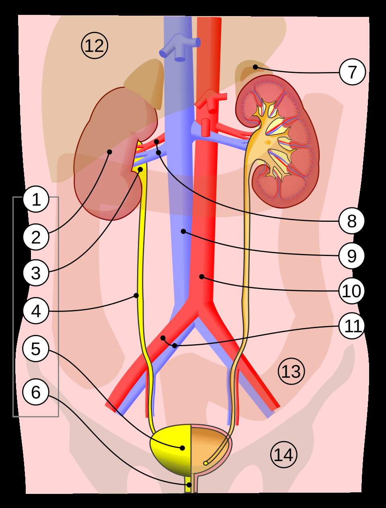

> *Nguồn dự kiến: Wikimedia Commons / Radiopaedia — sơ đồ giải phẫu hệ tiết niệu người lớn nhìn trước, ghi rõ thận, đài bể thận, niệu quản, bàng quang, niệu đạo và 3 chỗ hẹp sinh lý — agent ảnh sẽ thay bằng ảnh thật đã kiểm chứng.*

---

## 1. ĐỊNH NGHĨA CÁC PHƯƠNG TIỆN VÀ KHUNG ĐỌC PHIM CÓ HỆ THỐNG [CỐT LÕI]

### 1.1. Định nghĩa 10 phương tiện trong bài [CỐT LÕI]

 KUB (kidney-ureter-bladder, phim bụng không chuẩn bị) là phim X-quang bụng thường, chụp không tiêm thuốc cản quang, thấy được xương, hơi ruột và những cấu trúc cản quang như sỏi calci.

 Siêu âm (ultrasound, US) dùng sóng âm để tạo ảnh, không có bức xạ ion hóa, thấy được thận, bàng quang đầy nước và dấu hiệu ứ nước, nhưng khó thấy sỏi niệu quản đoạn giữa vì ruột che.

 Siêu âm Doppler (duplex Doppler ultrasonography) đo tốc độ dòng máu trong mạch thận, từ đó tính chỉ số kháng (resistive index, RI) để đánh giá tắc nghẽn.

 CT không cản quang (non-contrast CT, NCCT) là chụp cắt lớp vi tính không tiêm thuốc cản quang, tiêu chuẩn chẩn đoán đau hông cấp nghi sỏi.

 CT liều thấp (low-dose CT, LD-CT) là NCCT với liều bức xạ giảm xuống dưới 3 mSv cho toàn bộ lần chụp, vẫn giữ độ chính xác cao với sỏi.

 CT niệu đồ (CT urography, CTU) là CT có tiêm thuốc cản quang iod tĩnh mạch, chụp nhiều pha để đánh giá cả nhu mô thận, hệ thống đài bể thận và bàng quang.

 IVU (intravenous urography, niệu đồ bài tiết hay niệu đồ tĩnh mạch) là chụp X-quang nhiều phim sau khi tiêm thuốc cản quang iod tĩnh mạch, theo dõi thuốc được thận bài tiết xuống niệu quản và bàng quang.

 RUG (retrograde urethrography, chụp niệu đạo ngược dòng) là bơm thuốc cản quang từ miệng sáo ngược lên niệu đạo để thấy hình dạng và chỗ hẹp hay chỗ rách của niệu đạo.

 VCUG (voiding cystourethrography, chụp bàng quang–niệu đạo lúc đi tiểu) là bơm thuốc cản quang vào bàng quang qua sonde rồi chụp lúc bệnh nhân đi tiểu, để thấy trào ngược bàng quang–niệu quản và van niệu đạo sau.

 MRI (magnetic resonance imaging, cộng hưởng từ) và MRU (MR urography, cộng hưởng từ niệu đồ) dùng từ trường và sóng radio, không có bức xạ ion hóa, cho độ phân giải tương phản mô mềm tốt nhất.

 CEUS (contrast-enhanced ultrasound, siêu âm tăng quang) là siêu âm có tiêm vi bọt khí chỉ nằm trong lòng mạch, không độc thận, dùng được ở mọi giai đoạn suy thận mạn.

### 1.2. Khung đọc phim có hệ thống — 4 bước cho mọi phương tiện [CỐT LÕI]

 Khung dưới đây là tổng hợp dạy học từ các bằng chứng trong bài, không phải một protocol hay guideline đã kiểm chứng.

 Không có nghiên cứu nào trong dossier kiểm chứng một checklist đọc hệ thống cho hình ảnh tiết niệu, nên khung này phải được ghi rõ như vậy và không được trích dẫn như khuyến cáo của guideline.

 Bốn bước áp dụng giống nhau cho KUB, siêu âm, CT, IVU, RUG, VCUG và MRI, chỉ khác nội dung cần tìm ở mỗi bước.

1. **Bước 1 — Kiểm tra kỹ thuật và chất lượng phim:** phim có đủ vùng cần xem không, bệnh nhân có cử động làm mờ phim không, thuốc cản quang đã vào đúng pha cần đọc chưa, bàng quang đã đủ đầy chưa khi cần đánh giá đoạn niệu quản cuối.
2. **Bước 2 — Đọc giải phẫu bình thường:** đi theo đường nước tiểu từ thận xuống bàng quang, xác nhận từng đoạn hiện rõ và bình thường, ghi nhận biến thể giải phẫu nếu có, trước khi tìm bệnh.
3. **Bước 3 — Tìm bất thường theo danh sách kiểm:** sỏi (vị trí, kích thước, số lượng), tắc nghẽn (giãn đài bể thận, giãn niệu quản, dấu hiệu thứ phát), khối u (vị trí, kích thước, bờ, tăng quang), chấn thương (thoát thuốc, tụ máu, gãy xương kèm theo), và chẩn đoán thay thế ngoài đường niệu.
4. **Bước 4 — Kết luận và hướng xử trí tiếp:** trả lời 3 câu hỏi — có bất thường không, bất thường đó giải thích được triệu chứng không, và cần thêm phương tiện nào hay chuyển tuyến nào tiếp theo.

 Ví dụ: đọc CT không cản quang ở bệnh nhân đau hông cấp, bước 1 xác nhận phim đủ từ thận đến bàng quang, bước 2 thấy thận phải bình thường, bước 3 thấy sỏi 6 mm ở niệu quản đoạn giữa kèm giãn đài bể thận nhẹ và vành mô mềm quanh sỏi, bước 4 kết luận sỏi niệu quản gây tắc nghẽn một phần và cần theo dõi sát vì có nguy cơ tắc hoàn toàn.

 Ví dụ: đọc siêu âm ở bệnh nhân tiểu máu vi thể, bước 1 xác nhận bàng quang đã đầy đủ, bước 2 thấy thận 2 bên bình thường, bước 3 không thấy khối trong bàng quang nhưng thấy thận trái ứ nước độ nhẹ, bước 4 kết luận cần CT niệu đồ để tìm nguyên nhân tắc nghẽn vì siêu âm không đủ để loại trừ u niệu mạc.

> ⚠️ HỌC VIÊN HAY NHẦM: Đọc phim không phải là nhìn lướt để tìm một thứ duy nhất rồi dừng. Nhiều người thấy sỏi là dừng đọc, bỏ sót giãn đài bể thận, nhiễm khuẩn kèm theo hay một khối u khác. Khung 4 bước buộc người đọc đi hết đường nước tiểu rồi mới kết luận.

### 🛑 DỪNG 1 PHÚT — TỰ KIỂM TRA

> 1. Bốn bước của khung đọc phim có hệ thống là gì, và vì sao phải kiểm tra kỹ thuật trước khi tìm bệnh?
> 2. KUB khác CT không cản quang ở điểm nào về nguyên lý tạo ảnh?
>
> *(Đáp án: 1. Kỹ thuật → giải phẫu bình thường → bất thường → kết luận và hướng xử trí; phim lỗi kỹ thuật làm dấu hiệu giả hoặc bỏ sót bệnh. 2. KUB là phim X-quang 2 chiều chồng hình, CT là ảnh cắt lớp 3 chiều.)*

---

## 2. CƠ CHẾ — TẮC NGHẼN, CẢN QUANG VÀ BỨC XẠ [CỐT LÕI]

 Ba chuỗi cơ chế dưới đây giải thích vì sao hình ảnh thấy được những gì nó thấy, và vì sao mỗi quyết định chụp đều có giá phải trả.

 Chuỗi A giải thích tắc nghẽn tạo ra hình ảnh ứ nước như thế nào.

 Chuỗi B giải thích thuốc cản quang gây hại cho thận ra sao và vì sao xơ hóa hệ thống do gadolinium (NSF) lại đáng sợ.

 Chuỗi C giải thích bức xạ gây hại như thế nào và vì sao nguyên tắc ALARA tồn tại.

 Chuỗi D giải thích vì sao một viên sỏi thấy được trên KUB còn một viên khác thì không.

### Chuỗi A — Tắc nghẽn niệu quản → ứ nước → tổn thương thận [CỐT LÕI]

 **Tầng 1, cơ chế phân tử và áp lực:** Sỏi kẹt trong niệu quản chặn dòng nước tiểu, áp lực trong đài bể thận tăng lên, nước tiểu ứ lại phía trên chỗ tắc.

 **Tầng 2, tác động lên tế bào và mô:** Áp lực cao ép vào nhu mô thận, làm giảm tưới máu thận và giảm áp lực lọc ở cầu thận, tế bào ống thận bắt đầu thiếu máu và phù nề.

 **Tầng 3, biến đổi lâm sàng và xét nghiệm:** Đài bể thận giãn ra thấy được trên siêu âm và CT, thận sưng to, chức năng lọc giảm dần, bệnh nhân đau quặn hông do đài bể thận căng và niệu quản co bóp chống lại chỗ tắc.

 **Tầng 4, quyết định:** Mức độ giãn và các dấu hiệu thứ phát trên phim cho biết tắc hoàn toàn hay một phần, từ đó quyết định theo dõi, dẫn lưu hay can thiệp lấy sỏi.

 **Tầng 5, phản chứng và hậu quả nếu chọn sai:** Tắc hoàn toàn kéo dài không giải quyết sẽ hủy hoại thận vĩnh viễn, còn đọc nhầm tắc một phần thành không tắc sẽ làm chậm dẫn lưu và mất thận.

```text
Sỏi kẹt niệu quản ──→ áp lực đài bể thận tăng ──→ đài bể thận giãn
──→ tưới máu thận giảm ──→ lọc cầu thận giảm ──→ tổn thương thận
```

```text
Tắc một phần ──→ giãn nhẹ, thận còn bù được ──→ theo dõi được
Tắc hoàn toàn ──→ giãn tiến triển, thận sưng to ──→ ✗ KHÔNG được chờ
──→ cần giải áp sớm
```

 Ví dụ: sỏi 4 mm ở khúc nối niệu quản–bàng quang gây giãn đài bể thận nhẹ, thận chưa sưng to, phù hợp tắc một phần và có thể theo dõi chờ sỏi tự ra.

 Ví dụ: sỏi 8 mm ở niệu quản đoạn giữa gây giãn đài bể thận rõ, thận sưng to và thâm nhiễm mỡ quanh thận, phù hợp tắc hoàn toàn và cần giải áp sớm.

### Chuỗi B — Thuốc cản quang → gánh nặng thận → xơ hóa hệ thống do gadolinium [CỐT LÕI]

 **Tầng 1, cơ chế phân tử:** Thuốc cản quang iod và gadolinium đều phải được thận lọc thải, gadolinium tự do tách khỏi chất mang có thể lắng đọng trong mô và kích hoạt xơ hóa.

 **Tầng 2, tác động lên tế bào và mô:** Ở thận suy, thuốc thải chậm, thời gian tiếp xúc mô kéo dài, nguyên bào sợi được kích hoạt và tạo xơ lan tỏa ở da, khớp và nội tạng.

 **Tầng 3, biến đổi lâm sàng và xét nghiệm:** Bệnh nhân xơ hóa hệ thống do gadolinium (nephrogenic systemic fibrosis, NSF) xuất hiện da dày và cứng, khớp co rút, có thể suy nội tạng, diễn tiến trong nhiều tuần sau khi tiêm thuốc.

 **Tầng 4, quyết định:** Trước khi tiêm gadolinium phải biết eGFR (tốc độ lọc cầu thận ước tính), chọn thuốc nhóm II liều chuẩn ở bệnh nhân suy thận nặng, và cân bằng nguy cơ hoãn chụp với nguy cơ NSF.

 **Tầng 5, phản chứng và hậu quả nếu chọn sai:** Hoãn một lần chụp cần thiết có thể làm chậm chẩn đoán ung thư, còn tiêm gadolinium nhóm nguy cơ cao cho bệnh nhân eGFR dưới 30 có thể gây một bệnh xơ hóa không hồi phục.

```text
Gadolinium tiêm tĩnh mạch ──→ thận suy thải chậm ──→ gadolinium tự do
lắng đọng mô ──→ nguyên bào sợi hoạt hóa ──→ xơ hóa hệ thống (NSF)
```

```text
eGFR dưới 30 + thuốc nhóm II liều chuẩn ──→ nguy cơ NSF rất thấp
──→ vẫn chụp được khi cần
eGFR dưới 30 + thuốc nhóm I liều cao ──→ ✗ KHÔNG dùng ──→ đổi thuốc
hoặc đổi phương tiện
```

 Ví dụ: bệnh nhân suy thận mạn giai đoạn 5 cần MRI bụng, chọn thuốc gadolinium nhóm II liều chuẩn thì nguy cơ NSF rất thấp theo đồng thuận ACR–NKF, còn hoãn chụp có thể làm chậm chẩn đoán khối u thận.

### Chuỗi C — Bức xạ ion hóa → tổn thương DNA → nguyên tắc ALARA [CỐT LÕI]

 **Tầng 1, cơ chế phân tử:** Tia X và tia CT là bức xạ ion hóa, phá vỡ liên kết hóa học và gây đứt gãy DNA trong tế bào đang phân chia.

 **Tầng 2, tác động lên tế bào và mô:** Phần lớn tổn thương DNA được sửa chữa, nhưng một phần nhỏ sửa sai sẽ tích lũy thành đột biến, đặc biệt ở mô nhạy cảm như tủy xương, tuyến giáp và tuyến sinh dục.

 **Tầng 3, biến đổi lâm sàng và xét nghiệm:** Nguy cơ ung thư do bức xạ tăng theo tổng liều tích lũy suốt đời, không có ngưỡng an toàn tuyệt đối, và thai nhi là đối tượng nhạy cảm nhất.

 **Tầng 4, quyết định:** Mỗi lần chụp phải trả lời được câu hỏi lâm sàng cụ thể, dùng liều thấp nhất đủ để trả lời, và ưu tiên phương tiện không bức xạ ở trẻ em và thai phụ.

 **Tầng 5, phản chứng và hậu quả nếu chọn sai:** Chụp CT đa pha không cần thiết nhân liều lên nhiều lần mà không thêm thông tin quyết định, còn sợ bức xạ mà từ chối CT cần thiết thì bỏ sót chẩn đoán nguy hiểm.

```text
Tia X / CT ──→ ion hóa ──→ đứt gãy DNA ──→ sửa chữa sai
──→ đột biến tích lũy ──→ nguy cơ ung thư tăng theo tổng liều
```

```text
Câu hỏi lâm sàng rõ ──→ chọn phương tiện liều thấp nhất trả lời được
──→ ALARA
Chụp lại không lý do ──→ ✗ KHÔNG làm ──→ liều tích lũy tăng vô ích
```

 Ví dụ: bệnh nhân trẻ đau hông cấp lần đầu, CT liều thấp dưới 3 mSv đủ để thấy sỏi và chẩn đoán thay thế, không cần CT liều chuẩn.

 Ví dụ: thai phụ nghi sỏi, siêu âm là lựa chọn đầu tiên vì không có bức xạ, MRI là lựa chọn thứ 2, CT liều thấp chỉ là lựa chọn cuối cùng.

### Chuỗi D — Thành phần sỏi → độ cản quang → thấy hay không thấy trên KUB [CỐT LÕI]

 **Tầng 1, cơ chế phân tử:** Sỏi calci chứa nguyên tử calci nặng, hấp thụ tia X mạnh, còn sỏi acid uric, cystine và indinavir chứa nguyên tử nhẹ, hấp thụ tia X yếu.

 **Tầng 2, tác động lên hình ảnh:** Sỏi calci hiện thành bóng trắng rõ trên phim X-quang, sỏi acid uric gần như trong suốt với tia X nên phim thường không thấy.

 **Tầng 3, biến đổi lâm sàng và xét nghiệm:** Bệnh nhân đau quặn thận có phim KUB bình thường vẫn có thể đang có sỏi acid uric tắc niệu quản, và chỉ CT mới thấy được viên sỏi đó.

 **Tầng 4, quyết định:** KUB âm tính không loại trừ sỏi, nhất là khi lâm sàng nghi ngờ cao, nên chuyển sang CT không cản quang thay vì kết luận không có sỏi.

 **Tầng 5, phản chứng và hậu quả nếu chọn sai:** Dựa vào KUB âm tính để cho bệnh nhân về mà không chụp thêm sẽ bỏ sót tắc nghẽn, còn chụp CT cho mọi trường hợp thì tăng bức xạ không cần thiết.

```text
Sỏi calci ──→ hấp thụ tia X mạnh ──→ bóng trắng rõ trên KUB
Sỏi acid uric ──→ hấp thụ tia X yếu ──→ ✗ KHÔNG thấy trên KUB
──→ cần CT không cản quang
```

```text
KUB thấy sỏi ──→ xác nhận sỏi cản quang ──→ dùng KUB theo dõi được
KUB không thấy sỏi + đau quặn điển hình ──→ chưa loại trừ sỏi
──→ chụp CT không cản quang
```

> ⚠️ HỌC VIÊN HAY NHẦM: Nhiều người nghĩ phim X-quang bình thường nghĩa là không có sỏi. Sai lầm này bỏ sót đúng nhóm sỏi acid uric, vốn là nhóm hay gặp ở bệnh nhân có nước tiểu acid và hội chứng chuyển hóa.

---

## 3. KUB — X-QUANG BỤNG KHÔNG CHUẨN BỊ [CỐT LÕI]

### 3.1. Kỹ thuật và mục tiêu [CỐT LÕI]

 KUB là phim X-quang bụng chụp ở tư thế nằm ngửa, không cần chuẩn bị ruột và không tiêm thuốc cản quang.

 Mục tiêu của KUB là tìm sỏi cản quang, xác định vị trí và kích thước sỏi, và so sánh với phim cũ trong theo dõi.

 KUB thấy được xương cột sống, khung chậu, bờ cơ thắt lưng chậu (psoas) và hơi trong ruột, làm mốc để định vị sỏi.

 KUB không thấy được nhu mô thận, không thấy được sỏi không cản quang, và không đánh giá được mức độ tắc nghẽn.

### 3.2. Giải phẫu bình thường trên KUB [CỐT LÕI]

 Thận bình thường không hiện rõ bờ trên KUB, chỉ thấy mờ mờ qua bóng mỡ quanh thận.

 Bờ cơ thắt lưng chậu 2 bên phải đối xứng và rõ nét; bờ cơ mờ một bên gợi ý có viêm hay tụ máu sau phúc mạc.

 Khung chậu, cột sống thắt lưng và khớp cùng chậu phải liên tục, không có đường gãy hay di lệch.

 Hơi ruột phân bố đều, không có quai ruột giãn khu trú gợi ý liệt ruột do viêm phúc mạc hay tắc ruột.

### 3.3. Dấu hiệu bất thường — sỏi cản quang [CỐT LÕI]

 Sỏi cản quang hiện thành bóng trắng đậm, bờ rõ, nằm dọc đường đi của niệu quản hoặc trong vùng thận.

 Độ nhạy và độ đặc hiệu của KUB với sỏi được EAU 2026 tổng kết ở mức 44–77% [FULL TEXT VERIFIED].

 Một nghiên cứu hồi cứu 178 bệnh nhân đau hông cấp lấy CT xoắn ốc không cản quang làm chuẩn cho thấy đọc gốc của phim thường có độ nhạy 45% và độ đặc hiệu 77% với sỏi niệu quản, đọc lại mù có độ nhạy 59% và độ đặc hiệu 71% [DATA VERIFIED].

 Kết luận của nghiên cứu đó là phim thường có giá trị hạn chế, và bệnh nhân đau hông cấp cần chụp hình ảnh thì có thể chụp thẳng CT không cản quang, không cần phim thường trước [ABSTRACT VERIFIED].

 KUB có giá trị nhất khi đã biết sỏi cản quang từ trước: so sánh kích thước và vị trí sỏi qua các lần chụp để biết sỏi có di chuyển hay to lên không.

 KUB kết hợp siêu âm harmonic mô tự nhiên (NTHI-US, native tissue harmonic imaging ultrasonography) đạt kết quả cao hơn hẳn KUB đơn thuần.

 Một nghiên cứu tiền cứu 98 bệnh nhân nghi sỏi niệu quản cho thấy KUB kết hợp siêu âm NTHI qua bụng phát hiện 72 trong 75 ca có sỏi, độ nhạy 96%, độ đặc hiệu 91% và độ chính xác 95%, trong khi CT không cản quang phát hiện đủ 75 ca với cả 3 chỉ số đều 100% [DATA VERIFIED].

 Tác giả kết luận CT chính xác nhất, nhưng KUB kết hợp siêu âm NTHI là phương án thay thế có kết quả tương đương [ABSTRACT VERIFIED].

| Phương tiện | Độ nhạy | Độ đặc hiệu | Ghi chú |
|---|---|---|---|
| Phim thường đơn thuần | 45% | 77% | Đọc gốc, 178 bệnh nhân |
| KUB + siêu âm NTHI | 96% | 91% | Kết hợp, 98 bệnh nhân |
| CT không cản quang | 100% | 100% | Chuẩn tham chiếu trong nghiên cứu |

 Ví dụ: bệnh nhân đã biết sỏi calci thận phải 8 mm, KUB theo dõi sau 3 tháng thấy bóng sỏi vẫn ở cùng vị trí nhưng nhỏ còn 5 mm, kết luận sỏi đang nhỏ dần và tiếp tục theo dõi được.

 Ví dụ: bệnh nhân đau quặn hông trái lần đầu, KUB không thấy sỏi, nhưng lâm sàng nghi ngờ cao, kết luận KUB âm tính chưa loại trừ sỏi và cần chụp CT không cản quang.

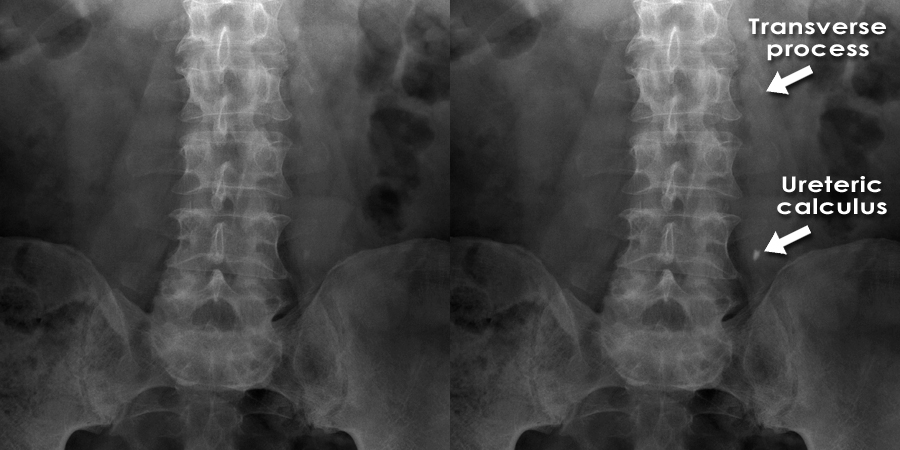

> *Nguồn dự kiến: Radiopaedia — phim KUB bụng thẳng thấy sỏi cản quang niệu quản một bên, bóng trắng đậm bờ rõ — agent ảnh sẽ thay bằng ảnh thật đã kiểm chứng.*

### 3.4. Cạm bẫy trên KUB [CỐT LÕI]

 Phlebolith (sỏi tĩnh mạch chậu) là vôi hóa tròn nhỏ trong tĩnh mạch chậu, rất giống sỏi niệu quản đoạn cuối trên KUB, dễ chẩn đoán nhầm.

 Hơi ruột và phân trong đại tràng có thể che sỏi hoặc giả dạng bóng sỏi, nhất là sỏi nhỏ dưới 3 mm.

 Sỏi acid uric, sỏi cystine và sỏi indinavir không cản quang nên KUB không thấy, dù sỏi đã gây tắc nghẽn.

 Xương cùng và khớp cùng chậu chồng hình lên niệu quản đoạn cuối, làm khó thấy sỏi ở vị trí này.

> ⚠️ BẪY — KUB thấy bóng trắng chưa chắc là sỏi niệu quản. Phải đối chiếu vị trí bóng trắng với đường đi của niệu quản và loại trừ phlebolith, vôi hóa hạch hay xương chồng hình trước khi kết luận.

### 3.5. Khi nào cần thêm phương tiện khác [CỐT LÕI]

 KUB âm tính mà lâm sàng vẫn nghi sỏi thì chụp CT không cản quang, không kết luận không có sỏi.

 KUB thấy sỏi nhưng cần biết sỏi có gây tắc nghẽn không thì thêm siêu âm để xem giãn đài bể thận.

 KUB thấy sỏi lớn cần can thiệp thì chụp CT không cản quang để đo kích thước, mật độ và khoảng cách da–sỏi trước khi chọn phương pháp.

---

## 4. SIÊU ÂM HỆ TIẾT NIỆU [CỐT LÕI]

### 4.1. Kỹ thuật và mục tiêu [CỐT LÕI]

 Siêu âm hệ tiết niệu khảo sát thận 2 bên, bàng quang đầy nước và đoạn niệu quản kề bàng quang.

 Bệnh nhân nên có bàng quang đầy vừa khi siêu âm, vì bàng quang đầy giúp thấy rõ đoạn niệu quản cuối và tia nước tiểu phun vào bàng quang.

 Đầu dò cong tần số thấp dùng cho thận sâu, đầu dò tuyến tính tần số cao dùng cho cấu trúc nông.

 Mục tiêu của siêu âm là tìm sỏi, đánh giá ứ nước, đo kích thước thận và phát hiện khối trong thận hay bàng quang, không dùng bức xạ và không cần thuốc cản quang.

### 4.2. Giải phẫu bình thường trên siêu âm [CỐT LÕI]

 Thận bình thường dài khoảng 10–12 cm, vỏ thận dày đều, hồi âm vỏ thận thấp hơn gan và lách.

 Đài bể thận bình thường không giãn, không thấy nước tiểu ứ trong đài thận.

 Bàng quang đầy nước có thành mỏng và đều, lòng bàng quang trống âm hoàn toàn.

 Niệu quản bình thường không thấy được trên siêu âm, trừ đoạn cuối kề bàng quang khi có nước tiểu chảy qua.

### 4.3. Dấu hiệu bất thường — sỏi thận và sỏi niệu quản [CỐT LÕI]

 Sỏi trên siêu âm hiện thành ổ tăng âm sáng kèm bóng lưng (acoustic shadow) phía sau, là dấu hiệu đặc trưng nhất.

 Sỏi nhỏ dưới 3 mm có thể không tạo bóng lưng rõ, nên dễ bỏ sót.

 EAU 2026 tổng kết siêu âm có độ nhạy 45% và độ đặc hiệu 94% với sỏi niệu quản, độ nhạy 45% và độ đặc hiệu 88% với sỏi thận [FULL TEXT VERIFIED].

 Con số này có nghĩa là siêu âm bỏ sót hơn một nửa số sỏi, nên siêu âm âm tính không bao giờ loại trừ được sỏi.

 Siêu âm thấy sỏi ở đài thận, bể thận, khúc nối bể thận–niệu quản và khúc nối niệu quản–bàng quang khi bàng quang đầy, và thấy được giãn đường niệu trên [FULL TEXT VERIFIED].

 Đoạn niệu quản giữa hay bị ruột che nên siêu âm thường bỏ sót sỏi ở đoạn này.

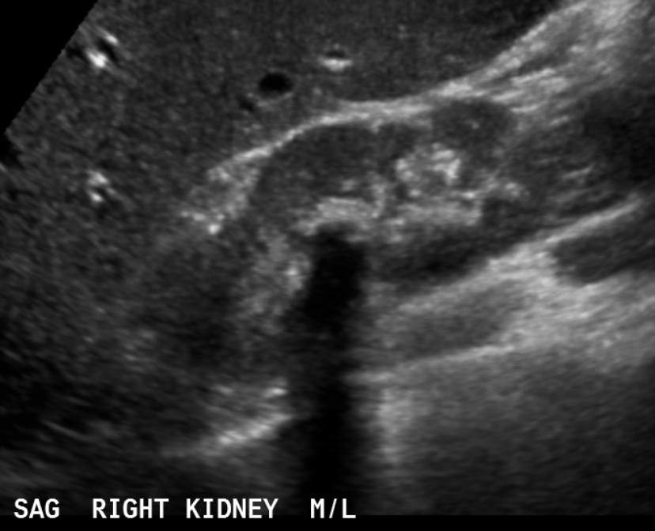

> *Nguồn dự kiến: Radiopaedia / Wikimedia Commons — ảnh siêu âm thận thấy sỏi tăng âm kèm bóng lưng rõ — agent ảnh sẽ thay bằng ảnh thật đã kiểm chứng.*

 Ví dụ: siêu âm thấy ổ tăng âm 7 mm ở bể thận phải kèm bóng lưng và giãn đài bể thận nhẹ, kết luận sỏi bể thận gây tắc nghẽn một phần và cần CT không cản quang để đo chính xác kích thước trước can thiệp.

### 4.4. Dấu hiệu bất thường — ứ nước và phân độ SFU [CỐT LÕI]

 Ứ nước (hydronephrosis) là giãn đài bể thận do nước tiểu ứ lại phía trên chỗ tắc.

 Hệ thống phân độ của Society for Fetal Urology (SFU, Hội Niệu nhi Hoa Kỳ) chuẩn hóa cách phân độ giãn đường niệu trên qua hình dạng đài thận, bể thận và nhu mô thận trên siêu âm [ABSTRACT VERIFIED].

 Hệ thống này được dùng tại 36 cơ sở thành viên của SFU, và dựa trên hình dạng đài thận, bể thận và nhu mô thận để xác định độ giãn [ABSTRACT VERIFIED].

 Định nghĩa chi tiết từng độ 0–IV của SFU nằm trong toàn văn và bảng của bài báo gốc, chưa đối chiếu nguyên văn trong đợt nghiên cứu này, nên bài này không dạy định nghĩa từng độ như sự thật đã kiểm chứng [NGOÀI ABSTRACT].

 Khi đọc siêu âm ứ nước, phải mô tả đài thận có giãn không, bể thận giãn bao nhiêu, nhu mô thận còn dày hay đã mỏng, vì 3 yếu tố này quyết định độ nặng chứ không phải một con số duy nhất.

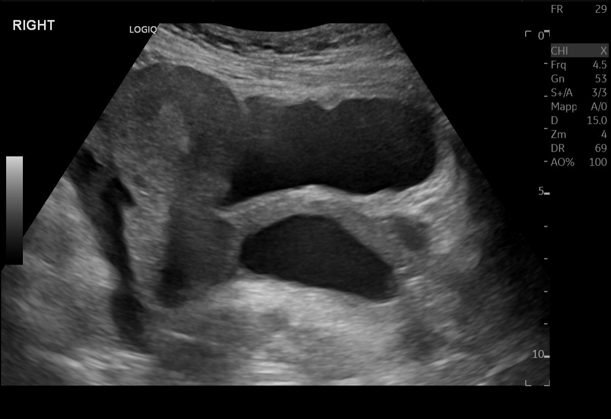

> *Nguồn dự kiến: Radiopaedia — ảnh siêu âm thận ứ nước với đài bể thận giãn rõ, đài thận dãn — agent ảnh sẽ thay bằng ảnh thật đã kiểm chứng.*

 Ví dụ: siêu âm thấy đài thận giãn vừa, bể thận giãn rõ nhưng nhu mô thận còn dày, kết luận ứ nước mức độ trung bình và cần tìm nguyên nhân tắc ở niệu quản.

### 4.5. Siêu âm Doppler — chỉ số kháng RI và delta RI [NÂNG CAO]

 Chỉ số kháng (resistive index, RI) đo sức cản dòng máu trong động mạch thận, tăng lên khi thận bị tắc nghẽn cấp.

 Delta RI là chênh lệch RI giữa thận tắc và thận đối bên, nhạy hơn RI đơn thuần vì mỗi người có RI nền khác nhau.

 Một nghiên cứu 161 bệnh nhân nghi cơn đau quặn thận do sỏi, đối chiếu siêu âm Doppler với IVU, cho thấy ngưỡng phân biệt tắc nghẽn là RI từ 0,70 trở lên và delta RI từ 0,06 trở lên [DATA VERIFIED].

 RI trung bình ở thận tắc là 0,67 so với thận đối bên là 0,59, delta RI trung bình là 0,076 so với 0,03 [DATA VERIFIED].

 Với tắc hoàn toàn, độ nhạy của RI là 77,5% và của delta RI là 92,5%, độ đặc hiệu lần lượt là 84,3% và 90,1% [DATA VERIFIED].

 Với tắc một phần, độ nhạy chỉ còn 22,8% với RI và 62,8% với delta RI, nên tác giả kết luận Doppler không thay thế được IVU làm chuẩn vì nhạy thấp với tắc một phần [ABSTRACT VERIFIED].

 Một nghiên cứu khác trên 54 bệnh nhân tắc nghẽn một bên trong 24 giờ đầu cơn đau quặn thận cấp cho thấy RI động mạch phân thùy ở thận tắc là 0,75 so với thận không tắc là 0,56, độ nhạy 85% và độ đặc hiệu 93% với ngưỡng RI trên 0,7 [DATA VERIFIED].

| Chỉ số | Ngưỡng | Tắc hoàn toàn: nhạy / đặc hiệu | Tắc một phần: nhạy |
|---|---|---|---|
| RI | 0,70 trở lên | 77,5% / 84,3% | 22,8% |
| Delta RI | 0,06 trở lên | 92,5% / 90,1% | 62,8% |

 Ví dụ: bệnh nhân đau quặn thận phải 12 giờ, RI thận phải 0,78 và thận trái 0,60, delta RI là 0,18, kết luận tắc nghẽn cấp thận phải và delta RI vượt xa ngưỡng nên khả năng tắc hoàn toàn cao.

> ⚠️ BẪY — RI tăng không chỉ do tắc nghẽn. Bệnh thận mạn, tăng huyết áp lâu năm và tuổi cao đều làm RI nền tăng, nên phải so sánh với thận đối bên bằng delta RI thay vì đọc một con số tuyệt đối.

### 4.6. Cạm bẫy trên siêu âm [CỐT LÕI]

 Siêu âm phụ thuộc người làm rất nhiều: cùng một bệnh nhân, người có kinh nghiệm thấy được sỏi mà người ít kinh nghiệm bỏ sót.

 Sỏi niệu quản đoạn giữa hay bị hơi ruột che, là vị trí bỏ sót thường gặp nhất trên siêu âm.

 Thận ứ nước không phải lúc nào cũng do tắc nghẽn: bàng quang đầy quá, thai kỳ và bể thận giãn bẩm sinh đều gây giãn đài bể thận mà không có tắc thật sự.

 Siêu âm không đo được mật độ sỏi và không thấy được sỏi acid uric nhỏ, nên không đủ để chọn phương pháp tán sỏi.

### 4.7. Siêu âm ở thai phụ, trẻ em và bệnh nhân suy thận [CỐT LÕI]

 Siêu âm là phương tiện đầu tay ở thai phụ vì không có bức xạ, và là phương tiện đầu tay ở trẻ em vì không bức xạ và không cần gây mê [GUIDELINE VERIFIED].

 Ở thai phụ, thay đổi sinh lý thai kỳ có thể bắt chước tắc nghẽn niệu quản, nên phải thận trọng khi kết luận tắc nghẽn chỉ dựa vào giãn đài bể thận [FULL TEXT VERIFIED].

 Ở trẻ em, siêu âm phải gồm thận, bàng quang đầy nước với đoạn niệu quản kề bàng quang, và niệu quản trên; Doppler màu cho thấy khác biệt tia nước tiểu niệu quản và RI động mạch vòng cung 2 thận, gợi ý mức độ tắc nghẽn [FULL TEXT VERIFIED].

 Ở bệnh nhân suy thận, siêu âm thận sau phúc mạc là hình ảnh ban đầu được xếp loại thường phù hợp, còn mọi phương tiện có cản quang iod hay gadolinium đều không phù hợp ở bước đầu [GUIDELINE VERIFIED].

 Một thử nghiệm ngẫu nhiên đa trung tâm trên 2.759 bệnh nhân ở khoa cấp cứu nghi sỏi thận cho thấy chiến lược siêu âm đầu tay (siêu âm tại giường hoặc bởi bác sĩ chẩn đoán hình ảnh, CT thêm khi bác sĩ quyết định) không làm tăng chẩn đoán nguy cơ cao bị bỏ sót so với chụp CT ngay [DATA VERIFIED].

 Tỉ lệ chẩn đoán nguy cơ cao có biến chứng trong 30 ngày rất thấp, chỉ 0,4%, và không khác nhau giữa các nhóm, trong khi phơi nhiễm bức xạ tích lũy 6 tháng thấp hơn hẳn ở 2 nhóm siêu âm [DATA VERIFIED].

 Biến cố nghiêm trọng, điểm đau ngày 7, tái khám cấp cứu, nhập viện và độ chính xác chẩn đoán đều không khác nhau có ý nghĩa giữa siêu âm đầu tay và CT ngay [ABSTRACT VERIFIED].

 Điểm mấu chốt là chiến lược siêu âm trước an toàn về kết cục, nhưng điều đó không đồng nghĩa một lần siêu âm đơn lẻ nhạy như CT (xem mâu thuẫn K6 ở §11).

### 🛑 DỪNG 1 PHÚT — TỰ KIỂM TRA

> 1. Vì sao siêu âm âm tính không loại trừ được sỏi niệu quản?
> 2. Delta RI nhạy hơn RI đơn thuần trong trường hợp nào, và khi nào Doppler vẫn thua IVU?
>
> *(Đáp án: 1. Độ nhạy siêu âm với sỏi niệu quản chỉ khoảng 45%, đoạn giữa hay bị ruột che. 2. Delta RI nhạy hơn vì so sánh với thận đối bên; Doppler thua IVU khi tắc một phần vì độ nhạy thấp.)*

---

## 5. CT KHÔNG CẢN QUANG VÀ CT LIỀU THẤP — CHẨN ĐOÁN SỎI [CỐT LÕI]

### 5.1. Kỹ thuật và mục tiêu [CỐT LÕI]

 CT không cản quang (NCCT) chụp cắt lớp mỏng từ thận đến bàng quang, không tiêm thuốc cản quang, không cần chuẩn bị ruột.

 Mục tiêu của NCCT là xác định vị trí, kích thước và mật độ sỏi, đánh giá tắc nghẽn và các dấu hiệu thứ phát, đồng thời phát hiện chẩn đoán thay thế gây đau bụng.

 NCCT đã thay thế IVU thành tiêu chuẩn chẩn đoán đau hông cấp, và chính xác hơn hẳn IVU và siêu âm [FULL TEXT VERIFIED].

 NCCT còn đo được mật độ sỏi, cấu trúc trong của sỏi, khoảng cách từ da đến sỏi và giải phẫu xung quanh, là các yếu tố ảnh hưởng đến việc chọn phương pháp điều trị [FULL TEXT VERIFIED].

### 5.2. Đọc sỏi trên CT không cản quang [CỐT LÕI]

 Sỏi trên NCCT hiện thành ổ đậm độ cao, bờ rõ, nằm trong đài bể thận hay dọc đường niệu quản.

 Phải ghi đủ 4 yếu tố cho mỗi viên sỏi: vị trí (thận, niệu quản trên, giữa hay dưới), kích thước theo chiều dài nhất, số lượng, và mật độ tính bằng HU.

 Mật độ HU gợi ý thành phần sỏi: sỏi calci thường có HU cao, sỏi acid uric có HU thấp hơn, nhưng bài này không dạy ngưỡng HU cụ thể để dự báo thành công tán sỏi ngoài cơ thể vì ngưỡng đó chưa đối chiếu được nguồn gốc (xem U14 ở §11).

 NCCT phát hiện được sỏi acid uric và sỏi xanthine vốn không cản quang trên phim thường, nhưng không phát hiện được sỏi indinavir [FULL TEXT VERIFIED].

 CT năng lượng kép (dual-energy CT) phân biệt được sỏi acid uric với sỏi chứa calci [FULL TEXT VERIFIED].

 Ví dụ: NCCT thấy sỏi 5 mm ở niệu quản đoạn dưới, mật độ 850 HU, kèm giãn đài bể thận nhẹ, kết luận sỏi niệu quản đoạn dưới gây tắc một phần, mật độ cao gợi ý sỏi calci.

### 5.3. Dấu hiệu tắc nghẽn thứ phát — rim sign và các dấu hiệu khác [CỐT LÕI]

 Dấu hiệu thứ phát là những thay đổi gián tiếp quanh sỏi và thận, cho biết sỏi có đang gây tắc nghẽn hay không, ngay cả khi sỏi khó thấy.

 Rim sign (dấu vành) là vành mô mềm bao quanh vôi hóa trên CT, giúp phân biệt sỏi niệu quản với phlebolith.

 Một nghiên cứu hồi cứu 442 bệnh nhân tắc nghẽn niệu quản xác nhận trên CT cho thấy rim sign có ở 105 trong 136 sỏi (77%) và ở 20 trong 259 phlebolith (8%), độ nhạy 77% và độ đặc hiệu 92% để phân biệt sỏi với phlebolith [DATA VERIFIED].

 Sỏi có rim sign nhỏ hơn trung bình so với sỏi không có rim sign, 4,3 mm so với 6,3 mm [DATA VERIFIED].

 Tác giả kết luận có rim sign là chỉ dấu mạnh cho thấy vôi hóa dọc niệu quản là sỏi, còn vắng rim sign thì vôi hóa vẫn chưa xác định được [ABSTRACT VERIFIED].

 Các dấu hiệu thứ phát khác gồm giãn đài bể thận, giãn niệu quản, thâm nhiễm mỡ quanh thận (perirenal stranding), chênh lệch mật độ thận và thận sưng to.

 Một nghiên cứu 117 bệnh nhân sỏi niệu quản chụp CT không cản quang kèm phân tích thành phần sỏi cho thấy sỏi acid uric có tỉ lệ dấu hiệu thứ phát cao hơn sỏi calci: rim sign 78,9% so với 60,2%, giãn niệu quản 94,7% so với 89,8%, thâm nhiễm mỡ quanh thận 84,2% so với 59,2%, chênh lệch mật độ thận 73,7% so với 50,0% [DATA VERIFIED].

 Khác biệt có ý nghĩa thống kê với thâm nhiễm mỡ quanh thận, và tác giả cho rằng dấu hiệu thứ phát gặp nhiều hơn ở sỏi acid uric có thể do môi trường nước tiểu acid [ABSTRACT VERIFIED].

 Ngược lại, một nghiên cứu hồi cứu 49 lần CT theo dõi bệnh nhân còn sỏi niệu quản sau cơn đau quặn cho thấy dấu hiệu thứ phát ít gặp và giá trị không chắc chắn ở thời điểm theo dõi [ABSTRACT VERIFIED].

 Giá trị tiên đoán của từng dấu hiệu ở CT theo dõi là: giãn đài bể thận có độ nhạy 1,0 và độ đặc hiệu 0,63, giãn niệu quản có độ nhạy 1,0 và độ đặc hiệu 0,4, thâm nhiễm mỡ quanh thận có độ nhạy 0,21 và độ đặc hiệu 0,94, cân Gerota và thận sưng to đều có độ nhạy 0,21 và độ đặc hiệu 0,97 [DATA VERIFIED].

 Kết luận quan trọng của nghiên cứu theo dõi là vắng giãn đài bể thận và giãn niệu quản thì phản bác tắc nghẽn còn tồn tại, vì giá trị tiên đoán âm của 2 dấu hiệu này đều bằng 1,0 [ABSTRACT VERIFIED].

| Dấu hiệu thứ phát | Độ nhạy | Độ đặc hiệu | Giá trị tiên đoán âm |
|---|---|---|---|
| Giãn đài bể thận | 1,0 | 0,63 | 1,0 |
| Giãn niệu quản | 1,0 | 0,4 | 1,0 |
| Thâm nhiễm mỡ quanh thận | 0,21 | 0,94 | 0,75 |

 Hai nghiên cứu này không mâu thuẫn nhau mà chụp ở 2 thời điểm khác nhau: một nghiên cứu chụp trong cơn cấp khi tắc đang diễn ra, nghiên cứu còn lại chụp theo dõi sau cơn khi tắc đã giảm ở đa số bệnh nhân (xem mâu thuẫn K5 ở §11).

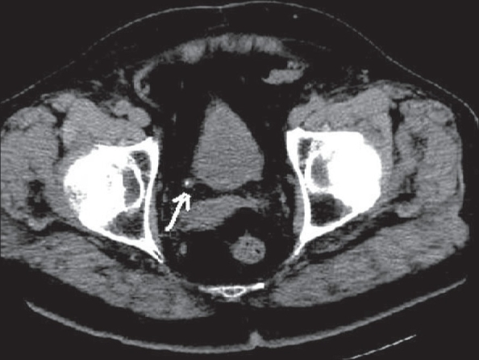

> *Nguồn dự kiến: Radiopaedia — ảnh CT không cản quang thấy sỏi niệu quản kèm rim sign rõ — agent ảnh sẽ thay bằng ảnh thật đã kiểm chứng.*

 Ví dụ: CT theo dõi sau 2 tuần thấy sỏi vẫn còn nhưng không còn giãn đài bể thận và không còn giãn niệu quản, kết luận tắc nghẽn đã hết dù sỏi chưa ra, và có thể tiếp tục theo dõi.

 Ví dụ: CT trong cơn cấp thấy sỏi 6 mm kèm thâm nhiễm mỡ quanh thận rõ và chênh lệch mật độ thận, kết luận tắc nghẽn cấp đang diễn ra và cần theo dõi sát.

### 5.4. CT liều thấp — độ chính xác và liều bức xạ [CỐT LÕI]

 CT liều thấp là NCCT giảm liều xuống dưới 3 mSv cho toàn bộ lần chụp, vẫn giữ độ chính xác cao với sỏi.

 Một phân tích gộp 7 nghiên cứu với 1.061 bệnh nhân cho thấy CT liều thấp có độ nhạy gộp 0,966 và độ đặc hiệu gộp 0,949 trong chẩn đoán sỏi niệu [DATA VERIFIED].

 Tác giả kết luận protocol CT liều thấp có thể dùng làm kỹ thuật hình ảnh đầu tiên khi nghi sỏi [ABSTRACT VERIFIED].

 Một tổng quan hệ thống và phân tích gộp khác trên 12 nghiên cứu với 1.250 bệnh nhân cho thấy CT liều thấp phát hiện sỏi có ý nghĩa lâm sàng (từ 3 mm trở lên) với độ nhạy gộp 93,1%, độ đặc hiệu gộp 96,6%, tỉ số khả dĩ dương 19,9, tỉ số khả dĩ âm 0,05 và diện tích dưới đường cong ROC 0,9877 [DATA VERIFIED].

 Liều trung bình ở các nghiên cứu mới hơn chỉ 1–1,5 mSv [ABSTRACT VERIFIED].

 Hạn chế của tổng quan này là không nghiên cứu nào đánh giá độ chính xác phát hiện chẩn đoán thay thế, dù có 86 chẩn đoán thay thế được ghi nhận [ABSTRACT VERIFIED].

 Tác giả khuyến cáo dùng CT liều thấp khi xác suất trước xét nghiệm của bệnh sỏi cao hơn hẳn chẩn đoán thay thế, ví dụ theo dõi sỏi đã biết, và thận trọng khi xác suất chẩn đoán thay thế cao, ví dụ lần đầu đau quặn [ABSTRACT VERIFIED].

 EAU 2026 bổ sung rằng ở bệnh nhân BMI dưới 30, CT liều thấp có độ nhạy 86% với sỏi niệu quản dưới 3 mm và 100% với sỏi trên 3 mm [FULL TEXT VERIFIED].

| Nguồn | Số nghiên cứu | Độ nhạy gộp | Độ đặc hiệu gộp |
|---|---|---|---|
| Phân tích gộp 2008 | 7 | 96,6% | 94,9% |
| Tổng quan hệ thống 2017 | 12 | 93,1% | 96,6% |

### 5.5. Cạm bẫy trên CT không cản quang [CỐT LÕI]

 Phlebolith có thể nhầm với sỏi niệu quản đoạn cuối nếu không có rim sign và không theo dõi đường niệu quản liên tục trên các lát cắt.

 Sỏi nhỏ dưới 3 mm có thể bị bỏ sót nếu lát cắt dày, và sỏi indinavir không thấy được trên CT không cản quang.

 Giãn đài bể thận nhẹ có thể do bàng quang đầy quá chứ không phải tắc nghẽn, nên phải đối chiếu với lâm sàng và siêu âm.

 CT không cản quang không đánh giá được chức năng thận từng bên và không thấy được u niệu mạc nhỏ trong đài bể thận.

### 5.6. Khuyến cáo ACR cho đau hông cấp nghi sỏi [CỐT LÕI]

 Tiêu chuẩn phù hợp của Hội Điện quang Hoa Kỳ (ACR Appropriateness Criteria) xếp CT không cản quang là xét nghiệm hình ảnh được chọn để đánh giá ban đầu bệnh nhân đau hông cấp nghi sỏi chưa từng biết có sỏi [ABSTRACT VERIFIED].

 CT không cản quang xác định được vị trí và kích thước sỏi niệu quản, phát hiện biến chứng và chẩn đoán nguyên nhân khác gây đau bụng [ABSTRACT VERIFIED].

 Siêu âm kém nhạy hơn trong phát hiện sỏi nhưng có vai trò đánh giá dấu hiệu tắc nghẽn, còn X-quang có thể có vai trò nhưng kém nhạy hơn CT không cản quang [ABSTRACT VERIFIED].

 Bệnh nhân đã biết có sỏi và tái phát triệu chứng thì CT không cản quang vẫn là xét nghiệm được chọn [ABSTRACT VERIFIED].

 Ở thai kỳ, siêu âm là phương tiện đầu tay, có thể dùng MRI không cản quang, và nếu CT không cản quang ban đầu không kết luận được thì chụp có cản quang (MRI hoặc CT/CTU) có thể phù hợp [ABSTRACT VERIFIED].

---

## 6. CT NIỆU ĐỒ — CTU [CỐT LÕI]

### 6.1. Định nghĩa, chỉ định và kỹ thuật [CỐT LÕI]

 CT niệu đồ là CT có tiêm thuốc cản quang iod tĩnh mạch, chụp nhiều pha để đánh giá nhu mô thận, hệ thống đài bể thận, niệu quản và bàng quang trong một lần chụp.

 Guideline chuyên gia của Hội Điện quang Niệu sinh dục châu Âu (ESUR) xếp CTU là xét nghiệm đầu tay cho bệnh nhân tiểu máu đại thể có nguy cơ cao ung thư niệu mạc [ABSTRACT VERIFIED].

 Ngoài trường hợp đó, CTU dùng làm xét nghiệm giải quyết vấn đề khi các phương tiện khác chưa kết luận được [ABSTRACT VERIFIED].

 ESUR đề xuất tiếp cận phân biệt 1, 2 hay 3 pha tùy chỉ định: hoặc pha thận–bài tiết kết hợp sau tiêm split-bolus (chia liều), hoặc pha thận và pha bài tiết riêng sau tiêm single-bolus (một liều) [ABSTRACT VERIFIED].

 Liều thấp với CTDIvol 5–6 mGy dùng cho bệnh lành tính, liều thường với CTDIvol 9–12 mGy dùng cho bệnh ác tính tiềm ẩn, và có thể thêm chuỗi không cản quang liều thấp với CTDIvol 2–3 mGy khi có chỉ định [ABSTRACT VERIFIED].

 Lưu ý quan trọng là guideline ESUR không phải guideline dựa trên bằng chứng thực sự mà là guideline chuyên gia, vì bằng chứng chưa đủ để xây dựng guideline dựa trên bằng chứng [ABSTRACT VERIFIED].

### 6.2. Các pha của CTU — pha niệu mạc và pha bài tiết [CỐT LÕI]

 Pha niệu mạc (urothelial phase) chụp khoảng 60 giây sau tiêm thuốc cản quang kèm lợi tiểu, lúc niệu mạc ngấm thuốc đậm nhất.

 Pha bài tiết (excretory phase) chụp khoảng 5 phút sau tiêm, lúc thuốc đã bài tiết xuống đài bể thận và niệu quản.

 Một nghiên cứu tiền cứu 80 lần CTU ở 77 bệnh nhân nguy cơ cao cho thấy pha niệu mạc nhạy hơn pha bài tiết cả ở bàng quang (89,3% so với 70,5%) và ở đường niệu trên (82,6% so với 69,6%) [DATA VERIFIED].

 Tuy nhiên độ giãn nở đường niệu trên tốt hơn ở pha bài tiết, nên pha bài tiết vẫn cần để đánh giá hình dạng đài bể thận và niệu quản [ABSTRACT VERIFIED].

 Tác giả gợi ý pha niệu mạc có thể dùng làm protocol một pha duy nhất để đánh giá toàn bộ đường niệu ở bệnh nhân nguy cơ cao u niệu mạc [ABSTRACT VERIFIED].

| Pha | Bàng quang: độ nhạy | Đường niệu trên: độ nhạy | Ưu điểm riêng |
|---|---|---|---|
| Pha niệu mạc | 89,3% | 82,6% | Phát hiện u tốt hơn |
| Pha bài tiết | 70,5% | 69,6% | Giãn nở đường niệu tốt hơn |

### 6.3. Độ chính xác của CT/CTU với ung thư niệu mạc đường niệu trên [CỐT LÕI]

 Ung thư niệu mạc đường niệu trên (upper tract urothelial carcinoma, UTUC) là u ác tính của đài bể thận và niệu quản, khó phát hiện vì nằm sâu và nhỏ.

 Một nghiên cứu hồi cứu 275 bệnh nhân UTUC cho thấy CT/CTU có độ chính xác tổng thể 96–97%, chỉ có 2 dương giả và 6 âm giả [DATA VERIFIED].

 CT/CTU phát hiện đúng vị trí u ở bể thận 85%, ở đài thận chỉ 50%, ở niệu quản đoạn xa 93% và ở niệu quản đoạn gần 60% [DATA VERIFIED].

 Hạn chế lớn nhất là dễ bỏ sót u đài thận, và chưa đủ bằng chứng để chỉ dựa vào CT mà không sinh thiết qua nội soi niệu quản trước phẫu thuật triệt căn [ABSTRACT VERIFIED].

 Ví dụ: CTU thấy khối tăng quang ở bể thận phải kèm giãn đài thận khu trú, kết luận nghi UTUC bể thận và cần nội soi niệu quản sinh thiết trước khi quyết định cắt thận–niệu quản triệt căn.

### 6.4. CT một pha thận có thua CT 4 pha không [NÂNG CAO]

 CT 4 pha chụp nhiều lần nên liều bức xạ cao, câu hỏi đặt ra là CT một pha thận có đủ để phát hiện u niệu mạc ở bệnh nhân tiểu máu đại thể hay không.

 Một nghiên cứu tiền cứu, paired, noninferiority trên 308 bệnh nhân tiểu máu nhìn thấy được cho thấy chênh lệch độ chính xác giữa CT 1 pha và CT 4 pha là 1,9%, đạt tiêu chuẩn noninferiority với ngưỡng 7,5% [DATA VERIFIED].

 Độ nhạy là 93,3% so với 91,1%, độ đặc hiệu là 83,7% so với 81,8%, giá trị tiên đoán âm là 98,7% so với 98,2%, giá trị tiên đoán dương là 49,4% so với 46,1%, diện tích dưới đường cong ROC là 0,96 so với 0,94 [DATA VERIFIED].

 Hạn chế của nghiên cứu là số ca ung thư niệu mạc ít (45 ca, chiếm 14,6%) và không có tiêu chí rõ để chọn ngưỡng noninferiority [ABSTRACT VERIFIED].

 Ý nghĩa thực hành là CT một pha thận có thể đủ để tầm soát u niệu mạc ở bệnh nhân tiểu máu đại thể, giảm liều bức xạ so với CT 4 pha, nhưng bằng chứng còn ít ca nên cần thận trọng.

### 6.5. Liều bức xạ của CTU — con số phụ thuộc protocol [CỐT LÕI]

 Không có một con số liều duy nhất cho CTU, vì liều phụ thuộc số pha chụp, thế hệ máy và cỡ bệnh nhân.

 Một nghiên cứu 60 bệnh nhân bằng máy CT dual-slice năm 2015 cho thấy liều hiệu dụng của CTU là 2,53 mSv, của IVU là 1,81 mSv và của xạ hình thận là 0,78 mSv [DATA VERIFIED].

 Trong nghiên cứu đó CTU cao hơn IVU nhưng chênh lệch nhỏ, và liều phụ thuộc cỡ bệnh nhân, loại máy và protocol [ABSTRACT VERIFIED].

 Ngược lại, một nghiên cứu tiền cứu so sánh MRU với CTU 3 pha cho thấy liều hiệu dụng trung bình của CTU 3 pha là 9,2 mSv, gấp khoảng 5 lần liều IVU trong nghiên cứu 2015 [DATA VERIFIED].

 Hai con số này không mâu thuẫn nhau mà phản ánh protocol khác nhau: CTU một pha liều thấp tiệm cận IVU, CTU đa pha 3–4 pha cao hơn IVU nhiều lần (xem mâu thuẫn K1 ở §11).

 Khi dạy liều CTU phải luôn ghi rõ protocol đi kèm con số liều, nếu không con số đó vô nghĩa.

### 6.6. CTU trong tiểu máu đại thể không đau [CỐT LÕI]

 Tiểu máu đại thể không đau là dấu hiệu cảnh báo ung thư niệu mạc, cần đánh giá cả đường niệu trên và đường niệu dưới.

 Một thuật toán theo phân tầng nguy cơ ác tính xếp siêu âm quan trọng trong đánh giá ban đầu, nhất là bệnh nhân nhạy cảm bức xạ, nguy cơ thấp và nam trẻ dưới 40 tuổi [ABSTRACT VERIFIED].

 CTU là phương pháp nhạy và đặc hiệu để phát hiện ác tính niệu mạc, nhất là bệnh nhân nguy cơ cao [ABSTRACT VERIFIED].

 MRU cho độ phân giải tương phản tốt hơn CTU mà không phơi nhiễm bức xạ ion hóa và không cần cản quang tĩnh mạch, nên phù hợp hơn cho trẻ em, thai kỳ và bệnh nhân suy thận [ABSTRACT VERIFIED].

 Nội soi bàng quang vẫn là tiêu chuẩn vàng phát hiện u niệu mạc đường niệu dưới [ABSTRACT VERIFIED].

 Tác giả thừa nhận chưa có thử nghiệm ngẫu nhiên so sánh trực tiếp các chiến lược chẩn đoán, nên khuyến cáo dựa trên đồng thuận [ABSTRACT VERIFIED].

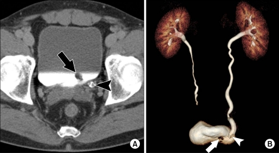

> *Nguồn dự kiến: Radiopaedia — ảnh CTU pha bài tiết thấy khối khuyết thuốc trong niệu quản — agent ảnh sẽ thay bằng ảnh thật đã kiểm chứng.*

### 6.7. Cạm bẫy trên CTU [CỐT LÕI]

 U đài thận nhỏ dễ bị bỏ sót nhất, chỉ phát hiện đúng vị trí một nửa số ca, nên CTU âm tính không loại trừ hoàn toàn UTUC.

 Thuốc cản quang chưa xuống đủ niệu quản đoạn xa sẽ làm đoạn niệu quản đó không đánh giá được, dễ bỏ sót u đoạn xa.

 Cục máu đông trong đài bể thận có thể giả dạng u niệu mạc trên pha niệu mạc, cần đối chiếu pha bài tiết và lâm sàng.

> ⚠️ BẪY — CTU bình thường không đủ để quyết định cắt thận–niệu quản triệt căn hay không. Phải sinh thiết qua nội soi niệu quản trước phẫu thuật triệt căn, vì CT bỏ sót u đài thận tới một nửa số ca.

### 🛑 DỪNG 1 PHÚT — TỰ KIỂM TRA

> 1. Vì sao pha niệu mạc nhạy hơn pha bài tiết trong phát hiện u, nhưng pha bài tiết vẫn cần thiết?
> 2. CTU 3 pha và CTU 1 pha khác nhau bao nhiêu về liều, và con số liều nào phải ghi kèm protocol?
>
> *(Đáp án: 1. Pha niệu mạc ngấm thuốc đậm nhất ở niệu mạc nên thấy u rõ hơn; pha bài tiết giãn nở đường niệu tốt hơn để đánh giá hình dạng. 2. CTU 3 pha khoảng 9,2 mSv, CTU 1 pha liều thấp khoảng 2,53 mSv; luôn ghi protocol kèm liều.)*

---

## 7. IVU — NIỆU ĐỒ BÀI TIẾT [CỐT LÕI]

### 7.1. Vai trò hiện nay của IVU [CỐT LÕI]

 IVU từng là xét nghiệm hình ảnh tiết niệu được làm nhiều nhất, nay hiếm khi làm do siêu âm và CT/MRI niệu đồ phát triển, và chuyên môn về kỹ thuật này cũng suy giảm [ABSTRACT VERIFIED].

 Tuy vậy IVU vẫn có giá trị ở các chỉ định đặc biệt: dị tật bẩm sinh, tổn thương niệu mạc và rò nước tiểu, nhờ tính chất động học, sẵn có, chi phí thấp và liều bức xạ thấp [ABSTRACT VERIFIED].

 Tính chất động học có nghĩa là IVU chụp nhiều phim theo thời gian, thấy được thuốc cản quang đi từ thận xuống niệu quản và bàng quang theo từng thời điểm, điều mà CT tĩnh một pha không thể hiện được.

 Bài này chỉ dạy vai trò hiện nay và liều bức xạ của IVU, không dạy kỹ thuật chi tiết như thể tích thuốc cản quang hay thời điểm chụp từng phim, vì không truy được nguồn sơ cấp có số liệu trong đợt nghiên cứu này (xem U7 ở §11).

### 7.2. Đọc phim IVU [CỐT LÕI]

 Phim IVU đọc theo trình tự thời gian: phim sớm thấy thận ngấm thuốc, phim giữa thấy đài bể thận và niệu quản đầy thuốc, phim muộn thấy bàng quang đầy thuốc.

 Đài bể thận bình thường hiện rõ hình chén, niệu quản hiện thành dải thuốc liên tục từ bể thận xuống bàng quang.

 Khuyết thuốc (filling defect) trong đài bể thận hay niệu quản gợi ý sỏi, u hay cục máu đông, cần đối chiếu với CTU để phân biệt.

 Chậm bài tiết một bên so với bên đối diện gợi ý tắc nghẽn bên đó, và mức độ chậm tương quan với mức độ tắc.

 Rò nước tiểu hiện thành thuốc thoát ra ngoài đường niệu, thấy rõ nhất trên phim muộn.

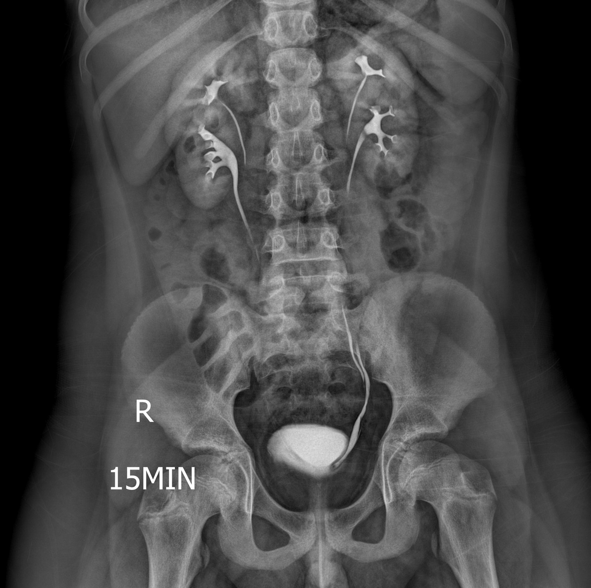

> *Nguồn dự kiến: Radiopaedia / Wikimedia Commons — phim IVU bình thường thấy đài bể thận, niệu quản và bàng quang ngấm thuốc — agent ảnh sẽ thay bằng ảnh thật đã kiểm chứng.*

 Ví dụ: IVU thấy đài bể thận phải giãn, niệu quản phải không hiện thuốc dù đã 30 phút, trong khi bên trái bài tiết bình thường, kết luận tắc nghẽn niệu quản phải và cần CT không cản quang để tìm nguyên nhân tắc.

### 7.3. Liều bức xạ của IVU [CỐT LÕI]

 Một nghiên cứu 60 bệnh nhân cho thấy liều hiệu dụng của IVU là 1,81 mSv, thấp hơn CTU trong cùng nghiên cứu là 2,53 mSv và cao hơn xạ hình thận là 0,78 mSv [DATA VERIFIED].

 Liều IVU thường khoảng 1–3 mSv tùy tuổi, cỡ bệnh nhân và protocol, và cần thuốc cản quang tĩnh mạch là một bất lợi thêm so với siêu âm [FULL TEXT VERIFIED].

 Một tổng quan năm 2022 vẫn kể liều bức xạ thấp là một ưu điểm của IVU, nhưng con số này chỉ đúng khi so với CTU đa pha, không đúng khi so với CT liều thấp hiện nay (xem mâu thuẫn K1 ở §11).

### 7.4. IVU so với CTU — chưa có so sánh trực tiếp [CỐT LÕI]

 Không tìm được nghiên cứu đối đầu nào so sánh trực tiếp độ nhạy và độ đặc hiệu của IVU với CTU trong phát hiện u niệu mạc đường niệu trên (xem U1 ở §11).

 Chỉ có so sánh gián tiếp: CTU có độ chính xác tổng thể 96–97% với UTUC, pha niệu mạc của CTU có độ nhạy 82,6% với u đường niệu trên, còn IVU không có con số tương đương đã kiểm chứng.

 Tồn tại một nghiên cứu so sánh IVU với CTU, nhưng về chẩn đoán tắc nghẽn khúc nối bể thận–niệu quản chứ không phải u niệu mạc, và không có abstract nên không trích được số liệu nào [ABSTRACT VERIFIED].

 Vì vậy bài này không dạy con số so sánh trực tiếp IVU với CTU, và người đọc không được tự suy ra IVU kém CTU một tỉ lệ cụ thể nào.

### 7.5. Khi nào còn dùng IVU [CỐT LÕI]

 Nghi dị tật bẩm sinh đường niệu mà CTU chưa làm rõ được hình dạng đài bể thận và niệu quản.

 Nghi rò nước tiểu sau phẫu thuật hay chấn thương mà cần theo dõi động học thuốc thoát ra theo thời gian.

 Nghi tổn thương niệu mạc khu trú mà siêu âm và CT chưa kết luận được, ở nơi không có CTU.

 Không dùng IVU khi cần đánh giá nhanh đau hông cấp, vì NCCT đã thay thế IVU trong chỉ định này.

---

## 8. RUG VÀ VCUG — NIỆU ĐẠO VÀ BÀNG QUANG [CỐT LÕI]

### 8.1. Kỹ thuật RUG theo EAU 2026 [CỐT LÕI]

 RUG là xét nghiệm chuẩn trong đánh giá sớm chấn thương niệu đạo nam, thực hiện bằng cách bơm 20–30 mL thuốc cản quang trong khi bịt kín miệng sáo, chụp ở tư thế nghiêng 30 độ [FULL TEXT VERIFIED].

 Ở bệnh nhân chấn thương gãy khung chậu kèm tổn thương niệu đạo sau (pelvic fracture urethral injury, PFUI), cần điều chỉnh góc tia X thành 30 độ thay vì xoay bệnh nhân [FULL TEXT VERIFIED].

 Ở bệnh nhân chưa ổn định huyết động, phải hoãn RUG cho đến khi bệnh nhân đã ổn định [FULL TEXT VERIFIED].

 Kỹ thuật RUG 20–30 mL và nghiêng 30 độ đã dạy chi tiết ở bài Chấn thương niệu đạo §5, bài này chỉ nhắc lại để đọc phim và dạy thêm RUG trong hẹp niệu đạo, VCUG và cystography.

### 8.2. Đọc phim RUG trong chấn thương niệu đạo [CỐT LÕI]

 Thuốc thoát ra ngoài niệu đạo trên RUG là dấu hiệu chắc chắn có chấn thương niệu đạo [FULL TEXT VERIFIED].

 RUG xác định được vị trí tổn thương là niệu đạo trước hay niệu đạo sau một cách đáng tin cậy, nhưng phân biệt đứt một phần với đứt hoàn toàn không phải lúc nào cũng rõ ràng [FULL TEXT VERIFIED].

 Vì vậy bất kỳ hệ thống phân loại nào dựa trên RUG cũng không đáng tin cậy [FULL TEXT VERIFIED].

 Hình ảnh điển hình của đứt một phần là thuốc thoát ra khỏi niệu đạo trong khi bàng quang vẫn đang đầy thuốc [FULL TEXT VERIFIED].

 Đứt hoàn toàn được gợi ý bởi thuốc thoát ồ ạt mà bàng quang không đầy thuốc [FULL TEXT VERIFIED].

 Trước điều trị trì hoãn, kết hợp RUG với chụp bàng quang–niệu đạo xuôi dòng để đánh giá vị trí và mức độ tổn thương, và đánh giá khả năng đóng của cổ bàng quang [FULL TEXT VERIFIED].

 Trong giai đoạn cấp, siêu âm dùng để hướng dẫn đặt dẫn lưu trên mu [FULL TEXT VERIFIED].

 Ở PFUI phức tạp, MRI trước điều trị trì hoãn cho thêm thông tin quý giá giúp chọn chiến lược phẫu thuật phù hợp, gồm ước tính tốt hơn về độ dài đoạn khuyết, mức độ di lệch tiền liệt tuyến và có hay không đường giả [FULL TEXT VERIFIED].

 Nội soi niệu đạo–bàng quang mềm là lựa chọn thay thế quý giá để chẩn đoán chấn thương niệu đạo cấp và có thể phân biệt đứt hoàn toàn với đứt một phần [FULL TEXT VERIFIED].

 Khuyến cáo EAU 2026 mức Strong là đánh giá chấn thương niệu đạo nam bằng nội soi niệu đạo–bàng quang mềm và/hoặc RUG, còn chấn thương niệu đạo nữ thì đánh giá bằng nội soi niệu đạo–bàng quang và soi âm đạo [GUIDELINE VERIFIED].

> 🚨 **BOX ĐỎ — KHÔNG ĐẶT SONDE TIỂU TRƯỚC KHI CHỤP RUG:** Nghi chấn thương niệu đạo (máu ở miệng sáo, gãy khung chậu, không tiểu được sau chấn thương) thì cấm đặt sonde tiểu qua niệu đạo trước khi chụp RUG. Đặt sonde có thể biến đứt một phần thành đứt hoàn toàn và tạo đường giả. Hành động ngay là chụp RUG trước, đặt dẫn lưu trên mu nếu cần dẫn lưu, và chuyển chuyên khoa tiết niệu. Nội dung này đã dạy ở bài Chấn thương niệu đạo §5 và được nhắc lại ở đây vì đây là lỗi nguy hiểm nhất khi đọc và xử trí chấn thương niệu đạo.

### 8.3. RUG trong hẹp niệu đạo [CỐT LÕI]

 Chẩn đoán hình ảnh chính xác hẹp niệu đạo rất quan trọng cho phân giai đoạn trước mổ và lập kế hoạch tái tạo [ABSTRACT VERIFIED].

 RUG là tiêu chuẩn vàng hiện nay trong hẹp niệu đạo: chẩn đoán, phân giai đoạn và phác họa hẹp chính xác, là nền tảng trong xử trí bệnh hẹp niệu đạo [ABSTRACT VERIFIED].

 Trường hợp phức tạp, kết hợp RUG với VCUG để thấy rõ hơn niệu đạo sau hoặc khuyết tật gián đoạn phức tạp [ABSTRACT VERIFIED].

 Nội soi bàng quang–niệu đạo xuôi và ngược bổ sung vị trí và hình thái hẹp [ABSTRACT VERIFIED].

 Sonourethrography (siêu âm niệu đạo) là công cụ phụ trợ, đánh giá 3 chiều chiều dài và vị trí hẹp, dùng trong mổ, nhưng vẫn là lựa chọn hàng 2 [ABSTRACT VERIFIED].

 CT và MRI niệu đồ cho thêm thông tin 3 chiều về cấu trúc giải phẫu và quan hệ, hữu ích trong ca phức tạp [ABSTRACT VERIFIED].

 MRI ngày càng được chấp nhận trong hẹp niệu đạo, ưu điểm là xác định được xơ hóa quanh niệu đạo (spongiofibrosis), khắc phục giới hạn chính của RUG [ABSTRACT VERIFIED].

 MR niệu đồ ngày càng được đánh giá cao, cho thêm thông tin về quan hệ giải phẫu và chi tiết mô quanh niệu đạo, hỗ trợ lập kế hoạch điều trị [ABSTRACT VERIFIED].

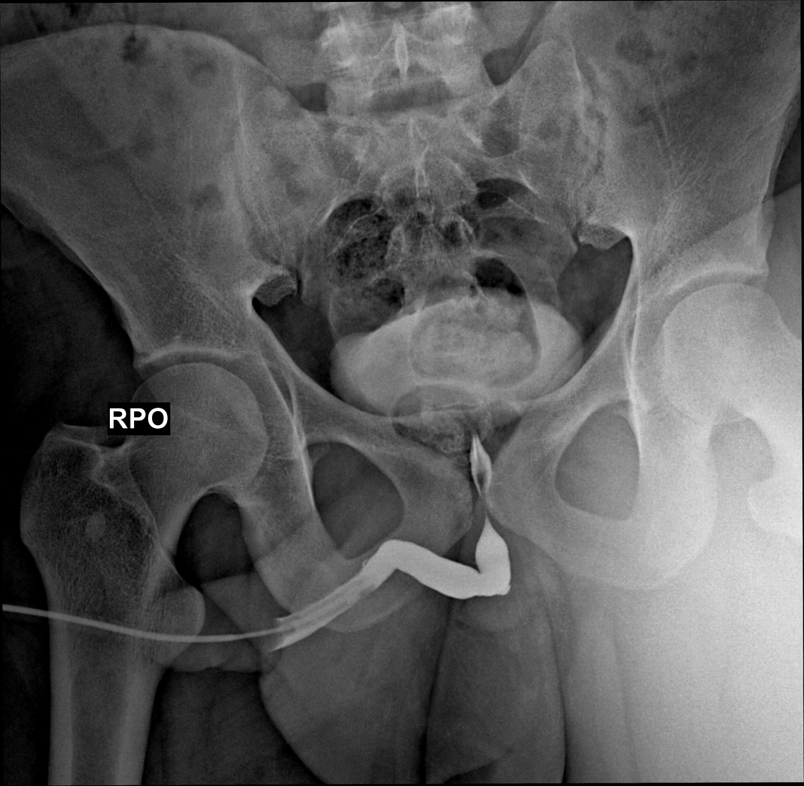

> *Nguồn dự kiến: Radiopaedia — phim RUG thấy hẹp niệu đạo đoạn hành niệu đạo — agent ảnh sẽ thay bằng ảnh thật đã kiểm chứng.*

 Ví dụ: RUG thấy hẹp 2 cm ở niệu đạo hành, bờ đều, không có đường giả, kết luận hẹp niệu đạo hành khu trú và đủ thông tin để lập kế hoạch mổ tái tạo.

 Ví dụ: RUG thấy hẹp dài kèm đoạn khuyết không thấy thuốc qua, kết luận cần kết hợp VCUG và MRI để đánh giá đoạn khuyết trước mổ.

### 8.4. VCUG — chỉ định, kỹ thuật và cạm bẫy [CỐT LÕI]

 VCUG được chỉ định đánh giá giải phẫu niệu đạo và bàng quang, chủ yếu chẩn đoán trào ngược bàng quang–niệu quản (vesicoureteral reflux, VUR) và van niệu đạo sau (posterior urethral valves, PUV) [ABSTRACT VERIFIED].

 VCUG đặc biệt có giá trị khi nhiễm trùng tiểu có sốt, giãn niệu quản đáng kể trên siêu âm, và ở trẻ đã kiểm soát tiểu tiện có triệu chứng gợi ý tắc nghẽn dưới bàng quang [ABSTRACT VERIFIED].

 VCUG phơi nhiễm bức xạ không nhỏ, cần đặt catheter niệu đạo gây đau nhất là bé trai, và có nguy cơ nhiễm trùng tiểu sau thủ thuật tuy thấp nhưng vẫn có [ABSTRACT VERIFIED].

 Cạm bẫy lớn nhất là VCUG có thể bỏ sót VUR tới 50% số ca [DATA VERIFIED].

 Nghi ngờ PUV trước mổ trên VCUG chỉ có ở 46% bé trai chưa tập đi vệ sinh và 59% bé trai đã tập đi vệ sinh, có thể do khó diễn giải hình ảnh [DATA VERIFIED].

 VCUG bỏ sót tổn thương niệu đạo nữ khoảng 50% số ca khi so với nội soi niệu đạo–bàng quang, theo tổng kết bằng chứng của EAU 2026 [FULL TEXT VERIFIED].

 Ở nữ, niệu đạo ngắn và phù nề âm hộ làm chụp niệu đạo gần như không thể thực hiện đầy đủ, nên nội soi niệu đạo–bàng quang và soi âm đạo là phương thức chẩn đoán được chọn [FULL TEXT VERIFIED].

 Hai con số bỏ sót khoảng 50% này thuộc 2 quần thể và 2 bệnh lý khác nhau, trùng nhau là ngẫu nhiên, không được gộp thành một con số chung (xem mâu thuẫn K3 ở §11).

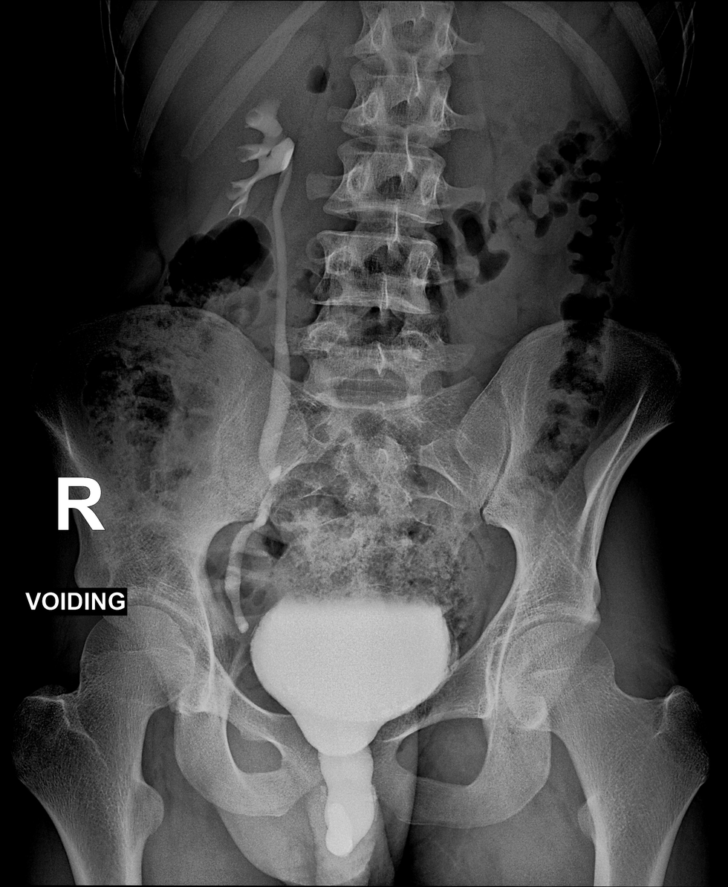

> *Nguồn dự kiến: Radiopaedia — ảnh VCUG thấy trào ngược bàng quang–niệu quản — agent ảnh sẽ thay bằng ảnh thật đã kiểm chứng.*

 Ví dụ: bé trai 3 tuổi nhiễm trùng tiểu có sốt tái phát, VCUG không thấy trào ngược, kết luận VCUG âm tính chưa loại trừ VUR vì có thể bỏ sót tới một nửa số ca, và cần theo dõi lâm sàng cùng siêu âm.

### 8.5. Phân độ trào ngược bàng quang–niệu quản I–V — nguồn gốc [THAM KHẢO]

 Hệ thống phân độ hình ảnh quốc tế của VUR do các thành viên nghiên cứu trào ngược quốc tế ở trẻ em thống nhất, kết hợp 2 phân loại trước đó, dựa trên mức độ đổ đầy và giãn của niệu quản, bể thận và đài thận do trào ngược [ABSTRACT VERIFIED].

 Bài báo gốc cũng mô tả kỹ thuật chuẩn của chụp bàng quang lúc đi tiểu để kết quả so sánh được với nhau [ABSTRACT VERIFIED].

 Định nghĩa chi tiết từng độ I–V nằm trong toàn văn bài báo năm 1985, không truy được bản mở trong đợt nghiên cứu này, nên bài này không dạy định nghĩa từng độ như sự thật đã kiểm chứng (xem U2 ở §11).

### 8.6. Cystography trong chấn thương bàng quang [CỐT LÕI]

 Cystography (chụp bàng quang có cản quang) là phương thức chẩn đoán ưu tiên cho chấn thương bàng quang không do thầy thuốc và nghi ngờ chấn thương bàng quang do thầy thuốc sau mổ [FULL TEXT VERIFIED].

 Cả cystography thường và CT cystography có độ nhạy tương đương 90–95% và độ đặc hiệu 100% [FULL TEXT VERIFIED].

 CT cystography vượt trội trong phát hiện mảnh xương trong bàng quang, tổn thương cổ bàng quang và tổn thương bụng kèm theo [FULL TEXT VERIFIED].

 Cystography phải làm bằng cách bơm ngược bàng quang với thể tích tối thiểu 300–350 mL thuốc cản quang pha loãng [FULL TEXT VERIFIED].

 CTU là xét nghiệm được chọn khi nghi ngờ chấn thương niệu quản [FULL TEXT VERIFIED].

 Ví dụ: bệnh nhân gãy khung chậu kèm tiểu máu đại thể, CT cystography thấy thuốc thoát ra ngoài bàng quang vào ổ bụng, kết luận vỡ bàng quang trong phúc mạc và cần mổ sửa.

---

## 9. MRI, NANG THẬN BOSNIAK VÀ AN TOÀN GADOLINIUM [CỐT LÕI]

### 9.1. MR urography so với CT urography [CỐT LÕI]

 Một nghiên cứu tiền cứu trên 20 bệnh nhân với 39 đơn vị đường niệu trên so sánh MRU 3.0T toàn diện với CTU 3 pha để loại trừ ác tính đường niệu trên, cho thấy hiệu năng chẩn đoán bằng nhau [ABSTRACT VERIFIED].

 Hai phương tiện làm rõ nguyên nhân lành tính của 7 ca tắc nghẽn như nhau, và MRU phát hiện thêm 2 u ác tính đường niệu cùng 1 u lành ngoài đường niệu [ABSTRACT VERIFIED].

 Hiển thị đầy đủ 100% ở mọi vùng đạt 93,6% với MRU và 87,2% với CTU, hiển thị trên 75% đạt 100% với MRU và 93,6% với CTU [DATA VERIFIED].

 CTU hơi tốt hơn ở vùng trong thận và kém dần về phía niệu quản xa, còn MRU luôn hơi tốt hơn ở niệu quản [ABSTRACT VERIFIED].

 Liều hiệu dụng trung bình của CTU trong nghiên cứu này là 9,2 mSv, còn MRU không có bức xạ [DATA VERIFIED].

 Tác giả kết luận MRU toàn diện là phương tiện chính xác đạt hiệu năng tương đương CTU, và vì không phơi nhiễm bức xạ nên có tiềm năng thành xét nghiệm đầu tay ở bệnh nhân chọn lọc [ABSTRACT VERIFIED].

 Hạn chế quan trọng là nghiên cứu chỉ có 20 bệnh nhân ở một trung tâm, nên kết luận ngang CTU không thể khái quát thành MRI thường quy ngang CT (xem mâu thuẫn K2 ở §11).

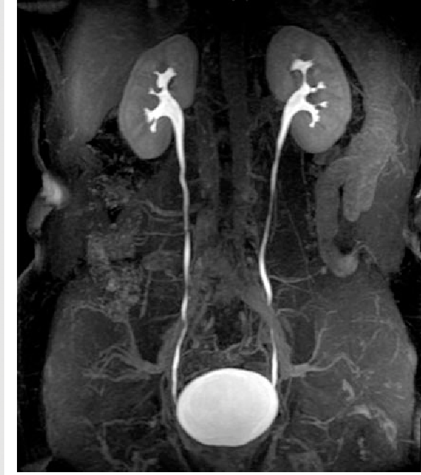

> *Nguồn dự kiến: Radiopaedia — ảnh MR urography thấy đài bể thận và niệu quản 2 bên — agent ảnh sẽ thay bằng ảnh thật đã kiểm chứng.*

### 9.2. MRI trong phát hiện và staging ung thư đường niệu trên [NÂNG CAO]

 Một tổng quan hệ thống trên 15 nghiên cứu với 999 bệnh nhân, trong đó 593 bệnh nhân có u đường niệu trên, cho thấy chuỗi xung MRI rất không đồng nhất giữa các nghiên cứu [ABSTRACT VERIFIED].

 Chuỗi chuẩn gồm T1 và T2 cho hiệu năng chẩn đoán không đủ, còn chuỗi tăng quang động (dynamic contrast-enhanced, DCE) và chuỗi khuếch tán (diffusion-weighted imaging, DWI) cho điểm mạnh [ABSTRACT VERIFIED].

 Độ nhạy gộp là 92,5% với DCE và 93,2% với DWI, độ đặc hiệu là 76,7% và 84,2%, độ chính xác chẩn đoán là 91,1% và 90,1% [DATA VERIFIED].

 DWI và hệ số khuếch tán biểu kiến (apparent diffusion coefficient, ADC) có ích cho staging và tiên lượng [ABSTRACT VERIFIED].

 Tác giả kết luận MRI có tiềm năng mạnh nhưng bằng chứng còn hạn chế và không đồng nhất, cần nghiên cứu đa trung tâm lớn với protocol chuẩn, đối chiếu giải phẫu bệnh sau cắt thận–niệu quản triệt căn, và đề xuất xây dựng điểm MRI UUTI-RADS [ABSTRACT VERIFIED].

 Ví dụ: CTU chưa kết luận được khối ở bể thận, MRI với chuỗi DCE và DWI thấy khối tăng quang kèm hạn chế khuếch tán, kết luận nghi u niệu mạc và cần nội soi sinh thiết.

### 9.3. Đánh giá u thận ở bệnh nhân suy thận mạn [NÂNG CAO]

 Suy thận mạn làm tăng nguy cơ ung thư tế bào thận, nhất là lọc máu dài hạn kèm bệnh thận nang mắc phải, đồng thời biến dạng cấu trúc và giảm tưới máu làm giảm khả năng thấy tổn thương trên siêu âm và làm yếu diễn giải dựa trên tăng quang trên CT và MRI [ABSTRACT VERIFIED].

 Ở suy thận mạn tiến triển, hạn chế dùng thuốc cản quang iod và gadolinium làm tăng tỉ lệ u thận còn không xác định được sau hình ảnh thường quy [ABSTRACT VERIFIED].

 Siêu âm tăng quang (CEUS) dùng vi bọt khí chỉ nằm trong lòng mạch, không độc thận, dùng được ở mọi giai đoạn suy thận mạn kể cả lọc máu, phân biệt thành phần u có mạch máu với chất xuất huyết hay protein không có mạch máu [ABSTRACT VERIFIED].

 Ví dụ: bệnh nhân lọc máu chu kỳ có khối thận 3 cm không xác định được trên CT vì không dùng được thuốc cản quang iod, CEUS thấy khối tăng quang có mạch máu, kết luận khối có mạch máu và cần theo dõi sát hoặc sinh thiết.

### 9.4. Phân loại Bosniak v2019 với u thận dạng nang [CỐT LÕI]

 Phân loại Bosniak xếp u thận dạng nang theo nguy cơ ác tính dựa trên đặc điểm hình ảnh như độ dày thành và vách, nốt lồi và mức độ tăng quang.

 Một tổng quan hệ thống và phân tích gộp 8 nghiên cứu với 720 bệnh nhân, dùng ngưỡng lớp III/IV, cho thấy độ nhạy gộp 0,85, độ đặc hiệu gộp 0,68, diện tích dưới đường cong HSROC 0,84, tỉ số khả dĩ dương 2,62, tỉ số khả dĩ âm 0,22 và tỉ số odds chẩn đoán 11,7 [DATA VERIFIED].

 Không khác biệt độ chính xác giữa CT (độ nhạy 0,86 và độ đặc hiệu 0,71) và MRI (0,87 và 0,67) [DATA VERIFIED].

 So với Bosniak v2005 trong 5 nghiên cứu so sánh trực tiếp, v2019 có độ đặc hiệu cao hơn hẳn (0,62 so với 0,41) nhưng độ nhạy giảm hẳn (0,88 so với 0,94) [DATA VERIFIED].

 Tác giả kết luận v2019 có hiệu năng trung bình, tiềm năng giảm điều trị quá mức nhưng đánh đổi bằng giảm độ nhạy đáng kể [ABSTRACT VERIFIED].

 Một tổng quan hệ thống và phân tích gộp khác trên 12 nghiên cứu với 966 bệnh nhân và 975 khối nang cho tỉ lệ ác tính gộp theo lớp: lớp I là 0%, lớp II là 9%, lớp IIF là 26%, lớp III là 80% và lớp IV là 88% [DATA VERIFIED].

 Theo phân lớp dựa trên đặc điểm, tỉ lệ ác tính là: lớp IIF nhiều vách mỏng và nhẵn là 10%, lớp IIF dày nhẹ thành hay vách là 47%, lớp IIF tăng tín hiệu T1 không đồng nhất là 26%, lớp III thành hay vách dày và nhẵn là 78%, lớp III lồi tù không quá 3 mm là 84%, lớp IV lồi nhọn mọi kích thước là 88%, lớp IV lồi tù từ 4 mm trở lên là 86% [DATA VERIFIED].

 Thiên lệch kiểm chứng rất rõ ở lớp IIF: tỉ lệ ác tính là 41% khi chuẩn tham chiếu là giải phẫu bệnh so với chỉ 2% khi chuẩn tham chiếu là theo dõi hình ảnh [DATA VERIFIED].

 So sánh v2005 với v2019 trong 4 nghiên cứu cho thấy lớp IIF là 24% so với 42%, lớp III là 74% so với 77%, lớp IV là 79% so với 84%, đều không khác biệt có ý nghĩa [DATA VERIFIED].

| Lớp Bosniak v2019 | Tỉ lệ ác tính gộp | Ý nghĩa thực hành |
|---|---|---|
| I | 0% | Lành tính, không cần theo dõi đặc biệt |
| II | 9% | Nguy cơ thấp |
| IIF | 26% | Cần theo dõi hình ảnh định kỳ |
| III | 80% | Nguy cơ cao, thường cần phẫu thuật |
| IV | 88% | Nguy cơ rất cao, thường cần phẫu thuật |

 Định nghĩa chi tiết từng lớp Bosniak v2019 theo nguyên văn bài báo gốc chưa đối chiếu được trong đợt nghiên cứu này, nên bài này chỉ dạy các đặc điểm đã xuất hiện trong abstract của tổng quan hệ thống, ví dụ lồi tù không quá 3 mm hay lồi nhọn mọi kích thước, hoặc ghi rõ chưa đối chiếu (xem U10 ở §11) [NGOÀI ABSTRACT].

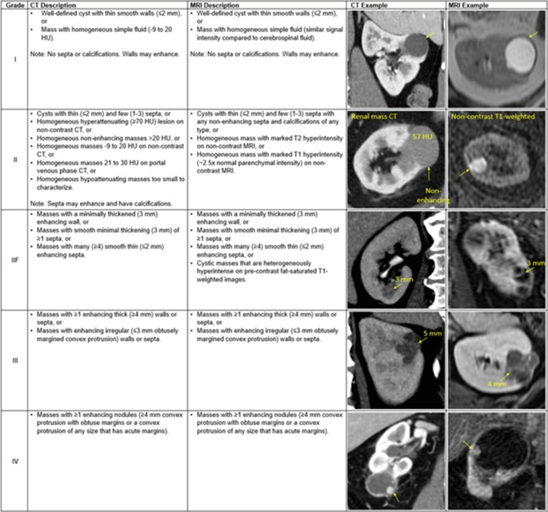

> *Nguồn dự kiến: Radiopaedia — ảnh CT/MRI minh họa nang thận Bosniak các lớp, từ nang đơn giản đến nang phức tạp có nốt lồi — agent ảnh sẽ thay bằng ảnh thật đã kiểm chứng.*

 Ví dụ: khối nang thận 4 cm có thành dày và nốt lồi tù 2 mm, xếp lớp III với tỉ lệ ác tính gộp khoảng 80%, kết luận cần hội chẩn phẫu thuật thay vì chỉ theo dõi.

 Ví dụ: khối nang thận có nhiều vách mỏng và nhẵn, xếp lớp IIF, kết luận cần theo dõi hình ảnh định kỳ vì tỉ lệ ác tính gộp khoảng 26% nhưng thiên lệch kiểm chứng làm con số này chưa chắc chắn.

> ⚠️ BẪY — Tỉ lệ ác tính của lớp IIF thay đổi rất lớn tùy chuẩn tham chiếu. Cùng một lớp IIF, tỉ lệ ác tính là 41% nếu tính trên bệnh nhân đã mổ có giải phẫu bệnh, nhưng chỉ 2% nếu tính trên bệnh nhân theo dõi hình ảnh. Đọc tỉ lệ mà không hỏi chuẩn tham chiếu là đọc sai.

### 9.5. Xơ hóa hệ thống do gadolinium — NSF [CỐT LÕI]

 NSF là bệnh xơ hóa lan tỏa ở da, khớp và nội tạng sau khi tiêm thuốc cản quang gadolinium ở bệnh nhân suy thận nặng.

 Đồng thuận của Hội Điện quang Hoa Kỳ và Quỹ Thận Quốc gia Hoa Kỳ (ACR–NKF) năm 2021 cho rằng nguy cơ NSF từ thuốc gadolinium nhóm II ở bệnh nhân bệnh thận tiến triển rất thấp: 0 sự kiện sau 4.931 lần dùng ở bệnh nhân eGFR dưới 30 mL/phút/1,73 m², giới hạn trên của khoảng tin cậy 95% là 0,07% tổng thể, 0,2% ở suy thận mạn giai đoạn 5D đang lọc máu, và 0,5% ở suy thận mạn giai đoạn 5 không lọc máu [DATA VERIFIED].

 Không có ca NSF không gây nhiễu nào được báo cáo với thuốc nhóm III duy nhất hiện có là gadoxetate disodium [ABSTRACT VERIFIED].

 Tùy chỉ định, tác hại của việc trì hoãn hay hoãn dùng thuốc nhóm II hay III ở bệnh nhân tổn thương thận cấp hoặc eGFR dưới 30 cần cân bằng với nguy cơ NSF và có thể lớn hơn nguy cơ NSF [ABSTRACT VERIFIED].

 Việc bắt đầu hoặc thay đổi lọc máu sau khi dùng thuốc nhóm II hay III có lẽ không cần thiết [ABSTRACT VERIFIED].

 Các thuốc macrocyclic mới đã chứng minh an toàn hơn nhiều ở bệnh nhân suy thận mạn và suy thận giai đoạn cuối, nhưng bác sĩ vẫn phải hiểu đặc điểm lâm sàng và yếu tố nguy cơ của bệnh lý này và duy trì nghi ngờ cao để phòng ngừa và nhận biết [ABSTRACT VERIFIED].

 Hướng dẫn châu Âu thận trọng hơn với thuốc nguy cơ thấp nhất khi GFR dưới 30, nhưng khuyến cáo này chỉ biết qua tóm tắt thứ cấp và chưa kiểm chứng toàn văn trong đợt này, nên bài này dạy theo ACR–NKF có số liệu và ghi chú sự khác biệt (xem mâu thuẫn K4 và U5 ở §11) [NGOÀI ABSTRACT].

| Nhóm bệnh nhân | Giới hạn trên khoảng tin cậy 95% của nguy cơ NSF |
|---|---|
| Tất cả bệnh nhân eGFR dưới 30 | 0,07% |
| Suy thận mạn giai đoạn 5D đang lọc máu | 0,2% |
| Suy thận mạn giai đoạn 5 không lọc máu | 0,5% |

### 9.6. Bảng xếp hạng ACR — staging ung thư thận và suy thận [CỐT LÕI]

 Tiêu chuẩn phù hợp của ACR cho staging ung thư tế bào thận xếp các phương tiện sau đây là thường phù hợp khi không chống chỉ định cản quang: MRI bụng và chậu không và có cản quang tĩnh mạch, MRI bụng không và có cản quang tĩnh mạch, CT bụng và chậu có cản quang tĩnh mạch, CT bụng có cản quang tĩnh mạch, và CT ngực có cản quang tĩnh mạch [GUIDELINE VERIFIED].

 Siêu âm bụng, CTU, PET/CT với FDG, MRI không cản quang và CT không cản quang đều xếp loại thường không phù hợp để staging ung thư thận [GUIDELINE VERIFIED].

 Khi chống chỉ định cả cản quang iod và gadolinium, MRI bụng và chậu không cản quang cùng CT ngực không cản quang là thường phù hợp [GUIDELINE VERIFIED].

 Khi chỉ chống chỉ định cản quang iod, MRI bụng và chậu không và có cản quang tĩnh mạch cùng CT ngực không cản quang là thường phù hợp [GUIDELINE VERIFIED].

 Điểm dạy là staging ung thư thận dùng CT hay MRI bụng–chậu có cản quang kèm CT ngực, siêu âm và CTU không phù hợp để staging, PET/CT thường không phù hợp, và khi chống chỉ định cản quang thì chuyển sang MRI hay CT không cản quang theo từng trường hợp [GUIDELINE VERIFIED].

 Tiêu chuẩn phù hợp của ACR cho suy thận xếp siêu âm thận sau phúc mạc là hình ảnh ban đầu thường phù hợp cho tổn thương thận cấp chưa rõ nguyên nhân, suy thận mạn, bệnh thận chưa rõ thời gian và bàng quang thần kinh [GUIDELINE VERIFIED].

 Mọi CT hay MRI có cản quang, CTU và X-quang bụng đều xếp loại thường không phù hợp ở bước đầu của suy thận [GUIDELINE VERIFIED].

 Phần văn bản tổng quan của 2 tài liệu ACR này không có trong file đã truy được, chỉ có bảng xếp hạng và tài liệu tham khảo, nên bài này chỉ dạy bảng xếp hạng và không trích luận cứ văn bản từ 2 tài liệu này (xem U13 ở §11).

### 🛑 DỪNG 1 PHÚT — TỰ KIỂM TRA

> 1. Vì sao MRU ngang CTU trong một nghiên cứu nhỏ chưa đủ để nói MRI thường quy ngang CT?
> 2. Lớp Bosniak nào cần theo dõi định kỳ, lớp nào thường cần phẫu thuật, và vì sao tỉ lệ ác tính lớp IIF chưa chắc chắn?
>
> *(Đáp án: 1. Nghiên cứu chỉ có 20 bệnh nhân và dùng protocol MRU toàn diện gồm DCE và DWI; MRI thường quy chỉ có T1 và T2 thì không đủ. 2. Lớp IIF theo dõi định kỳ, lớp III và IV thường cần phẫu thuật; tỉ lệ IIF là 41% theo giải phẫu bệnh nhưng chỉ 2% theo dõi hình ảnh.)*

---

## 10. CHẨN ĐOÁN HÌNH ẢNH GẮN VỚI BỆNH ĐÃ HỌC [CỐT LÕI]

 Mục này gắn hình ảnh với 5 nhóm bệnh đã học, mỗi bệnh ghi phương tiện đầu tay, phương tiện xác nhận và dấu hiệu đặc trưng.

 Cách chọn phương tiện đã dạy ở 3 bài trước, bài này chỉ dạy cách đọc phim và dấu hiệu đặc trưng, không dạy lại nội dung của 3 bài đó.

### 10.1. Sỏi thận [CỐT LÕI]

 Phương tiện đầu tay là siêu âm, phương tiện xác nhận là CT không cản quang.

 Dấu hiệu đặc trưng trên siêu âm là ổ tăng âm kèm bóng lưng trong đài bể thận, kèm giãn đài bể thận nếu có tắc nghẽn.

 Dấu hiệu đặc trưng trên CT là ổ đậm độ cao trong đài bể thận, ghi đủ vị trí, kích thước, số lượng và mật độ HU.

 Cách chọn phương tiện và các mốc điều trị đã dạy ở bài Sỏi thận §3.4, bài này dạy thêm cách đọc phim: KUB, Doppler RI, rim sign, dấu hiệu thứ phát định lượng, SFU và số liệu EAU 2026 toàn văn.

 Ví dụ: siêu âm thấy sỏi bể thận 9 mm kèm bóng lưng rõ và giãn đài bể thận vừa, CT xác nhận sỏi 9 mm mật độ 1.100 HU, kết luận sỏi bể thận gây tắc một phần và cần hội chẩn can thiệp.

### 10.2. Sỏi niệu quản [CỐT LÕI]

 Với sỏi niệu quản, siêu âm vẫn là phương tiện đầu tay và CT không cản quang vẫn là phương tiện xác nhận.

 Dấu hiệu đặc trưng trên CT là ổ đậm độ cao dọc đường niệu quản kèm rim sign, giãn đài bể thận, giãn niệu quản và thâm nhiễm mỡ quanh thận.

 Rim sign và thang điểm STONE đã dạy ở bài Sỏi niệu quản §3.4–3.5, bài này bổ sung định lượng từng dấu hiệu thứ phát: giãn đài bể thận và giãn niệu quản có giá trị tiên đoán âm bằng 1,0 ở CT theo dõi, thâm nhiễm mỡ quanh thận có độ nhạy 0,21 và độ đặc hiệu 0,94.

 Sỏi acid uric có tỉ lệ dấu hiệu thứ phát cao hơn sỏi calci, nhất là thâm nhiễm mỡ quanh thận 84,2% so với 59,2%.

 Ví dụ: CT thấy sỏi 5 mm ở niệu quản đoạn giữa kèm rim sign và giãn niệu quản rõ, kết luận sỏi niệu quản gây tắc nghẽn cấp và cần theo dõi sát diễn tiến tắc.

### 10.3. Chấn thương niệu đạo [CỐT LÕI]

 Phương tiện quyết định là RUG, làm trước mọi đặt sonde tiểu qua niệu đạo.

 Dấu hiệu đặc trưng trên RUG là thuốc thoát ra ngoài niệu đạo, bàng quang có đầy thuốc hay không, và vị trí tổn thương là niệu đạo trước hay sau.

 Kỹ thuật RUG 20–30 mL và nghiêng 30 độ cùng BOX ĐỎ về cấm đặt sonde trước khi chụp đã dạy ở bài Chấn thương niệu đạo §5, bài này dạy thêm RUG trong hẹp niệu đạo, VCUG, cystography và MRI trước điều trị trì hoãn.

 Siêu âm hướng dẫn đặt dẫn lưu trên mu trong giai đoạn cấp, MRI trước điều trị trì hoãn ở PFUI phức tạp cho biết độ dài đoạn khuyết, mức độ di lệch tiền liệt tuyến và có hay không đường giả.

 Ví dụ: bệnh nhân gãy khung chậu kèm máu miệng sáo, RUG thấy thuốc thoát ồ ạt mà bàng quang không đầy thuốc, kết luận gợi ý đứt niệu đạo hoàn toàn và cần dẫn lưu trên mu cùng hội chẩn tiết niệu khẩn.

### 10.4. Tắc nghẽn và thận ứ nước [CỐT LÕI]

 Phương tiện đầu tay là siêu âm, phương tiện xác nhận là CT không cản quang hay CTU tùy nguyên nhân nghi ngờ.

 Dấu hiệu đặc trưng là giãn đài bể thận, giãn niệu quản, thận sưng to, thâm nhiễm mỡ quanh thận và chênh lệch mật độ thận.

 Doppler RI và delta RI giúp đánh giá tắc nghẽn cấp khi siêu âm thường chưa rõ, với ngưỡng RI từ 0,70 và delta RI từ 0,06 trở lên.

 Ở CT theo dõi, vắng giãn đài bể thận và giãn niệu quản phản bác tắc nghẽn còn tồn tại vì giá trị tiên đoán âm của 2 dấu hiệu này đều bằng 1,0.

 Phân độ SFU dựa trên hình dạng đài thận, bể thận và nhu mô thận, nhưng định nghĩa chi tiết từng độ chưa đối chiếu nguyên văn nên không dạy như sự thật đã kiểm chứng.

 Ví dụ: siêu âm thấy thận phải ứ nước rõ, đài thận giãn rộng, nhu mô thận mỏng, kết luận ứ nước nặng và cần tìm nguyên nhân tắc ở niệu quản hay khúc nối bể thận–niệu quản.

### 10.5. U thận [CỐT LÕI]

 Phương tiện phát hiện thường là siêu âm tình cờ, phương tiện đặc trưng là CT hay MRI bụng có cản quang, staging theo bảng xếp hạng ACR.

 Dấu hiệu đặc trưng của u thận đặc là khối tăng quang không đều trong nhu mô thận, bờ không rõ, có thể kèm huyết khối tĩnh mạch thận.

 Dấu hiệu đặc trưng của u thận dạng nang là nang có vách, thành dày hay nốt lồi, xếp lớp Bosniak v2019 để quyết định theo dõi hay phẫu thuật.

 Phân loại Bosniak là nội dung mới, 3 bài cũ chưa dạy, và là phần dạy thêm chính của bài này cho nhóm u thận.

 Ở bệnh nhân suy thận mạn, u thận khó đánh giá vì hạn chế cản quang, CEUS là lựa chọn dùng được ở mọi giai đoạn kể cả lọc máu.

 Ví dụ: CT thấy khối đặc 5 cm ở cực dưới thận trái tăng quang không đều, kết luận nghi ung thư tế bào thận và cần staging bằng CT bụng–chậu có cản quang kèm CT ngực theo bảng ACR.

### 10.6. U bàng quang và tiểu máu [CỐT LÕI]

 Phương tiện đầu tay ở bệnh nhân nguy cơ thấp hay nam trẻ dưới 40 tuổi là siêu âm, phương tiện xác nhận ở bệnh nhân nguy cơ cao là CTU.

 Dấu hiệu đặc trưng trên CTU pha niệu mạc là khối tăng quang trong lòng bàng quang, độ nhạy 89,3% so với 70,5% ở pha bài tiết.

 Nội soi bàng quang vẫn là tiêu chuẩn vàng phát hiện u niệu mạc đường niệu dưới, CTU không thay thế được nội soi.

 Mọi bệnh nhân tiểu máu cần hỏi bệnh sử và khám thực thể kỹ, xét nghiệm nước tiểu và xét nghiệm máu trước bất kỳ hình ảnh ban đầu nào [ABSTRACT VERIFIED].

 Siêu âm, CT và MRI là 3 phương tiện thường dùng nhất để đánh giá tiểu máu [ABSTRACT VERIFIED].

 Bảng xếp hạng cụ thể từng kịch bản tiểu máu của ACR chưa truy được, nên bài này chỉ dạy nguyên tắc chung từ abstract và không trích bảng xếp hạng (xem U15 ở §11).

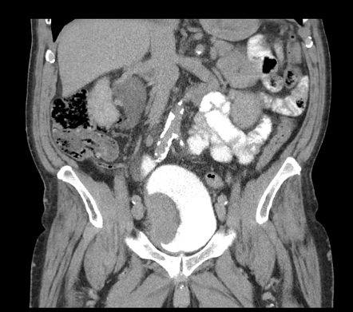

> *Nguồn dự kiến: Radiopaedia — ảnh CTU thấy khối u bàng quang tăng quang trong lòng bàng quang — agent ảnh sẽ thay bằng ảnh thật đã kiểm chứng.*

 Ví dụ: bệnh nhân nam 65 tuổi tiểu máu đại thể không đau, CTU pha niệu mạc thấy khối 2 cm ở thành bên bàng quang, kết luận nghi u bàng quang và cần nội soi bàng quang sinh thiết.

---

## 11. MÂU THUẪN, BẪY VÀ GIỚI HẠN BẰNG CHỨNG [CỐT LÕI]

### 11.1. Sáu mâu thuẫn trong y văn — dạy cả 2 phía [CỐT LÕI]

 Mâu thuẫn K1 — Liều bức xạ CTU so với IVU phụ thuộc protocol và thế hệ máy.

 Phía thứ nhất: một nghiên cứu năm 2015 bằng máy CT dual-slice cho thấy CTU có liều 2,53 mSv, cao hơn IVU là 1,81 mSv nhưng chênh lệch nhỏ.

 Phía thứ hai: một nghiên cứu năm 2016 với CTU 3 pha cho thấy liều trung bình là 9,2 mSv, gấp khoảng 5 lần liều IVU trong nghiên cứu 2015.

 Phía thứ ba: một tổng quan năm 2022 vẫn kể liều bức xạ thấp là một ưu điểm của IVU.

 Cách dạy đúng là không có một con số liều duy nhất cho CTU: CTU một pha liều thấp có thể tiệm cận IVU, CTU đa pha 3–4 pha cao hơn IVU nhiều lần, và khi dạy phải ghi rõ protocol đi kèm con số liều.

 Mâu thuẫn K2 — MRU ngang CTU so với bằng chứng MRI còn hạn chế.

 Phía thứ nhất: một nghiên cứu tiền cứu với 20 bệnh nhân ở một trung tâm cho thấy MRU 3.0T toàn diện đạt hiệu năng chẩn đoán bằng CTU 3 pha.

 Phía thứ hai: một tổng quan hệ thống trên 15 nghiên cứu với 999 bệnh nhân kết luận bằng chứng còn hạn chế và không đồng nhất, chuỗi chuẩn T1 và T2 không đủ, chỉ DCE và DWI mới đạt độ nhạy khoảng 92–93%.

 Cách dạy đúng là kết luận MRU ngang CTU dựa trên một nghiên cứu nhỏ với protocol toàn diện gồm DCE và DWI, không thể khái quát thành MRI thường quy ngang CT, và cần protocol DCE kèm DWI mới đạt hiệu năng đó.

 Mâu thuẫn K3 — Hai con số bỏ sót khoảng 50% khác nhau, không được gộp.

 Phía thứ nhất: EAU 2026 tổng kết VCUG bỏ sót tổn thương niệu đạo nữ khoảng 50% so với nội soi niệu đạo–bàng quang.

 Phía thứ hai: một nghiên cứu năm 2026 cho thấy VCUG bỏ sót trào ngược bàng quang–niệu quản ở trẻ em tới 50% số ca.

 Hai quần thể và hai bệnh lý khác nhau, con số trùng nhau là ngẫu nhiên, khi dạy phải tách rõ từng con số với đúng bệnh lý của nó.

 Mâu thuẫn K4 — NSF: không cần hoãn gadolinium nhóm II khi eGFR dưới 30 so với thận trọng truyền thống.

 Phía thứ nhất: đồng thuận ACR–NKF năm 2021 cho thấy 0 ca NSF sau 4.931 lần dùng thuốc nhóm II ở bệnh nhân eGFR dưới 30, và tác hại của việc hoãn chụp có thể lớn hơn nguy cơ NSF.

 Phía thứ hai: quan điểm thận trọng cũ cho rằng hướng dẫn châu Âu vẫn khuyên thận trọng với thuốc nguy cơ thấp nhất khi GFR dưới 30, nhưng quan điểm này chỉ biết qua tóm tắt thứ cấp và chưa kiểm chứng toàn văn trong đợt này.

 Cách dạy đúng là dạy theo ACR–NKF có số liệu, đồng thời ghi chú sự khác biệt với hướng dẫn châu Âu.

 Mâu thuẫn K5 — Dấu hiệu tắc nghẽn thứ phát: gặp rất nhiều so với ít gặp và giá trị không chắc chắn.

 Phía thứ nhất: một nghiên cứu năm 2012 chụp CT không cản quang trong cơn cấp trên 117 bệnh nhân cho thấy dấu hiệu thứ phát gặp rất thường xuyên, giãn niệu quản 89,8–94,7%, thâm nhiễm mỡ quanh thận 59,2–84,2%, rim sign 60,2–78,9%.

 Phía thứ hai: một nghiên cứu năm 2018 chụp CT theo dõi sau cơn đau quặn trên 49 lần chụp cho thấy tắc nghẽn chỉ còn ở 28% số ca, dấu hiệu thứ phát ít gặp và giá trị không chắc chắn, thâm nhiễm mỡ quanh thận chỉ có độ nhạy 0,21.

 Cách dạy đúng là hai quần thể khác nhau: nghiên cứu thứ nhất chụp trong cơn cấp khi tắc đang diễn ra, nghiên cứu thứ hai chụp theo dõi sau cơn khi tắc đã giảm ở đa số, và ở CT theo dõi thì vắng giãn đài bể thận kèm giãn niệu quản mới là thông tin mạnh nhất vì giá trị tiên đoán âm bằng 1,0.

 Mâu thuẫn K6 — Siêu âm phát hiện sỏi: nhạy 45% so với nhạy 96% so với chiến lược siêu âm trước không thua CT.

 Phía thứ nhất: EAU 2026 tổng kết siêu âm đơn thuần có độ nhạy 45% với sỏi niệu quản và sỏi thận.

 Phía thứ hai: một nghiên cứu năm 2007 cho thấy KUB kết hợp siêu âm harmonic mô tự nhiên có độ nhạy 96% và độ đặc hiệu 91%.

 Phía thứ ba: thử nghiệm NEJM năm 2014 trên 2.759 bệnh nhân cho thấy chiến lược siêu âm đầu tay không làm tăng chẩn đoán nguy cơ cao bị bỏ sót so với CT ngay.

 Cách dạy đúng là tách rõ 3 điều: độ chính xác của một lần siêu âm đơn thuần thấp, kết hợp KUB với siêu âm harmonic cải thiện mạnh nhưng chỉ là một nghiên cứu đơn trung tâm với 98 bệnh nhân, và chiến lược siêu âm trước rồi CT khi cần an toàn về kết cục nhưng an toàn của chiến lược không đồng nghĩa siêu âm đơn lẻ nhạy như CT.

### 11.2. Bẫy thường gặp — tổng hợp [CỐT LÕI]

| # | Bẫy | Hậu quả | Cách tránh |
|---|---|---|---|
| 1 | KUB bình thường kết luận không có sỏi | Bỏ sót sỏi acid uric gây tắc | KUB âm tính chưa loại trừ sỏi, chụp CT khi lâm sàng nghi ngờ cao |
| 2 | Thấy sỏi là dừng đọc phim | Bỏ sót tắc nghẽn, nhiễm khuẩn, khối u khác | Đọc hết khung 4 bước rồi mới kết luận |
| 3 | Siêu âm âm tính loại trừ sỏi | Bỏ sót sỏi đoạn giữa do ruột che | Siêu âm âm tính không loại trừ sỏi, chụp CT khi cần |
| 4 | Đọc RI tuyệt đối không so sánh thận đối bên | Kết luận tắc sai ở bệnh thận mạn | Luôn dùng delta RI so với thận đối bên |
| 5 | Gộp 2 con số bỏ sót 50% thành một | Dạy sai quần thể và bệnh lý | Tách rõ VCUG bỏ sót tổn thương niệu đạo nữ và bỏ sót VUR ở trẻ em |
| 6 | CTU bình thường loại trừ hoàn toàn UTUC | Bỏ sót u đài thận tới một nửa số ca | Sinh thiết qua nội soi niệu quản trước phẫu thuật triệt căn |
| 7 | Dạy tỉ lệ ác tính Bosniak IIF không hỏi chuẩn tham chiếu | Đánh giá sai nguy cơ 41% so với 2% | Luôn hỏi chuẩn tham chiếu là giải phẫu bệnh hay theo dõi hình ảnh |
| 8 | Đặt sonde tiểu trước khi chụp RUG | Biến đứt một phần thành đứt hoàn toàn | Chụp RUG trước, đặt dẫn lưu trên mu nếu cần |

 Ví dụ: bệnh nhân đau quặn hông, KUB không thấy sỏi, bác sĩ kết luận không có sỏi và cho về, 2 ngày sau bệnh nhân quay lại với thận ứ nước nặng do sỏi acid uric tắc niệu quản mà KUB không thấy được.

 Ví dụ: đọc CTU thấy bể thận bình thường, bác sĩ kết luận không có u, nhưng u đài thận nhỏ đã bị bỏ sót vì CTU chỉ phát hiện đúng vị trí u đài thận một nửa số ca.

### 11.3. Giới hạn bằng chứng — những gì bài này KHÔNG dạy [CỐT LÕI]

 Mục này liệt kê những gì chưa kiểm chứng được và bài này đã tránh không dạy thành sự thật.

 Không có nghiên cứu đối đầu trực tiếp nào so sánh độ nhạy và độ đặc hiệu của IVU với CTU trong phát hiện u niệu mạc đường niệu trên, nên bài này không dạy con số so sánh trực tiếp.

 Định nghĩa chi tiết từng độ trào ngược bàng quang–niệu quản I–V nằm trong toàn văn bài báo năm 1985, không truy được bản mở, nên bài này không dạy định nghĩa từng độ như sự thật đã kiểm chứng.

 Nguồn gốc độc lập của con số RUG 20–30 mL và nghiêng 30 độ đã kiểm chứng trong toàn văn EAU 2026, nhưng chưa truy được bài gốc để xác nhận nguồn sơ cấp.

 Khuyến cáo hình ảnh cụ thể của guideline AUA về điều trị nội khoa sỏi thận năm 2026 chưa kiểm chứng được vì toàn văn bị trả phí, nên bài này không trích khuyến cáo chi tiết về phương thức và chu kỳ chụp.

 Toàn văn hướng dẫn về thuốc cản quang của ACR và ESUR phần xơ hóa hệ thống do gadolinium không truy được trong đợt này, nên bài này dạy NSF theo đồng thuận ACR–NKF năm 2021 có số liệu.

 Không tìm được nghiên cứu đối đầu có số liệu so sánh trực tiếp MRI với CT trong staging u thận, nên bài này chỉ dạy bảng xếp hạng ACR mà không trích số liệu độ chính xác so sánh.

 Kỹ thuật IVU chi tiết như thể tích thuốc cản quang và thời điểm chụp từng phim không truy được nguồn sơ cấp có số liệu, nên bài này chỉ dạy vai trò hiện nay và liều bức xạ của IVU.

 Không có bảng tỉ lệ nhạy và đặc hiệu của RUG cho từng loại tổn thương niệu đạo theo vị trí trong các nguồn đã kiểm chứng, nên bài này chỉ dạy mô tả định tính của EAU 2026.

 Claim về dấu hiệu comet-tail trong bài Sỏi niệu quản chưa tìm được bài gốc sau nhiều lần tìm kiếm, nên bài này chỉ dạy rim sign đã kiểm chứng và ghi rõ comet-tail chưa đối chiếu được nguồn.

 Định nghĩa chi tiết từng lớp Bosniak v2019 theo nguyên văn bài báo gốc và từng độ SFU 0–IV chưa đối chiếu nguyên văn, nên bài này chỉ dạy các đặc điểm đã xuất hiện trong abstract của tổng quan hệ thống.

 Không tìm được nghiên cứu nào về một checklist đọc hệ thống hình ảnh tiết niệu đã kiểm chứng, nên khung 4 bước trong bài này là tổng hợp dạy học, không phải guideline đã kiểm chứng.

 Toàn văn EAU Urolithiasis 2025 không lấy được do lỗi truy cập, nên mọi khuyến cáo sỏi trong bài này lấy từ bản EAU 2026 toàn văn.

 Phần văn bản tổng quan của 2 tài liệu ACR về staging ung thư thận và suy thận không có trong file đã truy được, nên bài này chỉ dạy bảng xếp hạng và không trích luận cứ văn bản.

 Ngưỡng HU dự báo thành công tán sỏi ngoài cơ thể chưa lấy được abstract gốc, nên bài này không dạy ngưỡng HU cụ thể nào.

 Bảng xếp hạng cụ thể từng kịch bản tiểu máu của ACR chưa truy được, nên bài này chỉ dạy nguyên tắc chung từ abstract và không trích bảng xếp hạng.

 Hai tổng quan Cochrane về điều trị sỏi (citrate và chẹn alpha) có trong hồ sơ nghiên cứu nhưng là bằng chứng điều trị, ngoài phạm vi hình ảnh, nên bài này không trích chúng và không in số định danh của chúng trong bài.

 Khung đọc phim 4 bước và các ví dụ minh họa trong bài là tổng hợp dạy học từ các bằng chứng đã kiểm chứng, không phải một protocol đã được nghiên cứu kiểm chứng.

### 11.4. Kết quả kiểm tra trích dẫn — danh sách WARN [CỐT LÕI]

 Bài này chạy kiểm tra trích dẫn với yêu cầu 0 BLOCK, WARN được phép nhưng phải liệt kê đầy đủ để người đọc thấy rõ.

 Kết quả kiểm tra trích dẫn của bài này là 33 citation, trong đó 11 PASS, 22 WARN và 0 BLOCK, đạt yêu cầu 0 BLOCK.

 Toàn bộ 22 WARN đều có cùng một lý do duy nhất là tạp chí chưa có trong bảng phân hạng của hệ thống kiểm tra, không có WARN nào do số liệu cụ thể gần định danh, và không có BLOCK nào.

| STT | Nghiên cứu (tạp chí, năm) | Verdict |
|---|---|---|
| 1 | KUB kết hợp siêu âm harmonic mô tự nhiên so với CT (BJU Int, 2007) | WARN — tạp chí chưa có trong bảng phân hạng của hệ thống kiểm tra |
| 2 | CT liều thấp phát hiện sỏi, phân tích gộp (AJR Am J Roentgenol, 2008) | WARN — tạp chí chưa có trong bảng phân hạng của hệ thống kiểm tra |
| 3 | Doppler RI và delta RI trong tắc nghẽn cấp (Int J Nephrol Renovasc Dis, 2012) | WARN — tạp chí chưa có trong bảng phân hạng của hệ thống kiểm tra |
| 4 | CT liều thấp KUB, tổng quan hệ thống (J Med Imaging Radiat Oncol, 2017) | WARN — tạp chí chưa có trong bảng phân hạng của hệ thống kiểm tra |
| 5 | Doppler RI động mạch trong thận (J Ultrasound, 2021) | WARN — tạp chí chưa có trong bảng phân hạng của hệ thống kiểm tra |
| 6 | Phân độ ứ nước SFU (Pediatr Radiol, 1993) | WARN — tạp chí chưa có trong bảng phân hạng của hệ thống kiểm tra |
| 7 | Liều bức xạ CTU so với IVU so với xạ hình thận (Radiat Prot Dosimetry, 2015) | WARN — tạp chí chưa có trong bảng phân hạng của hệ thống kiểm tra |
| 8 | Hình ảnh hẹp niệu đạo (Transl Androl Urol, 2015) | WARN — tạp chí chưa có trong bảng phân hạng của hệ thống kiểm tra |
| 9 | Guideline chấn thương niệu của AUA (J Urol, 2021) | WARN — tạp chí chưa có trong bảng phân hạng của hệ thống kiểm tra |
| 10 | MRI trong hẹp niệu đạo, tổng quan hệ thống (Diagn Interv Radiol, 2021) | WARN — tạp chí chưa có trong bảng phân hạng của hệ thống kiểm tra |
| 11 | Độ chính xác CT/CTU với UTUC (Urol Ann, 2021) | WARN — tạp chí chưa có trong bảng phân hạng của hệ thống kiểm tra |
| 12 | Vai trò hiện nay của IVU (Br J Radiol, 2022) | WARN — tạp chí chưa có trong bảng phân hạng của hệ thống kiểm tra |
| 13 | NSF và thuốc macrocyclic (Diagnostics, 2022) | WARN — tạp chí chưa có trong bảng phân hạng của hệ thống kiểm tra |
| 14 | CT một pha thận so với CT 4 pha (Eur Urol Open Sci, 2023) | WARN — tạp chí chưa có trong bảng phân hạng của hệ thống kiểm tra |
| 15 | MRI trong UTUC, tổng quan hệ thống (Front Oncol, 2026) | WARN — tạp chí chưa có trong bảng phân hạng của hệ thống kiểm tra |
| 16 | U thận ở bệnh nhân suy thận mạn (Abdom Radiol, 2026) | WARN — tạp chí chưa có trong bảng phân hạng của hệ thống kiểm tra |
| 17 | Guideline AUA điều trị nội khoa sỏi thận, phần II (J Urol, 2026) | WARN — tạp chí chưa có trong bảng phân hạng của hệ thống kiểm tra |
| 18 | Guideline AUA điều trị nội khoa sỏi thận, phần I (J Urol, 2026) | WARN — tạp chí chưa có trong bảng phân hạng của hệ thống kiểm tra |
| 19 | Dấu hiệu thứ phát sỏi acid uric so với sỏi calci (Kaohsiung J Med Sci, 2012) | WARN — tạp chí chưa có trong bảng phân hạng của hệ thống kiểm tra |
| 20 | Giá trị tiên đoán dấu hiệu thứ phát ở CT theo dõi (Scand J Urol, 2018) | WARN — tạp chí chưa có trong bảng phân hạng của hệ thống kiểm tra |
| 21 | Hiệu năng Bosniak v2019, tổng quan hệ thống (Front Oncol, 2022) | WARN — tạp chí chưa có trong bảng phân hạng của hệ thống kiểm tra |
| 22 | Tỉ lệ ác tính theo lớp Bosniak v2019 (AJR Am J Roentgenol, 2025) | WARN — tạp chí chưa có trong bảng phân hạng của hệ thống kiểm tra |

 Lý do chung của các WARN trên là tạp chí chưa có trong bảng phân hạng của hệ thống kiểm tra, không phải vì số liệu sai hay bài báo không tồn tại.

 Mọi định danh trong bảng trên đều có trong evidence bundle và đã được kiểm chứng tồn tại, chỉ có mức phân hạng tạp chí là chưa có trong bảng của hệ thống.

---

## 12. LƯU ĐỒ QUYẾT ĐỊNH, THEO DÕI VÀ ÁP DỤNG TẠI VIỆT NAM [CỐT LÕI]

### 12.1. Lưu đồ quyết định — từ triệu chứng đến phương tiện [CỐT LÕI]

```text
Bệnh nhân đến vì đau hông cấp, tiểu máu hay nghi chấn thương niệu
│
├── Có dấu hiệu cấp cứu? (sốt cao + đau hông, thận độc nhất, huyết
│   động không ổn định, chấn thương nặng, vô niệu)
│   ├── CÓ → 🛑 CẤP CỨU NGAY
│   │   ├── Sốt + đau hông → nghi nhiễm khuẩn tắc nghẽn: siêu âm
│   │   │   ngay tại giường + xét nghiệm máu và nước tiểu, kháng
│   │   │   sinh sớm, hội chẩn tiết niệu giải áp khẩn
│   │   ├── Nghi chấn thương niệu đạo → 🛑 KHÔNG đặt sonde tiểu
│   │   │   → chụp RUG trước, dẫn lưu trên mu nếu cần
│   │   └── Huyết động không ổn định → hồi sức trước, hoãn RUG
│   │       và hoãn CT có cản quang cho đến khi ổn định
│   └── KHÔNG → Bước tiếp theo: bệnh nhân thuộc nhóm nào?
│       ├── Đau hông cấp nghi sỏi
│       │   ├── Plan A (đủ phương tiện): siêu âm đầu tay → CT
│       │   │   không cản quang liều thấp để xác nhận
│       │   └── Plan B (thiếu CT): siêu âm + KUB → theo dõi sát,
│       │       chuyển tuyến khi đau không giảm hay sốt xuất hiện
│       ├── Tiểu máu đại thể không đau
│       │   ├── Plan A: siêu âm ban đầu → CTU (nguy cơ cao) +
│       │   │   nội soi bàng quang
│       │   └── Plan B: siêu âm + xét nghiệm đầy đủ → chuyển
│       │       tuyến trên chụp CTU và nội soi
│       ├── Thai phụ nghi sỏi
│       │   ├── Plan A: siêu âm → MRI không cản quang nếu chưa rõ
│       │   └── Plan B: siêu âm lặp lại + theo dõi sát, CT liều
│       │       thấp chỉ là lựa chọn cuối cùng
│       └── Suy thận cần hình ảnh
│           ├── Plan A: siêu âm thận sau phúc mạc → CEUS nếu cần
│           │   đánh giá khối có mạch máu
│           └── Plan B: siêu âm + xét nghiệm chức năng thận,
│               tránh cản quang iod và gadolinium ở bước đầu
```

### 12.2. Giải thích từng bước của lưu đồ [CỐT LÕI]

1. **Bước 1 — Có dấu hiệu cấp cứu không:** Hỏi câu này trước mọi quyết định chụp, vì sốt kèm đau hông gợi ý nhiễm khuẩn tắc nghẽn cần giải áp khẩn, còn chấn thương niệu đạo cần RUG trước khi đặt sonde.
2. **Bước 2 — Bệnh nhân thuộc nhóm nào:** Đau hông cấp, tiểu máu, thai phụ và suy thận có đường đi khác nhau, không dùng một protocol chung cho mọi người.
3. **Bước 3 — Plan A hay Plan B:** Plan A dùng khi đủ phương tiện, Plan B dùng khi thiếu CT hay MRI, và Plan B phải nêu rõ điều vẫn làm được ngay, điều không được suy diễn thay thế, và ngưỡng chuyển tuyến.
4. **Bước 4 — Đánh giá lại sau hình ảnh:** Sau khi có kết quả, quay lại khung 4 bước ở §1 để kết luận và quyết định bước tiếp theo, không dừng ở việc có phim.

### 12.3. Theo dõi sau chẩn đoán hình ảnh [CỐT LÕI]

 Theo dõi sỏi phải so sánh bằng cùng một phương tiện: siêu âm lần trước so với CT lần này không kết luận được sỏi to lên hay nhỏ đi.

 Ghi rõ kích thước, vị trí, số lượng sỏi và phương tiện đã dùng trong mỗi lần chụp, để lần sau so sánh được.

 Mảnh sỏi tồn dư sau can thiệp lớn lên trên 2 lần chụp liên tiếp quan trọng hơn kích thước tuyệt đối trong 1 lần chụp.

 Stent niệu quản phải ghi ngày đặt và ngày tháo hay thay, vì stent quên có thể gây nhiễm khuẩn và tắc nghẽn.

 Nội dung theo dõi sỏi sau can thiệp đã dạy ở bài Sỏi thận §7.5 và bài Sỏi niệu quản §3.5, bài này chỉ nhắc lại nguyên tắc so sánh cùng phương tiện.

 Guideline AUA về điều trị nội khoa sỏi thận năm 2026 có 2 khuyến cáo theo dõi về chụp hình ảnh giám sát định kỳ và xét nghiệm chuyển hóa, nhưng nội dung cụ thể về phương thức và chu kỳ chụp chưa kiểm chứng được nên bài này không trích chi tiết.

 Nang thận lớp IIF cần theo dõi hình ảnh định kỳ, còn nang lớp III và IV thường cần phẫu thuật, theo tỉ lệ ác tính gộp đã dạy ở §9.4.

 Dấu hiệu cần tái khám sớm là sốt, đau tăng, vô niệu hay tiểu máu nhiều hơn, và khi xuất hiện các dấu hiệu này thì chụp lại ngay thay vì chờ lịch hẹn.

### 12.4. Áp dụng tại Việt Nam [CỐT LÕI]

 Chưa có số liệu quốc gia về tỉ lệ dùng từng phương tiện hình ảnh tiết niệu tại Việt Nam trong dossier của bài này, nên mục này chỉ nêu nguyên tắc thực hành theo nguồn lực.

 Siêu âm và X-quang thường có sẵn rộng rãi ở nhiều tuyến, CT không cản quang có ở nhiều bệnh viện tuyến tỉnh, còn CTU và MRI tập trung ở tuyến trung ương và bệnh viện lớn.

 Khi thiếu CT, Plan B trong lưu đồ là siêu âm kết hợp KUB kèm theo dõi sát và chuyển tuyến đúng ngưỡng, không dùng KUB âm tính để kết luận không có sỏi.

 Khi thiếu MRI, CTU là phương tiện thay thế cho đánh giá u niệu mạc, và khi thiếu cả CTU thì siêu âm kèm nội soi bàng quang là bước tiếp theo cho tiểu máu.

 Chưa có guideline riêng của Việt Nam về chẩn đoán hình ảnh tiết niệu trong dossier của bài này, nên áp dụng guideline quốc tế là EAU, ACR và ESUR đã dạy trong bài.

 Thuốc cản quang iod và gadolinium nhóm II có sẵn ở bệnh viện có CT và MRI, còn CEUS phụ thuộc máy siêu âm và thuốc vi bọt khí tại từng cơ sở.

 Chi phí và bảo hiểm y tế ảnh hưởng đến việc chọn CT liều thấp hay CT liều chuẩn, nhưng quyết định lâm sàng vẫn ưu tiên trả lời đúng câu hỏi chẩn đoán với liều thấp nhất có thể.

---

## 13. TIPS THỰC HÀNH, CASE LÂM SÀNG VÀ TÓM TẮT [CỐT LÕI]

### Case 1: Đau hông cấp kèm sốt — nhiễm khuẩn tắc nghẽn [NÂNG CAO]

**Bệnh nhân:** Nam 45 tuổi, đau quặn hông phải 6 giờ, sốt 39 độ C, rét run, tiểu buốt, ấn đau hông phải, gõ hông phải đau chói.

**Câu hỏi:** Phương tiện đầu tay là gì, dấu hiệu nào trên phim buộc phải giải áp khẩn, và vì sao không được chờ CT liều chuẩn?

**Bước 1, nhận diện nguy cơ và cấp cứu:** Sốt cao kèm đau hông gợi ý nhiễm khuẩn tắc nghẽn đường niệu, là cấp cứu tiết niệu vì thận đang bị nhiễm khuẩn dưới áp lực cao và có thể sốc nhiễm khuẩn nhanh.

**Bước 2, dữ kiện thay đổi xác suất:** Sốt kèm đau hông làm xác suất tắc nghẽn có nhiễm khuẩn tăng rất cao, còn gõ hông đau chói ủng hộ thận đang căng và viêm.

**Bước 3, hành động ngay:** Siêu âm tại giường ngay để xem giãn đài bể thận và sỏi, lấy máu và nước tiểu cấy, dùng kháng sinh sớm, hội chẩn tiết niệu giải áp khẩn, không chờ CT liều chuẩn.

**Bước 4, hướng xử trí:** Giải áp đường niệu bằng dẫn lưu qua da hay stent niệu quản tùy chuyên khoa tiết niệu quyết định, tiếp tục kháng sinh theo kháng sinh đồ, theo dõi huyết động và chức năng thận sát.

**Bước 5, vì sao các lựa chọn sai không phù hợp:** Chờ CT liều chuẩn làm chậm giải áp và tăng nguy cơ sốc nhiễm khuẩn, còn cho kháng sinh mà không giải áp thì thuốc không tới được thận tắc, và chụp CT có cản quang khi thận đang suy cấp làm nặng thêm tổn thương thận.

### Case 2: Gãy khung chậu kèm máu miệng sáo — nghi chấn thương niệu đạo [NÂNG CAO]

**Bệnh nhân:** Nam 32 tuổi, tai nạn giao thông, gãy khung chậu, máu chảy ở miệng sáo, không tiểu được, bàng quang căng trên lâm sàng.

**Câu hỏi:** Vì sao cấm đặt sonde tiểu ngay, phương tiện nào phải làm trước, và đọc phim đó như thế nào?

**Bước 1, nhận diện nguy cơ và cấp cứu:** Máu miệng sáo kèm gãy khung chậu và không tiểu được là tam chứng gợi ý chấn thương niệu đạo sau, đặt sonde tiểu qua niệu đạo có thể biến đứt một phần thành đứt hoàn toàn.

**Bước 2, dữ kiện thay đổi xác suất:** Gãy khung chậu làm xác suất tổn thương niệu đạo sau tăng cao, còn bàng quang căng cho biết nước tiểu vẫn được tạo ra nhưng không thoát được.

**Bước 3, hành động ngay:** Không đặt sonde tiểu qua niệu đạo, chụp RUG trước với 20–30 mL thuốc cản quang ở tư thế nghiêng 30 độ, chuẩn bị đặt dẫn lưu trên mu nếu cần dẫn lưu.

**Bước 4, hướng xử trí:** Dựa vào RUG để quyết định: thuốc thoát nhưng bàng quang vẫn đầy thuốc thì gợi ý đứt một phần, thuốc thoát ồ ạt mà bàng quang không đầy thuốc thì gợi ý đứt hoàn toàn, cả 2 trường hợp đều cần dẫn lưu trên mu và hội chẩn tiết niệu khẩn.

**Bước 5, vì sao các lựa chọn sai không phù hợp:** Đặt sonde tiểu trước khi chụp có thể tạo đường giả và làm nặng thêm tổn thương, còn chụp CT bụng có cản quang trước khi làm RUG thì không trả lời được câu hỏi về niệu đạo và làm chậm quyết định dẫn lưu.

### 13.3. TIPS THỰC HÀNH [THAM KHẢO]

- Tip 1: Đọc phim theo đường nước tiểu từ thận xuống bàng quang, đừng nhảy thẳng tới chỗ nghi ngờ rồi dừng.
- Tip 2: KUB âm tính chưa bao giờ loại trừ sỏi, nhất là sỏi acid uric ở bệnh nhân có nước tiểu acid.
- Tip 3: Luôn so sánh RI với thận đối bên bằng delta RI, đừng đọc một con số RI tuyệt đối.
- Tip 4: Thấy sỏi là chưa đủ, phải đọc thêm giãn đài bể thận, dấu hiệu thứ phát và chẩn đoán thay thế.
- Tip 5: Ở CT theo dõi, vắng giãn đài bể thận kèm giãn niệu quản là tin tốt nhất vì phản bác tắc nghẽn còn tồn tại.
- Tip 6: Rim sign có thì gần như chắc là sỏi, rim sign vắng thì vôi hóa vẫn chưa xác định được.
- Tip 7: CTU bỏ sót u đài thận tới một nửa số ca, nên CTU bình thường không đủ để quyết định phẫu thuật triệt căn.
- Tip 8: Nghi chấn thương niệu đạo thì chụp RUG trước, đặt sonde sau, không bao giờ làm ngược lại.
- Tip 9: Nang thận lớp IIF thì hỏi chuẩn tham chiếu trước khi đọc tỉ lệ ác tính, vì con số thay đổi rất lớn.
- Tip 10: Trước khi tiêm gadolinium, hỏi eGFR trước, hỏi thuốc nhóm nào sau, và cân bằng nguy cơ hoãn chụp với nguy cơ NSF.
- Tip 11: Theo dõi sỏi phải so sánh cùng một phương tiện, đừng so siêu âm lần trước với CT lần này.
- Tip 12: Thai phụ nghi sỏi thì siêu âm trước, MRI sau, CT liều thấp cuối cùng, và luôn ghi rõ lý do nếu phải dùng CT.

### 13.4. TÓM TẮT — 10 ĐIỂM CẦN NHỚ [CỐT LÕI]

1. Đọc phim tiết niệu theo 4 bước: kỹ thuật, giải phẫu bình thường, bất thường, kết luận và hướng xử trí tiếp.
2. KUB chỉ thấy sỏi cản quang với độ nhạy 44–77%, KUB âm tính không loại trừ sỏi acid uric.
3. Siêu âm là phương tiện đầu tay không bức xạ nhưng độ nhạy với sỏi chỉ khoảng 45%, đoạn niệu quản giữa hay bị ruột che.
4. Doppler RI và delta RI đánh giá tắc nghẽn cấp với ngưỡng 0,70 và 0,06, delta RI nhạy hơn RI, nhưng cả 2 đều kém với tắc một phần.
5. CT không cản quang là tiêu chuẩn chẩn đoán đau hông cấp, CT liều thấp dưới 3 mSv giữ độ nhạy trên 93% và độ đặc hiệu trên 94%.
6. Rim sign phân biệt sỏi với phlebolith với độ nhạy 77% và độ đặc hiệu 92%, vắng giãn đài bể thận kèm giãn niệu quản ở CT theo dõi phản bác tắc nghẽn.
7. CTU là xét nghiệm đầu tay cho tiểu máu đại thể nguy cơ cao, pha niệu mạc nhạy hơn pha bài tiết, nhưng dễ bỏ sót u đài thận.
8. RUG làm trước mọi đặt sonde khi nghi chấn thương niệu đạo, bơm 20–30 mL thuốc ở tư thế nghiêng 30 độ, thuốc thoát là dấu hiệu chắc chắn có tổn thương.
9. Nang thận Bosniak lớp IIF theo dõi định kỳ, lớp III và IV thường cần phẫu thuật, tỉ lệ ác tính lớp IIF phụ thuộc chuẩn tham chiếu.
10. Gadolinium nhóm II liều chuẩn có nguy cơ NSF rất thấp ở bệnh nhân eGFR dưới 30, hoãn chụp cần thiết có thể hại hơn nguy cơ NSF.

### 13.5. TỰ KIỂM TRA CUỐI BÀI

> 1. Bệnh nhân đau quặn hông, siêu âm không thấy sỏi, KUB không thấy sỏi. Kết luận được không có sỏi hay chưa, và bước tiếp theo là gì?
> 2. CTU thấy bể thận bình thường ở bệnh nhân tiểu máu đại thể nguy cơ cao. Có đủ để loại trừ u niệu mạc đường niệu trên không, vì sao?
> 3. Bệnh nhân suy thận mạn giai đoạn 5 cần đánh giá khối thận. Phương tiện nào phù hợp ở bước đầu, phương tiện nào không phù hợp, và vì sao?
>
> Làm xong 3 câu tự kiểm tra cuối bài này trước khi xem đáp án.
>
> *(Đáp án: 1. Chưa kết luận được, siêu âm và KUB đều kém nhạy với sỏi, cần CT không cản quang. 2. Chưa đủ, CTU chỉ phát hiện đúng vị trí u đài thận một nửa số ca, cần nội soi niệu quản sinh thiết. 3. Siêu âm thận sau phúc mạc là phù hợp ở bước đầu, CT và MRI có cản quang không phù hợp, CEUS dùng được ở mọi giai đoạn suy thận mạn.)*

---

## 14. TÀI LIỆU THAM KHẢO

 Phần này liệt kê toàn bộ tài liệu đã dùng để viết bài, gồm các nghiên cứu gốc và guideline đã đọc toàn văn hay abstract. Mỗi mục chỉ tóm tắt định tính về nội dung và ý nghĩa của tài liệu, không ghi số liệu cụ thể, vì toàn bộ số liệu đã được dạy đầy đủ trong thân bài kèm nhãn kiểm chứng. Người đọc muốn đối chiếu số liệu thì tìm lại trong thân bài theo tên nghiên cứu và mục tương ứng. Các guideline của EAU được trích theo tên và phiên bản, không kèm định danh số, vì các tài liệu này không có định danh số trong hệ thống đã dùng.

1. **Levine et al. (1997)** "Ureteral calculi in patients with flank pain: correlation of plain radiography with unenhanced helical CT." *Radiology.* PMID: 9205218. [DATA VERIFIED] Nghiên cứu hồi cứu so sánh phim X-quang thường với CT xoắn ốc không cản quang trong phát hiện sỏi niệu quản ở bệnh nhân đau hông cấp, kết luận phim thường có giá trị hạn chế.
2. **Mitterberger et al. (2007)** "Plain abdominal radiography with transabdominal native tissue harmonic imaging ultrasonography vs unenhanced computed tomography in renal colic." *BJU Int.* PMID: 17608825. [DATA VERIFIED] Nghiên cứu tiền cứu so sánh KUB kết hợp siêu âm harmonic mô tự nhiên với CT không cản quang trong phát hiện sỏi niệu quản.
3. **Sayani et al. (2012)** "Functional evaluation of the urinary tract by duplex Doppler ultrasonography in patients with acute renal colic." *Int J Nephrol Renovasc Dis.* PMID: 22334796. [DATA VERIFIED] Nghiên cứu về vai trò của Doppler duplex với chỉ số kháng và delta RI trong đánh giá tắc nghẽn thận cấp do sỏi.
4. **Viyannan et al. (2021)** "Doppler sonographic evaluation of resistive index of intra-renal arteries in acute ureteric obstruction." *J Ultrasound.* PMID: 33210264. [DATA VERIFIED] Nghiên cứu về chỉ số kháng động mạch trong thận trong tắc nghẽn niệu quản cấp trong ngày đầu cơn đau quặn thận.
5. **Niemann et al. (2008)** "Diagnostic performance of low-dose CT for the detection of urolithiasis: a meta-analysis." *AJR Am J Roentgenol.* PMID: 18647908. [DATA VERIFIED] Phân tích gộp về hiệu năng chẩn đoán của CT liều thấp trong phát hiện sỏi niệu.
6. **Xiang et al. (2017)** "Systematic review and meta-analysis of the diagnostic accuracy of low-dose computed tomography of the kidneys, ureters and bladder for urolithiasis." *J Med Imaging Radiat Oncol.* PMID: 28139077. [DATA VERIFIED] Tổng quan hệ thống và phân tích gộp về độ chính xác của CT liều thấp với sỏi có ý nghĩa lâm sàng, kèm khuyến cáo về xác suất trước xét nghiệm.
7. **Fernbach et al. (1993)** "Ultrasound grading of hydronephrosis: introduction to the system used by the Society for Fetal Urology." *Pediatr Radiol.* PMID: 8255658. [ABSTRACT VERIFIED] Bài báo giới thiệu hệ thống phân độ giãn đường niệu trên qua siêu âm của Hội Niệu nhi Hoa Kỳ.
8. **Expert Panel on Urological Imaging (2023)** "ACR Appropriateness Criteria® Acute Onset Flank Pain-Suspicion of Stone Disease (Urolithiasis)." *J Am Coll Radiol.* PMID: 38040458. [ABSTRACT VERIFIED] Tiêu chuẩn phù hợp của Hội Điện quang Hoa Kỳ về đau hông cấp nghi sỏi, xếp CT không cản quang là xét nghiệm được chọn.
9. **Van Der Molen et al. (2008)** "CT urography: definition, indications and techniques. A guideline for clinical practice." *Eur Radiol.* PMID: 17973110. [ABSTRACT VERIFIED] Guideline chuyên gia của Hội Điện quang Niệu sinh dục châu Âu về định nghĩa, chỉ định và kỹ thuật CT niệu đồ.
10. **Expert Panel on Urological Imaging (2020)** "ACR Appropriateness Criteria® Hematuria." *J Am Coll Radiol.* PMID: 32370958. [ABSTRACT VERIFIED] Tiêu chuẩn phù hợp của Hội Điện quang Hoa Kỳ về tiểu máu, bao phủ các kịch bản lâm sàng và phương tiện thường dùng.
11. **Heneghan et al. (1997)** "Soft-tissue 'rim' sign in the diagnosis of ureteral calculi with use of unenhanced helical CT." *Radiology.* PMID: 9051021. [DATA VERIFIED] Nghiên cứu về dấu hiệu vành mô mềm trong phân biệt sỏi niệu quản với phlebolith trên CT không cản quang.
12. **Madaan et al. (2022)** "Conventional uroradiology with excretory urography: a forgotten art?" *Br J Radiol.* PMID: 34990261. [ABSTRACT VERIFIED] Tổng quan về vai trò hiện nay của niệu đồ bài tiết trong các chỉ định đặc biệt.
13. **Hamza et al. (2015)** "Evaluation of patient effective doses in CT urography, intravenous urography and renal scintigraphy." *Radiat Prot Dosimetry.* PMID: 25883305. [DATA VERIFIED] Nghiên cứu đo liều hiệu dụng của CT niệu đồ so với niệu đồ bài tiết và xạ hình thận.
14. **Abouelkheir et al. (2021)** "The accuracy of computed tomography in the diagnosis of upper urinary tract urothelial carcinoma in correlation with the final histopathology: a retrospective study in 275 patients at a single institution." *Urol Ann.* PMID: 34759646. [DATA VERIFIED] Nghiên cứu hồi cứu về độ chính xác của CT và CT niệu đồ trong chẩn đoán ung thư niệu mạc đường niệu trên theo vị trí u.
15. **Metser et al. (2012)** "Detection of urothelial tumors: comparison of urothelial phase with excretory phase CT urography--a prospective study." *Radiology.* PMID: 22495683. [DATA VERIFIED] Nghiên cứu tiền cứu so sánh pha niệu mạc với pha bài tiết của CT niệu đồ trong phát hiện u niệu mạc.
16. **Galtung et al. (2023)** "Is a Single Nephrographic Phase Computed Tomography Sufficient for Detecting Urothelial Carcinoma in Patients with Visible Haematuria? A Prospective Paired Noninferiority Comparison with Four-Phase Computed Tomography." *Eur Urol Open Sci.* PMID: 37693732. [DATA VERIFIED] Nghiên cứu tiền cứu so sánh CT một pha thận với CT bốn pha trong phát hiện ung thư niệu mạc ở bệnh nhân tiểu máu nhìn thấy được.
17. **Maciejewski et al. (2015)** "Imaging of urethral stricture disease." *Transl Androl Urol.* PMID: 26816803. [ABSTRACT VERIFIED] Tổng quan về hình ảnh hẹp niệu đạo, xếp RUG là tiêu chuẩn vàng và mô tả các phương tiện bổ sung.
18. **Frankiewicz et al. (2021)** "MRI in patients with urethral stricture: a systematic review." *Diagn Interv Radiol.* PMID: 33226004. [ABSTRACT VERIFIED] Tổng quan hệ thống về MRI trong hẹp niệu đạo, nhấn mạnh khả năng đánh giá xơ hóa quanh niệu đạo.
19. **Marzuillo et al. (2026)** "Voiding cystourethrography for the pediatric nephrologist: clinical value, challenges, and areas of debate." *Pediatr Nephrol.* PMID: 40924183. [DATA VERIFIED] Tổng quan về VCUG ở trẻ em, gồm chỉ định, cạm bẫy và tỉ lệ bỏ sót trào ngược và van niệu đạo sau.
20. **Sudah et al. (2016)** "Comprehensive MR Urography Protocol: Equally Good Diagnostic Performance and Enhanced Visibility of the Upper Urinary Tract Compared to Triple-Phase CT Urography." *PLoS One.* PMID: 27384417. [DATA VERIFIED] Nghiên cứu tiền cứu so sánh MR niệu đồ toàn diện với CT niệu đồ ba pha trong loại trừ ác tính đường niệu trên.
21. **Manceau et al. (2026)** "The role of MRI in detection and staging of upper urinary tract cancer: a systematic review of the literature." *Front Oncol.* PMID: 41800041. [DATA VERIFIED] Tổng quan hệ thống về vai trò của MRI với các chuỗi tăng quang động và khuếch tán trong phát hiện và staging ung thư đường niệu trên.
22. **Eusebi et al. (2026)** "Diagnostic evaluation of renal masses in chronic kidney disease: a clinical and radiologic challenge." *Abdom Radiol.* PMID: 41961318. [ABSTRACT VERIFIED] Tổng quan về khó khăn khi đánh giá u thận ở bệnh nhân suy thận mạn và vai trò của siêu âm tăng quang.
23. **Dulku et al. (2019)** "Painless Visible Haematuria in Adults: An Algorithmic Approach Guiding Management." *Cureus.* PMID: 31886075. [ABSTRACT VERIFIED] Thuật toán theo phân tầng nguy cơ ác tính cho tiểu máu đại thể không đau, gồm siêu âm, CTU, MRU và nội soi bàng quang.
24. **Weinreb et al. (2021)** "Use of Intravenous Gadolinium-based Contrast Media in Patients with Kidney Disease: Consensus Statements from the American College of Radiology and the National Kidney Foundation." *Radiology.* PMID: 33170103. [DATA VERIFIED] Đồng thuận của Hội Điện quang Hoa Kỳ và Quỹ Thận Quốc gia Hoa Kỳ về nguy cơ xơ hóa hệ thống do gadolinium ở bệnh nhân bệnh thận tiến triển.
25. **Gallo-Bernal et al. (2022)** "Nephrogenic Systemic Fibrosis in Patients with Chronic Kidney Disease after the Use of Gadolinium-Based Contrast Agents: A Review for the Cardiovascular Imager." *Diagnostics.* PMID: 36010167. [ABSTRACT VERIFIED] Tổng quan về xơ hóa hệ thống do gadolinium, nhấn mạnh thuốc macrocyclic an toàn hơn ở bệnh nhân suy thận mạn.
26. **Morey et al. (2021)** "Urotrauma Guideline 2020: AUA Guideline." *J Urol.* PMID: 33053308. [ABSTRACT VERIFIED] Guideline của Hội Tiết niệu Hoa Kỳ về chấn thương niệu, gồm các khuyến cáo cập nhật về xử trí chấn thương niệu đạo.
27. **Pearle et al. (2026)** "Medical Management of Kidney Stones: AUA Guideline (2026) Part I: Evaluation of Patients With Kidney Stones and Dietary Management of Patients With Calcium Stones." *J Urol.* PMID: 42529981. [ABSTRACT VERIFIED] Guideline của Hội Tiết niệu Hoa Kỳ về đánh giá và quản lý chế độ ăn ở bệnh nhân sỏi thận, phần đánh giá và sỏi calci.
28. **Pearle et al. (2026)** "Medical Management of Kidney Stones: AUA Guideline (2026) Part II: Treatment and Follow-up of Kidney Stones." *J Urol.* PMID: 42529979. [ABSTRACT VERIFIED] Guideline của Hội Tiết niệu Hoa Kỳ về điều trị và theo dõi sỏi thận, gồm theo dõi bằng hình ảnh giám sát định kỳ.
29. **Chou et al. (2012)** "Comparison of secondary signs as shown by unenhanced helical computed tomography in patients with uric acid or calcium ureteral stones." *Kaohsiung J Med Sci.* PMID: 22632887. [DATA VERIFIED] Nghiên cứu so sánh dấu hiệu tắc nghẽn thứ phát trên CT không cản quang giữa sỏi acid uric và sỏi calci.
30. **Sahlén et al. (2018)** "Predictive value of secondary signs of obstruction in follow-up computed tomography of ureteral stones: a study with dynamic computed tomography." *Scand J Urol.* PMID: 29037128. [DATA VERIFIED] Nghiên cứu hồi cứu về giá trị tiên đoán của dấu hiệu tắc nghẽn thứ phát trên CT theo dõi sỏi niệu quản.
31. **Zhang et al. (2022)** "Diagnostic performance of the Bosniak classification, version 2019 for cystic renal masses: a systematic review and meta-analysis." *Front Oncol.* PMID: 36330503. [DATA VERIFIED] Tổng quan hệ thống và phân tích gộp về hiệu năng chẩn đoán của phân loại Bosniak phiên bản mới với u thận dạng nang.
32. **McGrath et al. (2025)** "Bosniak Classification of Cystic Renal Masses Version 2019: Proportion of Malignancy by Class and Subclass-Systematic Review and Meta-Analysis." *AJR Am J Roentgenol.* PMID: 39772585. [DATA VERIFIED] Tổng quan hệ thống và phân tích gộp về tỉ lệ ác tính theo từng lớp và phân lớp Bosniak phiên bản mới.
33. **Smith-Bindman et al. (2014)** "Ultrasonography versus computed tomography for suspected nephrolithiasis." *N Engl J Med.* PMID: 25229916. [DATA VERIFIED] Thử nghiệm ngẫu nhiên đa trung tâm so sánh chiến lược siêu âm đầu tay với CT ngay ở bệnh nhân khoa cấp cứu nghi sỏi thận.
34. **European Association of Urology (2026)** "EAU Guidelines on Urolithiasis." [GUIDELINE VERIFIED] Guideline của Hội Tiết niệu châu Âu về sỏi niệu, bản cập nhật giới hạn tháng 3, đã đọc toàn văn, phần chẩn đoán hình ảnh gồm siêu âm, KUB, CT không cản quang, CT liều thấp, thai kỳ và trẻ em.
35. **European Association of Urology (2026)** "EAU Guidelines on Urological Trauma." [GUIDELINE VERIFIED] Guideline của Hội Tiết niệu châu Âu về chấn thương niệu, bản cập nhật toàn văn, phần chẩn đoán hình ảnh chấn thương niệu đạo, bàng quang và niệu quản.
36. **American College of Radiology (2022)** "ACR Appropriateness Criteria: Staging of Renal Cell Carcinoma; Renal Failure." [GUIDELINE VERIFIED] Tiêu chuẩn phù hợp của Hội Điện quang Hoa Kỳ, bảng xếp hạng đã đọc toàn văn, gồm staging ung thư tế bào thận và hình ảnh ban đầu của suy thận.
