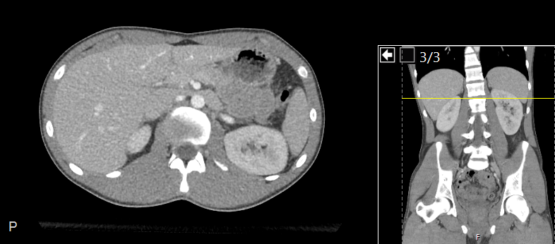
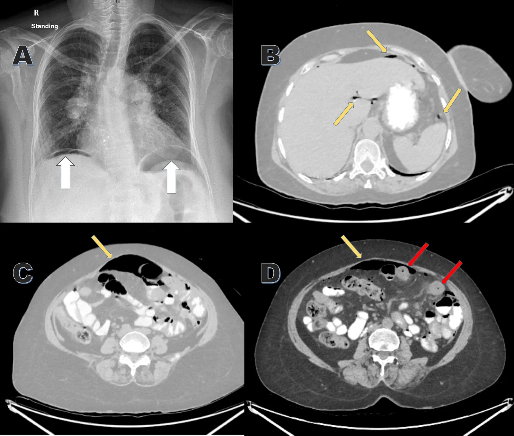
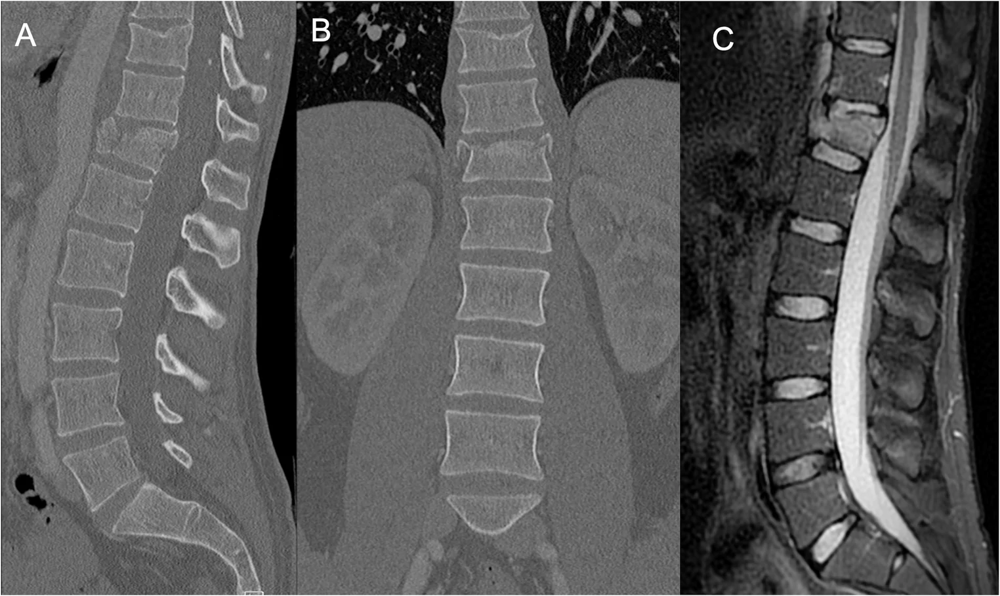
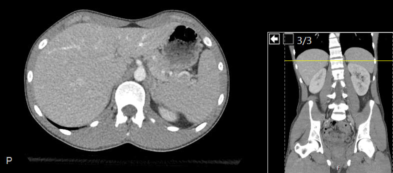
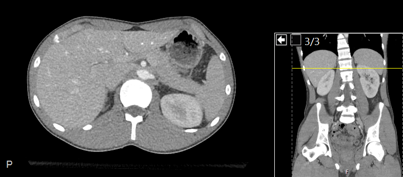
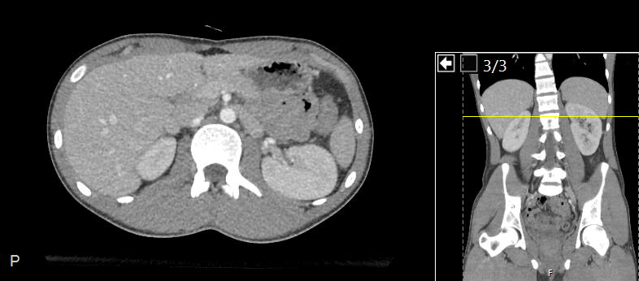
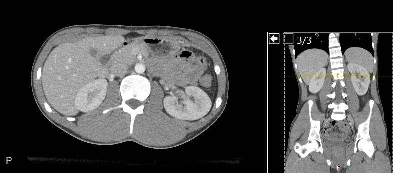
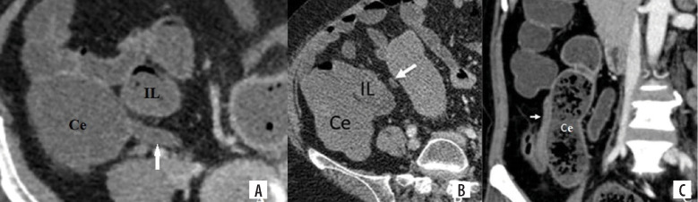
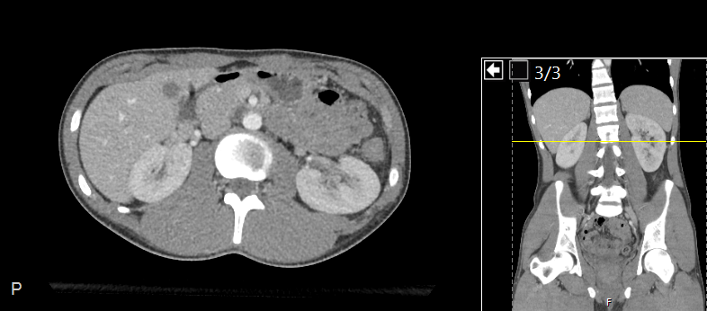

# BÀI HỌC Y KHOA: GIẢI PHẪU CT BỤNG
**Ngày:** 2026-11-17 | **Chuyên khoa:** Ngoại khoa — Kỹ năng chẩn đoán hình ảnh | **Đối tượng:** Sinh viên Y6, người học mất gốc cần học từ nền tảng

---

## 0. TỔNG QUAN — VÌ SAO BÀI NÀY QUAN TRỌNG? [CỐT LÕI]

&emsp;Chụp cắt lớp vi tính ổ bụng (computed tomography, CT) là xét nghiệm hình ảnh mà sinh viên Y6 gặp hằng ngày ở khoa ngoại.

&emsp;Một phim CT bụng chứa hàng trăm lát cắt, mỗi lát cắt chứa gan, lách, thận, tụy, ruột và mạch máu cùng lúc.

&emsp;Người mới đọc CT thường lạc giữa các tạng vì chưa biết mỗi cấu trúc bình thường trông ra sao.

&emsp;Bài này dạy đúng một kỹ năng duy nhất: nhận diện giải phẫu bình thường trên CT bụng.

&emsp;Bài này không dạy dấu hiệu bệnh lý sâu.

&emsp;Dấu hiệu bệnh lý thuộc Bài 2 — Dấu hiệu cơ bản và cách đọc hệ thống, bài sắp có.

&emsp;Khi một biến thể bình thường trông giống bệnh lý, bài này nói rõ chỗ giống nhau đó và gắn chéo sang Bài 2 hoặc bài bệnh học tương ứng, không dạy chẩn đoán bệnh thay Bài 2.

**Mục tiêu của bài:**
- Hiểu CT tạo ảnh như thế nào và đọc được thang Hounsfield (Hounsfield unit, HU) để nhận diện mô.
- Biết chọn đúng cửa sổ (window), đúng thì cản quang và đúng mặt cắt cho từng câu hỏi.
- Xác định được từng tạng và mạch máu lớn trên CT bằng vị trí, mốc giải phẫu và hình ảnh bình thường.
- Phân biệt được biến thể bình thường hay gặp với bệnh lý, tránh gọi nhầm bình thường thành bệnh.

> **TIÊU CHUẨN BẮT BUỘC — DẠY TỪ GỐC, KHÔNG GIỚI HẠN ĐỘ DÀI:** Viết để một người học mất gốc vẫn theo được. Trước khi dùng một thuật ngữ, chữ viết tắt, chỉ số, cơ quan, cơ chế, thủ thuật hoặc quyết định điều trị lần đầu, phải giải thích bằng tiếng Việt đơn giản: **nó là gì → bình thường hoạt động ra sao → vì sao bất thường này quan trọng → nhận ra bằng cách nào → làm gì tiếp theo**. Sau lần giải thích đầu tiên, mới dùng viết tắt/thuật ngữ ngắn. Không dùng "rõ ràng", "thường quy", "theo protocol" hoặc danh sách bước trần nếu chưa giải thích lý do và ý nghĩa của hành động. Độ dài không có giới hạn tối đa: tiếp tục viết khi còn một mắt xích cần thiết để người học hiểu hoặc ra quyết định an toàn; ưu tiên chia nhỏ bằng tiêu đề, ví dụ và checkpoint thay vì cắt bỏ nền tảng.

### 0.1. Nền tảng tối thiểu cần dùng ngay [CỐT LÕI]

&emsp;Người học cần biết trước vài khái niệm giải phẫu ổ bụng ở mức rất cơ bản.

&emsp;Ổ bụng là khoang chứa dạ dày, ruột, gan, lách, tụy, thận và các mạch máu lớn.

&emsp;Phúc mạc (peritoneum) là màng lót khoang bụng và bao bọc nhiều tạng.

&emsp;Tạng trong phúc mạc (intraperitoneal) như gan, lách, dạ dày và ruột non được phúc mạc bao gần kín và di động ít nhiều.

&emsp;Tạng sau phúc mạc (retroperitoneal) như thận, thượng thận, tụy, tá tràng đoạn giữa và đoạn cuối, đại tràng lên và đại tràng xuống nằm sau lớp phúc mạc thành sau, cố định hơn.

&emsp;Động mạch chủ bụng (abdominal aorta, ĐMC) là động mạch lớn nhất của ổ bụng, chạy trước cột sống, hơi lệch trái đường giữa.

&emsp;Tĩnh mạch chủ dưới (inferior vena cava, TM chủ dưới) là tĩnh mạch lớn nhất của ổ bụng, chạy bên phải ĐMC.

&emsp;Tĩnh mạch cửa (portal vein, TM cửa) là tĩnh mạch đưa máu từ ruột về gan, khác với tĩnh mạch hệ thống đưa máu về tim.

&emsp;Nếu chưa học giải phẫu ổ bụng, cứ đọc tiếp vì mỗi cấu trúc trong bài đều được chỉ vị trí và mốc nhận diện ngay tại chỗ.

&emsp;Mạc treo (mesentery) là nếp phúc mạc gắn ruột vào thành bụng sau và mang mạch máu cùng thần kinh tới ruột.

&emsp;Mạc nối lớn (greater omentum) là nếp phúc mạc từ bờ cong lớn dạ dày phủ trước ruột non như một tấm tạp dề mỡ, còn mạc nối nhỏ nối gan với dạ dày và tá tràng.

&emsp;Khoang phúc mạc là khoang chứa các tạng trong phúc mạc, dịch tự do trong khoang này có thể lan theo trọng lực, còn khoang sau phúc mạc nằm sau lớp phúc mạc thành sau và chứa thận, tụy, động mạch chủ bụng cùng tĩnh mạch chủ dưới, nên dịch ở đây khu trú hơn.

&emsp;Về vị trí tương đối theo chiều trên–dưới, gan và dạ dày nằm ở bụng trên, ruột non nằm ở trung tâm ổ bụng, đại tràng tạo khung bao quanh ruột non, tiểu khung chứa bàng quang, trực tràng và cơ quan sinh dục.

&emsp;Gan nằm trên–phải, dạ dày nằm trên–trái dưới gan trái, ruột non nằm dưới dạ dày và được đại tràng bao quanh, vì vậy một lát cắt càng xuống thấp càng thấy ít gan và càng thấy nhiều ruột.

&emsp;Cột sống thắt lưng là mốc giữa sau trên CT, động mạch chủ bụng chạy trước cột sống và tĩnh mạch chủ dưới chạy bên phải động mạch chủ, còn xương chậu là mốc dưới giúp xác định tiểu khung cùng vị trí của bàng quang và trực tràng.

### 0.2. Bài này đứng ở đâu trong bộ kỹ năng [CỐT LÕI]

&emsp;Bài này là Bài 1 trong cặp bài CT bụng.

&emsp;Bài 2 — Dấu hiệu cơ bản và cách đọc hệ thống — bài sắp có, sẽ dạy dấu hiệu bệnh lý và checklist đọc từng bước.

&emsp;Bài này gắn chéo bằng tên với bài **Hướng dẫn đọc chẩn đoán hình ảnh tiết niệu ngoại khoa** (SURG-01C).

&emsp;Phần tiết niệu chỉ dạy ở mức gắn chéo, không dạy lại hệ thống của SURG-01C.

&emsp;Bài này cũng gắn chéo với bài **Khám bụng ngoại khoa** để đối chiếu khám lâm sàng với đọc CT.

&emsp;Các bài bệnh học đã có như viêm ruột thừa, thủng tạng rỗng, tắc ruột, sỏi thận/niệu quản, sỏi mật và viêm đường mật chỉ được nhắc tên khi cần, không viết lại nội dung của các bài đó.

---

## 1. ĐỊNH NGHĨA VÀ CƠ CHẾ HOẠT ĐỘNG CỦA CT — ĐƠN VỊ HOUNSFIELD [CỐT LÕI]

### 1.0. Nền tảng: CT tạo ảnh như thế nào [CỐT LÕI]

&emsp;CT dùng chùm tia X và máy tính để tạo ảnh lát cắt ngang cơ thể.

&emsp;Ống tia X xoay quanh bệnh nhân và thu tín hiệu suy giảm tia X từ nhiều góc khác nhau.

&emsp;Máy tính tái tạo các tín hiệu đó thành ảnh lát cắt, mỗi điểm ảnh mang một con số gọi là đơn vị Hounsfield.

&emsp;Hệ số suy giảm tuyến tính (linear attenuation coefficient, ký hiệu μ) đo mức độ một mô làm yếu chùm tia X, và nó thay đổi theo mật độ, số nguyên tử và năng lượng tia.

&emsp;Mô càng đặc và số nguyên tử càng cao thì suy giảm tia càng mạnh, vì vậy ảnh càng sáng.

&emsp;Máy CT hiện đại là máy thế hệ thứ ba: ống tia X và dãy đầu dò cong xoay cùng nhau quanh bệnh nhân, với nhiều hàng đầu dò dọc trục cơ thể (multidetector CT, MDCT).

&emsp;Quét xoắn ốc (helical hay spiral CT) là cách quét mà ống tia X xoay liên tục trong khi bàn bệnh nhân trượt đều, nhờ đó quét nhanh và ít artefact do chuyển động.

&emsp;Bước tiến của bàn trên mỗi vòng xoay chia cho độ rộng chùm tia gọi là pitch (hệ số bước quét).

&emsp;Điện áp ống tia X điển hình khoảng 120 kV, dao động trong khoảng từ 70 kV đến 140 kV [FULL TEXT VERIFIED].

&emsp;Iod có cạnh K (K-edge) khoảng 33 keV nên thuốc cản quang iod thấy rõ nhất ở điện áp thấp, khoảng 80 kV [FULL TEXT VERIFIED].

### 1.1. Đơn vị Hounsfield — thang đo độ đặc của mô [CỐT LÕI]

&emsp;Đơn vị Hounsfield (Hounsfield unit, HU) là số đo tương đối độ suy giảm tia X của một thể tích ảnh nhỏ (voxel) so với nước.

&emsp;Công thức là HU bằng 1000 nhân với hiệu số giữa hệ số suy giảm của mô và của nước, chia cho hệ số suy giảm của nước.

&emsp;Nước được định nghĩa bằng 0 HU và khí được định nghĩa bằng −1000 HU ở nhiệt độ và áp suất tiêu chuẩn [ABSTRACT VERIFIED].

&emsp;Mô càng đặc thì HU càng dương và càng trắng trên ảnh.

&emsp;Mô càng loãng thì HU càng âm và càng đen trên ảnh.

&emsp;Thang hiển thị 12-bit trải từ −1024 HU đến +3071 HU [FULL TEXT VERIFIED].

&emsp;Xương đặc có thể lên tới khoảng 2000 HU, và kim loại như thép hoặc bạc vượt quá 3000 HU [ABSTRACT VERIFIED].

&emsp;HU không phải hằng số tuyệt đối của mô.

&emsp;HU phụ thuộc phổ tia, máy quét và kích thước bệnh nhân, và hiệu chuẩn được kiểm tra bằng phantom nước [FULL TEXT VERIFIED].

> ⚠️ HỌC VIÊN HAY NHẦM: HU là số đo tương đối, không phải "mật độ thật" của mô. Cùng một khối mỡ đo ở 2 máy khác nhau có thể cho HU hơi khác nhau. Vì vậy bài này luôn dạy HU theo khoảng, không dạy một con số đơn lẻ như chân lý.

### 1.2. Bảng HU điển hình — tra cứu khi đọc phim [CỐT LÕI]

&emsp;Bảng dưới đây là thang tham chiếu để nhận diện mô trên ảnh không cản quang.

&emsp;Các số trong bảng là xấp xỉ, không phải hằng số tuyệt đối.

| Mô hoặc chất | HU không cản quang |
|---|---|
| Khí | −1000 (định nghĩa) |
| Phổi | −700 đến −600 |
| Mỡ | −120 đến −90 |
| Nước | 0 (định nghĩa) |
| Dịch não tủy | +15 |
| Nước tiểu và mật | −5 đến +15 |
| Hạch lympho | +10 đến +20 |
| Máu chưa đông | +13 đến +50 |
| Máu đông | +50 đến +75 |
| Thận (nhu mô) | +20 đến +45 |
| Gan | 60 ± 6 |
| Cơ | +35 đến +55 |
| Mô mềm (chung) | +20 đến +60 |
| Xương xốp | +300 đến +400 |
| Xương đặc | +500 đến +1900 |
| Kim loại | Trên +3000 |

&emsp;Các khoảng HU trong bảng này đã đối chiếu từ nguồn giáo dục toàn văn và bài tổng quan về thang Hounsfield [FULL TEXT VERIFIED].

&emsp;Mỡ âm rõ, khoảng −50 HU đến −120 HU, là dấu nhận diện mỡ đáng tin cậy nhất trên CT [FULL TEXT VERIFIED].

&emsp;Máu cấp nói chung khoảng +50 HU đến +80 HU, nhưng máu chưa đông và máu đông có 2 dải khác nhau nên không được dùng chung một số [FULL TEXT VERIFIED].

&emsp;Gan bình thường khoảng 60 HU và sáng hơn lách một chút trên ảnh không cản quang [FULL TEXT VERIFIED].

&emsp;Xương đặc bắt đầu từ khoảng +500 HU và có thể lên tới khoảng +2000 HU, vì vậy không được dạy "xương tối đa 1000 HU" [FULL TEXT VERIFIED].

### 1.3. HU dùng để nhận diện — sỏi, mỡ trong u, u tuyến thượng thận [CỐT LÕI]

&emsp;Sỏi acid uric thuần thường đo khoảng 500 HU, trong khi sỏi calci khoảng 900 HU [FULL TEXT VERIFIED].

&emsp;Người bệnh sỏi thận có pH nước tiểu từ 5,5 trở xuống và sỏi khoảng 500 HU trở xuống có thể chẩn đoán tin cậy là sỏi acid uric [FULL TEXT VERIFIED].

&emsp;Muốn đo HU sỏi thì phải dùng thì không cản quang, vì cản quang che mất hình ảnh sỏi [FULL TEXT VERIFIED].

&emsp;U tuyến thượng thận có đậm độ dưới 10 HU là khối giàu mỡ và gần như chắc chắn là u tuyến lành tính (adenoma) [FULL TEXT VERIFIED].

&emsp;Khối có HU mỡ, tức âm rõ trong khoảng −50 HU đến −100 HU, là khối chứa mỡ, ví dụ u mỡ (lipoma).

&emsp;Bài này không dạy ngưỡng HU riêng cho từng loại sỏi khác vì chưa kiểm chứng được.

**Ví dụ 1 — Đọc HU để đoán loại sỏi:** Bệnh nhân đau hông cấp, CT không cản quang thấy sỏi niệu quản đo khoảng 500 HU và pH nước tiểu 5,0. Con số này gợi ý sỏi acid uric, loại sỏi có thể tan bằng kiềm hóa nước tiểu. Ngược lại sỏi khoảng 900 HU gợi ý sỏi calci. Chi tiết chẩn đoán và điều trị sỏi thuộc bài Sỏi thận và bài Sỏi niệu quản, không dạy lại ở đây.

### 1.4. HU trên ảnh không cản quang và ảnh có cản quang — đừng so nhầm [CỐT LÕI]

&emsp;Cản quang iod làm HU tăng mạnh.

&emsp;Máu và mô mềm ngấm thuốc có thể lên tới +100 HU đến +300 HU trên ảnh có cản quang [FULL TEXT VERIFIED].

&emsp;Vì vậy không được so HU đo trên ảnh có cản quang với bảng HU không cản quang.

&emsp;Muốn đo HU nền (baseline) của một khối, HU sỏi hay HU mỡ thì phải đo trên thì không cản quang.

&emsp;HU còn thay đổi theo thông số thu nhận và tái tạo như kV, bộ lọc và thuật toán tái tạo [FULL TEXT VERIFIED].

### 1.5. Chuỗi cơ chế 1 — Từ tia X tới con số HU [CỐT LÕI]

&emsp;Chuỗi này giải thích vì sao một con số HU lại nói được mô đó là gì.

**Tầng 1 — Phân tử và tia X:** Chùm tia X đi qua cơ thể và bị các nguyên tử trong mô hấp thụ và tán xạ. Mô đặc và giàu nguyên tử nặng hấp thụ nhiều hơn.

**Tầng 2 — Tế bào và mô:** Mỗi loại mô có mật độ và thành phần nguyên tử riêng, nên hệ số suy giảm μ của mỡ, máu, cơ và xương khác nhau rõ rệt.

**Tầng 3 — Tín hiệu và tái tạo:** Đầu dò đo tia X còn lại sau khi đi qua cơ thể từ nhiều góc, máy tính tái tạo thành ảnh lát cắt, mỗi voxel mang một giá trị μ.

**Tầng 4 — Chuẩn hóa thành HU:** Máy chuẩn hóa μ theo nước và khí thành thang HU, nhờ đó mỡ âm, nước bằng 0 và xương dương lớn, người đọc có thể nhận diện mô bằng con số.

**Tầng 5 — Phản chứng khi đứt chuỗi:** Nếu đo HU trên ảnh có cản quang rồi so với bảng không cản quang thì kết luận sai, ví dụ máu ngấm thuốc bị đọc thành "khối tăng đậm độ". Nếu HU phụ thuộc máy mà dạy như hằng số tuyệt đối thì 2 máy cho 2 kết luận khác nhau về cùng một khối.

```text
Tia X xoay quanh bệnh nhân
  ──→ Mô hấp thụ tia theo mật độ và số nguyên tử
  ──→ Đầu dò đo tia còn lại từ nhiều góc
  ──→ Máy tính tái tạo lát cắt, mỗi voxel có 1 giá trị μ
  ──→ Chuẩn hóa theo nước (0 HU) và khí (−1000 HU)
  ──→ Người đọc nhận diện mô bằng khoảng HU
  ✗ Đứt ở bước chuẩn hóa: đo HU trên ảnh có cản quang rồi so bảng không cản quang → kết luận sai
  ✗ Đứt ở bước đo: lát cắt dày làm trung bình HU của cấu trúc mỏng với mô xung quanh → HU sai
```

```text
Tia X đi qua 2 mô có HU chồng lấn trong cùng một voxel
  ──→ HU đo được là trung bình của 2 mô, không còn là HU của mô nào
  ──→ Người đọc nghi ngờ: đo lại trên lát cắt mỏng hơn hoặc đổi cửa sổ
  ──→ Nếu HU vẫn chồng lấn → đối chiếu thì không cản quang với thì có cản quang
  ✗ Đứt: tin ngay HU trung bình rồi gán cho một mô → kết luận sai về bản chất khối
```

### 🛑 DỪNG 1 PHÚT — TỰ KIỂM TRA

> 1. Vì sao mỡ có HU âm và xương có HU dương lớn?
> 2. Vì sao không được đo HU sỏi trên ảnh đã tiêm cản quang?
>
> *(Đáp án: Mỡ loãng nên suy giảm tia X ít hơn nước, HU âm; xương đặc nên suy giảm nhiều, HU dương lớn. Cản quang iod làm HU tăng mạnh và che mất sỏi, nên HU sỏi phải đo trên thì không cản quang.)*

---

## 2. CÁC CỬA SỔ CT — NHÌN ĐÚNG CỬA SỔ MỚI THẤY ĐÚNG BỆNH [CỐT LÕI]

### 2.0. Nền tảng: cửa sổ là gì [CỐT LÕI]

&emsp;Cửa sổ (window) là cách chọn một dải HU nào đó để hiển thị thành thang xám trên màn hình.

&emsp;Mắt người chỉ phân biệt được vài chục mức xám, trong khi thang HU trải dài hàng nghìn đơn vị.

&emsp;Nếu hiển thị toàn bộ thang HU cùng lúc thì gan, lách, thận và ruột đều xám gần giống nhau, không phân biệt được.

&emsp;Cửa sổ gồm 2 thông số: độ rộng cửa sổ (window width, WW) và mức cửa sổ (window level, WL).

&emsp;WW là độ rộng dải HU được trải ra thành thang xám, quyết định độ tương phản hiển thị.

&emsp;WL là điểm giữa của dải HU đó, thường đặt gần HU trung bình của mô cần xem [FULL TEXT VERIFIED].

&emsp;Cửa sổ hẹp làm tăng tương phản hiển thị giữa các mô gần nhau, nhưng mọi giá trị ngoài cửa sổ bị cắt thành đen hoặc trắng [FULL TEXT VERIFIED].

&emsp;Cửa sổ rộng cho thấy nhiều loại mô cùng lúc, nhưng nén tương phản giữa các mô mềm gần nhau [FULL TEXT VERIFIED].

### 2.1. Ba cửa sổ bắt buộc của CT bụng [CỐT LÕI]

&emsp;CT bụng phải đọc tối thiểu 3 cửa sổ: mô mềm là cửa sổ chính, phổi để tìm khí và xương để tìm gãy và vôi hóa.

| Cửa sổ | WW / WL điển hình | Dùng trong CT bụng để xem |
|---|---|---|
| Mô mềm (abdomen) | WW 400 / WL +40 | Gan, lách, thận, tụy, thành ruột, mạch máu, hạch |
| Phổi (lung) | WW 1500 / WL −600 | Đáy phổi, khí tự do ổ bụng, khí trong ruột và thành ruột |
| Xương (bone) | WW 2000 / WL 500 | Xương sườn, cột sống, khung chậu, sỏi vôi hóa, cốt hóa |

&emsp;Các preset cửa sổ trong bảng là điểm khởi đầu, không phải chuẩn phổ quát vì mỗi khoa tự đặt preset riêng [FULL TEXT VERIFIED].

&emsp;Các nguồn ghi dao động nhỏ quanh các preset này: cửa sổ mô mềm có nơi đặt WL +50 thay vì +40, cửa sổ phổi có nơi đặt WL −500 thay vì −600, cửa sổ xương có nơi đặt WL 400 đến 500 và WW 1500 đến 2500 [FULL TEXT VERIFIED].

&emsp;Người đọc được phép chỉnh WW và WL thủ công trên PACS khi cần, preset chỉ là điểm xuất phát.



*Hình 1. CT bụng mặt cắt ngang, cửa sổ mô mềm — cửa sổ chính để nhận diện tạng đặc, thành ruột, mạch máu và hạch. Nguồn: Mikael Häggström, Wikimedia Commons, CC0 1.0 (lát cắt 85/320, CT bụng–chậu thường quy có cản quang, nam 21 tuổi).*



*Hình 2. CT bụng, cửa sổ phổi — cửa sổ bắt buộc để tìm khí tự do ổ bụng và đánh giá đáy phổi. Hình ghép: (A) X-quang ngực thấy khí dưới 2 vòm hoành; (B, C) CT cửa sổ phổi thấy khí tự do (mũi tên vàng); (D) CT cửa sổ mô mềm. Nguồn: Mazur KJ và cs., Cureus 2026, CC BY 4.0 (Hình 4).*



*Hình 3. CT bụng, cửa sổ xương — cửa sổ bắt buộc để tìm gãy xương, tổn thương xương và vôi hóa. Hình ghép: (A) CT cửa sổ xương mặt cắt dọc và (B) mặt cắt trán thấy vỡ đốt sống T12, bè xương và xương sườn dưới rõ; (C) là MRI. Nguồn: Calabrese M và cs., Emergency Radiology 2026, CC BY 4.0 (Hình 12). Lưu ý: hình không thấy xương chậu.*

### 2.2. Cái gì bị bỏ sót nếu chỉ đọc một cửa sổ [CỐT LÕI]

&emsp;Chỉ đọc cửa sổ mô mềm với WW 400 thì dải HU hiển thị chỉ khoảng −160 HU đến +240 HU.

&emsp;Khí tự do ổ bụng ở −1000 HU và khí trong thành ruột bị cắt thành đen đặc, khó phân biệt khí tự do với khí trong lòng ruột.

&emsp;Gãy xương, tổn thương xương và vôi hóa trên +500 HU bị cắt thành trắng đặc, mất chi tiết bè xương.

&emsp;Chỉ đọc cửa sổ phổi với WW 1500 thì mô mềm bị nén tương phản, tổn thương gan, lách, thận, dày thành ruột và áp xe mờ hoặc mất hẳn.

&emsp;Chỉ đọc cửa sổ xương thì mô mềm gần như trắng xóa, không đánh giá được tạng đặc.

&emsp;Cửa sổ phổi không chỉ dùng cho ngực.

&emsp;Trong CT bụng, cửa sổ phổi là cửa sổ tìm khí tự do ổ bụng và đánh giá đáy phổi.

**Ví dụ 2 — Bỏ sót khí tự do vì chỉ đọc cửa sổ mô mềm:** Bệnh nhân đau bụng sau thủng tạng rỗng, CT chỉ đọc cửa sổ mô mềm thấy bụng "gần như bình thường". Chuyển sang cửa sổ phổi thấy một vệt đen khí tự do dưới cơ hoành phải. Khí tự do chi tiết thuộc Bài 2 và bài Thủng tạng rỗng do loét dạ dày–tá tràng, nhưng bài học ở đây là: không đổi cửa sổ thì không thấy khí.

### 🛑 DỪNG 1 PHÚT — TỰ KIỂM TRA

> 1. Vì sao cửa sổ mô mềm không thấy được khí tự do?
> 2. Cửa sổ nào dùng để tìm gãy xương sườn dưới trên CT bụng?
>
> *(Đáp án: Cửa sổ mô mềm chỉ hiển thị dải HU hẹp quanh mô mềm, khí ở −1000 HU bị cắt thành đen đặc. Gãy xương tìm bằng cửa sổ xương.)*

---

## 3. THUỐC CẢN QUANG VÀ CÁC THÌ [CỐT LÕI]

### 3.0. Nền tảng: cản quang làm gì [CỐT LÕI]

&emsp;Thuốc cản quang (contrast agent) là chất làm tăng HU của máu và mô ngấm thuốc, nhờ đó phân biệt được cấu trúc này với cấu trúc kia.

&emsp;Cản quang CT bụng thường dùng là cản quang iod, tiêm tĩnh mạch bằng bơm tiêm điện.

&emsp;Iod hấp thụ tia X mạnh nên mạch máu và nhu mô ngấm thuốc sáng lên rõ rệt.

&emsp;Không có cản quang, nhiều tạng đặc có HU gần nhau và bờ khối mờ, khó phân biệt.

&emsp;Có cản quang, mỗi tạng ngấm thuốc theo nhịp riêng của nó, và nhịp ngấm đó chính là thông tin chẩn đoán.

> 🚨 **BOX ĐỎ — AN TOÀN TRƯỚC KHI TIÊM CẢN QUANG:** Trước mỗi lần tiêm cản quang iod, phải sàng lọc chức năng thận (eGFR), tiền sử phản ứng với cản quang, thuốc đang dùng (metformin) và thai kỳ theo chính sách cản quang của cơ sở [GUIDELINE VERIFIED]. Bệnh nhân có eGFR dưới 30 mL/min/1,73 m² hoặc đang có tổn thương thận cấp (acute kidney injury, AKI) cần cân nhắc dự phòng bằng truyền nước muối sinh lý (normal saline) tĩnh mạch, không phải chống chỉ định tuyệt đối [ABSTRACT VERIFIED]. Tiền sử phản ứng với cản quang là yếu tố cần hỏi đầu tiên. Nếu bệnh nhân lơ mơ, an thần hoặc chấn thương nặng thì không cho uống cản quang vì nguy cơ sặc. Khi có nghi ngờ về an toàn cản quang, dừng lại và hỏi bác sĩ chẩn đoán hình ảnh hoặc bác sĩ điều trị, không tự ý tiêm rồi tính sau.

### 3.1. Cản quang tĩnh mạch — liều và tốc độ [CỐT LÕI]

&emsp;Cản quang iod dùng cho CT gan đa thì có nồng độ từ 300 mgI/mL trở lên, liều 1,5 đến 2 mL/kg, tốc độ tiêm ít nhất 3 mL/s, kèm xả 30 đến 40 mL nước muối sinh lý sau thuốc [GUIDELINE VERIFIED].

&emsp;Thì tĩnh mạch cửa thường quy chấp nhận tốc độ 2,5 đến 5 mL/s, vì tốc độ tiêm phụ thuộc protocol: protocol gan đa thì cần tiêm nhanh hơn protocol bụng thường quy một thì [GUIDELINE VERIFIED].

&emsp;Một thì tĩnh mạch cửa duy nhất trả lời được đa số câu hỏi bụng, chỉ thêm thì khác khi có câu hỏi riêng như đặc trưng tổn thương gan, tổn thương thận hoặc tìm chảy máu đang hoạt động [GUIDELINE VERIFIED].

### 3.2. Các thì cản quang — mỗi thì thấy rõ gì [CỐT LÕI]

&emsp;Mỗi thì là một lần chụp ở một thời điểm thuốc đi qua cơ thể, tính từ lúc bắt đầu tiêm.

| Thì | Thời gian | Thấy rõ gì |
|---|---|---|
| Không cản quang | Trước tiêm | Sỏi, máu đông, calci, mỡ, HU nền |
| Động mạch muộn | 25 đến 45 giây | Động mạch, tổn thương tăng sinh mạch, chảy máu đang hoạt động |
| Tĩnh mạch cửa | 60 đến 75 giây | Nhu mô gan đạt đỉnh ngấm, lách, thận, tĩnh mạch mạc treo |
| Muộn | 2 đến 5 phút | Rửa trôi thuốc (washout), bao xơ, u mạch máu, bài tiết muộn |

&emsp;Thì động mạch muộn có 2 cách tính thời gian: 25 đến 35 giây theo protocol gan của bài tổng quan gan, và 35 đến 45 giây cố định hoặc bolus tracking 15 đến 30 giây sau khi động mạch chủ đạt 100 đến 150 HU theo guideline gan [FULL TEXT VERIFIED].

&emsp;Hai cách tính khác nhau do cách đếm thời gian và protocol từng máy, không phải một bên sai.

&emsp;Bài này dạy khoảng 25 đến 45 giây, và mốc kiểm chứng trên ảnh là động mạch gan ngấm đậm, tĩnh mạch cửa bắt đầu ngấm, tĩnh mạch gan chưa ngấm.

&emsp;Thì tĩnh mạch cửa chuẩn hiện hành là 60 đến 75 giây [FULL TEXT VERIFIED].

&emsp;Con số 35 đến 40 giây cho thì tĩnh mạch cửa chỉ xuất hiện trong tài liệu ACR cũ và đã lạc hậu, không dạy [FULL TEXT VERIFIED].

&emsp;Thì muộn gan là 2 đến 5 phút theo một guideline và 3 đến 5 phút theo guideline khác, bài này dạy khoảng 2 đến 5 phút và ghi chú 3 đến 5 phút là khoảng hẹp hơn thường dùng trong protocol gan [FULL TEXT VERIFIED].

&emsp;Gan nhận khoảng 3 phần 4 lượng máu từ tĩnh mạch cửa nên ngấm mạnh nhất ở thì tĩnh mạch cửa, còn u gan nhận máu động mạch nên sáng nhất ở thì động mạch.

&emsp;Đó là lý do phải chụp nhiều thì để đặc trưng tổn thương gan: tổn thương tăng sinh mạch sáng hơn gan nền ở thì động mạch, tổn thương giảm sinh mạch tối hơn gan nền ở thì tĩnh mạch cửa khi gan nền ngấm tối đa [FULL TEXT VERIFIED].

&emsp;Thì thận (nephrographic) và thì bài tiết (excretory) của CT niệu đồ chưa kiểm chứng được thời gian trong đợt này, nên bài này không dạy 2 mốc thời gian đó.

&emsp;CT niệu đồ (CT urography, CTU) chi tiết thuộc bài **Hướng dẫn đọc chẩn đoán hình ảnh tiết niệu ngoại khoa** (SURG-01C), bài này chỉ nhắc tên.



*Hình 4. CT bụng thì tĩnh mạch cửa — thì "workhorse" của CT bụng, nhu mô gan đạt đỉnh ngấm; gan ngấm đều, lách đồng nhất, tĩnh mạch cửa thấy ở đoạn hợp lưu. Nguồn: Mikael Häggström, Wikimedia Commons, CC0 1.0 (lát cắt 65/320).*

### 3.3. Cản quang đường uống — khi nào dùng, uống gì [CỐT LÕI]

&emsp;Cản quang đường uống không bắt buộc, là tùy chọn theo câu hỏi lâm sàng.

&emsp;Trong cấp cứu và chấn thương thường bỏ cản quang uống để khỏi chậm và tránh sặc [GUIDELINE VERIFIED].

&emsp;Cản quang dương (iod pha loãng hoặc barium pha loãng, ruột trắng) dùng khi nghi rò, áp xe, thủng, hoặc cần phân biệt quai ruột với hạch và di căn phúc mạc [GUIDELINE VERIFIED].

&emsp;Nhược điểm của cản quang dương là che mất thành ruột và khối trong lòng ruột, gây giả u dạ dày và cản trở dựng hình mạch 3D [GUIDELINE VERIFIED].

&emsp;Cản quang trung tính (nước, ruột đen như nước, khoảng 0 HU) làm căng ruột mà không che thành ruột, dùng khi cần thấy thành ruột ngấm thuốc như viêm ruột, thiếu máu ruột hoặc u tụy [GUIDELINE VERIFIED].

&emsp;Nhược điểm của cản quang trung tính là dịch tự do khó phân biệt với ruột chứa nước.

&emsp;Không cho uống cản quang khi bệnh nhân chấn thương, lơ mơ hoặc an thần vì nguy cơ sặc, hoặc khi câu hỏi duy nhất là sỏi tiết niệu hay xương [GUIDELINE VERIFIED].

### 3.4. Chuỗi cơ chế 2 — Thuốc cản quang đi đâu, thấy gì [CỐT LÕI]

&emsp;Chuỗi này giải thích vì sao cùng một bệnh nhân mà mỗi thì lại cho một bức ảnh khác nhau.

**Tầng 1 — Phân tử:** Cản quang iod tiêm tĩnh mạch chứa iod hấp thụ tia X mạnh, làm tăng HU của máu lên hàng trăm đơn vị trong vài chục giây.

**Tầng 2 — Tế bào và mô:** Máu mang iod tới từng tạng theo lưu lượng máu của tạng đó; tạng giàu mạch ngấm sớm, tạng nhận máu tĩnh mạch cửa ngấm muộn hơn.

**Tầng 3 — Cơ quan:** Gan nhận máu từ cả động mạch gan và tĩnh mạch cửa, lách ngấm loang lổ thì động mạch rồi đồng nhất thì tĩnh mạch cửa muộn, thận ngấm vỏ trước rồi tới tủy, rồi bài tiết ra đài bể thận.

**Tầng 4 — Quyết định:** Người đọc chọn thì chụp theo câu hỏi: thì động mạch muộn để tìm tổn thương tăng sinh mạch và chảy máu, thì tĩnh mạch cửa để đánh giá đa số tạng đặc, thì muộn để xem rửa trôi thuốc và bao xơ.

**Tầng 5 — Phản chứng khi đứt chuỗi:** Nếu chỉ chụp một thì tĩnh mạch cửa thì tổn thương chỉ sáng ở thì động mạch sẽ bị bỏ sót. Nếu đọc thì động mạch mà kết luận lách loang lổ là nhồi máu thì sai, vì lách loang lổ thì động mạch là sinh lý.

```text
Tiêm iod tĩnh mạch, tốc độ ít nhất 3 mL/s
  ──→ Máu động mạch mang iod tới tạng (thì động mạch muộn, 25 đến 45 giây)
  ──→ Máu tĩnh mạch cửa mang iod tới gan (thì tĩnh mạch cửa, 60 đến 75 giây)
  ──→ Nhu mô ngấm tối đa, tĩnh mạch hiện rõ
  ──→ Iod rửa trôi khỏi tổn thương và nhu mô (thì muộn, 2 đến 5 phút)
  ──→ Người đọc so sánh độ ngấm giữa các thì để đặc trưng tổn thương
  ✗ Đứt ở thì động mạch: chỉ chụp thì tĩnh mạch cửa → bỏ sót tổn thương chỉ tăng sinh mạch ở thì động mạch
  ✗ Đứt ở cách đọc: đọc lách loang lổ thì động mạch thành nhồi máu → kết luận sai
```

```text
Thì động mạch muộn không thấy tổn thương nghi ngờ
  ──→ Chưa kết luận: tổn thương có thể chỉ ngấm ở thì tĩnh mạch cửa
  ──→ Chờ thì tĩnh mạch cửa (60 đến 75 giây), so sánh độ ngấm với gan nền
  ──→ Nếu thì tĩnh mạch cửa vẫn không rõ → xem thì muộn (2 đến 5 phút) để đánh giá rửa trôi thuốc
  ✗ Đứt: chỉ đọc một thì rồi kết luận không có tổn thương → bỏ sót tổn thương chỉ hiện ở thì khác
```

**Ví dụ 3 — Vì sao phải chụp nhiều thì:** Một tổn thương gan sáng hơn gan nền ở thì động mạch muộn nhưng tối hơn gan nền ở thì tĩnh mạch cửa. Nếu chỉ chụp thì tĩnh mạch cửa thì tổn thương này trông như một khối giảm đậm độ không đặc hiệu. Nhờ có thì động mạch mà người đọc biết nó là tổn thương tăng sinh mạch. Chi tiết đặc trưng tổn thương gan thuộc Bài 2, ở đây chỉ cần hiểu nguyên lý nhiều thì.

### 3.5. Liều tia — ALARA và liều hiệu dụng điển hình [CỐT LÕI]

&emsp;Nguyên tắc ALARA (As Low As Reasonably Achievable, thấp nhất có thể đạt được một cách hợp lý) yêu cầu chỉ định đúng, giới hạn số thì và độ dài quét, dùng điều biến dòng ống và tái tạo lặp.

&emsp;CT bụng–chậu một thì có liều hiệu dụng điển hình khoảng 8 đến 10 mSv, tương đương khoảng 2,6 năm phông nền tự nhiên [FULL TEXT VERIFIED].

&emsp;Chụp 2 lần không và có cản quang thì liều khoảng 15,4 mSv, tương đương khoảng 5,1 năm phông nền tự nhiên [FULL TEXT VERIFIED].

&emsp;Phông nền tự nhiên trung bình khoảng 3 mSv mỗi năm [ABSTRACT VERIFIED].

&emsp;Liều phụ thuộc kích thước bệnh nhân, máy và số thì, nên bài này dạy khoảng 8 đến 10 mSv cho một thì, không dạy một con số cố định [ABSTRACT VERIFIED].

&emsp;CTDIvol không phải liều bệnh nhân.

&emsp;CTDIvol là output của máy đo trên phantom, còn liều hiệu dụng ước tính bằng DLP nhân với hệ số k, với k vùng bụng–chậu khoảng 0,015 mSv trên mỗi mGy·cm, và chỉ dùng cho quần thể, không dùng để tính nguy cơ ung thư cho một cá nhân [FULL TEXT VERIFIED].

&emsp;Mức tham chiếu chẩn đoán (diagnostic reference level, DRL) cho bụng–chậu là mức để tối ưu hóa, không phải giới hạn liều cho từng bệnh nhân [FULL TEXT VERIFIED].

&emsp;Liều CT bụng và DRL tại Việt Nam chưa kiểm chứng được trong đợt này, nên bài này không dạy số liều Việt Nam.

&emsp;Khi áp dụng tại Việt Nam, ghi liều theo DRL của cơ sở, không bịa số quốc gia.

---

## 4. MẶT CẮT, ARTEFACT VÀ KHUNG ĐỌC HỆ THỐNG — NỀN TẢNG CHẨN ĐOÁN HÌNH ẢNH [CỐT LÕI]

### 4.0. Nền tảng: các mặt cắt [CỐT LÕI]

&emsp;Mặt cắt ngang (axial) là mặt cắt gốc của CT.

&emsp;Máy CT thu nhận dữ liệu theo các lát cắt ngang cơ thể khi bệnh nhân nằm và tia X xoay quanh trục dọc.

&emsp;Mặt cắt đứng ngang (coronal) và mặt cắt đứng dọc (sagittal) là mặt cắt tái tạo (multiplanar reformat, MPR) từ khối dữ liệu 3D, không cần quét lại.

&emsp;Chuẩn thực hành yêu cầu phải có cả mặt cắt coronal và sagittal trên PACS, không chỉ có axial [GUIDELINE VERIFIED].

&emsp;Tái tạo đa mặt phẳng (multiplanar reformat) hiển thị được mọi mặt phẳng từ một khối dữ liệu, và tái tạo cong (curved reformat) đi theo cấu trúc hình ống như mạch máu và niệu quản [FULL TEXT VERIFIED].

### 4.1. Lợi thế của từng mặt cắt [CỐT LÕI]

&emsp;Mặt cắt axial là mặt cắt quen thuộc nhất, thấy rõ quan hệ trước–sau và trái–phải trong một lát, ví dụ gan, tụy, lách và thận cùng một tầng.

&emsp;Mặt cắt coronal thấy toàn bộ chiều dài cơ quan theo trục đầu–chân trong một ảnh, ví dụ gan, 2 thận và bàng quang, và đánh giá mức độ lan dọc như áp xe lan dọc khoang sau phúc mạc.

&emsp;Mặt cắt sagittal thấy quan hệ trước–sau dọc trục, ví dụ động mạch chủ bụng, mạc treo và tụy theo chiều dài, hữu ích cho mạch máu và đường giữa.

&emsp;Các lợi thế này là suy luận hình học chuẩn từ mặt cắt, không gắn số liệu của nghiên cứu.

### 4.2. Artefact hay gặp — nhận diện, không dạy sâu vật lý [CỐT LÕI]

&emsp;Artefact là hình ảnh giả do quá trình thu nhận hoặc tái tạo tạo ra, có thể làm giảm chất lượng ảnh tới mức không đọc được [ABSTRACT VERIFIED].

&emsp;Artefact chia thành 4 nhóm: do vật lý, do bệnh nhân, do máy quét và do tái tạo xoắn ốc hoặc đa lát cắt [ABSTRACT VERIFIED].

| Artefact | Nhìn thấy gì | Gặp khi nào ở bụng |
|---|---|---|
| Beam hardening | Vệt tối giữa 2 vật đặc, ảnh cupping | Giữa 2 xương chậu, quanh cột sống, sau cản quang đậm trong ruột |
| Kim loại | Sọc sáng–tối hình sao từ vật kim loại | Kẹp phẫu thuật, stent, dị vật kim loại |
| Chuyển động | Nhòe, bóng đôi, sọc | Bệnh nhân thở, cử động, nhu động ruột |
| Vòng (ring) | Vòng tròn đồng tâm | Lỗi một đầu dò, hiếm |
| Partial volume | Cấu trúc mỏng bị trung bình với mô xung quanh | Đo HU sỏi nhỏ, nốt nhỏ trên lát cắt dày |

&emsp;Chùm tia đa sắc gây artefact beam hardening khi photon năng lượng thấp bị hấp thụ ưu tiên, tạo vệt tối và cupping; lọc chùm tia, thuật toán hiệu chỉnh và điện áp cao hơn làm giảm artefact này [FULL TEXT VERIFIED].

&emsp;Kim loại gây sọc sáng–tối do thiếu photon và beam hardening; thuật toán giảm artefact kim loại, điện áp cao và ảnh đơn sắc ảo giúp cải thiện [FULL TEXT VERIFIED].

&emsp;Cách tránh artefact ở mức sinh viên: bệnh nhân nằm đúng giữa, nín thở, bỏ vật kim loại và chọn lát cắt mỏng.

**Ví dụ 4 — Nhầm artefact thành xuất huyết:** Vệt tối giữa 2 xương chậu do beam hardening trông giống tụ máu, và sọc kim loại từ kẹp phẫu thuật trông giống xuất huyết. Cách phân biệt là vệt artefact đi theo hướng của vật đặc hoặc kim loại gây ra nó, không theo giải phẫu của tạng, và thay đổi khi đổi cửa sổ hoặc lát cắt.

### 4.3. Khung đọc hệ thống 4 bước [CỐT LÕI]

&emsp;Bài này dùng lại khung đọc 4 bước của bài **Hướng dẫn đọc chẩn đoán hình ảnh tiết niệu ngoại khoa** (SURG-01C) §1.2, ghi rõ nguồn.

&emsp;Khung này là khung chung, không phải nội dung tiết niệu.

&emsp;Bước 1 là kỹ thuật: kiểm tra đúng bệnh nhân, đúng vùng quét, đủ thì, đủ cửa sổ và chất lượng ảnh có artefact gì không.

&emsp;Bước 2 là giải phẫu: đi từng tạng theo thứ tự cố định, xác định mỗi cấu trúc bình thường trước khi tìm bất thường.

&emsp;Bước 3 là bất thường: mô tả cái lạ bằng vị trí, kích thước, đậm độ, bờ, hiệu ứng khối và thì ngấm.

&emsp;Bước 4 là kết luận: tổng hợp các bất thường thành kết luận, đối chiếu lâm sàng và đề xuất bước tiếp theo.

&emsp;Thứ tự đọc tạng gợi ý trong bài này là gan, đường mật, tụy, lách, thận và thượng thận, ống tiêu hóa, mạch máu, hạch và phúc mạc, tiểu khung, xương và mô mềm.

&emsp;Đọc theo thứ tự cố định giúp không bỏ sót tạng, vì người mới hay đọc chỗ dễ trước rồi quên chỗ khó như tá tràng và mạc treo.

### 4.4. Lưu đồ quyết định — Đọc một phim CT bụng [CỐT LÕI]

```text
BỆNH NHÂN CÓ CHỈ ĐỊNH CT BỤNG
  │
  ├─ Bước 1: Có dấu hiệu cấp cứu không? (đau bụng dữ dội, bụng cứng, sốc, khí tự do nghi ngờ)
  │    ├── CÓ → 🛑 DỪNG NHÁNH THƯỜNG QUY
  │    │         → Đọc ngay cửa sổ phổi tìm khí tự do, cửa sổ mô mềm tìm dịch và chảy máu
  │    │         → Báo bác sĩ điều trị ngay, chuẩn bị mổ cấp cứu hoặc hồi sức
  │    │         → Plan A: CT đủ thì, đủ cửa sổ, đọc nhanh theo khung 4 bước
  │    │         → Plan B: Không có CT đa thì → CT một thì tĩnh mạch cửa + X-quang bụng đứng, không trì hoãn chuyển tuyến vì chờ đủ thì
  │    └── KHÔNG → Bước 2: Kỹ thuật đã đủ chưa?
  │              ├── Chưa đủ (thiếu cửa sổ, thiếu thì, artefact nặng) → ⚠️ Yêu cầu tái tạo lại hoặc quét lại, không kết luận trên phim thiếu
  │              └── Đủ → Bước 3: Đọc từng tạng theo thứ tự cố định?
  │                        ├── Có cấu trúc chưa xác định được → ⚠️ Đổi mặt cắt coronal/sagittal, đổi cửa sổ, đối chiếu tạng đối bên
  │                        └── Xác định đủ → Bước 4: Có bất thường không?
  │                                  ├── Có → ✅ Mô tả bất thường, đối chiếu lâm sàng, gắn chéo Bài 2 hoặc bài bệnh học tương ứng
  │                                  └── Không → ✅ Kết luận bình thường theo khung 4 bước, ghi rõ đã đọc đủ 3 cửa sổ
```

&emsp;Lưu đồ trên có nhánh cấp cứu dừng nhánh thường quy và có Plan A khi đủ nguồn lực cùng Plan B khi thiếu nguồn lực.

&emsp;Plan B không được dùng xét nghiệm kém phù hợp chỉ để tạo cảm giác yên tâm, và ngưỡng chuyển tuyến là khi có dấu hiệu cấp cứu hoặc phim không đủ chất lượng để kết luận.

### 4.5. Mốc đốt sống — thước đo dọc của ổ bụng [CỐT LÕI]

&emsp;Dùng đốt sống làm thước đo dọc giúp định vị nhanh mỗi tạng.

- Đốt sống ngực 12 (T12) là mức khe động mạch chủ của cơ hoành và thân tạng (celiac trunk).
- Đốt sống thắt lưng 1 (L1) là mức động mạch mạc treo tràng trên, môn vị, đầu tụy và đoạn đầu tá tràng.
- Đốt sống thắt lưng 2 (L2) là mức góc tá–hỗng tràng và rốn thận gần đúng.
- Đốt sống thắt lưng 3 (L3) là mức động mạch mạc treo tràng dưới.
- Đốt sống thắt lưng 4 (L4) là mức động mạch chủ bụng chia đôi.
- Đốt sống thắt lưng 5 (L5) là mức tĩnh mạch chủ dưới hợp thành từ 2 tĩnh mạch chậu chung.

---

## 5. GAN, TÚI MẬT VÀ ĐƯỜNG MẬT [CỐT LÕI]

### 5.0. Nền tảng: gan nằm ở đâu [CỐT LÕI]

&emsp;Gan là tạng đặc lớn nhất ổ bụng, nằm hạ sườn phải và thượng vị, dưới cơ hoành phải.

&emsp;Gan nhận máu từ 2 nguồn: động mạch gan và tĩnh mạch cửa.

&emsp;Tĩnh mạch cửa đưa máu từ ruột về gan, động mạch gan đưa máu giàu oxy.

&emsp;Máu ra khỏi gan qua tĩnh mạch gan đổ về tĩnh mạch chủ dưới.

&emsp;Mật do gan tạo ra chảy qua đường mật trong gan rồi ra ống gan, xuống ống mật chủ và vào tá tràng.

### 5.1. Phân thùy Couinaud — chia gan bằng mạch máu, không chia bằng mắt [CỐT LÕI]

&emsp;Gan được chia thành 8 phân thùy chức năng độc lập theo phân loại Couinaud.

&emsp;Mỗi phân thùy có dòng máu vào, dòng máu ra và dẫn lưu mật riêng.

&emsp;Ở trung tâm mỗi phân thùy có một nhánh tĩnh mạch cửa, động mạch gan và ống mật.

&emsp;Ở rìa mỗi phân thùy có tĩnh mạch gan dẫn máu ra.

&emsp;Tĩnh mạch cửa chạy giữa mỗi phân thùy, còn tĩnh mạch gan chạy giữa các phân thùy.

&emsp;Mặt phẳng tĩnh mạch gan giữa chia gan phải và gan trái chức năng, và mặt phẳng này chạy từ hố túi mật tới tĩnh mạch chủ dưới, gọi là đường Cantlie.

&emsp;Mặt phẳng tĩnh mạch gan phải chia gan phải thành phần trước và phần sau.

&emsp;Mặt phẳng rốn chia gan trái thành phân thùy giữa (IV) và phân thùy bên (II, III).

&emsp;Mặt phẳng ngang qua chỗ chia nhánh tĩnh mạch cửa tách các phân thùy trên (II, IVa, VII, VIII) khỏi các phân thùy dưới (III, IVb, V, VI).

&emsp;Phân thùy I là thùy đuôi, nằm giữa tĩnh mạch chủ dưới và khe dây chằng tĩnh mạch, dẫn lưu trực tiếp về tĩnh mạch chủ dưới mà không qua tĩnh mạch gan chính.

&emsp;Phân thùy II là trái–bên trên, III là trái–bên dưới, IVa là trái–giữa trên, IVb là trái–giữa dưới, V là phải–trước dưới, VI là phải–sau dưới, VII là phải–sau trên, VIII là phải–trước trên.

&emsp;Thùy phải và thùy trái theo hình thái, chia bởi dây chằng liềm, khác với gan phải và gan trái chức năng, chia bởi đường Cantlie.

&emsp;Dây chằng liềm nằm lệch sang phải so với đường Cantlie, vì vậy không được lấy dây chằng liềm làm ranh giới phải–trái chức năng.



*Hình 5. CT bụng mặt cắt ngang qua rốn gan, thì tĩnh mạch cửa — tĩnh mạch cửa hợp lưu trước tĩnh mạch chủ dưới, gan ngấm đều. Nguồn: Mikael Häggström, Wikimedia Commons, CC0 1.0 (lát cắt 78/320). Lưu ý: túi mật và tĩnh mạch gan giữa không phân biệt rõ trên lát cắt không chú thích này.*

### 5.2. Mật độ gan bình thường [CỐT LÕI]

&emsp;Gan bình thường trên ảnh không cản quang khoảng 60 HU và sáng hơn lách một chút [FULL TEXT VERIFIED].

&emsp;Mạch máu trong gan và đường mật trong gan tối hơn nhu mô gan.

&emsp;Gan tối hơn lách gợi ý nhiễm mỡ, nhưng chẩn đoán nhiễm mỡ thuộc Bài 2, ở đây chỉ ghi nhận đây là mốc "bình thường trông thế nào".

&emsp;Ngưỡng HU chẩn đoán gan nhiễm mỡ, ví dụ gan dưới 40 HU hoặc gan trừ lách dưới −10 HU, chỉ có trong toàn văn, không nằm trong abstract, nên bài này dạy kèm nhãn nguồn toàn văn và không dạy như số đã đối chiếu abstract [FULL TEXT VERIFIED].

&emsp;Tĩnh mạch cửa trong gan ngấm thuốc thì trắng sáng, chạy vào trung tâm từng phân thùy, chia nhánh phải và trái ở rốn gan (porta hepatis).

&emsp;Tĩnh mạch gan có 3 thân phải, giữa và trái đổ về tĩnh mạch chủ dưới, thấy rõ nhất ở lát cắt gần vòm gan.

&emsp;Thùy đuôi dễ nhầm khối vì nó nằm sau, kẹp giữa tĩnh mạch chủ dưới và tĩnh mạch cửa, ngấm thuốc giống nhu mô gan.

&emsp;Thùy vuông (IVb) nằm trước, sát hố túi mật.

### 5.3. Túi mật và đường mật [CỐT LÕI]

&emsp;Túi mật nằm ở hố túi mật, mặt dưới gan phải, giữa phân thùy IVb bên trái và phân thùy V bên phải.

&emsp;Chính mốc này giúp xác định đường Cantlie trên CT.

&emsp;Trên CT không thuốc, túi mật là cấu trúc hình quả lê, mật độ dịch tối hơn nhu mô gan, thành mỏng, không thấy rõ khi xẹp.

&emsp;Trên CT có thuốc, thành túi mật ngấm mỏng đều và lòng không ngấm.

&emsp;Ống túi mật nối túi mật với ống gan chung thành ống mật chủ.

&emsp;Ống gan chung và ống túi mật hợp thành ống mật chủ, chạy trong dây chằng gan–tá tràng cùng tĩnh mạch cửa và động mạch gan riêng tạo thành bộ ba cửa ở rốn gan, rồi đi sau đoạn đầu tá tràng, qua đầu tụy và đổ vào đoạn giữa tá tràng ở bóng Vater.

&emsp;Đường mật trong gan bình thường không thấy rõ trên CT thường quy, chỉ thấy khi giãn, và giãn đường mật thuộc Bài 2.

&emsp;Không thấy đường mật trong gan là bình thường, đừng cố tìm.

&emsp;Túi mật xẹp sau ăn trông dày thành giả tạo, và túi mật xẹp đừng nhầm với viêm túi mật.

&emsp;Ống mật chủ to dần theo tuổi là sinh lý, và to hơn sau cắt túi mật [ABSTRACT VERIFIED].

&emsp;Ống mật chủ đo được trên 89% phim CT trong nghiên cứu đã kiểm chứng [ABSTRACT VERIFIED].

&emsp;Không có một ngưỡng số duy nhất cho ống mật chủ: các nguồn dạy khoảng 6 đến 7 mm kèm quy tắc cộng theo tuổi như mốc tham chiếu, và bài này ghi rõ nguồn không thống nhất [ABSTRACT VERIFIED].

&emsp;Chi tiết sỏi mật thuộc bài Sỏi mật, chi tiết viêm đường mật thuộc bài Viêm đường mật cấp, bài này chỉ dạy giải phẫu túi mật và đường mật.

### 5.4. Biến thể gan và túi mật hay gặp [CỐT LÕI]

&emsp;Thùy Riedel là thùy phải gan kéo dài xuống dưới dạng lưỡi, bờ dưới gan vượt quá bờ sườn, nhu mô gan bình thường và không có khối.

&emsp;Tỉ lệ bờ dưới gan vượt bờ sườn tăng theo tuổi, tới 65% ở nhóm 50 đến 59 tuổi, và không khác nhau giữa hai giới [ABSTRACT VERIFIED].

&emsp;Thùy Riedel dễ nhầm gan to hoặc u gan khi sờ thấy khối hạ sườn phải, và dễ bỏ sót tổn thương trong thùy Riedel nếu không chụp đủ tới cực dưới gan.

&emsp;Cách phân biệt là phần gan sa thấp nối liên tục với gan phải, nhu mô và kiểu ngấm giống gan, không có khối choán chỗ.

&emsp;Thùy gan phụ là mảnh nhu mô gan tách khỏi gan chính, thường gần túi mật hoặc dây chằng, ngấm giống gan và nối bằng cuống mạch, dễ nhầm hạch hoặc khối cạnh túi mật.

&emsp;Thùy gan phụ khác thùy Riedel: thùy Riedel là phần kéo dài liên tục của thùy phải, thùy phụ là mảnh tách rời.

&emsp;Tần suất thùy gan phụ và gan trái lớn chưa kiểm chứng được, nên bài này không dạy con số tần suất cho 2 biến thể này.

&emsp;Mũ Phrygian là biến thể túi mật mà đáy túi mật gập lên thân túi mật, tạo hình mũ, có thể kèm nếp gấp niêm mạc chia một phần lòng túi mật [FULL TEXT VERIFIED].

&emsp;Tần suất mũ Phrygian khoảng 2% đến 6%, thường trích khoảng 4%, thường không triệu chứng và không có ý nghĩa bệnh lý [FULL TEXT VERIFIED].

&emsp;Mũ Phrygian dễ nhầm khối cạnh túi mật hoặc gan, túi mật có vách ngăn, hoặc túi mật đôi.

&emsp;Cách phân biệt là theo dõi liên tục trên các lát cắt: phần trông như khối nối liên tục với túi mật, chứa dịch mật, thành mỏng đều, không có khối choán chỗ thật và không tăng quang bất thường.

&emsp;Nếp gấp của mũ Phrygian có thể che sỏi hoặc giả dạng sỏi và vách, chi tiết sỏi thuộc bài Sỏi mật.

### 5.5. Chuỗi cơ chế 3 — Dòng máu thứ ba và nhiễm mỡ khu trú giả u [CỐT LÕI]

&emsp;Chuỗi này giải thích vì sao một vùng gan giảm đậm độ có thể là bình thường, không phải di căn.

**Tầng 1 — Mạch máu:** Ngoài động mạch gan và tĩnh mạch cửa, gan còn nhận máu từ dòng vào thứ ba (third inflow) qua tĩnh mạch Sappey, tĩnh mạch tụy–tá tràng và tĩnh mạch vị phải hoặc trái lạc chỗ.

**Tầng 2 — Tế bào:** Máu từ dòng vào thứ ba mang ít insulin và chất dinh dưỡng hơn máu tĩnh mạch cửa, nên tế bào gan ở vùng đó tích mỡ khác với vùng gan còn lại.

**Tầng 3 — Mô và cơ quan:** Vùng gan nhận dòng vào thứ ba có thể nhiễm mỡ khu trú hoặc không nhiễm mỡ trong khi gan xung quanh nhiễm mỡ lan tỏa, tạo vùng giảm hoặc tăng đậm độ có bờ hình học theo phân thùy.

**Tầng 4 — Hình ảnh:** Vùng nhiễm mỡ khu trú thường ở cạnh túi mật, cạnh tĩnh mạch cửa và phân thùy IV; vùng không nhiễm mỡ thường ở cạnh túi mật và cửa gan; cả hai đều không có hiệu ứng khối và mạch máu đi xuyên qua bình thường [ABSTRACT VERIFIED].

**Tầng 5 — Phản chứng khi đứt chuỗi:** Nếu đọc vùng giảm đậm độ có bờ hình học thành di căn thì sai, vì di căn có hiệu ứng khối và cắt cụt mạch. Dạng đa nốt và tăng mỡ có thể nhầm di căn ở bệnh nhân ung thư, cần đối chiếu vị trí điển hình và bờ hình học [ABSTRACT VERIFIED].

```text
Dòng máu thứ ba (tĩnh mạch Sappey, tĩnh mạch tụy–tá tràng, tĩnh mạch vị lạc chỗ)
  ──→ Máu tới một vùng gan mang ít insulin hơn máu tĩnh mạch cửa
  ──→ Tế bào gan vùng đó tích mỡ khác vùng còn lại
  ──→ Vùng nhiễm mỡ khu trú hoặc vùng không nhiễm mỡ, bờ hình học theo phân thùy
  ──→ Trên CT: vùng giảm hoặc tăng đậm độ, không hiệu ứng khối, mạch xuyên qua bình thường
  ✗ Đứt ở bước hình ảnh: đọc vùng giảm đậm độ thành di căn mà không xem bờ và mạch xuyên qua → kết luận sai
```

```text
Vùng tăng đậm độ cạnh túi mật trong gan nhiễm mỡ lan tỏa
  ──→ Hỏi: vùng này có bờ hình học theo phân thùy và mạch máu đi xuyên qua không?
  ──→ CÓ → vùng gan không nhiễm mỡ do dòng máu thứ ba, không phải khối u
  ──→ KHÔNG, có hiệu ứng khối và mạch bị cắt cụt → nghĩ di căn, đối chiếu Bài 2
  ✗ Đứt: đọc vùng tăng đậm độ thành khối u mà không xem bờ và mạch xuyên qua → kết luận sai
```

**Ví dụ 5 — Vùng không nhiễm mỡ cạnh túi mật:** Bệnh nhân gan nhiễm mỡ lan tỏa, CT thấy một vùng tăng đậm độ cạnh túi mật. Vùng này có bờ hình học, mạch máu đi xuyên qua bình thường và nằm ở vị trí điển hình của dòng máu thứ ba. Đó là vùng gan không nhiễm mỡ, không phải khối u. Chẩn đoán nhiễm mỡ chi tiết thuộc Bài 2.

---

## 6. TỤY, LÁCH, THẬN VÀ THƯỢNG THẬN [CỐT LÕI]

### 6.0. Nền tảng: khoang sau phúc mạc [CỐT LÕI]

&emsp;Tụy, thận và thượng thận đều nằm sau phúc mạc, trong khoang sau phúc mạc.

&emsp;Khoang sau phúc mạc giới hạn trước bởi phúc mạc thành sau và sau bởi mạc ngang bụng, trải từ cơ hoành tới tiểu khung.

&emsp;Khoang sau phúc mạc chia thành 3 khoang: khoang trước thận, khoang quanh thận và khoang sau thận.

&emsp;Khoang trước thận nằm giữa phúc mạc thành sau và mạc thận trước, chứa hầu hết tụy, tá tràng đoạn giữa và đoạn cuối, đại tràng lên và đại tràng xuống.

&emsp;Khoang quanh thận nằm giữa mạc thận trước và mạc thận sau, chứa thận, thượng thận, hệ đài–bể thận đoạn gần, mạch thận và mỡ quanh thận.

&emsp;Khoang sau thận nằm giữa mạc thận sau và mạc ngang bụng, chỉ có mỡ và không có tạng [FULL TEXT VERIFIED].

&emsp;Mạc thận (mạc Gerota) thường chỉ thấy trên CT khi có mỡ 2 bên làm nền; không thấy mạc thận không có nghĩa là không có mạc thận.

### 6.1. Tụy — các phần và mốc xác định [CỐT LÕI]

&emsp;Tụy nằm sau phúc mạc, trong khoang trước thận, vắt ngang trước động mạch chủ bụng và tĩnh mạch chủ dưới, sau dạ dày, ở mức đốt sống thắt lưng 1 đến thắt lưng 2.

&emsp;Đầu tụy nằm trong khung chữ C của tá tràng, mỏm móc (uncinate process) quặt ra sau mạch mạc treo tràng trên.

&emsp;Cổ tụy nằm trước tĩnh mạch mạc treo tràng trên và tĩnh mạch cửa.

&emsp;Thân tụy nằm trước động mạch chủ bụng, sau dạ dày.

&emsp;Đuôi tụy chạm rốn lách.

&emsp;Ranh giới thực hành trên CT là đầu tụy nằm bên phải bờ trái tĩnh mạch mạc treo tràng trên, thân tụy từ bờ trái tĩnh mạch mạc treo tràng trên tới bờ trái động mạch chủ bụng, đuôi tụy từ bờ trái động mạch chủ bụng tới rốn lách.

&emsp;Nhu mô tụy bình thường đồng nhất, ngấm thuốc đều ở thì tĩnh mạch cửa, bờ hơi thùy do tiểu thùy và không có bao thật.

&emsp;Tụy teo dần theo tuổi, nên tụy nhỏ ở người già có thể vẫn bình thường.

&emsp;Chiều dài tụy 12 đến 15 cm [FULL TEXT VERIFIED].

&emsp;Đầu tụy dày khoảng 2 đến 3 cm, thân và đuôi tụy dày khoảng 1 đến 2 cm, và tụy nhỏ dần từ đầu tới đuôi [FULL TEXT VERIFIED].

&emsp;Ống tụy chính (ống Wirsung) chạy giữa nhu mô, nhỏ dần từ đầu về đuôi, đổ vào đoạn giữa tá tràng ở bóng Vater cùng ống mật chủ.

&emsp;Giới hạn trên bình thường của ống tụy chính trên CT là 2 đến 3 mm ở thân và đuôi, tới 5 mm ở đầu tụy [FULL TEXT VERIFIED].

&emsp;Đường kính trung bình tối đa của ống tụy chính là 2,9 mm ở người dưới 50 tuổi và 3,5 mm ở người trên 50 tuổi [FULL TEXT VERIFIED].

&emsp;Ống tụy phụ (ống Santorini) đổ vào nhú tá tràng nhỏ ở đoạn giữa tá tràng, phía trên nhú chính khoảng 2 cm, và không phải lúc nào cũng thấy.

&emsp;Đừng nhầm mặt phẳng mỡ giữa tĩnh mạch lách và nhu mô tụy với ống tụy.

&emsp;Đừng nhầm mỏm móc tụy với khối.

&emsp;Lách phụ ở đuôi tụy ngấm giống lách, dễ nhầm u thần kinh nội tiết của tụy.

### 6.2. Vùng rãnh tụy–tá tràng — bẫy hai chiều [CỐT LÕI]

&emsp;Vùng rãnh tụy–tá tràng (groove) là rãnh giữa đầu tụy và tá tràng, nơi phần mềm và viêm khu trú hay bị đọc thành khối đầu tụy hoặc ung thư.

&emsp;Nhiều bệnh giả ung thư tụy đầu, trong đó có viêm tụy rãnh, viêm tụy tự miễn, viêm tụy khu trú, u thần kinh nội tiết, u đặc giả nhú, di căn và lymphoma, và phân biệt các bệnh này với ung thư tụy ống (pancreatic ductal adenocarcinoma, PDAC) có thể khó vì hình ảnh CT và MRI chồng lấp [ABSTRACT VERIFIED].

&emsp;Ung thư tụy điển hình là khối giảm mạch kèm giãn ống tụy phía trên, cắt cụt ống đột ngột, teo tụy phía xa và bao quanh mạch máu.

&emsp;Viêm rãnh có dày thành tá tràng, nang nhỏ trong rãnh hoặc thành tá tràng, và ống tụy không cắt cụt đột ngột.

&emsp;Chụp cộng hưởng từ khuếch tán (diffusion-weighted MRI, DWI-MRI) hỗ trợ nhưng không đặc hiệu, và sinh thiết vẫn cần khi chưa chắc chắn [ABSTRACT VERIFIED].

&emsp;Đây là bẫy hai chiều kinh điển: viêm rãnh bị đọc thành ung thư, và ung thư không điển hình bị bỏ sót.

&emsp;Bài này chỉ dạy nhận diện vùng rãnh, không kết luận ung thư chỉ bằng một khối vùng đầu tụy trên CT.

### 6.3. Lách — vị trí, kích thước và kiểu ngấm thuốc [CỐT LÕI]

&emsp;Lách nằm hạ sườn trái, sát cơ hoành, cực trên tới xương sườn 9 đến 10, cực dưới không quá đường nách giữa.

&emsp;Mặt ngoài lách lồi theo thành bụng và cơ hoành, mặt trong lõm với rốn lách là nơi động mạch và tĩnh mạch lách ra vào.

&emsp;Lách ấn vào dạ dày ở phía trước–trong, thận trái ở phía sau–dưới, đuôi tụy ở phía trong và góc lách của đại tràng ở phía dưới.

&emsp;Giới hạn trên bình thường của chiều dài lách khoảng 12 cm ở nữ và 13 cm ở nam từ 15 tuổi trở lên [FULL TEXT VERIFIED].

&emsp;Nhiều giáo trình dạy mốc 12 cm chung, và người nam cao lớn bình thường có thể tới 14 cm, nên luôn đối chiếu chiều cao và tuổi, đừng kết luận chỉ bằng một số.

&emsp;Trên CT không cản quang, mật độ lách từ 40 HU đến 60 HU, thường thấp hơn gan bình thường từ 5 HU đến 10 HU [FULL TEXT VERIFIED].

&emsp;Sau tiêm cản quang, lách có thể loang lổ không đồng nhất hoặc hình cung và dây ở thì động mạch và đầu thì tĩnh mạch cửa, do dòng chảy khác nhau qua tủy đỏ, rồi đồng nhất dần ở giữa đến cuối thì tĩnh mạch cửa [FULL TEXT VERIFIED].

&emsp;Đây là điểm bắt buộc dạy: lách loang lổ thì động mạch là bình thường, phải đợi thì tĩnh mạch cửa muộn mới kết luận.

&emsp;Đừng đọc lách loang lổ thì động mạch thành nhồi máu hoặc vỡ lách.

&emsp;Khe lách (splenic cleft) có thể thấy ở bờ ngoài hoặc bờ dưới lách, đừng nhầm rách lách.



*Hình 6. CT bụng mặt cắt ngang qua tụy và lách, thì tĩnh mạch cửa — lách đã đồng nhất, tụy ngấm đều. Nguồn: Mikael Häggström, Wikimedia Commons, CC0 1.0 (lát cắt 90/320). Lưu ý: ranh giới thân tụy không sắc nét; đuôi tụy–rốn lách không phân biệt rõ trên lát này.*

### 6.4. Lách phụ — nốt nhỏ hay nhầm hạch và u [CỐT LÕI]

&emsp;Lách phụ (accessory spleen) là mảnh mô lách lạc chỗ bẩm sinh, hay gặp và hay nhầm hạch hoặc u.

&emsp;Trong loạt 1735 bệnh nhân chụp CT đa lát cắt, 199 bệnh nhân có lách phụ, tỉ lệ 11% [ABSTRACT VERIFIED].

&emsp;Kích thước lách phụ từ 3 mm đến 20 mm, trung bình 10 mm [ABSTRACT VERIFIED].

&emsp;Vị trí lách phụ hay gặp nhất là rốn lách với 60%, rồi cực dưới lách với 33% [ABSTRACT VERIFIED].

&emsp;Hình ảnh lách phụ là nốt tròn hoặc bầu dục, đậm độ và kiểu tăng quang giống hệt lách ở mọi thì.

&emsp;Vì sao dễ nhầm: nốt cạnh lách, đuôi tụy hoặc dạ dày dễ bị đọc thành hạch, u tụy đuôi, di căn hoặc u thượng thận trái.

&emsp;Cách phân biệt: đậm độ và kiểu tăng quang giống hệt lách ở mọi thì, vị trí điển hình ở rốn lách hoặc cực dưới, kích thước thường từ 3 mm đến 20 mm [ABSTRACT VERIFIED].

&emsp;Sau cắt lách, lách phụ phì đại có thể mọc lại chức năng lách.

&emsp;Lách phụ bẩm sinh khác với splenosis là mảnh lách cấy sau chấn thương hoặc mổ.

### 6.5. Thận — vị trí, vỏ và tủy, kích thước [CỐT LÕI]

&emsp;Thận nằm sau phúc mạc, trong khoang quanh thận, ở mức đốt sống ngực 12 đến thắt lưng 3.

&emsp;Thận phải thấp hơn thận trái khoảng 1 cm đến 2 cm do gan.

&emsp;Trục dài thận hướng xuống và ra ngoài, song song bờ ngoài cơ thắt lưng chậu (psoas).

&emsp;Chiều dài thận 10 đến 12 cm, thận trái thường lớn hơn thận phải [FULL TEXT VERIFIED].

&emsp;Hai thận chênh nhau tới 1,5 cm đến 2 cm vẫn có thể bình thường, và thận nhỏ dần theo tuổi.

&emsp;Độ dày nhu mô thận trên 15 mm và độ dày vỏ thận trên 5 mm là giá trị tham chiếu trong toàn văn, không nằm trong abstract, nên bài này dạy kèm nhãn nguồn toàn văn [FULL TEXT VERIFIED].

&emsp;Vỏ thận ở ngoài và tủy thận ở trong với các tháp thận, phân biệt rõ nhất ở thì nhu mô vỏ–tủy sau tiêm thuốc khoảng 100 giây: vỏ ngấm sớm và sáng hơn tủy.

&emsp;Thì bài tiết thấy đài thận, bể thận và niệu quản ngấm thuốc.

&emsp;Bể thận là phễu ở rốn thận, đài lớn hợp từ đài nhỏ ôm nhú thận.

&emsp;Niệu quản đoạn gần đi từ bể thận xuống, trước cơ thắt lưng chậu, bắt chéo mạch chậu ở eo trên.

&emsp;Cột Bertin là vỏ thận lấn vào giữa các tháp thận, đừng nhầm khối.

&emsp;Bướu lồi thận (dromedary hump) ở bờ ngoài thận trái là biến thể bình thường.

&emsp;Nang thận đơn giản hay gặp và tăng theo tuổi: trong loạt 617 phim CT bụng có cản quang, nang thận đơn giản gặp ở 41% bệnh nhân và nang gan đơn giản gặp ở 18% bệnh nhân [ABSTRACT VERIFIED].

&emsp;Cả nang thận và nang gan đều hay gặp hơn theo tuổi, nang thận hay gặp ở nam hơn ở mọi lứa tuổi và tăng cả kích thước lẫn số lượng theo tuổi [ABSTRACT VERIFIED].

&emsp;Nang đơn giản là nang tròn, thành mỏng đều, không vách và không nốt lồi, không tăng quang, đậm độ dịch và bờ rõ.

&emsp;Phân loại Bosniak phiên bản 2019 đã dạy ở bài **Hướng dẫn đọc chẩn đoán hình ảnh tiết niệu ngoại khoa** (SURG-01C): nang đơn giản là Bosniak I, nang có vách dày, nốt lồi hoặc tăng quang thì lên lớp cao hơn và không được gọi là đơn giản.

&emsp;Bài này chỉ nhắc tên Bosniak I, không dạy lại bảng Bosniak.

&emsp;Chẩn đoán sỏi thận chi tiết, bao gồm CT không cản quang (noncontrast CT, NCCT) là tiêu chuẩn đau hông cấp nghi sỏi, thuộc SURG-01C và bài Sỏi thận.



*Hình 7. CT bụng mặt cắt ngang qua thận — vỏ và tủy phân biệt rõ, thượng thận nằm trên–trong thận. Nguồn: Mikael Häggström, Wikimedia Commons, CC0 1.0 (lát cắt 100/320). Lưu ý: đài bể thận chưa ngấm thuốc vì đây là thì tĩnh mạch cửa, chưa tới thì bài tiết.*

### 6.6. Thượng thận — nhận diện và phân biệt [CỐT LÕI]

&emsp;Thượng thận nằm trên–trong thận, trong khoang quanh thận nhưng ngoài bao thận, trong mỡ quanh thận nên nổi rõ trên CT.

&emsp;Thượng thận phải nằm sau tĩnh mạch chủ dưới, trong gan phải, ngoài trụ hoành phải; mặt cắt hay có hình chữ V hoặc đường thẳng, nhánh trong lớn hơn nhánh ngoài.

&emsp;Thượng thận trái nằm trước–trên thận trái, gần đuôi tụy và lách; mặt cắt hay có hình tam giác hoặc chữ Y.

&emsp;Thượng thận phải đừng nhầm hạch cạnh tĩnh mạch chủ.

&emsp;Thượng thận trái đừng nhầm đuôi tụy hoặc lách phụ.

&emsp;Nốt mỡ quanh thận đừng nhầm tuyến thượng thận.

&emsp;U tuyến thượng thận dưới 10 HU gợi ý adenoma lành tính giàu lipid, đã dạy ở §1.3.

&emsp;Kích thước thượng thận chưa kiểm chứng được trong đợt này, nên bài này không dạy số đo thượng thận.

### 6.7. Thận móng ngựa và thận chậu — 2 biến thể hay nhầm khối [CỐT LÕI]

&emsp;Thận móng ngựa (horseshoe kidney) là dị tật hợp nhất thận hay gặp nhất, do 2 cực dưới thận dính nhau qua đường giữa.

&emsp;Tỉ lệ thận móng ngựa khoảng 1 trên 500 trẻ sinh sống [ABSTRACT VERIFIED].

&emsp;Eo thận (isthmus) nối 2 thận thường gồm nhu mô thận thật trong 80% trường hợp và có mạch nuôi riêng, nằm giữa 2 cực dưới trong trên 90% trường hợp [ABSTRACT VERIFIED].

&emsp;Thận móng ngựa xoay bất thường, cực dưới dính nhau và hệ đài bể thận hướng ra trước; niệu quản đi trước eo thận, thường ngay dưới động mạch mạc treo tràng dưới [ABSTRACT VERIFIED].

&emsp;Tỉ lệ bất thường tĩnh mạch thận ở thận móng ngựa là 23% [ABSTRACT VERIFIED].

&emsp;Nguy cơ ung thư thận ở thận móng ngựa cao gấp 3 đến 4 lần dân số chung [ABSTRACT VERIFIED].

&emsp;Vì sao dễ nhầm: eo thận bắt chéo trước động mạch chủ và tĩnh mạch chủ dưới dễ bị đọc thành khối sau phúc mạc, hạch hoặc thận lạc chỗ; thận nằm thấp và xoay bất thường nên dễ ứ nước, sỏi, nhiễm khuẩn và trào ngược.

&emsp;Cách phân biệt: tìm 2 thận nối nhau qua eo ở đường giữa, nhu mô eo tăng quang giống thận, niệu quản đi trước eo.

&emsp;Mạch máu thận móng ngựa rất thay đổi, và các động mạch thận là động mạch tận theo phân thùy: thắt hoặc đứt một nhánh gây hoại tử phân thùy tương ứng vì không có tuần hoàn bàng hệ.

&emsp;Thận chậu (pelvic kidney) là thận lạc chỗ nằm trong tiểu khung, hố thận trống một bên.

&emsp;Thận chậu thường không triệu chứng, nhưng liên quan nguy cơ chấn thương, nhiễm khuẩn đường tiểu, sỏi thận và các vấn đề tiết niệu khác cao hơn thận thường [ABSTRACT VERIFIED].

&emsp;Mạch nuôi thận lạc chỗ không cố định, có thể từ động mạch chậu, nhánh trực tiếp từ động mạch chủ, động mạch cùng giữa hoặc động mạch hạ vị [ABSTRACT VERIFIED].

&emsp;Vì sao dễ nhầm: khối tiểu khung cạnh tử cung hoặc buồng trứng ở nữ dễ bị đọc thành u phần phụ hoặc u xơ tử cung; hố thận trống dễ bị đọc thành thận teo hoặc mất một thận; mạch nuôi lạ dễ bị đọc thành khối tăng sinh mạch.

&emsp;Cách phân biệt: khối tiểu khung có cấu trúc thận gồm vỏ, tủy, đài bể thận và tăng quang giống thận, kèm hố thận cùng bên trống; niệu quản ngắn, đi từ thận chậu lên bàng quang.

&emsp;Tần suất thận chậu khoảng 1 trên 2200 đến 1 trên 3000 [NGOÀI ABSTRACT].

&emsp;Con số này không nằm trong abstract, nó nằm trong toàn văn StatPearls, nên bài này dạy kèm nhãn [NGOÀI ABSTRACT] và không dạy như số đã đối chiếu abstract.

&emsp;Tỉ lệ tắc khúc nối bể thận–niệu quản ở thận lạc chỗ chưa kiểm chứng được, nên bài này không dạy con số đó, chỉ dạy định tính là thận lạc chỗ có nguy cơ tắc nghẽn, sỏi và nhiễm khuẩn cao hơn.

### 🛑 DỪNG 1 PHÚT — TỰ KIỂM TRA

> 1. Vì sao lách loang lổ thì động mạch lại là bình thường?
> 2. Eo thận móng ngựa nằm ở đâu và niệu quản đi qua eo như thế nào?
>
> *(Đáp án: Lách ngấm không đều thì động mạch do dòng chảy khác nhau qua tủy đỏ, rồi đồng nhất ở thì tĩnh mạch cửa muộn. Eo thận móng ngựa nối 2 cực dưới qua đường giữa, niệu quản đi trước eo.)*

---

## 7. ỐNG TIÊU HÓA — DẠ DÀY, TÁ TRÀNG, RUỘT NON, ĐẠI TRÀNG, RUỘT THỪA [CỐT LÕI]

### 7.0. Nền tảng: nguyên tắc vàng khi đọc thành ruột [CỐT LÕI]

&emsp;Độ dày thành ruột chỉ đánh giá được khi lòng ruột căng.

&emsp;Ruột xẹp trông dày giả tạo, và đây là bẫy hay gặp nhất khi đọc CT bụng.

&emsp;Niêm mạc là lớp ngấm thuốc mạnh nhất sau tiêm cản quang.

&emsp;Thành ruột non không nên dày quá 3 mm dù lòng căng, và thành đại tràng từ 1 mm đến 2 mm khi lòng căng tốt tới 5 mm khi thành co hoặc lòng xẹp [FULL TEXT VERIFIED].

&emsp;Các số này nằm trong toàn văn, không nằm trong abstract, nên bài này dạy kèm nhãn nguồn toàn văn.

### 7.1. Dạ dày [CỐT LÕI]

&emsp;Dạ dày nằm hạ sườn trái và thượng vị, dưới gan trái và cơ hoành trái, trước lách, thận trái và tụy.

&emsp;Phình vị (fundus) là phần cao nhất, rồi tới thân vị, hang vị và môn vị nối với đoạn đầu tá tràng.

&emsp;Trên CT, dạ dày căng thì thành mỏng đều, dạ dày xẹp thì thành dày giả tạo, vì vậy luôn đánh giá độ dày thành kèm mức độ căng.

&emsp;Mốc thực quản–tâm vị ở mức đốt sống ngực 10 đến ngực 11, môn vị ở mức đốt sống thắt lưng 1.

&emsp;Cản quang dương trong dạ dày có thể gây giả u, đã dạy ở §3.3.

### 7.2. Tá tràng — 4 đoạn và các mốc bắt buộc nhớ [CỐT LÕI]

&emsp;Tá tràng dài 25 đến 30 cm, hình chữ C ôm đầu tụy, ở mức đốt sống thắt lưng 1 đến thắt lưng 3.

&emsp;Đoạn đầu tá tràng (D1) là đoạn duy nhất trong phúc mạc và di động, các đoạn D2 đến D4 sau phúc mạc và cố định.

&emsp;D1 đi từ môn vị sang phải và ra sau, 2 cm đầu trơn gọi là bóng tá tràng vì không có nếp vòng; trước D1 là gan và túi mật, sau D1 là ống mật chủ, tĩnh mạch cửa và tụy.

&emsp;D2 đi dọc bờ phải cột sống, trước rốn thận phải và mạch thận phải, sau đại tràng ngang; mặt trong D2 ôm đầu tụy.

&emsp;Bóng Vater ở thành sau–trong D2, là nơi ống mật chủ và ống tụy chính đổ vào qua nhú tá tràng lớn; nhú nhỏ của ống Santorini nằm cao hơn nhú lớn khoảng 2 cm.

&emsp;D3 chạy từ phải sang trái, trước tĩnh mạch chủ dưới và động mạch chủ bụng, sau mạch mạc treo tràng trên; động mạch và tĩnh mạch mạc treo tràng trên bắt chéo phía trước D3, đây là mốc quan trọng.

&emsp;D4 đi lên bên trái động mạch chủ bụng tới góc tá–hỗng tràng (góc Treitz) ở mức đốt sống thắt lưng 2, treo bởi dây chằng Treitz, là mốc phân chia tiêu hóa trên và tiêu hóa dưới.

&emsp;Độ dài từng đoạn D2 và D3 bị đảo giữa 2 nguồn, một nguồn ghi D2 dài 10 cm và D3 dài 7,5 cm, nguồn kia ghi ngược lại, tổng đều 25 đến 30 cm, nên bài này chỉ dạy tổng chiều dài và dạy độ dài từng đoạn ở mức khoảng.

&emsp;D2 đừng nhầm đầu tụy: tụy nằm trong lòng chữ C, tá tràng ôm ngoài.

&emsp;D3 đừng nhầm quai ruột non: D3 cố định sau phúc mạc và bắt chéo mạch lớn.

### 7.3. Ruột non — hỗng tràng và hồi tràng [CỐT LÕI]

&emsp;Ruột non nằm trung tâm ổ bụng, bao quanh bởi khung đại tràng.

&emsp;Hỗng tràng là khoảng 2 phần 5 đầu ruột non mạc treo, nằm bụng trên–trái và trung tâm.

&emsp;Hỗng tràng có nếp vòng (valvulae conniventes) dày, khít và nhiều, tạo hình lông vũ; thành dày hơn, ngấm thuốc mạnh hơn hồi tràng; mạc treo ít mỡ, 1 đến 2 cung mạch, mạch thẳng (vasa recta) dài [FULL TEXT VERIFIED].

&emsp;Hồi tràng là khoảng 3 phần 5 cuối ruột non, nằm bụng dưới–phải và tiểu khung.

&emsp;Hồi tràng có nếp vòng thưa dần, đoạn cuối gần như không có nếp; thành mỏng hơn, ngấm yếu hơn; mạc treo nhiều mỡ, nhiều cung mạch, vasa recta ngắn [FULL TEXT VERIFIED].

&emsp;Đường kính trung bình hỗng tràng 2,5 cm, hồi tràng gần 2 cm, hồi tràng xa và hồi tràng cuối 1,9 cm, và thành ruột non đối xứng, dày 1 đến 2 mm [FULL TEXT VERIFIED].

&emsp;Không có ranh giới rõ giữa hỗng tràng và hồi tràng, phân biệt bằng vị trí, nếp vòng và mức ngấm, không có một mốc tuyệt đối.

&emsp;Hồi tràng cuối đi lên qua cơ thắt lưng chậu phải và mạch chậu phải tới hố chậu phải, đổ vào manh tràng qua van hồi–manh tràng.

&emsp;Mạc treo ruột non có gốc chạy chéo từ góc tá–hỗng tràng bên trái ở mức đốt sống thắt lưng 2 xuống khớp cùng–chậu phải, chứa động mạch và tĩnh mạch mạc treo tràng trên cùng các nhánh và hạch mạc treo nhỏ là bình thường.

### 7.4. Đại tràng — khung bao quanh ruột non [CỐT LÕI]

&emsp;Đại tràng dài khoảng 150 cm, tạo khung bao quanh ruột non: manh tràng ở hố chậu phải, rồi đại tràng lên, góc gan, đại tràng ngang, góc lách, đại tràng xuống, đại tràng sigma và trực tràng.

&emsp;Dấu nhận diện đại tràng là túi phình (haustra) do 3 dải cơ dọc (teniae coli) ngắn hơn thành ruột tạo thành.

&emsp;Haustra không bắt ngang hết lòng ruột, khác nếp vòng ruột non bắt ngang hết lòng ruột.

&emsp;Đại tràng chứa hơi và phân, phân là dấu rất gợi ý đại tràng, đường kính lớn hơn ruột non và nằm ngoại vi như khung ảnh, trong khi ruột non nằm trung tâm.

&emsp;Manh tràng là đoạn to nhất, đại tràng ngang di động nhất.

&emsp;Thành đại tràng 1 đến 2 mm khi lòng căng tốt, tới 5 mm khi thành co hoặc lòng xẹp, nên đừng đọc đại tràng xẹp thành dày bệnh lý [FULL TEXT VERIFIED].

&emsp;Haustra dày nhất ở đại tràng phải và giảm dần về phía xa; mất haustra sau đại tràng ngang giữa có thể bình thường.

&emsp;Đại tràng thừa (dolichocolon, redundant colon) là đại tràng dài, ngoằn ngoèo và thừa quai, nhất là đại tràng sigma và đại tràng ngang sa thấp, có thể sa xuống tiểu khung.

&emsp;Đại tràng thừa ước tính gặp ở 10% đến 20% dân số, dữ liệu dịch tễ còn hạn chế theo chính tác giả, và liên quan táo bón, xoắn ruột, có thể bệnh viêm ruột [ABSTRACT VERIFIED].

&emsp;Đại tràng thừa ít được ghi trong báo cáo X-quang hiện nay, góp phần làm bệnh ít được nhận biết trong thực hành lâm sàng [ABSTRACT VERIFIED].

&emsp;Đại tràng thừa giãn hơi dễ nhầm tắc ruột, nhưng đại tràng thừa không có điểm chuyển tiếp (transition point), không có quai ruột non giãn phía trên, thành ruột không dày và không có dịch tự do bất thường.

&emsp;Tắc ruột thật có điểm chuyển tiếp kèm ruột non giãn và mức hơi–dịch, chi tiết thuộc bài Tắc ruột — Bài bệnh học số 22.

### 7.5. Ruột thừa — gốc, vị trí và ngưỡng 6 mm [CỐT LÕI]

&emsp;Ruột thừa là ống tịt, xuất phát từ thành sau–trong manh tràng, khoảng 2 cm đến 3 cm dưới van hồi–manh tràng, đúng chỗ 3 dải teniae coli hội tụ, đây là mốc tìm gốc ruột thừa trên CT.

&emsp;Ruột thừa bình thường là ống dài, đầu tịt, thành mỏng, lòng có thể chứa khí, dịch, phân hoặc hỗn hợp, không có mỡ quanh viêm và không có dịch quanh.

&emsp;Chiều dài trung bình ruột thừa 66,7 mm, dao động từ 6,3 mm đến 123 mm, và đường kính trung bình 6,3 mm, dao động từ 2,8 mm đến 11,3 mm [ABSTRACT VERIFIED].

&emsp;Đường kính trên 6 mm gặp ở 48,12% người bình thường [ABSTRACT VERIFIED].

&emsp;Độ dày thành ruột thừa trung bình 2,37 mm, dao động từ 1,2 mm đến 4,2 mm [ABSTRACT VERIFIED].

&emsp;Điểm bắt buộc dạy: ngưỡng 6 mm là mốc siêu âm cũ, không đứng một mình trên CT, phải kèm thành ruột thừa, mỡ quanh và lâm sàng, và chẩn đoán viêm ruột thừa thuộc Bài 2 và bài Viêm ruột thừa cấp.

&emsp;Vị trí ruột thừa hay gặp nhất trong loạt CT không triệu chứng ruột thừa là sau manh tràng, rồi dưới manh tràng, sau hồi tràng, tiểu khung, trước hồi tràng, mỏm nhô và cạnh manh tràng [ABSTRACT VERIFIED].

&emsp;Trong loạt 264 bệnh nhân mổ viêm ruột thừa ở Nepal, ruột thừa sau manh tràng chiếm 35,98%, tiểu khung 25,37%, sau hồi tràng 23,10%, dưới manh tràng 11,36% và trước hồi tràng 4,16% [ABSTRACT VERIFIED].

&emsp;Chiều dài ruột thừa trong loạt mổ Nepal từ 1,7 cm đến 14,7 cm, trung bình 8,67 cm [ABSTRACT VERIFIED].

&emsp;Cờ quan trọng: tỉ lệ trong loạt mổ Nepal là tỉ lệ trong quần thể bệnh nhân viêm ruột thừa đi mổ ở một bệnh viện Nepal, không phải tỉ lệ trong dân số chung, nên không được dạy như tỉ lệ vị trí ruột thừa trong dân số.

&emsp;Vị trí ruột thừa quyết định dấu hiệu lâm sàng và vị trí phải tìm trên CT: ruột thừa sau manh tràng cho dấu psoas dương tính, ruột thừa tiểu khung cho dấu obturator dương tính kèm triệu chứng tiết niệu và trực tràng dễ nhầm viêm bàng quang.

&emsp;Điểm McBurney là điểm đau nhất trên thành bụng, không phải vị trí ruột thừa, và McBurney âm tính không loại trừ viêm ruột thừa; gắn chéo bài **Khám bụng ngoại khoa** §5.1, §5.3 và §5.4.



*Hình 8. Hình ghép CT ruột thừa bình thường — manh tràng (Ce) và ruột thừa (mũi tên) ở vị trí sau hồi tràng (A), trước hồi tràng (B) và cạnh manh tràng (C); thành mỏng, không có mỡ quanh viêm. Nguồn: Singh N và cs., Polish Journal of Radiology 2023, CC BY-NC-ND 4.0 (Hình 5) — chỉ dùng nội bộ, không đăng công khai.*

### 7.6. Khí trong ruột và khí tự do — phân biệt bằng vị trí khí [CỐT LÕI]

&emsp;CT nhạy hơn X-quang bụng trong phát hiện khí tự do ổ bụng [ABSTRACT VERIFIED].

&emsp;Khi không có nguyên nhân lành tính, khí tự do ổ bụng thường có nghĩa thủng tạng rỗng cần mổ cấp cứu [ABSTRACT VERIFIED].

&emsp;Thủng tạng rỗng do vỡ tạng rỗng bao gồm dạ dày, ruột non và đại tràng, trừ những đoạn sau phúc mạc của tá tràng và đại tràng [ABSTRACT VERIFIED].

&emsp;Vì sao dễ nhầm: khí trong lòng ruột, nhất là đại tràng ngang và dạ dày, dễ bị đọc thành khí tự do; ngược lại, ít khí tự do khu trú quanh tá tràng hoặc dưới gan dễ bị bỏ sót, nhất là thủng tá tràng hoặc đại tràng sau phúc mạc gây khí sau phúc mạc mà không vào ổ bụng tự do.

&emsp;Cách phân biệt: khí tự do nằm ngoài lòng ruột, tập trung ở chỗ cao nhất, không theo hình ống ruột và không kèm phân hoặc dịch trong lòng; khí trong ruột nằm trong lòng ống có thành, theo đường đi của ruột và kèm dịch hoặc phân; so sánh nhiều lát cắt và dùng cửa sổ phổi để thấy khí nhỏ.

&emsp;Gắn chéo bài **Khám bụng ngoại khoa** §7.6: mất vùng đục gan khi gõ gợi ý hơi tự do, nhưng X-quang bụng đứng hoặc CT mới xác nhận, và hơi sau mổ hoặc nội soi cũng gây mất vùng đục gan.

&emsp;Chiều ngược lại: CT thấy khí tự do thì khám bụng phải có bụng cứng hoặc đau dội tương ứng; nếu khám bụng mềm hoàn toàn thì xem lại khí đó có phải khí trong ruột không.

&emsp;Chi tiết thủng tạng rỗng thuộc bài Thủng tạng rỗng do loét dạ dày–tá tràng.


### 🛑 DỪNG 1 PHÚT — TỰ KIỂM TRA

> 1. Vì sao ruột thừa trên 6 mm vẫn có thể bình thường?
> 2. Đại tràng thừa khác tắc ruột thật ở điểm nào?
>
> *(Đáp án: Đường kính trên 6 mm gặp ở gần một nửa người bình thường, ngưỡng 6 mm là mốc siêu âm cũ và không đứng một mình trên CT. Đại tràng thừa không có điểm chuyển tiếp và không có quai ruột non giãn phía trên, tắc ruột thật có điểm chuyển tiếp kèm ruột non giãn.)*

---

## 8. MẠCH MÁU LỚN, PHÚC MẠC, HẠCH, TIỂU KHUNG, XƯƠNG VÀ MÔ MỀM [CỐT LÕI]

### 8.0. Nền tảng: mạch máu là mốc định vị [CỐT LÕI]

&emsp;Mạch máu lớn là mốc định vị quan trọng nhất khi đọc CT bụng, vì tạng thay đổi theo hơi thở và mức căng ruột, còn mạch máu thì cố định.

&emsp;Động mạch chủ bụng và tĩnh mạch chủ dưới chạy dọc trước cột sống, và mọi tạng đều được định vị tương đối theo 2 mạch này.

&emsp;Động mạch ngấm thuốc sớm ở thì động mạch, tĩnh mạch ngấm muộn hơn ở thì tĩnh mạch cửa, nhờ đó phân biệt động mạch và tĩnh mạch bằng thì chụp.

### 8.1. Động mạch chủ bụng và các nhánh [CỐT LÕI]

&emsp;Động mạch chủ bụng đi từ khe động mạch chủ của cơ hoành ở mức đốt sống ngực 12, xuống hơi lệch trái đường giữa, trước cột sống, chia đôi thành 2 động mạch chậu chung ở mức đốt sống thắt lưng 4.

&emsp;Nhánh trước không đôi gồm thân tạng ở mức đốt sống ngực 12 đến thắt lưng 1, dài 1 đến 3 cm, chia thành động mạch gan chung, động mạch lách và động mạch vị trái; động mạch mạc treo tràng trên ở mức đốt sống thắt lưng 1, khoảng 1 cm dưới thân tạng, trước tụy và sau đoạn D3 ở đoạn gần; động mạch mạc treo tràng dưới ở mức đốt sống thắt lưng 3, khoảng 3 cm đến 4 cm trên chỗ chia động mạch chủ.

&emsp;Nhánh bên đôi gồm động mạch thận ngay dưới động mạch mạc treo tràng trên ở mức đốt sống thắt lưng 1 đến thắt lưng 2, cùng động mạch thượng thận và động mạch sinh dục.

&emsp;Động mạch thận phải dài hơn và đi sau tĩnh mạch chủ dưới; động mạch thận trái ngắn hơn.

&emsp;Động mạch lách ngoằn ngoèo, chạy dọc bờ trên tụy tới rốn lách.

&emsp;Động mạch gan chung chia thành động mạch gan riêng, vào rốn gan cùng tĩnh mạch cửa và ống mật chủ.

&emsp;Phân biệt động mạch chủ bụng với tĩnh mạch chủ dưới: động mạch chủ nằm trái, thành dày, tròn và ngấm sớm; tĩnh mạch chủ dưới nằm phải, thành mỏng, dẹt và ngấm muộn hơn.

&emsp;Động mạch mạc treo tràng trên có vòng mỡ quanh và đi trước D3.

&emsp;Đường kính động mạch chủ bụng và tĩnh mạch chủ dưới chưa kiểm chứng được trong đợt này, nên bài này không dạy số đo các mạch này.

### 8.2. Tĩnh mạch chủ dưới và tĩnh mạch cửa [CỐT LÕI]

&emsp;Tĩnh mạch chủ dưới hợp bởi 2 tĩnh mạch chậu chung ở mức đốt sống thắt lưng 5, đi lên bên phải động mạch chủ bụng, trước cột sống, nhận tĩnh mạch thận 2 bên, tĩnh mạch gan 3 thân và tĩnh mạch thượng thận phải, rồi lên ngực.

&emsp;Tĩnh mạch cửa hợp bởi tĩnh mạch mạc treo tràng trên và tĩnh mạch lách sau cổ tụy ở mức đốt sống thắt lưng 1 đến thắt lưng 2, dài khoảng 8 cm, đi lên sau D1 và ống mật chủ, vào rốn gan và chia nhánh phải và trái.

&emsp;Tĩnh mạch lách nhận tĩnh mạch mạc treo tràng dưới; tĩnh mạch mạc treo tràng trên nằm bên phải động mạch mạc treo tràng trên.

&emsp;Tĩnh mạch thận trái dài hơn và bắt chéo trước động mạch chủ bụng, nhận tĩnh mạch thượng thận trái và tĩnh mạch sinh dục trái; tĩnh mạch thận phải ngắn và đổ thẳng vào tĩnh mạch chủ dưới.

&emsp;Giới hạn trên bình thường của tĩnh mạch cửa là 13 mm, của tĩnh mạch mạc treo là 10 mm và của tĩnh mạch lách là 9 mm theo nghiên cứu siêu âm đã kiểm chứng [ABSTRACT VERIFIED].

&emsp;Cờ quan trọng: ngưỡng 13 mm đo bằng siêu âm trên bệnh nhân xơ gan sàng lọc giãn tĩnh mạch năm 1986, không phải CT người khỏe, nên chỉ dùng làm mốc tham chiếu lịch sử, không dạy thành tĩnh mạch cửa trên 13 mm là tăng áp cửa.

&emsp;Trên CT, tĩnh mạch cửa còn thay đổi theo hô hấp và thể tích máu.

### 8.3. Biến thể mạch máu hay gặp [CỐT LÕI]

&emsp;Động mạch thận phụ là động mạch thận thêm ngoài động mạch thận chính, hay gặp và quan trọng trước mổ.

&emsp;Trong loạt 400 phim CT ở Sudan, biến thể động mạch thận gặp ở 11% người tham gia, động mạch thận phụ gặp ở 6% dân số nghiên cứu [ABSTRACT VERIFIED].

&emsp;Trong số người có mạch phụ, 50% ở bên phải, 29,2% ở bên trái và 20,8% ở cả 2 bên, phân bố ở rốn thận 29,2%, cực dưới 29,2% và cực trên 41,7% [ABSTRACT VERIFIED].

&emsp;Động mạch thận chia sớm gặp ở 5% người tham gia [ABSTRACT VERIFIED].

&emsp;Cờ quan trọng: 6% là tỉ lệ trong dân số Sudan chụp CT, y văn các quần thể khác báo cáo cao hơn nhiều, nên dạy kèm quần thể, không dạy 6% như con số toàn cầu.

&emsp;Động mạch thận phụ, nhất là động mạch cực dưới, có thể bắt chéo niệu quản và gây tắc khúc nối bể thận–niệu quản; đây là động mạch tận theo phân thùy nên thắt nhầm khi mổ hoặc sinh thiết gây nhồi máu phân thùy thận; động mạch phụ dễ nhầm mạch nuôi khối u thận.

&emsp;Cách phân biệt: mạch đi thẳng vào nhu mô thận ở rốn hoặc cực, tăng quang thì động mạch, không có khối choán chỗ kèm theo.

&emsp;Động mạch gan phải thay thế từ động mạch mạc treo tràng trên là biến thể Michels III, hay gặp nhất trong các biến thể động mạch gan.

&emsp;Trong loạt 479 ca ghép gan, giải phẫu động mạch gan bình thường gặp ở 86,84% người hiến, biến thể gặp ở 13,15% [ABSTRACT VERIFIED].

&emsp;Michels III gặp ở 5,63% loạt ghép gan, Michels II là động mạch gan trái từ động mạch vị trái gặp ở 2,71%, và Michels IV gặp ở 0,83% [ABSTRACT VERIFIED].

&emsp;Tỉ lệ biến thể động mạch gan trong y văn dao động từ 20% đến 50% tùy loạt nghiên cứu, ghi trong cùng một abstract [ABSTRACT VERIFIED].

&emsp;Cách dạy đúng: tỉ lệ phụ thuộc quần thể, định nghĩa biến thể và phương pháp ghi nhận, nên dạy khoảng 20% đến 50% trong y văn kèm con số 13,15% của loạt ghép gan cụ thể, không dạy một con số duy nhất.

&emsp;Động mạch gan phải thay thế đi sau đầu tụy và tá tràng rồi lên gan phải, trên CT thì động mạch phải thấy đi sau tĩnh mạch cửa.

&emsp;Vì sao quan trọng: mổ tụy, tá tràng hoặc gan mà không biết biến thể này thì thắt nhầm gây thiếu máu gan phải; trên CT dễ nhầm với nhánh mạch bất thường của khối u hoặc bỏ sót khi đánh giá mạch trước ghép gan và cắt gan.

&emsp;Tĩnh mạch cửa biến thể hay gặp hơn các báo cáo cũ ghi nhận [ABSTRACT VERIFIED].

&emsp;Các phân loại cũ chỉ bao phủ 82,6% đến 84,8% tĩnh mạch cửa trong loạt 178 phim CT 3D, trong khi phân loại BLB mới bao phủ 100% trong loạt này [ABSTRACT VERIFIED].

&emsp;Nhánh cửa bất thường dễ nhầm huyết khối tĩnh mạch cửa hoặc nhầm nhánh cửa với tĩnh mạch gan, và quan trọng trước cắt gan, ghép gan và can thiệp cửa.

&emsp;Cách phân biệt: truy vết tĩnh mạch cửa trên ảnh tái tạo 3D, nhánh cửa đi cùng động mạch gan và đường mật trong bao Glisson.

&emsp;Tỉ lệ từng dưới nhóm tĩnh mạch cửa biến thể, đặc biệt chia ba, chưa kiểm chứng được, nên bài này không dạy tỉ lệ đó.



*Hình 9. CT bụng mặt cắt ngang qua gốc mạc treo — động mạch mạc treo tràng trên, tĩnh mạch mạc treo tràng trên bên phải động mạch, động mạch chủ bụng và tĩnh mạch chủ dưới. Nguồn: Mikael Häggström, Wikimedia Commons, CC0 1.0 (lát cắt 105/320).*

### 8.4. Phúc mạc, mạc treo và mạc nối [CỐT LÕI]

&emsp;Phúc mạc thành lót thành bụng, phúc mạc tạng bao tạng trong phúc mạc như gan, lách, dạ dày, ruột non, đại tràng ngang, đại tràng sigma và tử cung.

&emsp;Tạng sau phúc mạc gồm tụy, tá tràng D2 đến D4, thận, thượng thận, động mạch chủ bụng, tĩnh mạch chủ dưới, đại tràng lên và đại tràng xuống.

&emsp;Mạc treo ruột non có gốc chéo từ góc Treitz tới khớp cùng–chậu phải, mạc treo đại tràng ngang, mạc treo sigma; mạc nối lớn từ bờ cong lớn dạ dày phủ trước ruột non; mạc nối nhỏ gồm dây chằng gan–dạ dày và dây chằng gan–tá tràng chứa bộ ba cửa.

&emsp;Bộ ba cửa gồm tĩnh mạch cửa ở sau, ống mật chủ ở phải–trước và động mạch gan riêng ở trái–trước.

&emsp;Túi mạc nối (omental bursa) nằm sau dạ dày và trước tụy, là khoang tiềm tàng, bình thường xẹp và không thấy.

&emsp;Dịch sinh lý tiểu khung: một lượng nhỏ dịch tự do trong túi cùng Douglas là sinh lý ở phụ nữ tuổi sinh sản do rụng trứng và kinh nguyệt ngược dòng, thường dưới vài mL, dịch trong và không có triệu chứng.

&emsp;Dịch nhiều, có cặn, kèm đau, sốt hoặc β-hCG dương tính thì nghĩ bệnh lý như vỡ nang, thai ngoài tử cung hoặc viêm.

&emsp;Trong chấn thương, dịch tự do tiểu khung đơn độc không được bỏ qua như sinh lý, cần đối chiếu lâm sàng.

&emsp;Tỉ lệ dịch tiểu khung theo chu kỳ kinh nguyệt chưa kiểm chứng được, nên bài này không dạy con số đó.

### 8.5. Hạch ổ bụng — ngưỡng theo vị trí, không có một số chung [CỐT LÕI]

&emsp;Hạch bình thường đo bằng trục ngắn trên mặt cắt ngang.

&emsp;Ngưỡng trên bình thường theo vị trí là: khoang sau hoành 6 mm, cạnh tim 8 mm, dây chằng gan–dạ dày 8 mm, cạnh động mạch chủ trên 9 mm, cạnh tĩnh mạch cửa 10 mm, rốn gan 7 mm và cạnh động mạch chủ dưới 11 mm [ABSTRACT VERIFIED].

&emsp;Hạch cạnh động mạch chủ dưới lớn hơn 11 mm theo trục ngắn là bất thường, và ở các vị trí khác hạch nhỏ hơn 10 mm vẫn có thể bất thường nếu vượt ngưỡng vị trí của nó [ABSTRACT VERIFIED].

&emsp;Ngưỡng 10 mm chung của RECIST và Lugano chỉ là quy ước thực hành nhanh, không phải chân lý sinh học.

&emsp;Hình thái hạch bình thường là hình bầu dục dài, rốn mỡ ở giữa, bờ rõ và mỡ quanh trong.

&emsp;Hạch mạc treo nhỏ, rải rác là bình thường, thấy hạch nhỏ không đồng nghĩa bệnh lý.

&emsp;Hạch mạc treo trên 3 mm có ở 39% người có CT bụng bình thường, với 47 trên 120 bệnh nhân trong nghiên cứu đã kiểm chứng [ABSTRACT VERIFIED].

&emsp;Hạch mạc treo lớn nhất trung bình 4,8 mm, dao động từ 3 mm đến 9 mm, và hạch trung bình mỗi bệnh nhân 3,6 mm, dao động từ 3 mm đến 6 mm [ABSTRACT VERIFIED].

&emsp;Hạch mạc treo chỉ thấy ở gốc mạc treo trong 68% trường hợp, chỉ ở ngoại vi mạc treo trong 17% và chỉ ở hố chậu phải trong 11% [ABSTRACT VERIFIED].

&emsp;Vì sao dễ nhầm: hạch mạc treo vùng hố chậu phải dễ bị đọc thành viêm ruột thừa hoặc viêm hạch mạc treo; nhiều hạch nhỏ dễ bị đọc thành lymphoma hoặc di căn.

&emsp;Cách phân biệt: hạch mạc treo bình thường nhỏ, thường từ 3 mm đến 6 mm, hình bầu dục, tăng quang đều, không hoại tử, không chùm thành khối và không kèm dày thành ruột hoặc khối nguyên phát; hạch bệnh lý thường to hơn, tròn, hoại tử trung tâm, tăng quang không đều và kèm dấu hiệu nguyên phát.

&emsp;Nhóm hạch đi theo mạch máu: thân tạng, mạc treo tràng trên và dưới, lách, gan–tá tràng, cạnh động mạch chủ và chậu; hạch sau phúc mạc nằm quanh động mạch chủ bụng và tĩnh mạch chủ dưới.

**Ví dụ 6 — Hạch sau hoành 8 mm:** Bệnh nhân CT bụng thấy hạch sau hoành 8 mm trục ngắn. Ngưỡng 10 mm chung sẽ gọi hạch này là bình thường, nhưng ngưỡng theo vị trí của khoang sau hoành chỉ 6 mm, nên hạch này đã vượt ngưỡng vị trí và cần được ghi nhận là bất thường, đối chiếu thêm hình thái và lâm sàng. Đây là lý do bài này dạy ngưỡng theo vị trí thay vì một số chung.


### 8.6. Tiểu khung — bàng quang, trực tràng, tử cung, buồng trứng, tuyến tiền liệt [CỐT LÕI]

&emsp;Bàng quang nằm sau khớp mu, trước trực tràng ở nam và trước tử cung–âm đạo ở nữ.

&emsp;Bàng quang căng đầy có hình tròn, thành mỏng đều và lòng mật độ nước; bàng quang xẹp có thành dày giả tạo và hình tháp, vì vậy luôn đánh giá kèm mức căng.

&emsp;Trực tràng đi từ đại tràng sigma ở mức đốt sống cùng 3 xuống theo hõm xương cùng, có bóng trực tràng, qua sàn chậu thành ống hậu môn; thành mỏng, lòng có thể chứa hơi hoặc phân.

&emsp;Trực tràng nằm sau bàng quang và tuyến tiền liệt ở nam, sau tử cung và âm đạo ở nữ, trước xương cùng và xương cụt.

&emsp;Bàng quang căng đừng nhầm nang buồng trứng hoặc nang tiểu khung; trực tràng chứa phân đừng nhầm khối.

&emsp;Tử cung nằm giữa bàng quang ở trước và trực tràng ở sau, trong tiểu khung; thân tử cung trong phúc mạc, cổ tử cung dưới phúc mạc; tử cung thường ngả trước và gập trước; cơ tử cung ngấm thuốc đồng nhất thì tĩnh mạch cửa.

&emsp;Buồng trứng nằm 2 bên, sát thành chậu bên, gần mạch chậu; trên CT thường thấy khi có nang hoặc ở phụ nữ trẻ, khó thấy sau mãn kinh.

&emsp;Tuyến tiền liệt nằm dưới cổ bàng quang, trước trực tràng, bao quanh niệu đạo tiền liệt; trên CT là khối mô mềm đồng nhất, ranh giới với trực tràng bằng mỡ và vách Denonvilliers.

&emsp;CT không phải phương tiện chính đánh giá tử cung, buồng trứng và tuyến tiền liệt, siêu âm và MRI tốt hơn, nên ở Bài 1 chỉ dạy nhận diện vị trí và quan hệ, không dạy đo đạc chi tiết trên CT.

&emsp;Số đo tiểu khung trên CT chưa kiểm chứng được trong đợt này, nên bài này không dạy các số đó.

### 8.7. Xương và mô mềm thành bụng [CỐT LÕI]

&emsp;Cột sống thắt lưng gồm thân đốt, cuống, mỏm gai, ống sống và đĩa đệm; xương cùng và xương cụt ở tiểu khung; xương chậu gồm cánh chậu, ổ cối và khớp cùng–chậu; xương sườn dưới từ sườn 9 đến sườn 12, trong đó sườn 11 và 12 di động, đầu sườn gần thận và lách.

&emsp;Gãy sườn dưới hay kèm tổn thương lách hoặc thận, chi tiết thuộc Bài 2.

&emsp;Tủy xương bình thường có mật độ thấp hơn vỏ xương; vỏ xương sáng trắng và dày đều.

&emsp;Cơ thắt lưng chậu là mốc quan trọng: thận nằm trước–ngoài cơ thắt lưng chậu, niệu quản bắt chéo trước cơ thắt lưng chậu, ruột thừa sau manh tràng nằm gần cơ thắt lưng chậu phải.

&emsp;Cơ vuông thắt lưng nằm sau–ngoài thận; cơ ngang bụng, cơ chéo và cơ thẳng bụng tạo thành bụng; mỡ dưới da và mỡ trong ổ bụng là nền đen giúp thấy tạng và mạc.

&emsp;Cơ thắt lưng chậu đừng nhầm hạch cạnh động mạch chủ; mỡ quanh thận đừng nhầm dịch.

### 8.8. Bẫy thường gặp — bình thường trông giống bệnh [CỐT LÕI]

&emsp;Các bẫy dưới đây gom những điểm bình thường giống bệnh nhất trong bài, và chi tiết dấu hiệu bệnh lý thuộc Bài 2.

**Bẫy 1 — Lách loang lổ thì động mạch thành nhồi máu:** Lách ngấm loang lổ thì động mạch là sinh lý, phải đợi thì tĩnh mạch cửa muộn mới kết luận; đọc vội ở thì động mạch là lỗi hay gặp nhất ở Bài 1.

**Bẫy 2 — Ruột xẹp thành dày bệnh lý:** Thành ruột non dày quá 3 mm hay đại tràng dày quá 5 mm chỉ có nghĩa khi lòng căng; ruột xẹp, túi mật xẹp sau ăn và bàng quang xẹp đều dày giả tạo.

**Bẫy 3 — Ruột thừa trên 6 mm thành viêm ruột thừa:** Đường kính trên 6 mm gặp ở 48,12% người bình thường, ngưỡng 6 mm là mốc siêu âm cũ và không đứng một mình trên CT [ABSTRACT VERIFIED].

**Bẫy 4 — Lách phụ thành hạch hoặc u tụy đuôi:** Lách phụ tăng quang giống hệt lách ở mọi thì, ở rốn lách trong 60% trường hợp; cách phân biệt là so sánh độ ngấm với lách chính [ABSTRACT VERIFIED].

**Bẫy 5 — Eo thận móng ngựa thành khối sau phúc mạc:** Eo thận là nhu mô thận bắt chéo đường giữa, niệu quản đi trước eo; tìm 2 thận nối nhau qua eo sẽ tránh nhầm khối.

**Bẫy 6 — Thận chậu thành khối tiểu khung:** Thận chậu có cấu trúc thận và hố thận cùng bên trống; ở nữ dễ nhầm u phần phụ, cần tìm vỏ, tủy và đài bể thận trong khối.

**Bẫy 7 — Mũ Phrygian thành khối túi mật hoặc gan:** Đáy túi mật gập lên thân tạo hình mũ, gặp ở khoảng 2% đến 6% dân số; theo dõi liên tục trên các lát cắt sẽ thấy phần khối nối liên tục với túi mật [FULL TEXT VERIFIED].

**Bẫy 8 — Hạch mạc treo nhỏ thành lymphoma:** Hạch mạc treo trên 3 mm có ở 39% CT bụng bình thường, trung bình chỉ 3,6 mm; hạch nhỏ, bầu dục và tăng quang đều là bình thường [ABSTRACT VERIFIED].

**Bẫy 9 — Vùng nhiễm mỡ khu trú thành di căn:** Vùng nhiễm mỡ khu trú và vùng không nhiễm mỡ có bờ hình học, không hiệu ứng khối và mạch xuyên qua bình thường; di căn có hiệu ứng khối và cắt cụt mạch [ABSTRACT VERIFIED].

**Bẫy 10 — Khí trong lòng ruột thành khí tự do:** Khí tự do nằm ngoài lòng ruột và ở chỗ cao nhất, CT nhạy hơn X-quang, và thủng đoạn sau phúc mạc không gây khí tự do ổ bụng điển hình [ABSTRACT VERIFIED].

**Bẫy 11 — Thùy Riedel thành gan to hoặc u gan:** Thùy phải sa thấp nối liên tục với gan phải, nhu mô bình thường, bờ dưới gan vượt bờ sườn ở tới 65% nhóm 50 đến 59 tuổi [ABSTRACT VERIFIED].

**Bẫy 12 — Đại tràng thừa giãn hơi thành tắc ruột:** Đại tràng thừa không có điểm chuyển tiếp, tắc ruột thật có điểm chuyển tiếp kèm ruột non giãn; chi tiết thuộc bài Tắc ruột — Bài bệnh học số 22 [ABSTRACT VERIFIED].

---

## 9. ÁP DỤNG TẠI VIỆT NAM [CỐT LÕI]

&emsp;Tình hình dịch tễ tại Việt Nam: chưa có số liệu quốc gia về tỉ lệ biến thể giải phẫu bụng trên CT trong đợt này, nên bài này không bịa số Việt Nam.

&emsp;CT bụng đa lát cắt hiện có ở hầu hết bệnh viện tuyến tỉnh và tuyến trung ương, và PACS cho phép đọc đủ 3 cửa sổ cùng mặt cắt coronal và sagittal.

&emsp;Thuốc cản quang iod và bơm tiêm điện là trang bị thường quy ở các cơ sở có CT, và chính sách sàng lọc eGFR cùng tiền sử phản ứng cản quang theo cơ sở là bắt buộc trước mỗi lần tiêm.

&emsp;Hướng dẫn của Bộ Y tế: chưa có guideline riêng về đọc CT bụng, áp dụng guideline quốc tế như ACR Practice Parameter bản hiện hành và ACR Manual on Contrast Media bản hiện hành.

&emsp;Năm xuất bản của ACR Manual on Contrast Media chưa chốt được giữa 2 nguồn, nên bài này ghi bản hiện hành và không chốt năm.

&emsp;Liều CT bụng và DRL tại Việt Nam chưa kiểm chứng được, nên khi áp dụng tại Việt Nam ghi liều theo DRL của cơ sở, không bịa số quốc gia.

&emsp;Khác biệt thực hành tại Việt Nam: bệnh viện tuyến huyện có thể chỉ có CT một thì và không có tái tạo 3D, khi đó Plan A là đọc đủ 3 cửa sổ trên thì tĩnh mạch cửa, Plan B là chụp X-quang bụng đứng bổ sung khi nghi khí tự do và chuyển tuyến khi có dấu hiệu cấp cứu, không trì hoãn vì chờ đủ thì.

&emsp;Chi phí CT bụng có cản quang thuộc danh mục BHYT theo quy định hiện hành của từng cơ sở, người học cần đối chiếu bảng giá cơ sở mình, bài này không dạy số tiền cụ thể vì chưa kiểm chứng.

&emsp;Cản quang đường uống thường bỏ trong cấp cứu tại Việt Nam vì lý do sặc và chậm trễ giống chuẩn quốc tế, và nước trung tính là lựa chọn thực tế khi cần thấy thành ruột.

---

## 10. CASE LÂM SÀNG [NÂNG CAO]

### Case 1: Lách loang lổ thì động mạch [NÂNG CAO]

**Bệnh nhân:** Nam, 35 tuổi, chấn thương bụng kín sau tai nạn giao thông, CT bụng thì động mạch thấy lách loang lổ không đồng nhất, thì tĩnh mạch cửa muộn lách đồng nhất, không có dịch quanh lách.

**Câu hỏi:** Lách loang lổ này có phải vỡ lách không, và bước tiếp theo là gì?

**Bước 1, nhận diện nguy cơ:** Chấn thương bụng kín có nguy cơ vỡ lách và chảy máu trong ổ bụng, đây là cấp cứu ngoại khoa, không được bỏ qua.

**Bước 2, dữ kiện thay đổi xác suất:** Lách loang lổ chỉ thấy ở thì động mạch và đầu thì tĩnh mạch cửa, rồi đồng nhất ở thì tĩnh mạch cửa muộn, không có dịch quanh lách và không có tụ máu; kiểu ngấm này khớp sinh lý lách, không khớp vỡ lách.

**Bước 3, hành động ngay:** Đọc đủ 3 cửa sổ và đủ thì, đối chiếu thì tĩnh mạch cửa muộn, kiểm tra lại dịch tự do ổ bụng và các tạng khác theo khung 4 bước.

**Bước 4, hướng xử trí:** Theo dõi lâm sàng và sinh hiệu, không kết luận vỡ lách chỉ bằng hình loang lổ thì động mạch; nếu lâm sàng xấu đi hoặc có dịch tăng thì chụp lại hoặc hội chẩn ngoại khoa và chẩn đoán hình ảnh ngay.

**Bước 5, vì sao các lựa chọn sai không phù hợp:** Kết luận vỡ lách chỉ bằng thì động mạch là sai vì lách loang lổ thì động mạch là sinh lý; ngược lại, bỏ qua hoàn toàn chấn thương cũng sai vì bệnh nhân chấn thương bụng kín vẫn cần theo dõi vỡ tạng đặc.

### Case 2: Khối tiểu khung kèm hố thận trống [NÂNG CAO]

**Bệnh nhân:** Nữ, 28 tuổi, đau bụng dưới, CT bụng thấy khối mô mềm tiểu khung phải có cấu trúc vỏ và tủy, hố thận phải trống, niệu quản phải ngắn đi từ khối lên bàng quang.

**Câu hỏi:** Khối tiểu khung này là gì, và làm sao phân biệt với u phần phụ?

**Bước 1, nhận diện nguy cơ:** Khối tiểu khung ở phụ nữ trẻ có thể là u phần phụ, thai ngoài tử cung hoặc thận lạc chỗ, cần phân biệt trước khi quyết định mổ hay theo dõi.

**Bước 2, dữ kiện thay đổi xác suất:** Khối có cấu trúc thận gồm vỏ, tủy và đài bể thận, tăng quang giống thận, kèm hố thận phải trống và niệu quản ngắn; bộ ba dấu hiệu này hướng mạnh về thận chậu, không hướng về u phần phụ.

**Bước 3, hành động ngay:** Đọc lại toàn bộ phim theo khung 4 bước, kiểm tra hố thận 2 bên, truy vết niệu quản từ khối tới bàng quang, đối chiếu siêu âm và xét nghiệm β-hCG khi cần.

**Bước 4, hướng xử trí:** Ghi nhận thận chậu là biến thể bình thường, đánh giá nguy cơ sỏi, nhiễm khuẩn và chấn thương của thận lạc chỗ, tư vấn bệnh nhân và theo dõi, không mổ cắt khối khi chưa có bằng chứng u; chuyển chuyên khoa tiết niệu nếu có tắc nghẽn hoặc nhiễm khuẩn tái diễn.

**Bước 5, vì sao các lựa chọn sai không phù hợp:** Cắt khối như u phần phụ là sai vì sẽ cắt mất thận duy nhất bên phải; gọi khối là u khi chưa tìm hố thận trống là sai vì bỏ qua mốc quan trọng nhất; ngược lại, bỏ qua hoàn toàn cũng sai vì thận chậu có nguy cơ sỏi và nhiễm khuẩn cao hơn thận thường.

---

## 11. TIPS THỰC HÀNH (CLINICAL PEARLS) [THAM KHẢO]

- Tip 1: Luôn đọc đủ 3 cửa sổ mô mềm, phổi và xương trước khi kết luận, vì mỗi cửa sổ giấu một loại tổn thương.
- Tip 2: Tìm túi mật trước để xác định đường Cantlie, rồi mới chia phân thùy gan, vì hố túi mật là mốc thực hành nhanh nhất.
- Tip 3: Nhớ tĩnh mạch cửa ở trung tâm phân thùy và tĩnh mạch gan ở ranh giới phân thùy, đảo 2 hệ này thì không đọc được Couinaud.
- Tip 4: Đợi thì tĩnh mạch cửa muộn mới kết luận về lách, vì lách loang lổ thì động mạch là sinh lý.
- Tip 5: Đánh giá thành ruột kèm mức độ căng của lòng ruột, vì ruột xẹp luôn trông dày giả tạo.
- Tip 6: Tìm ruột thừa từ gốc ở manh tràng, chỗ 3 dải teniae coli hội tụ, đừng chỉ soi hố chậu phải.
- Tip 7: Đo hạch bằng trục ngắn và đối chiếu ngưỡng theo vị trí, vì hạch sau hoành trên 6 mm đã bất thường trong khi hạch cạnh động mạch chủ dưới tới 11 mm vẫn bình thường.
- Tip 8: Truy vết mạch máu về tận gốc khi thấy mạch lạ, vì động mạch gan phải từ động mạch mạc treo tràng trên và động mạch thận phụ đều là biến thể phải biết trước mổ.
- Tip 9: Kiểm tra hố thận trống khi thấy khối tiểu khung, vì thận chậu là bẫy kinh điển nhầm u phần phụ.
- Tip 10: So sánh gan với lách trong cùng bệnh nhân thay vì nhớ một con số HU cứng, vì HU thay đổi theo máy và protocol.

---

## 12. TÓM TẮT — 10 ĐIỂM CẦN NHỚ VÀ HƯỚNG THEO DÕI [CỐT LÕI]

1. HU là số đo tương đối so với nước và khí, dạy theo khoảng và đo trên thì không cản quang khi cần HU nền.
2. CT bụng phải đọc đủ 3 cửa sổ mô mềm, phổi và xương, vì mỗi cửa sổ giấu một loại tổn thương.
3. Thì tĩnh mạch cửa là thì workhorse, thì động mạch muộn tìm tổn thương tăng sinh mạch và chảy máu, thì muộn xem rửa trôi thuốc.
4. Chỉ mặt cắt axial là mặt cắt thu nhận gốc, coronal và sagittal là tái tạo từ khối dữ liệu.
5. Gan chia phân thùy bằng tĩnh mạch cửa và tĩnh mạch gan, ranh giới chức năng là đường Cantlie, không phải dây chằng liềm.
6. Lách loang lổ thì động mạch là sinh lý, ruột xẹp trông dày giả tạo, ruột thừa trên 6 mm gặp ở gần một nửa người bình thường.
7. Ngưỡng hạch theo vị trí dao động từ 6 mm đến 11 mm, đo bằng trục ngắn và xem hình thái, không đọc hạch chỉ bằng kích thước.
8. Thận móng ngựa, thận chậu, lách phụ, mũ Phrygian và thùy Riedel là biến thể bình thường hay nhầm khối hoặc bệnh.
9. Động mạch thận phụ và động mạch gan phải thay thế là biến thể phải biết trước mổ vì đều là mạch tận hoặc mạch nuôi gan phải.
10. Khung đọc 4 bước của SURG-01C, khám bụng đối chiếu CT, và dấu hiệu bệnh lý thuộc Bài 2 — bài sắp có.

### 🛑 TỰ KIỂM TRA CUỐI BÀI

> 1. Một bệnh nhân CT bụng thấy hạch sau hoành 8 mm trục ngắn, hạch này bình thường hay bất thường, vì sao?
> 2. Vì sao tổn thương gan chỉ sáng ở thì động mạch có thể bị bỏ sót nếu chỉ chụp thì tĩnh mạch cửa?
> 3. Bệnh nhân chấn thương, CT thấy khí trong lòng đại tràng ngang, đây có phải khí tự do không, cần làm gì tiếp?
>
> *(Đáp án: Hạch sau hoành 8 mm vượt ngưỡng 6 mm của vị trí đó nên bất thường. Tổn thương tăng sinh mạch chỉ sáng ở thì động mạch, thì tĩnh mạch cửa nó tối hoặc đẳng đậm độ nên dễ bỏ sót. Khí trong lòng ruột theo hình ống ruột và kèm phân hoặc dịch, khác khí tự do ngoài lòng ruột ở chỗ cao nhất; cần đọc cửa sổ phổi, đối chiếu lâm sàng và bài Thủng tạng rỗng.)*

---

## 13. GIỚI HẠN BẰNG CHỨNG [CỐT LÕI]

&emsp;Bài này dạy giải phẫu và nhận diện bình thường trên CT bụng, không dạy dấu hiệu bệnh lý sâu, dấu hiệu bệnh lý thuộc Bài 2 — bài sắp có.

&emsp;Mọi số liệu cụ thể trong thân bài đều gắn nhãn kiểm chứng theo nguồn trích.

&emsp;Nhãn [ABSTRACT VERIFIED] dùng cho số có trong abstract đã đọc.

&emsp;Nhãn [FULL TEXT VERIFIED] dùng cho số chỉ có trong toàn văn hoặc nguồn giáo dục đọc toàn văn.

&emsp;Nhãn [GUIDELINE VERIFIED] dùng cho khuyến cáo và số liệu từ guideline hoặc tài liệu chuẩn.

&emsp;Nhãn [NGOÀI ABSTRACT] dùng cho nhận định không ghi rõ trong abstract, khi đó bài không dạy số cụ thể như số đã đối chiếu.

&emsp;Các số chỉ có trong bảng tham chiếu Radiopaedia không được dạy như sự thật, vì Radiopaedia bị chặn trong phiên nghiên cứu và các số đó chỉ còn qua bản sao không đủ chuẩn trích dẫn.

&emsp;Một số số đo chưa kiểm chứng được trong đợt này và bài đã ghi rõ không dạy, gồm kích thước thượng thận, đường kính động mạch chủ bụng và tĩnh mạch chủ dưới, số đo tiểu khung trên CT, kích thước gan, tỉ lệ từng dưới nhóm tĩnh mạch cửa biến thể, tần suất thùy gan phụ, tần suất vách ngăn túi mật và tỉ lệ dịch tiểu khung theo chu kỳ kinh nguyệt.

&emsp;Liều CT bụng tại Việt Nam và DRL Việt Nam chưa kiểm chứng được, bài không dạy số liều Việt Nam.

&emsp;Năm xuất bản ACR Manual on Contrast Media chưa chốt được, bài ghi bản hiện hành và không chốt năm.

&emsp;Không có bài báo nào trong bài thuộc nhóm tạp chí Q1 hẹp, toàn bộ bài báo đã kiểm chứng đều là nguồn prose-only theo luật Q1 hẹp, vẫn dùng được làm nguồn nhưng không gắn nhãn Q1.

&emsp;Kết quả citation audit lần cuối: 22 citation, 21 PASS, 1 WARN, 0 BLOCK.

&emsp;Danh sách WARN (1 WARN):

1. Barrett và Keat, RadioGraphics, 2004, bài về artefact trong CT — WARN vì nhận định không ghi rõ trong abstract, bàn kèm nhãn trong bài, không dạy số cụ thể khi chưa đối chiếu toàn văn.

&emsp;Cơ chế xử lý WARN: mọi WARN của citation audit phải được liệt kê đầy đủ trong mục này, gồm số thứ tự, citation và verdict, không đẩy ra báo cáo giao bài.

---

## 14. TÀI LIỆU THAM KHẢO [THAM KHẢO]

1. **Barrett JF, Keat N.** "Artifacts in CT: recognition and avoidance." *RadioGraphics.* PMID: 15537976. [ABSTRACT VERIFIED]
2. **Mettler FA Jr et al.** "Effective doses in radiology and diagnostic nuclear medicine: a catalog." *Radiology.* PMID: 18566177. [ABSTRACT VERIFIED]
3. **Dorfman RE et al.** "Upper abdominal lymph nodes: criteria for normal size determined with CT." *Radiology.* PMID: 2068292. [ABSTRACT VERIFIED]
4. **Carrim ZI, Murchison JT.** "The prevalence of simple renal and hepatic cysts detected by spiral computed tomography." *Clinical Radiology.* PMID: 12887956. [ABSTRACT VERIFIED]
5. **Lucey BC et al.** "Mesenteric lymph nodes: detection and significance on MDCT." *AJR American Journal of Roentgenology.* PMID: 15615948. [ABSTRACT VERIFIED]
6. **Mortele KJ et al.** "The accessory spleen: prevalence and imaging findings in patients examined by multidetector computed tomography." *Journal of the Belgian Society of Radiology.* PMID: 22764656. [ABSTRACT VERIFIED]
7. **Dhakal P et al.** "Bowel wall thickening at CT: differentiating benign from malignant disease." *Insights into Imaging.* PMID: 24407923. [ABSTRACT VERIFIED]
8. **Yeh BM et al.** "CT evaluation of common duct dilation." *Abdominal Imaging.* PMID: 25421790. [ABSTRACT VERIFIED]
9. **Levine MS et al.** "Spectrum of signs of pneumoperitoneum." *Seminars in Ultrasound, CT, and MR.* PMID: 26827732. [ABSTRACT VERIFIED]
10. **Hamer OW et al.** "Hepatic steatosis: etiology, patterns, and quantification." *Seminars in Ultrasound, CT, and MR.* PMID: 27986169. [ABSTRACT VERIFIED]
11. **Oliveira MA et al.** "Anatomic variations of hepatic artery: a study in liver transplantations." *Arquivos Brasileiros de Cirurgia Digestiva.* PMID: 28489166. [ABSTRACT VERIFIED]
12. **Davis PL et al.** "Liver fat imaging." *The British Journal of Radiology.* PMID: 29722568. [ABSTRACT VERIFIED]
13. **Paudel S et al.** "Prevalence of retrocaecal appendix among patients with appendicitis in a tertiary care hospital." *Journal of Nepal Medical Association.* PMID: 31477952. [ABSTRACT VERIFIED]
14. **Davenport MS et al.** "Use of intravenous iodinated contrast media in patients with kidney disease: consensus statements from the American College of Radiology and the National Kidney Foundation." *Radiology.* PMID: 31961246. [ABSTRACT VERIFIED]
15. **Baker SR et al.** "Predictive value of ultrasonography in screening large varices." *Journal of Ultrasound in Medicine.* PMID: 3514947. [ABSTRACT VERIFIED]
16. **Suwal S et al.** "CT evaluation of appendix positions and measurements." *Polish Journal of Radiology.* PMID: 37808175. [ABSTRACT VERIFIED]
17. **Gore RM et al.** "Pancreatic cancer and its mimics." *RadioGraphics.* PMID: 37824413. [ABSTRACT VERIFIED]
18. **European Society of Gastrointestinal and Abdominal Radiology.** "ESR Essentials: diagnosis of hepatocellular carcinoma — practice recommendations by ESGAR." *European Radiology.* PMID: 38379018. [ABSTRACT VERIFIED]
19. **Ahmed ME et al.** "The prevalence of accessory renal arteries in Sudanese population: a cross-sectional CT study." *BMC Nephrology.* PMID: 38622526. [ABSTRACT VERIFIED]
20. **Kara E et al.** "Classification of variant portal vein anatomy based on three-dimensional CT: surgical implications." *Surgical and Radiologic Anatomy.* PMID: 38963433. [ABSTRACT VERIFIED]
21. **Kocak M et al.** "Sonographic anatomy and normal measurements of the human kidneys." *Diagnostics.* PMID: 41464208. [ABSTRACT VERIFIED]
22. **Lacy BE et al.** "Brief review: rethinking colonic redundancy in gastroenterology." *Digestive Diseases and Sciences.* PMID: 42249243. [ABSTRACT VERIFIED]
