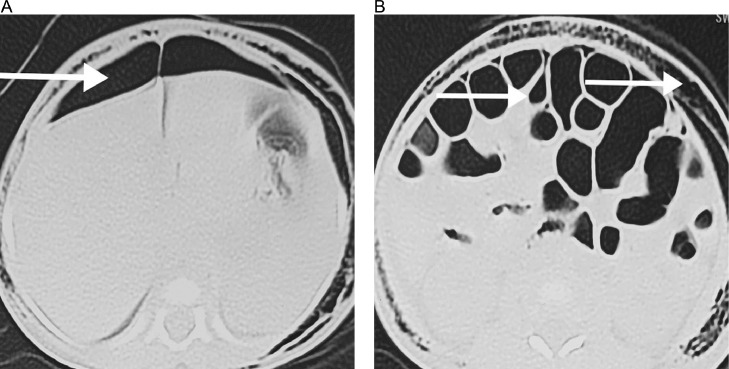
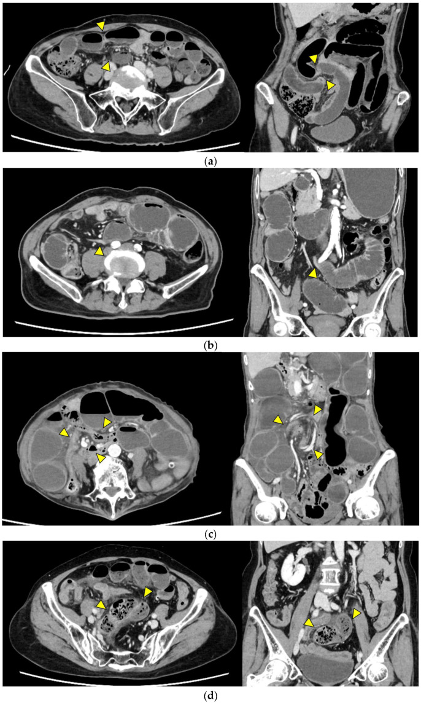
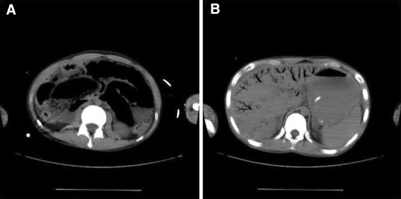
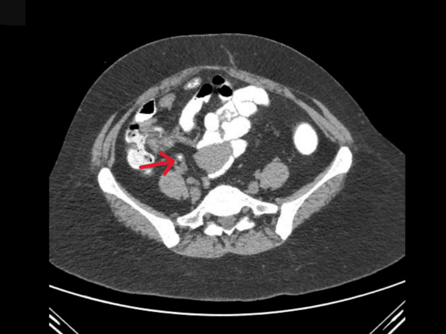
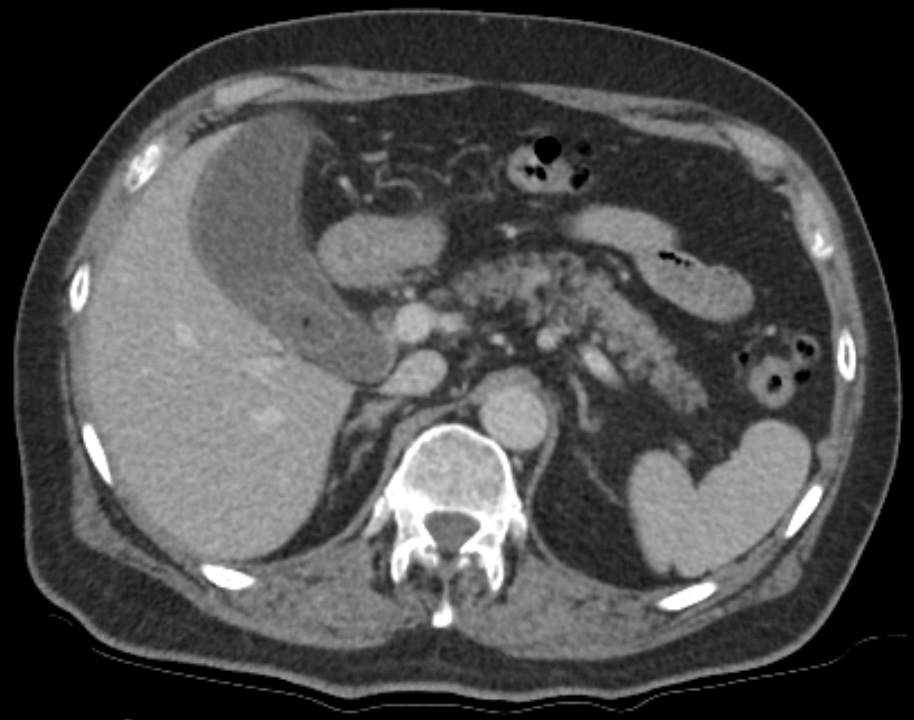
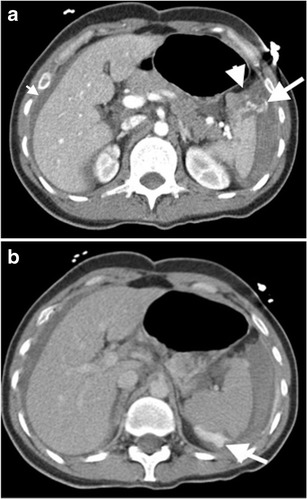
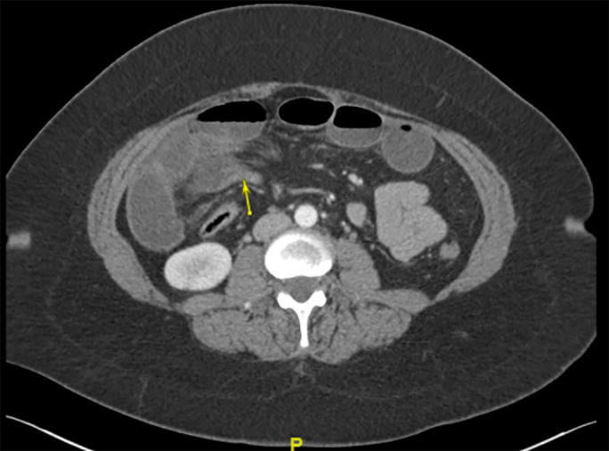
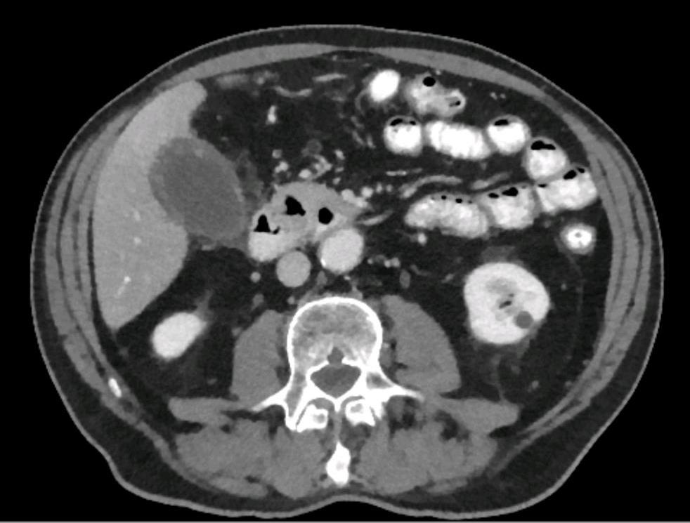
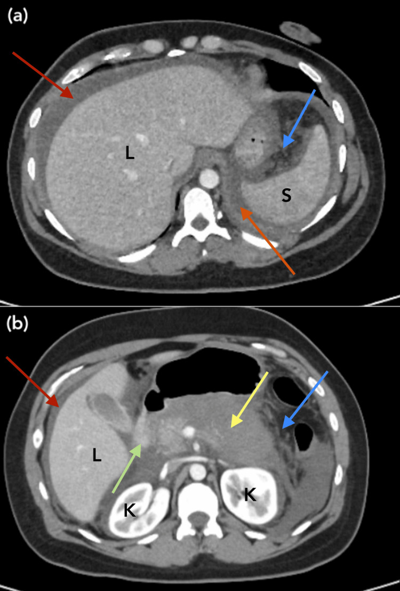

# BÀI HỌC Y KHOA: DẤU HIỆU CƠ BẢN TRÊN CT BỤNG VÀ CÁCH ĐỌC CÓ HỆ THỐNG
**Ngày:** 2026-11-17 | **Chuyên khoa:** Kỹ năng Ngoại khoa — Chẩn đoán hình ảnh | **Đối tượng:** Bác sĩ, học viên sau đại học và người học mất gốc cần học từ nền tảng

---

## 0. TỔNG QUAN — VÌ SAO BÀI NÀY QUAN TRỌNG? [CỐT LÕI]

&emsp;Bài 1 đã dạy cách nhận diện giải phẫu bình thường trên CT bụng.

&emsp;Bài 2 dạy bước tiếp theo: nhìn thấy bất thường, gọi đúng tên dấu hiệu, và quyết định bước tiếp theo.

&emsp;Một phim CT bụng cấp cứu thường chứa nhiều dấu hiệu cùng lúc: khí tự do, dịch tự do, quai ruột giãn, thành ruột dày, tạng đặc rách.

&emsp;Người đọc không có hệ thống sẽ dừng lại ở dấu hiệu đầu tiên thấy được, rồi bỏ sót dấu hiệu thứ 2 nguy hiểm hơn.

&emsp;Hiện tượng đó có tên là satisfaction of search (tạm dịch: thỏa mãn sau khi tìm thấy), và nó đã được chứng minh bằng thực nghiệm: thêm 1 nốt mô phỏng vào phim làm giảm đáng kể độ chính xác phát hiện các tổn thương thật khác trên cùng phim [ABSTRACT VERIFIED].

&emsp;Bài này dạy một quy trình đọc từng bước, rồi dạy từng dấu hiệu theo đúng 4 lớp: cơ chế, hình ảnh trên CT, ý nghĩa, bẫy.

&emsp;Mỗi số liệu cụ thể trong bài đều gắn nhãn kiểm chứng theo nguồn trích.

&emsp;Nhãn [ABSTRACT VERIFIED] dùng cho số có trong abstract đã đọc.

&emsp;Nhãn [FULL TEXT VERIFIED] dùng cho số chỉ có trong toàn văn đã đọc.

&emsp;Nhãn [GUIDELINE VERIFIED] dùng cho khuyến cáo và số liệu từ guideline chính thức.

&emsp;Nhãn [NGOÀI ABSTRACT] dùng cho nhận định không ghi rõ trong abstract, khi đó bài không dạy số cụ thể như số đã đối chiếu.

&emsp;Bài này không dạy lại giải phẫu và nhận diện bình thường của Bài 1.

&emsp;Bài này không dạy quản lý bệnh — quản lý bệnh thuộc các bài bệnh học, bài chỉ gắn chéo bằng tên.

**Mục tiêu của bài:**
- Đọc một phim CT bụng theo quy trình từng bước, không bỏ sót tạng, không quên bước, và viết được kết luận kèm bước tiếp theo.
- Nhận diện và gọi đúng tên 9 nhóm dấu hiệu cơ bản: khí tự do, dịch tự do, tắc ruột, dày thành ruột và thiếu máu ruột, viêm ruột thừa, viêm túi mật và tắc mật, viêm tụy, chấn thương tạng đặc, khối u.
- Phân biệt được dấu hiệu thật với bẫy thường gặp, và biết dấu hiệu nào là cấp cứu phải hành động ngay.
- Biết giới hạn của từng dấu hiệu: dấu hiệu nào âm tính vẫn không loại trừ được bệnh.

> **TIÊU CHUẨN BẮT BUỘC — DẠY TỪ GỐC, KHÔNG GIỚI HẠN ĐỘ DÀI:** Viết để một người học mất gốc vẫn theo được. Trước khi dùng một thuật ngữ, chữ viết tắt, chỉ số, cơ quan, cơ chế, thủ thuật hoặc quyết định điều trị lần đầu, phải giải thích bằng tiếng Việt đơn giản: **nó là gì → bình thường hoạt động ra sao → vì sao bất thường này quan trọng → nhận ra bằng cách nào → làm gì tiếp theo**. Sau lần giải thích đầu tiên, mới dùng viết tắt/thuật ngữ ngắn. Không dùng “rõ ràng”, “thường quy”, “theo protocol” hoặc danh sách bước trần nếu chưa giải thích lý do và ý nghĩa của hành động. Độ dài không có giới hạn tối đa: tiếp tục viết khi còn một mắt xích cần thiết để người học hiểu hoặc ra quyết định an toàn; ưu tiên chia nhỏ bằng tiêu đề, ví dụ và checkpoint thay vì cắt bỏ nền tảng.

> **CÁCH GIẢI THÍCH BẮT BUỘC CHO MỖI QUY TRÌNH:** Mỗi xét nghiệm, thang điểm, thuốc, thủ thuật hoặc algorithm phải ghi theo thứ tự: **mục tiêu → khi nào dùng/không dùng → cần chuẩn bị/đầu vào gì → làm hoặc đọc kết quả như thế nào → kết quả thay đổi quyết định ra sao → bẫy/an toàn → khi nào chuyển tuyến**. Chi tiết liều, đường dùng, trình tự và thời điểm phải có nguồn xác minh; không lấp chỗ trống bằng suy đoán.

### 📋 TRƯỚC KHI ĐỌC — NỀN TẢNG CẦN DÙNG

> Để hiểu bài này, người học nên đã biết:
> - Thang Hounsfield (Hounsfield unit, HU) và 3 cửa sổ CT — bài Giải phẫu CT bụng đã dạy, bài này chỉ dùng, không dạy lại.
> - Các thì cản quang — thì không cản quang, thì động mạch, thì tĩnh mạch cửa, thì muộn — bài Giải phẫu CT bụng đã dạy.
> - Vị trí và hình ảnh bình thường của gan, túi mật, tụy, lách, thận, ruột non, đại tràng, ruột thừa, mạch máu lớn — bài Giải phẫu CT bụng đã dạy.
>
> **Không được chặn việc học vì thiếu prerequisite.** Mục 0.1 dưới đây dạy đủ khái niệm nền tối thiểu để đọc tiếp ngay; link bài tiên quyết chỉ là đường học sâu hơn.

### 0.1. Nền tảng tối thiểu cần dùng ngay [CỐT LÕI]

&emsp;CT bụng là ảnh lát cắt ngang ổ bụng, chụp bằng tia X xoay quanh bệnh nhân và tái tạo thành nhiều lát mỏng.

&emsp;Mỗi điểm ảnh mang một con số HU nói lên mô đó đặc hay loãng: khí rất âm, mỡ âm nhẹ, nước bằng 0, mô mềm dương vừa, xương dương lớn.

&emsp;Cửa sổ (window) là cách chọn khoảng HU hiển thị: cửa sổ phổi làm khí đen rõ nhất, cửa sổ mô mềm làm tạng và thành ruột rõ nhất, cửa sổ xương làm xương rõ nhất.

&emsp;Thuốc cản quang iod tiêm tĩnh mạch làm mạch máu và mô giàu máu sáng lên theo từng thì, nhờ đó người đọc thấy được tưới máu của thành ruột và tạng đặc.

&emsp;Thì không cản quang cho thấy sỏi, máu tụ và khí mà không bị cản quang che mất.

&emsp;Thì động mạch cho thấy động mạch mạc treo và chảy máu đang diễn ra.

&emsp;Thì tĩnh mạch cửa là thì chính để đọc tạng đặc và thành ruột vì lúc này nhu mô ngấm thuốc đều nhất.

&emsp;Dấu hiệu trên CT là một hình ảnh bất thường có thể gọi tên và có ý nghĩa chẩn đoán, ví dụ khí nằm ngoài lòng ruột, quai ruột giãn kèm điểm chuyển tiếp, thành ruột không ngấm thuốc.

&emsp;Độ nhạy (sensitivity) là tỉ lệ bệnh nhân thật sự có bệnh mà xét nghiệm phát hiện được.

&emsp;Độ đặc hiệu (specificity) là tỉ lệ người không có bệnh mà xét nghiệm cho kết quả âm tính đúng.

&emsp;Một xét nghiệm nhạy cao mà âm tính thì giúp loại trừ bệnh, nhưng một xét nghiệm nhạy trung bình mà âm tính thì không loại trừ được bệnh — đây là điểm mấu chốt của bài này.

&emsp;Giá trị tiên đoán âm (negative predictive value, NPV) là xác suất người có kết quả âm tính thật sự không có bệnh.

&emsp;Tỉ lệ khả năng (likelihood ratio, LR) nói lên kết quả xét nghiệm làm thay đổi xác suất bệnh bao nhiêu lần: LR dương càng lớn thì kết quả dương tính càng chắc chắn, LR âm càng nhỏ thì kết quả âm tính càng loại trừ tốt.

### 0.2. Bài này đứng ở đâu trong bộ kỹ năng [CỐT LÕI]

&emsp;Bài 1 — Giải phẫu CT bụng — dạy nhận diện bình thường: HU, cửa sổ, thì cản quang, mặt cắt, khung đọc 4 bước, từng tạng, mạch, khoang, biến thể và bẫy bình thường trông giống bệnh.

&emsp;Bài 2 — bài này — dạy dấu hiệu bệnh lý cơ bản và cách đọc có hệ thống trên nền Bài 1.

&emsp;Các bài bệnh học dạy quản lý từng bệnh: bài Viêm ruột thừa cấp, bài Thủng tạng rỗng do loét dạ dày–tá tràng, bài Tắc ruột, bài Sỏi mật, bài Viêm đường mật.

&emsp;Bài Hướng dẫn đọc chẩn đoán hình ảnh tiết niệu ngoại khoa (SURG-01C) dạy chẩn đoán hình ảnh tiết niệu chi tiết — bài này chỉ nhắc chéo khi gặp sỏi niệu quản hay ứ nước thận trên CT bụng.

&emsp;Bài Khám bụng ngoại khoa dạy khám lâm sàng bụng — bài này gắn chéo khi đối chiếu dấu hiệu CT với dấu hiệu lâm sàng như co cứng thành bụng hay dấu Murphy (dấu Murphy là đau tăng khi ấn hạ sườn phải lúc bệnh nhân hít vào).

---

## 1. ĐỊNH NGHĨA VÀ KHUNG ĐỌC HỆ THỐNG [CỐT LÕI]

### 1.0. Nền tảng: dấu hiệu trên CT là gì [CỐT LÕI]

> **Phân biệt 2 loại nội dung trong bài:**
>
> **Loại 1 — Kiến thức sinh lý/giải phẫu/khái niệm consensus** (không tranh cãi, ổn định ≥10 năm):
> Viết tự do, KHÔNG gán nhãn verification và KHÔNG cần PMID (đây là kiến thức textbook/nền tảng).
> Ví dụ được phép: "Khí bay lên chỗ cao nhất trong ổ bụng", "Ruột non giãn thì chứa dịch và hơi", "Thành ruột thiếu máu thì không ngấm thuốc cản quang".
> Cấm tự gán các nhãn cũ như `[Thông tin cơ bản - LLM verified]` hay `[TEXTBOOK]`.
>
> **Loại 2 — Claim số liệu định lượng / ngưỡng / protocol / khuyến cáo guideline**:
> Bắt buộc Claim ID trong brief + PMID/guideline evidence + 1 trong 5 nhãn verification chuẩn:
> `[FETCHED]`, `[ABSTRACT VERIFIED]`, `[DATA VERIFIED]`, `[FULL TEXT VERIFIED]`, `[GUIDELINE VERIFIED]`.
> Cấm tuyệt đối dùng nhãn cho: %, mg/kg, mmol/L, RR/CI, liều thuốc, ngưỡng xét nghiệm, tỷ lệ dịch tễ khi chưa verify.

&emsp;Dấu hiệu trên CT là một hình ảnh bất thường mà người đọc có thể mô tả bằng lời và đối chiếu được với giải phẫu bình thường.

&emsp;Ví dụ: khí nằm ngoài lòng ruột và ngoài đường mật thì gọi là khí tự do ổ bụng.

&emsp;Ví dụ: quai ruột non giãn, chứa dịch, rồi đột ngột xẹp lại tại một điểm thì gọi là tắc ruột có điểm chuyển tiếp.

&emsp;Ví dụ: thành ruột không ngấm thuốc cản quang trong khi các quai bên cạnh ngấm đều thì gọi là mất ngấm thuốc thành ruột, gợi ý thiếu máu.

&emsp;Một dấu hiệu đứng một mình hiếm khi đủ để kết luận bệnh.

&emsp;Người đọc giỏi là người đọc tổ hợp dấu hiệu cộng với lâm sàng và xét nghiệm, không phải người thuộc lòng từng dấu hiệu đơn lẻ.

&emsp;Bài này dạy mỗi dấu hiệu theo đúng 4 lớp, theo thứ tự cố định.

&emsp;Lớp 1 là cơ chế: vì sao tổn thương đó sinh ra hình ảnh đó.

&emsp;Lớp 2 là hình ảnh trên CT: thấy gì, ở cửa sổ nào, thì nào, mặt cắt nào.

&emsp;Lớp 3 là ý nghĩa: dấu hiệu đó làm thay đổi xác suất bệnh và quyết định ra sao.

&emsp;Lớp 4 là bẫy: dấu hiệu đó dễ bị nhầm với cái gì, và khi nào nó không có nghĩa như người đọc tưởng.

### 1.1. Bốn lớp của mỗi dấu hiệu — cơ chế, hình ảnh, ý nghĩa, bẫy [CỐT LÕI]

&emsp;Bốn lớp này là khung học của toàn bộ §7 và §8.

&emsp;Học viên đọc một dấu hiệu mà chỉ nhớ hình ảnh thì sẽ gọi đúng tên nhưng xử trí sai.

&emsp;Học viên chỉ nhớ ý nghĩa mà không biết bẫy thì sẽ quá tự tin vào một dấu hiệu đơn lẻ.

&emsp;Ví dụ: khí tự do là hình ảnh dễ nhận, nhưng ý nghĩa của nó thay đổi hoàn toàn giữa bệnh nhân đau bụng cấp chưa mổ và bệnh nhân mới mổ 2 ngày.

&emsp;Ví dụ: mất ngấm thuốc thành ruột là dấu hiệu mạnh của nghẹt ruột, nhưng mất ngấm thuốc không đồng nghĩa ruột đã chết chắc chắn.

&emsp;Ví dụ: ruột thừa đường kính trên 6 mm là dấu hiệu hay được dạy, nhưng Bài 1 đã dạy đường kính trên 6 mm gặp ở 48,12% người bình thường [ABSTRACT VERIFIED].

&emsp;Vì vậy mỗi dấu hiệu trong bài này đều có đủ 4 lớp, và phần bẫy được viết ngay sau phần ý nghĩa để học viên không kịp hình thành phản xạ sai.

### 1.2. Khung đọc 4 bước của Bài 1 — gắn chéo, không dạy lại [CỐT LÕI]

&emsp;Bài 1 §4.3 đã dạy khung đọc hệ thống 4 bước: kỹ thuật, giải phẫu, bất thường, kết luận.

&emsp;Bài 2 không dạy lại khung này như nội dung mới.

&emsp;Bài 2 dùng khung đó làm xương sống cho §3, và làm sâu thêm 2 chỗ mà Bài 1 chưa có: đọc scout view trước khi vào 4 bước, và đọc lại lần 2 có chủ đích sau khi đã thấy 1 tổn thương.

&emsp;Bước kỹ thuật trong khung 4 bước là bước kiểm tra chất lượng phim trước: đúng cửa sổ, đúng thì cản quang, đúng mặt cắt, không có artefact (artefact là hình ảnh giả do máy hoặc do bệnh nhân gây ra) che mất vùng cần đọc.

&emsp;Bước giải phẫu là bước quét từng tạng, mạch và khoang theo thứ tự cố định, đối chiếu với hình ảnh bình thường đã học ở Bài 1.

&emsp;Bước bất thường là bước gọi tên dấu hiệu theo 4 lớp của §1.1, rồi xếp các dấu hiệu lại thành một chẩn đoán phân biệt.

&emsp;Bước kết luận là bước viết báo cáo theo chuẩn ACR: phát hiện, giới hạn, vấn đề lâm sàng, ấn tượng, bước tiếp theo.

### 1.3. Chuỗi cơ chế 1 — Từ tổn thương tới dấu hiệu trên CT [CỐT LÕI]

&emsp;Chuỗi này giải thích vì sao một tổn thương trong cơ thể lại hiện ra thành một dấu hiệu đọc được trên CT.

**Tầng 1 — Phân tử và tế bào:** Tổn thương khởi phát ở mức phân tử: vi khuẩn xâm nhập thành ruột gây viêm, cục máu đông bít động mạch mạc treo gây thiếu máu, áp lực trong lòng ruột tăng gây ứ đọng dịch và hơi.

**Tầng 2 — Mô và cơ quan:** Tổn thương lan ra mức mô: thành ruột phù nề và dày lên, nhu mô tụy hoại tử thành vùng không còn tế bào sống, thành ruột thủng tạo lỗ cho khí và dịch thoát ra ngoài lòng ruột.

**Tầng 3 — Thay đổi vật lý đo được trên CT:** Tổn thương đổi mật độ và tưới máu của mô: vùng phù nề đậm độ thấp hơn mô lành, vùng hoại tử không ngấm thuốc cản quang, khí thoát ra có HU rất âm và bay lên chỗ cao nhất trong ổ bụng.

**Tầng 4 — Hình ảnh người đọc thấy:** Người đọc thấy dấu hiệu trên cửa sổ và thì phù hợp: khí đen trên cửa sổ phổi, thành ruột dày trên cửa sổ mô mềm thì tĩnh mạch cửa, vùng không ngấm thuốc trên thì động mạch và thì tĩnh mạch cửa.

**Tầng 5 — Phản chứng khi đứt chuỗi:** Nếu chỉ học hình ảnh mà không học cơ chế thì người đọc sẽ gọi nhầm: khí trong lòng ruột bị gọi thành khí tự do, thành ruột dày do co thắt bị gọi thành viêm, vùng hoại tử bị bỏ qua vì chỉ đọc một thì.

```text
Tổn thương phân tử: viêm, tắc mạch, tăng áp lực trong lòng ruột
  ──→ Tổn thương mô: phù nề, hoại tử, thủng thành ruột
  ──→ Thay đổi vật lý: đổi đậm độ, đổi tưới máu, khí và dịch thoát ra
  ──→ Hình ảnh trên CT: khí đen, thành dày, vùng không ngấm thuốc, quai giãn
  ──→ Người đọc gọi tên dấu hiệu theo 4 lớp rồi xếp thành chẩn đoán
  ✗ Đứt ở tầng cơ chế: chỉ nhớ hình ảnh, không biết vì sao có hình ảnh đó → gọi nhầm dấu hiệu
  ✗ Đứt ở tầng cửa sổ và thì: đọc khí bằng cửa sổ mô mềm, đọc tưới máu bằng thì không cản quang → bỏ sót dấu hiệu
```

```text
Khí trong lòng ruột bình thường
  ──→ Khí nằm trong quai ruột, theo hình quai ruột, có thành ruột bao quanh
  ──→ Khí tự do sau thủng
  ──→ Khí nằm ngoài lòng ruột, bay lên dưới hoành, không có thành ruột bao quanh
  ──→ Người đọc phân biệt bằng vị trí khí, không phân biệt bằng màu đen
  ✗ Đứt: thấy đen là gọi khí tự do, không hỏi khí nằm trong hay ngoài lòng ruột → kết luận sai
```

### 🛑 DỪNG 1 PHÚT — TỰ KIỂM TRA

> 1. Bốn lớp của mỗi dấu hiệu là gì, và vì sao lớp bẫy phải viết ngay sau lớp ý nghĩa?
> 2. Khung đọc 4 bước của Bài 1 gồm những bước nào?
>
> *(Đáp án: Bốn lớp là cơ chế, hình ảnh trên CT, ý nghĩa, bẫy. Lớp bẫy viết ngay sau lớp ý nghĩa để học viên không kịp hình thành phản xạ quá tự tin vào một dấu hiệu đơn lẻ. Khung 4 bước là kỹ thuật, giải phẫu, bất thường, kết luận.)*

---
## 2. CƠ CHẾ CHUNG — VÌ SAO CÁC DẤU HIỆU XUẤT HIỆN [CỐT LÕI]

### 2.0. Nền tảng: 4 nhóm cơ chế tạo dấu hiệu [CỐT LÕI]

&emsp;Mọi dấu hiệu trong bài này đều sinh ra từ 1 trong 4 nhóm cơ chế dưới đây.

&emsp;Nhóm 1 là mất liên tục thành ruột: thủng, vỡ, rò làm khí và dịch thoát ra ngoài lòng ruột.

&emsp;Nhóm 2 là tắc nghẽn lòng ruột: dính, u, thoát vị, xoắn làm dịch và hơi ứ lại phía trên chỗ tắc, quai ruột giãn ra, rồi thành ruột thiếu máu nếu tắc kèm nghẹt.

&emsp;Nhóm 3 là thiếu máu tưới máu: tắc động mạch, tắc tĩnh mạch, co thắt mạch khi sốc làm thành ruột và tạng đặc không được tưới máu, rồi hoại tử.

&emsp;Nhóm 4 là viêm và nhiễm trùng: vi khuẩn và phản ứng viêm làm thành tạng dày lên, tăng ngấm thuốc, tụ dịch quanh tạng, rồi áp xe và hoại tử.

&emsp;Một bệnh thường chạy qua nhiều nhóm cơ chế cùng lúc.

&emsp;Ví dụ: tắc ruột do dính bắt đầu ở nhóm 2, rồi chuyển sang nhóm 3 khi quai ruột bị nghẹt, rồi chuyển sang nhóm 1 khi thành ruột hoại tử và thủng.

&emsp;Ví dụ: viêm tụy cấp bắt đầu ở nhóm 4, rồi chuyển sang nhóm 3 khi hoại tử tụy lan rộng và mạch máu quanh tụy bị huyết khối.

&emsp;Vì vậy người đọc không được gắn mỗi bệnh với một dấu hiệu duy nhất, mà phải đọc cả chuỗi cơ chế để biết bệnh đang ở giai đoạn nào.

### 2.1. Chuỗi cơ chế 2 — Thủng tạng rỗng tới khí tự do [CỐT LÕI]

&emsp;Chuỗi này giải thích vì sao thủng một lỗ nhỏ trên thành ruột lại sinh ra khí tự do thấy được trên CT, và vì sao có khi thủng mà không thấy khí.

**Tầng 1 — Phân tử và tế bào:** Loét, viêm hoặc chấn thương làm chết tế bào thành ruột tại một điểm, lớp cơ và lớp niêm mạc mất liên tục, tạo một lỗ thủng nối lòng ruột với ổ bụng.

**Tầng 2 — Mô và cơ quan:** Lỗ thủng làm áp lực trong lòng ruột đẩy khí và dịch tiêu hóa ra ngoài, đồng thời vi khuẩn thoát ra gây viêm phúc mạc, thành ruột quanh lỗ thủng phù nề và dày lên từng đoạn.

**Tầng 3 — Thay đổi vật lý đo được trên CT:** Khí thoát ra có HU rất âm và bay lên chỗ cao nhất trong ổ bụng, thường là dưới hoành phải và quanh gan; dịch thoát ra tụ lại ở các rãnh và khoang thấp; thành ruột quanh lỗ thủng dày lên và có thể thấy khuyết khu trú.

**Tầng 4 — Hình ảnh người đọc thấy:** Người đọc thấy bọt khí ngoài lòng ruột tập trung sát thành ruột, khí tự do ở khoang trên hoặc dưới mạc treo đại tràng ngang, dày thành ruột từng đoạn, thâm nhiễm mỡ quanh tạng và có thể thấy áp xe.

**Tầng 5 — Phản chứng khi đứt chuỗi:** Nếu thủng ở đoạn sau phúc mạc của tá tràng hoặc đại tràng thì khí không vào ổ bụng tự do mà khu trú sau phúc mạc, người đọc chỉ tìm khí dưới hoành sẽ bỏ sót; nếu lỗ thủng nhỏ và được mạc nối che kín thì khí thoát ra rất ít, người đọc phải tìm dấu hiệu gián tiếp như phlegmon (phlegmon là khối viêm đặc quanh ruột) và dịch phúc mạc.

```text
Loét hoặc viêm làm chết tế bào thành ruột tại một điểm
  ──→ Lớp cơ và niêm mạc mất liên tục, tạo lỗ thủng
  ──→ Áp lực lòng ruột đẩy khí và dịch ra ổ bụng, vi khuẩn gây viêm phúc mạc
  ──→ Khí bay lên dưới hoành, dịch tụ ở rãnh, thành ruột quanh lỗ dày lên
  ──→ Người đọc thấy bọt khí sát thành ruột, khí khoang trên hoặc dưới mạc treo, dày thành từng đoạn
  ✗ Đứt ở tầng vị trí: thủng sau phúc mạc không sinh khí tự do ổ bụng → chỉ tìm khí dưới hoành sẽ bỏ sót
  ✗ Đứt ở tầng lượng khí: lỗ thủng nhỏ được mạc nối che kín, khí thoát rất ít → phải tìm dấu hiệu gián tiếp
```

```text
Thủng dạ dày hoặc tá tràng
  ──→ Khí tập trung khoang trên mạc treo đại tràng ngang, quanh gan và dưới hoành
  ──→ Thủng ruột non thấp hoặc đại tràng
  ──→ Khí tập trung khoang dưới mạc treo đại tràng ngang và tiểu khung
  ──→ Người đọc dùng khoang khí để khu trú vị trí thủng trước khi mổ
  ✗ Đứt: khí đã lan khắp ổ bụng thì khoang khí không còn giúp khu trú → phải dựa vào bọt khí sát thành ruột và dày thành từng đoạn
```

### 2.2. Chuỗi cơ chế 3 — Tắc mạch tới hoại tử ruột [CỐT LÕI]

&emsp;Chuỗi này giải thích vì sao tắc một động mạch mạc treo lại sinh ra hàng loạt dấu hiệu trên CT, và vì sao CT thường quy phát hiện thiếu máu kém nhạy hơn CTA.

**Tầng 1 — Phân tử và tế bào:** Cục thuyên tắc từ tim hoặc huyết khối tại chỗ bít động mạch mạc treo tràng trên, máu không tới được thành ruột, tế bào niêm mạc ruột thiếu oxy và chết đầu tiên vì niêm mạc là lớp nhạy cảm nhất với thiếu máu.

**Tầng 2 — Mô và cơ quan:** Thành ruột mất khả năng giữ nước và chất điện giải, phù nề rồi mỏng dần khi hoại tử xuyên thành, vi khuẩn trong lòng ruột xâm nhập qua thành ruột chết, khí sinh ra trong thành ruột và theo tĩnh mạch cửa vào gan.

**Tầng 3 — Thay đổi vật lý đo được trên CT:** Thành ruột thiếu máu không ngấm thuốc cản quang, dày lên lúc đầu vì phù nề rồi mỏng đi khi hoại tử, khí trong thành ruột có HU rất âm, khí tĩnh mạch cửa lan ra ngoại vi gan theo dòng máu cửa.

**Tầng 4 — Hình ảnh người đọc thấy:** Người đọc thấy tắc động mạch trên CTA, giảm hoặc mất ngấm thuốc thành ruột, khí trong thành ruột, khí tĩnh mạch cửa, quai ruột giãn, dịch tự do, và ở giai đoạn muộn thì khí tự do ổ bụng do thủng.

**Tầng 5 — Phản chứng khi đứt chuỗi:** Nếu chỉ đọc CT thường quy một thì tĩnh mạch cửa thì người đọc không thấy được cục tắc trong động mạch, chỉ thấy hậu quả ở thành ruột, vì vậy độ nhạy phát hiện thiếu máu thấp hơn CTA; nếu chỉ thấy khí trong thành ruột đơn độc mà không thấy tắc mạch hay mất ngấm thuốc thì chưa đủ kết luận hoại tử, vì khí trong thành ruột có phổ nguyên nhân từ lành tính tới đe dọa tính mạng.

```text
Thuyên tắc hoặc huyết khối bít động mạch mạc treo tràng trên
  ──→ Tế bào niêm mạc ruột thiếu oxy và chết đầu tiên
  ──→ Thành ruột phù nề rồi mỏng dần, vi khuẩn xâm nhập, khí sinh ra trong thành ruột
  ──→ Khí theo tĩnh mạch cửa vào gan, dịch thoát ra ổ bụng, thành ruột thủng ở giai đoạn muộn
  ──→ Người đọc thấy tắc mạch trên CTA, mất ngấm thuốc, khí trong thành ruột, khí tĩnh mạch cửa
  ✗ Đứt ở tầng thì chụp: CT thường quy 1 thì không thấy cục tắc trong động mạch → độ nhạy thấp hơn CTA
  ✗ Đứt ở tầng dấu hiệu đơn độc: chỉ thấy khí trong thành ruột mà không thấy tắc mạch hay mất ngấm thuốc → chưa đủ kết luận hoại tử
```

```text
Thiếu máu do tắc mạch
  ──→ Tổn thương khu trú theo vùng mạch bị tắc, ranh giới rõ với vùng còn tưới máu
  ──→ Thiếu máu không do tắc mạch (NOMI)
  ──→ Co thắt mạch lan tỏa khi sốc, tổn thương lan rộng không theo một vùng mạch
  ──→ Người đọc phân biệt 2 loại bằng hình ảnh mạch máu và phân bố tổn thương
  ✗ Đứt: thấy thành ruột không ngấm thuốc mà không đọc mạch máu → bỏ sót nguyên nhân và điều trị sai hướng
```

### 2.3. Chuỗi cơ chế 4 — Viêm tới dày thành và tụ dịch [CỐT LÕI]

&emsp;Chuỗi này giải thích vì sao viêm một tạng lại sinh ra dày thành, tăng ngấm thuốc, thâm nhiễm mỡ và tụ dịch quanh tạng trên CT.

**Tầng 1 — Phân tử và tế bào:** Vi khuẩn hoặc sỏi kẹt gây tắc nghẽn và ứ đọng, tế bào viêm giải phóng các chất trung gian làm mạch máu tại chỗ giãn ra và tăng tính thấm, bạch cầu thoát ra khỏi mạch máu vào mô.

**Tầng 2 — Mô và cơ quan:** Thành tạng phù nề và dày lên, mỡ quanh tạng thấm dịch viêm và đậm độ tăng lên, dịch viêm thoát ra khoang quanh tạng, áp lực trong tạng tăng làm giảm tưới máu cục bộ và có thể gây hoại tử.

**Tầng 3 — Thay đổi vật lý đo được trên CT:** Thành tạng dày lên và ngấm thuốc mạnh hơn vì mạch máu giãn và tăng tính thấm, mỡ quanh tạng đậm độ cao hơn mỡ bình thường, dịch quanh tạng có HU của dịch, vùng hoại tử không ngấm thuốc.

**Tầng 4 — Hình ảnh người đọc thấy:** Người đọc thấy dày thành túi mật kèm dịch quanh túi mật, dày thành ruột thừa kèm mỡ quanh viêm, tụy to và bờ mờ kèm tụ dịch quanh tụy, và ở giai đoạn nặng thì vùng không ngấm thuốc gợi ý hoại tử.

**Tầng 5 — Phản chứng khi đứt chuỗi:** Nếu chỉ thấy dày thành mà không thấy các dấu hiệu viêm đi kèm thì chưa đủ kết luận viêm, vì thành ruột dày còn gặp khi lòng ruột xẹp hoặc co thắt; nếu thấy mất ngấm thuốc thành túi mật hoặc thành ruột thì phải nghĩ tới hoại thư, không được gọi là viêm đơn thuần.

```text
Tắc nghẽn và ứ đọng: sỏi kẹt, phù nề, vi khuẩn phát triển
  ──→ Chất trung gian viêm làm mạch giãn và tăng tính thấm, bạch cầu thoát mạch
  ──→ Thành tạng phù nề và dày lên, mỡ quanh tạng thấm dịch viêm, dịch tụ quanh tạng
  ──→ Thành dày ngấm thuốc mạnh, mỡ quanh viêm đậm độ cao, dịch quanh tạng thấy rõ
  ──→ Người đọc thấy dày thành kèm mỡ quanh viêm và dịch quanh tạng, xếp thành viêm cấp
  ✗ Đứt ở tầng dấu hiệu đi kèm: chỉ thấy dày thành đơn độc, không có mỡ viêm hay dịch → chưa đủ kết luận viêm
  ✗ Đứt ở tầng hoại tử: thấy mất ngấm thuốc thành mà vẫn gọi viêm đơn thuần → bỏ sót hoại thư
```

```text
Viêm sớm: thành dày, tăng ngấm thuốc, mỡ quanh viêm
  ──→ Viêm nặng: dịch quanh tạng nhiều, áp xe, thành mất ngấm thuốc
  ──→ Hoại tử: vùng không ngấm thuốc, khí trong nhu mô hoặc trong tụ dịch
  ──→ Người đọc xếp giai đoạn viêm bằng tổ hợp dấu hiệu, không xếp bằng một dấu hiệu
  ✗ Đứt: gọi hoại tử chỉ vì thấy một vùng đậm độ thấp, không đối chiếu thì cản quang → nhầm tụ dịch với hoại tử
```

### 🛑 DỪNG 1 PHÚT — TỰ KIỂM TRA

> 1. Bốn nhóm cơ chế tạo dấu hiệu là gì, và vì sao một bệnh thường chạy qua nhiều nhóm?
> 2. Vì sao CT thường quy phát hiện thiếu máu ruột kém nhạy hơn CTA?
>
> *(Đáp án: Bốn nhóm là mất liên tục thành ruột, tắc nghẽn lòng ruột, thiếu máu tưới máu, viêm và nhiễm trùng. Một bệnh chạy qua nhiều nhóm vì tổn thương tiến triển theo thời gian, ví dụ tắc ruột chuyển sang nghẹt rồi thủng. CT thường quy một thì không thấy cục tắc trong động mạch, chỉ thấy hậu quả ở thành ruột, nên kém nhạy hơn CTA.)*

---
## 3. QUY TRÌNH ĐỌC CT BỤNG TỪNG BƯỚC — CHẨN ĐOÁN CÓ HỆ THỐNG [CỐT LÕI]

> 🚨 **BOX ĐỎ — AN TOÀN TRƯỚC KHI ĐỌC THƯỜNG QUY:** Nếu bệnh nhân có dấu hiệu sốc, bụng cứng như gỗ, hoặc nghi ngờ thủng tạng rỗng kèm viêm phúc mạc, thì đọc phim không được trì hoãn hồi sức và gọi phẫu thuật. Đọc CT trong tình huống này là đọc tìm 3 thứ trong 2 phút: khí tự do, dịch tự do lượng nhiều, và chảy máu đang diễn ra. Không có dấu hiệu nào trong 3 thứ đó cũng không loại trừ được bệnh lý cấp cứu khi lâm sàng rõ ràng. Chuyển ngay cho phẫu thuật viên và bác sĩ hồi sức, không ngồi viết báo cáo dài.

&emsp;Quy trình dưới đây có 5 bước: bước 0 đọc scout view, bước 1 kiểm tra chất lượng phim, bước 2 quét từng tạng theo thứ tự cố định, bước 3 đọc lại lần 2 có chủ đích, bước 4 viết kết luận và bước tiếp theo.

&emsp;Quy trình này bám theo khung 4 bước của Bài 1 §4.3, chỉ thêm bước 0 và bước đọc lại lần 2.

&emsp;Mục tiêu của quy trình không phải là đọc nhanh, mà là đọc không bỏ sót.

&emsp;Người mới nên đọc chậm và đọc đủ 5 bước cho mọi phim, kể cả phim trông bình thường.

&emsp;Người đọc có kinh nghiệm vẫn giữ nguyên thứ tự, chỉ rút ngắn thời gian ở mỗi bước.

### 3.1. Bước 0 — Đọc scout view trước [CỐT LÕI]

&emsp;Scout view (topogram) là ảnh X-quang định vị chụp trước khi quét CT, cho thấy toàn bộ vùng từ ngực dưới tới tiểu khung trong một ảnh.

&emsp;Nhiều người đọc bỏ qua scout view vì cho rằng nó chỉ dùng để định vị vùng quét.

&emsp;Ảnh scout có thể chứa phát hiện ngoài vùng quét, ví dụ ung thư phổi ở đáy phổi, và dị vật phẫu thuật còn sót [ABSTRACT VERIFIED].

&emsp;Đọc scout view trước khi đọc các lát cắt là bước 0 của quy trình này.

&emsp;Cách đọc scout view: nhìn từ trên xuống dưới, từ ngoài vào trong, ghi nhận xương, khí ruột, bóng tim và đáy phổi, rồi mới chuyển sang các lát cắt CT.

&emsp;Ví dụ: một khối mờ ở đáy phổi trên scout view có thể là ung thư phổi chưa được chẩn đoán, dù vùng quét CT chỉ bắt đầu từ dưới hoành.

&emsp;Ví dụ: một dị vật đậm độ cao trên scout view ở vùng tiểu khung có thể là dụng cụ phẫu thuật còn sót mà các lát cắt CT đã cắt qua nhưng người đọc không để ý.

&emsp;Bước 0 chỉ mất khoảng 30 giây nhưng cứu được những phát hiện nằm ngoài vùng quét chính.

### 3.2. Bước 1 — Kiểm tra chất lượng phim [CỐT LÕI]

&emsp;Trước khi đọc bất thường, người đọc phải trả lời 4 câu hỏi về chất lượng phim.

&emsp;Câu hỏi 1: đủ cửa sổ chưa — phim có đủ cửa sổ phổi, cửa sổ mô mềm và cửa sổ xương không.

&emsp;Câu hỏi 2: đúng thì cản quang chưa — thì không cản quang có thấy sỏi và máu tụ không, thì động mạch có thấy động mạch mạc treo không, thì tĩnh mạch cửa có thấy nhu mô tạng đặc ngấm đều không.

&emsp;Câu hỏi 3: đủ mặt cắt chưa — mặt cắt ngang là mặt chính, mặt đứng dọc và mặt đứng ngang giúp xác định điểm chuyển tiếp và ranh giới tổn thương.

&emsp;Câu hỏi 4: có artefact che mất vùng cần đọc không — artefact do chuyển động, kim loại, hoặc tia cứng có thể che mất một quai ruột hoặc một vùng nhu mô.

&emsp;Nếu phim thiếu cửa sổ phổi thì khí tự do lượng nhỏ rất dễ bị bỏ sót, vì khí trên cửa sổ mô mềm khó thấy hơn nhiều.

&emsp;Nếu phim chỉ có một thì tĩnh mạch cửa đơn thuần thì thiếu máu ruột sớm có thể bị bỏ sót, vì meta-analysis mới nhất cho thấy CT đa thì nhạy hơn đơn thì trong phát hiện thiếu máu (83% so với 72%, p = 0,01) [ABSTRACT VERIFIED].

&emsp;Nếu phim có artefact nặng che vùng tiểu khung thì ruột thừa không đánh giá được, người đọc phải ghi rõ giới hạn này trong báo cáo thay vì kết luận ruột thừa bình thường.

&emsp;Bước 1 kết thúc bằng một câu ghi nhận: phim đủ chất lượng để đọc, hay phim có giới hạn ở vùng nào.

### 3.3. Bước 2 — Quét từng tạng, mạch và khoang theo thứ tự cố định [CỐT LÕI]

&emsp;Thứ tự quét dưới đây là quy ước dạy học của bộ bài này, lấy từ Bài 1 §4.3.

&emsp;Thứ tự này không phải là guideline quốc tế, vì không tìm thấy guideline ACR hay RSNA nào quy định thứ tự đọc tạng chuẩn.

&emsp;Giá trị của thứ tự cố định nằm ở chỗ người đọc không bỏ sót tạng nào, không nằm ở chỗ thứ tự này là chuẩn quốc tế.

&emsp;Thứ tự quét: gan, túi mật và đường mật, tụy, lách, thận và thượng thận, dạ dày, tá tràng, ruột non, đại tràng, ruột thừa, mạch máu lớn, phúc mạc và mạc treo, hạch, tiểu khung, xương và mô mềm thành bụng.

&emsp;Ở mỗi tạng, người đọc trả lời 3 câu hỏi ngắn: tạng có đúng vị trí và kích thước không, nhu mô có đồng nhất và ngấm thuốc đều không, quanh tạng có dịch, khí hay thâm nhiễm mỡ không.

&emsp;Ở mạch máu, người đọc trả lời 2 câu hỏi: lòng mạch có thông không, thành mạch có huyết khối hay bóc tách không.

&emsp;Ở phúc mạc và mạc treo, người đọc trả lời 2 câu hỏi: có dịch tự do không, có khí tự do không.

&emsp;Người đọc quét đủ thứ tự này cho mọi phim, kể cả khi đã thấy một tổn thương rõ ràng ở tạng đầu tiên.

&emsp;Ví dụ: thấy sỏi túi mật ở bước gan mật rồi dừng lại thì sẽ bỏ sót viêm ruột thừa ở bước cuối cùng.

&emsp;Ví dụ: thấy tắc ruột ở bước ruột non rồi dừng lại thì sẽ bỏ sót tổn thương lách kèm theo ở bệnh nhân chấn thương.

### 3.4. Bước 3 — Đọc lại lần 2 có chủ đích [CỐT LÕI]

&emsp;Sau khi quét đủ thứ tự và đã thấy 1 tổn thương, người đọc đọc lại lần 2 có chủ đích trước khi viết kết luận.

&emsp;Lần đọc 2 này là biện pháp chống lại hiệu ứng satisfaction of search.

&emsp;Hiệu ứng này có thật: thêm 1 nốt mô phỏng vào phim làm giảm đáng kể độ chính xác phát hiện các tổn thương thật khác trên cùng phim [ABSTRACT VERIFIED].

&emsp;Mức độ nặng của tổn thương gây xao lãng không quyết định việc có phát hiện tổn thương thứ 2 hay không, theo nghiên cứu trên CT chấn thương [ABSTRACT VERIFIED].

&emsp;Vì vậy quy tắc đọc lại lần 2 áp dụng cho mọi phim, không chỉ phim có tổn thương lớn.

&emsp;Cách đọc lại lần 2: quay lại từ đầu thứ tự quét, lần này chỉ tìm 3 nhóm hay bị bỏ sót — khí tự do lượng nhỏ trên cửa sổ phổi, tổn thương tạng đặc nhỏ ở thì động mạch, và hạch hay khối ở tiểu khung.

&emsp;Lần đọc 2 cũng là lúc đối chiếu lại với lâm sàng: bệnh nhân đau ở đâu, xét nghiệm nào bất thường, và dấu hiệu CT có giải thích được lâm sàng đó không.

&emsp;Nếu dấu hiệu CT không giải thích được lâm sàng thì người đọc phải nghi ngờ mình đã bỏ sót tổn thương khác, hoặc chẩn đoán ban đầu chưa đúng.

### 3.5. Bước 4 — Viết kết luận và bước tiếp theo theo chuẩn ACR [CỐT LÕI]

&emsp;Báo cáo chẩn đoán hình ảnh phải có đủ các thành phần theo chuẩn ACR Practice Parameter for Communication of Diagnostic Imaging Findings, sửa đổi 2014.

&emsp;Chuẩn này quy định thành phần báo cáo, không quy định thứ tự đọc phim hay thứ tự đọc tạng.

&emsp;Thành phần báo cáo gồm: thông tin nhân khẩu học, thông tin lâm sàng liên quan, thân báo cáo gồm thủ thuật và vật liệu, phát hiện, giới hạn tiềm ẩn, vấn đề lâm sàng, so sánh với các kỳ khám trước, và ấn tượng hay kết luận.

&emsp;Phần phát hiện dùng thuật ngữ giải phẫu, bệnh lý và X-quang thích hợp, mô tả đúng vị trí, kích thước và đặc điểm của từng dấu hiệu.

&emsp;Phần giới hạn tiềm ẩn nêu yếu tố làm giảm độ nhạy và độ đặc hiệu của kỳ khám, ví dụ artefact che vùng tiểu khung hay chỉ chụp một thì.

&emsp;Phần vấn đề lâm sàng trả lời câu hỏi lâm sàng cụ thể, ví dụ có thủng không, có tắc ruột không, có thiếu máu ruột không.

&emsp;Nếu không trả lời được câu hỏi lâm sàng thì phải nói rõ không trả lời được và vì sao.

&emsp;Phần ấn tượng hay kết luận phải có trong mọi báo cáo trừ báo cáo rất ngắn, và phải ghi bước tiếp theo: mổ thăm dò, can thiệp mạch, chụp thêm thì, hay theo dõi và chụp lại.

&emsp;Báo cáo cuối cùng là tài liệu xác định, phải được đọc soát trước khi ký, và hạn chế viết tắt.

&emsp;Ví dụ: kết luận "tắc ruột non do dính, có dấu hiệu nghẹt, đề nghị hội chẩn phẫu thuật cấp cứu" là một kết luận đủ, vì nó gọi tên bệnh, gọi tên biến chứng, và ghi bước tiếp theo.

&emsp;Ví dụ: kết luận "không thấy bất thường" mà không ghi giới hạn phim thì là kết luận thiếu, vì người đọc sau không biết phim có đủ thì để loại trừ thiếu máu ruột hay không.

### 3.6. Checklist đọc hệ thống — dùng đúng vai trò [CỐT LÕI]

&emsp;Checklist trong bài này là danh sách kiểm tra các bước và các tạng, dùng để tổ chức việc đọc và viết báo cáo.

&emsp;Checklist giúp người đọc không bỏ sót tạng, không quên bước, và viết báo cáo đủ mục.

&emsp;Checklist không có bằng chứng chống được satisfaction of search.

&emsp;Bằng chứng trái chiều rất rõ: checklist chính thức không làm giảm lỗi satisfaction of search và làm hiệu năng ROC tệ hơn (0,68 so với 0,75, p < 0,001) [ABSTRACT VERIFIED].

&emsp;Checklist đọc thành tiếng cũng không loại trừ được hiệu ứng này, dù nó hữu ích để tổ chức việc đọc và viết báo cáo, đặc biệt với sinh viên [ABSTRACT VERIFIED].

&emsp;Vì vậy bài này dạy checklist như công cụ tổ chức, không dạy "dùng checklist thì sẽ không bỏ sót".

&emsp;Biện pháp chống bỏ sót mà bài này dạy là đọc lại lần 2 có chủ đích ở §3.4, không phải checklist.

&emsp;Có một loại checklist khác có bằng chứng đo được: checklist dấu hiệu của một chẩn đoán cụ thể.

&emsp;Ví dụ: checklist 3 dấu hiệu giúp phân biệt pneumatosis thật với giả pneumatosis, với độ chính xác của từng dấu hiệu là 94%, 86% và 78%, trong khi chẩn đoán sai pneumatosis lên tới 38% nếu không dùng checklist [ABSTRACT VERIFIED].

&emsp;Phân biệt rõ 2 loại checklist này là điểm mấu chốt của §3.6: checklist quy trình chung giúp tổ chức nhưng chưa có bằng chứng chống bỏ sót, checklist dấu hiệu của một chẩn đoán cụ thể thì có số liệu đo được.

&emsp;Khung đọc có hệ thống dựa trên giải phẫu, tức định vị tổn thương trước rồi mới mô tả thành phần, giúp cải thiện độ chính xác chẩn đoán [ABSTRACT VERIFIED].

&emsp;Khung này khớp với khung 4 bước của Bài 1 §4.3, nhưng cần nói rõ đây là review tổng hợp, không phải thử nghiệm đo mức giảm bỏ sót.

### 🛑 DỪNG 1 PHÚT — TỰ KIỂM TRA

> 1. Vì sao phải đọc scout view trước khi đọc các lát cắt CT?
> 2. Checklist giúp được gì và không giúp được gì trong việc chống bỏ sót?
>
> *(Đáp án: Scout view có thể chứa phát hiện ngoài vùng quét như ung thư phổi ở đáy phổi và dị vật phẫu thuật còn sót. Checklist giúp tổ chức việc đọc và viết báo cáo, nhưng không có bằng chứng chống được satisfaction of search; chống bỏ sót phải nhờ đọc lại lần 2 có chủ đích.)*

---
## 4. BẰNG CHỨNG VÀ HƯỚNG DẪN [CỐT LÕI]

### 4.1. Hướng dẫn Bologna 2018 — tắc ruột do dính [CỐT LÕI]

&emsp;Hướng dẫn Bologna 2018 của WSES (World Society of Emergency Surgery) là hướng dẫn chính về tắc ruột non do dính.

&emsp;Khuyến cáo chính: CT là kỹ thuật chẩn đoán được chọn khi chưa chắc nguyên nhân có phải dính, hoặc khi có thể có chống chỉ định điều trị bảo tồn [FULL TEXT VERIFIED].

&emsp;Chống chỉ định điều trị bảo tồn gồm viêm phúc mạc, nghẹt ruột và thiếu máu ruột [FULL TEXT VERIFIED].

&emsp;Dính sau mổ là nguyên nhân hàng đầu của tắc ruột non, chiếm 60% số ca [FULL TEXT VERIFIED].

&emsp;Khám lâm sàng phát hiện nghẹt ruột chỉ nhạy 48%, ngay cả trong tay người có kinh nghiệm [FULL TEXT VERIFIED].

&emsp;Đây là lý do phải dựa vào CT chứ không chỉ dựa vào khám lâm sàng khi nghi ngờ nghẹt ruột.

&emsp;X-quang bụng có tam chứng nhiều mức hơi–dịch, quai ruột non giãn và không có hơi ở đại tràng là đặc hiệu cho tắc ruột độ cao, nhưng X-quang bụng nói chung chỉ nhạy khoảng 70% [FULL TEXT VERIFIED].

&emsp;Ba dấu hiệu liên quan tới nhu cầu mổ thăm dò là phù mạc treo, vắng dấu small-bowel faeces (dấu phân ruột non), và bí trung đại tiện [FULL TEXT VERIFIED].

&emsp;Lưu ý: vắng dấu phân ruột non mới gợi ý cần mổ, ngược với trực giác "có dấu hiệu lạ thì nặng hơn".

&emsp;Khoảng 20–30% bệnh nhân tắc ruột do dính cuối cùng cần mổ [FULL TEXT VERIFIED].

### 4.2. Hướng dẫn WSES 2022 — thiếu máu mạc treo cấp [CỐT LÕI]

&emsp;Hướng dẫn WSES 2022 về thiếu máu mạc treo cấp định nghĩa bệnh là nhóm bệnh do gián đoạn cấp máu cho ruột, dẫn tới thiếu máu và thay đổi viêm thứ phát, nếu không điều trị sẽ tiến triển tới hoại tử ruột đe dọa tính mạng [FULL TEXT VERIFIED].

&emsp;Tỉ lệ mắc thấp, ước tính 0,09–0,2% số ca nhập viện ngoại cấp cứu, nhưng tăng theo tuổi [FULL TEXT VERIFIED].

&emsp;Tử vong vẫn ở khoảng 50% nếu không điều trị [FULL TEXT VERIFIED].

&emsp;Nguyên nhân tắc mạch: thuyên tắc động mạch mạc treo 50%, huyết khối động mạch 15–25%, huyết khối tĩnh mạch 5–15% [FULL TEXT VERIFIED].

&emsp;Thiếu máu không do tắc mạch (non-occlusive mesenteric ischemia, NOMI) chiếm khoảng 20% số ca, thường do co thắt động mạch mạc treo tràng trên khi tưới máu tạng thấp [FULL TEXT VERIFIED].

&emsp;Dấu hiệu CTA của thiếu máu không hồi phục ở giai đoạn muộn gồm ruột giãn và dày thành, giảm hoặc mất ngấm thuốc tạng, khí trong thành ruột, khí tĩnh mạch cửa, đặc biệt khi kết hợp tất cả, và khí tự do ổ bụng [FULL TEXT VERIFIED].

&emsp;Sáu yếu tố hình ảnh dự báo hoại tử ruột là quai ruột giãn, khí trong thành ruột, huyết khối tĩnh mạch mạc treo tràng trên, dịch tự do ổ bụng, huyết khối tĩnh mạch cửa, và huyết khối tĩnh mạch lách [FULL TEXT VERIFIED].

&emsp;Ý nghĩa lâm sàng của khí trong thành ruột khi đứng một mình vẫn là thách thức, tức dấu hiệu này đơn độc chưa đủ kết luận [FULL TEXT VERIFIED].

### 4.3. Hướng dẫn WSES 2020 — viêm ruột thừa và viêm túi mật [CỐT LÕI]

&emsp;Hướng dẫn WSES Jerusalem 2020 về viêm ruột thừa cấp khuyến cáo dùng CT liều thấp có thuốc thay cho CT liều chuẩn ở thanh thiếu niên và người trẻ nghi viêm ruột thừa mà siêu âm âm tính, với chất lượng bằng chứng cao và sức mạnh khuyến cáo mạnh [FULL TEXT VERIFIED].

&emsp;Bệnh nhân dưới 40 tuổi, triệu chứng rõ và nguy cơ cao theo thang điểm (AIR, Alvarado, AAS) có thể không cần chụp cắt lớp trước mổ mà đi thẳng tới nội soi chẩn đoán và điều trị [FULL TEXT VERIFIED].

&emsp;Siêu âm kết hợp thang điểm lâm sàng có thể giảm nhu cầu CT, tức CT không phải là bước đầu tiên cho mọi bệnh nhân nghi viêm ruột thừa.

&emsp;Hướng dẫn WSES 2020 về viêm túi mật cấp do sỏi khuyến cáo dùng siêu âm bụng làm kỹ thuật hình ảnh đầu tay, với chất lượng bằng chứng cao và khuyến cáo mạnh [FULL TEXT VERIFIED].

&emsp;Hướng dẫn này đề nghị chụp thêm hình ảnh ở bệnh nhân chọn lọc, gồm HIDA scan, CT hoặc MRI tùy chuyên môn và sẵn có tại chỗ [FULL TEXT VERIFIED].

&emsp;HIDA scan có độ nhạy và độ đặc hiệu cao nhất trong các phương tiện, nhưng hướng dẫn viết nguyên văn rằng độ chính xác chẩn đoán của CT là kém [FULL TEXT VERIFIED].

&emsp;Câu "CT kém" này dựa trên dữ liệu cũ, khi meta-analysis Kiewiet 2012 chỉ có 1 nghiên cứu CT đủ chuẩn, vì vậy phải dạy kèm dữ liệu mới 2024, không dạy câu này như kết luận hiện tại.

&emsp;Về sỏi ống mật chủ, đường kính ống mật chủ trên 6 mm khi còn túi mật là yếu tố dự báo mạnh sỏi ống mật chủ [FULL TEXT VERIFIED].

### 4.4. Tiêu chuẩn ACR, phân loại Atlanta và tiêu chí TG18 [CỐT LÕI]

&emsp;Tiêu chuẩn phù hợp ACR 2020 về nghi tắc ruột non khẳng định hình ảnh học đóng vai trò then chốt trong chẩn đoán và xử trí tắc ruột non, vì triệu chứng, khám lâm sàng và xét nghiệm đều không đủ nhạy và đặc hiệu để chẩn đoán hay hướng dẫn xử trí [ABSTRACT VERIFIED].

&emsp;Tiêu chuẩn phù hợp ACR 2018 về đau hạ sườn phải nghi viêm ruột thừa khẳng định CT có thuốc cản quang tĩnh mạch vẫn là phương tiện chính và phù hợp nhất để đánh giá nhóm bệnh nhân này [ABSTRACT VERIFIED].

&emsp;Dùng hình ảnh phù hợp đã kéo tỉ lệ mổ cắt ruột thừa âm tính, tức mổ mà ruột thừa không viêm, từ cao tới 25% xuống còn khoảng 1–3% [ABSTRACT VERIFIED].

&emsp;Ở thai phụ, MRI không thuốc và siêu âm là lựa chọn chẩn đoán, không phải CT [ABSTRACT VERIFIED].

&emsp;Tiêu chuẩn phù hợp ACR 2022 về đau hạ sườn phải tập trung vào độ chính xác chẩn đoán của các phương tiện trong đau hạ sườn phải cấp, với nguyên nhân mật là thường gặp nhất nhưng phải xét cả nguyên nhân ngoài mật [ABSTRACT VERIFIED].

&emsp;Abstract của tài liệu ACR này chỉ tường thuật, không có số xếp hạng appropriateness nào trong abstract, vì vậy bài không dạy xếp hạng cụ thể.

&emsp;Phân loại Atlanta sửa đổi 2012 chia viêm tụy cấp thành 2 pha bệnh là pha sớm và pha muộn, và 3 mức nặng [ABSTRACT VERIFIED].

&emsp;Mức nhẹ là không suy tạng, không biến chứng tại chỗ hay toàn thân, thường lui trong tuần đầu [ABSTRACT VERIFIED].

&emsp;Mức trung bình–nặng là suy tạng thoáng qua, biến chứng tại chỗ, hoặc bệnh kèm nặng lên [ABSTRACT VERIFIED].

&emsp;Mức nặng là suy tạng dai dẳng, tức suy tạng trên 48 giờ [ABSTRACT VERIFIED].

&emsp;Tiêu chí chẩn đoán viêm túi mật cấp theo Tokyo Guidelines 2018 (TG18) gồm 3 nhóm: A là viêm tại chỗ, B là viêm toàn thân, C là hình ảnh [FULL TEXT VERIFIED].

&emsp;Chẩn đoán nghi ngờ cần 1 tiêu chí A và 1 tiêu chí B, chẩn đoán xác định cần thêm 1 tiêu chí C [FULL TEXT VERIFIED].

&emsp;Phân độ nặng TG18: độ 3 là rối loạn chức năng 1 trong 6 hệ gồm tim mạch, thần kinh, hô hấp, thận, gan, huyết học; độ 2 là có bạch cầu trên 18.000/mm³, khối sờ được kèm ấn đau hạ sườn phải, triệu chứng trên 72 giờ, hoặc viêm tại chỗ rõ; độ 1 là không đạt tiêu chí độ 2 hay 3 [FULL TEXT VERIFIED].

&emsp;Ngưỡng cụ thể của độ 3 gồm hạ huyết áp cần dopamine trên 5 µg/kg/phút hoặc bất kỳ liều norepinephrine nào, PaO2/FiO2 dưới 300, thiểu niệu với creatinine trên 2,0 mg/dL, PT-INR trên 1,5, tiểu cầu dưới 100.000/mm³ [FULL TEXT VERIFIED].

&emsp;Tiêu chí TG18 được dạy ở đây qua bản tái hiện toàn văn mở trong review J Clin Med 2023, vì toàn văn TG18 trên Wiley chặn bot và abstract trên PubMed chỉ có 252 ký tự.

### 4.5. Meta-analysis mới nhất — đọc số theo dòng thời gian [CỐT LÕI]

&emsp;Meta-analysis mới nhất về CT trong tắc ruột non, công bố 2026, gộp 66 nghiên cứu với 6.650 bệnh nhân [ABSTRACT VERIFIED].

&emsp;CT chẩn đoán tắc ruột non nhạy 88% và đặc hiệu 85%, định vị điểm chuyển tiếp nhạy 97%, chẩn đoán nguyên nhân nhạy 79%, dự báo cần mổ nhạy 75% và đặc hiệu 81% [ABSTRACT VERIFIED].

&emsp;CT phát hiện thiếu máu trong tắc ruột đặc hiệu cao (94%) nhưng nhạy chỉ trung bình (76%), tức CT âm tính không loại trừ thiếu máu [ABSTRACT VERIFIED].

&emsp;Nghiên cứu kinh điển Megibow 1991 cho số cao hơn, nhạy 94% và đặc hiệu 96%, nhưng đó là nghiên cứu đơn trung tâm hồi cứu với máy CT thế hệ cũ, vì vậy bài lấy meta-analysis 2026 làm số chính [ABSTRACT VERIFIED].

&emsp;Systematic review 2005 cho số thiếu máu trong tắc ruột là nhạy 83% và đặc hiệu 92%, với khoảng dao động rất rộng, tức chất lượng nghiên cứu gốc không đồng đều [ABSTRACT VERIFIED].

&emsp;Meta-analysis Cudnik 2013 về thiếu máu mạc treo cấp cho CT nhạy 94% và đặc hiệu 95%, với +LR 17,5 và −LR 0,09 [ABSTRACT VERIFIED].

&emsp;Hai con số 94% và 76% đo hai thứ khác nhau, không được dạy lẫn: 94% là CTA trong thiếu máu mạc treo cấp nghi do tắc mạch, 76% là CT thường quy phát hiện thiếu máu thứ phát trong tắc ruột cơ học.

&emsp;Meta-analysis Doria 2006 về viêm ruột thừa cho CT nhạy 94% ở cả trẻ em và người lớn, cao hơn hẳn siêu âm [ABSTRACT VERIFIED].

&emsp;Meta-analysis van Randen 2008 cho CT +LR 9,29 và −LR 0,10, với xác suất sau test 90% khi CT dương tính và còn 9% khi CT âm tính ở quần thể tỉ lệ mắc 50% [ABSTRACT VERIFIED].

&emsp;Meta-analysis Kiewiet 2012 về viêm túi mật cấp cho siêu âm nhạy 81%, cholescintigraphy 96%, MRI 85%, nhưng CT chỉ có 1 nghiên cứu đủ chuẩn với nhạy 94% và đặc hiệu 59% [ABSTRACT VERIFIED].

&emsp;Meta-analysis Childs 2024 cho dữ liệu mới: CT nhạy 78% và đặc hiệu 81% gộp chung, và so sánh trực tiếp CT nhạy 87,6% so với siêu âm 66,8% [ABSTRACT VERIFIED].

&emsp;Đọc hai meta-analysis viêm túi mật theo dòng thời gian cho thấy đánh giá "CT kém" của WSES 2020 dựa trên dữ liệu cũ đã thiếu dữ liệu CT, và dữ liệu 2018–2026 cho thấy CT nhạy hơn siêu âm nhưng siêu âm vẫn là đầu tay.

---

## 5. ĐIỀU TRỊ, XỬ TRÍ VÀ THEO DÕI SAU KHI ĐỌC PHIM [CỐT LÕI]

### 5.1. Nguyên tắc chung — đọc phim xong thì làm gì [CỐT LÕI]

&emsp;Đọc phim xong không phải là hết việc, mà là bắt đầu quyết định xử trí.

&emsp;Nguyên tắc chung: dấu hiệu CT thay đổi xác suất bệnh, nhưng quyết định cuối cùng luôn kết hợp dấu hiệu CT với lâm sàng và xét nghiệm.

&emsp;Không có dấu hiệu đơn lẻ nào trong bài này đủ để quyết định mổ hay không mổ một mình.

&emsp;Ví dụ: khí tự do cộng với bụng cứng và đau dội thì mổ cấp cứu, nhưng khí tự do đứng một mình ở bệnh nhân ổn định sau nội soi thì theo dõi sát là đủ.

&emsp;Ví dụ: mất ngấm thuốc thành ruột là chỉ định mổ đánh giá, không phải chỉ định cắt ruột chắc chắn, vì 5 trong 17 bệnh nhân mất ngấm thuốc vẫn giữ được ruột nhờ đánh giá trong mổ bằng huỳnh quang ICG [ABSTRACT VERIFIED].

&emsp;Quản lý chi tiết từng bệnh thuộc các bài bệnh học, bài này chỉ dạy khung phân tầng và ngưỡng chuyển tuyến sau khi đọc phim.

### 5.2. Phân tầng — cấp cứu, nhập viện, ngoại trú [CỐT LÕI]

&emsp;Tầng cấp cứu là bệnh nhân có 1 trong 4 nhóm dấu hiệu: khí tự do kèm viêm phúc mạc, chảy máu đang diễn ra trên CT, thiếu máu ruột với mất ngấm thuốc thành ruột, hoặc tắc ruột vòng kín có dấu hiệu nghẹt.

&emsp;Tầng cấp cứu cần hồi sức, gọi phẫu thuật ngay, và không trì hoãn vì chờ chụp thêm.

&emsp;Tầng nhập viện theo dõi là bệnh nhân có dấu hiệu viêm tạng rõ nhưng chưa có biến chứng: viêm ruột thừa chưa biến chứng, viêm túi mật cấp chưa hoại thư, viêm tụy cấp mức nhẹ tới trung bình, tắc ruột một phần chưa có dấu hiệu thiếu máu.

&emsp;Tầng nhập viện cần theo dõi sát diễn biến lâm sàng, xét nghiệm và chụp lại nếu xấu đi.

&emsp;Tầng ngoại trú là bệnh nhân có dấu hiệu nhẹ và lâm sàng ổn định, ví dụ sỏi túi mật không biến chứng hay nang gan lành tính tình cờ phát hiện.

&emsp;Tầng ngoại trú cần hẹn tái khám và dặn dấu hiệu cần quay lại sớm.

&emsp;Phân tầng này là khung dạy học của bài, quyết định cuối cùng thuộc về bác sĩ điều trị dựa trên toàn bộ lâm sàng.

### 5.3. Khi nào chuyển tuyến và hội chẩn [CỐT LÕI]

&emsp;Chuyển tuyến phẫu thuật cấp cứu khi có khí tự do kèm viêm phúc mạc, tắc ruột có dấu hiệu nghẹt, thiếu máu ruột, viêm ruột thừa biến chứng, viêm túi mật hoại thư, hoặc chấn thương tạng đặc có chảy máu đang diễn ra.

&emsp;Hội chẩn X-quang can thiệp khi CT thấy chảy máu đang diễn ra hoặc giả phình mạch, vì nút mạch ngay khi thấy chảy máu đang diễn ra hoặc giả phình mạch là khuyến cáo trong chấn thương [FULL TEXT VERIFIED].

&emsp;Hội chẩn nội soi khi CT thấy sỏi ống mật chủ mà lâm sàng nghi ngờ cao, dù CT âm tính không loại trừ được sỏi, vì CT bỏ sót khoảng 15–30% sỏi ống mật chủ [ABSTRACT VERIFIED].

&emsp;Hội chẩn chuyên khoa gan mật khi CT thấy khối u gan không điển hình, vì hầu hết u lành như hemangioma vô hại nhưng u tuyến và tăng sản nốt khu trú lớn hay không điển hình cần theo dõi và quản lý đa chuyên khoa [ABSTRACT VERIFIED].

&emsp;Chuyển tuyến trên khi bệnh nhân cần hồi sức tích cực, can thiệp mạch, hoặc phẫu thuật chuyên sâu mà tuyến hiện tại không có.

### 5.4. Theo dõi và tái khám sau đọc phim [CỐT LÕI]

&emsp;Bệnh nhân tầng cấp cứu sau mổ cần theo dõi dấu hiệu nhiễm trùng, rò miệng nối và chảy máu sau mổ, với khung đánh giá hậu phẫu theo ngày đã có trong các bài bệnh học.

&emsp;Bệnh nhân tắc ruột điều trị bảo tồn cần theo dõi bí trung đại tiện, chướng bụng tăng, và dấu hiệu viêm phúc mạc xuất hiện mới, vì tắc một phần trên CT thường tự khỏi nhưng tắc hoàn toàn thì không.

&emsp;Bệnh nhân viêm tụy cấp cần theo dõi suy tạng và biến chứng tại chỗ, vì khoảng 1 trong 5 bệnh nhân diễn tiến biến chứng gồm hoại tử tụy và suy tạng [ABSTRACT VERIFIED].

&emsp;Bệnh nhân chấn thương tạng đặc điều trị bảo tồn cần theo dõi huyết động và hemoglobin, vì tổn thương lách độ 1–2 kèm contrast blush có tỉ lệ thất bại của điều trị bảo tồn là 20,0% [ABSTRACT VERIFIED].

&emsp;Bệnh nhân có khối u tình cờ phát hiện cần hẹn chụp lại và hội chẩn chuyên khoa, không được bỏ qua chỉ vì bệnh nhân đến vì một lý do khác.

&emsp;Mọi trường hợp CT âm tính nhưng lâm sàng xấu đi đều phải chụp lại hoặc mổ thăm dò, vì CT âm tính không loại trừ được thiếu máu ruột, không loại trừ được viêm ruột thừa, và không loại trừ được sỏi ống mật chủ.

---

## 6. LƯU ĐỒ QUYẾT ĐỊNH — ĐỌC MỘT PHIM CT BỤNG [CỐT LÕI]

> 🚨 **BOX ĐỎ — TRƯỚC KHI ĐI VÀO NHÁNH THƯỜNG QUY:** Lưu đồ dưới đây chỉ dùng khi bệnh nhân đã được hồi sức ban đầu và không có dấu hiệu sốc đang diễn ra. Nếu bệnh nhân đang sốc, bụng cứng như gỗ, hoặc CT đã thấy chảy máu đang diễn ra, thì dừng lưu đồ tại nhánh cấp cứu và gọi phẫu thuật ngay. Không đọc tiếp các nhánh thường quy trong khi bệnh nhân đang xấu đi.

```text
**Tình huống lâm sàng — Bệnh nhân đau bụng cấp được chụp CT bụng có cản quang**

**Bước 1: Có dấu hiệu cấp cứu trên CT không?**
├── CÓ → 🛑 Dừng nhánh thường quy → Hồi sức, gọi phẫu thuật cấp cứu, hội chẩn X-quang can thiệp nếu có chảy máu đang diễn ra
│         Dấu hiệu cấp cứu: khí tự do kèm viêm phúc mạc, chảy máu đang diễn ra, mất ngấm thuốc thành ruột, tắc vòng kín có dấu hiệu nghẹt
└── KHÔNG → **Bước 2: Có khí tự do không?**
    ├── CÓ → ⚠️ Hỏi 3 thứ: mới mổ, nội soi hay thủ thuật gần đây không; lâm sàng có viêm phúc mạc không; khí tăng lên hay giảm đi theo thời gian
    │         → Khí sau mổ trong 18 ngày đầu, thể tích thường không quá 10 mL, lâm sàng ổn định → theo dõi sát
    │         → Khí tăng lên, lâm sàng xấu đi, hoặc không có nguyên nhân lành tính → hội chẩn phẫu thuật
    └── KHÔNG → **Bước 3: Có tắc ruột không?**
        ├── CÓ → ⚠️ Tìm điểm chuyển tiếp, phân biệt tắc một phần với tắc hoàn toàn, tìm dấu hiệu nghẹt
        │         → Có dấu hiệu nghẹt (giảm hoặc mất ngấm thuốc, khí trong thành ruột, khí tĩnh mạch cửa) → 🛑 mổ cấp cứu
        │         → Tắc một phần, không có dấu hiệu thiếu máu → Plan A: điều trị bảo tồn và theo dõi sát
        │         → Không có CT đa thì hoặc lâm sàng xấu đi → Plan B: chụp CTA mạc treo hoặc mổ thăm dò
        └── KHÔNG → **Bước 4: Có dấu hiệu viêm tạng không?**
            ├── CÓ → ✅ Xếp viêm theo tạng: ruột thừa, túi mật, tụy, rồi phân tầng biến chứng
            │         → Có biến chứng (áp xe, hoại tử, vỡ) → hội chẩn phẫu thuật
            │         → Chưa biến chứng → nhập viện, điều trị theo bài bệnh học tương ứng
            └── KHÔNG → **Bước 5: Có chấn thương tạng đặc hay khối u không?**
                ├── CÓ → ⚠️ Phân độ AAST theo nguyên tắc 2018, tìm chảy máu đang diễn ra và giả phình mạch
                │         → Có chảy máu đang diễn ra hoặc giả phình mạch → nút mạch hoặc mổ
                │         → Không có chảy máu đang diễn ra → điều trị bảo tồn và theo dõi huyết động
                └── KHÔNG → ✅ Đọc lại lần 2 có chủ đích, kiểm tra cửa sổ phổi và tiểu khung, rồi viết kết luận kèm bước tiếp theo
```

**Giải thích từng bước:**
1. **Bước 1 — Dấu hiệu cấp cứu:** Hỏi câu này trước vì 4 nhóm dấu hiệu cấp cứu quyết định mổ ngay hay không, và mọi nhánh thường quy đều vô nghĩa nếu bệnh nhân đang sốc.

2. **Bước 2 — Khí tự do:** Khí tự do đứng một mình chưa đủ kết luận thủng, vì khí sau mổ còn tới ngày 18 và khí sau nội soi thường lành tính; 3 câu hỏi về thủ thuật gần đây, lâm sàng và diễn biến theo thời gian mới phân biệt được khí lành tính với khí do thủng.

3. **Bước 3 — Tắc ruột:** Điểm chuyển tiếp là dấu hiệu mạnh nhất của CT trong tắc ruột, nhưng quyết định mổ hay không phụ thuộc dấu hiệu nghẹt chứ không phụ thuộc điểm chuyển tiếp; CT âm tính không loại trừ thiếu máu nên lâm sàng xấu đi thì vẫn mổ thăm dò.

4. **Bước 4 — Viêm tạng:** Viêm tạng được xếp theo tạng rồi theo biến chứng, vì cùng một tạng mà có biến chứng thì xử trí khác hẳn chưa biến chứng; ví dụ viêm ruột thừa có áp xe thì không điều trị bảo tồn như viêm chưa biến chứng.

5. **Bước 5 — Chấn thương và khối u:** Phân độ AAST phải kèm tìm chảy máu đang diễn ra, vì độ giải phẫu thấp mà có contrast blush thì nguy cơ thực tế cao hơn độ giải phẫu; khối u tình cờ phát hiện thì hẹn hội chẩn chuyên khoa, không bỏ qua.

**Plan A và Plan B khi nguồn lực hạn chế:**
- **Plan A — đủ nguồn lực:** CT đa thì kèm CTA mạc treo khi nghi thiếu máu, hội chẩn phẫu thuật và X-quang can thiệp đầy đủ, theo dõi tại khoa hồi sức.
- **Plan B — thiếu nguồn lực:** CT một thì tĩnh mạch cửa kèm đối chiếu lâm sàng chặt chẽ, không có CTA thì không kết luận loại trừ thiếu máu, ngưỡng mổ thăm dò thấp hơn khi lâm sàng xấu đi, và chuyển tuyến trên sớm khi có dấu hiệu cấp cứu mà tuyến hiện tại không xử trí được.

```text
Bệnh nhân đau bụng cấp, CT bụng có cản quang
  ──→ Bước 1: Có dấu hiệu cấp cứu không?
  ──→ CÓ: khí tự do + viêm phúc mạc, chảy máu đang diễn ra, mất ngấm thuốc, tắc vòng kín có nghẹt
  ──→ 🛑 Hồi sức + gọi phẫu thuật ngay, không đọc tiếp nhánh thường quy
  ──→ KHÔNG: sang Bước 2
  ──→ Bước 2: Có khí tự do không?
  ──→ CÓ: hỏi thủ thuật gần đây, lâm sàng viêm phúc mạc, diễn biến theo thời gian
  ──→ KHÔNG: sang Bước 3
  ──→ Bước 3: Có tắc ruột không?
  ──→ CÓ: tìm điểm chuyển tiếp + dấu hiệu nghẹt → có nghẹt thì mổ, không nghẹt thì bảo tồn + theo dõi
  ──→ KHÔNG: sang Bước 4
  ──→ Bước 4: Có viêm tạng không?
  ──→ CÓ: xếp theo tạng + biến chứng → có biến chứng thì hội chẩn phẫu thuật
  ──→ KHÔNG: sang Bước 5
  ──→ Bước 5: Có chấn thương tạng đặc hay khối u không?
  ──→ CÓ: phân độ AAST + tìm chảy máu đang diễn ra → có chảy máu thì nút mạch hoặc mổ
  ──→ KHÔNG: đọc lại lần 2 có chủ đích rồi viết kết luận
  ✗ Đứt ở Bước 1: bỏ qua dấu hiệu cấp cứu để đọc tiếp nhánh thường quy → trì hoãn mổ
  ✗ Đứt ở Bước 3: thấy điểm chuyển tiếp mà không tìm dấu hiệu nghẹt → bỏ sót tắc ruột cần mổ cấp cứu
```

---
## 7. DẤU HIỆU NHÓM 1 — KHÍ TỰ DO, DỊCH TỰ DO VÀ TẮC RUỘT [CỐT LÕI]

### 7.1. Khí tự do ổ bụng [CỐT LÕI]

&emsp;Khí tự do ổ bụng (pneumoperitoneum) là khí nằm ngoài lòng ruột, ngoài đường mật và ngoài các tạng rỗng, tự do trong khoang phúc mạc.

&emsp;Cơ chế của khí tự do đã dạy ở chuỗi cơ chế 2: lỗ thủng trên thành ruột làm khí trong lòng ruột thoát ra ổ bụng, rồi khí bay lên chỗ cao nhất.

&emsp;Hình ảnh trên CT: khí là vùng đen đậm độ rất âm, thấy rõ nhất trên cửa sổ phổi, thường tập trung dưới hoành phải, quanh gan và rãnh đại tràng.

&emsp;Người đọc phải đọc cửa sổ phổi trước rồi mới đọc cửa sổ mô mềm khi tìm khí tự do, vì khí lượng nhỏ trên cửa sổ mô mềm rất dễ bị bỏ sót.

&emsp;Mẹo này là kinh nghiệm dạy học, chưa có PMID nào đo lường việc đổi thứ tự cửa sổ làm thay đổi tỉ lệ phát hiện khí, vì vậy bài dạy nó như mẹo thực hành, không gắn PMID.

&emsp;CT vượt trội X-quang ngực đứng trong phát hiện khí tự do: CT phát hiện 13 trong 13 bệnh nhân, X-quang ngực đứng chỉ phát hiện 5 trong 13 bệnh nhân (38%) [ABSTRACT VERIFIED].

&emsp;Độ nhạy của X-quang phụ thuộc mạnh vào lượng khí: X-quang 0% với khí tối thiểu dưới 3 ổ khí 1 mm, 33% với khí vừa dưới 13 mm, và 100% với khí nhiều trên 13 mm [ABSTRACT VERIFIED].

&emsp;X-quang ngực đứng tư thế nghiêng nhạy hơn tư thế thẳng: nghiêng 98% so với thẳng 80% ở 100 bệnh nhân có khí tự do đã biết [ABSTRACT VERIFIED].

&emsp;Vì vậy khi chỉ có X-quang, thêm phim nghiêng đứng là mẹo thực hành có giá trị.

&emsp;Sau cắt tách dưới niêm mạc dạ dày, CT thấy khí trong phúc mạc ở 38,1% bệnh nhân so với X-quang ngực chỉ 1,4%, và tất cả hồi phục hoàn toàn bằng điều trị nội khoa [ABSTRACT VERIFIED].

&emsp;Ý nghĩa của khí tự do phụ thuộc bối cảnh: khí tự do kèm bụng cứng và đau dội là thủng tạng rỗng cần mổ cấp cứu, nhưng khí tự do đứng một mình thì chưa đủ kết luận thủng.

&emsp;Khí tự do không do phẫu thuật có nhiều nguyên nhân: khí còn sót sau mổ chiếm 25–60%, sau đặt catheter lọc màng bụng chiếm 10–34%, sau nội soi tiêu hóa chiếm 0,3–25% tùy thủ thuật [ABSTRACT VERIFIED].

&emsp;Nguyên nhân ngực thường gặp gồm thở máy, hồi sức tim phổi và tràn khí màng phổi [ABSTRACT VERIFIED].

&emsp;Trong 196 báo cáo ca khí tự do không do phẫu thuật, 45 ca đã bị mổ thăm dò mà không thấy thủng tạng nào [ABSTRACT VERIFIED].

&emsp;Khí tự do sau mổ trên CT gặp ở 44% lần CT trong 3 ngày đầu, 30% ngày 4–18, và 0% sau ngày 18 [ABSTRACT VERIFIED].

&emsp;Thể tích khí sau mổ thường không quá 10 mL, nhỏ nhất quan sát được là 0,2 mL, và 66% bệnh nhân có khí nằm trong khoảng 0,2–10 mL [ABSTRACT VERIFIED].

&emsp;Gợi ý rò miệng nối là béo phì, nữ, và khí xuất hiện vài tuần sau mổ, nhưng quyết định chủ yếu dựa vào lâm sàng [ABSTRACT VERIFIED].

&emsp;Khí sau mổ còn sót thường tự hấp thu và không cần điều trị, trong khi khí do rò hay thủng là thảm họa cần can thiệp khẩn [ABSTRACT VERIFIED].

&emsp;Chỉ có khí tự do không phải chỉ định mổ; yếu tố quyết định là lâm sàng, diễn biến thay đổi, và đối chiếu xét nghiệm với hình ảnh [ABSTRACT VERIFIED].

&emsp;Ví dụ: bệnh nhân sau mổ cắt đại tràng 2 ngày, CT thấy khí dưới hoành phải lượng ít, bụng mềm, không sốt, thì khí này phù hợp khí sau mổ còn sót và theo dõi là đủ.

&emsp;Ví dụ: bệnh nhân đau bụng cấp chưa mổ, CT thấy khí tự do kèm dịch tự do và dày thành ruột từng đoạn, thì đây là thủng tạng rỗng cần mổ cấp cứu.

&emsp;Ví dụ: bệnh nhân sau nội soi đại tràng 1 ngày, CT thấy khí lượng ít, bụng mềm, sinh hiệu ổn định, thì khí này phù hợp khí sau nội soi và theo dõi sát là đủ.

&emsp;Bẫy 1: thấy khí đen là gọi khí tự do, không hỏi khí nằm trong hay ngoài lòng ruột.

&emsp;Bẫy 2: dạy "CT nhạy 100% với khí tự do" mà quên quần thể nghiên cứu chỉ có 13 bệnh nhân chấn thương có khí do rửa phúc mạc chẩn đoán.

&emsp;Bẫy 3: dạy "khí sau mổ hết trong 24–48 giờ" trong khi số liệu cho thấy khí còn tới ngày 18 sau mổ.

&emsp;Bẫy 4: thấy khí tự do là kết luận thủng và chỉ định mổ, bỏ qua nhóm nguyên nhân không do phẫu thuật.

&emsp;Bẫy 5: chỉ tìm khí dưới hoành mà bỏ qua khí sau phúc mạc ở thủng tá tràng và đại tràng đoạn sau phúc mạc.

&emsp;MDCT dự đoán đúng vị trí thủng ở 73 trong 85 bệnh nhân (86%), với 3 yếu tố dự báo mạnh nhất là bọt khí tập trung sát thành ruột, dày thành ruột từng đoạn, và khuyết khu trú thành ruột [ABSTRACT VERIFIED].

&emsp;Khí tự do ở khoang trên mạc treo đại tràng ngang gợi ý thủng dạ dày và tá tràng, khí ở khoang dưới mạc treo gợi ý thủng ruột non thấp và đại tràng.

&emsp;CT thấy được khí ngoài lòng ruột quá nhỏ để X-quang thường quy phát hiện, cùng dấu hiệu gián tiếp như phlegmon, áp xe, dịch phúc mạc và dị vật ngoài lòng ruột [ABSTRACT VERIFIED].

&emsp;Nguyên tắc bắt buộc: không thấy khí không loại trừ được thủng, phải tìm dấu hiệu gián tiếp.

&emsp;Ngay cả mô hình AI chuyên phát hiện khí tự do cũng khó nhất với khí lượng nhỏ dưới 10 mL: độ nhạy của mô hình AI tăng từ 0,81–0,83 lên 0,92–0,98 khi loại các ca khí dưới 10 mL [ABSTRACT VERIFIED].

&emsp;Con số 0,81–0,83 là của mô hình AI, không phải của CT, và bài cấm dạy "CT nhạy 81–83%".



&emsp;Ảnh trên: khí tự do lượng vừa quanh gan (ô A, mũi tên trắng) trên CT bụng cửa sổ phổi, mặt cắt ngang, có cản quang — ca tràn khí phúc mạc lành tính ở trẻ sơ sinh, ảnh minh họa. Ô (B) cho thấy khí tự do trong ổ bụng kèm khí trong lòng ruột. Nguồn: Tuladhar và cộng sự, Radiology Case Reports 2024 (CC BY-NC-ND 4.0 — chỉ dùng nội bộ, không đăng công khai lên HungMed).

### 7.2. Dịch tự do ổ bụng [CỐT LÕI]

&emsp;Dịch tự do ổ bụng là dịch nằm tự do trong khoang phúc mạc, ngoài lòng ruột và ngoài các tạng.

&emsp;Cơ chế của dịch tự do gồm 3 nhóm: dịch viêm thoát ra từ tạng viêm, máu thoát ra từ tạng vỡ, và dịch tiêu hóa thoát ra từ lỗ thủng.

&emsp;Hình ảnh trên CT: dịch có HU của dịch, thấp hơn mô mềm và cao hơn mỡ, tụ lại ở các rãnh và khoang thấp như rãnh đại tràng, túi cùng Douglas và quanh gan.

&emsp;Dịch tự do lượng ít ở phụ nữ trong độ tuổi sinh sản có thể là dịch sinh lý quanh thời điểm rụng trứng, vì vậy dịch lượng ít đơn độc chưa đủ kết luận bệnh lý.

&emsp;Dịch tự do là dấu hiệu không đặc hiệu: nó gặp trong thủng tạng rỗng, tắc ruột có nghẹt, viêm tụy, viêm ruột thừa vỡ, chấn thương tạng đặc, và cả suy tim hay xơ gan.

&emsp;Ý nghĩa của dịch tự do nằm ở lượng dịch, vị trí dịch và dấu hiệu đi kèm, không nằm ở bản thân dịch.

&emsp;Ví dụ: dịch tự do lượng nhiều kèm khí tự do thì gợi ý thủng tạng rỗng.

&emsp;Ví dụ: dịch tự do kèm quai ruột giãn và điểm chuyển tiếp thì gợi ý tắc ruột.

&emsp;Ví dụ: dịch tự do đậm độ cao, tức HU cao hơn dịch thường, kèm tạng đặc rách thì gợi ý máu trong ổ bụng do chấn thương.

&emsp;Sáu yếu tố hình ảnh dự báo hoại tử ruột trong thiếu máu mạc treo cấp có 1 yếu tố là dịch tự do ổ bụng, cùng với quai ruột giãn, khí trong thành ruột, huyết khối tĩnh mạch mạc treo tràng trên, huyết khối tĩnh mạch cửa và huyết khối tĩnh mạch lách [FULL TEXT VERIFIED].

&emsp;Bẫy 1: thấy dịch tự do là kết luận có bệnh lý cấp cứu, quên dịch sinh lý lượng ít.

&emsp;Bẫy 2: thấy dịch tự do mà không hỏi dịch ở đâu và kèm dấu hiệu gì, rồi kết luận một bệnh cụ thể chỉ từ dịch.

&emsp;Bẫy 3: bỏ qua dịch trong túi cùng Douglas ở bệnh nhân chấn thương vì chỉ đọc vùng bụng trên.

### 7.3. Tắc ruột — điểm chuyển tiếp, tắc vòng kín, nghẹt [CỐT LÕI]

&emsp;Tắc ruột non (small bowel obstruction, SBO) là tắc nghẽn lòng ruột non làm dịch và hơi ứ lại phía trên chỗ tắc.

&emsp;Cơ chế của tắc ruột đã dạy ở chuỗi cơ chế 2 và 3: tắc nghẽn cơ học làm quai ruột phía trên giãn ra, rồi thành ruột thiếu máu nếu tắc kèm nghẹt.

&emsp;Hình ảnh trên CT gồm 3 nhóm: quai ruột non giãn chứa dịch và hơi phía trên chỗ tắc, điểm chuyển tiếp là chỗ quai ruột đột ngột xẹp lại, và quai ruột xẹp phía dưới chỗ tắc.

&emsp;Điểm chuyển tiếp là dấu hiệu mạnh nhất của CT trong tắc ruột, với độ nhạy định vị điểm chuyển tiếp là 97% theo meta-analysis mới nhất [ABSTRACT VERIFIED].

&emsp;CT chẩn đoán tắc ruột non nhạy 88% và đặc hiệu 85% theo meta-analysis 2026 gộp 66 nghiên cứu với 6.650 bệnh nhân [ABSTRACT VERIFIED].

&emsp;CT chẩn đoán nguyên nhân tắc ruột nhạy 79%, tức gần 1 trong 5 trường hợp đoán sai nguyên nhân [ABSTRACT VERIFIED].

&emsp;CT dự báo cần mổ chỉ ở mức trung bình, nhạy 75% và đặc hiệu 81%, vì vậy không dùng CT một mình để quyết định mổ hay không mổ [ABSTRACT VERIFIED].

&emsp;Nghiên cứu kinh điển Megibow 1991 cho số cao hơn, nhạy 94% và đặc hiệu 96%, nhưng đó là nghiên cứu đơn trung tâm hồi cứu với máy CT thế hệ cũ [ABSTRACT VERIFIED].

&emsp;Dính sau mổ là nguyên nhân hàng đầu của tắc ruột non, chiếm 60% số ca, và dính chiếm 37 trong 64 ca trong nghiên cứu Megibow [FULL TEXT VERIFIED].

&emsp;CT phân biệt tắc hoàn toàn nhạy 92% và đặc hiệu 93%, và tắc một phần trên CT thường sẽ tự khỏi không cần mổ [ABSTRACT VERIFIED].

&emsp;Tắc vòng kín (closed-loop obstruction) là tắc ở 2 điểm trên cùng một quai ruột, làm quai ruột bị kẹt thành vòng kín và nguy cơ nghẹt rất cao.

&emsp;Dấu hiệu tắc vòng kín gồm quai ruột hình chữ U căng chứa dịch, dấu whirl (xoáy) là mạc treo xoắn lại, dấu beak (mỏ chim) là quai ruột thon dần về phía chỗ tắc, quai hình tam giác, và 2 quai xẹp kề nhau tại chỗ tắc [ABSTRACT VERIFIED].

&emsp;Dấu hiệu vòng kín gặp ở 15 trong 19 bệnh nhân tắc vòng kín trong nghiên cứu kinh điển [ABSTRACT VERIFIED].

&emsp;Tắc do dính dạng dải đơn độc nguy hiểm hơn dính bết lan tỏa: kiểu vòng kín và dấu whirl chỉ gặp ở tắc do dính dạng dải, dấu beak và dấu fat notch gặp nhiều hơn hẳn ở dạng dải, và thiếu máu cùng hoại tử ruột gặp nhiều hơn ở dạng dải [ABSTRACT VERIFIED].

&emsp;Dấu small-bowel faeces, tức chất chứa dạng phân ở ruột non phía trên chỗ tắc, gặp nhiều hơn ở dính bết [ABSTRACT VERIFIED].

&emsp;Nghẹt ruột (strangulation) là tắc ruột kèm thiếu máu thành ruột, và đây là biến chứng phải phát hiện sớm nhất.

&emsp;Dấu hiệu nghẹt mạnh nhất là giảm ngấm thuốc thành ruột, với nhạy chỉ 56% nhưng đặc hiệu 94% và LR 9,3 [ABSTRACT VERIFIED].

&emsp;Mất hoàn toàn ngấm thuốc thành ruột nhạy 75% và đặc hiệu 86,1%, với OR 19,7 cho việc phải cắt ruột [ABSTRACT VERIFIED].

&emsp;Dấu hiệu nghẹt chỉ thấy ở 10 trong 16 bệnh nhân thiếu máu và hoại tử ruột trong nghiên cứu kinh điển, vì vậy không có dấu hiệu thiếu máu trên CT không loại trừ nghẹt ruột [ABSTRACT VERIFIED].

&emsp;Dịch ổ bụng, dấu beak và phù mạc treo gặp ở cả 2 nhóm cắt ruột và không cắt ruột nên không đặc hiệu, đừng dạy 3 dấu hiệu này như bằng chứng nghẹt [ABSTRACT VERIFIED].

&emsp;CT phát hiện thiếu máu trong tắc ruột nhạy 83% và đặc hiệu 93% trong nghiên cứu Balthazar 1997, với giá trị tiên đoán âm 95% [ABSTRACT VERIFIED].

&emsp;Nguyên tắc an toàn: CT chưa rõ mà lâm sàng xấu đi thì mổ thăm dò [ABSTRACT VERIFIED].

&emsp;Ví dụ: bệnh nhân sau mổ cắt ruột thừa 3 năm, đau bụng từng cơn, CT thấy quai ruột non giãn kèm điểm chuyển tiếp và dấu beak, không có dấu hiệu nghẹt, thì đây là tắc ruột do dính, tắc một phần, điều trị bảo tồn và theo dõi sát.

&emsp;Ví dụ: bệnh nhân đau bụng dữ dội, CT thấy quai ruột hình chữ U căng chứa dịch kèm dấu whirl và mất ngấm thuốc thành ruột, thì đây là tắc vòng kín có nghẹt, mổ cấp cứu.

&emsp;Ví dụ: bệnh nhân tắc ruột đã biết, CT thấy dịch ổ bụng lượng nhiều nhưng không có giảm ngấm thuốc, thì dịch này chưa đủ kết luận nghẹt, phải đối chiếu lâm sàng và xét nghiệm.

&emsp;Bẫy 1: dạy ngưỡng quai ruột giãn 2,5 cm hay 3 cm như số đã kiểm chứng, trong khi không tìm được PMID hay toàn văn nào ghi ngưỡng này.

&emsp;Bẫy 2: dạy dịch ổ bụng, dấu beak và phù mạc treo như bằng chứng nghẹt, trong khi 3 dấu hiệu này gặp ở cả 2 nhóm.

&emsp;Bẫy 3: thấy tắc một phần trên CT mà kết luận bệnh nhân sẽ khỏi, quên rằng tắc một phần có thể tiến triển thành tắc hoàn toàn và nghẹt.

&emsp;Bẫy 4: CT không thấy dấu hiệu thiếu máu mà kết luận loại trừ nghẹt ruột.



&emsp;Ảnh trên: hình ghép 4 dấu hiệu tắc ruột — ô (b) là dấu beak: quai ruột giãn phía trên thon dần hình mỏ chim tại điểm chuyển tiếp (mũi tên vàng), mặt cắt ngang (trái) và mặt đứng dọc (phải), CT có cản quang, cửa sổ mô mềm. Các ô còn lại — (a) quai ruột kín, (c) dấu xoáy, (d) dấu phân ruột non — không phải nội dung chính của đoạn này. Nguồn: Okumura và cộng sự, Journal of Clinical Medicine 2025 (CC BY 4.0).

### 🛑 DỪNG 1 PHÚT — TỰ KIỂM TRA

> 1. Vì sao khí tự do đứng một mình chưa đủ kết luận thủng, và phải hỏi 3 thứ gì?
> 2. Dấu hiệu nghẹt ruột mạnh nhất trên CT là gì, và vì sao âm tính không loại trừ được nghẹt?
>
> *(Đáp án: Phải hỏi mới mổ, nội soi hay thủ thuật gần đây không; lâm sàng có viêm phúc mạc không; khí tăng lên hay giảm đi theo thời gian. Dấu hiệu nghẹt mạnh nhất là giảm hoặc mất ngấm thuốc thành ruột, nhưng nhạy chỉ 56–75% nên âm tính không loại trừ được nghẹt.)*

---
## 8. DẤU HIỆU NHÓM 2 — THIẾU MÁU RUỘT, VIÊM RUỘT THỪA, MẬT, TỤY, CHẤN THƯƠNG VÀ KHỐI U [CỐT LÕI]

### 8.1. Dày thành ruột và thiếu máu ruột [CỐT LÕI]

&emsp;Dày thành ruột là thành ruột dày hơn bình thường trên CT, và thiếu máu ruột là thành ruột không được tưới máu đủ.

&emsp;Bài 1 đã dạy thành ruột non bình thường không nên vượt quá 3 mm dù lòng ruột căng, và thành đại tràng 1–2 mm khi lòng căng tốt và tới 5 mm khi thành co hoặc lòng xẹp [ABSTRACT VERIFIED].

&emsp;Ngưỡng nào thì gọi là dày bệnh lý do thiếu máu thì chưa có trong bất kỳ abstract nào đọc được, vì vậy bài không dạy số ngưỡng mới.

&emsp;Cơ chế của dày thành ruột gồm phù nề do viêm, sung huyết do tắc tĩnh mạch, và xuất huyết trong thành do chấn thương.

&emsp;Cơ chế của thiếu máu ruột đã dạy ở chuỗi cơ chế 3: tắc động mạch, tắc tĩnh mạch, hoặc co thắt mạch khi sốc.

&emsp;Hình ảnh trên CT của thiếu máu ruột gồm giảm hoặc mất ngấm thuốc thành ruột, dày thành ruột, mỏng thành ruột khi hoại tử, khí trong thành ruột, khí tĩnh mạch cửa, quai ruột giãn, và dịch tự do.

&emsp;Thành mỏng cũng là dấu hiệu thiếu máu, đừng chỉ tìm thành dày.

&emsp;Khí trong thành ruột (pneumatosis intestinalis) là khí nằm trong thành ruột, không phải khí trong lòng ruột và không phải khí tự do.

&emsp;Phát hiện khí trong thành ruột ngày càng nhiều vì dùng CT nhiều hơn [ABSTRACT VERIFIED].

&emsp;Khí trong thành ruột có phổ nguyên nhân từ lành tính tới đe dọa tính mạng, vì vậy bản thân dấu hiệu này không đồng nghĩa hoại tử ruột [ABSTRACT VERIFIED].

&emsp;Các dấu hiệu đi kèm gợi ý nguyên nhân nặng gồm khí tĩnh mạch cửa–mạc treo, huyết khối mạch máu, ngấm thuốc thành ruột bất thường, và dày hoặc mỏng thành ruột [ABSTRACT VERIFIED].

&emsp;Khí tĩnh mạch cửa (portal venous gas) không được nhầm với khí đường mật (pneumobilia): khí tĩnh mạch cửa lan ra ngoại vi gan theo dòng máu cửa đi ra, khí đường mật tập trung trung tâm quanh rốn gan [FULL TEXT VERIFIED].

&emsp;CT chẩn đoán thiếu máu mạc treo cấp do tắc mạch nhạy 94% và đặc hiệu 95%, với +LR 17,5 và −LR 0,09, theo meta-analysis gộp 23 nghiên cứu với 1.970 bệnh nhân [ABSTRACT VERIFIED].

&emsp;Con số này là cho CT chủ yếu là CTA trong thiếu máu mạc treo cấp do tắc mạch, không phải CT thường quy phát hiện thiếu máu thành ruột sớm.

&emsp;CTA mạc treo 2 thì chẩn đoán đúng thiếu máu mạc treo cấp ở 27 trong 28 bệnh nhân (96,4%) [ABSTRACT VERIFIED].

&emsp;Tổ hợp dấu hiệu CTA gồm tắc động mạch tạng, khí trong thành ruột, khí tĩnh mạch cửa–mạc treo, hoặc dày thành ruột kèm huyết khối tĩnh mạch cửa–mạc treo hay nhồi máu tạng đặc, đạt nhạy 93% và đặc hiệu 100% [ABSTRACT VERIFIED].

&emsp;Giá trị nằm ở tổ hợp dấu hiệu, không phải một dấu hiệu đơn độc.

&emsp;Lactate nhạy 86% nhưng đặc hiệu chỉ 44%, D-dimer nhạy 96% nhưng đặc hiệu chỉ 40%, vì vậy 2 xét nghiệm này nhạy cao nhưng đặc hiệu thấp, không dùng để khẳng định bệnh [ABSTRACT VERIFIED].

&emsp;Chỉ CTA mới đủ chính xác để thay mổ thăm dò trong chẩn đoán thiếu máu mạc treo cấp [ABSTRACT VERIFIED].

&emsp;Tử vong sau mổ do thiếu máu mạc treo gộp lại là 47%, nhấn mạnh chẩn đoán sớm cứu mạng [ABSTRACT VERIFIED].

&emsp;Các dấu hiệu CT thường gặp của thiếu máu ruột non cấp không đặc hiệu, vì vậy chẩn đoán đúng cần kết hợp lâm sàng, xét nghiệm và hình ảnh [ABSTRACT VERIFIED].

&emsp;Thuyên tắc và huyết khối là nguyên nhân hàng đầu của thiếu máu ruột non, chiếm 50% số ca [ABSTRACT VERIFIED].

&emsp;Ví dụ: bệnh nhân đau bụng dữ dội không tương xứng với khám bụng, CTA thấy tắc động mạch mạc treo tràng trên kèm thành ruột không ngấm thuốc, thì đây là thiếu máu mạc treo cấp do tắc mạch, cần can thiệp mạch hoặc mổ cấp cứu.

&emsp;Ví dụ: bệnh nhân sau mổ lớn, huyết áp thấp kéo dài, CT thấy thành ruột dày lan tỏa không theo một vùng mạch và không thấy tắc mạch, thì đây là thiếu máu không do tắc mạch và xử trí là hồi sức tưới máu.

&emsp;Ví dụ: bệnh nhân ung thư đang hóa trị, CT thấy khí trong thành ruột đơn độc mà không thấy tắc mạch hay mất ngấm thuốc, thì dấu hiệu này chưa đủ kết luận hoại tử và cần đối chiếu lâm sàng chặt chẽ.

&emsp;Bẫy 1: nhầm khí tĩnh mạch cửa với khí đường mật.

&emsp;Bẫy 2: thấy khí trong thành ruột là kết luận hoại tử ruột, quên phổ nguyên nhân từ lành tính tới đe dọa tính mạng.

&emsp;Bẫy 3: dạy số tử vong 72% hay 85% khi pneumatosis kèm khí tĩnh mạch cửa như số đã kiểm chứng, trong khi các số này chỉ là trích dẫn thứ cấp từ các loạt ca cũ với quần thể khác nhau.

&emsp;Bẫy 4: chỉ tìm thành dày mà bỏ qua thành mỏng khi hoại tử.



&emsp;Ảnh trên: khí trong thành ruột non (ô A) và khí tĩnh mạch cửa lan ra ngoại vi gan (ô B) trên CT không cản quang, mặt cắt ngang — dấu hiệu muộn của thiếu máu ruột. Lưu ý: ảnh chụp thì không cản quang nên không đánh giá được mất ngấm thuốc thành ruột; dấu hiệu mất ngấm thuốc xem phần mô tả trong bài. Nguồn: Maezawa và cộng sự, BMC Surgery 2015 (CC BY 4.0).

### 8.2. Viêm ruột thừa [CỐT LÕI]

&emsp;Viêm ruột thừa cấp (acute appendicitis) là viêm của ruột thừa, thường do tắc nghẽn lòng ruột thừa rồi vi khuẩn phát triển.

&emsp;Cơ chế: tắc nghẽn làm dịch ứ lại trong lòng ruột thừa, áp lực tăng, thành ruột thừa phù nề và thiếu máu, rồi vi khuẩn xâm nhập và có thể gây hoại tử và vỡ.

&emsp;Hình ảnh trên CT gồm ruột thừa giãn, dày thành, tăng ngấm thuốc thành, mỡ quanh viêm, dịch quanh ruột thừa, và sỏi phân (appendicolith) trong lòng ruột thừa.

&emsp;Bài 1 đã dạy ruột thừa bình thường đường kính trung bình 6,3 mm, dao động 2,8–11,3 mm, và đường kính trên 6 mm gặp ở 48,12% người bình thường [ABSTRACT VERIFIED].

&emsp;Vì vậy đường kính đơn độc không chẩn đoán viêm ruột thừa, phải kèm dày thành, tăng ngấm thành, mỡ quanh viêm và lâm sàng.

&emsp;CT chẩn đoán viêm ruột thừa nhạy 94% và đặc hiệu 95% ở trẻ em, nhạy 94% và đặc hiệu 94% ở người lớn, theo meta-analysis gộp 26 nghiên cứu trẻ em và 31 nghiên cứu người lớn [ABSTRACT VERIFIED].

&emsp;Siêu âm nhạy thấp hơn hẳn: trẻ em 88%, người lớn 83% [ABSTRACT VERIFIED].

&emsp;CT nhạy hơn siêu âm có ý nghĩa ở cả trẻ em và người lớn, nhưng phải cân nhắc tia xạ, nhất là ở trẻ em [ABSTRACT VERIFIED].

&emsp;CT có +LR 9,29 và −LR 0,10, siêu âm có +LR 4,50 và −LR 0,27, theo meta-analysis đối đầu trực tiếp [ABSTRACT VERIFIED].

&emsp;CT dương tính thì xác suất sau test là 90%, CT âm tính thì xác suất còn 9% ở quần thể tỉ lệ mắc 50%, tức CT âm tính không loại trừ hoàn toàn viêm ruột thừa [ABSTRACT VERIFIED].

&emsp;Giá trị của CT thay đổi theo tỉ lệ mắc: ở nơi tỉ lệ viêm ruột thừa thấp, CT dương tính cũng ít chắc chắn hơn nhiều [ABSTRACT VERIFIED].

&emsp;CT có thuốc cản quang tĩnh mạch vẫn là phương tiện chính và phù hợp nhất để đánh giá nghi viêm ruột thừa [ABSTRACT VERIFIED].

&emsp;Dùng hình ảnh phù hợp đã kéo tỉ lệ mổ cắt ruột thừa âm tính từ cao tới 25% xuống còn khoảng 1–3% [ABSTRACT VERIFIED].

&emsp;Hướng dẫn WSES 2020 khuyến cáo dùng CT liều thấp có thuốc thay cho CT liều chuẩn ở thanh thiếu niên và người trẻ nghi viêm ruột thừa mà siêu âm âm tính [FULL TEXT VERIFIED].

&emsp;Bệnh nhân dưới 40 tuổi, triệu chứng rõ và nguy cơ cao theo thang điểm có thể không cần CT trước mổ [FULL TEXT VERIFIED].

&emsp;Viêm ruột thừa biến chứng là viêm đã hoại tử hoặc vỡ, và CT phân biệt biến chứng với chưa biến chứng bằng 10 dấu hiệu [ABSTRACT VERIFIED].

&emsp;Mười dấu hiệu gồm khuyết ngấm thuốc thành ruột thừa, áp xe, khí ngoài lòng ruột, khí trong lòng ruột, sỏi phân ngoài lòng ruột, sỏi phân trong lòng ruột, mỡ quanh viêm vừa–nặng, dịch quanh ruột thừa, liệt ruột, và dịch ổ bụng [ABSTRACT VERIFIED].

&emsp;Chỉ cần có bất kỳ 1 trong 10 dấu hiệu thì nhạy 92% so với cảm nhận tổng thể của bác sĩ X-quang chỉ 64%, nhưng đặc hiệu chỉ 43% so với 76% [ABSTRACT VERIFIED].

&emsp;Tiêu chí "bất kỳ 1 dấu hiệu" rất nhạy nhưng rất nhiều dương tính giả, vì vậy dùng để sàng lọc bệnh nhân không nên điều trị bảo tồn, không dùng để khẳng định biến chứng.

&emsp;Sỏi phân ngoài lòng ruột nghĩa là đã vỡ, nặng hơn sỏi phân trong lòng ruột, và mỡ quanh viêm phải ở mức vừa–nặng mới tính, mỡ viêm nhẹ không tính.

&emsp;Báo cáo CT viêm ruột thừa "không kết luận được" gặp ở 15,5% báo cáo gốc, và khi 2 bác sĩ X-quang đọc lại và chốt thì tỉ lệ này giảm còn 12% với hiệu năng cao nhất [ABSTRACT VERIFIED].

&emsp;Hai thang từ vựng khách quan trong nghiên cứu này dùng 2 ngưỡng đường kính khác nhau, 6 mm và 7 mm, và cả 2 đều cho tỉ lệ "không kết luận được" cao hơn nhiều, 27,9–46,1% [ABSTRACT VERIFIED].

&emsp;Đọc máy móc theo checklist kém hơn phán đoán tích hợp của bác sĩ X-quang, và cách diễn đạt kết luận trong báo cáo ảnh hưởng trực tiếp tới quyết định lâm sàng.

&emsp;Ví dụ: bệnh nhân đau hạ sườn phải, CT thấy ruột thừa giãn 9 mm kèm dày thành, tăng ngấm thành và mỡ quanh viêm vừa, thì đây là viêm ruột thừa cấp chưa biến chứng.

&emsp;Ví dụ: bệnh nhân đau hạ sườn phải 3 ngày, CT thấy ruột thừa giãn kèm áp xe quanh ruột thừa và sỏi phân ngoài lòng ruột, thì đây là viêm ruột thừa biến chứng đã vỡ.

&emsp;Ví dụ: bệnh nhân đau hạ sườn phải, CT thấy ruột thừa 7 mm nhưng thành mỏng, không mỡ quanh viêm, lâm sàng không rõ, thì đây là trường hợp không kết luận được và cần đọc lại, đối chiếu lâm sàng, hoặc chụp lại.

&emsp;Bẫy 1: dùng đường kính 6 mm hay 7 mm đơn độc để chẩn đoán viêm ruột thừa.

&emsp;Bẫy 2: CT âm tính mà kết luận loại trừ hoàn toàn viêm ruột thừa, quên xác suất còn 9%.

&emsp;Bẫy 3: dạy "CT nhạy trên 90% trong viêm ruột thừa" mà quên tỉ lệ mắc, vì giá trị của CT thay đổi theo tỉ lệ mắc.

&emsp;Bẫy 4: dùng tiêu chí "bất kỳ 1 trong 10 dấu hiệu" để khẳng định biến chứng, quên đặc hiệu chỉ 43%.



&emsp;Ảnh trên: viêm ruột thừa cấp chưa biến chứng — ruột thừa giãn, dày thành, tăng ngấm, mỡ quanh viêm, kèm sỏi ruột thừa trong lòng (mũi tên đỏ), CT có cản quang, cửa sổ mô mềm, mặt cắt ngang. Nguồn: Agarwal và cộng sự, Cureus 2025 (CC BY 4.0).

### 8.3. Viêm túi mật, tắc mật và sỏi [CỐT LÕI]

&emsp;Viêm túi mật cấp (acute cholecystitis) là viêm của túi mật, thường do sỏi kẹt ở cổ túi mật gây tắc nghẽn và ứ đọng mật.

&emsp;Cơ chế: sỏi kẹt làm mật ứ lại, áp lực trong túi mật tăng, thành túi mật phù nề và thiếu máu, vi khuẩn phát triển và có thể gây hoại thư.

&emsp;Hình ảnh trên CT gồm dày thành túi mật, tăng ngấm thuốc thành, dịch quanh túi mật, thâm nhiễm mỡ quanh túi mật, sỏi túi mật, và sỏi kẹt ở cổ túi mật.

&emsp;Siêu âm là hình ảnh đầu tay trong viêm túi mật cấp, CT chỉ ở bệnh nhân chọn lọc, theo hướng dẫn WSES 2020 [FULL TEXT VERIFIED].

&emsp;Siêu âm phát hiện tốt hơn CT các dấu hiệu viêm tại chỗ: dày thành túi mật 98,5% so với 66,4%, bùn mật 35,1% so với 14,9%, dịch quanh túi mật 75,4% so với 47,8% [ABSTRACT VERIFIED].

&emsp;MDCT phát hiện tốt hơn siêu âm các biến chứng: sỏi ống mật chủ 8,2% so với 2,2%, áp xe gan 6,7% so với 1,5% [ABSTRACT VERIFIED].

&emsp;MDCT phát hiện viêm túi mật ở 7 bệnh nhân (5,2%) mà siêu âm bỏ sót, và làm thay đổi xử trí ở 20 bệnh nhân (14,9%) [ABSTRACT VERIFIED].

&emsp;Meta-analysis Kiewiet 2012 cho siêu âm nhạy 81%, cholescintigraphy 96%, MRI 85%, nhưng CT chỉ có 1 nghiên cứu đủ chuẩn với nhạy 94% và đặc hiệu 59% [ABSTRACT VERIFIED].

&emsp;Con số 94% của CT đến từ 1 nghiên cứu duy nhất với khoảng tin cậy rất rộng, và tác giả cảnh báo CT vẫn chưa được đánh giá đầy đủ.

&emsp;Meta-analysis Childs 2024 cho dữ liệu mới: CT nhạy 78% và đặc hiệu 81% gộp chung, siêu âm nhạy 69% và đặc hiệu 79% [ABSTRACT VERIFIED].

&emsp;So sánh trực tiếp cho thấy CT nhạy 87,6% so với siêu âm 66,8%, đặc hiệu tương đương [ABSTRACT VERIFIED].

&emsp;Nghiên cứu Wertz 2018 cho CT nhạy 85% so với siêu âm 68% ở một trung tâm, và 2 phương tiện bổ sung nhau [ABSTRACT VERIFIED].

&emsp;Đọc theo dòng thời gian: đánh giá "CT kém" của WSES 2020 dựa trên dữ liệu cũ thiếu nghiên cứu CT, dữ liệu 2018–2026 cho thấy CT nhạy hơn siêu âm nhưng siêu âm vẫn là đầu tay vì rẻ, sẵn có, không tia, và bắt dấu hiệu viêm tại chỗ tốt hơn.

&emsp;Viêm túi mật hoại thư là viêm túi mật đã hoại tử thành, và dấu hiệu CT mạnh nhất là mất ngấm thuốc thành túi mật với OR 10,23, nhạy 0,49 và đặc hiệu 0,91 [ABSTRACT VERIFIED].

&emsp;Thành túi mật không đều có OR 10,26, nhạy 0,43 và đặc hiệu 0,94, và dải viêm quanh túi mật có OR 4,82 [ABSTRACT VERIFIED].

&emsp;Ngấm thuốc ống cổ túi mật là dấu hiệu CT hữu ích khi không thấy sỏi kẹt: ngấm thuốc ống cổ hoặc sỏi kẹt gặp ở 86–91% nhóm bệnh so với 6–14% nhóm chứng [ABSTRACT VERIFIED].

&emsp;Dùng ngấm thuốc ống cổ thay cho sỏi kẹt làm tiêu chí nâng độ nhạy chẩn đoán từ 60,3% lên 85,7% ở độc giả 1 và từ 71,4% lên 87,3% ở độc giả 2 [ABSTRACT VERIFIED].

&emsp;Sỏi đường mật trên CT có độ nhạy chỉ khoảng 71–73%, vì vậy CT âm tính không loại trừ sỏi ống mật chủ khi lâm sàng nghi ngờ cao [ABSTRACT VERIFIED].

&emsp;Sỏi cholesterol hay bị bỏ sót nhất: chỉ phát hiện được 46% so với sỏi sắc tố đen 84% và sỏi sắc tố nâu 71% [ABSTRACT VERIFIED].

&emsp;MDCT thấy sỏi ống mật chủ ở 111 trong 130 bệnh nhân có sỏi, tức nhạy 85,4%, và 15% số sỏi không thấy trên MDCT [ABSTRACT VERIFIED].

&emsp;Cỡ sỏi giúp xác định sỏi trên MDCT với ngưỡng cắt 5 mm [ABSTRACT VERIFIED].

&emsp;CT năng lượng kép phát hiện sỏi túi mật nhạy 92% và đặc hiệu 96%, và 17% số sỏi chỉ thấy trên ảnh VNC hoặc VMC 50-keV mà không thấy trên ảnh thường quy [ABSTRACT VERIFIED].

&emsp;CT năng lượng kép chưa sẵn có ở nhiều nơi tại Việt Nam, vì vậy đây là hướng mới, không phải chuẩn hiện hành.

&emsp;Ví dụ: bệnh nhân đau hạ sườn phải, sốt, CT thấy thành túi mật dày kèm dịch quanh túi mật và sỏi kẹt ở cổ túi mật, thì đây là viêm túi mật cấp do sỏi.

&emsp;Ví dụ: bệnh nhân vàng da, CT thấy ống mật chủ giãn kèm sỏi ống mật chủ đậm độ thấp, thì đây là tắc mật do sỏi, nhưng CT âm tính cũng không loại trừ sỏi vì sỏi cholesterol nhỏ hay bị bỏ sót.

&emsp;Ví dụ: bệnh nhân viêm túi mật cấp, CT thấy thành túi mật mất ngấm thuốc và không đều, thì đây là viêm túi mật hoại thư cần mổ cấp cứu, không phải viêm đơn thuần.

&emsp;Bẫy 1: dạy "CT nhạy 94% trong viêm túi mật cấp" mà giấu khoảng tin cậy rộng và giấu chỉ có 1 nghiên cứu.

&emsp;Bẫy 2: dạy "siêu âm tốt hơn CT" theo dữ liệu 2012 mà bỏ qua dữ liệu 2018–2024.

&emsp;Bẫy 3: dạy ngưỡng dày thành túi mật trên CT như số đã kiểm chứng, trong khi không tìm được ngưỡng này trong abstract hay toàn văn mở đọc được.

&emsp;Bẫy 4: dạy "CT kém trong viêm túi mật cấp" theo WSES 2020 như kết luận hiện tại, quên dữ liệu mới cho thấy CT nhạy hơn siêu âm.



&emsp;Ảnh trên: viêm túi mật cấp — túi mật căng, có sỏi trong lòng, dịch quanh túi mật mỏng giữa túi mật và gan, CT có cản quang, cửa sổ mô mềm, mặt cắt ngang. Dày thành túi mật chỉ thấy mờ trên lát cắt này. Nguồn: Mikael Häggström, Wikimedia Commons 2018 (CC0).

### 8.4. Viêm tụy và biến chứng [CỐT LÕI]

&emsp;Viêm tụy cấp (acute pancreatitis) là viêm của tuyến tụy, thường do sỏi mật hoặc rượu, với men tụy thoát ra và tự tiêu mô tụy.

&emsp;Cơ chế: men tụy hoạt hóa sớm trong tuyến, gây viêm, phù nề, xuất huyết và hoại tử nhu mô tụy cùng mô quanh tụy.

&emsp;Hình ảnh trên CT gồm tụy to và bờ mờ, thâm nhiễm mỡ quanh tụy, tụ dịch quanh tụy, và vùng không ngấm thuốc gợi ý hoại tử.

&emsp;Phân loại Atlanta sửa đổi 2012 chia viêm tụy cấp thành mức nhẹ, trung bình–nặng và nặng, với mức nặng là suy tạng dai dẳng trên 48 giờ [ABSTRACT VERIFIED].

&emsp;Biến chứng tại chỗ gồm tụ dịch quanh tụy, hoại tử tụy và quanh tụy, nang giả, và hoại tử có vách [ABSTRACT VERIFIED].

&emsp;Hoại tử tụy được định nghĩa là vùng tuyến không ngấm thuốc cản quang, đánh giá theo mức 30%, 50% và trên 50% [ABSTRACT VERIFIED].

&emsp;Nhóm có hoại tử có tử vong 23% và biến chứng 82%, nhóm không hoại tử có tử vong 0% và bệnh suất 6% [ABSTRACT VERIFIED].

&emsp;Biến chứng nặng xảy ra ở bệnh nhân có hoại tử trên 30%, ngay từ đầu hoặc diễn tiến sau [ABSTRACT VERIFIED].

&emsp;Thang CTSI cao cho bệnh suất 92% và tử vong 17%, thang CTSI thấp cho bệnh suất 2% và không tử vong [ABSTRACT VERIFIED].

&emsp;Bài không dạy bảng điểm CTSI gốc hay MCTSI, vì bảng điểm không có trong abstract và toàn văn gốc không truy cập được.

&emsp;Thang CTSI sửa đổi tương quan với kết cục chặt hơn CTSI gốc, và chỉ thang sửa đổi có ý nghĩa với suy tạng [ABSTRACT VERIFIED].

&emsp;Phân biệt tụ dịch quanh tụy cấp với tụ dịch hoại tử cấp trên CT trong tháng đầu chỉ đạt đồng thuận vừa giữa 2 độc giả, với kappa bằng 0,45, và không cải thiện theo thời gian chụp [ABSTRACT VERIFIED].

&emsp;Vì vậy đừng dạy học viên "nhìn CT là phân biệt chắc tụ dịch quanh tụy cấp hay tụ dịch hoại tử cấp trong tháng đầu".

&emsp;Khoảng 1 trong 5 bệnh nhân viêm tụy cấp diễn tiến biến chứng gồm hoại tử tụy và suy tạng [ABSTRACT VERIFIED].

&emsp;Khí trong tụ dịch tụy gợi ý mạnh nhiễm trùng vì độ đặc hiệu rất cao, nhưng vắng khí không loại trừ nhiễm trùng vì độ nhạy thấp [ABSTRACT VERIFIED].

&emsp;Theo số liệu 1994, độ nhạy phát hiện áp xe của bóng khí là 0,46 và độ đặc hiệu là 1,0, trong khi tụ dịch tiếp xúc ruột có nhạy 0,93 và đặc hiệu 0,91 [ABSTRACT VERIFIED].

&emsp;Số tử vong 20–60% của nhiễm trùng tụy trong nghiên cứu 1994 phản ánh thời trước điều trị step-up và can thiệp tối thiểu hiện đại, vì vậy không dạy làm số hiện tại.

&emsp;Ví dụ: bệnh nhân đau thượng vị xuyên ra sau lưng, CT thấy tụy to, bờ mờ, thâm nhiễm mỡ quanh tụy và tụ dịch quanh tụy, không có vùng không ngấm thuốc, thì đây là viêm tụy cấp mức nhẹ tới trung bình.

&emsp;Ví dụ: bệnh nhân viêm tụy cấp 1 tuần, CT thấy vùng tụy không ngấm thuốc chiếm trên 30% kèm khí trong tụ dịch, thì đây là hoại tử tụy nhiễm trùng cần hội chẩn chuyên khoa.

&emsp;Ví dụ: bệnh nhân viêm tụy cấp 2 tuần, CT thấy tụ dịch quanh tụy nhưng không rõ là tụ dịch đơn thuần hay tụ dịch hoại tử, thì đây là trường hợp khó phân biệt trong tháng đầu và cần theo dõi bằng CT lại hoặc MRI.

&emsp;Bẫy 1: dạy bảng điểm CTSI hay MCTSI từ sách hay blog mà không đối chiếu toàn văn gốc, trong khi 2 phiên bản mô tả MCTSI xung đột nhau.

&emsp;Bẫy 2: phân biệt chắc tụ dịch quanh tụy cấp với tụ dịch hoại tử cấp trên CT tháng đầu, trong khi đồng thuận giữa độc giả chỉ ở mức vừa.

&emsp;Bẫy 3: dùng số tử vong 1994 làm số hiện tại của nhiễm trùng tụy.

&emsp;Bẫy 4: gọi hoại tử chỉ vì thấy một vùng đậm độ thấp, không đối chiếu thì cản quang để phân biệt tụ dịch với hoại tử.

### 8.5. Chấn thương tạng đặc — phân độ AAST [CỐT LÕI]

&emsp;Chấn thương tạng đặc là tổn thương gan, lách và thận do chấn thương kín hoặc xuyên thấu.

&emsp;Cơ chế: lực chấn thương làm rách nhu mô và mạch máu trong tạng, máu thoát ra tạo tụ máu dưới bao và trong nhu mô, và có thể chảy máu đang diễn ra vào ổ bụng.

&emsp;Hình ảnh trên CT gồm rách nhu mô, tụ máu dưới bao, tụ máu trong nhu mô, vùng không ngấm thuốc, chảy máu đang diễn ra, giả phình mạch, và máu tự do ổ bụng.

&emsp;Thang phân độ tổn thương tạng (Organ Injury Scale, OIS) của AAST là thang giải phẫu từ 1 là nhẹ nhất tới 5 là nặng nhất cho từng tạng lách, gan và thận [ABSTRACT VERIFIED].

&emsp;OIS khác với thang AIS: AIS phản ánh ảnh hưởng của tổn thương lên kết cục cuối cùng, OIS là mô tả giải phẫu thuần túy [ABSTRACT VERIFIED].

&emsp;Bản cập nhật AAST-OIS 2018 đưa tiêu chí phân độ thành 3 nhóm là hình ảnh, phẫu thuật và giải phẫu bệnh, và độ cuối cùng lấy theo tiêu chí cao nhất [ABSTRACT VERIFIED].

&emsp;Nếu nhiều tổn thương độ 1 hoặc 2 trong cùng 1 tạng thì nâng lên 1 độ thành độ 3 [ABSTRACT VERIFIED].

&emsp;Thay đổi lớn nhất của bản 2018 là đưa tổn thương mạch máu trên MDCT vào phân độ, gồm giả phình mạch và rò động–tĩnh mạch [ABSTRACT VERIFIED].

&emsp;Bài không dạy ngưỡng AAST 2018 từng tạng, vì ngưỡng chi tiết không có trong bất kỳ abstract nào đọc được và toàn văn gốc chưa đọc được.

&emsp;Bài dạy bảng cổ điển có nhãn rõ "bảng cổ điển, chưa gồm cập nhật mạch máu 2018", với lách độ 1 là tụ máu dưới bao dưới 10% diện tích bề mặt và rách bao dưới 1 cm sâu, độ 2 là tụ máu 10–50% hoặc rách 1–3 cm, độ 3 là tụ máu trên 50% hoặc rách trên 3 cm [FULL TEXT VERIFIED].

&emsp;Gan độ 3 là rách trên 3 cm sâu hoặc tụ máu lan rộng trên 50% diện tích, độ 4 là vỡ nhu mô 25–75% một thùy gan, độ 5 là vỡ trên 75% một thùy hoặc tổn thương tĩnh mạch cạnh gan, độ 6 là bong gan [FULL TEXT VERIFIED].

&emsp;Thận độ 1 là đụng dập và tụ máu dưới bao không rách, độ 2 là rách dưới 1 cm không thoát nước tiểu, độ 3 là rách trên 1 cm không vào hệ thống đài–bể thận, độ 4 là rách vào hệ thống thu thập hoặc tổn thương động mạch phân thùy, độ 5 là thận vỡ nát hoặc bong mạch hoàn toàn [FULL TEXT VERIFIED].

&emsp;Phân độ thận đã có bản cập nhật 2025, vì vậy dạy phân độ thận mà chỉ dùng bản 2018 và không nhắc bản 2025 là lỗi thời một phần [ABSTRACT VERIFIED].

&emsp;Chảy máu đang diễn ra trên CT 2 thì có mẫu kinh điển là tia hoặc hố tăng đậm độ trong khối máu tụ ở thì động mạch, rồi lan rộng thành khối máu tụ tăng đậm độ lớn hơn ở ảnh muộn [ABSTRACT VERIFIED].

&emsp;Dấu hiệu này chỉ chảy máu đáng kể và phải báo ngay cho lâm sàng, vì có thể cần phẫu thuật hoặc can thiệp mạch cứu sống [ABSTRACT VERIFIED].

&emsp;Dấu sentinel clot, tức cục máu đông đậm độ cao nhất nằm gần nguồn chảy máu, giúp khu trú nguồn chảy máu khi không có dấu hiệu khu trú khác [ABSTRACT VERIFIED].

&emsp;Tổn thương lách độ 1–2 kèm contrast blush, tức chảy máu đang diễn ra, có tỉ lệ thất bại của điều trị bảo tồn là 20,0%, với độ 1 là 18,2% và độ 2 là 21,1% [ABSTRACT VERIFIED].

&emsp;Blush làm tăng độ nặng thực tế vượt quá độ giải phẫu 1–2, khớp với nguyên tắc 2018 đưa tổn thương mạch máu vào phân độ.

&emsp;Blush trên CT nhưng chụp mạch không thấy vẫn tái chảy máu cao: lách tái chảy máu 25% so với 10% ở nhóm có blush trên mạch và được nút mạch, gan tái chảy máu 32% so với 11% ở nhóm được nút mạch [ABSTRACT VERIFIED].

&emsp;Ví dụ: bệnh nhân chấn thương bụng kín, CT thấy lách rách 2 cm kèm tụ máu dưới bao 30% và contrast blush, thì đây là tổn thương lách độ 2 về giải phẫu nhưng nguy cơ thực tế cao hơn vì có blush, cần theo dõi sát và cân nhắc nút mạch.

&emsp;Ví dụ: bệnh nhân chấn thương bụng kín, CT thấy gan rách sâu 4 cm kèm máu tự do ổ bụng, thì đây là tổn thương gan độ 3 theo bảng cổ điển và cần hội chẩn phẫu thuật.

&emsp;Ví dụ: bệnh nhân chấn thương thận, CT thấy rách thận vào hệ thống đài–bể thận kèm thoát nước tiểu, thì đây là tổn thương thận độ 4 theo bảng cổ điển và cần nhắc đã có bản cập nhật thận 2025.

&emsp;Bẫy 1: dạy bảng AAST 2018 nhưng thực chất là bảng cổ điển 1989, vì nhiều sách và bài giảng vẫn in bảng có gan độ 6 và không có nâng độ do tổn thương mạch máu.

&emsp;Bẫy 2: phân độ xong mà không tìm chảy máu đang diễn ra và giả phình mạch, bỏ sót yếu tố quyết định xử trí.

&emsp;Bẫy 3: thấy blush trên CT nhưng chụp mạch âm tính mà kết luận an toàn, quên tái chảy máu vẫn cao.

&emsp;Bẫy 4: dạy phân độ thận mà không nhắc bản cập nhật 2025.



&emsp;Ảnh trên: chấn thương lách — rách nhu mô (mũi tên ngắn, ô a) kèm chảy máu đang diễn ra trong ổ bụng (mũi tên dài, ô a và b), CT có cản quang, cửa sổ mô mềm, mặt cắt ngang; ô (a) thì sớm, ô (b) thì muộn. Nguồn: Unal và cộng sự, Insights into Imaging 2016 (CC BY 4.0).

### 8.6. Khối u — tiếp cận cơ bản [CỐT LÕI]

&emsp;Khối u ổ bụng trên CT là tổn thương choán chỗ trong hoặc ngoài tạng, và bài này chỉ dạy tiếp cận cơ bản, không dạy sâu từng loại u vì đã có loạt bài ung thư.

&emsp;Cơ chế chung: khối u làm thay đổi đậm độ, ranh giới và kiểu ngấm thuốc của mô, chèn ép hoặc xâm lấn cấu trúc lân cận, và có thể gây tắc ruột, tắc mật hoặc chảy máu.

&emsp;Hình ảnh trên CT gồm khối đặc hay nang, ranh giới rõ hay mờ, ngấm thuốc đồng nhất hay không đồng nhất, vôi hóa trong khối, và hạch kèm theo.

&emsp;Khung đánh giá tổn thương gan mới phát hiện gồm hỏi kỹ bệnh gan mạn và yếu tố nguy cơ, khám tìm dấu bệnh gan mạn, xét nghiệm máu, xem lại hình ảnh cũ, rồi chụp có cản quang [ABSTRACT VERIFIED].

&emsp;MRI cản quang cho đánh giá mô chi tiết, sinh thiết chỉ ở ca chọn lọc hay nghi ngờ [ABSTRACT VERIFIED].

&emsp;Hầu hết u lành như hemangioma vô hại và không cần theo dõi đặc biệt, trong khi u tuyến và tăng sản nốt khu trú lớn hay không điển hình có ý nghĩa lâm sàng và cần theo dõi cùng quản lý đa chuyên khoa [ABSTRACT VERIFIED].

&emsp;Ngưỡng hạch theo vị trí đã dạy ở Bài 1 §8.5, bài này chỉ gắn chéo và không dạy lại số.

&emsp;Ví dụ: bệnh nhân chụp CT vì đau bụng, tình cờ thấy khối gan tăng quang thì động mạch và washout thì tĩnh mạch cửa, thì đây là tổn thương gan cần hội chẩn chuyên khoa gan mật, không được bỏ qua chỉ vì bệnh nhân đến vì đau bụng.

&emsp;Ví dụ: bệnh nhân chụp CT vì tắc ruột, thấy khối đại tràng gây điểm chuyển tiếp kèm hạch quanh khối, thì đây là tắc ruột do u và cần hội chẩn phẫu thuật cùng ung bướu.

&emsp;Bẫy 1: gọi mọi khối gan là ung thư, quên hầu hết u lành như hemangioma vô hại.

&emsp;Bẫy 2: bỏ qua khối u tình cờ phát hiện vì bệnh nhân đến vì một lý do khác.

&emsp;Bẫy 3: chẩn đoán loại u chỉ từ một thì CT, không đối chiếu đủ thì và MRI.

### 8.7. Bẫy thường gặp — 8 bẫy [CỐT LÕI]

&emsp;Bẫy 1: dùng checklist như biện pháp chống bỏ sót, trong khi checklist chính thức không làm giảm lỗi satisfaction of search và còn làm hiệu năng ROC tệ hơn.

&emsp;Bẫy 2: thấy khí tự do là kết luận thủng và chỉ định mổ, bỏ qua khí sau mổ, khí sau nội soi và khí do nguyên nhân ngực.

&emsp;Bẫy 3: dạy "CT nhạy 100%" với khí tự do, quên quần thể nghiên cứu chỉ có 13 bệnh nhân và khí do rửa phúc mạc chẩn đoán.

&emsp;Bẫy 4: dạy "khí sau mổ hết trong 24–48 giờ", trong khi khí sau mổ còn tới ngày 18.

&emsp;Bẫy 5: CT không thấy dấu hiệu thiếu máu mà kết luận loại trừ nghẹt ruột, quên nhạy của dấu hiệu nghẹt chỉ 56–75%.

&emsp;Bẫy 6: dùng đường kính ruột thừa 6 mm hay 7 mm đơn độc để chẩn đoán viêm ruột thừa, quên gần một nửa người bình thường có ruột thừa trên 6 mm.

&emsp;Bẫy 7: dạy "CT nhạy 94% trong viêm túi mật cấp" mà giấu khoảng tin cậy rộng và giấu chỉ có 1 nghiên cứu.

&emsp;Bẫy 8: dạy bảng điểm CTSI hay MCTSI và bảng AAST 2018 từng tạng từ sách hay blog mà không đối chiếu toàn văn gốc, trong khi 2 phiên bản mô tả MCTSI xung đột nhau và bảng AAST trong nhiều sách vẫn là bảng cổ điển.

### 🛑 DỪNG 1 PHÚT — TỰ KIỂM TRA

> 1. Vì sao khí trong thành ruột đơn độc chưa đủ kết luận hoại tử ruột?
> 2. Vì sao đường kính ruột thừa 7 mm mà thành mỏng và không có mỡ quanh viêm vẫn có thể là bình thường?
>
> *(Đáp án: Khí trong thành ruột có phổ nguyên nhân từ lành tính tới đe dọa tính mạng, cần thêm tắc mạch, mất ngấm thuốc hay khí tĩnh mạch cửa mới kết luận. Đường kính ruột thừa trên 6 mm gặp ở gần một nửa người bình thường, nên phải kèm dày thành, tăng ngấm thành, mỡ quanh viêm và lâm sàng mới chẩn đoán viêm ruột thừa.)*

---
## 9. ÁP DỤNG TẠI VIỆT NAM [CỐT LÕI]

&emsp;Tình hình dịch tễ tại Việt Nam: chưa có số liệu quốc gia về tỉ lệ các dấu hiệu CT bụng, bài không dạy số Việt Nam.

&emsp;CT bụng có cản quang đã sẵn có ở hầu hết bệnh viện tuyến tỉnh và tuyến trung ương, nhưng CT đa thì kèm CTA mạc treo chưa sẵn có ở mọi nơi.

&emsp;Khi không có CTA mạc treo, người đọc không được kết luận loại trừ thiếu máu ruột chỉ từ CT một thì tĩnh mạch cửa, mà phải đối chiếu lâm sàng chặt chẽ và hạ thấp ngưỡng mổ thăm dò khi lâm sàng xấu đi.

&emsp;CT năng lượng kép phát hiện sỏi túi mật tốt hơn CT thường, nhưng chưa sẵn có ở nhiều nơi tại Việt Nam, vì vậy đây là hướng mới, không phải chuẩn hiện hành.

&emsp;Siêu âm vẫn là phương tiện đầu tay trong viêm túi mật cấp tại Việt Nam vì rẻ, sẵn có, không tia, và bắt dấu hiệu viêm tại chỗ tốt hơn CT.

&emsp;Chưa có guideline riêng của Bộ Y tế về đọc CT bụng cấp cứu, vì vậy áp dụng guideline quốc tế là hướng dẫn Bologna 2018, WSES 2020 và 2022, cùng tiêu chuẩn phù hợp ACR.

&emsp;Khác biệt thực hành tại Việt Nam: bệnh nhân thường đến muộn hơn, tỉ lệ tắc ruột do dính sau mổ cao, và bệnh nhân chấn thương bụng kín thường được chụp CT toàn thân khi huyết động ổn định hoặc không ổn định ban đầu nhưng đáp ứng.

&emsp;Chi phí và bảo hiểm y tế: CT bụng có cản quang được bảo hiểm y tế chi trả khi có chỉ định, nhưng chụp lại nhiều lần cần cân nhắc liều tia và chi phí.

&emsp;Plan A khi nguồn lực đầy đủ: CT đa thì kèm CTA mạc treo khi nghi thiếu máu, hội chẩn phẫu thuật và X-quang can thiệp đầy đủ.

&emsp;Plan B khi nguồn lực hạn chế: CT một thì tĩnh mạch cửa kèm đối chiếu lâm sàng chặt chẽ, không có CTA thì không kết luận loại trừ thiếu máu, ngưỡng mổ thăm dò thấp hơn khi lâm sàng xấu đi, và chuyển tuyến trên sớm khi có dấu hiệu cấp cứu mà tuyến hiện tại không xử trí được.

&emsp;Đào tạo đọc CT tại Việt Nam cần nhấn mạnh quy trình đọc từng bước và đọc lại lần 2, vì satisfaction of search là lỗi nhận thức phổ biến ở mọi trình độ, không riêng người mới.

---

## 10. CASE LÂM SÀNG [NÂNG CAO]

### Case 1: Đau bụng từng cơn sau mổ 3 năm [NÂNG CAO]

**Bệnh nhân:** Nam 58 tuổi, mổ cắt ruột thừa 3 năm trước, đau bụng từng cơn 2 ngày, nôn 3 lần, bí trung đại tiện 1 ngày, bụng chướng, không sốt, bạch cầu tăng nhẹ.

**Câu hỏi:** CT bụng thấy quai ruột non giãn chứa dịch, điểm chuyển tiếp ở hạ sườn phải, dấu beak, không thấy giảm ngấm thuốc thành ruột, không thấy khí trong thành ruột. Chẩn đoán là gì và xử trí thế nào?

**Bước 1, nhận diện nguy cơ:** Bệnh nhân có tắc ruột non do dính sau mổ, chưa có dấu hiệu nghẹt rõ trên CT, nhưng tắc ruột có thể tiến triển thành nghẹt bất cứ lúc nào.

**Bước 2, dữ kiện thay đổi xác suất:** Điểm chuyển tiếp kèm dấu beak khẳng định tắc ruột cơ học; không có giảm ngấm thuốc và không có khí trong thành ruột làm giảm xác suất nghẹt, nhưng CT âm tính không loại trừ nghẹt vì nhạy của dấu hiệu nghẹt chỉ 56–75%.

**Bước 3, hành động ngay:** Nhập viện, nhịn ăn, đặt sonde dạ dày, truyền dịch, theo dõi sát dấu hiệu viêm phúc mạc và chụp lại nếu xấu đi, đồng thời hội chẩn phẫu thuật.

**Bước 4, hướng xử trí:** Điều trị bảo tồn và theo dõi sát vì tắc một phần trên CT thường tự khỏi, nhưng chuẩn bị mổ ngay nếu xuất hiện dấu hiệu nghẹt hay viêm phúc mạc; nếu CT chỉ có một thì thì cân nhắc chụp CTA mạc treo khi nghi ngờ thiếu máu.

**Bước 5, vì sao các phương án sai không phù hợp:** Mổ ngay mà không có dấu hiệu nghẹt hay viêm phúc mạc là mổ quá sớm vì tắc một phần thường tự khỏi; cho về nhà là sai vì tắc ruột có thể tiến triển thành nghẹt; chỉ cho thuốc giảm đau mà không theo dõi là sai vì bỏ sót diễn biến xấu.



&emsp;Ảnh trên: tắc ruột non do dính — quai ruột non giãn chứa dịch phía trên, đột ngột xẹp tại điểm chuyển tiếp (mũi tên vàng), CT có cản quang, cửa sổ mô mềm, mặt cắt ngang. Ảnh là ca minh họa khác (bệnh nhân sau thắt ống dẫn trứng), không phải ca trong bài; không thấy dấu hiệu nghẹt. Nguồn: Tong và cộng sự, Acute Medicine & Surgery 2020 (CC BY-NC 4.0 — chỉ dùng nội bộ, không đăng công khai lên HungMed).

### Case 2: Đau hạ sườn phải 2 ngày, sốt nhẹ [NÂNG CAO]

**Bệnh nhân:** Nữ 34 tuổi, đau hạ sườn phải 2 ngày, sốt 38,2 độ C, bạch cầu tăng, dấu Murphy dương tính, siêu âm thấy thành túi mật dày và dịch quanh túi mật, không thấy sỏi kẹt rõ.

**Câu hỏi:** CT bụng thấy thành túi mật dày, tăng ngấm thuốc thành, dịch quanh túi mật, ống cổ túi mật ngấm thuốc, không thấy sỏi kẹt, không thấy mất ngấm thuốc thành. Chẩn đoán là gì và xử trí thế nào?

**Bước 1, nhận diện nguy cơ:** Bệnh nhân có viêm túi mật cấp do sỏi, chưa có dấu hiệu hoại thư vì thành túi mật còn ngấm thuốc và không có khí trong thành.

**Bước 2, dữ kiện thay đổi xác suất:** Dày thành kèm dịch quanh túi mật và ngấm thuốc ống cổ túi mật nâng xác suất viêm túi mật cấp, vì ngấm thuốc ống cổ gặp ở 86–91% nhóm bệnh so với 6–14% nhóm chứng; không thấy sỏi kẹt không loại trừ viêm vì ngấm thuốc ống cổ thay cho sỏi kẹt làm tiêu chí.

**Bước 3, hành động ngay:** Nhập viện, kháng sinh, nhịn ăn, giảm đau, theo dõi dấu hiệu hoại thư, hội chẩn phẫu thuật mật.

**Bước 4, hướng xử trí:** Mổ cắt túi mật theo lịch của bài bệnh học sỏi mật và viêm đường mật, không mổ cấp cứu ngay vì chưa có hoại thư; nếu xuất hiện mất ngấm thuốc thành hay thành không đều thì chuyển mổ cấp cứu.

**Bước 5, vì sao các phương án sai không phù hợp:** Kết luận không viêm vì không thấy sỏi kẹt là sai, vì ngấm thuốc ống cổ đã thay cho sỏi kẹt làm tiêu chí; cho về nhà uống thuốc là sai vì viêm túi mật cấp cần nhập viện và theo dõi biến chứng; mổ cấp cứu ngay mà chưa có dấu hiệu hoại thư là mổ quá sớm so với phân tầng.



&emsp;Ảnh trên: viêm túi mật cấp — túi mật căng, thành dày, thâm nhiễm mỡ quanh túi mật, CT có cản quang thì tĩnh mạch cửa, cửa sổ mô mềm, mặt cắt ngang. Ảnh là ca minh họa khác, không phải ca trong bài; ngấm thuốc ống cổ túi mật — dấu hiệu then chốt của Case 2 — không thể hiện rõ trên lát cắt này, và không thấy sỏi kẹt rõ. Nguồn: Hellerhoff, Wikimedia Commons 2020 (CC BY-SA 4.0).

### Case 3: Đau thượng vị xuyên ra sau lưng, nôn nhiều [NÂNG CAO]

**Bệnh nhân:** Nam 45 tuổi, uống rượu nhiều năm, đau thượng vị xuyên ra sau lưng 1 ngày, nôn nhiều lần, amylase tăng cao, sốt nhẹ, bụng chướng nhẹ.

**Câu hỏi:** CT bụng thấy tụy to, bờ mờ, thâm nhiễm mỡ quanh tụy, tụ dịch quanh tụy, có vùng tụy không ngấm thuốc chiếm khoảng 1 phần 3 tuyến, không thấy khí trong tụ dịch. Chẩn đoán là gì và xử trí thế nào?

**Bước 1, nhận diện nguy cơ:** Bệnh nhân có viêm tụy cấp mức nặng vì có hoại tử tụy, và cần theo dõi suy tạng vì suy tạng dai dẳng trên 48 giờ là mức nặng theo phân loại Atlanta sửa đổi.

**Bước 2, dữ kiện thay đổi xác suất:** Vùng không ngấm thuốc chiếm khoảng 1 phần 3 tuyến khẳng định hoại tử tụy, vì hoại tử được định nghĩa là vùng tuyến không ngấm thuốc; không thấy khí trong tụ dịch làm giảm xác suất nhiễm trùng, nhưng vắng khí không loại trừ nhiễm trùng vì độ nhạy của bóng khí chỉ 0,46.

**Bước 3, hành động ngay:** Nhập viện, hồi sức tích cực, nhịn ăn, giảm đau, theo dõi suy tạng và biến chứng tại chỗ, hội chẩn chuyên khoa tiêu hóa và phẫu thuật.

**Bước 4, hướng xử trí:** Theo dõi sát tại khoa hồi sức, chụp lại khi xấu đi, can thiệp khi có nhiễm trùng hoại tử được chứng minh hoặc suy tạng tiến triển; không mổ ngay chỉ vì thấy hoại tử, vì hoại tử vô trùng được điều trị bảo tồn theo bài bệnh học viêm tụy.

**Bước 5, vì sao các phương án sai không phù hợp:** Kết luận viêm tụy nhẹ vì không thấy khí trong tụ dịch là sai, vì hoại tử đã rõ và vắng khí không loại trừ nhiễm trùng; mổ cắt tụy hoại tử ngay là sai vì hoại tử vô trùng không mổ cấp cứu; cho về nhà là sai vì khoảng 1 trong 5 bệnh nhân diễn tiến biến chứng và cần theo dõi suy tạng.



&emsp;Ảnh trên: viêm tụy cấp hoại tử — thân và đuôi tụy ngấm thuốc kém, bờ mờ (mũi tên vàng), tụ dịch quanh tụy, CT có cản quang, cửa sổ mô mềm, mặt cắt ngang. Ảnh là ca minh họa khác, không phải ca trong bài; vùng hoại tử trong ảnh rộng hơn khoảng 1/3 tuyến mà Case 3 mô tả, và không thấy khí trong tụ dịch. Nguồn: Mangold và cộng sự, Cureus 2024 (CC BY 4.0).

---

## 11. TIPS THỰC HÀNH (CLINICAL PEARLS) [THAM KHẢO]

1. **Đọc cửa sổ phổi trước khi đọc cửa sổ mô mềm khi tìm khí tự do.** Khí lượng nhỏ trên cửa sổ mô mềm rất dễ bị bỏ sót, và khí dưới 10 mL là phần khó nhất của cả người lẫn máy.
2. **Đọc scout view trước khi đọc các lát cắt.** Scout view có thể chứa ung thư phổi ở đáy phổi và dị vật phẫu thuật còn sót nằm ngoài vùng quét chính.
3. **Thấy 1 tổn thương thì đọc lại lần 2 có chủ đích.** Satisfaction of search là có thật, và checklist không chống được nó; chỉ đọc lại lần 2 mới chống được bỏ sót.
4. **Khí tự do thì hỏi 3 thứ trước khi kết luận thủng.** Mới mổ, nội soi hay thủ thuật gần đây không; lâm sàng có viêm phúc mạc không; khí tăng lên hay giảm đi theo thời gian.
5. **Không thấy khí không loại trừ được thủng.** Lỗ thủng nhỏ được mạc nối che kín hay thủng sau phúc mạc đều không sinh khí tự do ổ bụng; phải tìm dấu hiệu gián tiếp như phlegmon, áp xe và dịch phúc mạc.
6. **Điểm chuyển tiếp là dấu hiệu mạnh nhất của CT trong tắc ruột.** Định vị điểm chuyển tiếp nhạy 97%, nhưng quyết định mổ hay không phụ thuộc dấu hiệu nghẹt chứ không phụ thuộc điểm chuyển tiếp.
7. **CT âm tính không loại trừ được thiếu máu ruột.** Dấu hiệu nghẹt nhạy chỉ 56–75%, vì vậy lâm sàng xấu đi thì vẫn mổ thăm dò dù CT chưa rõ.
8. **Đọc CTA khi nghi thiếu máu mạc treo, đừng chỉ đọc CT thường quy.** CTA thấy được cục tắc trong động mạch nên nhạy hơn hẳn CT thường quy chỉ thấy hậu quả ở thành ruột.
9. **Đường kính ruột thừa đơn độc không chẩn đoán viêm ruột thừa.** Gần một nửa người bình thường có ruột thừa trên 6 mm; phải kèm dày thành, tăng ngấm thành, mỡ quanh viêm và lâm sàng.
10. **CT âm tính không loại trừ được viêm ruột thừa và sỏi ống mật chủ.** CT âm tính vẫn còn 9% xác suất viêm ruột thừa ở quần thể tỉ lệ mắc 50%, và CT bỏ sót khoảng 15–30% sỏi ống mật chủ, nhất là sỏi cholesterol nhỏ.
11. **Thấy mất ngấm thuốc thành thì nghĩ tới hoại thư, không gọi viêm đơn thuần.** Mất ngấm thuốc thành túi mật và thành ruột đều là dấu hiệu hoại tử, nhưng mất ngấm thuốc không đồng nghĩa ruột đã chết chắc chắn vì một phần bệnh nhân vẫn giữ được ruột.
12. **Phân độ AAST xong thì tìm chảy máu đang diễn ra.** Độ giải phẫu thấp mà có contrast blush thì nguy cơ thực tế cao hơn độ giải phẫu, và blush trên CT nhưng chụp mạch âm tính vẫn tái chảy máu cao.

---

## 12. TÓM TẮT — 10 ĐIỂM CẦN NHỚ [CỐT LÕI]

1. Đọc CT bụng theo 5 bước: đọc scout view, kiểm tra chất lượng phim, quét từng tạng theo thứ tự cố định, đọc lại lần 2 có chủ đích, viết kết luận kèm bước tiếp theo.
2. Checklist giúp tổ chức việc đọc và viết báo cáo, nhưng không có bằng chứng chống được satisfaction of search; chống bỏ sót phải nhờ đọc lại lần 2.
3. Khí tự do đứng một mình chưa đủ kết luận thủng; phải hỏi thủ thuật gần đây, lâm sàng viêm phúc mạc, và diễn biến khí theo thời gian.
4. Khí sau mổ còn tới ngày 18 sau mổ và thể tích thường không quá 10 mL; mốc 24–48 giờ là sai.
5. Điểm chuyển tiếp là dấu hiệu mạnh nhất của CT trong tắc ruột, nhưng quyết định mổ phụ thuộc dấu hiệu nghẹt, và CT âm tính không loại trừ nghẹt.
6. Dấu hiệu nghẹt mạnh nhất là giảm hoặc mất ngấm thuốc thành ruột, nhưng nhạy chỉ 56–75% nên âm tính không loại trừ được nghẹt.
7. CTA nhạy hơn CT thường quy trong thiếu máu mạc treo do tắc mạch; khí trong thành ruột đơn độc chưa đủ kết luận hoại tử.
8. Đường kính ruột thừa 6 mm hay 7 mm đơn độc không chẩn đoán viêm ruột thừa; CT âm tính vẫn còn xác suất viêm ruột thừa.
9. CT nhạy hơn siêu âm trong viêm túi mật cấp theo dữ liệu mới, nhưng siêu âm vẫn là đầu tay vì bắt dấu hiệu viêm tại chỗ tốt hơn và CT bắt biến chứng tốt hơn.
10. Không dạy bảng điểm CTSI hay MCTSI và ngưỡng AAST 2018 từng tạng khi chưa đối chiếu toàn văn gốc; dạy nguyên tắc 2018 kèm bảng cổ điển có nhãn.

### 🛑 TỰ KIỂM TRA CUỐI BÀI

> 1. Bệnh nhân sau mổ 5 ngày, CT thấy khí tự do lượng ít, bụng mềm, không sốt. Khí này phù hợp nguyên nhân nào và xử trí ra sao?
> 2. Bệnh nhân tắc ruột, CT thấy điểm chuyển tiếp rõ nhưng không thấy dấu hiệu thiếu máu, lâm sàng xấu đi nhanh. Quyết định tiếp theo là gì?
> 3. Bệnh nhân đau hạ sườn phải, CT thấy ruột thừa 7 mm, thành mỏng, không có mỡ quanh viêm. Kết luận nào là đúng?
>
> *(Đáp án: 1. Khí sau mổ còn sót, phù hợp vì khí còn tới ngày 18 và thể tích thường không quá 10 mL; theo dõi sát. 2. Mổ thăm dò, vì CT âm tính không loại trừ nghẹt và lâm sàng xấu đi là chỉ định mổ. 3. Không kết luận được, cần đọc lại, đối chiếu lâm sàng, hoặc chụp lại; đường kính đơn độc không chẩn đoán viêm ruột thừa.)*

---
## 13. GIỚI HẠN BẰNG CHỨNG [CỐT LÕI]

&emsp;Bài này dạy dấu hiệu trên CT và cách đọc có hệ thống, không dạy quản lý bệnh chi tiết.

&emsp;Quản lý từng bệnh thuộc các bài bệnh học: bài Viêm ruột thừa cấp, bài Thủng tạng rỗng do loét dạ dày–tá tràng, bài Tắc ruột, bài Sỏi mật, bài Viêm đường mật.

&emsp;Chẩn đoán hình ảnh tiết niệu chi tiết thuộc bài Hướng dẫn đọc chẩn đoán hình ảnh tiết niệu ngoại khoa (SURG-01C), bài này chỉ nhắc chéo.

&emsp;Mọi số liệu cụ thể trong thân bài đều gắn nhãn kiểm chứng theo nguồn trích.

&emsp;Năm nhãn kiểm chứng đã giải thích ở §0 được dùng xuyên suốt thân bài: nhãn abstract cho số trong abstract đã đọc, nhãn toàn văn cho số chỉ có trong toàn văn, nhãn guideline cho khuyến cáo và số liệu từ guideline chính thức, nhãn dữ liệu cho số đã đối chiếu chính xác, và nhãn ngoài abstract cho nhận định không ghi rõ trong abstract mà bài không dạy số cụ thể.

&emsp;Nhận định "đọc cửa sổ phổi trước rồi mới đọc cửa sổ mô mềm để tìm khí tự do" là mẹo thực hành dạy học, chưa có PMID đo lường việc đổi thứ tự cửa sổ, bài dạy như mẹo và không gắn PMID.

&emsp;Thứ tự quét từng tạng trong §3.3 là quy ước dạy học của bộ bài, không phải guideline quốc tế, vì không tìm thấy guideline ACR hay RSNA nào quy định thứ tự đọc tạng chuẩn.

&emsp;Vị trí khí tự do "bay lên chỗ cao nhất" được dạy như nguyên lý vật lý và tổng hợp dạy học, không gắn PMID, vì không tìm thấy PMID nào định lượng tần suất vị trí khí trên CT.

&emsp;Không có bài báo nào trong bài thuộc nhóm tạp chí Q1 hẹp, toàn bộ bài báo đã kiểm chứng đều là nguồn prose-only theo luật Q1 hẹp, vẫn dùng được làm nguồn nhưng không gắn nhãn Q1.

&emsp;Radiopaedia bị chặn hoàn toàn trong phiên nghiên cứu, vì vậy bài không trích nội dung Radiopaedia; mọi số đều truy về PMID và toàn văn PMC.

&emsp;Các mục chưa kiểm chứng được trong đợt này và bài đã ghi rõ không dạy thành sự thật, gồm ngưỡng quai ruột giãn 2,5 cm hay 3 cm, ngưỡng dày thành ruột trong thiếu máu, độ nhạy và độ đặc hiệu của từng dấu hiệu đơn lẻ như beak, whirl, fat stranding hay appendicolith, và giá trị dự báo riêng của appendicolith.

&emsp;Các mục còn lại chưa kiểm chứng gồm định nghĩa cơ chế chi tiết của dấu hiệu small-bowel faeces, bảng điểm CTSI gốc và MCTSI, ngưỡng AAST 2018 từng tạng, ngưỡng dày thành túi mật trên CT, xếp hạng appropriateness của ACR về đau hạ sườn phải, thời điểm chụp CT trong viêm tụy cấp, tỉ lệ sỏi túi mật thấy được trên CT thường quy, và độ nhạy CT trong chẩn đoán nhiễm trùng hoại tử tụy theo số hiện đại.

&emsp;Số tử vong khi pneumatosis kèm khí tĩnh mạch cửa chỉ được dạy định tính kèm nhãn trích dẫn thứ cấp, vì các số này đến từ các loạt ca cũ với quần thể khác nhau và không phải tỉ lệ tử vong chung của mọi bệnh nhân có pneumatosis.

&emsp;Số liệu CT trong viêm túi mật cấp của Kiewiet 2012 chỉ đến từ 1 nghiên cứu duy nhất với khoảng tin cậy rất rộng, bài dạy kèm cảnh báo này và không dạy "CT nhạy 94%" như kết luận chung.

&emsp;Tiêu chí TG18 được dạy qua bản tái hiện toàn văn mở trong review J Clin Med 2023, vì toàn văn TG18 trên Wiley chặn bot và abstract trên PubMed chỉ có 252 ký tự.

&emsp;Bản cập nhật AAST-OIS 2018 gốc không có abstract trên PubMed và toàn văn chưa đọc được, vì vậy nguyên tắc 2018 được dạy qua review RadioGraphics 2023 và bảng phân độ chi tiết được dạy dưới nhãn bảng cổ điển.

&emsp;Kết quả citation audit lần cuối: xem danh sách WARN dưới đây.

&emsp;Danh sách WARN:

&emsp;1. **Berbaum K et al., Acad Radiol, 2006 (xem §14, mục 8)** — Verdict: WARN evidence gates: claim_abstract (bàn kèm nhãn trong bài). Lý do: cửa sổ 300 ký tự quanh PMID ở §14 có độ trùng lặp từ thấp với abstract nên audit đánh WARN cơ học; nhận định về checklist trong §1 đã được bàn kèm nhãn [ABSTRACT VERIFIED] và số ROC 0,68 so với 0,75 (p < 0,001) có ghi rõ trong abstract, vì vậy bài giữ nguyên cách dạy và không dạy thêm số nào từ bài này.

&emsp;Cơ chế xử lý WARN: mọi WARN của citation audit phải được liệt kê đầy đủ trong mục này, gồm số thứ tự, citation và verdict, không đẩy ra báo cáo giao bài.

---

## 14. TÀI LIỆU THAM KHẢO [THAM KHẢO]

1. **Stapakis JC et al.** "Diagnosis of pneumoperitoneum: abdominal CT vs. upright chest film." *J Comput Assist Tomogr.* PMID: 1522261. [ABSTRACT VERIFIED]
2. **Berbaum KS et al.** "Satisfaction of search in diagnostic radiology." *Invest Radiol.* PMID: 2312249. [ABSTRACT VERIFIED]
3. **Woodring JH et al.** "Detection of pneumoperitoneum on chest radiographs: comparison of upright lateral and posteroanterior projections." *AJR Am J Roentgenol.* PMID: 7785629. [ABSTRACT VERIFIED]
4. **Gayer G et al.** "Postoperative pneumoperitoneum as detected by CT: prevalence, duration, and relevant factors affecting its possible significance." *Abdom Imaging.* PMID: 10823456. [ABSTRACT VERIFIED]
5. **Mularski RA et al.** "Pneumoperitoneum: a review of nonsurgical causes." *Crit Care Med.* PMID: 10921609. [ABSTRACT VERIFIED]
6. **Gayer G et al.** "Postoperative pneumoperitoneum: prevalence, duration, and possible significance." *Semin Ultrasound CT MR.* PMID: 15272552. [ABSTRACT VERIFIED]
7. **Furukawa A et al.** "Gastrointestinal tract perforation: CT diagnosis of presence, site, and cause." *Abdom Imaging.* PMID: 16096870. [ABSTRACT VERIFIED]
8. **Berbaum K et al.** "Can a checklist reduce SOS errors in chest radiography?." *Acad Radiol.* PMID: 16488841. [ABSTRACT VERIFIED]
9. **Hainaux B et al.** "Accuracy of MDCT in predicting site of gastrointestinal tract perforation." *AJR Am J Roentgenol.* PMID: 17056902. [ABSTRACT VERIFIED]
10. **Singh JP et al.** "Evolution of imaging for abdominal perforation." *Ann R Coll Surg Engl.* PMID: 20412668. [ABSTRACT VERIFIED]
11. **Cho SJ et al.** "Clinical significance of intraperitoneal air on computed tomography scan after endoscopic submucosal dissection in patients with gastric neoplasms." *Surg Endosc.* PMID: 24018764. [ABSTRACT VERIFIED]
12. **Berbaum KS et al.** "The Influence of a Vocalized Checklist on Detection of Multiple Abnormalities in Chest Radiography." *Acad Radiol.* PMID: 26916249. [ABSTRACT VERIFIED]
13. **Schartz KM et al.** "Trauma in CT: The Role of Severe Injury on Satisfaction of Search Revised." *J Am Coll Radiol.* PMID: 27325469. [ABSTRACT VERIFIED]
14. **Esposito AA et al.** "Pseudo-pneumatosis of the gastrointestinal tract: its incidence and the accuracy of a checklist supported by artificial intelligence (AI) techniques to reduce the misinterpretation of pneumatosis." *Emerg Radiol.* PMID: 34021845. [ABSTRACT VERIFIED]
15. **Lee MH et al.** "The CT scout view: complementary value added to abdominal CT interpretation." *Abdom Radiol (NY).* PMID: 34075469. [ABSTRACT VERIFIED]
16. **Chiu IM et al.** "PACT-3D, a deep learning algorithm for pneumoperitoneum detection in abdominal CT scans." *Nat Commun.* PMID: 39511229. [ABSTRACT VERIFIED]
17. **Martínek L et al.** "Postoperative pneumoperitoneum." *Rozhl Chir.* PMID: 42284125. [ABSTRACT VERIFIED]
18. **Furtado W et al.** "A systematic imaging approach to pathology within the retroperitoneal space." *Abdom Radiol (NY).* PMID: 42322420. [ABSTRACT VERIFIED]
19. **Yuniarti M et al.** "Retrospective Review Is the Best View: A Primer for Residents and Radiologists on Missed Findings in Chest Radiography." *J Med Imaging Radiat Oncol.* PMID: 42400210. [ABSTRACT VERIFIED]
20. **Kumari P et al.** "Benign Pneumoperitoneum: A Case Report and Literature Review." *Cureus.* PMID: 42774634. [ABSTRACT VERIFIED]
21. **Balthazar EJ et al.** "Closed-loop and strangulating intestinal obstruction: CT signs." *Radiology.* PMID: 1438761. [ABSTRACT VERIFIED]
22. **Megibow AJ et al.** "Bowel obstruction: evaluation with CT." *Radiology.* PMID: 2068291. [ABSTRACT VERIFIED]
23. **Balthazar EJ et al.** "Intestinal ischemia in patients in whom small bowel obstruction is suspected: evaluation of accuracy, limitations, and clinical implications of CT in diagnosis." *Radiology.* PMID: 9356638. [ABSTRACT VERIFIED]
24. **Segatto E et al.** "Acute small bowel ischemia: CT imaging findings." *Semin Ultrasound CT MR.* PMID: 14620718. [ABSTRACT VERIFIED]
25. **Mallo RD et al.** "Computed tomography diagnosis of ischemia and complete obstruction in small bowel obstruction: a systematic review." *J Gastrointest Surg.* PMID: 15862265. [ABSTRACT VERIFIED]
26. **Doria AS et al.** "US or CT for Diagnosis of Appendicitis in Children and Adults? A Meta-Analysis." *Radiology.* PMID: 16928974. [ABSTRACT VERIFIED]
27. **Ho LM et al.** "Pneumatosis intestinalis in the adult: benign to life-threatening causes." *AJR Am J Roentgenol.* PMID: 17515383. [ABSTRACT VERIFIED]
28. **Aschoff AJ et al.** "Evaluation of acute mesenteric ischemia: accuracy of biphasic mesenteric multi-detector CT angiography." *Abdom Imaging.* PMID: 18425546. [ABSTRACT VERIFIED]
29. **van Randen A et al.** "Acute appendicitis: meta-analysis of diagnostic performance of CT and graded compression US related to prevalence of disease." *Radiology.* PMID: 18682583. [ABSTRACT VERIFIED]
30. **Jancelewicz T et al.** "Predicting strangulated small bowel obstruction: an old problem revisited." *J Gastrointest Surg.* PMID: 18685902. [ABSTRACT VERIFIED]
31. **Delabrousse E et al.** "Small-bowel obstruction from adhesive bands and matted adhesions: CT differentiation." *AJR Am J Roentgenol.* PMID: 19234265. [ABSTRACT VERIFIED]
32. **Cudnik MT et al.** "The diagnosis of acute mesenteric ischemia: A systematic review and meta-analysis." *Acad Emerg Med.* PMID: 24238311. [ABSTRACT VERIFIED]
33. **Ten Broek RPG et al.** "Bologna guidelines for diagnosis and management of adhesive small bowel obstruction (ASBO): 2017 update of the evidence-based guidelines from the world society of emergency surgery ASBO working group." *World J Emerg Surg.* PMID: 29946347. [FULL TEXT VERIFIED]
34. **Expert Panel on Gastrointestinal Imaging: et al.** "ACR Appropriateness Criteria(®) Right Lower Quadrant Pain-Suspected Appendicitis." *J Am Coll Radiol.* PMID: 30392606. [ABSTRACT VERIFIED]
35. **Kim HY et al.** "CT in Differentiating Complicated From Uncomplicated Appendicitis: Presence of Any of 10 CT Features Versus Radiologists' Gestalt Assessment." *AJR Am J Roentgenol.* PMID: 31414891. [ABSTRACT VERIFIED]
36. **Di Saverio S et al.** "Diagnosis and treatment of acute appendicitis: 2020 update of the WSES Jerusalem guidelines." *World J Emerg Surg.* PMID: 32295644. [FULL TEXT VERIFIED]
37. **Expert Panel on Gastrointestinal Imaging et al.** "ACR Appropriateness Criteria® Suspected Small-Bowel Obstruction." *J Am Coll Radiol.* PMID: 32370974. [ABSTRACT VERIFIED]
38. **Bala M et al.** "Acute mesenteric ischemia: updated guidelines of the World Society of Emergency Surgery." *World J Emerg Surg.* PMID: 36261857. [FULL TEXT VERIFIED]
39. **Okumura T et al.** "Diagnostic Utility of CT Findings as Indicators for Bowel Resection in Strangulated Small Bowel Obstruction." *J Clin Med.* PMID: 41303063. [ABSTRACT VERIFIED]
40. **Truong K et al.** "Pneumatosis intestinalis revisited: associated imaging findings, clinical correlation, management, risk stratification and future perspectives." *Emerg Radiol.* PMID: 42067705. [ABSTRACT VERIFIED]
41. **Huang Z et al.** "Computed tomography for diagnosis and risk stratification of small bowel obstruction: a systematic review and meta-analysis." *Eur J Radiol.* PMID: 42308707. [ABSTRACT VERIFIED]
42. **Siriphiphatcharoen P et al.** "Indeterminate CT reporting of adult acute appendicitis: radiologist versus lexicon-based diagnostic certainty." *Insights Imaging.* PMID: 42487036. [ABSTRACT VERIFIED]
43. **Balthazar EJ et al.** "Acute pancreatitis: value of CT in establishing prognosis." *Radiology.* PMID: 2296641. [ABSTRACT VERIFIED]
44. **Moore EE et al.** "Organ injury scaling: spleen, liver, and kidney." *J Trauma.* PMID: 2593197. [ABSTRACT VERIFIED]
45. **Friedrich JM et al.** "[The early recognition of infected fluid collections in acute pancreatitis in computed tomography]." *Rofo.* PMID: 7919245. [ABSTRACT VERIFIED]
46. **Mortele KJ et al.** "A modified CT severity index for evaluating acute pancreatitis: improved correlation with patient outcome." *AJR Am J Roentgenol.* PMID: 15505289. [ABSTRACT VERIFIED]
47. **Lee JK et al.** "Diagnosis of intrahepatic and common duct stones: combined unenhanced and contrast-enhanced helical CT in 1090 patients." *Abdom Imaging.* PMID: 16967241. [ABSTRACT VERIFIED]
48. **Hamilton JD et al.** "Multidetector CT evaluation of active extravasation in blunt abdominal and pelvic trauma patients." *Radiographics.* PMID: 18936024. [ABSTRACT VERIFIED]
49. **Kiewiet JJ et al.** "A systematic review and meta-analysis of diagnostic performance of imaging in acute cholecystitis." *Radiology.* PMID: 22798223. [ABSTRACT VERIFIED]
50. **Banks PA et al.** "Classification of acute pancreatitis--2012: revision of the Atlanta classification and definitions by international consensus." *Gut.* PMID: 23100216. [ABSTRACT VERIFIED]
51. **Kim CW et al.** "Common bile duct stones on multidetector computed tomography: attenuation patterns and detectability." *World J Gastroenterol.* PMID: 23555167. [ABSTRACT VERIFIED]
52. **Alarhayem AQ et al.** ""Blush at first sight": significance of computed tomographic and angiographic discrepancy in patients with blunt abdominal trauma." *Am J Surg.* PMID: 26456683. [ABSTRACT VERIFIED]
53. **Kim SW et al.** "Cystic Duct Enhancement: A Useful CT Finding in the Diagnosis of Acute Cholecystitis Without Visible Impacted Gallstones." *AJR Am J Roentgenol.* PMID: 26496546. [ABSTRACT VERIFIED]
54. **Wertz JR et al.** "Comparing the Diagnostic Accuracy of Ultrasound and CT in Evaluating Acute Cholecystitis." *AJR Am J Roentgenol.* PMID: 29702020. [ABSTRACT VERIFIED]
55. **Badat N et al.** "Revised Atlanta classification for CT pancreatic and peripancreatic collections in the first month of acute pancreatitis: interobserver agreement." *Eur Radiol.* PMID: 30631920. [ABSTRACT VERIFIED]
56. **Chien LC et al.** "The American Association for the Surgery of Trauma Organ Injury Scale 2018 update for computed tomography-based grading of renal trauma: a primer for the emergency radiologist." *Emerg Radiol.* PMID: 31489487. [ABSTRACT VERIFIED]
57. **Baker FA et al.** "Benign Hepatic Tumors: From Incidental Imaging Finding to Clinical Management." *Korean J Fam Med.* PMID: 32456408. [ABSTRACT VERIFIED]
58. **Pisano M et al.** "2020 World Society of Emergency Surgery updated guidelines for the diagnosis and treatment of acute calculus cholecystitis." *World J Emerg Surg.* PMID: 33153472. [FULL TEXT VERIFIED]
59. **Expert Panel on Gastrointestinal Imaging et al.** "ACR Appropriateness Criteria® Right Upper Quadrant Pain: 2022 Update." *J Am Coll Radiol.* PMID: 37236744. [ABSTRACT VERIFIED]
60. **Nve E et al.** "Early Management of Severe Biliary Infection in the Era of the Tokyo Guidelines." *J Clin Med.* PMID: 37510826. [FULL TEXT VERIFIED]
61. **Guha Roy S et al.** "Gallstones Detection on Dual-Energy Computerized Tomography-Is It Ready for Real-World Use? A Retrospective Observational Study." *J Comput Assist Tomogr.* PMID: 37531641. [ABSTRACT VERIFIED]
62. **Dixe de Oliveira Santo I et al.** "Grading Abdominal Trauma: Changes in and Implications of the Revised 2018 AAST-OIS for the Spleen, Liver, and Kidney." *Radiographics.* PMID: 37590162. [ABSTRACT VERIFIED]
63. **Childs DD et al.** "A meta-analysis of the performance of ultrasound, hepatobiliary scintigraphy, CT and MRI in the diagnosis of acute cholecystitis." *Abdom Radiol (NY).* PMID: 37982832. [ABSTRACT VERIFIED]
64. **Spoor K et al.** "Failure rates of nonoperative management of low-grade splenic injuries with active extravasation: an Eastern Association for the Surgery of Trauma multicenter study." *Trauma Surg Acute Care Open.* PMID: 38464553. [ABSTRACT VERIFIED]
65. **Tenner S et al.** "American College of Gastroenterology Guidelines: Management of Acute Pancreatitis." *Am J Gastroenterol.* PMID: 38857482. [ABSTRACT VERIFIED]
66. **Keihani S et al.** "Kidney organ injury scaling: 2025 update." *J Trauma Acute Care Surg.* PMID: 39836096. [ABSTRACT VERIFIED]
67. **Zhang L et al.** "Optimization of modified CT severity index by incorporating lymphocyte-to-monocyte ratio for early stratification in acute pancreatitis: a single-center validation study." *Front Med (Lausanne).* PMID: 41669352. [ABSTRACT VERIFIED]
68. **Bulum A et al.** "ESR Essentials: trauma team and the role of Interventional Radiology-practice recommendations by the Cardiovascular and Interventional Radiological Society of Europe." *Eur Radiol.* PMID: 41874621. [FULL TEXT VERIFIED]
69. **Mahamid A et al.** "Comparative evaluation of ultrasound and computed tomography in the detection of imaging findings and complications of acute cholecystitis: a retrospective cohort study." *Emerg Radiol.* PMID: 42098387. [ABSTRACT VERIFIED]
70. **Itagaki H et al.** "Computed tomography findings associated with gangrenous cholecystitis: a systematic review and meta-analysis." *Emerg Radiol.* PMID: 42764326. [ABSTRACT VERIFIED]
