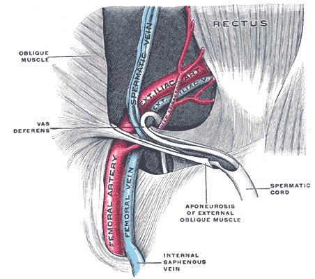
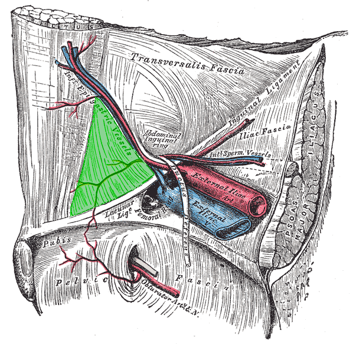
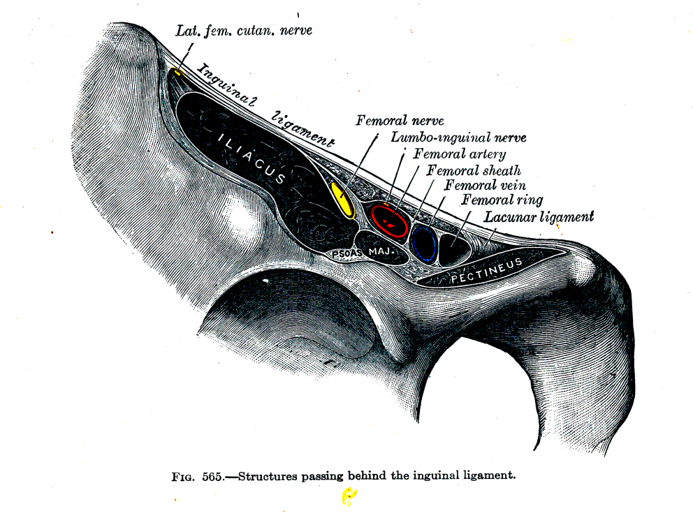
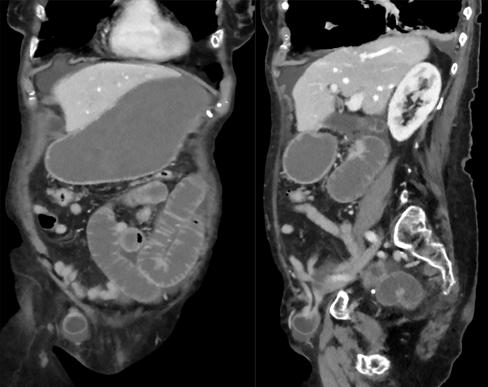
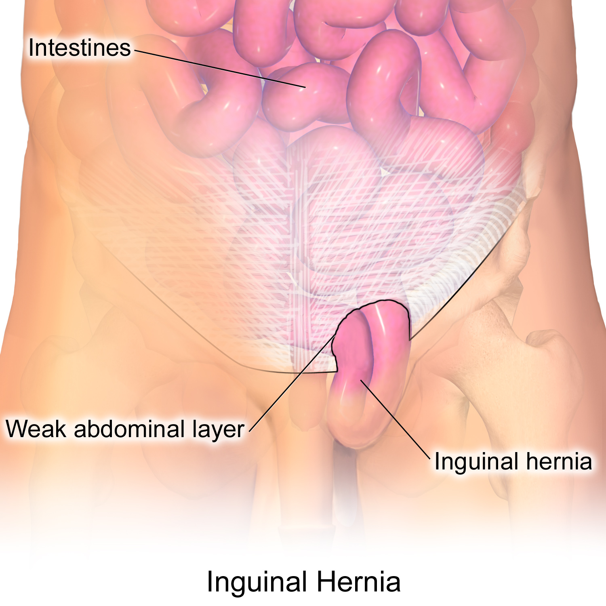
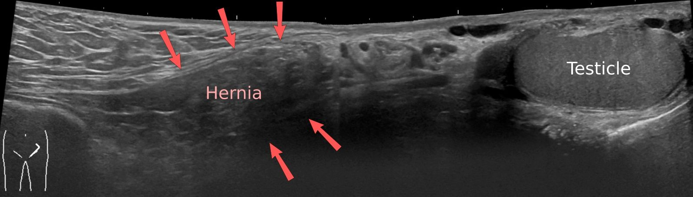
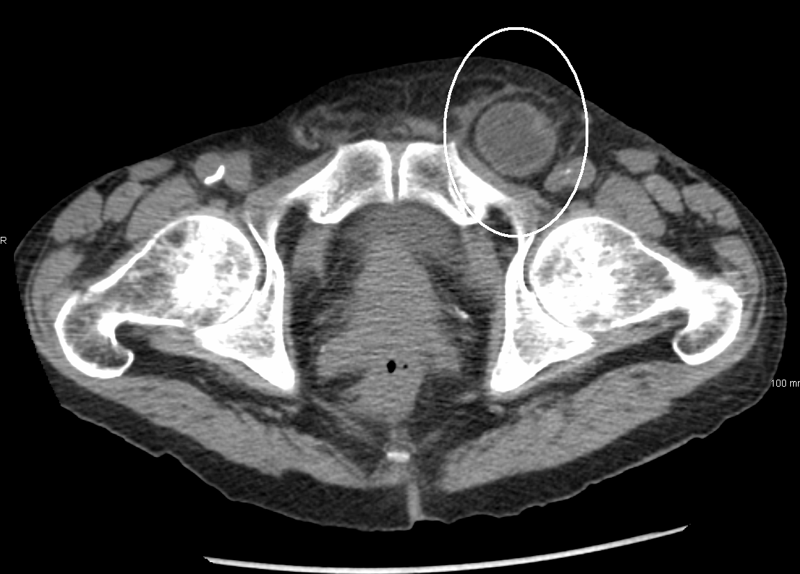
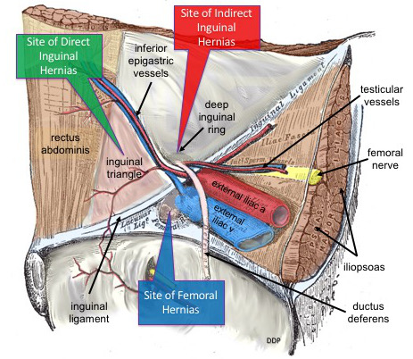
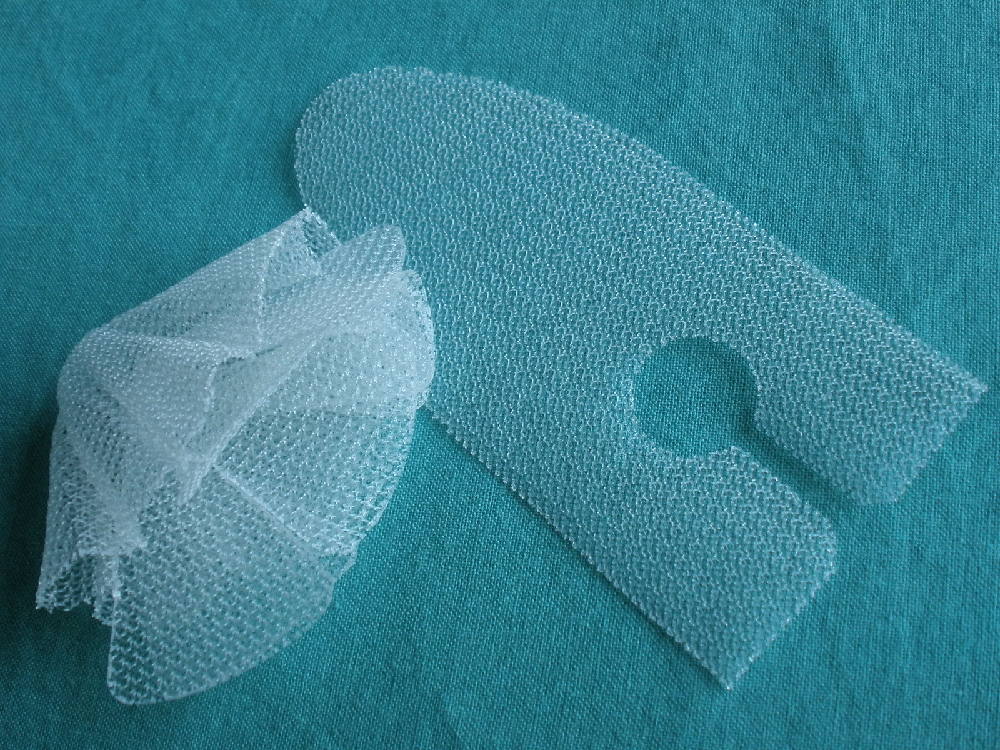

# BÀI HỌC Y KHOA: THOÁT VỊ BẸN & THOÁT VỊ ĐÙI
**Ngày:** 2026-11-18 | **Chuyên khoa:** Ngoại khoa | **Đối tượng:** Bác sĩ, học viên sau đại học và người học mất gốc cần học từ nền tảng

---

## 0. TỔNG QUAN — VÌ SAO BÀI NÀY QUAN TRỌNG? [CỐT LÕI]

&emsp;Thoát vị vùng bẹn là bệnh ngoại khoa thường gặp nhất mà một bác sĩ sẽ gặp trong suốt đời hành nghề.
&emsp;Mỗi năm, toàn thế giới có hơn 20 triệu bệnh nhân được mổ thoát vị vùng bẹn [GUIDELINE VERIFIED].
&emsp;Nguy cơ thoát vị bẹn trong suốt đời ở nam giới là 27%, nghĩa là cứ khoảng 4 nam giới thì có 1 người sẽ bị thoát vị bẹn trong đời [ABSTRACT VERIFIED].
&emsp;Nguy cơ phải mổ thoát vị bẹn trong suốt đời là 27% ở nam và 3% ở nữ [FULL TEXT VERIFIED].

&emsp;Trong số các thoát vị vùng bẹn, thoát vị bẹn chiếm 96% và thoát vị đùi chiếm 4% [ABSTRACT VERIFIED].
&emsp;Con số 4% này rất dễ làm người học chủ quan, nhưng thoát vị đùi lại là loại nguy hiểm nhất vùng bẹn vì cổ thoát vị hẹp và tỉ lệ nghẹt rất cao.

&emsp;Bài này giải quyết 3 câu hỏi lâm sàng mà bác sĩ trực hay gặp nhất.
&emsp;Thứ nhất, khối phồng vùng bẹn này có phải thoát vị không, là thoát vị bẹn hay thoát vị đùi, và phân biệt với u mỡ dây tinh, tràn dịch màng tinh hoàn hay hạch bẹn bằng cách nào.
&emsp;Thứ hai, bệnh nhân này mổ ngay, mổ chương trình hay theo dõi chờ, và quyết định đó dựa trên những dữ kiện nào.
&emsp;Thứ ba, khi nào khối thoát vị trở thành cấp cứu ngoại khoa, và vì sao thoát vị đùi không bao giờ được phép theo dõi chờ.

&emsp;Bỏ sót thoát vị đùi là sai lầm kinh điển và đắt giá nhất của bài này.
&emsp;Thoát vị đùi hay gặp ở nữ, khó sờ thấy khi khám, và khoảng 40% ca mổ lại ở nữ phát hiện tái phát thực chất là thoát vị đùi đã bị bỏ sót trong lần mổ đầu [FULL TEXT VERIFIED].
&emsp;Mổ cấp cứu thoát vị đùi làm tăng nguy cơ tử vong 10 lần so với dân số chung, trong khi mổ chương trình thì nguy cơ tử vong không vượt dân số chung [ABSTRACT VERIFIED].
&emsp;Hiểu được câu này là hiểu được vì sao guideline bắt mổ thoát vị đùi ngay cả khi bệnh nhân chưa có triệu chứng gì.

**Mục tiêu của bài:**
- Nhận diện và phân loại thoát vị bẹn gián tiếp, thoát vị bẹn trực tiếp và thoát vị đùi từ giải phẫu ống bẹn, tam giác Hesselbach và ống đùi
- Khám lâm sàng vùng bẹn đúng cách, phân biệt thoát vị bẹn với thoát vị đùi và với các bệnh giả thoát vị
- Giải thích chuỗi cơ chế từ điểm yếu thành bụng đến kẹt, nghẹt và hoại tử ruột
- Ra quyết định theo dõi chờ, mổ chương trình hay mổ cấp cứu cho từng nhóm bệnh nhân, kể cả nam không triệu chứng, phụ nữ và thoát vị đùi

- Chọn giữa mổ lưới, khâu mô, mổ mở và mổ nội soi theo bằng chứng và theo chuyên môn của ê-kíp
- Nhận diện cấp cứu nghẹt thoát vị và xử trí đúng trong vài giờ đầu

> **TIÊU CHUẨN BẮT BUỘC — DẠY TỪ GỐC, KHÔNG GIỚI HẠN ĐỘ DÀI:** Viết để một người học mất gốc vẫn theo được. Trước khi dùng một thuật ngữ, chữ viết tắt, chỉ số, cơ quan, cơ chế, thủ thuật hoặc quyết định điều trị lần đầu, phải giải thích bằng tiếng Việt đơn giản: **nó là gì → bình thường hoạt động ra sao → vì sao bất thường này quan trọng → nhận ra bằng cách nào → làm gì tiếp theo**. Sau lần giải thích đầu tiên, mới dùng viết tắt/thuật ngữ ngắn. Không dùng “rõ ràng”, “thường quy”, “theo protocol” hoặc danh sách bước trần nếu chưa giải thích lý do và ý nghĩa của hành động. Độ dài không có giới hạn tối đa: tiếp tục viết khi còn một mắt xích cần thiết cho người học hiểu hoặc ra quyết định an toàn; ưu tiên chia nhỏ bằng tiêu đề, ví dụ và checkpoint thay vì cắt bỏ nền tảng.

> **CÁCH GIẢI THÍCH BẮT BUỘC CHO MỖI QUY TRÌNH:** Mỗi xét nghiệm, thang điểm, thuốc, thủ thuật hoặc algorithm phải ghi theo thứ tự: **mục tiêu → khi nào dùng/không dùng → cần chuẩn bị/đầu vào gì → làm hoặc đọc kết quả như thế nào → kết quả thay đổi quyết định ra sao → bẫy/an toàn → khi nào chuyển tuyến**. Chi tiết liều, đường dùng, trình tự và thời điểm phải có nguồn xác minh; không lấp chỗ trống bằng suy đoán.

### 📋 TRƯỚC KHI ĐỌC — NỀN TẢNG CẦN DÙNG

> Để hiểu bài này, người học nên đã biết:
> - Giải phẫu thành bụng trước và các lớp cân cơ vùng bẹn
> - Sinh lý áp lực ổ bụng và cách thành bụng chịu lực khi ho, rặn, mang vác nặng
> - Khám bụng và khám vùng bẹn cơ bản
>
> **Không được chặn việc học vì thiếu prerequisite.** Nếu bài tiên quyết chưa tồn tại hoặc người học chưa nắm, tạo mục `### 0.1 Nền tảng tối thiểu cần dùng ngay` sau Overview và dạy đủ khái niệm nền để hiểu bài hiện tại; link bài tiên quyết chỉ là đường học sâu hơn.

### 0.1 Nền tảng tối thiểu cần dùng ngay [CỐT LÕI]

&emsp;Thành bụng trước gồm da, mô dưới da, các lớp cơ và cân, rồi đến mạc ngang (transversalis fascia) và phúc mạc (peritoneum) ở trong cùng.
&emsp;Phúc mạc là lớp màng mỏng lót mặt trong ổ bụng, bọc lấy các tạng như ruột và mạc nối.
&emsp;Thoát vị xảy ra khi một phần của tạng trong ổ bụng, thường là ruột non hoặc mạc nối, chui qua một điểm yếu của thành bụng, đẩy phúc mạc phồng ra ngoài tạo thành bao thoát vị (hernial sac).

&emsp;Bao thoát vị có 3 phần: cổ bao là chỗ hẹp nhất nơi bao chui qua thành bụng, thân bao là phần phồng ra, đáy bao là đầu xa nhất.
&emsp;Cổ bao càng hẹp thì tạng bên trong càng dễ bị kẹt, vì vậy kích thước cổ bao quyết định phần lớn nguy cơ cấp cứu.

&emsp;Ống bẹn (inguinal canal) là một đường hầm chéo dài khoảng 4 cm ở vùng bẹn dưới, chạy từ lỗ bẹn sâu (deep inguinal ring) ở phía trong-bụng đến lỗ bẹn nông (superficial inguinal ring) ở phía ngoài-da.
&emsp;Ở nam, ống bẹn chứa thừng tinh (spermatic cord) gồm ống dẫn tinh, mạch máu và thần kinh đi xuống bìu.
&emsp;Ở nữ, ống bẹn chứa dây chằng tròn (round ligament) đi xuống môi lớn.

&emsp;Ống bẹn có 4 thành: thành trước là cân cơ chéo ngoài, thành sau là mạc ngang và gân kết hợp (conjoint tendon), thành trên là cung của cơ chéo trong và cơ ngang bụng, thành dưới là dây chằng bẹn (inguinal ligament).
&emsp;Thành sau là thành yếu nhất, và đó chính là nơi thoát vị trực tiếp chui qua.

&emsp;Dây chằng bẹn là dải xơ chắc chạy từ gai chậu trước trên đến củ mu, tạo thành ranh giới giữa bụng và đùi.
&emsp;Ngay dưới dây chằng bẹn, phía trong mạch đùi, có một khoảng hẹp gọi là ống đùi (femoral canal), nơi thoát vị đùi chui qua.
&emsp;Động mạch thượng vị dưới (inferior epigastric artery) là mốc giải phẫu quan trọng nhất vùng này: nó chạy lên phía trong lỗ bẹn sâu, và vị trí của bao thoát vị so với động mạch này phân biệt thoát vị gián tiếp với thoát vị trực tiếp.

&emsp;Tam giác Hesselbach là vùng tam giác giới hạn bởi bao cơ thẳng bụng ở phía trong, động mạch thượng vị dưới ở phía ngoài và dây chằng bẹn ở phía dưới.
&emsp;Tam giác này là điểm yếu của thành sau ống bẹn, và thoát vị trực tiếp chui qua đúng vùng tam giác này.

&emsp;Tăng áp lực ổ bụng là lực đẩy chính tạo ra và làm nặng thêm thoát vị.
&emsp;Các tình huống làm tăng áp lực ổ bụng gồm ho mạn tính, táo bón phải rặn nhiều, bí tiểu phải rặn, mang vác nặng, béo phì và có thai.
&emsp;Khi áp lực ổ bụng tăng, thành bụng yếu sẽ phồng ra tại điểm yếu nhất, giống như lốp xe non hơi phồng ra ở chỗ thành lốp mỏng nhất.

&emsp;Ví dụ: một bệnh nhân nam 68 tuổi ho mạn do bệnh phổi tắc nghẽn mạn tính, mỗi cơn ho là một lần áp lực ổ bụng tăng vọt và đẩy ruột vào bao thoát vị.
&emsp;Ví dụ: một bệnh nhân táo bón lâu năm phải rặn mạnh mỗi ngày, áp lực ổ bụng tăng lặp lại nhiều lần trong ngày, làm thoát vị to dần theo tháng.

---

## 1. ĐỊNH NGHĨA & PHÂN LOẠI [CỐT LÕI]

### 1.0 Nền tảng: Giải phẫu vùng bẹn bình thường — đủ để hiểu bài này [CỐT LÕI]

> **Phân biệt 2 loại nội dung trong bài:**
>
> **Loại 1 — Kiến thức sinh lý/giải phẫu/khái niệm consensus** (không tranh cãi, ổn định ≥10 năm):
> Viết tự do, KHÔNG gán nhãn verification và KHÔNG cần PMID (đây là kiến thức textbook/nền tảng).
> Ví dụ được phép: "Tim có 4 buồng", "Nephron lọc máu qua cầu thận",
> "Insulin gắn receptor → GLUT4 → glucose vào tế bào", "NLRP3 kích hoạt IL-1β".
> Cấm tự gán các nhãn cũ như `[Thông tin cơ bản - LLM verified]` hay `[TEXTBOOK]`.
>
> **Loại 2 — Claim số liệu định lượng / ngưỡng / protocol / khuyến cáo guideline**:
> Bắt buộc Claim ID trong brief + PMID/guideline evidence + 1 trong 5 nhãn verification chuẩn:
> `[FETCHED]`, `[ABSTRACT VERIFIED]`, `[DATA VERIFIED]`, `[FULL TEXT VERIFIED]`, `[GUIDELINE VERIFIED]`.
> Cấm tuyệt đối dùng nhãn cho: %, mg/kg, mmol/L, RR/CI, liều thuốc, ngưỡng xét nghiệm, tỷ lệ dịch tễ khi chưa verify.

&emsp;Vùng bẹn (groin) là vùng chuyển tiếp giữa bụng và đùi, giới hạn phía trên bởi đường nối 2 gai chậu trước trên, phía dưới bởi nếp gấp bẹn-đùi, phía trong bởi vùng mu và phía ngoài bởi mào chậu.
&emsp;Đây là vùng giao nhau của nhiều cấu trúc: ống bẹn ở phía trên dây chằng bẹn, ống đùi ở phía dưới dây chằng bẹn, mạch đùi ở phía ngoài ống đùi, và hạch bạch huyết bẹn nằm rải rác dưới da.

&emsp;Vì nhiều cấu trúc chen chúc trong một diện tích nhỏ, một khối phồng ở vùng này có thể là thoát vị, nhưng cũng có thể là hạch, u mỡ, giãn tĩnh mạch hay tràn dịch.
&emsp;Khám vùng bẹn vì vậy không bao giờ chỉ sờ khối phồng rồi kết luận, mà phải xác định khối đó nằm trên hay dưới dây chằng bẹn, có liên quan đến thừng tinh hay không, và có thay đổi khi ho hay không.



*Hình 1: Thừng tinh trong ống bẹn — thấy rõ thừng tinh, ống dẫn tinh, mạch thừng tinh và động mạch thượng vị dưới. Nguồn: Gray's Anatomy, hình 1146 (Carter, 1918), Public domain.*

&emsp;Ống bẹn chạy chéo từ trên-ngoài xuống dưới-trong, giống như một đường hầm xiên qua thành bụng.
&emsp;Lỗ bẹn sâu nằm ở phía trong ổ bụng, ngay phía ngoài động mạch thượng vị dưới, là nơi thừng tinh hoặc dây chằng tròn đi vào ống bẹn.
&emsp;Lỗ bẹn nông nằm ở phía ngoài, là một khe trên cân cơ chéo ngoài, nơi thừng tinh hoặc dây chằng tròn đi ra khỏi ống bẹn.
&emsp;Khi đứng, trọng lực và áp lực ổ bụng đẩy các tạng xuống dưới, và đường đi tự nhiên của chúng là men theo ống bẹn từ lỗ sâu ra lỗ nông.

&emsp;Ví dụ: thoát vị gián tiếp đi đúng đường này, từ lỗ bẹn sâu qua ống bẹn rồi ra lỗ nông, có thể xuống tới bìu ở nam hoặc môi lớn ở nữ.

&emsp;Mạc ngang là lớp cân mỏng nhưng dai, lót mặt trong của cơ ngang bụng và tạo thành thành sau của ống bẹn.
&emsp;Gân kết hợp là dải gân do cơ chéo trong và cơ ngang bụng hợp lại, bám vào xương mu và tăng cường cho thành sau ống bẹn ở phía trong.
&emsp;Khi mạc ngang và gân kết hợp yếu đi theo tuổi, do thoái hoá collagen hoặc do tăng áp lực ổ bụng kéo dài, thành sau ống bẹn trở thành điểm yếu và thoát vị trực tiếp chui qua đó.

&emsp;Ống đùi là một khoảng hẹp hình phễu nằm dưới dây chằng bẹn, phía trong tĩnh mạch đùi, bình thường chứa mô mỡ và vài hạch bạch huyết.
&emsp;Lỗ đùi (femoral ring) là miệng trên của ống đùi, giới hạn bởi dây chằng bẹn ở phía trước, dây chằng lược (pectineal ligament) ở phía sau, tĩnh mạch đùi ở phía ngoài và dây chằng khuyết (lacunar ligament) ở phía trong.
&emsp;Lỗ đùi rất hẹp và được bao quanh bởi các cấu trúc cứng, vì vậy bất cứ tạng nào chui qua đó đều dễ bị kẹt chặt.

### 1.1. Định nghĩa thoát vị vùng bẹn [CỐT LÕI]

&emsp;Thoát vị vùng bẹn (groin hernia) là tình trạng một phần tạng trong ổ bụng, thường là ruột non hoặc mạc nối, chui qua một điểm yếu của thành bụng vùng bẹn ra ngoài, tạo thành một khối phồng thấy được hoặc sờ được.
&emsp;Thoát vị bẹn (inguinal hernia) là thoát vị chui qua ống bẹn, nằm phía trên dây chằng bẹn.
&emsp;Thoát vị đùi (femoral hernia) là thoát vị chui qua ống đùi, nằm phía dưới dây chằng bẹn.
&emsp;Cả 2 loại đều thuộc nhóm thoát vị vùng bẹn, nhưng chúng khác nhau về giải phẫu, đối tượng hay gặp, nguy cơ nghẹt và cách mổ, vì vậy không được gộp chung thành một bệnh duy nhất.

&emsp;Một thoát vị được gọi là nắn được (reducible) khi khối phồng có thể đẩy trở lại vào ổ bụng bằng tay hoặc tự xẹp khi bệnh nhân nằm xuống.
&emsp;Một thoát vị được gọi là kẹt (incarcerated) khi tạng trong bao không thể đẩy trở lại ổ bụng được nữa, nhưng máu nuôi tạng vẫn còn.
&emsp;Một thoát vị được gọi là nghẹt (strangulated) khi mạch máu nuôi tạng bị chèn ép đến mức tạng thiếu máu và hoại tử.

&emsp;Ba trạng thái này là 3 nấc thang của cùng một quá trình, và nhiệm vụ của bác sĩ là không để bệnh nhân trượt từ nấc nắn được xuống nấc nghẹt.
&emsp;Thoát vị ẩn (occult hernia) là thoát vị gây đau vùng bẹn nhưng khám không sờ thấy khối phồng rõ ràng, cần chẩn đoán hình ảnh để xác nhận.

> ⚠️ HỌC VIÊN HAY NHẦM: Nhiều người học nghĩ thoát vị đùi là một loại thoát vị bẹn, hoặc nghĩ cứ khối phồng vùng bẹn thì đều là thoát vị bẹn. Sai lầm này nguy hiểm vì thoát vị đùi nằm dưới dây chằng bẹn, hay gặp ở nữ, khó khám thấy và nghẹt rất nhanh, trong khi thoát vị bẹn nằm trên dây chằng bẹn và thường diễn biến chậm hơn. Mốc dây chằng bẹn là ranh giới bắt buộc phải xác định ở mọi bệnh nhân có khối vùng bẹn.

### 1.2. Phân loại Nyhus — phân loại kinh điển dùng trong thi [CỐT LÕI]

&emsp;Phân loại Nyhus là phân loại kinh điển dựa trên giải phẫu lỗ bẹn trong và tình trạng thành sau ống bẹn, vẫn được dùng trong thi và trong giao tiếp lâm sàng.
&emsp;Type 1 là thoát vị gián tiếp, lỗ bẹn trong bình thường, thường gặp ở trẻ em và thanh niên do ống phúc mạc–tinh mạc còn mở.
&emsp;Type 2 là thoát vị gián tiếp, lỗ bẹn trong giãn nhưng thành sau ống bẹn còn nguyên.
&emsp;Type 3A là thoát vị trực tiếp, khiếm khuyết thành sau ống bẹn tại tam giác Hesselbach.

&emsp;Type 3B là thoát vị gián tiếp lớn kèm thành sau yếu, gọi là thoát vị quần (pantaloon) vì bao thoát vị vừa có phần gián tiếp vừa có phần trực tiếp, giống như 2 ống quần.
&emsp;Type 3C là thoát vị đùi.
&emsp;Type 4 là thoát vị tái phát, chia thành 4A trực tiếp, 4B gián tiếp, 4C đùi và 4D hỗn hợp.

&emsp;Phân loại Nyhus giúp bác sĩ mô tả nhanh một thoát vị chỉ bằng một mã ngắn, và giúp phẫu thuật viên hình dung được mức độ tổn thương thành bụng trước khi mổ.
&emsp;Ví dụ: một bệnh nhân được ghi "Nyhus 3A" thì ê-kíp mổ hiểu ngay đây là thoát vị trực tiếp qua tam giác Hesselbach, thành sau yếu, cần tăng cường thành sau.
&emsp;Ví dụ: một bệnh nhân được ghi "Nyhus 3C" thì ê-kíp mổ hiểu ngay đây là thoát vị đùi, cần mổ sớm vì nguy cơ nghẹt cao, không được xếp lịch mổ chậm như thoát vị bẹn thông thường.

&emsp;Hạn chế của phân loại Nyhus là nó không ghi kích thước khiếm khuyết và không phân biệt nguyên phát với tái phát một cách hệ thống, vì vậy guideline HerniaSurge khuyên dùng thêm phân loại EHS.

### 1.3. Phân loại EHS 2007 — phân loại chính thức HerniaSurge khuyên dùng [CỐT LÕI]

&emsp;Phân loại EHS (European Hernia Society) là phân loại chính thức mà HerniaSurge 2018 khuyên dùng để phân tầng bệnh nhân, cá thể hoá điều trị, làm nghiên cứu và kiểm toán [GUIDELINE VERIFIED].
&emsp;Phân loại EHS ghi vị trí thoát vị bằng chữ cái: L là lateral, tức thoát vị gián tiếp qua lỗ bẹn ngoài; M là medial, tức thoát vị trực tiếp qua tam giác Hesselbach; F là femoral, tức thoát vị đùi.
&emsp;Sau chữ cái vị trí là chữ P nếu thoát vị nguyên phát (primary) hoặc R nếu thoát vị tái phát (recurrent).

&emsp;Kích thước khiếm khuyết được ghi bằng số: 1 là khiếm khuyết dưới 1,5 cm, 2 là khiếm khuyết 1,5–3 cm, 3 là khiếm khuyết trên 3 cm.
&emsp;Ví dụ: "L2-P" nghĩa là thoát vị gián tiếp nguyên phát, khiếm khuyết 1,5–3 cm.
&emsp;Ví dụ: "M3-R" nghĩa là thoát vị trực tiếp tái phát, khiếm khuyết trên 3 cm, là loại thoát vị trong lớn.

&emsp;Chữ M3 có ý nghĩa quyết định điều trị trực tiếp, vì vậy người học phải nhớ nó.
&emsp;Thoát vị trong lớn M3 là trường hợp duy nhất mà HerniaSurge khuyên cố định lưới trong mổ nội soi TEP và TAPP để giảm tái phát [GUIDELINE VERIFIED].
&emsp;Ở các loại thoát vị khác, cố định lưới trong TEP hầu như không cần thiết.
&emsp;Ví dụ: một bệnh nhân M3 được mổ TEP mà không cố định lưới thì nguy cơ lưới xô lệch và tái phát cao hơn, trong khi một bệnh nhân L1 được cố định lưới thì chỉ thêm đau và chi phí mà không thêm lợi ích.

### 1.4. Gián tiếp so với trực tiếp — bảng dạy cốt lõi [CỐT LÕI]



*Hình 2: Nhìn từ trong ổ bụng vào vùng bẹn — tam giác Hesselbach tô xanh: thoát vị trực tiếp chui qua tam giác này, thoát vị gián tiếp chui qua vòng bẹn sâu theo thừng tinh. Nguồn: Gray's Anatomy, hình 547, tô màu bởi Häggström, Public domain.*

&emsp;Thoát vị gián tiếp (indirect) chui qua lỗ bẹn sâu, đi theo thừng tinh ở nam hoặc dây chằng tròn ở nữ, và bao thoát vị nằm trong thừng tinh.
&emsp;Thoát vị gián tiếp thường có nguồn gốc bẩm sinh do ống phúc mạc–tinh mạc (processus vaginalis) không đóng kín sau khi tinh hoàn di chuyển xuống bìu.
&emsp;Ống phúc mạc–tinh mạc là một túi phúc mạc đi theo tinh hoàn trong quá trình di chuyển từ bụng xuống bìu, bình thường sẽ đóng lại sau sinh.

&emsp;Khi ống này còn mở, ruột có thể chui vào đó và tạo thành thoát vị gián tiếp, vì vậy thoát vị gián tiếp thường gặp ở trẻ em và thanh niên.
&emsp;Thoát vị gián tiếp có thể xuống tới bìu ở nam hoặc môi lớn ở nữ, và thường to dần theo thời gian.

&emsp;Thoát vị trực tiếp (direct) chui qua tam giác Hesselbach, tức là xuyên thẳng qua thành sau yếu của ống bẹn, và bao thoát vị nằm ngoài thừng tinh.
&emsp;Thoát vị trực tiếp là bệnh mắc phải do tăng áp lực ổ bụng kéo dài cộng với thoái hoá collagen theo tuổi làm thành sau yếu đi.
&emsp;Thoát vị trực tiếp thường gặp ở nam lớn tuổi, hiếm khi xuống tới bìu, và thường có cổ bao rộng hơn thoát vị gián tiếp.
&emsp;Cổ bao rộng làm thoát vị trực tiếp ít kẹt hơn thoát vị gián tiếp, nhưng không có nghĩa là không bao giờ kẹt.

&emsp;Ví dụ: một cụ ông 75 tuổi ho mạn và táo bón lâu năm, khối phồng vùng bẹn xuất hiện từ từ, nằm ngay trên dây chằng bẹn, không xuống bìu, ấn xẹp khi nằm là hình ảnh điển hình của thoát vị trực tiếp.

| Đặc điểm | Thoát vị gián tiếp | Thoát vị trực tiếp |
|---|---|---|
| **Đường đi** | Qua lỗ bẹn sâu, theo thừng tinh | Qua tam giác Hesselbach, xuyên thành sau |
| **Nguồn gốc** | Bẩm sinh, ống phúc mạc–tinh mạc còn mở | Mắc phải, thành sau yếu do tuổi và áp lực |
| **Đối tượng** | Trẻ em, thanh niên | Nam lớn tuổi |
| **Vị trí bao** | Trong thừng tinh | Ngoài thừng tinh |
| **Xuống bìu** | Thường gặp | Hiếm gặp |
| **Cổ bao** | Hẹp, dễ kẹt | Rộng, ít kẹt hơn nhưng vẫn kẹt được |

> ⚠️ HỌC VIÊN HAY NHẦM: Nhiều người học dạy nhau rằng "thoát vị trực tiếp không bao giờ nghẹt". Đây là một bẫy nguy hiểm. Thoát vị trực tiếp vẫn có thể kẹt và nghẹt, chỉ là hiếm hơn vì cổ bao thường rộng. Một khối thoát vị trực tiếp bị kẹt vẫn có thể hoại tử ruột nếu không xử trí kịp, vì vậy không bao giờ được chủ quan với bất kỳ thoát vị nào chỉ vì nó là loại trực tiếp.

### 1.5. Thoát vị đùi — loại nhỏ nhưng nguy hiểm nhất [CỐT LÕI]



*Hình 3: Các cấu trúc đi sau dây chằng bẹn — thần kinh đùi, động mạch đùi, tĩnh mạch đùi, bao đùi và vòng đùi, nơi thoát vị đùi chui qua. Nguồn: Gray's Anatomy, ấn bản 21 (1924), hình 565, Public domain.*

&emsp;Thoát vị đùi là thoát vị chui qua ống đùi, nằm dưới dây chằng bẹn và phía trong mạch đùi.
&emsp;Thoát vị đùi chiếm 4% trong số thoát vị vùng bẹn, nhưng lại chiếm tỉ trọng rất lớn trong các ca mổ cấp cứu vùng bẹn [ABSTRACT VERIFIED].
&emsp;Trong sổ bộ Thụy Điển, thoát vị đùi chỉ chiếm 1,1% số ca mổ thoát vị vùng bẹn ở nam nhưng chiếm tới 22,4% ở nữ [ABSTRACT VERIFIED].
&emsp;Nói cách khác, ở nữ giới, cứ khoảng 5 ca mổ thoát vị vùng bẹn thì có 1 ca là thoát vị đùi, vì vậy bác sĩ khám thoát vị ở nữ luôn phải nghĩ đến thoát vị đùi.

&emsp;Thoát vị đùi hay gặp ở nữ vì khung chậu nữ rộng hơn, lỗ đùi rộng hơn, và các lần mang thai làm tăng áp lực ổ bụng đồng thời làm giãn các dây chằng vùng chậu.
&emsp;Khối thoát vị đùi thường nhỏ, nằm sâu dưới dây chằng bẹn, khó sờ thấy, đặc biệt ở bệnh nhân béo.
&emsp;Nhiều bệnh nhân thoát vị đùi không có khối phồng rõ ràng mà chỉ đau âm ỉ vùng bẹn hoặc đùi trên, dễ bị chẩn đoán nhầm thành đau khớp háng hay đau thần kinh đùi.

&emsp;Ví dụ: một phụ nữ 62 tuổi đau vùng bẹn phải 2 tháng, khám không thấy khối phồng rõ, được cho là thoái hoá khớp háng, đến khi ruột nghẹt mới phát hiện thoát vị đùi là kịch bản bỏ sót kinh điển.
&emsp;Ví dụ: một phụ nữ 58 tuổi có khối nhỏ dưới dây chằng bẹn, ấn đau, không đẩy lên được, đó là thoát vị đùi kẹt và cần mổ cấp cứu, không được hẹn tái khám sau 1 tháng.

&emsp;Nguy cơ nghẹt của thoát vị đùi cao hơn hẳn thoát vị bẹn vì lỗ đùi hẹp và được bao quanh bởi các cấu trúc cứng không giãn được.
&emsp;Xác suất tích lũy nghẹt của thoát vị đùi là 22% sau 3 tháng và 45% sau 21 tháng, trong khi thoát vị bẹn chỉ là 2,8% sau 3 tháng và 4,5% sau 2 năm [ABSTRACT VERIFIED].
&emsp;Tốc độ tăng nguy cơ nghẹt nhanh nhất trong 3 tháng đầu ở cả 2 loại, nghĩa là thời gian chờ đợi càng dài thì nguy cơ càng tăng nhanh.

&emsp;Vì vậy HerniaSurge quy định thoát vị đùi không triệu chứng vẫn phải mổ chương trình, và đây là khuyến cáo nhận được đồng thuận mạnh nhất trong toàn bộ guideline [GUIDELINE VERIFIED].

### 1.6. Các biến thể: trượt, Richter, Amyand, Littre [NÂNG CAO]

&emsp;Thoát vị trượt (sliding hernia) là loại thoát vị mà thành của một tạng, thường là đại tràng sigma, đại tràng trái, manh tràng hoặc bàng quang, tạo thành một phần của thành bao thoát vị.
&emsp;Thoát vị trượt thường gặp ở thoát vị lớn, lâu năm, và là bẫy lớn trong mổ vì phẫu thuật viên có thể cắt nhầm vào thành tạng trượt nếu tưởng đó chỉ là bao thoát vị.
&emsp;Ví dụ: một thoát vị bẹn trái khổng lồ tồn tại 10 năm, trong mổ thấy thành bao dày bất thường, đó có thể là thành đại tràng sigma trượt, cần bóc tách cẩn thận thay vì cắt bao như thường lệ.

&emsp;Thoát vị Richter là tình trạng chỉ một phần chu vi thành ruột bị kẹt trong cổ thoát vị, còn phần còn lại của lòng ruột vẫn thông.
&emsp;Vì lòng ruột vẫn thông, bệnh nhân Richter có thể không nôn, không chướng bụng và vẫn đi cầu được, trong khi đoạn thành ruột bị kẹt đã thiếu máu và hoại tử từng phần.
&emsp;Đây là bẫy lâm sàng kinh điển: bệnh nhân trông không giống tắc ruột nhưng ruột đã hoại tử, và chỉ có đau khu trú dữ dội tại khối thoát vị mới gợi ý chẩn đoán.

&emsp;Ví dụ: một bệnh nhân có khối thoát vị nhỏ, căng, đau dữ dội khi chạm, nhưng bụng mềm, không chướng, vẫn trung tiện được, thì vẫn phải nghĩ đến Richter và mổ cấp cứu.

&emsp;Thoát vị Amyand là ruột thừa nằm trong bao thoát vị bẹn, thường ở bên phải.
&emsp;Thoát vị Littre là túi thừa Meckel nằm trong bao thoát vị.
&emsp;Thoát vị De Garengeot là ruột thừa nằm trong bao thoát vị đùi, cần phân biệt với Amyand để chọn đường mổ và quyết định có cắt ruột thừa hay không.
&emsp;Các biến thể này hiếm gặp, không cần nhớ tỉ lệ, chỉ cần nhớ nguyên tắc: khi mổ thoát vị mà thấy tạng bất thường trong bao, phải xử trí tạng đó trước rồi mới sửa thoát vị.

> 🛑 DỪNG 1 PHÚT — TỰ KIỂM TRA SAU PHẦN ĐỊNH NGHĨA
>
> 1. Mốc nào phân biệt thoát vị bẹn với thoát vị đùi trên lâm sàng?
> 2. Vì sao thoát vị trực tiếp hiếm xuống bìu, còn thoát vị gián tiếp hay xuống bìu?
> 3. Mã EHS "M3-R" nói lên điều gì về thoát vị đó?
>
> *(Đáp án: 1. Dây chằng bẹn — thoát vị bẹn nằm trên dây chằng bẹn, thoát vị đùi nằm dưới dây chằng bẹn. 2. Thoát vị gián tiếp đi theo thừng tinh qua ống bẹn xuống bìu, còn thoát vị trực tiếp chui thẳng qua thành sau và nằm ngoài thừng tinh. 3. Thoát vị trực tiếp tái phát, khiếm khuyết trên 3 cm, là thoát vị trong lớn cần cố định lưới khi mổ nội soi.)*

---

## 2. CƠ CHẾ & SINH LÝ BỆNH [CỐT LÕI]

### 2.1. Bình thường: thành bụng vùng bẹn chịu lực ra sao

&emsp;Thành bụng vùng bẹn chịu áp lực ổ bụng giống như thành một quả bóng chịu áp lực khí bên trong.
&emsp;Khi một người ho, rặn hay mang vác nặng, áp lực ổ bụng tăng vọt trong thời gian ngắn và dồn lên mọi điểm của thành bụng.
&emsp;Các lớp cơ và cân khỏe sẽ phân tán lực này, nhưng tại các điểm yếu như lỗ bẹn sâu, tam giác Hesselbach và lỗ đùi, lực tập trung lại và đẩy phúc mạc phồng ra ngoài.
&emsp;Collagen là protein tạo nên độ bền của cân và dây chằng, và chất lượng collagen quyết định thành bụng chịu được bao nhiêu lực trước khi giãn.

&emsp;Người có rối loạn chuyển hoá collagen bẩm sinh hoặc mắc phải sẽ có thành bụng yếu hơn người bình thường, vì vậy thoát vị có yếu tố gia đình và hay tái phát.
&emsp;Ví dụ: hai người cùng ho mạn như nhau, người có collagen bình thường chỉ bị thoát vị sau nhiều năm, còn người có collagen yếu có thể bị thoát vị sớm hơn và tái phát sau mổ.
&emsp;Các yếu tố làm tăng áp lực ổ bụng mạn tính gồm ho mạn, táo bón, bí tiểu do phì đại tiền liệt tuyến, béo phì, có thai và mang vác nặng thường xuyên.

&emsp;Các yếu tố làm yếu thành bụng gồm tuổi cao, suy dinh dưỡng, hút thuốc lá, rối loạn collagen và mổ bụng trước đó làm sẹo yếu vùng bẹn.

### 2.2. Chuỗi cơ chế 1: Hình thành thoát vị bẹn gián tiếp — ống phúc mạc còn mở [CỐT LÕI]

&emsp;**Tầng 1 — Phân tử và phôi thai:** Trong thời kỳ bào thai, tinh hoàn di chuyển từ ổ bụng xuống bìu, kéo theo một túi phúc mạc gọi là ống phúc mạc–tinh mạc (processus vaginalis).
&emsp;**Tầng 2 — Tế bào và mô:** Sau khi tinh hoàn xuống bìu, ống phúc mạc–tinh mạc bình thường sẽ đóng kín và teo lại, chỉ còn lại màng tinh hoàn bao quanh tinh hoàn.

&emsp;**Tầng 3 — Cơ quan:** Khi ống này không đóng kín, nó để lại một đường thông từ ổ bụng xuống bìu, và ruột hoặc mạc nối có thể chui vào đường thông đó mỗi khi áp lực ổ bụng tăng.
&emsp;**Tầng 4 — Lâm sàng:** Bệnh nhân xuất hiện khối phồng vùng bẹn hoặc bìu khi đứng, ho hoặc rặn, khối xẹp khi nằm, và khối to dần theo thời gian vì đường thông không tự đóng lại được.

&emsp;**Tầng 5 — Phản chứng:** Nếu ống phúc mạc–tinh mạc đã đóng kín hoàn toàn thì không còn đường thông, ruột không thể chui qua lỗ bẹn sâu, và thoát vị gián tiếp bẩm sinh không hình thành.

```text
Tinh hoàn di chuyển xuống bìu → Kéo theo ống phúc mạc–tinh mạc → Ống không đóng kín sau sinh
→ Đường thông ổ bụng–bìu còn mở → Áp lực ổ bụng đẩy ruột vào đường thông → Thoát vị gián tiếp
```

```text
Ho, rặn, mang vác nặng → Áp lực ổ bụng tăng vọt → Ruột chui qua lỗ bẹn sâu → Đi theo thừng tinh
→ Ra lỗ bẹn nông → Xuống bìu → Khối phồng to dần theo tháng và năm
```

&emsp;Vì sao thoát vị gián tiếp hay gặp ở trẻ em và thanh niên.
&emsp;Vì nguyên nhân là ống phúc mạc còn mở từ lúc sinh, nên thoát vị có thể xuất hiện ngay từ nhỏ, và càng lớn thì khối càng to vì áp lực ổ bụng đẩy thêm ruột vào bao mỗi ngày.
&emsp;Vì sao bao thoát vị gián tiếp nằm trong thừng tinh.
&emsp;Vì ruột đi đúng đường của ống phúc mạc–tinh mạc, tức là đi trong bao thừng tinh, nên khi mổ, phẫu thuật viên phải tách bao thoát vị ra khỏi các thành phần của thừng tinh một cách cẩn thận để không làm tổn thương ống dẫn tinh và mạch máu tinh hoàn.

&emsp;Ví dụ: một bé trai 6 tuổi có khối phồng bẹn phải mỗi khi khóc, khối xẹp khi ngủ, đó là thoát vị gián tiếp bẩm sinh điển hình do ống phúc mạc còn mở.
&emsp;Ví dụ: một thanh niên 22 tuổi chơi thể thao nặng, khối phồng bẹn xuất hiện sau một lần gánh tạ, đó là thoát vị gián tiếp mà ống phúc mạc đã mở sẵn từ trước, chỉ chờ một lần tăng áp lực mạnh để ruột chui vào.

### 2.3. Chuỗi cơ chế 2: Hình thành thoát vị bẹn trực tiếp — thành sau yếu dần [CỐT LÕI]

&emsp;**Tầng 1 — Phân tử:** Collagen type 1 và type 3 tạo nên độ bền kéo của mạc ngang và gân kết hợp, và tỉ lệ giữa 2 loại collagen này thay đổi theo tuổi, làm cân yếu dần.
&emsp;**Tầng 2 — Tế bào và mô:** Các nguyên bào sợi (fibroblast) sản xuất collagen kém đi theo tuổi, đồng thời các enzyme phân huỷ collagen (matrix metalloproteinase) hoạt động mạnh hơn, làm mạc ngang mỏng và giãn.

&emsp;**Tầng 3 — Cơ quan:** Thành sau ống bẹn tại tam giác Hesselbach mỏng dần, không còn đủ sức chống lại áp lực ổ bụng, và phúc mạc cùng với ruột bị đẩy phồng ra ngoài qua điểm yếu này.
&emsp;**Tầng 4 — Lâm sàng:** Bệnh nhân nam lớn tuổi xuất hiện khối phồng vùng bẹn từ từ, thường ở cả 2 bên, khối mềm, ấn xẹp, hiếm khi xuống bìu, và thường đau âm ỉ khi đứng lâu hoặc mang vác.

&emsp;**Tầng 5 — Phản chứng:** Nếu collagen còn tốt và áp lực ổ bụng bình thường, thành sau ống bẹn đủ sức chống đỡ, phúc mạc không phồng ra, và thoát vị trực tiếp không hình thành.

```text
Tuổi cao + hút thuốc + suy dinh dưỡng → Collagen yếu, mạc ngang mỏng → Thành sau ống bẹn yếu
→ Áp lực ổ bụng đẩy phúc mạc qua tam giác Hesselbach → Thoát vị trực tiếp
```

```text
Ho mạn + táo bón + bí tiểu → Áp lực ổ bụng tăng lặp lại nhiều lần → Thành sau yếu dần theo tháng
→ Phúc mạc phồng qua tam giác Hesselbach → Khối phồng bẹn to dần → Đau âm ỉ khi đứng lâu
```

&emsp;Vì sao thoát vị trực tiếp thường gặp ở nam lớn tuổi và hay bị cả 2 bên.
&emsp;Vì nguyên nhân là thoái hoá collagen toàn thân theo tuổi cộng với tăng áp lực ổ bụng mạn tính, nên cả 2 bên bẹn đều yếu như nhau và thoát vị có thể xuất hiện lần lượt ở cả 2 bên.
&emsp;Vì sao thoát vị trực tiếp hiếm khi xuống bìu.
&emsp;Vì bao thoát vị chui thẳng qua thành sau và nằm ngoài thừng tinh, không đi theo đường ống bẹn xuống bìu, nên khối thường dừng lại ở vùng bẹn trên.

&emsp;Ví dụ: một cụ ông 74 tuổi bị phì đại tiền liệt tuyến gây bí tiểu, phải rặn mỗi lần đi tiểu, sau 2 năm xuất hiện khối phồng cả 2 bên bẹn, đó là thoát vị trực tiếp do tăng áp lực ổ bụng mạn tính cộng với thành sau yếu theo tuổi.
&emsp;Ví dụ: một bệnh nhân nam 68 tuổi hút thuốc lá 30 năm, ho mạn mỗi sáng, khối phồng bẹn phải xuất hiện từ từ trong 1 năm, đó là thoát vị trực tiếp do collagen yếu vì thuốc lá cộng với ho mạn.

### 2.4. Chuỗi cơ chế 3: Kẹt → nghẹt → hoại tử — chuỗi cấp cứu [CỐT LÕI]



*Hình 7: CT coronal — thoát vị đùi kẹt kèm ileus: quai ruột giãn lớn thấy rõ; khối thoát vị đùi nằm ở mép dưới mỗi panel (ảnh gốc không có mũi tên chỉ khối thoát vị). Nguồn: Hellerhoff, Wikimedia Commons, CC BY-SA 4.0.*

&emsp;**Tầng 1 — Cơ học tại cổ bao:** Tạng trong bao thoát vị, thường là ruột non hoặc mạc nối, bị kẹt tại cổ bao hẹp và không thể trượt trở lại ổ bụng, dù máu nuôi tạng lúc đầu vẫn còn.
&emsp;**Tầng 2 — Tĩnh mạch và bạch huyết:** Cổ bao hẹp chèn ép tĩnh mạch và mạch bạch huyết trước vì thành tĩnh mạch mỏng và áp lực thấp, máu không thoát ra được, tạng kẹt phù nề và to lên.

&emsp;**Tầng 3 — Động mạch:** Tạng phù nề càng to thì càng bị cổ bao siết chặt hơn, đến một lúc nào đó áp lực trong bao vượt áp lực động mạch, máu động mạch không vào được, tạng bắt đầu thiếu máu.
&emsp;**Tầng 4 — Hoại tử và nhiễm trùng:** Đoạn ruột thiếu máu sẽ hoại tử trong vài giờ, thành ruột thủng, dịch ruột và vi khuẩn tràn vào ổ bụng gây viêm phúc mạc và nhiễm trùng huyết.

&emsp;**Tầng 5 — Phản chứng:** Nếu tạng kẹt được nắn trở lại ổ bụng sớm, trước khi động mạch bị chèn ép, máu nuôi phục hồi hoàn toàn và không để lại di chứng, vì vậy thời gian là yếu tố quyết định sống còn.

```text
Tạng chui qua cổ bao hẹp → Không đẩy trở lại được (kẹt) → Tĩnh mạch và bạch huyết bị chèn trước
→ Tạng phù nề, to lên → Cổ bao siết chặt hơn → Động mạch bị chèn → Thiếu máu → Hoại tử (nghẹt)
```

```text
Ruột hoại tử → Thành ruột thủng → Dịch ruột và vi khuẩn tràn ổ bụng → Viêm phúc mạc
→ Nhiễm trùng huyết → Sốc nhiễm trùng → Tử vong nếu không mổ kịp
```

&emsp;Vì sao đau do kẹt khác đau do nghẹt, và vì sao phân biệt 2 loại đau này cứu được mạng bệnh nhân.
&emsp;Đau do kẹt thường là đau từng cơn, quặn từng đợt theo nhu động ruột, bệnh nhân vẫn có thể chịu được và khối thoát vị căng nhưng chưa đau dữ dội liên tục.
&emsp;Đau do nghẹt là đau liên tục, dữ dội, không thành cơn, không giảm khi nằm yên, kèm theo khối thoát vị căng cứng, đau dữ dội khi chạm, da trên khối đỏ và nóng.

&emsp;Khi đau chuyển từ từng cơn thành liên tục dữ dội, nghĩa là ruột đã chuyển từ kẹt sang nghẹt, và đồng hồ đếm ngược đến hoại tử đã bắt đầu.
&emsp;Ví dụ: một bệnh nhân đến vì khối thoát vị bẹn căng, đau quặn từng cơn 3 giờ, nôn 2 lần, đó là kẹt có tắc ruột nhưng chưa chắc đã nghẹt, vẫn còn cửa sổ để nắn thử và mổ sớm.
&emsp;Ví dụ: một bệnh nhân khác đến vì khối thoát vị căng cứng, đau liên tục dữ dội 6 giờ, sốt, da trên khối đỏ, bụng chướng và cứng, đó là nghẹt kèm viêm phúc mạc, phải mổ cấp cứu ngay, cấm nắn mạnh.

&emsp;Vì sao cấm nắn mạnh khi nghi ngờ nghẹt.
&emsp;Nắn mạnh một khối thoát vị đã nghẹt có thể đẩy đoạn ruột hoại tử trở lại ổ bụng, làm dịch ruột nhiễm khuẩn tràn vào ổ bụng và gây viêm phúc mạc toàn thể.
&emsp;Nắn mạnh cũng có thể làm vỡ đoạn ruột đã hoại tử ngay trong bao, gây nhiễm trùng nặng hơn.
&emsp;Vì vậy nguyên tắc là chỉ thử nắn nhẹ nhàng khi chưa có dấu hiệu thiếu máu ruột, và dừng ngay khi bệnh nhân đau tăng hoặc khối không xẹp.

&emsp;HerniaSurge 2023 khuyên nên thử nắn chỉnh bằng tay ở mọi thoát vị kẹt cấp không nghi ngờ thiếu máu ruột, và mổ cấp cứu ngay khi nghi ngờ nghẹt hoặc nắn thất bại [GUIDELINE VERIFIED].

### 2.5. Chuỗi cơ chế 4: Vì sao thoát vị đùi nghẹt nhiều hơn thoát vị bẹn [CỐT LÕI]

&emsp;**Tầng 1 — Giải phẫu:** Lỗ đùi là một vòng xơ cứng, giới hạn bởi dây chằng bẹn ở trước, dây chằng lược ở sau, tĩnh mạch đùi ở ngoài và dây chằng khuyết ở trong, không có thành nào giãn được.
&emsp;**Tầng 2 — Cơ học:** Khi ruột chui qua lỗ đùi, nó bị siết bởi một vòng cứng toàn bộ chu vi, khác với cổ bao thoát vị bẹn vốn là mô mềm có thể giãn phần nào.

&emsp;**Tầng 3 — Mạch máu:** Vòng cứng siết chặt làm tĩnh mạch bị chèn rất nhanh, ruột phù nề trong một khoang không giãn được, áp lực tăng vọt và động mạch bị chèn sớm hơn nhiều so với thoát vị bẹn.
&emsp;**Tầng 4 — Lâm sàng:** Thoát vị đùi chuyển từ kẹt sang nghẹt nhanh hơn, khối thường nhỏ nên dễ bị bỏ sót, và khi bệnh nhân đến viện thì ruột thường đã hoại tử, phải cắt ruột.

&emsp;**Tầng 5 — Phản chứng:** Nếu lỗ đùi rộng và mềm như cổ bao thoát vị bẹn thì ruột có thể trượt ra vào dễ dàng, ít kẹt hơn, nhưng giải phẫu lỗ đùi không cho phép điều đó, vì vậy nguy cơ nghẹt của thoát vị đùi là cố hữu.

```text
Lỗ đùi hẹp, vòng xơ cứng không giãn → Ruột chui qua bị siết toàn bộ chu vi → Tĩnh mạch chèn nhanh
→ Phù nề trong khoang cứng → Áp lực tăng vọt → Động mạch chèn sớm → Nghẹt nhanh
```

```text
Thoát vị đùi nhỏ, khó sờ thấy → Bệnh nhân và bác sĩ chủ quan → Phát hiện muộn → Ruột đã hoại tử
→ Phải cắt ruột → Tử vong tăng cao so với mổ chương trình
```

&emsp;Vì sao tỉ lệ cắt ruột trong mổ cấp cứu thoát vị đùi cao gấp nhiều lần thoát vị bẹn.
&emsp;Trong sổ bộ Thụy Điển, tỉ lệ cắt ruột trong mổ cấp cứu thoát vị đùi là 22,7%, trong khi mổ cấp cứu thoát vị bẹn chỉ là 5,4% [ABSTRACT VERIFIED].
&emsp;Con số này phản ánh 2 điều cùng lúc: thoát vị đùi nghẹt nhanh hơn, và thoát vị đùi được phát hiện muộn hơn vì khối nhỏ và khó khám.
&emsp;Vì sao mổ cấp cứu thoát vị đùi làm tăng nguy cơ tử vong 10 lần.

&emsp;Mổ cấp cứu thoát vị đùi làm tăng nguy cơ tử vong 10 lần so với dân số chung, trong khi mổ chương trình thoát vị đùi thì nguy cơ tử vong không vượt dân số chung [ABSTRACT VERIFIED].
&emsp;Sự chênh lệch này là lý do mạnh nhất để mổ thoát vị đùi ngay khi phát hiện, thay vì hẹn theo dõi.
&emsp;Ví dụ: một phụ nữ 70 tuổi có thoát vị đùi nhỏ không triệu chứng, nếu mổ chương trình thì nguy cơ tử vong tương đương người bình thường cùng tuổi, nhưng nếu chờ đến khi nghẹt mới mổ cấp cứu thì nguy cơ tử vong tăng 10 lần và khả năng phải cắt ruột là hơn 20%.

### 2.6. Chuỗi cơ chế 5: Đau mạn sau mổ — CPIP (inguinodynia) [CỐT LÕI]

&emsp;**Tầng 1 — Thần kinh:** Vùng bẹn có 3 thần kinh chính đi qua: thần kinh chậu–bẹn (ilioinguinal), thần kinh chậu–hạ vị (iliohypogastric) và nhánh sinh dục của thần kinh sinh dục–đùi (genitofemoral).
&emsp;**Tầng 2 — Tổn thương trong mổ:** Khi bóc tách bao thoát vị, đặt lưới hoặc khâu cố định lưới, phẫu thuật viên có thể làm tổn thương, chèn ép hoặc khâu trúng các thần kinh này, hoặc lưới xơ hoá co kéo gây chèn ép thần kinh sau mổ.

&emsp;**Tầng 3 — Viêm và nhạy cảm hoá:** Tổn thương thần kinh gây viêm tại chỗ, các sợi thần kinh bị kích thích liên tục và trở nên nhạy cảm quá mức, chỉ một kích thích nhẹ cũng gây đau.
&emsp;**Tầng 4 — Lâm sàng:** Bệnh nhân đau vùng bẹn kéo dài ít nhất 3 tháng sau mổ, đau mức độ vừa, gây khó chịu và ảnh hưởng hoạt động thường ngày, gọi là đau mạn sau mổ thoát vị bẹn (CPIP).

&emsp;**Tầng 5 — Phản chứng:** Nếu các thần kinh được nhận diện và bảo vệ tốt trong mổ, lưới được đặt đúng vị trí không chèn ép thần kinh, và đau sau mổ được kiểm soát tốt ngay từ đầu, nguy cơ đau mạn giảm rõ rệt.

```text
Bóc tách, đặt lưới, cố định lưới → Tổn thương hoặc chèn ép thần kinh bẹn → Viêm tại chỗ
→ Thần kinh nhạy cảm hoá → Đau kéo dài ít nhất 3 tháng → CPIP
```

```text
Đau trước mổ nhiều + đau sớm sau mổ nhiều → Hệ thần kinh đã nhạy cảm sẵn → Nguy cơ CPIP tăng
→ Đau mạn ảnh hưởng sinh hoạt và công việc → Cần quản lý đa chuyên khoa
```

&emsp;Vì sao tỉ lệ đau mạn sau mổ được báo cáo khác nhau giữa các nguồn.
&emsp;HerniaSurge 2018 ghi tỉ lệ đau mạn có ý nghĩa lâm sàng là 10–12%, giảm dần theo thời gian, và đau mạn gây tàn phế ảnh hưởng sinh hoạt hoặc công việc là 0,5–6% [ABSTRACT VERIFIED].
&emsp;Một phân tích gộp 2024 trên 18 nghiên cứu với 29.466 bệnh nhân ghi tỉ lệ gộp đau mạn là 17,01%, với châu Âu 18,65%, châu Á 14,70% và Bắc Mỹ 6,04% [ABSTRACT VERIFIED].

&emsp;Sự khác nhau này do định nghĩa đau mạn khác nhau và quần thể khác nhau, vì vậy khi tư vấn bệnh nhân nên dạy khoảng 10–17% tổng thể và 0,5–6% nặng gây tàn phế, thay vì dạy một con số duy nhất.
&emsp;Các yếu tố nguy cơ đau mạn gồm trẻ tuổi, nữ, đau trước mổ nhiều, đau sớm sau mổ nhiều, thoát vị tái phát và mổ mở [ABSTRACT VERIFIED].

&emsp;Phân tích gộp 2024 cũng ghi các yếu tố nguy cơ với tỉ số chênh (OR): trẻ tuổi 2,261, nữ 1,885, đau trước mổ 2,321, đau sau mổ 1,553, tiền sử mổ thoát vị bẹn cùng bên 2,706, khiếm khuyết bao thoát vị dưới 3 cm 1,370 và biến chứng khác sau mổ 1,849 [ABSTRACT VERIFIED].
&emsp;Ví dụ: một phụ nữ trẻ, thoát vị tái phát, đau nhiều trước mổ, được mổ mở, là bệnh nhân có nguy cơ đau mạn cao nhất và cần được tư vấn kỹ trước mổ, đồng thời cần kế hoạch giảm đau sau mổ thật tốt.

### 2.7. Diễn biến tự nhiên & Biến chứng [CỐT LÕI]

> **Mô hình bắt buộc — Tại sao → Là gì → Thế nào → Nếu không thì sao:**
> Mỗi giai đoạn và biến chứng phải trả lời đủ bốn câu hỏi này. Không được chỉ liệt kê tên biến chứng.

**Diễn biến tự nhiên theo giai đoạn:**

| Giai đoạn | Thời gian điển hình | Đặc điểm lâm sàng | Yếu tố thúc đẩy chuyển giai đoạn |
|---|---|---|---|
| Khởi phát âm thầm | Nhiều tháng | Khối nhỏ, chỉ xuất hiện khi ho hoặc rặn, không đau | Ống phúc mạc còn mở, thành sau yếu |
| To dần, có triệu chứng | Nhiều tháng đến nhiều năm | Khối to hơn, đau âm ỉ khi đứng lâu, mang vác | Ho mạn, táo bón, bí tiểu, mang vác nặng |
| Kẹt | Đột ngột, bất kỳ lúc nào | Khối căng, không đẩy lên được, đau quặn từng cơn | Cổ bao hẹp, ruột chui vào đột ngột |
| Nghẹt và hoại tử | Vài giờ sau kẹt | Đau liên tục dữ dội, khối căng cứng, sốt, nôn | Phù nề siết động mạch, thiếu máu ruột |

&emsp;Thoát vị bẹn không tự khỏi, và đa số bệnh nhân theo dõi chờ cuối cùng vẫn phải mổ.
&emsp;Phân tích gộp dữ liệu cá nhân 2024 trên 3 thử nghiệm ngẫu nhiên với 592 người cho thấy tỉ lệ tích lũy chuyển sang mổ là 28,7% sau 1 năm, 51,5% sau 5 năm và 70,6% sau 10 năm [ABSTRACT VERIFIED].
&emsp;Lý do chuyển sang mổ thường gặp nhất là đau tăng, chiếm 198 trên 344 người chuyển mổ (57,6%), còn kẹt chỉ chiếm 15 trên 344 người (4,4%) [ABSTRACT VERIFIED].

&emsp;Nói cách khác, bệnh nhân theo dõi chờ thường không phải mổ vì kẹt cấp, mà vì triệu chứng đau tăng dần đến mức không chịu được nữa.
&emsp;Ví dụ: một bệnh nhân nam 60 tuổi chọn theo dõi chờ vì thoát vị không đau, sau 2 năm khối to hơn và đau khi đi bộ xa, cuối cùng xin mổ, đó là diễn biến tự nhiên thường gặp nhất của theo dõi chờ.

**Biến chứng — Nếu không điều trị hoặc điều trị sai:**

- **Kẹt (incarceration):**
  - *Cơ chế hình thành:* Tạng trong bao không đẩy trở lại ổ bụng được vì cổ bao hẹp siết chặt.
  - *Thời điểm xuất hiện:* Đột ngột, bất kỳ lúc nào, thường sau một lần ho mạnh, rặn mạnh hoặc mang vác nặng.
  - *Dấu hiệu nhận biết sớm:* Khối thoát vị căng, không xẹp khi nằm, không đẩy lên được, đau quặn từng cơn, có thể nôn.
  - *Phòng ngừa:* Mổ chương trình trước khi kẹt xảy ra, đặc biệt ở thoát vị đùi và thoát vị có cổ hẹp.
- **Nghẹt (strangulation) và hoại tử ruột:**
  - *Cơ chế hình thành:* Phù nề tạng kẹt siết động mạch, ruột thiếu máu và hoại tử trong vài giờ.
  - *Thời điểm xuất hiện:* Vài giờ sau kẹt, nhanh hơn ở thoát vị đùi vì lỗ đùi cứng và hẹp.
  - *Dấu hiệu nhận biết sớm:* Đau liên tục dữ dội, khối căng cứng đau khi chạm, da trên khối đỏ và nóng, sốt, nôn, bụng chướng.
  - *Phòng ngừa:* Mổ cấp cứu ngay khi nghi ngờ nghẹt, không nắn mạnh, không chờ đợi.
- **Tắc ruột:**
  - *Cơ chế hình thành:* Ruột bị kẹt trong bao làm tắc lòng ruột, hơi và dịch ứ đọng phía trên chỗ tắc.
  - *Thời điểm xuất hiện:* Cùng lúc với kẹt, nặng dần theo giờ.
  - *Dấu hiệu nhận biết sớm:* Nôn, chướng bụng, không trung tiện, đau quặn bụng từng cơn.
  - *Phòng ngừa:* Xử trí kẹt sớm, mổ kịp thời; xem bài Tắc ruột (22) để học sâu về tắc ruột.
- **Viêm phúc mạc và nhiễm trùng huyết:**
  - *Cơ chế hình thành:* Ruột hoại tử thủng, dịch ruột và vi khuẩn tràn vào ổ bụng.
  - *Thời điểm xuất hiện:* Sau hoại tử ruột vài giờ, nếu không mổ.
  - *Dấu hiệu nhận biết sớm:* Bụng cứng như gỗ, đau khắp bụng, sốt cao, mạch nhanh, huyết áp tụt.
  - *Phòng ngừa:* Mổ cấp cứu trong vài giờ đầu khi có dấu hiệu nghẹt; xem bài Viêm phúc mạc (25) để học sâu về viêm phúc mạc.
- **Tái phát sau mổ:**
  - *Cơ chế hình thành:* Lưới xô lệch, lưới quá nhỏ, cố định không đủ, hoặc thành bụng tiếp tục yếu đi.
  - *Thời điểm xuất hiện:* Nhiều tháng đến nhiều năm sau mổ, có khi phát hiện trong lần mổ lại là thoát vị đùi bị bỏ sót.
  - *Dấu hiệu nhận biết sớm:* Khối phồng xuất hiện trở lại tại vị trí mổ cũ hoặc ngay dưới dây chằng bẹn.
  - *Phòng ngừa:* Đặt lưới đủ lớn, cố định khi cần, phẫu thuật viên đủ kinh nghiệm, khám cả 2 bên và lỗ đùi trong mổ.
- **Đau mạn sau mổ (CPIP):**
  - *Cơ chế hình thành:* Tổn thương hoặc chèn ép thần kinh bẹn trong mổ, xơ hoá quanh lưới.
  - *Thời điểm xuất hiện:* Đau kéo dài ít nhất 3 tháng sau mổ, có thể kéo dài nhiều năm.
  - *Dấu hiệu nhận biết sớm:* Đau vùng bẹn dai dẳng sau mổ, tăng khi vận động, ảnh hưởng sinh hoạt.
  - *Phòng ngừa:* Nhận diện và bảo vệ thần kinh trong mổ, kiểm soát đau sớm sau mổ, ưu tiên mổ nội soi khi có chuyên môn.

> ⚠️ **ĐIỂM MẤU CHỐT:** Biến chứng không xuất hiện ngẫu nhiên — mỗi biến chứng là hậu quả trực tiếp của một cơ chế bệnh sinh chưa được kiểm soát. Giải thích rõ chuỗi nhân quả: [sinh lý bệnh không kiểm soát] → [tổn thương tích lũy] → [biến chứng].

**Yếu tố tiên lượng xấu (Poor Prognostic Factors):**
- Thoát vị đùi, vì cổ hẹp và vòng cứng, nghẹt nhanh và tỉ lệ cắt ruột cao.
- Nữ giới, vì thoát vị đùi hay gặp hơn, mổ cấp cứu nhiều hơn và nguy cơ tử vong sau mổ cao hơn nam.
- Tiền sử nhập viện vì thoát vị vùng bẹn, vì đây là dấu hiệu thoát vị đã từng kẹt và sẽ kẹt lại.
- Tuổi cao và bệnh đồng mắc nặng, vì dự trữ sinh lý kém và chịu đựng mổ cấp cứu kém hơn.

- Đến viện muộn sau khi đã nghẹt nhiều giờ, vì ruột đã hoại tử và nguy cơ nhiễm trùng huyết tăng vọt.
- Tái phát sau mổ, vì mô sẹo xơ cứng, giải phẫu biến dạng và nguy cơ đau mạn cao hơn.

> 🛑 DỪNG 1 PHÚT — TỰ KIỂM TRA SAU PHẦN CƠ CHẾ
>
> 1. Vì sao tĩnh mạch bị chèn trước động mạch khi ruột kẹt, và điều đó giải thích dấu hiệu nào?
> 2. Vì sao thoát vị đùi nghẹt nhanh hơn thoát vị bẹn?
> 3. Đau mạn sau mổ được định nghĩa như thế nào?
>
> *(Đáp án: 1. Thành tĩnh mạch mỏng và áp lực thấp nên bị chèn trước, máu không thoát ra được, tạng phù nề và to lên, làm cổ bao siết chặt hơn rồi mới chèn động mạch. 2. Lỗ đùi hẹp và được bao quanh bởi các cấu trúc cứng không giãn được, nên ruột bị siết toàn bộ chu vi và động mạch bị chèn sớm. 3. Đau mức độ vừa gây khó chịu, ảnh hưởng hoạt động thường ngày, kéo dài ít nhất 3 tháng sau mổ.)*

---

## 3. CHẨN ĐOÁN [CỐT LÕI]

### 3.1. Lâm sàng — khám vùng bẹn đúng cách [CỐT LÕI]

&emsp;Chẩn đoán thoát vị vùng bẹn chủ yếu dựa vào khám lâm sàng, và HerniaSurge khẳng định chẩn đoán có thể xác nhận chỉ bằng khám lâm sàng đơn thuần ở đại đa số bệnh nhân có dấu hiệu và triệu chứng điển hình [GUIDELINE VERIFIED].
&emsp;Hiếm khi cần siêu âm, và càng hiếm hơn mới cần chụp cộng hưởng từ động, chụp CT hay chụp bao thoát vị [GUIDELINE VERIFIED].
&emsp;Vì vậy bác sĩ phải khám vùng bẹn thành thạo, vì khám kém sẽ bỏ sót thoát vị đùi, chẩn đoán nhầm thoát vị với u mỡ hay hạch, và chỉ định chụp chiếu không cần thiết.

&emsp;**Nhìn:** Cho bệnh nhân đứng thẳng, quan sát vùng bẹn và bìu ở cả 2 bên, so sánh đối xứng.
&emsp;Khối thoát vị thường phồng rõ khi đứng, khi ho hoặc khi rặn, và xẹp khi nằm.
&emsp;Ghi nhận vị trí khối so với dây chằng bẹn: khối nằm trên dây chằng bẹn gợi ý thoát vị bẹn, khối nằm dưới dây chằng bẹn gợi ý thoát vị đùi.
&emsp;Ghi nhận khối có xuống bìu hay không, da trên khối có đỏ hay không, và có sẹo mổ cũ vùng bẹn hay không.

&emsp;Ví dụ: một khối phồng rõ ở bẹn phải khi bệnh nhân đứng và ho, xẹp hoàn toàn khi nằm, là hình ảnh điển hình của thoát vị bẹn nắn được.



*Hình 4: Minh họa y khoa — ruột chui qua lớp thành bụng yếu tạo túi thoát vị bẹn phình xuống vùng bẹn-bìu. Đây là minh họa, không phải ảnh chụp lâm sàng. Nguồn: Blausen Medical 0560, Wikimedia Commons, CC BY 3.0.*

&emsp;**Sờ:** Dùng các đầu ngón tay sờ nhẹ khối phồng, đánh giá kích thước, độ căng, độ đau và khả năng đẩy lên.
&emsp;Khối thoát vị nắn được thường mềm, ấn xẹp, có cảm giác ruột trượt trở lại ổ bụng, đôi khi nghe tiếng ọc ọc khi ruột trượt về.
&emsp;Khối thoát vị kẹt thường căng, ấn không xẹp, đẩy không lên, đau khi chạm.
&emsp;Khối thoát vị nghẹt thường căng cứng, đau dữ dội khi chạm, da trên khối đỏ và nóng.
&emsp;Sờ thừng tinh ở nam để xem bao thoát vị nằm trong hay ngoài thừng tinh, và sờ tinh hoàn để loại trừ u tinh hoàn.

&emsp;**Nghiệm pháp ho (cough impulse):** Đặt các đầu ngón tay lên vùng bẹn hoặc lên lỗ bẹn nông, bảo bệnh nhân ho mạnh, và cảm nhận xung động lan truyền.
&emsp;Thoát vị bẹn cho xung động ho rõ ràng lan vào các ngón tay, vì áp lực ổ bụng tăng khi ho sẽ đẩy ruột vào bao thoát vị.
&emsp;U mỡ dây tinh và tràn dịch màng tinh hoàn không cho xung động ho, vì chúng không thông với ổ bụng.

&emsp;Nghiệm pháp Valsalva là biến thể của nghiệm pháp ho: bảo bệnh nhân rặn mạnh như đi cầu trong khi bịt miệng và mũi, áp lực ổ bụng tăng và khối thoát vị phồng rõ hơn.
&emsp;Ví dụ: một bệnh nhân có khối phồng nhỏ chỉ xuất hiện khi ho, sờ thấy xung động ho rõ, đó là thoát vị bẹn dù khối rất nhỏ khi nghỉ.

&emsp;**Phân biệt thoát vị bẹn với thoát vị đùi:** Dùng ngón tay xác định dây chằng bẹn, rồi xác định khối nằm trên hay dưới dây chằng bẹn.
&emsp;Khối thoát vị đùi nằm dưới dây chằng bẹn, phía trong mạch đùi, thường nhỏ, tròn, căng và khó đẩy lên.
&emsp;Khám lỗ đùi bằng cách ấn ngón tay vào vùng dưới dây chằng bẹn, phía trong mạch đùi, và bảo bệnh nhân ho để cảm nhận xung động.
&emsp;Khám cả 2 bên vùng bẹn và cả 2 lỗ đùi, vì thoát vị có thể ở cả 2 bên và thoát vị đùi đối bên có thể bị bỏ sót.

&emsp;Ở nam lớn tuổi, khám trực tràng và đánh giá tiền liệt tuyến để tìm nguyên nhân tăng áp lực ổ bụng như phì đại tiền liệt tuyến gây bí tiểu.
&emsp;Ở nữ, khám phụ khoa khi cần để loại trừ các khối vùng chậu khác.
&emsp;Kỹ năng khám thoát vị và thành bụng được dạy chi tiết trong bài kỹ năng 04 Khám thoát vị & thành bụng, hiện chưa làm, ghi chú gắn chéo chờ trong bài này.

&emsp;**Đánh giá nghẹt:** Hỏi bệnh nhân khối xuất hiện từ khi nào, có đau không, đau từng cơn hay liên tục, có nôn, chướng bụng, không trung tiện hay không.
&emsp;Khám toàn thân: mạch, huyết áp, nhiệt độ, tình trạng mất nước, dấu hiệu nhiễm trùng.
&emsp;Khám bụng: chướng, đau, phản ứng thành bụng, nhu động ruột còn hay mất.
&emsp;Khám khối thoát vị: căng, cứng, đau khi chạm, da đỏ, không đẩy lên được.
&emsp;Bất kỳ dấu hiệu nào gợi ý nghẹt cũng phải xử trí như cấp cứu ngoại khoa, không hẹn tái khám và không cho bệnh nhân về nhà theo dõi.

> 🚨 **BOX ĐỎ — AN TOÀN TRƯỚC KHI CHẨN ĐOÁN THƯỜNG QUY:** Ngay trước phần test/thuật toán không cấp cứu, nêu các red flags riêng của chủ đề theo format: **dấu hiệu → nguy cơ đang bỏ sót → hành động ngay → nơi/chuyên khoa chuyển đến**. Nếu có dấu hiệu cấp cứu, flowchart phải dừng nhánh ngoại trú và chuyển sang đánh giá cấp cứu; không được để một bài học làm người đọc trì hoãn hồi sức/chuyển tuyến.
>
> - **Khối thoát vị căng cứng, đau liên tục dữ dội, da trên khối đỏ và nóng** → đang bỏ sót nghẹt và hoại tử ruột → nhịn ăn, truyền dịch, kháng sinh theo protocol cấp cứu, hội chẩn ngoại khoa mổ cấp cứu ngay trong vài giờ, không nắn mạnh, không cho về nhà.
> - **Nôn, chướng bụng, không trung tiện kèm khối thoát vị không đẩy lên được** → đang bỏ sót tắc ruột do kẹt → nhịn ăn, đặt sonde dạ dày, truyền dịch, chụp X-quang bụng đứng hoặc CT bụng cấp cứu, hội chẩn ngoại khoa ngay.
> - **Sốt, mạch nhanh, huyết áp tụt, bụng cứng như gỗ** → đang bỏ sót viêm phúc mạc và nhiễm trùng huyết do ruột hoại tử thủng → hồi sức tích cực, kháng sinh phổ rộng, mổ cấp cứu ngay, chuyển khoa hồi sức tích cực sau mổ.
> - **Khối nhỏ dưới dây chằng bẹn ở nữ, đau, không đẩy lên được** → đang bỏ sót thoát vị đùi kẹt → không hẹn tái khám, hội chẩn ngoại khoa ngay trong ngày, chuẩn bị mổ cấp cứu.
> - **Bệnh nhân đau vùng bẹn dữ dội nhưng khám không thấy khối rõ** → đang bỏ sót thoát vị Richter hoặc thoát vị đùi ẩn → siêu âm hoặc CT cấp cứu, hội chẩn ngoại khoa, không cho về nhà khi chưa loại trừ nghẹt.

### 3.2. Cận lâm sàng — siêu âm, CT, MRI [CỐT LÕI]

&emsp;Siêu âm là xét nghiệm hình ảnh đầu tay khi khám lâm sàng không rõ ràng, vì siêu âm không xâm lấn, không bức xạ, rẻ và có thể làm động, tức là quan sát bao thoát vị thay đổi khi bệnh nhân ho hoặc rặn.
&emsp;Siêu âm giúp xác nhận thoát vị ẩn, phân biệt thoát vị bẹn với thoát vị đùi, và phân biệt thoát vị với u mỡ, tràn dịch hay hạch.
&emsp;Tuy nhiên siêu âm phụ thuộc rất nhiều vào người làm và máy móc, vì vậy kết quả siêu âm âm tính không loại trừ được thoát vị ẩn.



*Hình 5: Siêu âm toàn cảnh vùng bẹn — thoát vị bẹn gián tiếp chứa mỡ, có nhãn "Hernia" và mũi tên đỏ; tinh hoàn nhãn "Testicle" ở bên phải ảnh. Nguồn: Häggström, Wikimedia Commons, CC0.*

&emsp;Một phân tích gộp về thoát vị bẹn ẩn ghi siêu âm có độ nhạy 86% và độ đặc hiệu 77%, CT có độ nhạy 80% và độ đặc hiệu 65%, chụp bao thoát vị có độ nhạy 91% và độ đặc hiệu 83% [ABSTRACT VERIFIED].
&emsp;Một phân tích gộp khác về siêu âm thoát vị ẩn trên 16 nghiên cứu ghi giá trị dự đoán dương gộp là 85,6%, và tỉ lệ phân loại đúng thoát vị bẹn so với thoát vị đùi là 94,4–99,1% [ABSTRACT VERIFIED].

&emsp;Phân tích gộp này cũng kết luận độ nhạy và độ đặc hiệu của siêu âm không xác định chắc chắn được vì các nghiên cứu còn lại đều có thiên lệch kiểm chứng, và độ chính xác có thể phụ thuộc nhiều vào kỹ năng người làm siêu âm [ABSTRACT VERIFIED].
&emsp;Ví dụ: một bệnh nhân đau vùng bẹn, khám không rõ, siêu âm thấy bao thoát vị có ruột bên trong khi làm Valsalva, đó là bằng chứng đủ để chẩn đoán thoát vị ẩn và chỉ định mổ.

&emsp;Ví dụ: một bệnh nhân khác đau vùng bẹn, siêu âm không thấy thoát vị, nhưng đau vẫn dai dẳng và tăng khi vận động, thì không được kết luận là không có thoát vị, mà cần chụp MRI.

&emsp;CT bụng chậu có vai trò khi nghi ngờ biến chứng như tắc ruột, hoại tử ruột hoặc viêm phúc mạc, và khi cần đánh giá thoát vị ẩn mà siêu âm không rõ.
&emsp;CT cũng giúp phát hiện thoát vị đùi ở bệnh nhân béo mà khám lâm sàng khó sờ thấy, và giúp lập kế hoạch mổ khi thoát vị lớn hoặc tái phát.
&emsp;Tuy nhiên CT không phải xét nghiệm đầu tay cho thoát vị không biến chứng, vì CT có bức xạ, tốn kém hơn siêu âm và độ nhạy với thoát vị ẩn không cao hơn siêu âm.



*Hình 6: CT axial vùng chậu — thoát vị bẹn kẹt chứa quai ruột, đã khoanh tròn trắng trong ảnh gốc. Nguồn: Heilman, Wikimedia Commons, CC BY-SA 3.0.*

&emsp;MRI là xét nghiệm xác định thoát vị ẩn khi siêu âm và CT đều không kết luận được.
&emsp;Một nghiên cứu hồi cứu trên 36 bệnh nhân đau vùng bẹn với 59 vùng bẹn ghi MRI có độ nhạy 0,91, độ đặc hiệu 0,92, giá trị dự đoán dương 0,95 và giá trị dự đoán âm 0,85, trong khi siêu âm chỉ đạt 0,33 và CT chỉ đạt 0,54 về độ nhạy [ABSTRACT VERIFIED].
&emsp;Trong các vùng bẹn mà CT bỏ sót, MRI phát hiện đúng 10 trên 11 ca, tức 91% [ABSTRACT VERIFIED].

&emsp;Nghiên cứu này kết luận siêu âm và CT không loại trừ chắc chắn được các bất thường vùng bẹn ẩn, và bệnh nhân nghi ngờ thoát vị bẹn trên lâm sàng nên được chụp MRI như xét nghiệm hình ảnh xác định [ABSTRACT VERIFIED].
&emsp;Cần lưu ý mẫu siêu âm trong nghiên cứu này rất nhỏ, chỉ 9 vùng bẹn, nên độ nhạy siêu âm 0,33 ở đây thấp bất thường so với phân tích gộp, và không được dạy con số 0,33 như số chính.

&emsp;Chụp bao thoát vị (herniography) là kỹ thuật cũ, tiêm thuốc cản quang vào bao thoát vị để chụp X-quang, nay ít dùng vì xâm lấn và đã có siêu âm và MRI thay thế.

&emsp;**Khi nào dùng xét nghiệm nào:** Khám lâm sàng điển hình thì không cần xét nghiệm hình ảnh, chẩn đoán và quyết định mổ dựa trên khám.
&emsp;Khám không rõ, đau vùng bẹn dai dẳng không giải thích được, hoặc nghi ngờ thoát vị ẩn thì siêu âm trước.
&emsp;Siêu âm âm tính nhưng nghi ngờ lâm sàng vẫn cao thì chụp MRI.
&emsp;Nghi ngờ biến chứng như tắc ruột, hoại tử hay viêm phúc mạc thì CT cấp cứu.

&emsp;Xét nghiệm máu không giúp chẩn đoán thoát vị, nhưng giúp đánh giá cấp cứu: công thức máu, điện giải, chức năng thận, lactate máu và khí máu khi nghi ngờ nghẹt hoặc nhiễm trùng huyết.
&emsp;Ví dụ: một bệnh nhân thoát vị kẹt có lactate máu tăng, đó là dấu hiệu gợi ý ruột thiếu máu và cần mổ cấp cứu ngay, không chờ thêm xét nghiệm hình ảnh.

### 3.3. Chẩn đoán phân biệt [CỐT LÕI]



*Hình 9: Vị trí 3 loại thoát vị — bẹn trực tiếp (ô xanh lá, tại tam giác bẹn), bẹn gián tiếp (ô đỏ, tại vòng bẹn sâu), đùi (ô xanh dương, dưới dây chằng bẹn). Ảnh gốc nhỏ, nhãn tiếng Anh. Nguồn: DePace, Wikimedia Commons, CC BY-SA 4.0.*

| Bệnh | Giống | Khác — điểm quyết định |
|---|---|---|
| U mỡ dây tinh (lipoma) | Khối mềm vùng bẹn, theo thừng tinh | Không có xung động ho, không thay đổi khi nằm hay ho, siêu âm thấy khối mỡ đặc không thông ổ bụng |
| Tràn dịch màng tinh hoàn (hydrocele) | Khối phồng bìu, mềm | Soi đèn thấy xuyên sáng, không liên quan ổ bụng, không có xung động ho |
| Giãn tĩnh mạch tinh (varicocele) | Khối vùng bìu, sờ như túi giun | Tăng khi đứng, giảm khi nằm, không có xung động ho, siêu âm Doppler thấy tĩnh mạch giãn |
| Hạch bẹn to | Khối vùng bẹn, có thể đau | Khối chắc, không đẩy lên được, không có xung động ho, thường kèm nhiễm trùng hoặc u vùng dẫn lưu |
| U tinh hoàn | Khối cứng ở bìu | Khối nằm trong tinh hoàn, không tách khỏi tinh hoàn, không thay đổi khi ho, siêu âm thấy khối đặc trong tinh hoàn |
| Phình động mạch đùi | Khối dưới dây chằng bẹn, có thể đau | Sờ thấy mạch đập, nghe tiếng thổi, siêu âm Doppler thấy phình mạch |
| Nang thừng tinh | Khối vùng bẹn hoặc bìu | Khối căng, không thông ổ bụng, không có xung động ho |
| Giãn tĩnh mạch dây chằng tròn (thai kỳ) | Phồng vùng bẹn ở phụ nữ mang thai | Thường tự giới hạn, không phải thoát vị thật, theo dõi chờ |
| Đau khớp háng hoặc thần kinh đùi | Đau vùng bẹn, đùi trên | Không có khối phồng, đau theo vận động khớp hoặc theo đường đi thần kinh |

&emsp;Chẩn đoán phân biệt quan trọng nhất là u mỡ dây tinh, vì u mỡ dây tinh rất hay gặp kèm theo thoát vị bẹn và có thể bị nhầm thành thoát vị hoặc ngược lại.
&emsp;U mỡ dây tinh không thông với ổ bụng, không có xung động ho, và siêu âm thấy khối mỡ đặc, trong khi thoát vị có bao chứa ruột hoặc mạc nối và có xung động ho.
&emsp;Chẩn đoán phân biệt quan trọng thứ 2 là tràn dịch màng tinh hoàn, vì cả 2 đều gây phồng bìu, nhưng tràn dịch soi đèn xuyên sáng và không thay đổi khi ho.

&emsp;Ở phụ nữ mang thai, phồng vùng bẹn thường là giãn tĩnh mạch dây chằng tròn tự giới hạn, không phải thoát vị, và HerniaSurge khuyên theo dõi chờ trong thai kỳ [GUIDELINE VERIFIED].
&emsp;Ví dụ: một phụ nữ mang thai 28 tuần có khối phồng bẹn, mềm, không đau, không có xung động ho rõ, đó có thể là giãn tĩnh mạch dây chằng tròn, cần siêu âm để phân biệt với thoát vị thật trước khi quyết định gì.

> ⚠️ HỌC VIÊN HAY NHẦM: Nhiều người học chỉ khám một bên bẹn rồi kết luận, trong khi thoát vị có thể ở cả 2 bên và thoát vị đùi đối bên rất dễ bị bỏ sót. Khám vùng bẹn luôn phải khám cả 2 bên, cả lỗ bẹn và lỗ đùi, cả khi đứng và khi nằm, cả khi nghỉ và khi ho. Một lần khám đầy đủ mất thêm 2 phút nhưng có thể phát hiện thêm một thoát vị đùi mà nếu bỏ sót sẽ phải mổ lại.

> 🛑 DỪNG 1 PHÚT — TỰ KIỂM TRA SAU PHẦN CHẨN ĐOÁN
>
> 1. Vì sao siêu âm âm tính không loại trừ được thoát vị ẩn?
> 2. Xét nghiệm hình ảnh nào là xét nghiệm xác định thoát vị ẩn, và vì sao?
> 3. Điểm nào phân biệt u mỡ dây tinh với thoát vị bẹn trên lâm sàng?
>
> *(Đáp án: 1. Vì siêu âm phụ thuộc nhiều vào người làm và máy móc, độ nhạy và độ đặc hiệu không xác định chắc chắn được, và các phân tích gộp cho thấy siêu âm có thể bỏ sót thoát vị ẩn. 2. MRI, vì độ nhạy và độ đặc hiệu đều khoảng 0,91–0,92, và MRI phát hiện được 91% số ca mà CT bỏ sót. 3. U mỡ dây tinh không có xung động ho và không thay đổi khi nằm hay ho, vì nó không thông với ổ bụng.)*

---

## 4. BẰNG CHỨNG & GUIDELINE [CỐT LÕI]

### 4.1. HerniaSurge 2018 — khung chính [GUIDELINE VERIFIED]

&emsp;HerniaSurge 2018 là hướng dẫn quốc tế về xử trí thoát vị vùng bẹn, được xây dựng bởi nhóm chuyên gia quốc tế cùng 1 chuyên gia gây mê và giảm đau, và được tất cả 5 hội thoát vị châu lục, Hội Thoát vị Nội soi Quốc tế và Hội Phẫu thuật Nội soi Châu Âu chứng thực [GUIDELINE VERIFIED].
&emsp;Guideline này trả lời 166 câu hỏi chính, đưa ra 136 phát biểu và 88 khuyến cáo, chấm điểm bằng chứng theo phương pháp Oxford, SIGN và GRADE, thẩm định bằng công cụ AGREE 2 và phản biện ngoài bởi 3 chuyên gia quốc tế [GUIDELINE VERIFIED].

&emsp;Mục tiêu ghi trong guideline là cải thiện kết cục bệnh nhân, cụ thể là giảm tái phát và giảm đau mạn, là 2 vấn đề thường gặp nhất sau mổ thoát vị vùng bẹn [GUIDELINE VERIFIED].
&emsp;Vì quy mô và độ tin cậy này, HerniaSurge 2018 là khung chính của bài này, và mọi khuyến cáo trong bài đều đối chiếu với khung này trước tiên.

&emsp;Các khuyến cáo nền tảng của HerniaSurge 2018 gồm chẩn đoán chủ yếu bằng khám lâm sàng, phân loại EHS để phân tầng bệnh nhân, thoát vị có triệu chứng thì mổ, nam không triệu chứng hoặc triệu chứng nhẹ có thể theo dõi chờ, mổ lưới là lựa chọn đầu tiên, và không có một kỹ thuật chuẩn duy nhất cho mọi thoát vị vùng bẹn [GUIDELINE VERIFIED].
&emsp;Guideline cũng quy định phẫu thuật viên và dịch vụ nên cung cấp được cả đường mổ trước và đường mổ sau, trong đó Lichtenstein và mổ nội soi là 2 kỹ thuật được đánh giá tốt nhất [GUIDELINE VERIFIED].

&emsp;Khi ê-kíp đủ chuyên môn và nguồn lực, mổ nội soi cho hồi phục nhanh hơn, đau mạn ít hơn và hiệu quả chi phí tốt hơn [GUIDELINE VERIFIED].

&emsp;Khâu mô thì Shouldice là lựa chọn đầu tiên khi chọn khâu mô, sau khi đã thảo luận đầy đủ với bệnh nhân [GUIDELINE VERIFIED].

### 4.2. HerniaSurge update 2023 — chỉ cập nhật 10 chương [GUIDELINE VERIFIED]

&emsp;Bản cập nhật 2023 của HerniaSurge do 30 chuyên gia quốc tế cùng các bên liên quan thực hiện, rà soát văn kiện đến tháng 4 năm 2022, cập nhật 10 chương, đưa ra 39 phát biểu mới và 32 khuyến cáo, trong đó có 16 khuyến cáo mạnh, đồng thuận bằng phương pháp Delphi sửa đổi tại hội nghị Hội Thoát vị Châu Âu ở Manchester ngày 21 tháng 10 năm 2022 [GUIDELINE VERIFIED].

&emsp;Điểm quan trọng nhất mà người học phải nhớ là bản 2023 chỉ cập nhật 10 chương, các chương không được cập nhật như chỉ định và theo dõi chờ, phụ nữ, thoát vị đùi, chẩn đoán, phân loại và gây mê vẫn giữ nguyên khuyến cáo 2018 [GUIDELINE VERIFIED].
&emsp;Không được viết rằng bản 2023 thay thế toàn bộ bản 2018, vì điều đó sai và sẽ dẫn đến áp dụng sai khuyến cáo ở các chương chưa cập nhật.

&emsp;Các chương đã cập nhật gồm tái phát và đau mạn, mổ không lưới, mổ lưới mở trước phúc mạc so với Lichtenstein, mổ nội soi, xử trí thoát vị ẩn đối bên trong mổ, kháng sinh dự phòng, gây mê và giảm đau, cấp cứu, phẫu thuật robot và hướng phát triển guideline tương lai [GUIDELINE VERIFIED].
&emsp;Bản corrigendum năm 2024 chỉ sửa giấy phép bản quyền của bản cập nhật 2023, không sửa nội dung, số liệu hay khuyến cáo nào, vì vậy không ảnh hưởng đến bài này.

&emsp;Điểm mới quan trọng của bản 2023 gồm mổ nội soi được khuyến cáo cho thoát vị bẹn một bên nguyên phát ở cả 2 giới vì ít đau sau mổ và ít đau mạn hơn, với điều kiện phẫu thuật viên có chuyên môn và đủ nguồn lực [GUIDELINE VERIFIED].
&emsp;Mổ không lưới có thể đề xuất sau khi chọn lọc kỹ bệnh nhân và quyết định chung nếu có chuyên môn, và kỹ thuật Shouldice vẫn được khuyến cáo trong mổ khâu mô [GUIDELINE VERIFIED].

&emsp;Kỹ thuật lưới mở trước phúc mạc đạt kết quả tương đương Lichtenstein về tỉ lệ tái phát và là lựa chọn thay thế chấp nhận được khi có chuyên môn [GUIDELINE VERIFIED].
&emsp;Trong cấp cứu, bản 2023 khuyên nên thử nắn chỉnh bằng tay ở mọi thoát vị kẹt cấp không nghi ngờ thiếu máu ruột, mổ cấp cứu ngay khi nghi ngờ nghẹt hoặc nắn thất bại, và sau khi nắn thành công thì mổ lưới chương trình [GUIDELINE VERIFIED].
&emsp;Khi có nghẹt hoặc cắt ruột, tức trường mổ sạch–nhiễm, có thể dùng lưới, với xu hướng ưu tiên lưới lỗ lớn (macroporous) [GUIDELINE VERIFIED].

### 4.3. Theo dõi chờ ở nam không triệu chứng hoặc triệu chứng nhẹ [ABSTRACT VERIFIED]

&emsp;Theo dõi chờ (watchful waiting) nghĩa là không mổ ngay mà theo dõi định kỳ, khám lại sau 6 tháng rồi hằng năm, và chỉ mổ khi triệu chứng tăng lên hoặc có biến chứng.
&emsp;Thử nghiệm Fitzgibbons 2006 trên 720 nam thoát vị bẹn triệu chứng nhẹ, chia ngẫu nhiên theo dõi chờ hoặc mổ mở không căng, theo dõi 2 đến 4,5 năm, cho thấy đau hạn chế hoạt động sau 2 năm là 5,1% ở nhóm chờ so với 2,2% ở nhóm mổ, với P bằng 0,06, tức khác biệt chưa đạt ý nghĩa thống kê [ABSTRACT VERIFIED].

&emsp;Trong thử nghiệm này, 23% nhóm chờ chuyển sang mổ, thường nhất do đau tăng, và 17% nhóm mổ chuyển sang chờ [ABSTRACT VERIFIED].
&emsp;Chỉ 1 bệnh nhân nhóm chờ, tức 0,3%, bị kẹt cấp không nghẹt trong 2 năm, và 1 bệnh nhân nữa bị kẹt cấp kèm tắc ruột ở năm thứ 4, với tần suất kẹt là 1,8 ca trên 1.000 bệnh nhân-năm [ABSTRACT VERIFIED].
&emsp;Kết luận của thử nghiệm là theo dõi chờ là lựa chọn chấp nhận được ở nam thoát vị bẹn triệu chứng nhẹ, và trì hoãn mổ đến khi triệu chứng tăng là an toàn vì kẹt cấp xảy ra hiếm [ABSTRACT VERIFIED].

&emsp;Theo dõi dài hạn Fitzgibbons 2013 trên 254 nam nhóm chờ đồng ý theo dõi thêm 7 năm, tối đa 11,5 năm, cho thấy 81 trên 254 người, tức 31,9%, đã chuyển sang mổ trước khi nghiên cứu gốc kết thúc, và tỉ lệ tích lũy chuyển sang mổ ước tính bằng Kaplan–Meier là 68% [ABSTRACT VERIFIED].
&emsp;Nam trên 65 tuổi chuyển sang mổ nhiều hơn hẳn nam trẻ hơn, 79% so với 62%, và lý do chuyển sang mổ thường gặp nhất là đau, chiếm 54,1% [ABSTRACT VERIFIED].
&emsp;Chỉ 3 bệnh nhân cần mổ cấp cứu và không có tử vong trong suốt thời gian theo dõi dài hạn này [ABSTRACT VERIFIED].

&emsp;Thử nghiệm INCA 2023 theo dõi 12 năm trên 496 nam từ 50 tuổi trở lên cho thấy tỉ lệ tích lũy chuyển sang mổ sau 12 năm là 64,2%, cao hơn ở nhóm triệu chứng nhẹ so với nhóm không triệu chứng, 71,7% so với 60,4%, với HR 1,451 và khoảng tin cậy 95% từ 1,064 đến 1,979 [ABSTRACT VERIFIED].
&emsp;Thời gian đến khi chuyển sang mổ dài hơn ở bệnh nhân không triệu chứng, 50% chuyển sau 6,0 năm so với 2,0 năm ở nhóm triệu chứng nhẹ, với p bằng 0,019 [ABSTRACT VERIFIED].

&emsp;Hối tiếc cao hơn ở nhóm theo dõi chờ, 37,7% so với 18,0%, với p bằng 0,002, trong khi chất lượng sống không khác biệt, với p bằng 0,737, và kẹt xảy ra ở 10 trên 255 bệnh nhân nhóm chờ, tức 3,9% [ABSTRACT VERIFIED].

&emsp;Thử nghiệm O'Dwyer 2006 trên 160 nam từ 55 tuổi trở lên bị thoát vị bẹn không triệu chứng cho thấy sau 12 tháng không có khác biệt có ý nghĩa về điểm đau VAS khi nghỉ, 3,7 mm so với 5,2 mm, và khi vận động, 7,6 mm so với 5,7 mm [ABSTRACT VERIFIED].
&emsp;Trong thử nghiệm này, 23 bệnh nhân nhóm quan sát chuyển sang mổ sau theo dõi trung vị 574 ngày, và nhóm quan sát có 3 biến cố nặng liên quan thoát vị so với 0 ở nhóm mổ [ABSTRACT VERIFIED].

&emsp;Tác giả kết luận mổ thoát vị bẹn không triệu chứng không ảnh hưởng tỉ lệ đau mạn dài hạn và có thể cải thiện sức khỏe chung, giảm bệnh tật nặng tiềm ẩn [ABSTRACT VERIFIED].
&emsp;Một lưu ý khi dạy con số nguy cơ kẹt theo năm: khoảng ước tính 0,3–3% mỗi năm thường gặp trong tài liệu ôn thi chưa đối chiếu được với abstract gốc trong phiên nghiên cứu này, vì vậy bài này dạy số Fitzgibbons là 1,8 ca trên 1.000 bệnh nhân-năm, số INCA là 3,9% tích lũy sau 12 năm, và số Gallegos là xác suất tích lũy theo thời gian, thay vì dạy khoảng ước tính đó như số chính [NGOÀI ABSTRACT].

### 4.4. Lưới so với khâu mô [ABSTRACT VERIFIED]

&emsp;Tổng quan Cochrane 2018 về lưới so với không lưới trong mổ thoát vị bẹn và thoát vị đùi gộp 25 nghiên cứu với 6.293 người tham gia, tất cả đều là thoát vị bẹn, trong đó 2 nghiên cứu có cả thoát vị đùi [ABSTRACT VERIFIED].
&emsp;Mổ lưới có thể giảm nguy cơ tái phát so với mổ không lưới, với RR 0,46 và khoảng tin cậy 95% từ 0,26 đến 0,80, trên 21 nghiên cứu với 5.575 người, bằng chứng mức độ vừa, và cứ 46 ca mổ lưới thì ngăn được 1 ca tái phát [ABSTRACT VERIFIED].

&emsp;Tổn thương thần kinh, mạch máu hoặc tạng ít hơn ở nhóm lưới, với RR 0,61 và khoảng tin cậy 95% từ 0,49 đến 0,76, cứ 22 ca thì tránh được 1 tổn thương, bằng chứng chất lượng cao [ABSTRACT VERIFIED].
&emsp;Mổ lưới cũng giảm nguy cơ bí tiểu sau mổ, với RR 0,53 và khoảng tin cậy 95% từ 0,38 đến 0,73, cứ 16 ca thì tránh được 1 ca bí tiểu [ABSTRACT VERIFIED].
&emsp;Nằm viện ngắn hơn 0,6 ngày và trở lại sinh hoạt thường ngày sớm hơn trung bình 2,87 ngày ở nhóm mổ lưới [ABSTRACT VERIFIED].

&emsp;Nhiễm trùng vết mổ hơi nhiều hơn ở nhóm lưới, với RR 1,29 và khoảng tin cậy 95% từ 0,89 đến 1,86, và thanh dịch (seroma) nhiều hơn ở nhóm lưới, với RR 1,63 và khoảng tin cậy 95% từ 1,03 đến 2,59 [ABSTRACT VERIFIED].
&emsp;Đau sau mổ và đau mạn không so sánh được giữa 2 nhóm do cách đo và thời gian theo dõi khác nhau [ABSTRACT VERIFIED].

&emsp;Ví dụ: một bệnh nhân hỏi vì sao bác sĩ khuyên mổ lưới thay vì khâu mô, câu trả lời dựa trên bằng chứng là cứ 46 ca mổ lưới thì ngăn được 1 ca tái phát, và nguy cơ tổn thương thần kinh, mạch máu cũng thấp hơn, đánh đổi bằng nguy cơ thanh dịch cao hơn một chút.

&emsp;Khâu mô không lưới vẫn có vai trò, và kỹ thuật Shouldice là khâu mô tốt nhất theo HerniaSurge 2023 [GUIDELINE VERIFIED].
&emsp;Shouldice được chỉ định cho thoát vị gián tiếp nguyên phát và thoát vị trực tiếp nhỏ ở nam trẻ dưới 40 tuổi, cho thoát vị nguyên phát ở nữ khi đã loại trừ thoát vị đùi, và cho thoát vị gián tiếp tái phát sau lần mổ nội soi TAPP hoặc TEP đầu tiên [GUIDELINE VERIFIED].

&emsp;Các kỹ thuật khâu mô khác như Desarda, Marcy, Moloney darn và Bassini không đủ bằng chứng mức cao để được khuyến cáo riêng [GUIDELINE VERIFIED].

&emsp;Tỉ lệ tái phát cụ thể của Shouldice so với Lichtenstein chưa đối chiếu được một RR duy nhất từ toàn văn trong phiên nghiên cứu này, vì vậy bài này chỉ dạy định tính rằng Shouldice tương đương Lichtenstein ở nhóm chọn lọc khi phẫu thuật viên có chuyên môn, và không bịa ra một RR nào [NGOÀI ABSTRACT].

### 4.5. Mổ mở so với mổ nội soi TAPP và TEP [ABSTRACT VERIFIED]

&emsp;Mổ nội soi thoát vị bẹn gồm 2 kỹ thuật chính: TAPP là mổ nội soi qua ổ bụng vào khoang trước phúc mạc, và TEP là mổ nội soi hoàn toàn ngoài phúc mạc.
&emsp;Cả 2 kỹ thuật đều đặt lưới ở khoang trước phúc mạc, tức là phía sau thành bụng, khác với Lichtenstein đặt lưới ở phía trước thành bụng qua đường mổ mở.
&emsp;Đường cong học tập của mổ nội soi là điểm mấu chốt: cần khoảng 100 ca mổ nội soi có giám sát mới đạt kết quả tương đương mổ mở Lichtenstein, và khối lượng ca mỗi phẫu thuật viên quan trọng hơn khối lượng của trung tâm [GUIDELINE VERIFIED].

&emsp;Phân tích gộp 2025 trên 12 thử nghiệm ngẫu nhiên với khoảng 4.000 bệnh nhân, theo dõi trung bình 1,2 đến 5,0 năm, cho thấy không khác biệt tái phát ngắn và trung hạn giữa nội soi và mổ mở lưới [ABSTRACT VERIFIED].
&emsp;Mổ nội soi dài hơn trung bình khoảng 16 phút, với p nhỏ hơn 0,001, nhưng bệnh nhân trở lại hoạt động thường ngày sớm hơn khoảng 1 tuần, ít đau sớm sau mổ hơn, và nguy cơ đau mạn vùng bẹn thấp hơn khoảng một nửa so với mổ mở [ABSTRACT VERIFIED].

&emsp;Nguy cơ nhiễm trùng vết mổ cũng thấp hơn ở nhóm nội soi, nhưng biến chứng nặng trong ổ bụng độ 3b theo Clavien–Dindo chỉ xảy ra ở nhóm nội soi, trong khi biến chứng vết mổ độ 1 đến 2 nhiều hơn ở nhóm mổ mở [ABSTRACT VERIFIED].
&emsp;Bằng chứng được chấm GRADE chắc chắn cao cho tái phát tương đương và giảm đau mạn với nội soi [ABSTRACT VERIFIED].

&emsp;Phân tích gộp 2026 so sánh TAPP với Lichtenstein trên 17 nghiên cứu thoát vị bẹn một bên nguyên phát ở người lớn cho thấy TAPP ít đau sau mổ hơn, với ngày 0 chênh lệch trung bình trừ 1,75, ngày 1 trừ 0,72 và tuần 1 trừ 1,14 [ABSTRACT VERIFIED].
&emsp;TAPP cũng giảm nguy cơ nhiễm trùng vị trí mổ với RR 0,36, tụ máu với RR 0,27, đau mạn với RR 0,42 và tái phát ngắn hạn với RR 0,26 [ABSTRACT VERIFIED].
&emsp;Không có khác biệt về trở lại hoạt động thường ngày, nằm viện và tái phát dài hạn giữa 2 kỹ thuật [ABSTRACT VERIFIED].

&emsp;Ví dụ: một bệnh nhân nam 45 tuổi thoát vị bẹn một bên nguyên phát, phẫu thuật viên có chuyên môn nội soi, chọn TAPP thì bệnh nhân ít đau hơn, ít nguy cơ đau mạn hơn, nhưng thời gian mổ dài hơn và có nguy cơ nhỏ biến chứng trong ổ bụng mà mổ mở không có.

### 4.6. Thoát vị đùi và cấp cứu — số liệu sổ bộ Thụy Điển [ABSTRACT VERIFIED]

&emsp;Sổ bộ Thoát vị Thụy Điển là nguồn số liệu lớn nhất về thoát vị đùi, vì nó ghi nhận hơn 100.000 ca mổ trong nhiều năm và cho thấy rõ sự khác biệt giữa thoát vị bẹn và thoát vị đùi.
&emsp;Nghiên cứu Nilsson 2007 trên 107.838 ca mổ thoát vị vùng bẹn từ năm 1992 đến 2005 cho thấy mổ cấp cứu chiếm 36,5% ở thoát vị đùi so với chỉ 5,1% ở thoát vị bẹn [ABSTRACT VERIFIED].
&emsp;Mổ chương trình thoát vị vùng bẹn không làm tăng tử vong so với dân số nền, nhưng mổ cấp cứu làm tăng nguy cơ tử vong 7 lần, và cắt ruột làm tăng 20 lần [ABSTRACT VERIFIED].

&emsp;Tỉ lệ tử vong chuẩn hoá sau 30 ngày toàn bộ là 1,4 ở nam và 4,2 ở nữ, phản ánh tỉ lệ mổ cấp cứu ở nữ cao hơn nam, 17,0% so với 5,1% [ABSTRACT VERIFIED].
&emsp;Số liệu cắt ruột 21,3% ở mổ cấp cứu thoát vị đùi so với 5,4% ở mổ cấp cứu thoát vị bẹn nằm trong toàn văn của nghiên cứu này, không có trong abstract, và đã được đối chiếu trực tiếp với toàn văn [FULL TEXT VERIFIED].

&emsp;Nghiên cứu Dahlstrand 2009 trên 3.980 ca mổ thoát vị đùi từ năm 1992 đến 2006 cho thấy 1.430 ca, tức 35,9%, phải mổ cấp cứu, so với 4,9% trong 138.309 ca thoát vị bẹn [ABSTRACT VERIFIED].
&emsp;Cắt ruột được thực hiện ở 22,7% số ca mổ cấp cứu thoát vị đùi so với 5,4% số ca mổ cấp cứu thoát vị bẹn [ABSTRACT VERIFIED].
&emsp;Nữ mổ cấp cứu thoát vị đùi 40,6% so với nam 28,1%, và mổ cấp cứu thoát vị đùi làm tăng nguy cơ tử vong 10 lần, trong khi mổ chương trình không vượt dân số chung [ABSTRACT VERIFIED].

&emsp;Ở mổ chương trình thoát vị đùi, mổ nội soi ít phải mổ lại hơn khâu mô với HR 0,31, và lưới mở trước phúc mạc cũng ít phải mổ lại hơn khâu mô với HR 0,28 [ABSTRACT VERIFIED].
&emsp;Tác giả kết luận thoát vị đùi nên được mổ với mức ưu tiên cao để tránh kẹt, và nên được sửa bằng lưới [ABSTRACT VERIFIED].

&emsp;Nghiên cứu Gallegos 1991 trên 476 thoát vị đến bệnh viện trong 2 năm, trong đó có 439 thoát vị bẹn và 37 thoát vị đùi, ghi nhận 34 ca nghẹt, gồm 22 ca bẹn và 12 ca đùi [ABSTRACT VERIFIED].
&emsp;Xác suất tích lũy nghẹt của thoát vị bẹn là 2,8% sau 3 tháng và 4,5% sau 2 năm, trong khi thoát vị đùi là 22% sau 3 tháng và 45% sau 21 tháng [ABSTRACT VERIFIED].

&emsp;Đây là nghiên cứu cũ, cỡ mẫu thoát vị đùi nhỏ, chỉ 37 ca, đơn trung tâm, nhưng vẫn là nguồn gốc của con số kinh điển này và vẫn được HerniaSurge trích dẫn làm cơ sở cho quy định thoát vị đùi phải mổ ngay.
&emsp;Vì vậy khi dạy con số này, phải dạy kèm lưu ý cỡ mẫu nhỏ, và bổ sung số liệu hiện đại hơn từ Nilsson và Dahlstrand.

### 4.7. Chẩn đoán hình ảnh thoát vị ẩn [ABSTRACT VERIFIED]

&emsp;Thoát vị ẩn là thoát vị gây đau vùng bẹn nhưng khám không sờ thấy khối rõ, và chẩn đoán hình ảnh là cách duy nhất để xác nhận.
&emsp;Phân tích gộp Robinson 2013 cho thấy siêu âm có độ nhạy 86% và độ đặc hiệu 77% trong thoát vị bẹn ẩn, CT có độ nhạy 80% và độ đặc hiệu 65%, chụp bao thoát vị có độ nhạy 91% và độ đặc hiệu 83% [ABSTRACT VERIFIED].
&emsp;Chụp bao thoát vị nay ít dùng vì xâm lấn, cần tiêm thuốc cản quang vào bao thoát vị, nên chỉ dạy như kiến thức lịch sử và so sánh, thực hành hiện nay là siêu âm trước rồi MRI.

&emsp;Phân tích gộp Kwee 2018 trên 16 nghiên cứu về siêu âm thoát vị ẩn cho thấy chỉ 2 nghiên cứu không có thiên lệch kiểm chứng, với độ nhạy 29,4% và 90,9%, độ đặc hiệu 90,0% và 90,6%, còn các nghiên cứu còn lại đều có thiên lệch nên không gộp được độ nhạy, độ đặc hiệu và giá trị dự đoán âm [ABSTRACT VERIFIED].
&emsp;Giá trị dự đoán dương gộp từ 10 nghiên cứu là 85,6%, và tỉ lệ phân loại đúng thoát vị bẹn so với thoát vị đùi là 94,4–99,1% [ABSTRACT VERIFIED].

&emsp;Tác giả kết luận độ nhạy, độ đặc hiệu và giá trị dự đoán âm của siêu âm trong phát hiện thoát vị bẹn ẩn trên lâm sàng không xác định chắc chắn được dựa trên bằng chứng hiện tại, và độ chính xác có thể phụ thuộc nhiều vào kỹ năng người làm siêu âm [ABSTRACT VERIFIED].
&emsp;Ví dụ: một bệnh nhân đau vùng bẹn, siêu âm dương tính với thoát vị, thì giá trị dự đoán dương 85,6% nghĩa là khả năng thật sự có thoát vị là cao, đủ để quyết định mổ, nhưng siêu âm âm tính thì không đủ để loại trừ.

### 4.8. Đau mạn sau mổ — 2 nguồn số liệu [ABSTRACT VERIFIED]

&emsp;Đau mạn sau mổ thoát vị bẹn là biến chứng hay gặp thứ 2 sau tái phát, và là 1 trong 2 mục tiêu mà HerniaSurge đặt ra khi xây dựng guideline.
&emsp;HerniaSurge 2018 định nghĩa đau mạn sau mổ thoát vị bẹn là đau mức độ vừa gây khó chịu, ảnh hưởng hoạt động thường ngày, kéo dài ít nhất 3 tháng sau mổ và giảm dần theo thời gian [ABSTRACT VERIFIED].
&emsp;Tỉ lệ đau mạn có ý nghĩa lâm sàng là 10–12%, giảm dần theo thời gian, và đau mạn gây tàn phế ảnh hưởng sinh hoạt thường ngày hoặc công việc là 0,5–6% [ABSTRACT VERIFIED].

&emsp;Các yếu tố nguy cơ gồm trẻ tuổi, nữ, đau trước mổ nhiều, đau sớm sau mổ nhiều, thoát vị tái phát và mổ mở [ABSTRACT VERIFIED].
&emsp;Phân tích gộp 2024 trên 18 nghiên cứu với 29.466 bệnh nhân ghi tỉ lệ gộp đau mạn là 17,01%, với khoảng tin cậy 95% từ 12,78% đến 21,71% [ABSTRACT VERIFIED].
&emsp;Phân tích gộp này cũng ghi tỉ lệ theo vùng địa lý: châu Âu 18,65%, châu Á 14,70% và Bắc Mỹ 6,04% [ABSTRACT VERIFIED].

### 4.9. Mâu thuẫn trong y văn — dạy thế nào [NÂNG CAO]

&emsp;Mục này gom toàn bộ tranh luận giữa các nghiên cứu vào một chỗ duy nhất, mỗi mục kết bằng cách dạy đúng trên lâm sàng, để tranh luận nghiên cứu không lấn vào các mục dạy cốt lõi của bài.

1. **Tái phát nội soi: thử nghiệm VA 2004 so với phân tích gộp 2025.**
   - Thử nghiệm VA 2004 trên 2.164 nam cho thấy tái phát sau nội soi là 10,1% so với 4,9% sau mổ mở, với OR 2,2, và kết luận mổ mở ưu việt hơn trong thoát vị nguyên phát [ABSTRACT VERIFIED].
   - Phân tích gộp 2025 trên 12 thử nghiệm ngẫu nhiên cho thấy tái phát tương đương giữa nội soi và mổ mở [ABSTRACT VERIFIED].
   - Dạy thế nào: kết quả VA 2004 phản ánh đường cong học tập, vì phẫu thuật viên nội soi thời đó còn đang học, trong khi guideline yêu cầu khoảng 100 ca giám sát mới đạt kết quả tương đương Lichtenstein; với phẫu thuật viên đủ kinh nghiệm và lưới chuẩn, tái phát nội soi tương đương mổ mở, chọn kỹ thuật theo chuyên môn và đặc điểm bệnh nhân, không theo phe.
2. **Đau mạn: HerniaSurge 2018 so với phân tích gộp 2024.**
   - HerniaSurge 2018 ghi đau mạn có ý nghĩa lâm sàng là 10–12%, phân tích gộp 2024 ghi tỉ lệ gộp là 17,01% [ABSTRACT VERIFIED].
   - Dạy thế nào: con số phụ thuộc định nghĩa đau mạn và vùng địa lý, Bắc Mỹ 6,04% so với châu Âu 18,65%; dạy khoảng 10–17% tổng thể và 0,5–6% nặng gây tàn phế, không dạy một con số duy nhất.
3. **Siêu âm thoát vị ẩn: Robinson 2013 so với JAMA Surgery 2014 so với Kwee 2018.**
   - Robinson 2013 ghi siêu âm nhạy 86%, JAMA Surgery 2014 ghi siêu âm nhạy 0,33 trên mẫu rất nhỏ chỉ 9 vùng bẹn, Kwee 2018 kết luận không gộp được độ nhạy và độ đặc hiệu [ABSTRACT VERIFIED].
   - Dạy thế nào: siêu âm là xét nghiệm đầu tay nhưng phụ thuộc người làm, âm tính không loại trừ được thoát vị ẩn, nghi ngờ cao thì chụp MRI với độ nhạy và độ đặc hiệu khoảng 0,91 và 0,92.
4. **Theo dõi chờ: Fitzgibbons so với O'Dwyer.**
   - Fitzgibbons 2006 kết luận theo dõi chờ an toàn, kẹt chỉ 1,8 ca trên 1.000 bệnh nhân-năm, trong khi O'Dwyer 2006 ghi 3 biến cố nặng ở nhóm quan sát so với 0 ở nhóm mổ và kết luận nghiêng về mổ [ABSTRACT VERIFIED].
   - Dạy thế nào: cả 2 thử nghiệm đều đồng ý theo dõi chờ an toàn trước mắt và đa số cuối cùng vẫn mổ, khác biệt chỉ là mức độ nhấn mạnh; tư vấn bệnh nhân bằng số phân tích gộp 2024 là 70,6% chuyển sang mổ sau 10 năm, kèm cảnh báo kẹt hiếm nhưng có thật.
5. **Lưới nhẹ so với lưới nặng.**
   - HerniaSurge 2018 ghi lưới nhẹ có thể giảm đau ngắn hạn và rút ngắn thời gian dưỡng bệnh, nhưng không cải thiện kết cục dài hạn như tái phát và đau mạn, và không nên chọn lưới chỉ dựa trên trọng lượng [GUIDELINE VERIFIED].
   - Dạy thế nào: chọn lưới theo bằng chứng dài hạn, không theo quảng cáo lưới nhẹ tốt hơn.
6. **Khâu mô Shouldice so với lưới.**
   - Tổng quan Cochrane 2018 cho thấy lưới giảm tái phát với RR 0,46, nhưng Shouldice tương đương ở nhóm chọn lọc là nam trẻ dưới 40 tuổi với thoát vị nhỏ, và là lựa chọn khi nhiễm trùng, khi không có lưới hoặc khi bệnh nhân từ chối lưới [ABSTRACT VERIFIED].
   - Dạy thế nào: lưới là mặc định, Shouldice là lựa chọn có điều kiện, không phải kỹ thuật lỗi thời.
7. **Nắn chỉnh bằng tay trong kẹt cấp.**
   - HerniaSurge 2023 khuyên thử nắn chỉnh bằng tay khi chưa nghi ngờ thiếu máu ruột, nhưng cấm nắn mạnh khi nghi ngờ nghẹt [GUIDELINE VERIFIED].
   - Dạy thế nào: nắn chỉnh bằng tay là thủ thuật có chỉ định và chống chỉ định rõ ràng, thất bại hoặc nghi ngờ nghẹt thì mổ cấp cứu ngay trong vài giờ.

---

## 5. ĐIỀU TRỊ & QUẢN LÝ [CỐT LÕI]

### 5.1. Nguyên tắc chung

&emsp;Mục tiêu điều trị thoát vị vùng bẹn gồm 3 điều: hết triệu chứng, ngăn biến chứng kẹt và nghẹt, và tránh tạo thêm biến chứng mới như tái phát và đau mạn.
&emsp;Không có một kỹ thuật chuẩn duy nhất cho mọi thoát vị vùng bẹn, và lựa chọn điều trị phải cá thể hoá theo chuyên môn của phẫu thuật viên, đặc điểm bệnh nhân và thoát vị, nguồn lực địa phương, cũng như yếu tố sức khỏe, lối sống và xã hội của bệnh nhân [GUIDELINE VERIFIED].

&emsp;Phẫu thuật viên và dịch vụ nên cung cấp được cả đường mổ trước và đường mổ sau, vì tái phát sau mổ đường trước thì mổ lại bằng đường sau, và ngược lại [GUIDELINE VERIFIED].
&emsp;Nếu cả 2 đường mổ đều đã thất bại thì bệnh nhân nên được chuyển đến phẫu thuật viên chuyên về thoát vị [GUIDELINE VERIFIED].
&emsp;Mổ trong ngày được khuyến cáo cho đa số ca mổ thoát vị vùng bẹn, với điều kiện chăm sóc sau mổ đã được tổ chức tốt [GUIDELINE VERIFIED].
&emsp;Bệnh nhân được khuyên trở lại hoạt động bình thường không hạn chế ngay khi cảm thấy thoải mái [GUIDELINE VERIFIED].

&emsp;**Cơ chế lựa chọn điều trị:** Mỗi lựa chọn điều trị sửa một vấn đề khác nhau trong chuỗi cơ chế.
&emsp;Mổ lưới sửa điểm yếu thành bụng bằng cách tăng cường bằng vật liệu lưới, giúp phân tán áp lực ổ bụng trên diện rộng thay vì dồn vào một điểm yếu.
&emsp;Khâu mô Shouldice sửa điểm yếu bằng chính mô của bệnh nhân, khâu nhiều lớp để tái tạo thành sau ống bẹn, phù hợp khi không muốn hoặc không thể dùng lưới.

&emsp;Mổ nội soi sửa thoát vị từ phía sau phúc mạc, đặt lưới bao phủ cả lỗ bẹn và lỗ đùi, vì vậy phát hiện được thoát vị đùi kèm theo mà mổ mở phía trước có thể bỏ sót.
&emsp;Theo dõi chờ không sửa điểm yếu nào, mà chỉ trì hoãn mổ đến khi triệu chứng đủ nặng, vì vậy nó chỉ an toàn khi nguy cơ kẹt thấp và bệnh nhân được theo dõi sát.

&emsp;Ví dụ: một bệnh nhân nam 70 tuổi thoát vị bẹn trực tiếp 2 bên, phẫu thuật viên chọn mổ nội soi để sửa cả 2 bên trong một lần mổ và kiểm tra cả 2 lỗ đùi, đó là lựa chọn dựa trên cơ chế và đặc điểm bệnh nhân.

### 5.2. Điều trị cụ thể — Phân tầng & Lựa chọn

| Tình huống | Lựa chọn 1 | Ghi chú |
|---|---|---|
| Nam thoát vị bẹn không triệu chứng hoặc triệu chứng nhẹ | Theo dõi chờ hoặc mổ chương trình, quyết định chung | An toàn trước mắt, nhưng 70,6% chuyển sang mổ sau 10 năm |
| Nam thoát vị bẹn có triệu chứng | Mổ chương trình, lưới là lựa chọn đầu tiên | Mổ mở Lichtenstein hoặc nội soi TAPP/TEP tùy chuyên môn |
| Nữ thoát vị vùng bẹn | Mổ nội soi nếu có chuyên môn | Giảm đau mạn và tránh bỏ sót thoát vị đùi |
| Thoát vị đùi, kể cả không triệu chứng | Mổ lưới kịp thời, ưu tiên nội soi | Không bao giờ theo dõi chờ, nguy cơ nghẹt rất cao |
| Thoát vị bẹn ở phụ nữ mang thai | Theo dõi chờ | Phồng vùng bẹn thường là giãn tĩnh mạch dây chằng tròn tự giới hạn |
| Thoát vị kẹt cấp, chưa nghi thiếu máu ruột | Thử nắn chỉnh bằng tay, rồi mổ lưới chương trình | Nắn thành công thì mổ chương trình, nắn thất bại thì mổ cấp cứu |
| Thoát vị nghẹt hoặc nắn thất bại | Mổ cấp cứu ngay trong vài giờ | Không làm ngoại trú trong ngày, cân nhắc lưới lỗ lớn nếu cắt ruột |
| Thoát vị tái phát sau mổ đường trước | Mổ lại bằng đường sau | Đổi đường mổ để tránh mô sẹo cũ |
| Thoát vị tái phát sau mổ đường sau | Mổ lại bằng đường trước | Đổi đường mổ để tránh mô sẹo cũ |
| Thất bại cả 2 đường mổ | Chuyển chuyên gia thoát vị | Không mổ lại lần 3 tại cơ sở không chuyên |

&emsp;**Mổ lưới là lựa chọn đầu tiên, bằng mổ mở hoặc nội soi.**
&emsp;Lichtenstein và mổ nội soi là 2 kỹ thuật được đánh giá tốt nhất, và phẫu thuật viên nên cung cấp được cả 2 đường tiếp cận trước và sau [GUIDELINE VERIFIED].
&emsp;Mổ nội soi khi có chuyên môn và nguồn lực thì hồi phục nhanh hơn, ít đau mạn hơn và hiệu quả chi phí hơn [GUIDELINE VERIFIED].

&emsp;Bản cập nhật 2023 khuyến cáo mổ nội soi cho thoát vị bẹn một bên nguyên phát ở cả 2 giới vì ít đau sau mổ và ít đau mạn hơn, với điều kiện phẫu thuật viên có chuyên môn và đủ nguồn lực [GUIDELINE VERIFIED].
&emsp;Đường cong học tập cần khoảng 100 ca nội soi có giám sát mới đạt kết quả tương đương mổ mở Lichtenstein [GUIDELINE VERIFIED].

&emsp;Ví dụ: một bệnh viện chỉ có 1 phẫu thuật viên mới làm nội soi được 20 ca thì không nên chọn nội soi cho mọi bệnh nhân, mà nên chọn Lichtenstein cho đến khi đủ kinh nghiệm, vì kết quả mổ phụ thuộc vào tay nghề nhiều hơn tên kỹ thuật.



*Hình 8: Ảnh chụp thật tấm lưới 2 thành phần dùng trong mổ Rutkow — tấm lưới phẳng có khe ôm thừng tinh và nút plug đã cuộn. Nguồn: Anpol42, Wikimedia Commons, CC BY-SA 3.0.*

&emsp;**Khâu mô khi nào:** Khâu mô được đề xuất sau khi chọn lọc kỹ bệnh nhân và quyết định chung nếu có chuyên môn, và kỹ thuật Shouldice được khuyến cáo trong mổ khâu mô [GUIDELINE VERIFIED].
&emsp;Chỉ định Shouldice gồm thoát vị bẹn gián tiếp nguyên phát và thoát vị trực tiếp nhỏ ở nam trẻ dưới 40 tuổi, thoát vị nguyên phát ở nữ sau khi đã loại trừ thoát vị đùi, và thoát vị gián tiếp tái phát sau mổ nội soi TAPP hoặc TEP lần đầu [GUIDELINE VERIFIED].
&emsp;Khâu mô cũng là lựa chọn khi có nhiễm trùng, khi không có lưới, hoặc khi bệnh nhân từ chối lưới sau khi đã thảo luận đầy đủ.

&emsp;Phẫu thuật viên nên thành thạo kỹ thuật Shouldice hoặc chuyển bệnh nhân đến phẫu thuật viên có kinh nghiệm về kỹ thuật này [GUIDELINE VERIFIED].
&emsp;Ví dụ: một nam thanh niên 28 tuổi thoát vị gián tiếp nhỏ, không muốn đặt vật liệu lạ trong cơ thể, phẫu thuật viên có kinh nghiệm Shouldice, thì khâu mô là lựa chọn hợp lý sau khi đã giải thích rằng lưới giảm tái phát hơn nhưng bệnh nhân vẫn chọn không lưới.

&emsp;**Cố định lưới và chọn lưới:** Trong mổ nội soi TEP, hầu như không cần cố định lưới, và trong cả TEP và TAPP nên cố định lưới ở thoát vị trong lớn M3 để giảm tái phát [GUIDELINE VERIFIED].
&emsp;Không nên dùng kỹ thuật plug vì tỉ lệ xói mòn cao hơn so với lưới phẳng [GUIDELINE VERIFIED].
&emsp;Lưới nhẹ có thể giảm đau ngắn hạn và rút ngắn thời gian dưỡng bệnh, nhưng không cải thiện kết cục dài hạn như tái phát và đau mạn, vì vậy không nên chọn lưới chỉ dựa trên trọng lượng [GUIDELINE VERIFIED].

&emsp;Phẫu thuật viên nên biết rõ đặc tính của loại lưới mình dùng, vì các loại lưới khác nhau về chất liệu, kích thước lỗ và độ bền [GUIDELINE VERIFIED].
&emsp;Ví dụ: một bệnh nhân M3 được mổ TAPP mà lưới không cố định thì lưới có thể xô lệch khi bệnh nhân ho sau mổ, gây tái phát sớm, trong khi một bệnh nhân L1 được cố định lưới bằng tack thì chỉ thêm đau mà không thêm lợi ích.

&emsp;**Kháng sinh dự phòng và gây mê:** Kháng sinh dự phòng không được khuyến cáo ở bệnh nhân nguy cơ trung bình trong môi trường nguy cơ thấp khi mổ mở, và không bao giờ được khuyến cáo trong mổ nội soi [GUIDELINE VERIFIED].
&emsp;Gây tê tại chỗ trong mổ mở có nhiều ưu điểm và được khuyến cáo nếu phẫu thuật viên có kinh nghiệm với kỹ thuật này [GUIDELINE VERIFIED].

&emsp;Gây mê toàn thân được gợi ý hơn gây tê vùng ở bệnh nhân từ 65 tuổi trở lên vì có thể ít biến chứng hơn như nhồi máu cơ tim, viêm phổi và thuyên tắc mạch [GUIDELINE VERIFIED].
&emsp;Block tại chỗ và thấm thuốc tê dưới cân hoặc dưới da được khuyến cáo trong mọi ca mổ mở [GUIDELINE VERIFIED].
&emsp;Mổ cấp cứu thoát vị nghẹt hoặc kẹt cấp không được làm ngoại trú trong ngày [GUIDELINE VERIFIED].

&emsp;**Xử trí cấp cứu:** Nắn chỉnh bằng tay được gợi ý thử ở mọi thoát vị kẹt cấp không nghi ngờ thiếu máu ruột, theo khuyến cáo yếu của bản cập nhật 2023 [GUIDELINE VERIFIED].
&emsp;Mổ cấp cứu được khuyến cáo ngay khi có nghi ngờ nghẹt hoặc khi nắn chỉnh bằng tay thất bại [GUIDELINE VERIFIED].
&emsp;Sau khi nắn thành công, mổ lưới chương trình được khuyến cáo [GUIDELINE VERIFIED].
&emsp;Khi có nghẹt hoặc cắt ruột, tức trường mổ sạch–nhiễm, có thể dùng lưới, với xu hướng ưu tiên lưới lỗ lớn [GUIDELINE VERIFIED].
&emsp;Mổ cấp cứu nên được thực hiện trong vài giờ khi chẩn đoán thoát vị có khả năng nghẹt được đặt ra [GUIDELINE VERIFIED].

&emsp;Ví dụ: một bệnh nhân đến lúc 22 giờ với khối thoát vị kẹt 2 giờ, chưa có dấu hiệu thiếu máu ruột, bác sĩ thử nắn nhẹ nhàng và thành công, bệnh nhân được nhập viện theo dõi qua đêm và xếp mổ lưới chương trình sau 2 ngày, đó là xử trí đúng.
&emsp;Ví dụ: một bệnh nhân khác đến với khối thoát vị căng cứng, đau liên tục 5 giờ, sốt, thì không thử nắn mạnh mà mổ cấp cứu ngay trong đêm, đó là xử trí đúng.

### 5.3. Phác đồ mẫu — Kế hoạch chu phẫu [CỐT LÕI]

> **Lưu ý quan trọng về liều thuốc:** Guideline HerniaSurge không đưa liều thuốc cụ thể cho giảm đau hay kháng sinh, mà chỉ đưa nguyên tắc như không kháng sinh dự phòng thường quy, block tại chỗ trong mổ mở và giảm đau đa mô thức. Vì vậy 2 phác đồ mẫu dưới đây là kế hoạch chu phẫu theo quyết định, không phải đơn thuốc có liều cụ thể. Liều thuốc giảm đau và kháng sinh, nếu cần, do protocol gây mê và protocol nhiễm trùng của từng cơ sở quyết định, và bài này không bịa liều. Bài phẫu thuật này không áp dụng đơn thuốc dài hạn.

#### Phác đồ 1: Mổ chương trình thoát vị bẹn — kế hoạch chu phẫu

**Kế hoạch:**
1. Khám và phân loại trước mổ: xác định loại thoát vị, phân loại EHS, khám cả 2 bên và lỗ đùi, đánh giá yếu tố tăng áp lực ổ bụng như ho mạn, táo bón, bí tiểu
2. Tư vấn và quyết định chung: giải thích lựa chọn mổ lưới, khâu mô, mổ mở và nội soi, nguy cơ tái phát và đau mạn, đường cong học tập của phẫu thuật viên
3. Chuẩn bị trước mổ: điều trị ho mạn, táo bón và bí tiểu trước mổ nếu có thể, hướng dẫn bệnh nhân nhịn ăn theo protocol gây mê

4. Trong mổ: chọn kỹ thuật theo chuyên môn và đặc điểm bệnh nhân, nhận diện và bảo vệ 3 thần kinh bẹn, đặt lưới đủ lớn, cố định lưới khi là thoát vị M3, không dùng plug
5. Giảm đau sau mổ: block tại chỗ hoặc thấm thuốc tê dưới cân trong mổ mở, giảm đau đa mô thức sau mổ, khuyến khích vận động sớm
6. Kháng sinh: không dùng kháng sinh dự phòng thường quy ở bệnh nhân nguy cơ trung bình trong môi trường nguy cơ thấp khi mổ mở, và không dùng trong mổ nội soi

7. Xuất viện và theo dõi: mổ trong ngày nếu chăm sóc sau mổ đã tổ chức tốt, bệnh nhân trở lại hoạt động bình thường khi cảm thấy thoải mái, tái khám sau 1 đến 2 tuần

**Giải thích kế hoạch:**
- **Tại sao khám cả 2 bên và lỗ đùi:** vì thoát vị đùi đối bên hay bị bỏ sót, đặc biệt ở nữ, và phát hiện trong mổ giúp sửa luôn, tránh mổ lại.
- **Tại sao điều trị ho và táo bón trước mổ:** vì ho và rặn sau mổ làm tăng áp lực ổ bụng, gây đau, chảy máu và tái phát sớm.
- **Tại sao bảo vệ thần kinh:** vì tổn thương thần kinh bẹn là nguyên nhân chính của đau mạn sau mổ, và nhận diện thần kinh trong mổ giảm nguy cơ này.

- **Dặn bệnh nhân:** tránh mang vác nặng trong 2 tuần đầu, ho có thể đau nhưng không làm bung lưới, tái khám ngay nếu khối phồng xuất hiện trở lại, đau tăng dần hoặc sốt.
- **Mốc đánh giá đáp ứng:** hết đau vết mổ trong 1 đến 2 tuần, trở lại công việc nhẹ trong 1 tuần, không có khối phồng tái phát khi tái khám.

#### Phác đồ 2: Mổ cấp cứu thoát vị kẹt hoặc nghẹt — kế hoạch cấp cứu

**Kế hoạch:**
1. Đánh giá cấp cứu ngay: hỏi thời gian kẹt, tính chất đau, nôn, chướng bụng, trung tiện, khám khối thoát vị và khám bụng, đo dấu hiệu sinh tồn
2. Hồi sức ban đầu: nhịn ăn, truyền dịch, xét nghiệm máu gồm công thức máu, điện giải, chức năng thận và lactate máu, đặt sonde dạ dày nếu tắc ruột
3. Thử nắn chỉnh bằng tay: chỉ thử nhẹ nhàng khi chưa nghi ngờ thiếu máu ruột, dừng ngay khi đau tăng hoặc khối không xẹp, nắn thành công thì chuyển sang mổ lưới chương trình

4. Mổ cấp cứu ngay trong vài giờ: khi nghi ngờ nghẹt, nắn thất bại, hoặc có dấu hiệu viêm phúc mạc và nhiễm trùng huyết
5. Trong mổ: đánh giá ruột thiếu máu, cắt ruột hoại tử nếu cần, cân nhắc lưới lỗ lớn khi trường mổ sạch–nhiễm, không làm ngoại trú trong ngày
6. Sau mổ: theo dõi tại khoa ngoại hoặc hồi sức tích cực nếu nhiễm trùng huyết, kháng sinh theo mức độ nhiễm bẩn của trường mổ và protocol nhiễm trùng của cơ sở, giảm đau và vận động sớm khi ổn định
7. Theo dõi biến chứng: nhiễm trùng vết mổ, nhiễm trùng lưới, tái phát sớm, đau mạn, tắc ruột sau mổ

**Giải thích kế hoạch:**
- **Tại sao không thử nắn mạnh khi nghi nghẹt:** vì nắn mạnh có thể đẩy ruột hoại tử vào ổ bụng gây viêm phúc mạc toàn thể, và có thể làm vỡ ruột hoại tử ngay trong bao.
- **Tại sao mổ trong vài giờ:** vì ruột thiếu máu sẽ hoại tử trong vài giờ, và càng chờ lâu thì đoạn ruột phải cắt càng dài, nguy cơ nhiễm trùng huyết càng cao.

- **Tại sao cân nhắc lưới lỗ lớn khi cắt ruột:** vì lưới lỗ lớn ít giữ vi khuẩn hơn lưới lỗ nhỏ trong trường mổ sạch–nhiễm, theo xu hướng của bản cập nhật 2023.
- **Dặn bệnh nhân và người nhà:** mổ cấp cứu có nguy cơ cao hơn mổ chương trình, có thể phải cắt ruột, có thể phải nằm hồi sức, và nguy cơ tử vong tăng nhiều lần so với mổ chương trình.
- **Mốc đánh giá đáp ứng:** hết dấu hiệu nhiễm trùng, ruột hoạt động trở lại, ăn uống được, vết mổ khô, không có khối phồng tái phát.

### 5.4. Hướng dẫn Theo dõi & Tái khám [CỐT LÕI]

> **Nguyên tắc phân luồng:** Phân biệt rõ bệnh nhân cần nhập viện theo dõi nội trú vs. có thể quản lý ngoại trú ngay từ đầu. Tiêu chí phân luồng phải dựa trên dấu hiệu lâm sàng quan sát được, không phải ý kiến chủ quan.

**Tiêu chí nhập viện / theo dõi nội trú:**
- Khối thoát vị kẹt hoặc nghi ngờ nghẹt, dù chưa có dấu hiệu viêm phúc mạc
- Nôn, chướng bụng, không trung tiện kèm khối thoát vị không đẩy lên được
- Sốt, mạch nhanh, huyết áp tụt hoặc lactate máu tăng gợi ý nhiễm trùng huyết
- Sau mổ cấp cứu có cắt ruột hoặc nhiễm trùng, cần theo dõi hồi sức

**Tiêu chí xuất viện / chuyển ngoại trú:**
- Mổ chương trình không biến chứng, tỉnh táo, đau kiểm soát được, ăn uống được, đi tiểu được
- Không sốt, vết mổ khô, không có khối phồng mới
- Bệnh nhân hiểu dấu hiệu cần tái khám sớm và có người nhà hỗ trợ

**Lịch tái khám ngoại trú:**

- **Lần 1 (1–2 tuần sau mổ):**
  - *Mục tiêu đánh giá:* Vết mổ, đau, khối phồng tái phát, bí tiểu, nhiễm trùng
  - *Xét nghiệm / Hình ảnh:* Khám lâm sàng là chính, siêu âm chỉ khi nghi ngờ tụ dịch, tụ máu hoặc tái phát
  - *Điều chỉnh điều trị:* Cắt chỉ nếu cần, điều chỉnh giảm đau, hướng dẫn vận động
- **Lần 2 (3 tháng sau mổ):**
  - *Mục tiêu đánh giá:* Đau mạn sau mổ, tái phát, trở lại hoạt động và công việc
  - *Xét nghiệm / Hình ảnh:* Khám lâm sàng, đánh giá đau bằng thang điểm, siêu âm nếu đau dai dẳng không rõ nguyên nhân
  - *Điều chỉnh điều trị:* Nếu đau mạn thì chuyển quản lý đa chuyên khoa gồm thuốc, can thiệp và vật lý trị liệu
- **Dài hạn (6–12 tháng):**
  - *Mục tiêu đánh giá:* Tái phát muộn, đau mạn kéo dài, chất lượng sống
  - *Xét nghiệm / Hình ảnh:* Khám lâm sàng định kỳ, siêu âm hoặc MRI nếu nghi ngờ tái phát mà khám không rõ
  - *Điều chỉnh điều trị:* Nếu tái phát thì hội chẩn mổ lại bằng đường mổ khác, nếu đau mạn nặng thì cân nhắc cắt thần kinh hoặc gỡ lưới ở ca chọn lọc

**Dấu hiệu cần tái khám sớm (trước lịch hẹn):**
- Khối phồng xuất hiện trở lại tại vị trí mổ → tái khám ngay, siêu âm đánh giá tái phát
- Đau vùng bẹn tăng dần, không giảm theo thời gian → tái khám ngay, đánh giá đau mạn và tái phát
- Sốt, vết mổ đỏ, chảy dịch → tái khám ngay, đánh giá nhiễm trùng vết mổ hoặc nhiễm trùng lưới
- Khối thoát vị bên đối diện xuất hiện → tái khám ngay, khám cả 2 bên và lỗ đùi

**Tiêu chí chuyển tuyến / hội chẩn chuyên khoa:**
- Tái phát sau khi đã mổ cả đường trước và đường sau → chuyển phẫu thuật viên chuyên về thoát vị
- Đau mạn nặng không đáp ứng thuốc và can thiệp → chuyển quản lý đa chuyên khoa về đau
- Nhiễm trùng lưới nặng hoặc dò → chuyển ngoại khoa chuyên sâu, cân nhắc gỡ lưới

> 🛑 DỪNG 1 PHÚT — TỰ KIỂM TRA SAU PHẦN ĐIỀU TRỊ
>
> 1. Bệnh nhân nào được theo dõi chờ, bệnh nhân nào bắt buộc phải mổ?
> 2. Vì sao tái phát sau mổ đường trước thì mổ lại bằng đường sau?
> 3. Khi nào được thử nắn chỉnh bằng tay, khi nào cấm nắn?
>
> *(Đáp án: 1. Nam thoát vị bẹn không triệu chứng hoặc triệu chứng nhẹ được theo dõi chờ; thoát vị đùi, thoát vị có triệu chứng và thoát vị nghẹt bắt buộc phải mổ. 2. Vì mổ lại bằng đường khác tránh mô sẹo cũ, dễ bóc tách hơn và giảm nguy cơ tổn thương. 3. Được thử nắn nhẹ khi kẹt cấp chưa nghi thiếu máu ruột; cấm nắn mạnh khi nghi ngờ nghẹt, khối căng cứng, đau liên tục dữ dội hoặc có dấu hiệu viêm phúc mạc.)*

---

## 6. LƯU ĐỒ QUYẾT ĐỊNH LÂM SÀNG [CỐT LÕI]

**Bệnh nhân đến vì khối phồng hoặc đau vùng bẹn**

**Bước 1: Có dấu hiệu nghẹt hoặc viêm phúc mạc không?**
├── CÓ → 🛑 Mổ cấp cứu ngay trong vài giờ — nhịn ăn, truyền dịch, kháng sinh theo protocol, hội chẩn ngoại khoa ngay, cấm nắn mạnh
└── KHÔNG → **Bước 2: Khối có đẩy lên được không?**
    ├── KHÔNG (kẹt) → ⚠️ Thử nắn chỉnh bằng tay nhẹ nhàng khi chưa nghi thiếu máu ruột
    │         → **Bước 3: Nắn có thành công không?**
    │             ├── CÓ → ✅ Nhập viện theo dõi qua đêm, xếp mổ lưới chương trình sau đó
    │             └── KHÔNG → 🛑 Mổ cấp cứu ngay trong vài giờ

    └── CÓ (nắn được) → **Bước 4: Là thoát vị đùi hay thoát vị bẹn?**
        ├── ĐÙI → ✅ Mổ lưới kịp thời, ưu tiên nội soi, không theo dõi chờ
        └── BẸN → **Bước 5: Bệnh nhân có triệu chứng không?**
            ├── CÓ → ✅ Mổ chương trình, lưới là lựa chọn đầu tiên
            └── KHÔNG → **Bước 6: Bệnh nhân là nam hay nữ, có thai không?**
                ├── NỮ → ✅ Mổ nội soi nếu có chuyên môn
                ├── NAM → ⚠️ Theo dõi chờ hoặc mổ chương trình, quyết định chung, giải thích 70,6% chuyển sang mổ sau 10 năm

                └── MANG THAI → ✅ Theo dõi chờ, phồng vùng bẹn thường là giãn tĩnh mạch dây chằng tròn

**Plan A (đủ nguồn lực):** Mổ nội soi TAPP hoặc TEP cho thoát vị bẹn một bên nguyên phát và thoát vị đùi, phẫu thuật viên có chuyên môn và đủ 100 ca kinh nghiệm, MRI khi nghi ngờ thoát vị ẩn.
**Plan B (thiếu nguồn lực):** Mổ mở Lichtenstein dưới gây tê tại chỗ bằng lưới chi phí thấp là lựa chọn an toàn và hiệu quả, siêu âm thay cho MRI khi nghi ngờ thoát vị ẩn, chuyển tuyến khi cần mổ nội soi hoặc khi tái phát phức tạp.

```text
Khối phồng hoặc đau vùng bẹn → Khám lâm sàng → Có dấu hiệu nghẹt? → CÓ: Mổ cấp cứu ngay
→ KHÔNG: Khối đẩy lên được? → KHÔNG: Thử nắn nhẹ → Thành công: Mổ chương trình
→ Thất bại: Mổ cấp cứu → CÓ: Đùi hay bẹn? → Đùi: Mổ lưới kịp thời
→ Bẹn: Có triệu chứng? → CÓ: Mổ chương trình → KHÔNG: Nam: Theo dõi chờ hoặc mổ
```

```text
Plan A (đủ nguồn lực) → Mổ nội soi TAPP/TEP → MRI thoát vị ẩn → Phẫu thuật viên đủ 100 ca
Plan B (thiếu nguồn lực) → Mổ mở Lichtenstein, gây tê tại chỗ → Siêu âm thay MRI
→ Chuyển tuyến khi tái phát phức tạp hoặc cần nội soi
```

**Giải thích từng bước:**
1. **Bước 1 — Dấu hiệu nghẹt hoặc viêm phúc mạc:** Hỏi và khám để phát hiện cấp cứu trước mọi quyết định khác, vì nghẹt là tình huống tính bằng giờ và trì hoãn sẽ làm ruột hoại tử.
2. **Bước 2 — Khối có đẩy lên được không:** Phân biệt kẹt với nắn được, vì kẹt cần thử nắn và chuẩn bị mổ, còn nắn được thì có thời gian quyết định chương trình.
3. **Bước 3 — Nắn có thành công không:** Nắn thành công chuyển cấp cứu thành chương trình, nắn thất bại giữ nguyên cấp cứu và phải mổ ngay.

4. **Bước 4 — Đùi hay bẹn:** Phân biệt bằng mốc dây chằng bẹn, vì thoát vị đùi bắt buộc mổ kịp thời còn thoát vị bẹn có thể theo dõi chờ.
5. **Bước 5 — Có triệu chứng không:** Triệu chứng quyết định mổ hay chờ ở thoát vị bẹn, vì thoát vị có triệu chứng thì mổ, không triệu chứng thì có thể chờ.
6. **Bước 6 — Nam, nữ hay mang thai:** Nữ nên mổ nội soi để tránh bỏ sót thoát vị đùi, nam không triệu chứng có thể chờ, mang thai thì chờ vì phồng vùng bẹn thường là giãn tĩnh mạch dây chằng tròn.

---

## 7. SAI LẦM THƯỜNG GẶP — LÂM SÀNG [CỐT LÕI]

| Sai lầm | Hậu quả | Cách tránh |
|---|---|---|
| 1. Chỉ khám một bên bẹn | Bỏ sót thoát vị đùi đối bên hoặc thoát vị 2 bên | Khám cả 2 bên, cả lỗ bẹn và lỗ đùi, cả khi đứng và khi nằm |
| 2. Không xác định mốc dây chằng bẹn | Nhầm thoát vị đùi thành thoát vị bẹn, hẹn mổ chậm | Xác định dây chằng bẹn trước khi kết luận loại thoát vị |
| 3. Cho thoát vị đùi theo dõi chờ | Nghẹt nhanh, cắt ruột, tử vong tăng 10 lần | Thoát vị đùi luôn mổ kịp thời, kể cả không triệu chứng |
| 4. Nắn mạnh khối thoát vị nghẹt | Đẩy ruột hoại tử vào ổ bụng, viêm phúc mạc | Chỉ nắn nhẹ khi chưa nghi thiếu máu ruột, dừng ngay khi đau tăng |
| 5. Tin siêu âm âm tính là không có thoát vị | Bỏ sót thoát vị ẩn, bệnh nhân đau kéo dài | Siêu âm âm tính nhưng nghi ngờ cao thì chụp MRI |
| 6. Dạy thoát vị trực tiếp không bao giờ nghẹt | Chủ quan, xử trí chậm khi trực tiếp bị kẹt | Nhớ trực tiếp vẫn kẹt và nghẹt được, chỉ hiếm hơn |
| 7. Mổ nội soi khi chưa đủ kinh nghiệm | Tái phát cao, biến chứng trong ổ bụng | Tôn trọng đường cong học tập khoảng 100 ca, chọn Lichtenstein khi chưa đủ kinh nghiệm |
| 8. Không cố định lưới ở thoát vị M3 | Lưới xô lệch, tái phát sớm | Cố định lưới ở thoát vị trong lớn M3 trong TAPP và TEP |
| 9. Dùng kỹ thuật plug | Tỉ lệ xói mòn cao hơn lưới phẳng | Không dùng plug, dùng lưới phẳng |
| 10. Bỏ qua đau mạn trước mổ khi tư vấn | Bệnh nhân thất vọng, khiếu nại, đau mạn sau mổ | Tư vấn khoảng 10–17% đau mạn và 0,5–6% nặng trước mổ |
| 11. Mổ lại tái phát bằng cùng đường mổ cũ | Bóc tách khó qua mô sẹo, tái phát lại | Tái phát sau đường trước thì mổ lại bằng đường sau và ngược lại |
| 12. Không khám lỗ đùi trong mổ thoát vị ở nữ | Bỏ sót thoát vị đùi, mổ lại vì tái phát giả | Kiểm tra lỗ đùi trong mọi ca mổ thoát vị vùng bẹn ở nữ |

---

## 8. BẢNG THUỐC VÀ LIỀU DÙNG [THAM KHẢO]

- **Không áp dụng đơn thuốc dài hạn:** Bài này là bài bệnh học ngoại khoa, điều trị chính là phẫu thuật, không có thuốc điều trị thoát vị.
- **Kháng sinh dự phòng:** Không dùng thường quy ở bệnh nhân nguy cơ trung bình trong môi trường nguy cơ thấp khi mổ mở, và không bao giờ dùng trong mổ nội soi, theo HerniaSurge [GUIDELINE VERIFIED].
- **Giảm đau:** Block tại chỗ hoặc thấm thuốc tê dưới cân trong mổ mở được khuyến cáo, giảm đau đa mô thức sau mổ, liều cụ thể theo protocol gây mê của từng cơ sở, bài này không bịa liều.
- **Thuốc điều trị nguyên nhân tăng áp lực ổ bụng:** Điều trị ho mạn, táo bón và bí tiểu do phì đại tiền liệt tuyến trước mổ nếu có thể, theo bài riêng của từng bệnh, không thuộc phạm vi bài này.

### 8.1 Checklist An toàn Trước khi Mổ [CỐT LÕI]

Trước khi mổ thoát vị vùng bẹn, xác nhận:
- [ ] Đã xác định loại thoát vị: bẹn gián tiếp, bẹn trực tiếp hay đùi, và phân loại EHS?
- [ ] Đã khám cả 2 bên và cả 2 lỗ đùi chưa, đặc biệt ở nữ?
- [ ] Đã loại trừ kẹt và nghẹt chưa, khối có đẩy lên được không?
- [ ] Bệnh nhân có thai không, có đang dùng thuốc chống đông không?
- [ ] Đã tư vấn nguy cơ tái phát, đau mạn, nhiễm trùng và khả năng phải cắt ruột nếu mổ cấp cứu chưa?

- [ ] Đã điều trị ho mạn, táo bón và bí tiểu trước mổ nếu có thể chưa?
- [ ] Phẫu thuật viên có đủ kinh nghiệm với kỹ thuật đã chọn không, đặc biệt là nội soi?
- [ ] Đã chuẩn bị phương án chuyển mổ mở khi nội soi khó khăn chưa?

### 8.2 Điều chỉnh theo dân số đặc biệt [THAM KHẢO]

- **Người cao tuổi (trên 65 tuổi):** Gây mê toàn thân được gợi ý hơn gây tê vùng vì có thể ít biến chứng hơn, theo HerniaSurge [GUIDELINE VERIFIED].
- **Phụ nữ mang thai:** Theo dõi chờ, vì phồng vùng bẹn thường là giãn tĩnh mạch dây chằng tròn tự giới hạn [GUIDELINE VERIFIED].
- **Trẻ em:** Thoát vị gián tiếp bẩm sinh do ống phúc mạc còn mở, xử trí theo bài riêng về thoát vị bẹn trẻ em, không thuộc phạm vi bài người lớn này.
- **Bệnh nhân có nhiễm trùng:** Khâu mô Shouldice là lựa chọn khi có nhiễm trùng, vì không đặt vật liệu lạ vào trường nhiễm trùng [GUIDELINE VERIFIED].

---

## 9. ÁP DỤNG TẠI VIỆT NAM [CỐT LÕI]

- **Tình hình dịch tễ tại Việt Nam**: Chưa có số liệu quốc gia về tỉ lệ mắc thoát vị vùng bẹn, tỉ lệ thoát vị đùi hay tỉ lệ mổ cấp cứu tại Việt Nam được đối chiếu trong phiên nghiên cứu này [NGOÀI ABSTRACT].
- **Số liệu dạy trong bài**: Bài này dạy số liệu sổ bộ Thụy Điển và các thử nghiệm Anh, Mỹ, Hà Lan, kèm lưu ý rõ ràng rằng đây là số liệu nước ngoài và chưa có số liệu Việt Nam để đối chiếu.
- **Thuốc và xét nghiệm sẵn có**: Siêu âm có sẵn ở hầu hết bệnh viện tuyến tỉnh và tuyến trung ương, CT có sẵn ở tuyến tỉnh và tuyến trung ương, MRI có sẵn ở tuyến trung ương và một số bệnh viện tuyến tỉnh lớn.
- **Lưới và kỹ thuật mổ**: Lưới nhân tạo có sẵn ở tuyến trung ương và tuyến tỉnh, mổ mở Lichtenstein thực hiện được ở hầu hết bệnh viện có khoa ngoại, mổ nội soi TAPP và TEP có sẵn ở tuyến trung ương và một số bệnh viện tuyến tỉnh lớn, nhưng phụ thuộc vào phẫu thuật viên có chuyên môn và đủ kinh nghiệm.
- **Hướng dẫn của Bộ Y tế**: Chưa có guideline riêng của Bộ Y tế về thoát vị vùng bẹn, vì vậy áp dụng guideline quốc tế HerniaSurge 2018 và bản cập nhật 2023 làm chuẩn.
- **Khác biệt thực hành tại Việt Nam**: Nhiều bệnh nhân đến viện muộn vì chủ quan với khối phồng không đau, hoặc vì ngại mổ, nên tỉ lệ kẹt và nghẹt khi đến viện có thể cao hơn số liệu nước ngoài, dù chưa có số liệu đối chiếu được.
- **Chi phí và bảo hiểm y tế**: Mổ thoát vị vùng bẹn được bảo hiểm y tế chi trả, nhưng lưới nhân tạo và vật tư nội soi có thể vượt ngoài danh mục hoặc cần đồng chi trả tùy từng thời điểm, cần tư vấn rõ cho bệnh nhân trước mổ.
- **Lời khuyên cho cơ sở thiếu nguồn lực**: HerniaSurge có kế hoạch riêng cho cơ sở thiếu nguồn lực, trong đó tập trung vào mổ Lichtenstein số lượng lớn dưới gây tê tại chỗ bằng lưới chi phí thấp [GUIDELINE VERIFIED].
- **Đăng ký và kiểm toán**: HerniaSurge gợi ý mỗi quốc gia hoặc vùng nên có sổ bộ thoát vị vùng bẹn quốc gia, ghi nhận theo dõi sau mổ và phù hợp với cấu trúc y tế địa phương [GUIDELINE VERIFIED].
- **Đào tạo**: Đường cong học tập khoảng 100 ca nội soi có giám sát là thách thức lớn ở cơ sở ít ca, vì vậy cần tập trung ca nội soi về phẫu thuật viên chuyên trách thay vì dàn trải cho nhiều người cùng làm ít ca.

> **Plan A / Plan B:** Với mọi quyết định phụ thuộc xét nghiệm, hình ảnh, thuốc hoặc chuyên khoa có thể không sẵn có, ghi Plan A khi nguồn lực đầy đủ và Plan B an toàn khi không có. Plan B phải nêu điều vẫn làm được ngay, điều không được suy diễn/thay thế, và ngưỡng chuyển tuyến; không dùng xét nghiệm kém phù hợp chỉ để tạo cảm giác yên tâm.
>
> - **Plan A (đủ nguồn lực):** Khám lâm sàng đầy đủ, siêu âm khi cần, MRI khi nghi ngờ thoát vị ẩn, mổ nội soi cho thoát vị một bên nguyên phát và thoát vị đùi, mổ trong ngày, theo dõi sau mổ đầy đủ.
> - **Plan B (thiếu nguồn lực):** Khám lâm sàng kỹ là chính, siêu âm thay cho MRI, mổ mở Lichtenstein dưới gây tê tại chỗ bằng lưới chi phí thấp, không dùng CT hay MRI chỉ để tạo cảm giác yên tâm khi khám đã rõ, chuyển tuyến trung ương khi tái phát phức tạp, khi cần mổ nội soi mà cơ sở chưa đủ kinh nghiệm, hoặc khi có biến chứng nặng.
> - **Ngưỡng chuyển tuyến:** Khối thoát vị kẹt hoặc nghi ngờ nghẹt mà cơ sở không mổ cấp cứu được, thoát vị tái phát sau cả 2 đường mổ, đau mạn nặng không đáp ứng điều trị, nhiễm trùng lưới nặng.

---

## 10. CASE LÂM SÀNG [NÂNG CAO]

### Case 1: Nam 62 tuổi, khối phồng bẹn phải không đau

**Bệnh nhân:** Nam 62 tuổi, khối phồng vùng bẹn phải 1 năm, chỉ xuất hiện khi đứng và ho, xẹp khi nằm, không đau, không nôn, không chướng bụng, tiền sử ho mạn do hút thuốc lá, táo bón lâu năm.
**Câu hỏi:** Bệnh nhân này nên theo dõi chờ hay mổ, và tư vấn như thế nào?

**Bước 1, nhận diện nguy cơ và cấp cứu:** Không có dấu hiệu cấp cứu, khối nắn được, không đau, không nôn, không chướng bụng, vì vậy đây là thoát vị bẹn nắn được không biến chứng.
**Bước 2, dữ kiện thay đổi xác suất hoặc lựa chọn:** Khối xuất hiện khi đứng và ho, xẹp khi nằm, gợi ý thoát vị bẹn gián tiếp hoặc trực tiếp nắn được; ho mạn và táo bón là yếu tố tăng áp lực ổ bụng làm thoát vị to dần; tuổi 62 làm tăng khả năng chuyển sang mổ theo thời gian.

**Bước 3, hành động ngay:** Khám đầy đủ cả 2 bên và lỗ đùi, làm nghiệm pháp ho, xác định loại thoát vị, điều trị ho mạn và táo bón, tư vấn lựa chọn theo dõi chờ hoặc mổ chương trình.

**Bước 4, hướng xử trí:** Theo dõi chờ là lựa chọn chấp nhận được vì bệnh nhân không triệu chứng hoặc triệu chứng nhẹ, nhưng phải tư vấn rõ rằng 70,6% bệnh nhân chuyển sang mổ sau 10 năm, thường do đau tăng, và kẹt cấp hiếm nhưng có thật với tần suất 1,8 ca trên 1.000 bệnh nhân-năm; nếu bệnh nhân chọn mổ thì mổ lưới chương trình, Lichtenstein hoặc nội soi tùy chuyên môn; hẹn khám lại sau 6 tháng rồi hằng năm, dặn tái khám ngay nếu khối căng, đau hoặc không đẩy lên được.

**Bước 5, vì sao các lựa chọn sai không phù hợp:** Mổ cấp cứu là sai vì không có cấp cứu; cho về không hẹn tái khám là sai vì thoát vị sẽ to dần và có thể kẹt; chỉ định chụp CT thường quy là sai vì chẩn đoán đã rõ trên lâm sàng và CT không thay đổi quyết định.

### Case 2: Nữ 68 tuổi, khối nhỏ dưới dây chằng bẹn, đau và không đẩy lên được

**Bệnh nhân:** Nữ 68 tuổi, khối nhỏ dưới dây chằng bẹn phải 3 ngày, đau tăng dần, khối căng, không đẩy lên được, nôn 2 lần, bụng hơi chướng, không sốt.
**Câu hỏi:** Chẩn đoán và xử trí cấp cứu như thế nào?

**Bước 1, nhận diện nguy cơ và cấp cứu:** Đây là cấp cứu ngoại khoa, khối dưới dây chằng bẹn ở nữ gợi ý thoát vị đùi kẹt, nôn và chướng bụng gợi ý tắc ruột, cần xử trí ngay.

**Bước 2, dữ kiện thay đổi xác suất hoặc lựa chọn:** Khối nằm dưới dây chằng bẹn là điểm quyết định phân biệt thoát vị đùi với thoát vị bẹn; nữ 68 tuổi là đối tượng hay gặp thoát vị đùi; khối căng và không đẩy lên được nghĩa là kẹt; nôn và chướng bụng nghĩa là ruột đã tắc; chưa sốt và bụng chưa cứng nghĩa là có thể chưa hoại tử và chưa viêm phúc mạc, nhưng không loại trừ được.

**Bước 3, hành động ngay:** Nhịn ăn, truyền dịch, xét nghiệm máu gồm công thức máu, điện giải, chức năng thận và lactate máu, chụp CT bụng chậu cấp cứu nếu cần để đánh giá tắc ruột và thiếu máu ruột, hội chẩn ngoại khoa ngay.

**Bước 4, hướng xử trí:** Thử nắn chỉnh bằng tay nhẹ nhàng chỉ khi chưa nghi ngờ thiếu máu ruột, dừng ngay khi đau tăng; nắn thất bại hoặc nghi ngờ nghẹt thì mổ cấp cứu ngay trong vài giờ, đánh giá ruột, cắt ruột hoại tử nếu cần, cân nhắc lưới lỗ lớn khi trường mổ sạch–nhiễm, không làm ngoại trú trong ngày; sau mổ theo dõi nhiễm trùng, tái phát và đau mạn; tư vấn người nhà rằng mổ cấp cứu thoát vị đùi làm tăng nguy cơ tử vong 10 lần so với mổ chương trình.

**Bước 5, vì sao các lựa chọn sai không phù hợp:** Hẹn tái khám sau 1 tuần là sai vì thoát vị đùi nghẹt rất nhanh và có thể hoại tử trong vài giờ; nắn mạnh là sai vì có thể đẩy ruột hoại tử vào ổ bụng; cho thuốc giảm đau rồi cho về nhà là sai vì che lấp dấu hiệu nghẹt và làm mất thời gian vàng.

### Case 3: Nam 45 tuổi, đau vùng bẹn dai dẳng sau mổ thoát vị 6 tháng

**Bệnh nhân:** Nam 45 tuổi, mổ mở thoát vị bẹn phải 6 tháng trước, đau vùng bẹn dai dẳng từ sau mổ, đau mức độ vừa, tăng khi đi bộ xa và mang vác, ảnh hưởng công việc, khám không thấy khối phồng tái phát, vết mổ khô, không sốt.
**Câu hỏi:** Đây là biến chứng gì, đánh giá và xử trí như thế nào?

**Bước 1, nhận diện nguy cơ và cấp cứu:** Không có cấp cứu, không có dấu hiệu tái phát hay nhiễm trùng, đây là đau mạn sau mổ cần đánh giá có hệ thống.

**Bước 2, dữ kiện thay đổi xác suất hoặc lựa chọn:** Đau kéo dài 6 tháng, tức hơn 3 tháng, mức độ vừa, ảnh hưởng hoạt động thường ngày, phù hợp định nghĩa đau mạn sau mổ thoát vị bẹn; mổ mở là yếu tố nguy cơ; đau trước mổ và đau sớm sau mổ nhiều cũng là yếu tố nguy cơ cần hỏi lại; không có khối phồng tái phát làm giảm khả năng tái phát, nhưng vẫn cần siêu âm để loại trừ tái phát ẩn và tụ dịch.

**Bước 3, hành động ngay:** Hỏi kỹ tính chất đau, thang điểm đau, yếu tố làm tăng và giảm đau, thuốc đã dùng, khám vùng bẹn và vết mổ, siêu âm vùng bẹn để loại trừ tái phát, tụ dịch và tụ máu.

**Bước 4, hướng xử trí:** Quản lý đau mạn bằng đội đa chuyên khoa gồm thuốc giảm đau, can thiệp giảm đau như block thần kinh, vật lý trị liệu và hỗ trợ tâm lý, chỉ cân nhắc cắt thần kinh hoặc gỡ lưới ở ca chọn lọc khi điều trị bảo tồn thất bại; tư vấn bệnh nhân rằng đau mạn giảm dần theo thời gian ở nhiều người, nhưng một số ít sẽ đau kéo dài và cần theo dõi dài hạn; ghi nhận bài học cho lần mổ sau là nhận diện và bảo vệ thần kinh, ưu tiên mổ nội soi khi có chuyên môn.

**Bước 5, vì sao các lựa chọn sai không phù hợp:** Mổ lại ngay để tìm tái phát khi siêu âm không thấy tái phát là sai vì mổ lại qua mô sẹo làm đau nặng hơn; cho rằng bệnh nhân giả vờ đau là sai vì đau mạn sau mổ là biến chứng thật với tỉ lệ 10–17%; chỉ cho thuốc giảm đau mạnh kéo dài mà không đánh giá nguyên nhân là sai vì bỏ sót tái phát và không giải quyết được cơ chế đau.

---

## 11. TIPS THỰC HÀNH (CLINICAL PEARLS) [THAM KHẢO]

- **Tip 1:** Luôn khám cả 2 bên bẹn và cả 2 lỗ đùi, vì thoát vị đùi đối bên là thứ hay bị bỏ sót nhất, đặc biệt ở nữ.
- **Tip 2:** Xác định dây chằng bẹn trước khi kết luận loại thoát vị, vì mốc này phân biệt thoát vị bẹn với thoát vị đùi trong 5 giây.
- **Tip 3:** Nghiệm pháp ho là xét nghiệm rẻ nhất và nhanh nhất, khối có xung động ho thì nghĩ thoát vị, không có xung động ho thì nghĩ u mỡ, tràn dịch hoặc hạch.
- **Tip 4:** Khối thoát vị nhỏ ở nữ dưới dây chằng bẹn thì nghĩ thoát vị đùi trước tiên, đừng vội kết luận là hạch bẹn.
- **Tip 5:** Đau chuyển từ từng cơn thành liên tục dữ dội là dấu hiệu ruột đã chuyển từ kẹt sang nghẹt, đừng chờ thêm xét nghiệm mà mổ ngay.
- **Tip 6:** Thoát vị Richter không gây tắc ruột hoàn toàn, bệnh nhân vẫn đi cầu được nhưng ruột đã hoại tử từng phần, vì vậy đừng loại trừ nghẹt chỉ vì bệnh nhân vẫn trung tiện.
- **Tip 7:** Siêu âm âm tính không loại trừ thoát vị ẩn, nghi ngờ cao thì chụp MRI, đừng cho bệnh nhân về nhà với chẩn đoán đau cơ.
- **Tip 8:** Tư vấn theo dõi chờ phải nói rõ 70,6% chuyển sang mổ sau 10 năm, nếu không bệnh nhân sẽ nghĩ theo dõi chờ nghĩa là khỏi bệnh.
- **Tip 9:** Hỏi đau trước mổ và đau sớm sau mổ, vì 2 yếu tố này dự báo đau mạn tốt hơn bất kỳ xét nghiệm nào.
- **Tip 10:** Trong mổ, nhận diện và bảo vệ 3 thần kinh bẹn trước khi đặt lưới, vì 5 phút nhận diện thần kinh có thể tránh nhiều năm đau mạn.
- **Tip 11:** Thoát vị trong lớn M3 là trường hợp duy nhất cần cố định lưới trong TEP và TAPP, nhớ M3 thì cố định, còn lại thì không cần.
- **Tip 12:** Tái phát sau đường trước thì mổ lại bằng đường sau và ngược lại, đừng mổ lại bằng cùng đường mổ cũ qua mô sẹo.
- **Tip 13:** Không dùng plug, vì tỉ lệ xói mòn cao hơn lưới phẳng, và lưới phẳng đã đủ tốt.
- **Tip 14:** Đừng chỉ định kháng sinh dự phòng thường quy trong mổ thoát vị không biến chứng, vì guideline nói không cần ở bệnh nhân nguy cơ trung bình và không bao giờ cần trong mổ nội soi.
- **Tip 15:** Điều trị ho mạn, táo bón và bí tiểu trước mổ, vì 3 yếu tố này làm tăng áp lực ổ bụng và là nguyên nhân tái phát sớm sau mổ mà nhiều người bỏ qua.
- **Tip 16:** Bệnh nhân nữ mang thai có khối phồng vùng bẹn thì nghĩ giãn tĩnh mạch dây chằng tròn trước, siêu âm để phân biệt, đừng vội mổ.
- **Tip 17:** Ghi phân loại EHS vào hồ sơ mổ, vì mã EHS giúp lần mổ sau biết ngay loại thoát vị và kích thước khiếm khuyết.
- **Tip 18:** Khi mổ thoát vị ở nữ, kiểm tra lỗ đùi trong mổ, vì khoảng 40% ca mổ lại ở nữ phát hiện thoát vị đùi đã bị bỏ sót.

---

## 11b. BỆNH HỌC CHUYÊN SÂU [NÂNG CAO]

> **Dành cho ai:** Người đã nắm phần [CỐT LÕI] và muốn hiểu sâu hơn về cơ chế phân tử, tranh luận trong y văn, hoặc các tình huống phức tạp không gặp thường ngày. Không cần đọc để ra quyết định lâm sàng cơ bản.

### Cơ chế phân tử chuyên sâu

&emsp;Collagen là protein cấu trúc chính của cân và dây chằng, gồm nhiều type, trong đó collagen type 1 tạo độ bền kéo và collagen type 3 tạo độ đàn hồi.
&emsp;Ở bệnh nhân thoát vị, tỉ lệ collagen type 1 trên type 3 thường giảm, nghĩa là cân có nhiều collagen đàn hồi nhưng ít collagen bền, vì vậy thành bụng giãn ra dễ dàng dưới áp lực.
&emsp;Các enzyme phân huỷ chất nền (matrix metalloproteinase) hoạt động mạnh hơn ở bệnh nhân thoát vị, phá vỡ collagen nhanh hơn tốc độ tổng hợp của nguyên bào sợi.

&emsp;Hút thuốc lá làm tăng hoạt động của các enzyme này và làm giảm tổng hợp collagen, vì vậy người hút thuốc lá có thành bụng yếu hơn và tái phát sau mổ nhiều hơn.
&emsp;Rối loạn chuyển hoá collagen bẩm sinh như hội chứng Ehlers-Danlos và hội chứng Marfan làm tăng nguy cơ thoát vị và tái phát, vì collagen của họ yếu ngay từ đầu.
&emsp;Hiểu cơ chế phân tử này giúp giải thích vì sao thoát vị có yếu tố gia đình, vì sao tái phát hay xảy ra ở cùng một bệnh nhân, và vì sao chỉ mổ mà không thay đổi yếu tố nguy cơ thì thoát vị có thể tái phát.

### Tranh luận trong y văn hiện tại

- **Câu hỏi tranh luận 1:** Có nên mổ thoát vị bẹn không triệu chứng ở nam lớn tuổi hay không?
  - Bằng chứng ủng hộ mổ: Thử nghiệm O'Dwyer ghi 3 biến cố nặng ở nhóm quan sát so với 0 ở nhóm mổ, và mổ có thể cải thiện sức khỏe chung.
  - Bằng chứng ủng hộ chờ: Thử nghiệm Fitzgibbons và INCA cho thấy theo dõi chờ an toàn, kẹt hiếm, và đa số chuyển sang mổ vì đau chứ không phải vì cấp cứu.
  - Quan điểm hiện tại: HerniaSurge 2018 cho phép theo dõi chờ ở nam không triệu chứng hoặc triệu chứng nhẹ, nhưng phải tư vấn rõ rằng đa số cuối cùng vẫn mổ.
- **Câu hỏi tranh luận 2:** Phẫu thuật robot có vai trò gì trong mổ thoát vị bẹn?
  - Bằng chứng hiện tại: HerniaSurge 2023 có chương riêng về phẫu thuật robot, nhưng abstract không cho số liệu gộp nào để khuyến cáo riêng, và thử nghiệm RIVAL được trích trong toàn văn nhưng chưa đối chiếu abstract gốc trong phiên này [NGOÀI ABSTRACT].
  - Quan điểm hiện tại: Robot đang được nghiên cứu, chưa có khuyến cáo riêng, không dạy số liệu so sánh robot với TAPP và TEP thường cho đến khi đối chiếu được.
- **Câu hỏi tranh luận 3:** Có nên mổ thoát vị ẩn đối bên trong cùng một lần mổ nội soi hay không?
  - Bằng chứng hiện tại: HerniaSurge 2018 gợi ý sau khi có sự đồng ý của bệnh nhân, trong mổ TAPP nên kiểm tra bên đối diện, nhưng không gợi ý điều này trong mổ TEP một bên.
  - Quan điểm hiện tại: Kiểm tra bên đối diện trong TAPP là hợp lý vì phát hiện thoát vị ẩn đối bên giúp tránh mổ lại, nhưng cần sự đồng ý của bệnh nhân trước mổ.

### Sinh lý bệnh các thể đặc biệt

&emsp;Thoát vị bẹn ở phụ nữ mang thai thường không phải thoát vị thật mà là giãn tĩnh mạch dây chằng tròn, tự giới hạn và hết sau sinh, vì vậy theo dõi chờ là đúng.
&emsp;Thoát vị bẹn ở trẻ em là thoát vị gián tiếp bẩm sinh do ống phúc mạc còn mở, xử trí theo bài riêng về thoát vị bẹn trẻ em, không áp dụng số liệu và khuyến cáo của bài người lớn này.

&emsp;Thoát vị tái phát sau mổ có giải phẫu biến dạng vì mô sẹo, thần kinh bị dính, lưới cũ xơ hoá, vì vậy mổ lại khó hơn mổ lần đầu và nên do phẫu thuật viên có kinh nghiệm thực hiện.
&emsp;Thoát vị trượt có thành tạng trong bao, vì vậy khi mổ phải xác định rõ đâu là bao thoát vị và đâu là thành tạng trượt trước khi cắt bất cứ thứ gì.

---

## 11c. BẢNG TRA NHANH — 1 PHÚT TẠI PHÒNG KHÁM [THAM KHẢO]

> Dành cho bác sĩ cần tra nhanh khi đang khám. Không thay thế phần [CỐT LÕI].

| Câu hỏi lâm sàng | Trả lời nhanh |
|---|---|
| **Chẩn đoán khi nào?** | Khám lâm sàng điển hình là đủ, hiếm khi cần siêu âm |
| **Phân biệt bẹn với đùi?** | Mốc dây chằng bẹn: bẹn nằm trên, đùi nằm dưới |
| **Khi nào mổ cấp cứu?** | Nghi ngờ nghẹt, nắn thất bại, viêm phúc mạc |
| **Khi nào theo dõi chờ?** | Nam thoát vị bẹn không triệu chứng hoặc triệu chứng nhẹ |
| **Khi nào bắt buộc mổ?** | Thoát vị đùi, kể cả không triệu chứng |
| **Lưới hay khâu mô?** | Lưới là mặc định, Shouldice khi chọn lọc hoặc nhiễm trùng |
| **Mở hay nội soi?** | Tùy chuyên môn, nội soi cần khoảng 100 ca kinh nghiệm |
| **CCĐ tuyệt đối không được quên?** | Không nắn mạnh khi nghi ngờ nghẹt |
| **Dấu hiệu cần mổ ngay?** | Khối căng cứng, đau liên tục dữ dội, da đỏ, sốt |
| **Khi nào chuyển tuyến?** | Tái phát sau cả 2 đường mổ, đau mạn nặng, nhiễm trùng lưới |
| **Mục tiêu điều trị đo được?** | Hết triệu chứng, không tái phát, không đau mạn sau 3 tháng |

---

## 11d. SO SÁNH CÁC LỰA CHỌN — Khi nào chọn cái nào? [THAM KHẢO]

> Dùng khi có ≥ 2 lựa chọn điều trị và cần ra quyết định nhanh dựa trên đặc điểm bệnh nhân.

| Tiêu chí quyết định | Mổ mở lưới (Lichtenstein) | Mổ nội soi (TAPP/TEP) |
|---|---|---|
| **Tái phát ngắn và trung hạn** | Tương đương nội soi | Tương đương mổ mở |
| **Đau sau mổ** | Nhiều hơn | Ít hơn, trở lại hoạt động sớm hơn khoảng 1 tuần |
| **Đau mạn** | Cao hơn, nguy cơ gấp khoảng 2 lần | Thấp hơn khoảng một nửa |
| **Nhiễm trùng vết mổ** | Cao hơn | Thấp hơn |
| **Biến chứng trong ổ bụng** | Hiếm | Có nguy cơ nhỏ biến chứng độ 3b |
| **Thời gian mổ** | Ngắn hơn | Dài hơn khoảng 16 phút |
| **Thoát vị 2 bên** | Mổ 2 đường riêng | Sửa cả 2 bên trong một lần mổ |
| **Thoát vị đùi kèm theo** | Dễ bỏ sót | Phát hiện và sửa luôn được |
| **Yêu cầu chuyên môn** | Thấp hơn, làm được ở nhiều cơ sở | Cần khoảng 100 ca kinh nghiệm |
| **Chi phí và nguồn lực** | Thấp hơn, làm được dưới gây tê tại chỗ | Cao hơn, cần trang thiết bị nội soi |
| **Ưu tiên khi nào** | Chưa đủ kinh nghiệm nội soi, cơ sở thiếu nguồn lực | Có chuyên môn, thoát vị 2 bên, nữ, tái phát sau mổ trước |

&emsp;Khâu mô Shouldice không có trong bảng này vì nó là lựa chọn thứ 3 cho nhóm chọn lọc: nam trẻ dưới 40 tuổi với thoát vị nhỏ, bệnh nhân từ chối lưới, hoặc khi có nhiễm trùng.
&emsp;Lưới mở trước phúc mạc là lựa chọn thay thế chấp nhận được cho Lichtenstein khi phẫu thuật viên có chuyên môn, với kết quả tái phát tương đương.

---

## 11e. DẤU HIỆU ĐÁP ỨNG ĐIỀU TRỊ & THEO DÕI [CỐT LÕI]

> **Mục đích:** Giúp bác sĩ biết điều trị đang đi đúng hướng hay cần thay đổi — không chỉ "theo dõi xét nghiệm" mà phải biết kết quả thế nào là tốt, thế nào là thất bại.

**Đáp ứng tốt — tiếp tục phác đồ hiện tại:**
- Khối thoát vị biến mất sau mổ, không có khối phồng mới khi ho hoặc rặn
- Đau vết mổ giảm dần trong 1 đến 2 tuần, hết đau khi trở lại hoạt động bình thường
- Trở lại công việc nhẹ trong 1 tuần, công việc nặng trong 2 đến 4 tuần
- Không sốt, vết mổ khô, không có dấu hiệu nhiễm trùng

**Thất bại điều trị — cần xem xét thay đổi:**
- Khối phồng xuất hiện trở lại tại vị trí mổ hoặc dưới dây chằng bẹn, nghĩa là tái phát hoặc thoát vị đùi bị bỏ sót
- Đau vùng bẹn kéo dài hơn 3 tháng, mức độ vừa, ảnh hưởng hoạt động thường ngày, nghĩa là đau mạn sau mổ
- Sốt, vết mổ đỏ và chảy dịch, nghĩa là nhiễm trùng vết mổ hoặc nhiễm trùng lưới
- Bước tiếp theo khi thất bại: siêu âm hoặc MRI để xác nhận tái phát, hội chẩn mổ lại bằng đường mổ khác, chuyển quản lý đa chuyên khoa khi đau mạn

**Không phải thất bại — giải thích cho bệnh nhân:**
- Đau nhẹ và căng tức vùng bẹn trong 1 đến 2 tuần đầu sau mổ là bình thường, do mô đang lành
- Thanh dịch là tụ dịch trong suốt quanh lưới, thường tự hết, không phải nhiễm trùng và không phải tái phát
- Tê nhẹ vùng bẹn sau mổ có thể do thần kinh bị kích thích trong mổ, thường giảm dần theo thời gian
- Sưng bìu nhẹ sau mổ thoát vị gián tiếp xuống bìu là thường gặp, giảm dần trong vài tuần

---

## 11f. CÂU HỎI BỆNH NHÂN THƯỜNG HỎI (Patient FAQ) [THAM KHẢO]

> Bác sĩ cần chuẩn bị sẵn câu trả lời cho những câu hỏi này — bệnh nhân hỏi mà không có câu trả lời rõ ràng làm giảm tuân thủ điều trị.

**"Tôi có phải mổ không, hay cứ để vậy được?"**
→ Thoát vị không tự khỏi, nếu có triệu chứng thì nên mổ, nếu không triệu chứng và là nam thì có thể theo dõi chờ, nhưng đa số cuối cùng vẫn mổ vì đau tăng; thoát vị đùi thì bắt buộc phải mổ dù chưa có triệu chứng.

**"Mổ lưới có nguy hiểm không, lưới có ở trong người suốt đời không?"**
→ Lưới là vật liệu y tế đã dùng hàng chục năm, cơ thể sẽ mọc mô xơ bao quanh lưới và lưới ở lại suốt đời; nguy cơ chính là nhiễm trùng và đau mạn, cả 2 đều hiếm, và mổ lưới giảm tái phát hơn khâu mô.

**"Mổ nội soi có tốt hơn mổ mở không?"**
→ Mổ nội soi ít đau hơn và hồi phục nhanh hơn, nhưng cần phẫu thuật viên có kinh nghiệm, thời gian mổ dài hơn một chút, và có nguy cơ nhỏ biến chứng trong ổ bụng mà mổ mở không có; bác sĩ sẽ chọn theo chuyên môn và tình trạng của bệnh nhân.

**"Sau mổ bao lâu tôi đi làm lại được?"**
→ Công việc nhẹ thường sau 1 tuần, công việc nặng sau 2 đến 4 tuần, và bệnh nhân được khuyên trở lại hoạt động bình thường ngay khi cảm thấy thoải mái, không cần kiêng khem kéo dài.

**"Tôi bị đau sau mổ 6 tháng rồi, có phải mổ hỏng không?"**
→ Đau kéo dài sau 3 tháng gọi là đau mạn sau mổ, gặp ở khoảng 10–17% bệnh nhân, đa số giảm dần theo thời gian, cần tái khám để loại trừ tái phát và được quản lý đau đúng cách, không phải cứ đau là mổ hỏng.

**"Thoát vị có tái phát không, làm sao phòng?"**
→ Tái phát có thể xảy ra, mổ lưới giảm tái phát hơn khâu mô, và bệnh nhân nên điều trị ho mạn, táo bón và bí tiểu, tránh mang vác nặng trong 2 tuần đầu sau mổ.

**"Tôi mang thai và có khối phồng vùng bẹn, có nguy hiểm không?"**
→ Ở phụ nữ mang thai, phồng vùng bẹn thường là giãn tĩnh mạch dây chằng tròn và tự hết sau sinh, bác sĩ sẽ siêu âm để phân biệt với thoát vị thật, và thường chỉ theo dõi chờ trong thai kỳ.

---

## 12. TÓM TẮT — 10 ĐIỂM CẦN NHỚ [CỐT LÕI]

1. Thoát vị vùng bẹn gồm thoát vị bẹn chiếm 96% và thoát vị đùi chiếm 4%, nguy cơ thoát vị bẹn suốt đời ở nam là 27%, và mỗi năm toàn thế giới có hơn 20 triệu ca mổ thoát vị vùng bẹn.
2. Thoát vị gián tiếp đi qua lỗ bẹn sâu theo thừng tinh, do ống phúc mạc–tinh mạc còn mở, hay gặp ở trẻ và thanh niên, có thể xuống bìu; thoát vị trực tiếp chui qua tam giác Hesselbach, do thành sau yếu theo tuổi, hay gặp ở nam lớn tuổi, hiếm khi xuống bìu.
3. Thoát vị đùi nằm dưới dây chằng bẹn, hay gặp ở nữ, khối nhỏ khó khám, xác suất tích lũy nghẹt là 22% sau 3 tháng và 45% sau 21 tháng, vì vậy không bao giờ theo dõi chờ.
4. Kẹt là tạng không đẩy trở lại được nhưng máu nuôi còn, nghẹt là mạch máu bị chèn đến hoại tử, đau chuyển từ từng cơn thành liên tục dữ dội là dấu hiệu ruột đã nghẹt.
5. Chẩn đoán chủ yếu bằng khám lâm sàng, nghiệm pháp ho giúp phân biệt thoát vị với u mỡ và tràn dịch, siêu âm là xét nghiệm đầu tay khi khám không rõ, MRI là xét nghiệm xác định thoát vị ẩn.
6. Nam thoát vị bẹn không triệu chứng hoặc triệu chứng nhẹ có thể theo dõi chờ, nhưng 70,6% chuyển sang mổ sau 10 năm, kẹt chỉ 1,8 ca trên 1.000 bệnh nhân-năm; thoát vị có triệu chứng thì mổ.
7. Mổ lưới là lựa chọn đầu tiên, giảm tái phát với RR 0,46 và cứ 46 ca thì ngăn được 1 ca tái phát; Shouldice là khâu mô tốt nhất cho nhóm chọn lọc; mổ nội soi ít đau và ít đau mạn hơn nhưng cần khoảng 100 ca kinh nghiệm.
8. Nắn chỉnh bằng tay chỉ thử khi chưa nghi ngờ thiếu máu ruột, mổ cấp cứu ngay khi nghi ngờ nghẹt hoặc nắn thất bại, mổ cấp cứu thoát vị đùi làm tăng nguy cơ tử vong 10 lần trong khi mổ chương trình thì không tăng.
9. Đau mạn sau mổ gặp ở khoảng 10–17% bệnh nhân, nặng gây tàn phế ở 0,5–6%, yếu tố nguy cơ gồm trẻ tuổi, nữ, đau trước mổ nhiều, đau sớm sau mổ nhiều, tái phát và mổ mở.
10. Tái phát sau mổ đường trước thì mổ lại bằng đường sau và ngược lại, thất bại cả 2 đường thì chuyển chuyên gia thoát vị; tại Việt Nam chưa có số liệu quốc gia, áp dụng HerniaSurge làm chuẩn và mổ Lichtenstein dưới gây tê tại chỗ là lựa chọn an toàn khi thiếu nguồn lực.

### 🛑 TỰ KIỂM TRA CUỐI BÀI

> 1. Một phụ nữ 65 tuổi có khối nhỏ dưới dây chằng bẹn, không đau, nên xử trí thế nào và vì sao?
> 2. Một nam 60 tuổi thoát vị bẹn không triệu chứng chọn theo dõi chờ, cần tư vấn những con số nào?
> 3. Một bệnh nhân sau mổ nội soi 2 năm xuất hiện khối phồng dưới dây chằng bẹn, chẩn đoán nào phải nghĩ đến đầu tiên?
>
> *(Đáp án: 1. Mổ lưới kịp thời, vì đó là thoát vị đùi, nguy cơ nghẹt rất cao và không bao giờ theo dõi chờ. 2. Theo dõi chờ an toàn trước mắt với kẹt 1,8 ca trên 1.000 bệnh nhân-năm, nhưng 70,6% chuyển sang mổ sau 10 năm, thường do đau tăng, và cần tái khám ngay nếu khối căng hoặc đau. 3. Thoát vị đùi bị bỏ sót trong lần mổ đầu, vì khoảng 40% ca mổ lại ở nữ phát hiện tái phát thực chất là thoát vị đùi.)*

---

## 13. GIỚI HẠN BẰNG CHỨNG [CỐT LÕI]

&emsp;Kết quả kiểm tra trích dẫn của bài này: 0 BLOCK, 0 WARN.
&emsp;Toàn bộ 18 nguồn trong gói bằng chứng đều đã được đối chiếu ngày 18 tháng 11 năm 2026, không có nguồn nào bị rút bài, và bản corrigendum duy nhất liên quan chỉ sửa giấy phép bản quyền, không sửa nội dung hay khuyến cáo.
&emsp;Mọi con số cụ thể trong thân bài đều có nhãn kiểm chứng truy được về nguồn trong gói bằng chứng, và mọi nhận định chưa đối chiếu được đều gắn nhãn [NGOÀI ABSTRACT] và chỉ dạy định tính.

**Những điểm chưa đối chiếu được và cách bài này xử trí:**
- Tỉ lệ thoát vị ẩn trong dân số chung chưa đối chiếu được với abstract gốc, vì vậy bài này chỉ bàn định tính rằng thoát vị ẩn có thể gặp ở người không triệu chứng, không dạy con số cụ thể, xem §14, mục 16 và mục 17.
- Kết quả thử nghiệm EFFECT về theo dõi chờ so với mổ nội soi TEP cho thoát vị ẩn có đau chưa đối chiếu được abstract gốc, vì vậy bài này không dạy kết luận của thử nghiệm này, xem §14, mục 17.

- Khoảng ước tính nguy cơ kẹt theo năm thường gặp trong tài liệu ôn thi chưa đối chiếu được với abstract gốc, vì vậy bài này dạy số đã đối chiếu là tần suất kẹt theo Fitzgibbons, tỉ lệ kẹt tích lũy theo INCA và xác suất tích lũy nghẹt theo Gallegos, xem §14, mục 3, mục 5 và mục 15.
- Tỉ lệ tái phát cụ thể của Shouldice so với Lichtenstein chưa đối chiếu được một tỉ số duy nhất, vì vậy bài này chỉ dạy định tính rằng Shouldice tương đương Lichtenstein ở nhóm chọn lọc khi phẫu thuật viên có chuyên môn, xem §14, mục 2.

- Phẫu thuật robot trong mổ thoát vị bẹn chưa có khuyến cáo riêng và chưa đối chiếu được số liệu gộp, vì vậy bài này chỉ nhắc một dòng định tính rằng robot đang được nghiên cứu, xem §14, mục 2.
- Chưa có số liệu Việt Nam về tỉ lệ mắc, tỉ lệ thoát vị đùi hay tỉ lệ mổ cấp cứu, vì vậy bài này dạy số liệu sổ bộ Thụy Điển và các thử nghiệm nước ngoài kèm lưu ý rõ ràng, xem §9.

- Tử vong mổ cấp cứu gộp theo một phân tích gộp chưa tìm được abstract gốc trong phiên nghiên cứu, vì vậy bài này không dạy con số đó mà dạy số tử vong đã đối chiếu từ sổ bộ Thụy Điển, xem §14, mục 13 và mục 14.

**Những nguồn đã loại trừ và lý do:**
- Mọi tóm tắt thứ cấp như FPIN, Medscape, review thứ cấp và bản tin đều bị loại làm nguồn quyết định, mọi số trong bài đều đã đối chiếu lại abstract hoặc toàn văn gốc.
- Guideline EHS 2009 đã bị HerniaSurge 2018 thay thế toàn bộ, vì vậy bài này chỉ nhắc một dòng lịch sử và không dùng khuyến cáo 2009 làm chuẩn.
- Bài ý kiến về xung đột lợi ích của HerniaSurge không phải bằng chứng định lượng, vì vậy bài này không dùng số liệu hay khuyến cáo nào từ đó.

- Tổng quan Cochrane 2026 về cố định lưới bị loại khỏi gói bằng chứng phiên này vì bằng chứng rất thấp và chủ đề cố định lưới là chi tiết kỹ thuật thuộc bài kỹ thuật mổ riêng.

**Lưu ý về guideline:**
- HerniaSurge 2018 và bản cập nhật 2023 chưa có trong sổ đăng ký guideline của hệ thống, vì vậy bài này trích dẫn guideline bằng tên đầy đủ và năm, kèm nhãn [GUIDELINE VERIFIED], và việc bổ sung vào sổ đăng ký do điều phối viên quyết định sau.
- Bản cập nhật 2023 chỉ cập nhật một số chương, các chương chỉ định và theo dõi chờ, phụ nữ, thoát vị đùi, chẩn đoán và phân loại vẫn giữ nguyên khuyến cáo 2018, vì vậy bài này không viết rằng bản 2023 thay thế toàn bộ bản 2018.

- Gói bằng chứng có 18 nguồn, tất cả đều đã qua kiểm tra rút bài trong ngày nghiên cứu, và các con số trong bài lấy từ abstract gốc hoặc toàn văn gốc, không lấy từ tóm tắt thứ cấp.

---

## 14. TÀI LIỆU THAM KHẢO [CỐT LÕI]

1. **HerniaSurge Group (2018)** "International guidelines for groin hernia management." *Hernia.* PMID: 29330835. [GUIDELINE VERIFIED]
   Hướng dẫn quốc tế về xử trí thoát vị vùng bẹn, thoát vị bẹn và thoát vị đùi, với nhiều câu hỏi chính, phát biểu và khuyến cáo, được nhiều hội thoát vị chứng thực. Chẩn đoán chủ yếu bằng khám lâm sàng, phân loại EHS để phân tầng bệnh nhân, theo dõi chờ ở nam không triệu chứng, mổ lưới là lựa chọn đầu tiên, Lichtenstein và mổ nội soi là hai kỹ thuật được đánh giá tốt nhất, nữ nên mổ nội soi để tránh bỏ sót thoát vị đùi, thoát vị đùi nên mổ lưới kịp thời, đau mạn sau mổ và tái phát là hai vấn đề thường gặp nhất.
2. **Stabilini C et al. (2023)** "Update of the international HerniaSurge guidelines for groin hernia management." *BJS Open.* PMID: 37862616. [GUIDELINE VERIFIED]
   Bản cập nhật hướng dẫn HerniaSurge về thoát vị vùng bẹn, cập nhật một số chương, đưa ra nhiều phát biểu mới và khuyến cáo mới, đồng thuận bằng phương pháp Delphi. Khâu mô Shouldice vẫn được khuyến cáo, mổ không lưới có thể đề xuất sau chọn lọc kỹ và quyết định chung, lưới mở trước phúc mạc tương đương Lichtenstein về tái phát, mổ nội soi được khuyến cáo cho thoát vị bẹn một bên nguyên phát, nắn chỉnh bằng tay và mổ cấp cứu khi nghẹt được cập nhật.
3. **Fitzgibbons RJ Jr et al. (2006)** "Watchful waiting vs repair of inguinal hernia in minimally symptomatic men: a randomized clinical trial." *JAMA.* PMID: 16418463. [ABSTRACT VERIFIED]
   Thử nghiệm ngẫu nhiên về theo dõi chờ so với mổ thoát vị bẹn ở nam triệu chứng nhẹ, theo dõi nhiều năm, kẹt cấp hiếm gặp, đau hạn chế hoạt động tương tự giữa hai nhóm. Kết luận theo dõi chờ là lựa chọn chấp nhận được ở nam thoát vị bẹn triệu chứng nhẹ, trì hoãn mổ đến khi triệu chứng tăng là an toàn vì kẹt cấp xảy ra hiếm.
4. **Fitzgibbons RJ Jr et al. (2013)** "Long-term results of a randomized controlled trial of a nonoperative strategy (watchful waiting) for men with minimally symptomatic inguinal hernias." *Annals of Surgery.* PMID: 24022443. [ABSTRACT VERIFIED]
   Theo dõi dài hạn thử nghiệm theo dõi chờ ở nam thoát vị bẹn triệu chứng nhẹ, đa số chuyển sang mổ theo thời gian, thường nhất do đau, nam lớn tuổi chuyển sang mổ nhiều hơn, rất ít ca cần mổ cấp cứu và không có tử vong. Cần tư vấn rằng dù theo dõi chờ hợp lý và an toàn, triệu chứng thường tiến triển và cuối cùng sẽ cần mổ.
5. **Van den Dop LM et al. (2023)** "Twelve-year outcomes of watchful waiting versus surgery of mildly symptomatic or asymptomatic inguinal hernia in men aged 50 years and older: a randomised controlled trial." *eClinicalMedicine.* PMID: 37936657. [ABSTRACT VERIFIED]
   Theo dõi dài hạn thử nghiệm INCA về theo dõi chờ so với mổ thoát vị bẹn ở nam lớn tuổi không triệu chứng hoặc triệu chứng nhẹ, đa số chuyển sang mổ, sớm hơn ở nhóm triệu chứng nhẹ, hối tiếc cao hơn ở nhóm theo dõi chờ, chất lượng sống không khác biệt, kẹt ở nhóm chờ ít gặp. Theo dõi chờ vẫn có thể là lựa chọn ở bệnh nhân không triệu chứng có nguyện vọng rõ ràng và được thông tin đầy đủ.
6. **Yeow M et al. (2024)** "Watchful waiting to surgery in men with mildly symptomatic or asymptomatic inguinal hernia: an individual participant data meta-analysis of long-term follow-up of randomized controlled trials." *Hernia.* PMID: 39046678. [ABSTRACT VERIFIED]
   Phân tích gộp dữ liệu cá nhân về theo dõi chờ thoát vị bẹn ở nam, gộp theo dõi dài hạn của nhiều thử nghiệm ngẫu nhiên, đa số chuyển sang mổ theo thời gian, lý do thường gặp nhất là đau tăng, kẹt chỉ chiếm tỉ lệ nhỏ. Theo dõi chờ là chiến lược an toàn nhưng triệu chứng thường tiến triển và cuối cùng cần mổ.
7. **O'Dwyer PJ et al. (2006)** "Observation or operation for patients with an asymptomatic inguinal hernia: a randomized clinical trial." *Annals of Surgery.* PMID: 16858177. [ABSTRACT VERIFIED]
   Thử nghiệm ngẫu nhiên về quan sát so với mổ thoát vị bẹn không triệu chứng ở nam lớn tuổi, điểm đau tương tự giữa hai nhóm sau một năm, tỉ lệ chuyển từ quan sát sang mổ cao hơn dự kiến, nhóm quan sát có vài biến cố nặng liên quan thoát vị. Mổ thoát vị bẹn không triệu chứng không ảnh hưởng tỉ lệ đau mạn dài hạn và có thể cải thiện sức khỏe chung.
8. **Lockhart K et al. (2018)** "Mesh versus non-mesh for inguinal and femoral hernia repair." *Cochrane Database of Systematic Reviews.* PMID: 30209805. [ABSTRACT VERIFIED]
   Tổng quan Cochrane về mổ lưới so với mổ không lưới trong thoát vị bẹn và thoát vị đùi, mổ lưới có thể giảm tái phát, giảm tổn thương thần kinh mạch máu và tạng, giảm bí tiểu sau mổ, nằm viện ngắn hơn và trở lại sinh hoạt sớm hơn, nhiễm trùng vết mổ và thanh dịch hơi nhiều hơn, đau sau mổ và đau mạn không so sánh được.
9. **Neumayer L et al. (2004)** "Open mesh versus laparoscopic mesh repair of inguinal hernia." *New England Journal of Medicine.* PMID: 15107485. [ABSTRACT VERIFIED]
   Thử nghiệm ngẫu nhiên so sánh mổ mở lưới với mổ nội soi lưới trong thoát vị bẹn ở nam, tái phát cao hơn ở nhóm nội soi trong thời kỳ nghiên cứu, nội soi ít đau hơn và trở lại hoạt động sớm hơn, kết luận phản ánh đường cong học tập của phẫu thuật viên nội soi thời đó. Bài này chỉ dùng cho mục tranh luận, không dạy thành kết luận chung về nội soi.
10. **Essa M et al. (2025)** "Is laparoscopy better? A Meta-analysis comparing laparoscopic and open inguinal hernia repair across 4,000 patients." *BMC Surgery.* PMID: 41454384. [ABSTRACT VERIFIED]
    Phân tích gộp về mổ nội soi so với mổ mở thoát vị bẹn, tái phát tương đương giữa hai nhóm, mổ nội soi dài hơn nhưng hồi phục nhanh hơn, ít đau sớm sau mổ hơn, nguy cơ đau mạn vùng bẹn thấp hơn, nguy cơ nhiễm trùng vết mổ thấp hơn, bằng chứng chắc chắn cao cho tái phát tương đương và giảm đau mạn với nội soi.
11. **Butt AUA et al. (2026)** "Laparoscopic transabdominal preperitoneal (TAPP) versus open Lichtenstein primary unilateral inguinal hernia repair: A systematic review and meta-analysis of randomized controlled trials." *Surgery.* PMID: 41791350. [ABSTRACT VERIFIED]
    Tổng quan hệ thống và phân tích gộp về mổ nội soi TAPP so với mổ mở Lichtenstein trong thoát vị bẹn một bên nguyên phát, TAPP ít đau sau mổ hơn, giảm nguy cơ nhiễm trùng vị trí mổ, tụ máu, đau mạn và tái phát ngắn hạn, không khác biệt về trở lại hoạt động, nằm viện và tái phát dài hạn.
12. **Chu Z et al. (2024)** "Incidence and predictors of chronic pain after inguinal hernia surgery: a systematic review and meta-analysis." *Hernia.* PMID: 38538812. [ABSTRACT VERIFIED]
    Tổng quan hệ thống và phân tích gộp về tỉ lệ và yếu tố dự báo đau mạn sau mổ thoát vị bẹn, đau mạn kéo dài nhiều tháng sau mổ, tỉ lệ gộp khác nhau theo vùng địa lý, yếu tố nguy cơ gồm trẻ tuổi, nữ, đau trước mổ, đau sau mổ, tiền sử mổ thoát vị bẹn cùng bên và khiếm khuyết bao thoát vị nhỏ.
13. **Nilsson H et al. (2007)** "Mortality after groin hernia surgery." *Annals of Surgery.* PMID: 17414617. [FULL TEXT VERIFIED]
    Nghiên cứu sổ bộ quốc gia về tử vong sau mổ thoát vị vùng bẹn, thoát vị bẹn và thoát vị đùi, mổ cấp cứu thoát vị đùi thường gặp hơn nhiều so với thoát vị bẹn, nữ mổ cấp cứu nhiều hơn nam, mổ chương trình không tăng tử vong so với dân số nền, mổ cấp cứu và cắt ruột làm tăng nguy cơ tử vong nhiều lần, tỉ lệ cắt ruột trong mổ cấp cứu thoát vị đùi cao hơn hẳn thoát vị bẹn.
14. **Dahlstrand U et al. (2009)** "Emergency femoral hernia repair: a study based on a national register." *Annals of Surgery.* PMID: 19300219. [ABSTRACT VERIFIED]
    Nghiên cứu sổ bộ quốc gia về mổ cấp cứu thoát vị đùi, mổ cấp cứu chiếm tỉ lệ lớn trong thoát vị đùi so với thoát vị bẹn, cắt ruột thường gặp hơn nhiều trong mổ cấp cứu thoát vị đùi, nữ mổ cấp cứu nhiều hơn nam, mổ cấp cứu làm tăng nguy cơ tử vong nhiều lần, mổ chương trình thoát vị đùi bằng lưới ít phải mổ lại hơn khâu mô. Kết luận thoát vị đùi nên mổ với mức ưu tiên cao và sửa bằng lưới.
15. **Gallegos NC et al. (1991)** "Risk of strangulation in groin hernias." *British Journal of Surgery.* PMID: 1958976. [ABSTRACT VERIFIED]
    Nghiên cứu về nguy cơ nghẹt trong thoát vị vùng bẹn, thoát vị bẹn và thoát vị đùi, xác suất tích lũy nghẹt của thoát vị đùi cao hơn hẳn thoát vị bẹn, tốc độ tăng nhanh nhất trong vài tháng đầu ở cả hai loại. Nghiên cứu cũ, cỡ mẫu thoát vị đùi nhỏ, đơn trung tâm, nhưng là nguồn gốc của con số kinh điển và vẫn được guideline trích dẫn.
16. **Robinson A et al. (2013)** "A systematic review and meta-analysis of the role of radiology in the diagnosis of occult inguinal hernia." *Surgical Endoscopy.* PMID: 22733195. [ABSTRACT VERIFIED]
    Tổng quan hệ thống và phân tích gộp về vai trò của chẩn đoán hình ảnh trong thoát vị bẹn ẩn, siêu âm, chụp CT và chụp bao thoát vị, độ nhạy và độ đặc hiệu của từng phương pháp, chụp bao thoát vị nay ít dùng vì xâm lấn, thực hành hiện nay là siêu âm trước rồi chụp cộng hưởng từ.
17. **Miller J et al. (2014)** "Role of imaging in the diagnosis of occult hernias." *JAMA Surgery.* PMID: 25141884. [ABSTRACT VERIFIED]
    Nghiên cứu về vai trò của chẩn đoán hình ảnh trong thoát vị ẩn, siêu âm, chụp CT và chụp cộng hưởng từ, chụp cộng hưởng từ là xét nghiệm xác định thoát vị ẩn, siêu âm và chụp CT không loại trừ chắc chắn được các bất thường vùng bẹn ẩn, bệnh nhân nghi ngờ thoát vị bẹn trên lâm sàng nên chụp cộng hưởng từ. Mẫu siêu âm trong nghiên cứu này rất nhỏ nên độ nhạy siêu âm thấp bất thường so với phân tích gộp.
18. **Kwee RM et al. (2018)** "Ultrasonography in diagnosing clinically occult groin hernia: systematic review and meta-analysis." *European Radiology.* PMID: 29761361. [ABSTRACT VERIFIED]
    Tổng quan hệ thống và phân tích gộp về siêu âm trong chẩn đoán thoát vị vùng bẹn ẩn trên lâm sàng, giá trị dự đoán dương gộp, tỉ lệ phân loại đúng thoát vị bẹn so với thoát vị đùi, độ nhạy và độ đặc hiệu không xác định chắc chắn được vì thiên lệch kiểm chứng, độ chính xác có thể phụ thuộc nhiều vào kỹ năng người làm siêu âm.
