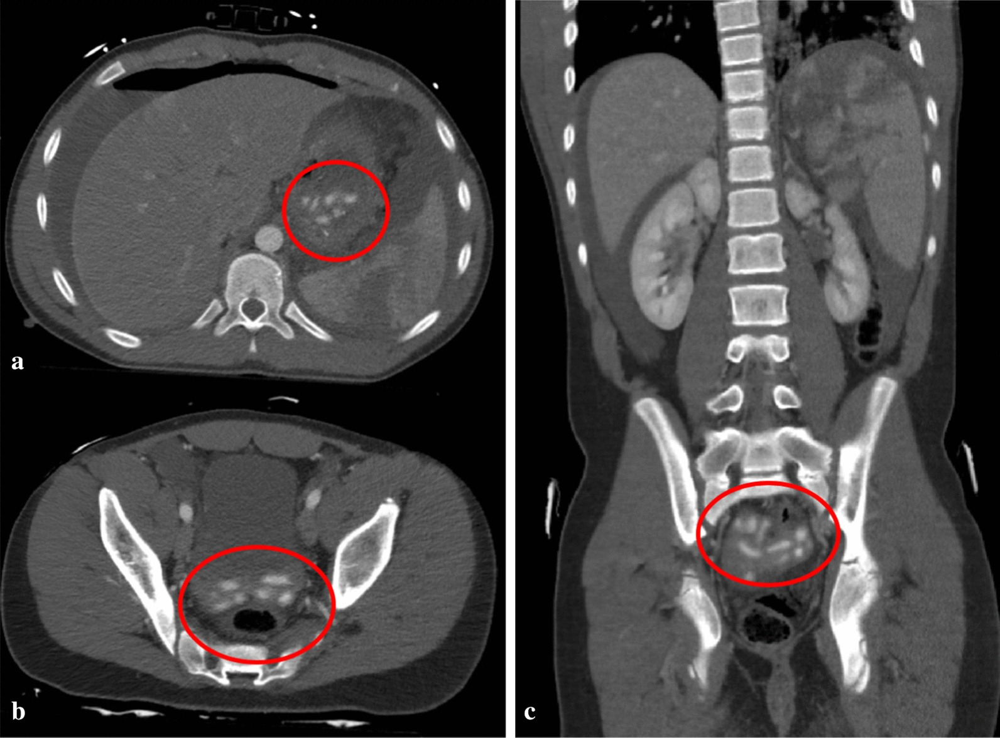
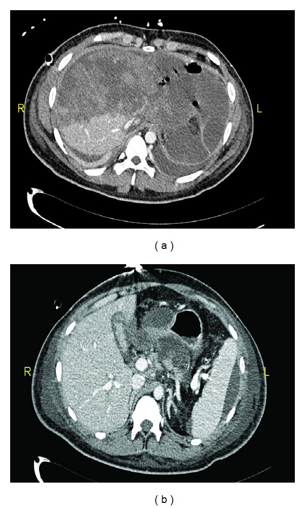
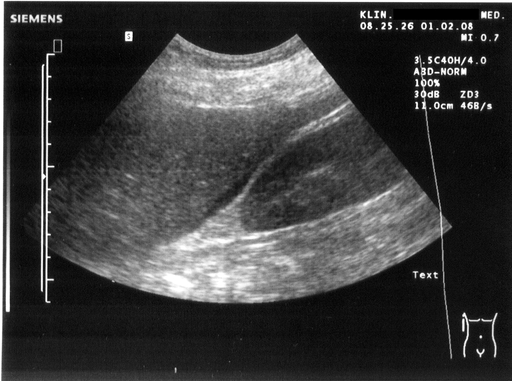
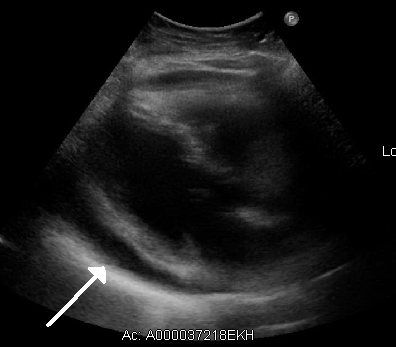
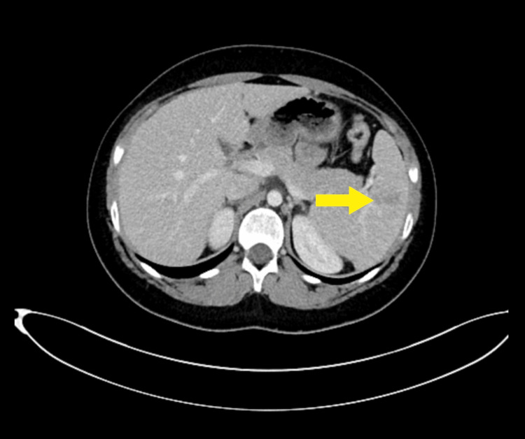
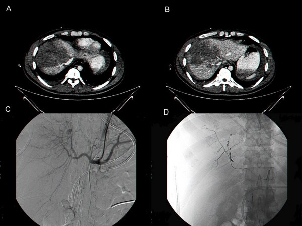
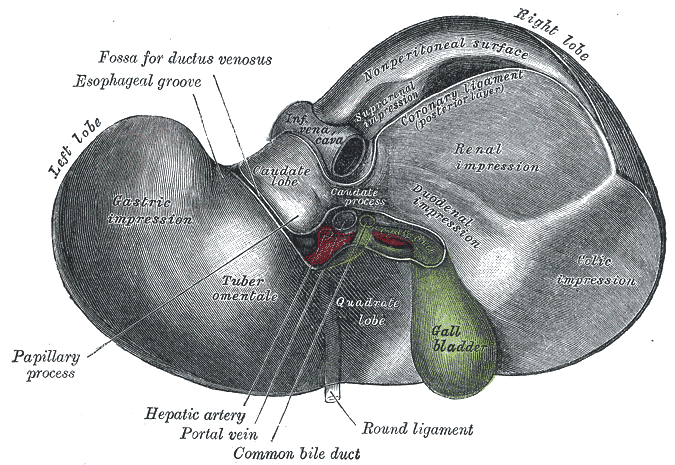
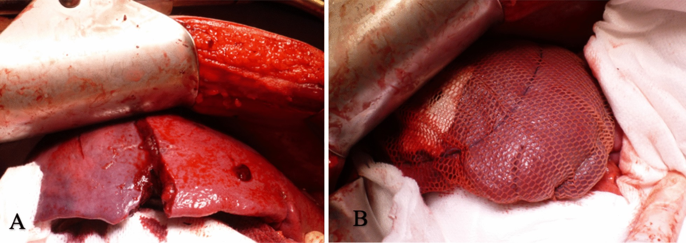

# BÀI HỌC Y KHOA: CHẤN THƯƠNG BỤNG KÍN & CHẤN THƯƠNG GAN–LÁCH
**Ngày:** 2026-11-18 | **Chuyên khoa:** Ngoại khoa | **Đối tượng:** Bác sĩ, học viên sau đại học và người học mất gốc cần học từ nền tảng

---

## 0. TỔNG QUAN — VÌ SAO BÀI NÀY QUAN TRỌNG? [CỐT LÕI]

&emsp;Chấn thương bụng kín là một trong những cấp cứu ngoại khoa giết người nhanh nhất mà bác sĩ trực có thể gặp.
&emsp;Bệnh nhân có thể đang nói chuyện bình thường, huyết áp bình thường, bụng mềm, nhưng máu đang chảy âm thầm trong ổ bụng với tốc độ hàng trăm mililít mỗi giờ.
&emsp;Khi huyết áp bắt đầu tụt, bệnh nhân thường đã mất khoảng 30% thể tích máu, và cửa sổ để cứu sống đã hẹp lại rất nhiều.

&emsp;Bài này gộp 2 phần mà trước đây tách riêng: phần tiếp cận chấn thương bụng kín (cơ chế, khám, siêu âm FAST, chụp cắt lớp vi tính, phân loại huyết động, quyết định mổ) và phần chấn thương gan–lách (phân độ, điều trị không mổ, nút mạch, mổ cầm máu, hậu quả sau cắt lách).
&emsp;Gan và lách là 2 tạng đặc hay vỡ nhất trong chấn thương bụng kín, và cả 2 đều chảy máu chứ không gây viêm phúc mạc do dịch tiêu hóa như tạng rỗng.
&emsp;Hiểu được 2 tạng này là hiểu được phần lớn quyết định "mổ hay không mổ" trong chấn thương bụng kín.

&emsp;Bài này giải quyết 4 câu hỏi lâm sàng mà bác sĩ trực hay gặp nhất.
&emsp;Thứ nhất, bệnh nhân này có đang chảy máu trong ổ bụng không, và làm sao biết được khi khám bụng không đáng tin cậy.
&emsp;Thứ hai, siêu âm FAST âm tính có cho phép về nhà không, và chụp cắt lớp vi tính khi nào thì an toàn.
&emsp;Thứ ba, gan hoặc lách rách độ cao có nhất thiết phải mổ không, và điều trị không mổ cần điều kiện gì.
&emsp;Thứ tư, khi nào phải mở bụng ngay không cần chụp phim, và khi đã cắt lách thì bệnh nhân phải sống chung với nguy cơ gì suốt đời.

&emsp;Sai lầm đắt giá nhất của bài này là tin FAST âm tính.
&emsp;Siêu âm FAST có độ đặc hiệu cao nhưng độ nhạy thấp trong phát hiện và loại trừ tổn thương tạng, vì vậy FAST âm tính không loại trừ được tổn thương [DATA VERIFIED].
&emsp;Ở túi Morison, siêu âm chỉ phát hiện đáng tin cậy khi đã có trung bình 619 mL dịch, và chỉ 10% người quét phát hiện được thể tích dưới 400 mL [DATA VERIFIED].
&emsp;Một bệnh nhân mất 500 mL máu trong ổ bụng hoàn toàn có thể có FAST âm tính mà vẫn đang chảy máu.

&emsp;Sai lầm đắt giá thứ 2 là nhìn độ rách mà quyết định mổ.
&emsp;Phân độ giải phẫu AAST chỉ mô tả tổn thương nặng đến đâu, còn quyết định mổ hay không mổ dựa chủ yếu vào huyết động, tổn thương phối hợp và năng lực của trung tâm [FULL TEXT VERIFIED].
&emsp;Lách rách độ V nhưng huyết động ổn định vẫn có thể thử điều trị không mổ, trong khi lách rách độ I nhưng bệnh nhân sốc không đáp ứng vẫn phải mổ ngay.

**Mục tiêu của bài:**
- Giải thích chuỗi cơ chế từ đụng dập và giảm tốc đến rách tạng đặc, chảy máu trong ổ bụng và sốc mất máu
- Khám bụng sau chấn thương đúng cách, nhận diện các bẫy làm khám bụng mất giá trị, và phân loại huyết động thành ổn định, đáp ứng thoáng qua và không đáp ứng
- Thực hiện và đọc siêu âm FAST 4 cửa sổ đúng vai trò của nó, biết ngưỡng phát hiện dịch và các nguyên nhân âm tính giả
- Chỉ định chụp cắt lớp vi tính cản quang đúng người và đúng thời điểm, đọc được dấu hiệu thoát thuốc cản quang
- Phân độ chấn thương gan và lách theo thang AAST, phân loại theo WSES kết hợp giải phẫu với huyết động
- Ra quyết định điều trị không mổ, nút mạch can thiệp hay mổ cho từng nhóm bệnh nhân, kể cả trẻ em
- Trình bày nguyên lý nghiệm pháp Pringle và chèn gạc cầm máu gan, quyết định bảo tồn hay cắt lách, và quản lý bệnh nhân sau cắt lách

> **TIÊU CHUẨN BẮT BUỘC — DẠY TỪ GỐC, KHÔNG GIỚI HẠN ĐỘ DÀI:** Viết để một người học mất gốc vẫn theo được. Trước khi dùng một thuật ngữ, chữ viết tắt, chỉ số, cơ quan, cơ chế, thủ thuật hoặc quyết định điều trị lần đầu, phải giải thích bằng tiếng Việt đơn giản: **nó là gì → bình thường hoạt động ra sao → vì sao bất thường này quan trọng → nhận ra bằng cách nào → làm gì tiếp theo**. Sau lần giải thích đầu tiên, mới dùng viết tắt/thuật ngữ ngắn. Không dùng “rõ ràng”, “thường quy”, “theo protocol” hoặc danh sách bước trần nếu chưa giải thích lý do và ý nghĩa của hành động. Độ dài không có giới hạn tối đa: tiếp tục viết khi còn một mắt xích cần thiết cho người học hiểu hoặc ra quyết định an toàn; ưu tiên chia nhỏ bằng tiêu đề, ví dụ và checkpoint thay vì cắt bỏ nền tảng.

> **CÁCH GIẢI THÍCH BẮT BUỘC CHO MỖI QUY TRÌNH:** Mỗi xét nghiệm, thang điểm, thuốc, thủ thuật hoặc algorithm phải ghi theo thứ tự: **mục tiêu → khi nào dùng/không dùng → cần chuẩn bị/đầu vào gì → làm hoặc đọc kết quả như thế nào → kết quả thay đổi quyết định ra sao → bẫy/an toàn → khi nào chuyển tuyến**. Chi tiết liều, đường dùng, trình tự và thời điểm phải có nguồn xác minh; không lấp chỗ trống bằng suy đoán.

### 📋 TRƯỚC KHI ĐỌC — NỀN TẢNG CẦN DÙNG

> Để hiểu bài này, người học nên đã biết:
> - Giải phẫu ổ bụng: vị trí gan hạ sườn phải, lách hạ sườn trái, các khoang phúc mạc và túi Morison
> - Sinh lý sốc mất máu: vì sao huyết áp tụt muộn và vì sao nhịp tim nhanh là dấu hiệu sớm
> - Khám bụng cơ bản và siêu âm tại giường là gì
>
> **Không được chặn việc học vì thiếu prerequisite.** Nếu bài tiên quyết chưa tồn tại hoặc người học chưa nắm, tạo mục `### 0.1 Nền tảng tối thiểu cần dùng ngay` sau Overview và dạy đủ khái niệm nền để hiểu bài hiện tại; link bài tiên quyết chỉ là đường học sâu hơn.

### 0.1 Nền tảng tối thiểu cần dùng ngay [CỐT LÕI]

&emsp;Ổ bụng là khoang kín chứa các tạng tiêu hóa, gan, lách, thận và các mạch máu lớn.
&emsp;Phúc mạc (peritoneum) là lớp màng mỏng lót mặt trong ổ bụng và bọc lấy phần lớn các tạng trong ổ bụng.
&emsp;Khoang phúc mạc là khoảng trống tiềm năng giữa 2 lá phúc mạc, bình thường chỉ có một lớp dịch mỏng tráng cho các tạng trượt lên nhau.

&emsp;Tạng đặc là các tạng có nhu mô đặc, giàu mạch máu, gồm gan, lách, thận và tụy.
&emsp;Tạng đặc khi rách sẽ chảy máu, vì nhu mô của chúng chứa rất nhiều mạch máu nhỏ và không có lòng rỗng để máu thoát ra ngoài.
&emsp;Tạng rỗng là các tạng có lòng chứa dịch hoặc khí, gồm dạ dày, ruột non, đại tràng và bàng quang.
&emsp;Tạng rỗng khi vỡ sẽ đổ dịch tiêu hóa hoặc nước tiểu vào ổ bụng, gây viêm phúc mạc do hóa chất và nhiễm trùng.

&emsp;Gan là tạng đặc lớn nhất cơ thể, nằm ở hạ sườn phải, được xương sườn 7 đến 11 bên phải che phủ phần lớn.
&emsp;Gan nhận máu từ 2 nguồn: động mạch gan riêng mang máu giàu oxy, và tĩnh mạch cửa mang máu từ ruột về.
&emsp;Nhờ có 2 nguồn máu, gan chịu được việc thắt động mạch gan trong những tình huống phải cầm máu, dù việc thắt này vẫn làm tăng nguy cơ hoại tử gan và áp-xe.

&emsp;Lách là tạng đặc nằm ở hạ sườn trái, dưới xương sườn 9 đến 11 bên trái, ngay dưới cơ hoành.
&emsp;Lách có 2 nhiệm vụ chính: lọc máu để loại hồng cầu già và tiểu cầu cũ, và miễn dịch để chống lại vi khuẩn có vỏ.
&emsp;Mất lách nghĩa là mất hàng rào chống vi khuẩn có vỏ, vì vậy bệnh nhân sau cắt lách có nguy cơ nhiễm trùng huyết tối cấp suốt đời.

&emsp;Túi Morison là khoảng trống giữa gan và thận phải, nằm ở phía sau gan.
&emsp;Ở bệnh nhân nằm ngửa, máu chảy trong ổ bụng sẽ tụ xuống túi Morison sớm nhất vì đây là khoang thấp nhất ở vùng bụng trên khi nằm.
&emsp;Vì vậy siêu âm FAST luôn quét túi Morison đầu tiên khi tìm dịch tự do trong ổ bụng.

&emsp;Huyết động ổn định nghĩa là huyết áp và nhịp tim giữ được trong giới hạn an toàn sau hồi sức ban đầu, không cần truyền dịch hay truyền máu liên tục để duy trì.
&emsp;Huyết động không ổn định nghĩa là huyết áp tụt và không giữ được dù đã hồi sức, hoặc phải truyền máu liên tục mới giữ được huyết áp.
&emsp;Đáp ứng thoáng qua nghĩa là huyết áp lên được lúc đầu sau truyền dịch, rồi lại tụt xuống khi máu vẫn tiếp tục chảy.

&emsp;Điều trị không mổ (non-operative management, NOM) nghĩa là điều trị chấn thương tạng đặc mà không mở bụng: theo dõi sát, truyền máu khi cần, chụp mạch và nút mạch khi có chỉ định.
&emsp;Nút mạch (angioembolization) là thủ thuật luồn ống thông qua động mạch, tìm điểm chảy máu rồi thả vật liệu nút để cầm máu từ bên trong lòng mạch, không cần mở bụng.
&emsp;Chụp mạch (angiography) là chụp X-quang mạch máu sau khi bơm thuốc cản quang vào động mạch, để thấy chỗ thuốc thoát ra ngoài lòng mạch tức là chỗ đang chảy máu.

&emsp;Ví dụ: một bệnh nhân tai nạn giao thông được đưa vào cấp cứu với huyết áp 85 mmHg, mạch 125 lần mỗi phút, bụng chướng dần.
&emsp;Ví dụ này cho thấy bệnh nhân đang mất máu trong ổ bụng, và câu hỏi đầu tiên không phải là tạng nào rách, mà là huyết động có giữ được không.

---

## 1. ĐỊNH NGHĨA & PHÂN LOẠI [CỐT LÕI]

### 1.1. Chấn thương bụng kín là gì

&emsp;Chấn thương bụng kín (blunt abdominal trauma) là tổn thương ổ bụng do lực tù tác động mà không làm rách da và thành bụng, khác với chấn thương thấu bụng do dao đâm hay đạn bắn.
&emsp;Da có thể hoàn toàn nguyên vẹn trong khi gan đã rách, lách đã vỡ, và máu đang chảy trong ổ bụng.
&emsp;Chính vì bên ngoài không thấy gì nên chấn thương bụng kín dễ bị đánh giá thấp hơn mức độ thật của nó.

&emsp;Ba cơ chế chính gây chấn thương bụng kín là đụng dập trực tiếp, giảm tốc đột ngột và tăng áp đột ngột trong ổ bụng.
&emsp;Đụng dập trực tiếp xảy ra khi vô-lăng, dây an toàn, tay lái xe đạp hay vật tù đập thẳng vào bụng, ép tạng vào cột sống hoặc thành ngực.
&emsp;Giảm tốc đột ngột xảy ra trong tai nạn giao thông tốc độ cao hoặc ngã từ trên cao: cơ thể dừng lại đột ngột nhưng các tạng bên trong vẫn lao về trước theo quán tính, giật đứt tại các điểm cố định là dây chằng và cuống mạch.
&emsp;Tăng áp đột ngột xảy ra khi bụng bị chèn ép mạnh: áp lực trong ổ bụng tăng vọt và làm vỡ các tạng rỗng đang chứa đầy như dạ dày no, ruột hay bàng quang đầy.

&emsp;Cơ chế gợi ý tạng tổn thương, và người khám giỏi đọc được cơ chế từ bệnh sử.
&emsp;Chấn thương hạ sườn phải gợi ý tổn thương gan, vì gan nằm ngay dưới xương sườn phải.
&emsp;Chấn thương hạ sườn trái kèm gãy xương sườn trái gợi ý tổn thương lách, vì lách nằm ngay dưới xương sườn trái.
&emsp;Dấu dây an toàn ngang bụng gợi ý tổn thương ruột non và mạc treo, vì dây an toàn ép ruột vào cột sống.
&emsp;Tay lái xe đạp đâm vào thượng vị gợi ý tổn thương tụy và tá tràng, vì 2 tạng này nằm ngay trước cột sống ở vùng thượng vị.

&emsp;Tạng đặc và tạng rỗng gây ra 2 hội chứng lâm sàng khác nhau, và phân biệt được 2 hội chứng này là chìa khóa của bài.
&emsp;Tạng đặc rách gây chảy máu trong ổ bụng: bệnh nhân mất máu dần, da lạnh ẩm, mạch nhanh, huyết áp tụt dần, bụng chướng dần.
&emsp;Tạng rỗng vỡ gây viêm phúc mạc do dịch tiêu hóa: bệnh nhân đau bụng dữ dội, bụng cứng như gỗ, có dấu hiệu phúc mạc rõ.
&emsp;Máu trong ổ bụng cũng kích thích phúc mạc nhưng thường chỉ gây đau vừa và bụng chướng, ít khi gây bụng cứng như gỗ như dịch tiêu hóa.
&emsp;Vì vậy một bệnh nhân sốc mất máu mà bụng mềm vẫn có thể đang chảy máu trong ổ bụng do tạng đặc, và một bệnh nhân bụng cứng như gỗ thì phải nghĩ ngay đến tạng rỗng vỡ.

&emsp;Bài này chỉ dạy chấn thương bụng kín và chấn thương gan–lách.
&emsp;Chấn thương thấu bụng có thuật toán riêng và thuộc bài riêng, bài này chỉ nhắc ranh giới khi cần.
&emsp;Xử trí chi tiết tạng rỗng, mạc treo, tụy và tá tràng thuộc bài Chấn thương bụng kín — Tạng rỗng (SURG-38), bài này chỉ nhắc nguyên tắc quyết định khi cần cho thuật toán.
&emsp;Các bước chi tiết của phẫu thuật kiểm soát tổn thương (damage control surgery) thuộc bài riêng (SURG-39), bài này chỉ nhắc tên và nguyên tắc khi cần cho thuật toán.
&emsp;Kỹ thuật mổ chi tiết thuộc bài kỹ thuật mổ riêng, bài này chỉ dạy ở mức quyết định: chỉ định, thời điểm và nguyên tắc.

> ⚠️ HỌC VIÊN HAY NHẦM: Chấn thương bụng kín không có nghĩa là nhẹ. Da nguyên vẹn không nói lên điều gì về bên trong, và nhiều ca chảy máu trong ổ bụng nguy hiểm nhất lại có thành bụng hoàn toàn bình thường khi nhìn từ ngoài.

### 1.2. Phân loại WSES lách và thang AAST lách

&emsp;Thang AAST (American Association for the Surgery of Trauma, Hiệp hội Phẫu thuật Chấn thương Hoa Kỳ) là thang phân độ giải phẫu, mô tả tổn thương nặng đến đâu dựa trên hình ảnh mổ hoặc chụp cắt lớp vi tính.
&emsp;Thang AAST gốc cho lách và gan công bố năm 1994, bản cập nhật năm 2018 chỉ nhắc tên trong bài này vì chưa đối chiếu được toàn văn bản cập nhật.
&emsp;Bảng phân độ AAST lách dưới đây lấy từ Bảng 1 của hướng dẫn WSES (World Society of Emergency Surgery, Hội Phẫu thuật Cấp cứu Thế giới) về chấn thương lách năm 2017, toàn văn đã đọc [FULL TEXT VERIFIED].


*Hình 1: Chụp cắt lớp vi tính cản quang ổ bụng sau chấn thương bụng kín: vỡ lách độ 4 kèm dịch tự do và khí tự do ổ bụng (3 mặt cắt). Vòng đỏ trong ảnh gốc khoanh các khối kẹo từ dạ dày thủng của bệnh nhân, không phải vết rách lách. Nguồn: Poelmann & IJpma, BMC Surgery 2020, CC BY 4.0.*

| Độ AAST lách | Máu tụ | Rách nhu mô |
|---|---|---|
| Độ I | Máu tụ dưới bao dưới 10% diện tích bề mặt | Rách bao dưới 1 cm chiều sâu nhu mô |
| Độ II | Máu tụ dưới bao 10–50% diện tích, hoặc máu tụ trong nhu mô dưới 5 cm đường kính | Rách 1–3 cm chiều sâu, không chạm mạch nhu mô |
| Độ III | Máu tụ dưới bao trên 50% diện tích hoặc đang to ra, hoặc máu tụ đã vỡ; máu tụ trong nhu mô trên 5 cm | Rách trên 3 cm chiều sâu hoặc chạm mạch bè |
| Độ IV | Rách mạch phân thùy hoặc rốn lách gây mất tưới máu trên 25% lách | Tổn thương mạch phân thùy hoặc mạch rốn lách |
| Độ V | Lách vỡ nát hoàn toàn | Tổn thương mạch rốn lách gây mất tưới máu toàn bộ lách |

&emsp;Đọc bảng trên theo logic từ nhẹ đến nặng: độ càng cao thì máu tụ càng lớn, vết rách càng sâu, và tổn thương mạch càng trung tâm.
&emsp;Điểm mấu chốt là độ IV và độ V không còn là chuyện máu tụ hay vết rách nữa, mà là chuyện mạch máu: mạch phân thùy hoặc mạch rốn lách bị rách, một phần hoặc toàn bộ lách mất tưới máu.
&emsp;Khi lách mất tưới máu, phần nhu mô đó sẽ hoại tử, và nguy cơ chảy máu tiếp diễn rất cao.

&emsp;Phân loại WSES lách kết hợp phân độ giải phẫu AAST với tình trạng huyết động, và đây mới là phân loại để ra quyết định.
&emsp;Phân loại WSES giống nhau cho người lớn và trẻ em, gồm 4 mức [FULL TEXT VERIFIED].
&emsp;WSES I là nhẹ: AAST độ I–II kèm huyết động ổn định.
&emsp;WSES II là vừa: AAST độ III kèm huyết động ổn định.
&emsp;WSES III là nặng về giải phẫu nhưng vẫn ổn định: AAST độ IV–V kèm huyết động ổn định.
&emsp;WSES IV là nặng về sinh lý: AAST độ I–V bất kỳ kèm huyết động KHÔNG ổn định.

&emsp;Điều trị đầu tay theo phân loại WSES lách như sau [FULL TEXT VERIFIED].
&emsp;WSES I đến III điều trị không mổ, kèm theo dõi lâm sàng, xét nghiệm và hình ảnh nối tiếp, cân nhắc chụp mạch và nút mạch.
&emsp;WSES IV phải mổ, không chụp cắt lớp vi tính.
&emsp;Nghiên cứu đa trung tâm tiền cứu trên 124 bệnh nhân người lớn chấn thương lách kín cho thấy phân loại WSES dự báo được quyết định: độ IV WSES là yếu tố nguy cơ phải mổ lúc nhập viện và mổ quyết định, độ III WSES là yếu tố nguy cơ phải nút mạch [DATA VERIFIED].

&emsp;Ví dụ: một bệnh nhân lách rách độ V nhưng huyết áp 120 mmHg, mạch 90 lần mỗi phút, tỉnh táo, da ấm, thì phân loại là WSES III và được thử điều trị không mổ.
&emsp;Ví dụ: một bệnh nhân khác lách chỉ rách độ I nhưng huyết áp 75 mmHg, mạch 130 lần mỗi phút, da lạnh ẩm, thì phân loại là WSES IV và phải mổ ngay.
&emsp;Hai ví dụ này cho thấy vì sao dạy "độ AAST cao chưa chắc phải mổ, huyết động mới quyết định" là câu quan trọng nhất của phần phân loại.

> ⚠️ HỌC VIÊN HAY NHẦM: Độ AAST cao không đồng nghĩa với phải mổ, và độ AAST thấp không đồng nghĩa với an toàn. Phân loại WSES dạy rằng cùng một độ AAST, bệnh nhân ổn định thì theo dõi, bệnh nhân không ổn định thì mổ.

### 🛑 DỪNG 1 PHÚT — TỰ KIỂM TRA

> 1. Bệnh nhân lách rách độ IV, huyết áp 125 mmHg, mạch 88 lần mỗi phút thuộc WSES mấy và xử trí đầu tay là gì?
> 2. Vì sao lách rách độ I vẫn có thể phải mổ?
>
> *(Đáp án: 1. WSES III, thử điều trị không mổ kèm theo dõi sát và cân nhắc chụp mạch, nút mạch. 2. Vì huyết động không ổn định xếp bệnh nhân vào WSES IV, và WSES IV phải mổ bất kể độ AAST.)*

### 1.3. Phân loại WSES gan và thang AAST gan

&emsp;Thang AAST gan có 6 độ, khác với lách chỉ có 5 độ, vì gan có thêm độ VI là đứt rời gan hoàn toàn.
&emsp;Bảng phân độ AAST gan dưới đây lấy từ Bảng 3 của hướng dẫn WSES về chấn thương gan năm 2020, bảng này trong toàn văn chỉ là hình ảnh nên đã đọc trực tiếp bằng mắt từ ảnh gốc của nhà xuất bản [FULL TEXT VERIFIED].


*Hình 2: Chụp cắt lớp vi tính cản quang: vỡ gan độ 4 với blush (a) — thoát thuốc cản quang đang hoạt động — và dịch tự do quanh gan, lách (b). Nguồn: Abdelrahman và cs., Case Reports in Surgery 2013, CC BY 3.0.*

| Độ AAST gan | Máu tụ | Rách nhu mô |
|---|---|---|
| Độ I | Máu tụ dưới bao gan dưới 10% diện tích bề mặt | Rách bao gan dưới 1 cm chiều sâu nhu mô |
| Độ II | Máu tụ dưới bao 10–50% diện tích, hoặc máu tụ trong nhu mô dưới 10 cm đường kính | Rách 1–3 cm chiều sâu, dưới 10 cm chiều dài |
| Độ III | Máu tụ dưới bao trên 50% diện tích hoặc đang to ra, hoặc máu tụ đã vỡ; máu tụ trong nhu mô trên 10 cm | Rách trên 3 cm chiều sâu |
| Độ IV | Rách gây đứt nhu mô 25–75% một thùy gan | Đứt nhu mô 25–75% thùy gan |
| Độ V | Rách gây đứt nhu mô trên 75% một thùy gan | Tổn thương mạch cạnh tĩnh mạch gan, gồm tĩnh mạch chủ dưới sau gan và tĩnh mạch gan chính giữa |
| Độ VI | Đứt rời gan hoàn toàn | Mất liên tục hoàn toàn của gan |

&emsp;Quy tắc cộng độ: khi gan có nhiều tổn thương, nâng lên 1 độ, tối đa đến độ III.
&emsp;Nghĩa là một gan có 2 vết rách độ II sẽ được xếp độ III, nhưng quy tắc này không áp dụng để nâng quá độ III.

&emsp;Phân loại WSES gan cũng kết hợp AAST với huyết động, gồm 4 mức [FULL TEXT VERIFIED].
&emsp;WSES I của gan là nhẹ: AAST độ I–II kèm huyết động ổn định.
&emsp;WSES II của gan là vừa: AAST độ III kèm huyết động ổn định.
&emsp;WSES III là nặng: AAST độ IV–V kèm huyết động ổn định.
&emsp;WSES IV là nặng về sinh lý: AAST độ I–VI bất kỳ kèm huyết động KHÔNG ổn định.
&emsp;Khác với lách, WSES gan gộp WSES III và IV thành nhóm "nặng", trong khi ở lách chỉ WSES IV mới gọi là nặng.
&emsp;Người học phải dạy đúng bảng của từng tạng, không được đồng nhất 2 phân loại với nhau.

&emsp;Lưu ý quan trọng về lỗi đánh máy trong hướng dẫn WSES gan 2020: phần mở đầu của bài báo viết "WSES IV, V" khi nói về chấn thương nặng, nhưng phân loại chính thức trong Bảng 2 của hướng dẫn chỉ có WSES I đến IV.
&emsp;Bài này dạy theo bảng phân loại chính thức, không trích câu "WSES IV, V" trong phần mở đầu.
&emsp;Đây là lỗi đánh máy của bài báo gốc, và người học cần biết để không hoang mang khi đọc thấy "WSES V" ở phần mở đầu rồi không tìm thấy nó trong bảng.

&emsp;Ví dụ: một bệnh nhân gan rách độ V nhưng huyết áp 118 mmHg, mạch 92 lần mỗi phút, tỉnh táo, thì phân loại là WSES III và được thử điều trị không mổ.
&emsp;Ví dụ: một bệnh nhân gan chỉ rách độ II nhưng huyết áp 78 mmHg không giữ được sau truyền dịch, thì phân loại là WSES IV và phải mổ ngay.

### 1.4. So sánh phân độ lách với gan — những điểm khác biệt hay ra thi

&emsp;Lách và gan giống nhau ở 3 độ đầu: máu tụ dưới bao dưới 10% diện tích là độ I, 10–50% là độ II, trên 50% hoặc đang to ra là độ III.
&emsp;Điểm khác biệt thứ nhất là ngưỡng máu tụ trong nhu mô: lách lấy 5 cm, gan lấy 10 cm.
&emsp;Một máu tụ trong nhu mô 7 cm ở lách là độ III, nhưng cùng kích thước đó ở gan mới chỉ là độ II, vì gan to hơn lách rất nhiều.
&emsp;Điểm khác biệt thứ 2 là cách tính độ IV và V: lách tính theo mạch máu bị rách (mạch phân thùy, mạch rốn), gan tính theo tỉ lệ thùy bị đứt (25–75% là độ IV, trên 75% là độ V).
&emsp;Điểm khác biệt thứ 3 là gan có thêm độ VI là đứt rời hoàn toàn, lách không có độ VI vì lách vỡ nát hoàn toàn đã là độ V.

&emsp;Điểm khác biệt thứ 4 nằm ở phân loại WSES: WSES lách gọi WSES III là "vừa đến nặng" và chỉ WSES IV là nặng, còn WSES gan gộp WSES III và IV thành nhóm nặng.
&emsp;Điểm khác biệt thứ 5 nằm ở ngưỡng truyền máu trong định nghĩa không ổn định, sẽ dạy kỹ ở §2 và §4: hướng dẫn lách 2017 ghi ít nhất 4–6 đơn vị hồng cầu khối trong 24 giờ đầu, hướng dẫn gan 2020 ghi trên 4 đơn vị trong 8 giờ đầu [FULL TEXT VERIFIED].
&emsp;Hai ngưỡng này khác nhau vì đây là ngưỡng vận hành của từng guideline, không phải hằng số sinh lý, và người học phải dạy theo từng guideline cho từng tạng.

> ⚠️ HỌC VIÊN HAY NHẦM: Học viên hay nhớ lộn ngưỡng 5 cm của lách với ngưỡng 10 cm của gan, và hay nghĩ gan cũng chỉ có đến độ V như lách. Mẹo nhớ: gan to gấp đôi lách nên ngưỡng máu tụ cũng gấp đôi, và gan có thêm độ đứt rời vì gan có cuống mạch lớn hơn.

---

## 2. CƠ CHẾ & SINH LÝ BỆNH [CỐT LÕI]

### 2.1. Chuỗi cơ chế 1: Đụng dập và giảm tốc gây rách tạng đặc

&emsp;Tạng đặc rách theo 2 cách khác nhau tùy cơ chế, và hiểu được 2 cách này giúp người khám đoán được tổn thương từ bệnh sử.
&emsp;Đụng dập trực tiếp ép tạng vào một mặt cứng: gan bị ép vào xương sườn và cột sống, lách bị ép vào xương sườn trái và cột sống.
&emsp;Lực ép làm nhu mô nứt ra từ bề mặt vào sâu, giống như ấn mạnh một quả cà chua chín vào thành bàn.
&emsp;Giảm tốc đột ngột giật tạng tại điểm cố định: gan bị giật tại dây chằng liềm, dây chằng vành và dây chằng tam giác, lách bị giật tại rốn lách và các dây chằng treo lách.
&emsp;Phần tạng di động tiếp tục lao về trước trong khi điểm cố định giữ lại, và vết rách xuất hiện ngay tại điểm cố định đó, thường kèm rách mạch máu đi qua điểm cố định.

```text
Đụng dập trực tiếp → ép nhu mô vào xương sườn hoặc cột sống → nứt bao và nhu mô từ ngoài vào trong → chảy máu trong ổ bụng
```

```text
Giảm tốc đột ngột → tạng di động lao về trước, điểm cố định giữ lại → rách tại dây chằng và cuống mạch → rách mạch phân thùy hoặc mạch rốn → chảy máu nhanh
```

&emsp;Vết rách nhu mô chảy máu theo 2 đường: máu thoát ra khoang phúc mạc tự do, hoặc máu tụ lại dưới bao của tạng.
&emsp;Máu tụ dưới bao lách đặc biệt nguy hiểm vì bao lách mỏng và căng dần theo thời gian, rồi vỡ ra sau vài giờ hoặc vài ngày, gây ra vỡ lách 2 thì sẽ dạy ở §2.3.
&emsp;Máu tụ dưới bao gan cũng có thể vỡ, nhưng bao gan dày hơn và gan có nhu mô lớn hơn nên máu tụ gan thường tự cầm hoặc được nút mạch.

&emsp;Tổn thương mạch trong nhu mô tạo ra 3 dạng: thoát thuốc cản quang đang chảy (blush), giả phình động mạch và rò động–tĩnh mạch.
&emsp;Blush là thuốc cản quang thoát ra ngoài lòng mạch trên phim chụp cắt lớp vi tính, nghĩa là máu đang chảy ra ngoài mạch ngay lúc chụp.
&emsp;Giả phình là một túi phình của thành mạch bị rách một phần, máu vẫn còn trong lòng mạch nhưng thành mạch đã yếu và có thể vỡ bất cứ lúc nào.
&emsp;Rò động–tĩnh mạch là đường thông bất thường giữa động mạch và tĩnh mạch do chấn thương tạo ra, làm máu động mạch chảy thẳng vào tĩnh mạch.
&emsp;Cả 3 dạng này đều là chỉ định chụp mạch và nút mạch khi bệnh nhân ổn định, sẽ dạy kỹ ở §5.4.

&emsp;Ví dụ: một bệnh nhân tai nạn xe máy đâm vào cột điện, vô-lăng đập vào hạ sườn phải, gan rách độ III với máu tụ dưới bao đang to ra.
&emsp;Ví dụ: một bệnh nhân ngã từ tầng 2 xuống, lách bị giật tại rốn lách, mạch rốn lách rách gây mất tưới máu toàn bộ lách, tức là độ V.

### 2.2. Chuỗi cơ chế 2: Mất máu trong ổ bụng dẫn đến sốc mất máu

&emsp;Máu chảy trong ổ bụng không nhìn thấy được từ bên ngoài, và cơ thể bù trừ rất giỏi trong giai đoạn đầu, vì vậy huyết áp là chỉ số muộn.
&emsp;Khi mất máu, hệ giao cảm co mạch ngoại vi, tăng nhịp tim và tăng sức co bóp tim để giữ huyết áp.
&emsp;Cơ chế bù trừ này giữ được huyết áp cho đến khi mất khoảng 30% thể tích máu, sau đó huyết áp tụt rất nhanh vì cơ chế bù đã cạn.
&emsp;Trẻ em và người trẻ bù trừ càng tốt, vì vậy một trẻ em huyết áp bình thường vẫn có thể đang mất máu nặng, và huyết áp bình thường không bao giờ được dùng để loại trừ chảy máu trong.

&emsp;ATLS (Advanced Trauma Life Support, Hồi sức chấn thương nâng cao) phân sốc mất máu thành 4 mức độ theo tỉ lệ thể tích máu mất, đây là chuẩn dạy của ATLS và không gắn PMID.
&emsp;Độ I là mất dưới 15% thể tích máu: mạch, huyết áp và nước tiểu còn bình thường, bệnh nhân chỉ lo âu nhẹ.
&emsp;Độ II là mất 15–30%: mạch nhanh, huyết áp còn giữ được, nước tiểu giảm, bệnh nhân lo âu rõ.
&emsp;Độ III là mất 30–40%: mạch nhanh rõ, huyết áp tụt, nước tiểu ít, bệnh nhân lú lẫn.
&emsp;Độ IV là mất trên 40%: mạch rất nhanh, yếu hoặc không bắt được, huyết áp tụt nặng, vô niệu, hôn mê.

&emsp;Hematocrit lúc đầu có thể hoàn toàn bình thường dù bệnh nhân đang mất máu nhiều, vì mất máu toàn phần nghĩa là mất cả hồng cầu lẫn huyết tương theo cùng tỉ lệ.
&emsp;Hematocrit chỉ giảm sau khi đã bù dịch hoặc sau khi dịch từ khoảng kẽ tái phân bố vào lòng mạch làm loãng máu.
&emsp;Vì vậy không được chờ hematocrit giảm mới chẩn đoán chảy máu, và không được dùng một chỉ số hematocrit bình thường lúc nhập viện để trấn an.

&emsp;Chỉ số sốc (shock index) bằng nhịp tim chia cho huyết áp tâm thu, và trên 1 là dấu hiệu cảnh báo sớm.
&emsp;Ví dụ: nhịp tim 120 lần mỗi phút chia cho huyết áp tâm thu 100 mmHg bằng 1,2, tức là chỉ số sốc đã trên 1 dù huyết áp vẫn còn 100 mmHg.
&emsp;Chỉ số này được dùng trong định nghĩa huyết động không ổn định của WSES, sẽ dạy ở §4 và §5.

```text
Rách tạng đặc → máu chảy vào khoang phúc mạc → thể tích tuần hoàn giảm → giao cảm co mạch và tăng nhịp tim → huyết áp còn giữ được lúc đầu → mất khoảng 30% thể tích máu → cơ chế bù cạn → huyết áp tụt nhanh → sốc mất máu
```

```text
Mất máu toàn phần → hematocrit lúc đầu còn bình thường → bù dịch và tái phân bố dịch → máu loãng dần → hematocrit giảm muộn → không được chờ hematocrit giảm mới chẩn đoán
```

&emsp;Chuỗi 5 tầng cho sốc mất máu, từ phân tử đến giường bệnh:
&emsp;Tầng 1: Thể tích tuần hoàn giảm làm thụ thể áp lực ở xoang cảnh và quai động mạch chủ giảm tín hiệu, hệ giao cảm tăng hoạt, giải phóng catecholamine.
&emsp;Tầng 2: Catecholamine co mạch ngoại vi, tăng nhịp tim, tăng sức co bóp tim, và co mạch tạng để ưu tiên máu cho tim và não.
&emsp;Tầng 3: Huyết áp được giữ tạm thời nhưng tưới máu thận, ruột và da giảm, nước tiểu ít dần, da lạnh ẩm, đầu chi lạnh.
&emsp;Tầng 4: Khi mất máu vượt ngưỡng bù trừ, huyết áp tụt, ý thức lú lẫn rồi hôn mê, và tam chứng chết chóc gồm hạ thân nhiệt, toan chuyển hóa và rối loạn đông máu bắt đầu xuất hiện.
&emsp;Tầng 5: Nếu không cầm được nguồn chảy máu và hồi sức tích cực, bệnh nhân rơi vào sốc không hồi phục và tử vong; vì vậy quyết định mổ cầm máu không được trì hoãn để chờ đủ máu hay chờ xét nghiệm.

&emsp;Ví dụ: một bệnh nhân nam 30 tuổi tai nạn giao thông, huyết áp 110 mmHg, mạch 115 lần mỗi phút, da lạnh, nước tiểu 20 mL mỗi giờ.
&emsp;Ví dụ này cho thấy bệnh nhân đang ở độ II đến III của sốc mất máu dù huyết áp vẫn trên 100 mmHg, và chỉ số sốc đã trên 1.

> ⚠️ HỌC VIÊN HAY NHẦM: Học viên hay chờ huyết áp tụt mới gọi là sốc. Thực tế mạch nhanh, da lạnh ẩm, nước tiểu giảm và chỉ số sốc trên 1 xuất hiện trước huyết áp tụt rất lâu, và đó mới là lúc phải hành động.

### 🛑 DỪNG 1 PHÚT — TỰ KIỂM TRA

> 1. Vì sao hematocrit lúc nhập viện có thể bình thường dù bệnh nhân đang chảy máu nhiều trong ổ bụng?
> 2. Chỉ số sốc được tính thế nào và trên bao nhiêu thì cảnh báo?
>
> *(Đáp án: 1. Vì mất máu toàn phần làm mất cả hồng cầu lẫn huyết tương theo cùng tỉ lệ, hematocrit chỉ giảm sau khi bù dịch hoặc tái phân bố dịch làm loãng máu. 2. Chỉ số sốc bằng nhịp tim chia huyết áp tâm thu, trên 1 là dấu hiệu cảnh báo sớm.)*

### 2.3. Chuỗi cơ chế 3: Máu tụ dưới bao lách và vỡ lách 2 thì

&emsp;Vỡ lách 2 thì là hiện tượng máu tụ dưới bao lách căng dần rồi vỡ ra sau một khoảng thời gian yên lặng, và đây là một trong những bẫy kinh điển của chấn thương lách.
&emsp;Thì 1: chấn thương làm rách nhu mô lách nhưng bao lách còn nguyên, máu chảy ra và tụ lại dưới bao, tạo thành khối máu tụ dưới bao.
&emsp;Bao lách căng dần theo từng giờ khi máu tiếp tục rỉ ra, bệnh nhân đau hạ sườn trái vừa phải rồi đau giảm dần, tưởng như đã ổn.
&emsp;Thì 2: bao lách chịu không nổi áp lực nữa và vỡ ra, máu đổ ào vào khoang phúc mạc, bệnh nhân đau dữ dội trở lại, huyết áp tụt nhanh, bụng chướng nhanh.
&emsp;Khoảng yên lặng giữa 2 thì có thể là vài giờ hoặc vài ngày, và bệnh nhân có thể đã về nhà hoặc đã được chuyển khỏi khoa cấp cứu khi thì 2 xảy ra.

```text
Rách nhu mô lách, bao còn nguyên → máu tụ dưới bao → bao căng dần theo giờ → đau giảm tưởng như ổn → bao vỡ → máu đổ vào khoang phúc mạc → đau dữ dội trở lại, huyết áp tụt nhanh
```

```text
Máu tụ dưới bao trên 50% diện tích bề mặt → bao mỏng và căng → nguy cơ vỡ cao → theo dõi sát và chụp lại hình ảnh → vỡ thì phải mổ hoặc nút mạch ngay
```

&emsp;Dấu hiệu gợi ý vỡ lách là đau hạ sườn trái lan lên vai trái, gọi là dấu Kehr.
&emsp;Cơ chế của dấu Kehr: máu kích thích cơ hoành, mà cơ hoành được chi phối bởi thần kinh hoành xuất phát từ đốt sống cổ 3 đến 5, cùng khoanh tủy chi phối da vùng vai, nên não hiểu nhầm tín hiệu từ cơ hoành thành đau vai.
&emsp;Đau tăng khi thở sâu vì cơ hoành di động nhiều hơn và cọ vào máu tụ.
&emsp;Gãy xương sườn trái kèm theo làm tăng khả năng tổn thương lách, vì cùng một lực đập vào hạ sườn trái có thể vừa gãy xương sườn vừa rách lách.

&emsp;Ví dụ: một bệnh nhân tai nạn xe máy, đau hạ sườn trái lúc đầu rồi đỡ dần, được cho về nhà sau 6 giờ theo dõi, đến đêm thì đau bụng dữ dội, vai trái đau nhói, huyết áp tụt còn 80 mmHg.
&emsp;Ví dụ này là vỡ lách 2 thì điển hình, và là lý do vì sao bệnh nhân chấn thương lách dù ổn định vẫn cần theo dõi sát và được dặn dò kỹ về dấu hiệu quay lại.

### 2.4. Chuỗi cơ chế 4: Mất lách dẫn đến nhiễm trùng tối cấp sau cắt lách

&emsp;Lách là cơ quan miễn dịch lớn nhất của cơ thể chống lại vi khuẩn có vỏ, và mất lách để lại một lỗ hổng miễn dịch không cơ quan nào bù được hoàn toàn.
&emsp;Vi khuẩn có vỏ là các vi khuẩn có lớp vỏ polysaccharide bên ngoài, gồm phế cầu (Streptococcus pneumoniae), Haemophilus influenzae type B và não mô cầu (Neisseria meningitidis).
&emsp;Lớp vỏ giúp vi khuẩn trốn khỏi thực bào, và lách là nơi duy nhất sản xuất đủ kháng thể IgM và opsonin để gắn lên lớp vỏ đó, đánh dấu vi khuẩn cho đại thực bào ăn.
&emsp;Không có lách, vi khuẩn có vỏ nhân lên trong máu không bị cản trở, và nhiễm trùng huyết tối cấp (overwhelming post-splenectomy infection, OPSI) có thể giết bệnh nhân trong 24 giờ đầu.

```text
Cắt lách → mất sản xuất IgM và opsonin → vi khuẩn có vỏ không bị đánh dấu → đại thực bào không nhận diện được → vi khuẩn nhân lên tự do trong máu → nhiễm trùng huyết tối cấp → tử vong trong 24 giờ đầu nếu không điều trị ngay
```

```text
Tiêm vắc-xin sau cắt lách → cơ thể tạo kháng thể chống vỏ vi khuẩn → kháng thể gắn lên vi khuẩn thay cho opsonin của lách → nguy cơ OPSI giảm nhưng không biến mất → vẫn cần kháng sinh standby khi sốt
```

&emsp;Tỉ lệ OPSI là 0,5–2,0%, tỉ lệ tử vong khi đã mắc OPSI là 30,0–70,0%, và đa số tử vong xảy ra trong 24 giờ đầu [FULL TEXT VERIFIED].
&emsp;Phế cầu gây 50,0% số ca OPSI, sau đó là Haemophilus influenzae type B và não mô cầu [FULL TEXT VERIFIED].
&emsp;Nguy cơ OPSI và tử vong cao nhất trong năm đầu sau cắt lách, nhưng vẫn cao hơn bình thường trên 10 năm và có thể suốt đời [FULL TEXT VERIFIED].
&emsp;Trẻ không lách dưới 5 tuổi có nguy cơ OPSI và tử vong cao hơn người lớn, nguy cơ trên 30,0% ở trẻ sơ sinh [FULL TEXT VERIFIED].
&emsp;Chính vì hậu quả suốt đời này mà điều trị không mổ và bảo tồn lách được ưu tiên hàng đầu, và cắt lách chỉ là bước cuối cùng khi mọi biện pháp khác đã thất bại.

&emsp;Ví dụ: một bệnh nhân cắt lách 3 năm trước, đang khỏe mạnh, bỗng sốt 39 độ C, rét run, mệt lả trong vài giờ.
&emsp;Ví dụ này phải được xử trí như OPSI cho đến khi chứng minh ngược lại: kháng sinh ngay, không chờ kết quả cấy máu, vì chờ đợi có thể giết bệnh nhân trong ngày.

### 2.5. Chuỗi cơ chế 5: Gan có 2 nguồn máu — vì sao thắt động mạch gan được và vì sao Pringle có giới hạn

&emsp;Gan nhận máu từ 2 nguồn: động mạch gan riêng mang khoảng 25% lưu lượng nhưng khoảng 50% lượng oxy, và tĩnh mạch cửa mang khoảng 75% lưu lượng máu từ ruột về.
&emsp;Nhờ nguồn máu kép này, thắt động mạch gan trong lúc mổ cầm máu thường được gan dung nạp, vì tĩnh mạch cửa vẫn nuôi gan.
&emsp;Nhưng thắt động mạch gan vẫn làm tăng nguy cơ hoại tử gan, áp-xe và biloma, vì vậy chỉ thắt khi đã cố gắng khâu cầm máu mà không được [FULL TEXT VERIFIED].
&emsp;Túi mật chỉ nhận máu từ động mạch gan, vì vậy nếu phải thắt động mạch gan phải hoặc động mạch gan chung thì phải cắt túi mật để tránh hoại tử túi mật [FULL TEXT VERIFIED].

```text
Thắt động mạch gan → tĩnh mạch cửa vẫn nuôi gan → gan thường sống được → nhưng oxy giảm một nửa → nguy cơ hoại tử gan, áp-xe và biloma tăng
```

```text
Thắt động mạch gan phải hoặc động mạch gan chung → túi mật mất nguồn máu duy nhất → hoại tử túi mật → phải cắt túi mật cùng lúc
```

&emsp;Nghiệm pháp Pringle là kẹp dây chằng gan–tá tràng, tức là kẹp cuống gan, để chặn đồng thời động mạch gan riêng, tĩnh mạch cửa và ống mật chủ.
&emsp;Pringle chặn máu ĐẾN gan, nhưng không chặn được máu ĐI ra khỏi gan qua tĩnh mạch gan đổ về tĩnh mạch chủ dưới.
&emsp;Vì vậy Pringle cầm được máu từ động mạch gan và tĩnh mạch cửa, nhưng không cầm được máu từ tĩnh mạch gan và tĩnh mạch chủ dưới sau gan.
&emsp;Khi Pringle cầm máu được, nguồn chảy là động mạch gan hoặc tĩnh mạch cửa, và phẫu thuật viên xử trí tại cuống gan hoặc vết thương.
&emsp;Khi Pringle không cầm máu được mà máu vẫn chảy, phải nghĩ đến 2 khả năng: động mạch gan lạc chỗ không đi qua cuống gan, hoặc tổn thương tĩnh mạch chủ sau gan và tĩnh mạch gan [FULL TEXT VERIFIED].
&emsp;Pringle kéo dài gây thiếu máu gan, vì vậy dùng ngắt quãng và ghi thời gian, chi tiết thời gian an toàn thuộc bài kỹ thuật mổ và không dạy số cụ thể ở đây vì chưa đối chiếu được.

&emsp;Chèn gạc cầm máu gan (hepatic packing) là đặt gạc QUANH gan để ép gan vào cơ hoành và thành bụng, tạo áp lực cơ học cầm máu tạm thời.
&emsp;Nguyên tắc quan trọng nhất: không nhét gạc VÀO vết rách, vì nhét gạc vào vết rách sẽ làm rách to thêm và chảy máu nhiều hơn.
&emsp;Packing là phương pháp ít rủi ro nhất để xử trí tạm thời tổn thương tĩnh mạch nặng sau gan [FULL TEXT VERIFIED].
&emsp;Sau packing, bệnh nhân được hồi sức tại hồi sức tích cực rồi mổ lại lấy gạc, thời điểm mổ lại thuộc chiến lược kiểm soát tổn thương của bài riêng (SURG-39).

&emsp;Ví dụ: một bệnh nhân gan rách độ V, máu chảy ồ ạt trong mổ, phẫu thuật viên kẹp Pringle thì máu ngừng chảy.
&emsp;Ví dụ này cho thấy nguồn chảy là động mạch gan hoặc tĩnh mạch cửa, và phẫu thuật viên có thể tìm và khâu điểm chảy tại vết thương.
&emsp;Ví dụ ngược lại: kẹp Pringle rồi mà máu vẫn chảy từ sau gan, phẫu thuật viên phải nghĩ ngay đến tổn thương tĩnh mạch chủ sau gan và chuyển sang packing thay vì tiếp tục tìm động mạch.

### 2.6. Diễn biến tự nhiên & biến chứng [CỐT LÕI]

&emsp;Diễn biến tự nhiên của chấn thương gan–lách không mổ chia thành 3 giai đoạn: chảy máu cấp, ổn định và lành, và biến chứng muộn.
&emsp;Giai đoạn chảy máu cấp diễn ra trong giờ đầu: máu chảy từ vết rách, máu tụ dưới bao căng dần, huyết động xấu dần nếu không cầm được máu.
&emsp;Giai đoạn ổn định diễn ra trong 24 đến 72 giờ đầu: nếu máu đã cầm, huyết động ổn định lại, máu tụ bắt đầu tổ chức hóa.
&emsp;Giai đoạn lành diễn ra trong nhiều tuần đến nhiều tháng: đa số tổn thương gan lành trong khoảng 4 tháng, và sau chấn thương gan vừa đến nặng thường có thể hoạt động bình thường lại sau 3–4 tháng [FULL TEXT VERIFIED].

&emsp;Biến chứng sau điều trị không mổ chấn thương gan, nhất là độ cao, gặp ở 12–14% bệnh nhân [FULL TEXT VERIFIED].
&emsp;Tái chảy máu là biến chứng thường gặp nhất sau điều trị không mổ, do vỡ máu tụ dưới bao hoặc vỡ giả phình, tỉ lệ 1,7–5,9%, tỉ lệ tử vong tới 18,0% [FULL TEXT VERIFIED].
&emsp;Điểm trấn an quan trọng: trong đa số ca, cụ thể là 69,0% ca chảy máu muộn, vẫn có thể xử trí không mổ, vì vậy tái chảy máu không đồng nghĩa với phải mổ ngay [FULL TEXT VERIFIED].
&emsp;Giả phình động mạch gan gặp ở 1,0% bệnh nhân, và giả phình không triệu chứng cũng nên điều trị sớm bằng nút mạch vì nguy cơ vỡ cao [FULL TEXT VERIFIED].
&emsp;Biến chứng đường mật gồm biloma, rò mật, bilhemia và viêm phúc mạc mật, gặp ở 2,8–30,0% bệnh nhân [FULL TEXT VERIFIED].
&emsp;Áp-xe sau điều trị không mổ hiếm gặp, thường ở tổn thương nặng, tỉ lệ 0,6–7,0%, dẫn lưu qua da là điều trị lựa chọn với tỉ lệ thành công cao [FULL TEXT VERIFIED].

&emsp;Biến chứng sau điều trị không mổ chấn thương lách gồm tái chảy máu, giả phình, rò động–tĩnh mạch và vỡ 2 thì.
&emsp;Yếu tố tiên lượng thất bại điều trị không mổ lách, với bằng chứng mạnh, gồm tuổi trên 55, chỉ số ISS cao và tổn thương lách vừa đến nặng, những bệnh nhân này cần theo dõi sát hơn và nghi ngờ thất bại cao hơn [FULL TEXT VERIFIED].
&emsp;Các yếu tố sau cần cân nhắc nhưng KHÔNG phải chống chỉ định tuyệt đối của điều trị không mổ: chỉ tuổi trên 55 đơn độc, máu tụ phúc mạc lớn đơn độc, tụt huyết áp trước hồi sức, GCS dưới 12, hematocrit thấp lúc nhập viện, tổn thương bụng phối hợp, blush trên phim chụp cắt lớp vi tính, thuốc kháng đông, HIV, nghiện, xơ gan và cần truyền máu [FULL TEXT VERIFIED].

&emsp;Dấu hiệu nhận biết sớm biến chứng sau điều trị không mổ gồm đau bụng tăng trở lại, sốt, vàng da, hemoglobin giảm và phản ứng viêm bất thường.
&emsp;Khi có các dấu hiệu này thì chụp lại cắt lớp vi tính, còn không thì không cần chụp cắt lớp vi tính thường quy sau điều trị không mổ [FULL TEXT VERIFIED].
&emsp;Siêu âm hữu ích để đánh giá rò mật và biloma ở chấn thương gan độ IV–V, nhất là rách trung tâm [FULL TEXT VERIFIED].

> **ĐIỂM MẤU CHỐT:** Biến chứng không xuất hiện ngẫu nhiên, mỗi biến chứng là hậu quả trực tiếp của một cơ chế chưa được kiểm soát. Tái chảy máu là máu tụ hoặc giả phình chưa được xử trí, rò mật là đường mật bị rách chưa được dẫn lưu, và OPSI là miễn dịch của lách đã mất mà không được bù bằng vắc-xin.

---

## 3. CHẨN ĐOÁN [CỐT LÕI]

### 3.1. Lâm sàng: khám bụng sau chấn thương và các bẫy

&emsp;Khám bụng sau chấn thương gồm 4 bước theo thứ tự: nhìn, nghe, gõ và sờ, nhưng giá trị của khám bụng trong chấn thương bụng kín thấp hơn nhiều so với trong bệnh lý bụng ngoại khoa thông thường.
&emsp;Nhìn để thấy vết bầm, vết dây an toàn, bụng chướng, vết thương thành bụng và dấu hiệu gãy xương sườn.
&emsp;Nghe để đánh giá nhu động ruột: nhu động giảm hoặc mất có thể do máu kích thích phúc mạc hoặc do liệt ruột sau chấn thương.
&emsp;Gõ để phát hiện vùng đục thay đổi theo tư thế khi có dịch tự do nhiều trong ổ bụng.
&emsp;Sờ để đánh giá đau khu trú, phản ứng thành bụng, cảm ứng phúc mạc và khối máu tụ sờ được.

&emsp;Dấu hiệu gợi ý vỡ lách gồm đau hạ sườn trái lan vai trái (dấu Kehr), đau tăng khi thở sâu và gãy xương sườn trái kèm theo.
&emsp;Dấu hiệu gợi ý vỡ gan gồm đau hạ sườn phải lan vai phải, đau khi ấn hạ sườn phải và chấn thương ngực phải phối hợp như gãy xương sườn hay đụng dập phổi.
&emsp;Dấu hiệu chung của mất máu trong ổ bụng gồm da lạnh ẩm, mạch nhanh, huyết áp tụt dần và bụng chướng dần.
&emsp;Vỡ 2 thì của lách có biểu hiện đặc trưng: đau giảm sau chấn thương rồi đau dữ dội trở lại khi máu tụ dưới bao vỡ, đã dạy ở §2.3.

&emsp;Bẫy lớn nhất của khám bụng là những tình huống làm khám bụng mất giá trị, và người khám phải biết khi nào không được tin vào bàn tay của mình.
&emsp;Bệnh nhân lú lẫn không mô tả được đau ở đâu và đau từ khi nào, vì vậy khám bụng ở bệnh nhân lú lẫn gần như không có giá trị phân biệt.
&emsp;Bệnh nhân say rượu hoặc say thuốc giảm đau không cảm nhận được đau đúng mức, và thuốc giảm đau làm mất phản ứng thành bụng.
&emsp;Bệnh nhân chấn thương sọ não không hợp tác được với khám bụng, và bệnh nhân chấn thương cột sống có thể mất cảm giác bụng.
&emsp;Bệnh nhân đang dùng thuốc an thần hoặc đang thở máy cũng không thể khai đau, vì vậy khám bụng ở những bệnh nhân này phải dựa vào dấu hiệu khách quan như huyết động và hình ảnh.
&emsp;Chính vì những bẫy này mà hướng dẫn WSES nhấn mạnh phải dựa vào FAST, chụp cắt lớp vi tính và huyết động chứ không chỉ dựa vào khám bụng.

&emsp;Ví dụ: một bệnh nhân tai nạn giao thông có nồng độ cồn cao, bụng mềm, không đau khi ấn, nhưng huyết áp 88 mmHg và mạch 128 lần mỗi phút.
&emsp;Ví dụ này cho thấy khám bụng mềm không loại trừ được chảy máu trong ổ bụng, và quyết định phải dựa vào huyết động và siêu âm FAST.

> 🚨 **BOX ĐỎ — AN TOÀN TRƯỚC KHI CHẨN ĐOÁN THƯỜNG QUY:** Bệnh nhân chấn thương bụng kín kèm tụt huyết áp không đáp ứng, dấu hiệu phúc mạc rõ, hoặc FAST dương tính kèm sốc là cấp cứu ngoại khoa, phải hồi sức và mổ ngay, không được đưa đi chụp cắt lớp vi tính hay làm xét nghiệm thường quy. Dấu hiệu bỏ sót nguy hiểm nhất là tin FAST âm tính hoặc khám bụng mềm mà cho bệnh nhân về nhà. Hành động ngay là hồi sức, truyền máu, siêu âm FAST tại giường và gọi phẫu thuật viên chấn thương. Nơi chuyển đến là phòng mổ, không phải phòng chụp cắt lớp vi tính.

### 3.2. Siêu âm FAST: 4 cửa sổ tìm dịch, không phải tìm tổn thương

&emsp;Siêu âm FAST (Focused Assessment with Sonography for Trauma, siêu âm tập trung đánh giá chấn thương) là siêu âm tại giường để tìm dịch tự do trong ổ bụng và quanh tim ở bệnh nhân chấn thương.
&emsp;Mục tiêu của FAST là trả lời một câu hỏi duy nhất trong vài phút: có dịch tự do trong ổ bụng không.
&emsp;FAST không phải là xét nghiệm tìm tổn thương: FAST dương tính nghĩa là có dịch, thường là máu, nhưng không cho biết tạng nào rách; FAST âm tính nghĩa là không thấy dịch ở 4 cửa sổ lúc đó, không loại trừ tổn thương tạng.

&emsp;Bốn cửa sổ chuẩn của FAST gồm cửa sổ dưới sườn ở mỏm tim, cửa sổ hạ sườn phải ở túi Morison, cửa sổ hạ sườn trái và cửa sổ hố chậu.
&emsp;Cửa sổ dưới sườn đặt đầu dò dưới mũi ức để tìm dịch quanh tim, tức là tràn máu màng ngoài tim.
&emsp;Cửa sổ hạ sườn phải đặt đầu dò ở khoang liên sườn phải để quét khoảng gan–thận là túi Morison, cực trên thận phải và túi cùng gan–cơ hoành.
&emsp;Cửa sổ hạ sườn trái đặt đầu dò ở khoang liên sườn trái để quét khoảng lách–thận và cực trên thận trái.
&emsp;Cửa sổ hố chậu đặt đầu dò trên xương mu để quét túi cùng sau bàng quang và tử cung, tức là túi cùng Douglas.
&emsp;Dịch tự do trên siêu âm là vùng không âm, tức là vùng đen, ở khoang tiềm năng; máu mới đông có thể tăng âm hoặc dạng đặc nên siêu âm có thể âm tính giả khi máu đã đông.


*Hình 3: Siêu âm túi Morison dương tính: vệt đen không vang giữa gan và thận phải là dịch tự do trong khoang gan–thận; trong chấn thương, xem là máu cho tới khi chứng minh ngược lại. Ảnh gốc không có nhãn hay mũi tên — tự xác định mốc gan (trên) và thận phải (dưới). Nguồn: Drahreg01, Wikimedia Commons, CC BY-SA 3.0.*


*Hình 4: Cửa sổ dưới sườn (subxiphoid): dịch màng ngoài tim là vệt đen không vang bao quanh tim (mũi tên trắng). Trong FAST, dịch màng tim gợi ý chèn ép tim. Đây là ca tràn dịch màng tim nội khoa, chỉ minh họa hình ảnh dịch màng tim mà cửa sổ dưới sườn cần tìm, không phải ca chấn thương. Nguồn: James Heilman, Wikimedia Commons, CC BY-SA 3.0.*

&emsp;Siêu âm FAST mở rộng (extended FAST, eFAST) thêm 2 cửa sổ ngực trước 2 bên để tìm tràn khí màng phổi và tràn máu màng phổi.
&emsp;Dấu hiệu tràn khí trên siêu âm ngực là mất trượt màng phổi, mất đường B và điểm phổi.
&emsp;FAST mở rộng là phụ trợ của bước B trong đánh giá ban đầu theo ATLS, và bước C khi nghi ngờ mạnh chảy máu trong ổ bụng.
&emsp;Số liệu về eFAST: trong nghiên cứu trên 225 bệnh nhân, siêu âm ngực phát hiện 65 tràn khí màng phổi ở 52 bệnh nhân, tức là 22% bệnh nhân, trong đó 41 ca, tức là 63%, là tràn khí ẩn không thấy trên X-quang ngực [DATA VERIFIED].

&emsp;So với chuẩn hỗn hợp, độ nhạy của eFAST là 58,9%, độ đặc hiệu là 99,1%, tỉ số khả dĩ dương là 69,7 [DATA VERIFIED].
&emsp;So trực tiếp từng trường phổi với chuẩn vàng là chụp cắt lớp vi tính, độ nhạy của eFAST là 48,8% so với X-quang ngực là 20,9%, độ đặc hiệu là 99,6% so với 98,7% [DATA VERIFIED].
&emsp;Kết luận của nghiên cứu: eFAST có độ đặc hiệu tương đương X-quang ngực nhưng nhạy hơn trong phát hiện tràn khí ẩn sau chấn thương, và kết quả eFAST dương tính cần xử trí lâm sàng hoặc chụp cắt lớp vi tính tùy huyết động [DATA VERIFIED].

&emsp;Ngưỡng phát hiện dịch của FAST là con số neo quan trọng nhất của phần này.
&emsp;Trong nghiên cứu trên 100 bệnh nhân dùng dịch rửa phúc mạc làm mô hình xuất huyết trong phúc mạc, thể tích trung bình siêu âm phát hiện được ở túi Morison là 619 mL, chỉ 10% người quét phát hiện được thể tích dưới 400 mL, và độ nhạy ở 1 lít là 97% [DATA VERIFIED].
&emsp;Nghĩa là siêu âm FAST cần khoảng 600 mL dịch mới phát hiện đáng tin cậy ở túi Morison, và một bệnh nhân mất 300 mL máu hoàn toàn có thể có FAST âm tính.
&emsp;Chưa có số liệu tương đương cho các vị trí ngoài túi Morison, vì vậy bài này chỉ dạy số 619 mL gắn với túi Morison, các vị trí khác chỉ dạy định tính rằng dịch tụ theo trọng lực và túi cùng Douglas là nơi thấp nhất khi đứng hoặc ngồi [NGOÀI ABSTRACT].

&emsp;Tổng quan Cochrane 2015 về thuật toán dùng siêu âm FAST gồm 4 thử nghiệm ngẫu nhiên, gộp tử vong từ 3 thử nghiệm với 1.254 bệnh nhân, nguy cơ tương đối tử vong ở nhóm FAST là 1,00 với khoảng tin cậy 95,0% từ 0,50 đến 2,00 [DATA VERIFIED].
&emsp;Đường đi dùng FAST làm giảm số lần chụp cắt lớp vi tính, chênh lệch nguy cơ −0,52 với khoảng tin cậy 95,0% từ −0,83 đến −0,21, nhưng ý nghĩa của kết quả này chưa rõ [DATA VERIFIED].

&emsp;Chất lượng thử nghiệm kém đến trung bình, và các thử nghiệm không đồng nhất mạnh với nhau [ABSTRACT VERIFIED].
&emsp;Kết luận quan trọng nhất: siêu âm FAST có độ đặc hiệu cao nhưng độ nhạy thấp trong phát hiện và loại trừ tổn thương tạng, và scan siêu âm âm tính có thể làm giảm số lần chụp cắt lớp vi tính, mà vì độ nhạy thấp nên có thể làm giảm khả năng phát hiện tổn thương của khảo sát chấn thương [DATA VERIFIED].

&emsp;Dạy thế nào: FAST giúp phân loại nhanh và giảm chụp cắt lớp vi tính, không chứng minh được giảm tử vong, vì vậy đừng bao giờ dạy rằng FAST cứu sống.

&emsp;Ba cơ chế âm tính giả của FAST mà người học phải thuộc lòng.
&emsp;Thứ nhất là ít dịch: chưa đủ khoảng 600 mL ở túi Morison nên siêu âm chưa thấy, đã dạy ở trên.
&emsp;Thứ hai là máu đông: máu mới đông có thể tăng âm hoặc dạng đặc nên nhìn giống nhu mô chứ không giống dịch đen, vì vậy siêu âm có thể âm tính giả do máu đông hoặc cửa sổ kém [FULL TEXT VERIFIED].
&emsp;Thứ ba là cửa sổ kém: bệnh nhân béo phì, khí dưới da lan rộng hoặc đã mổ bụng cũ làm hình ảnh siêu âm khó đọc, và "FAST khó đọc" không đồng nghĩa với "FAST âm tính thật" [NGOÀI ABSTRACT].
&emsp;Chưa có số liệu định lượng về độ nhạy của FAST giảm bao nhiêu ở bệnh nhân béo phì hay khí dưới da, vì vậy bài này chỉ dạy định tính 3 cơ chế âm tính giả này [NGOÀI ABSTRACT].

&emsp;Ví dụ: một bệnh nhân chấn thương bụng kín, FAST âm tính ở cả 4 cửa sổ, nhưng huyết áp tụt dần và bụng chướng dần trong 2 giờ theo dõi.
&emsp;Ví dụ này cho thấy FAST âm tính không loại trừ chảy máu đang tiếp diễn, và bệnh nhân cần chụp cắt lớp vi tính hoặc mổ thăm dò tùy huyết động.
&emsp;Ví dụ: một bệnh nhân béo phì, khí dưới da lan rộng sau gãy xương sườn, siêu âm FAST không đọc được cửa sổ hạ sườn trái.
&emsp;Ví dụ này cho thấy phải ghi rõ "FAST không đọc được" chứ không được ghi "FAST âm tính", vì 2 kết luận này dẫn đến 2 quyết định hoàn toàn khác nhau.

> ⚠️ HỌC VIÊN HAY NHẦM: Học viên hay nghĩ FAST là xét nghiệm tìm tổn thương gan hay lách. FAST chỉ tìm dịch, và dịch đó có thể là máu từ tạng đặc, từ mạc treo, từ tạng rỗng, hoặc từ mạch máu lớn, vì vậy FAST dương tính không cho biết tạng nào rách.

### 🛑 DỪNG 1 PHÚT — TỰ KIỂM TRA

> 1. FAST âm tính có loại trừ được tổn thương trong ổ bụng không, vì sao?
> 2. Kể tên 3 cơ chế làm FAST âm tính giả.
>
> *(Đáp án: 1. Không, vì FAST có độ nhạy thấp và cần khoảng 600 mL dịch ở túi Morison mới phát hiện đáng tin cậy. 2. Ít dịch, máu đông làm hình ảnh tăng âm, và cửa sổ siêu âm kém do béo phì, khí dưới da hoặc mổ bụng cũ.)*

### 3.3. Chụp cắt lớp vi tính cản quang: chỉ dành cho người ổn định

&emsp;Chụp cắt lớp vi tính (computed tomography, CT) cản quang tĩnh mạch là tiêu chuẩn vàng trong chẩn đoán hình ảnh chấn thương ở bệnh nhân huyết động ổn định [FULL TEXT VERIFIED].
&emsp;Mục tiêu của chụp cắt lớp vi tính là xác định tạng nào rách, độ rách bao nhiêu, có tổn thương mạch đang chảy không, và có tổn thương phối hợp nào khác không.
&emsp;Chụp cắt lớp vi tính chỉ được làm ở bệnh nhân huyết động ổn định hoặc đã ổn định, hoặc đáp ứng thoáng qua trong hoàn cảnh đặc biệt dưới sự giám sát của đội chấn thương [FULL TEXT VERIFIED].
&emsp;Bệnh nhân huyết động không ổn định và không đáp ứng thì không chụp cắt lớp vi tính, mà phải mổ ngay, vì máy chụp cắt lớp vi tính không phải là phòng mổ và không cầm được máu.

&emsp;Độ nhạy và độ đặc hiệu của chụp cắt lớp vi tính trong chẩn đoán chấn thương tiến tới 96,0–100,0%, theo các nghiên cứu gốc mà hướng dẫn WSES gan 2020 trích dẫn [FULL TEXT VERIFIED].
&emsp;Bệnh nhân cân nhắc điều trị không mổ luôn phải chụp cắt lớp vi tính cản quang tĩnh mạch để xác định tổn thương và tổn thương phối hợp [FULL TEXT VERIFIED].
&emsp;Pha muộn của chụp cắt lớp vi tính giúp phân biệt chảy máu đang hoạt động với tổn thương mạch đã được chứa đựng, và dữ liệu này quan trọng vì chỉ 47,0% bệnh nhân có xác nhận tổn thương trên phim chụp cắt lớp vi tính khi chụp mạch [FULL TEXT VERIFIED].
&emsp;Thoát thuốc cản quang đang hoạt động, tức là blush, là dấu hiệu chảy máu đang hoạt động, và đây là dấu hiệu quyết định chỉ định chụp mạch và nút mạch.


*Hình 5: Chụp cắt lớp vi tính cản quang: rách lách độ 2 (mũi tên vàng) — vệt giảm đậm độ tuyến tính từ rốn lách dài tới 2,5 cm. Trên lát cắt này không thấy blush rõ; blush (thoát thuốc cản quang đang hoạt động) xem Hình 2 và Hình 6. Nguồn: Alswaimil và cs., Cureus 2022, CC BY 4.0.*

&emsp;Khi nào chụp và khi nào không chụp là câu hỏi ra thi quan trọng nhất của phần này.
&emsp;Chụp khi bệnh nhân ổn định hoặc đã ổn định sau hồi sức, và khi cần phân độ tổn thương để quyết định điều trị không mổ hay nút mạch.
&emsp;Không chụp khi bệnh nhân không ổn định và không đáp ứng với hồi sức, vì đưa bệnh nhân đang sốc vào máy chụp là trì hoãn mổ cầm máu.
&emsp;Không chụp khi đã có chỉ định mổ tối khẩn rõ ràng như FAST dương tính kèm tụt huyết áp không đáp ứng, vì kết quả chụp không làm thay đổi quyết định mổ.
&emsp;Bệnh nhân đáp ứng thoáng qua có thể chụp trong hoàn cảnh đặc biệt dưới sự giám sát của đội chấn thương, nhưng phải có sẵn máu, phòng mổ và đội phẫu thuật đi cùng.

&emsp;Ví dụ: một bệnh nhân huyết áp 125 mmHg, mạch 90 lần mỗi phút, FAST dương tính ở túi Morison, được chụp cắt lớp vi tính thấy lách rách độ III có blush.
&emsp;Ví dụ này cho thấy chụp cắt lớp vi tính đã thay đổi quyết định từ theo dõi đơn thuần sang chụp mạch và nút mạch.
&emsp;Ví dụ: một bệnh nhân huyết áp 70 mmHg không lên được sau truyền dịch và truyền máu, FAST dương tính, được đưa thẳng vào phòng mổ mà không chụp cắt lớp vi tính.
&emsp;Ví dụ này cho thấy chụp cắt lớp vi tính ở bệnh nhân này không những vô ích mà còn nguy hiểm, vì mỗi phút trì hoãn là thêm máu mất đi.

### 3.4. Rửa phúc mạc chẩn đoán: phương án dự phòng khi không có FAST và CT

&emsp;Rửa phúc mạc chẩn đoán (diagnostic peritoneal lavage, DPL) là thủ thuật đưa một ống thông nhỏ vào ổ bụng, bơm dịch muối sinh lý vào rồi hút ra để xem có máu hay dịch tiêu hóa không.
&emsp;Mục tiêu của rửa phúc mạc là trả lời câu hỏi có máu hoặc dịch bất thường trong ổ bụng không, khi không có siêu âm FAST hay chụp cắt lớp vi tính sẵn sàng kịp thời.

&emsp;Rửa phúc mạc nên được cân nhắc ở nơi thiếu nguồn lực, nơi chụp cắt lớp vi tính hoặc siêu âm không có sẵn kịp thời [FULL TEXT VERIFIED].
&emsp;Rửa phúc mạc cũng được cân nhắc khi có khí dưới da lan rộng ở bệnh nhân sốc mà không siêu âm được, hoặc khi có dịch tự do trong phúc mạc mà không có tổn thương tạng đặc ở bệnh nhân ổn định [FULL TEXT VERIFIED].

&emsp;Cần tính đến biến chứng liên quan đến rửa phúc mạc, tới 2,0% bệnh nhân [FULL TEXT VERIFIED].
&emsp;Bài này dạy rửa phúc mạc như phương án dự phòng khi không có FAST và chụp cắt lớp vi tính, phù hợp bối cảnh tuyến dưới ở Việt Nam, và không dạy chi tiết kỹ thuật rửa phúc mạc vì đó thuộc bài kỹ năng riêng.

&emsp;Ví dụ: một bệnh viện tuyến huyện không có máy siêu âm tại giường vào ban đêm, bệnh nhân chấn thương bụng kín huyết áp tụt dần, khám bụng không rõ ràng.
&emsp;Ví dụ này cho thấy rửa phúc mạc có thể giúp quyết định chuyển tuyến mổ hay tiếp tục theo dõi, thay vì chờ sáng mới có siêu âm.

### 3.5. Chẩn đoán phân biệt

| Bệnh | Giống | Khác — điểm quyết định |
|---|---|---|
| Vỡ tạng đặc (gan, lách) | Đau bụng sau chấn thương, có thể sốc | Chảy máu là chính, bụng chướng dần, huyết áp tụt dần, FAST dương tính dịch máu |
| Vỡ tạng rỗng (ruột, dạ dày) | Đau bụng sau chấn thương, có thể sốc | Viêm phúc mạc là chính, bụng cứng như gỗ, dấu hiệu phúc mạc rõ, khí tự do trên phim |
| Chấn thương thận | Đau hông lưng sau chấn thương, có thể sốc | Tiểu máu đại thể, đau hông lưng khu trú, chụp cắt lớp vi tính thấy thận rách |

&emsp;Ba bệnh trên giống nhau ở chỗ đều là chấn thương bụng kín với đau bụng, nhưng khác nhau ở hội chứng chính: tạng đặc gây chảy máu, tạng rỗng gây viêm phúc mạc, thận gây tiểu máu.
&emsp;Điểm quyết định giữa tạng đặc và tạng rỗng là bụng cứng như gỗ và dấu hiệu phúc mạc rõ thì nghĩ tạng rỗng, còn bụng chướng dần kèm huyết áp tụt dần thì nghĩ tạng đặc đang chảy máu.
&emsp;Chẩn đoán phân biệt chi tiết của vỡ tạng rỗng, mạc treo, tụy và tá tràng thuộc bài Chấn thương bụng kín — Tạng rỗng (SURG-38), bài này chỉ dạy nguyên tắc phân biệt để ra quyết định mổ.

> ⚠️ HỌC VIÊN HAY NHẦM: Học viên hay nghĩ cứ đau bụng sau chấn thương thì đều là vỡ tạng đặc. Thực tế đau bụng dữ dội với bụng cứng như gỗ sau chấn thương phải nghĩ đến tạng rỗng vỡ trước, vì đó là chỉ định mổ khác hẳn với tạng đặc.

### 3.6. Trẻ em: FAST kém nhạy hơn và không được dùng làm cổng quyết định

&emsp;Trẻ em chấn thương bụng kín khác người lớn ở 2 điểm: trẻ bù trừ sốc rất tốt nên huyết áp tụt muộn hơn, và siêu âm FAST ở trẻ kém nhạy hơn ở người lớn.
&emsp;Phân tích gộp trên 8 nghiên cứu tiền cứu với 2.135 bệnh nhân trẻ em cho thấy tỉ lệ tổn thương trong ổ bụng gộp là 13,5%, độ nhạy gộp của FAST chỉ 35,0%, độ đặc hiệu 96,0%, tỉ số khả dĩ dương 10,84 và tỉ số khả dĩ âm 0,64 [DATA VERIFIED].
&emsp;Xác suất sau test của FAST dương tính là 63,0%, vượt ngưỡng trên 57,0% của mô hình ngưỡng test–điều trị cho chụp cắt lớp vi tính bụng cản quang, nghĩa là FAST dương tính thì tổn thương trong ổ bụng có khả năng cao [DATA VERIFIED].
&emsp;Xác suất sau test của FAST âm tính là 9,0%, không vượt ngưỡng dưới 0,23% của mô hình, nghĩa là FAST âm tính đơn độc không loại trừ được tổn thương và vẫn cần làm tiếp các bước chẩn đoán [DATA VERIFIED].

&emsp;Hướng dẫn thực hành mới nhất năm 2026 về đánh giá trẻ em chấn thương bụng kín, dựa trên sàng lọc 5.141 bài và gộp 13 nghiên cứu, cho thấy tỉ lệ tổn thương trong ổ bụng có ý nghĩa lâm sàng ở trẻ huyết động bình thường dưới 2,0% [DATA VERIFIED].
&emsp;Hướng dẫn này kết luận không thể đưa ra khuyến cáo về việc dùng xét nghiệm so với chụp cắt lớp vi tính bụng–chậu làm test sàng lọc đầu tay, và không thể đưa ra khuyến cáo về việc dùng FAST để phát hiện tổn thương trong ổ bụng có ý nghĩa lâm sàng hay để quyết định có cần chụp thêm không [DATA VERIFIED].

&emsp;Hướng dẫn này khuyến cáo có điều kiện chụp cắt lớp vi tính bụng–chậu để phát hiện tổn thương ở trẻ có dấu hiệu dây an toàn ở bụng [DATA VERIFIED].
&emsp;Chất lượng bằng chứng được xếp là rất thấp theo GRADE, đa số nghiên cứu hồi cứu, vì vậy đây là "không khuyến cáo được", không phải "khuyến cáo chống" [ABSTRACT VERIFIED].
&emsp;Dạy thế nào: ở trẻ em, FAST không được dùng làm cổng quyết định có chụp cắt lớp vi tính hay không, và quyết định phải dựa vào khám lâm sàng, dấu hiệu dây an toàn và mức độ nghi ngờ tổng thể.

&emsp;Số liệu từ hướng dẫn WSES gan 2020 trích dẫn các nghiên cứu gốc cho thấy ở trẻ em, độ nhạy và độ đặc hiệu của siêu âm FAST mở rộng lần lượt là 42,0–52,0% và 96,0–98,0%, giá trị dự báo âm cho dịch trong ổ bụng là 93,0–96,0% [FULL TEXT VERIFIED].
&emsp;Siêu âm bụng có thể âm tính giả do máu đông hoặc cửa sổ kém chất lượng [FULL TEXT VERIFIED].
&emsp;Độ nhạy thấp của siêu âm FAST ở trẻ ổn định có thể cần khảo sát thêm bằng siêu âm cản quang, chụp cắt lớp vi tính bụng và chậu hoặc cộng hưởng từ khi nghi ngờ cao tổn thương trong ổ bụng, như khám bất thường, xét nghiệm bất thường hoặc hình ảnh khác bất thường [FULL TEXT VERIFIED].

&emsp;Về điều trị, đa số trẻ em chấn thương lách kín có thể điều trị không mổ, và trẻ em nên luôn được điều trị tại trung tâm chấn thương nhi chuyên biệt [FULL TEXT VERIFIED].
&emsp;Trẻ ổn định, chấn thương lách đơn độc thì tránh cắt lách, và blush trên phim chụp cắt lớp vi tính ở trẻ không phải chỉ định tuyệt đối cắt lách hay chụp mạch và nút mạch [FULL TEXT VERIFIED].

&emsp;Trẻ trên 15 tuổi theo phác đồ người lớn đối với chụp mạch và nút mạch [FULL TEXT VERIFIED].
&emsp;Định nghĩa ổn định ở trẻ em theo hướng dẫn lách 2017: huyết áp tâm thu bằng 90 mmHg cộng 2 nhân tuổi tính bằng năm, giới hạn dưới dưới 70 mmHg cộng 2 nhân tuổi, hoặc dưới 50 mmHg trong một số nghiên cứu [FULL TEXT VERIFIED].
&emsp;Đáp ứng tốt với hồi sức ở trẻ em là 3 bolus tinh thể 20 mL/kg trước khi truyền máu, kèm giảm nhịp tim, tỉnh táo lại, mạch ngoại vi trở lại, da hồng, huyết áp và nước tiểu tăng, chi ấm lên [FULL TEXT VERIFIED].

&emsp;Lưu ý mâu thuẫn nhỏ: hướng dẫn gan 2020 dùng 2 bolus 20 mL/kg và huyết áp bằng 70 mmHg cộng 2 nhân tuổi, khác với hướng dẫn lách 2017, và bài này dạy kèm chú thích rằng đánh giá đáp ứng lâm sàng quan trọng hơn đếm bolus.

&emsp;Ví dụ: một trẻ 8 tuổi tai nạn giao thông, huyết áp 105 mmHg, mạch 110 lần mỗi phút, FAST âm tính, khám bụng đau nhẹ hạ sườn trái.
&emsp;Ví dụ này cho thấy FAST âm tính ở trẻ không loại trừ được tổn thương, và trẻ cần theo dõi sát, xét nghiệm nối tiếp, cân nhắc chụp cắt lớp vi tính khi nghi ngờ vẫn cao.

---

## 4. BẰNG CHỨNG & GUIDELINES [CỐT LÕI]

### 4.1. ATLS 10th — khung tiếp cận ban đầu

&emsp;ATLS (Advanced Trauma Life Support) ấn bản 10 của Hội Phẫu thuật Hoa Kỳ, năm 2018, là khung tổ chức tiếp cận bệnh nhân chấn thương, không phải nguồn số liệu của bài này.
&emsp;Sách ATLS là sách bản quyền nên không đọc được toàn văn, bài này chỉ nhắc tên ATLS làm khung và không bịa quote hay số trang từ sách.
&emsp;Khung ATLS gồm đánh giá ban đầu ABCDE lặp lại thường xuyên, siêu âm FAST mở rộng là phụ trợ của bước B và bước C, và đánh giá lần 2 sau khi sinh tồn cải thiện.
&emsp;Bước A là đường thở, bước B là thở, bước C là tuần hoàn, bước D là thần kinh, bước E là bộc lộ và chống hạ thân nhiệt.
&emsp;Siêu âm FAST mở rộng được làm ở bước B để tìm tràn khí màng phổi, và ở bước C khi nghi ngờ mạnh chảy máu trong ổ bụng.
&emsp;Phân loại sốc mất máu 4 mức độ của ATLS đã dạy ở §2.2 là chuẩn dạy của ATLS, không gắn PMID.
&emsp;Mọi số liệu trong bài này đều gắn PMID của WSES hoặc Cochrane, không lấy số liệu từ ATLS.

### 4.2. Hướng dẫn WSES lách 2017 — khung chính phần lách

&emsp;Hướng dẫn WSES về chấn thương lách năm 2017 là khung chính của phần lách trong bài này, toàn văn mở đã đọc [FULL TEXT VERIFIED].
&emsp;Hướng dẫn này tìm kiếm MEDLINE, Scopus và EMBASE từ tháng 01 năm 1980 đến tháng 05 năm 2016, chấm GRADE, đồng thuận bằng phương pháp Delphi và chốt tại Đại hội WSES thế giới tháng 05 năm 2017.
&emsp;Hướng dẫn áp cho cả người lớn và trẻ em dưới 15 tuổi.

&emsp;Điểm cốt lõi của hướng dẫn: điều trị chấn thương lách nhằm khôi phục hằng định nội môi và sinh lý bình thường, đa chuyên khoa, dựa trên sinh lý bệnh nhân, giải phẫu tổn thương và tổn thương phối hợp.
&emsp;Trẻ em nên luôn được điều trị tại trung tâm chấn thương nhi chuyên biệt, và đa số trẻ em chấn thương lách kín có thể điều trị không mổ.
&emsp;Định nghĩa huyết động không ổn định ở người lớn theo hướng dẫn này: huyết áp tâm thu lúc nhập viện dưới 90 mmHg kèm bằng chứng co mạch da như lạnh, ẩm, refill chậm, rối loạn ý thức hoặc khó thở; hoặc huyết áp trên 90 mmHg nhưng cần bolus truyền dịch, truyền máu hoặc thuốc vận mạch; hoặc base excess lúc nhập viện trên −5 mmol/l; hoặc chỉ số sốc trên 1; hoặc cần truyền ít nhất 4–6 đơn vị hồng cầu khối trong 24 giờ đầu [FULL TEXT VERIFIED].

&emsp;Định nghĩa ổn định: đạt huyết áp trên 90 mmHg và nhịp tim dưới 100 lần mỗi phút sau truyền dịch, huyết áp hằng định hoặc cải thiện, không cần dịch hay máu để duy trì huyết áp, không dấu hiệu giảm tưới máu [FULL TEXT VERIFIED].
&emsp;Đáp ứng thoáng qua là đáp ứng ban đầu với hồi sức dịch đầy đủ rồi xuất hiện dấu hiệu mất máu tiếp diễn và thiếu hụt tưới máu, và được xếp vào nhóm không ổn định, kể cả nhóm đáp ứng nhưng không ổn định đủ để làm can thiệp mạch [FULL TEXT VERIFIED].

&emsp;Định nghĩa "không ổn định" theo ATLS ấn bản 9 được trích trong hướng dẫn này là huyết áp dưới 90 mmHg và nhịp tim trên 120 lần mỗi phút, kèm co mạch da, rối loạn ý thức hoặc khó thở [FULL TEXT VERIFIED].

### 4.3. Hướng dẫn WSES gan 2020 — khung chính phần gan

&emsp;Hướng dẫn WSES về chấn thương gan năm 2020 là khung chính của phần gan trong bài này, toàn văn mở đã đọc [FULL TEXT VERIFIED].
&emsp;Hướng dẫn này tìm kiếm MEDLINE, Scopus và EMBASE từ tháng 01 năm 1990 đến tháng 10 năm 2019, chấm GRADE, đồng thuận bằng phương pháp Delphi, áp cho người lớn và trẻ em dưới 16 tuổi.
&emsp;Điểm cốt lõi của hướng dẫn: quyết định mổ hay điều trị không mổ dựa chủ yếu vào huyết động, tổn thương phối hợp và phân độ giải phẫu gan.

&emsp;Đa số chấn thương gan nhẹ và vừa, tức là WSES I, II, III và AAST I, II, III, điều trị không mổ thành công, và 1/3 chấn thương nặng cho phép điều trị không mổ [FULL TEXT VERIFIED].
&emsp;Hướng dẫn này dùng ngưỡng truyền máu khác với hướng dẫn lách 2017 trong định nghĩa không ổn định: trên 4 đơn vị hồng cầu khối trong 8 giờ đầu, thay vì ít nhất 4–6 đơn vị trong 24 giờ đầu [FULL TEXT VERIFIED].

&emsp;Bài này dạy theo hướng dẫn lách 2017 cho phần lách và hướng dẫn gan 2020 cho phần gan, và nói rõ đây là ngưỡng vận hành của từng guideline, không phải hằng số sinh lý.
&emsp;Hướng dẫn gan 2020 cũng dùng 2 bolus tinh thể 20 mL/kg ở trẻ em, khác với 3 bolus của hướng dẫn lách 2017, và bài này dạy kèm chú thích như đã nói ở §3.6.

### 4.4. Đồng thuận WSES 2022 về theo dõi sau điều trị không mổ lách

&emsp;Đồng thuận WSES năm 2022 về chiến lược theo dõi bệnh nhân chấn thương lách điều trị không mổ dùng phương pháp Delphi sửa đổi với 48 chuyên gia quốc tế từ 5 châu lục, đồng thuận 11 câu hỏi và 28 khuyến cáo với tỉ lệ đồng thuận từ 80% trở lên [ABSTRACT VERIFIED].
&emsp;Các số liệu dùng trong bài này đều nằm trong abstract gốc của đồng thuận.
&emsp;Vận động sau 24 giờ ở chấn thương lách độ thấp, tức là WSES I và AAST I–II [DATA VERIFIED].

&emsp;Ở độ cao, tức là WSES II–III và AAST III–V, vận động an toàn khi 3 lần hemoglobin liên tiếp cách nhau 8 giờ chênh nhau trong 10%, nếu không có chống chỉ định vận động sớm khác [DATA VERIFIED].
&emsp;Nhập viện 1 ngày cho độ thấp đến 3 ngày cho độ cao, với độ cao cần theo dõi sát [DATA VERIFIED].
&emsp;Dự phòng huyết khối bằng heparin trọng lượng phân tử thấp bắt đầu trong 48–72 giờ sau nhập viện, khi không có biến chứng đặc biệt [DATA VERIFIED].

&emsp;Chụp lại bằng siêu âm cản quang hoặc chụp cắt lớp vi tính sau 48–72 giờ ở chấn thương lách WSES II trở lên điều trị không mổ, để phát hiện sớm biến chứng mạch máu [DATA VERIFIED].
&emsp;Đây là đồng thuận chuyên gia bằng phương pháp Delphi, không phải thử nghiệm ngẫu nhiên, vì vậy bài này dạy ở mức khuyến cáo thực hành.
&emsp;Thời gian nằm viện 1–3 ngày này ngắn hơn nhiều so với quan niệm cũ là nằm nghỉ tại giường theo độ cộng 1 ngày của hướng dẫn APSA, và bài này dạy theo WSES 2022 vì mới hơn, nhắc APSA chỉ ở mức tham chiếu lịch sử.

### 4.5. Tổng quan Cochrane 2015 về thuật toán FAST

&emsp;Tổng quan Cochrane 2015 về thuật toán chẩn đoán dùng siêu âm FAST ở bệnh nhân chấn thương bụng kín đã dạy chi tiết ở §3.2, và đây là bằng chứng nền cho toàn bộ phần FAST của bài.
&emsp;Tổng quan này gồm 4 thử nghiệm ngẫu nhiên, gộp tử vong từ 3 thử nghiệm với 1.254 bệnh nhân, nguy cơ tương đối tử vong ở nhóm FAST là 1,00 với khoảng tin cậy 95,0% từ 0,50 đến 2,00 [DATA VERIFIED].
&emsp;Về số lần chụp cắt lớp vi tính, đường đi có siêu âm FAST giảm được số lần chụp, chênh lệch nguy cơ −0,52 với khoảng tin cậy 95,0% từ −0,83 đến −0,21, nhưng ý nghĩa của kết quả này chưa rõ [DATA VERIFIED].
&emsp;Ở mức tốt nhất, siêu âm FAST không có tác động tiêu cực lên tử vong hay bệnh tật, và tổng quan Cochrane này được xem là bằng chứng tốt nhất hiện có cho hướng dẫn thực hành và khuyến cáo quản lý [ABSTRACT VERIFIED].
&emsp;Bài này dạy FAST là công cụ phân loại nhanh, không phải điều trị, và không dạy rằng FAST làm giảm tử vong.

### 4.6. FAST ở trẻ em: phân tích gộp 2021 và hướng dẫn 2026

&emsp;Phân tích gộp năm 2021 về siêu âm FAST tại giường ở trẻ chấn thương bụng kín gồm 8 nghiên cứu tiền cứu với 2.135 bệnh nhân, tỉ lệ tổn thương trong ổ bụng gộp là 13,5%, độ nhạy gộp 35,0%, độ đặc hiệu 96,0%, tỉ số khả dĩ dương 10,84 và tỉ số khả dĩ âm 0,64 [DATA VERIFIED].
&emsp;Kết luận của phân tích gộp: ở trẻ huyết động ổn định chấn thương bụng kín, FAST dương tính nghĩa là tổn thương trong ổ bụng có khả năng cao, nhưng FAST âm tính đơn độc không loại trừ được tổn thương và vẫn cần làm tiếp các bước chẩn đoán [ABSTRACT VERIFIED].

&emsp;Hướng dẫn thực hành năm 2026 là bằng chứng mới nhất trong gói bằng chứng của bài này, dựa trên sàng lọc 5.141 bài và gộp 13 nghiên cứu, chất lượng bằng chứng rất thấp theo GRADE [DATA VERIFIED].
&emsp;Hướng dẫn 2026 không thể khuyến cáo dùng FAST để phát hiện tổn thương trong ổ bụng có ý nghĩa lâm sàng hay để quyết định có cần chụp thêm không, và khuyến cáo có điều kiện chụp cắt lớp vi tính bụng–chậu ở trẻ có dấu hiệu dây an toàn ở bụng [DATA VERIFIED].

&emsp;Cả 2 nguồn này thống nhất một điểm dạy: FAST ở trẻ em còn kém nhạy hơn ở người lớn, và FAST âm tính ở trẻ càng không được dùng để loại trừ tổn thương.

### 4.7. Phân tích gộp JBI 2025 về nút mạch dự phòng lách độ cao

&emsp;Phân tích gộp JBI năm 2025 so sánh nút mạch dự phòng với theo dõi đơn thuần ở người lớn từ 15 tuổi trở lên chấn thương lách kín độ cao, tức là độ 3–5, gồm 16 nghiên cứu [DATA VERIFIED].
&emsp;Nút mạch dự phòng giảm 57% nguy cơ thất bại quản lý, OR 0,43 với khoảng tin cậy 95,0% từ 0,28 đến 0,68, I² 53,0%, 15 nghiên cứu [DATA VERIFIED].
&emsp;Nút mạch dự phòng giảm 37% tử vong, OR 0,63 với khoảng tin cậy 95,0% từ 0,43 đến 0,93, I² 0,0%, 9 nghiên cứu [DATA VERIFIED].

&emsp;Nút mạch dự phòng giảm 47% nguy cơ biến chứng, OR 0,53 với khoảng tin cậy 95,0% từ 0,29 đến 0,95, 4 nghiên cứu [DATA VERIFIED].
&emsp;Không khác biệt về nhu cầu truyền hồng cầu hay thời gian nằm viện giữa 2 nhóm [ABSTRACT VERIFIED].
&emsp;Chất lượng phương pháp: đa số nghiên cứu có nguy cơ bias, chủ yếu do khác biệt độ nặng tổn thương và nhiễu [ABSTRACT VERIFIED].
&emsp;Kết luận của phân tích gộp ủng hộ nút mạch dự phòng cho chấn thương lách kín độ cao [ABSTRACT VERIFIED].

&emsp;Bài này dạy kết quả này kèm với chỉ định thận trọng của WSES 2017, và phần tranh luận giữa 2 nguồn được gói gọn trong mục Mâu thuẫn ở §11b.

### 4.8. Nghiên cứu EAST 2024: blush ở lách độ thấp vẫn thất bại điều trị không mổ 20%

&emsp;Nghiên cứu đa trung tâm của Hiệp hội Phẫu thuật Chấn thương miền Đông Hoa Kỳ năm 2024 gồm 145 bệnh nhân trên 18 tuổi, chấn thương lách độ I–II do chấn thương kín, có blush trên phim chụp cắt lớp vi tính, huyết động ổn định, tại 21 cơ sở, từ tháng 01 năm 2014 đến tháng 10 năm 2019, chỉ số ISS trung vị là 17 [DATA VERIFIED].
&emsp;Tỉ lệ thất bại điều trị không mổ gộp, tức là phải nút mạch hoặc mổ, là 20,0%, độ I là 18,2% so với độ II là 21,1%, không khác biệt có ý nghĩa thống kê [DATA VERIFIED].

&emsp;Nhóm thất bại điều trị không mổ nằm viện lâu hơn, cần truyền máu nhiều hơn và truyền máu khối lượng lớn nhiều hơn [DATA VERIFIED].
&emsp;Năm bệnh nhân, tức là 3,4%, tử vong; 96 bệnh nhân, tức là 66,2%, xuất viện về nhà; không khác biệt giữa nhóm thất bại và không thất bại về tử vong và xuất viện [DATA VERIFIED].
&emsp;Mức bằng chứng của nghiên cứu này là IV.
&emsp;Đây là câu bẫy thi của bài: lách độ I–II thì điều trị không mổ an toàn là SAI khi có blush, vì blush làm thất bại điều trị không mổ ở 1 trong 5 ca dù độ thấp.

### 4.9. Nghiên cứu validation phân loại WSES lách 2019

&emsp;Nghiên cứu quan sát tiền cứu đa trung tâm năm 2019 gồm 124 bệnh nhân người lớn chấn thương lách kín, từ năm 2014 đến 2016, tại 2 trung tâm chấn thương ở Ý là Bergamo và Ferrara [DATA VERIFIED].
&emsp;Phân tích đa biến cho thấy độ IV WSES là yếu tố nguy cơ phải mổ lúc nhập viện và mổ quyết định, độ III WSES là yếu tố nguy cơ phải nút mạch [DATA VERIFIED].
&emsp;Kết luận của nghiên cứu: phân loại WSES là công cụ tốt và đáng tin cậy trong ra quyết định xử trí chấn thương lách [ABSTRACT VERIFIED].
&emsp;Bài này dùng nghiên cứu này làm bằng chứng validation cho phân loại WSES, tức là phân loại không chỉ để mô tả mà để quyết định.

### 4.10. Đoàn hệ Freiburg 2020: thực tế dự phòng sau cắt lách

&emsp;Nghiên cứu đoàn hệ tiền cứu đơn trung tâm tại Bệnh viện Đại học Freiburg, Đức, từ năm 2009 đến 2016, gồm 459 bệnh nhân không lách được nhận vào nghiên cứu, 426 người theo dõi tiền cứu trung vị 2,9 năm [DATA VERIFIED].
&emsp;Tỉ lệ tiêm vắc-xin phế cầu trong 3 tháng sau cắt lách hoặc chẩn đoán không lách là 27% ở nhóm vào nghiên cứu muộn, tức là trên 3 tháng sau cắt lách, so với 71% ở nhóm vào nghiên cứu sớm, tức là trong 3 tháng, P nhỏ hơn 0,001 [DATA VERIFIED].

&emsp;Có 44 đợt nhiễm trùng huyết nặng hoặc sốc nhiễm trùng, 22 đợt trước và 22 đợt sau khi vào nghiên cứu [DATA VERIFIED].
&emsp;Phế cầu gặp ở 8 trên 22 đợt trước khi vào nghiên cứu so với 1 trên 22 đợt sau khi vào nghiên cứu [DATA VERIFIED].
&emsp;Kết luận của nghiên cứu: với chăm sóc ngoại trú chuyên biệt, tỉ lệ tiêm vắc-xin phế cầu sau cắt lách đạt cao, và các đợt nhiễm trùng huyết sau đó chủ yếu không do phế cầu [ABSTRACT VERIFIED].

&emsp;Bài này dùng nghiên cứu này làm cặp "khuyến cáo và thực tế" với hướng dẫn WSES 2017: khuyến cáo tiêm vắc-xin thì rõ ràng, nhưng thực tế tỉ lệ tiêm chỉ 27% nếu không có dịch vụ theo dõi chuyên biệt.

---

## 5. ĐIỀU TRỊ & QUẢN LÝ [CỐT LÕI]

### 5.1. Nguyên tắc chung: huyết động quyết định, không phải độ rách

&emsp;Nguyên tắc chung của điều trị chấn thương gan–lách gồm 3 điểm: cầm máu là ưu tiên đầu tiên, bảo tồn tạng là ưu tiên thứ 2, và mọi quyết định đều dựa trên huyết động trước, giải phẫu sau.
&emsp;Mục tiêu điều trị là khôi phục hằng định nội môi và sinh lý bình thường, đa chuyên khoa, gồm phẫu thuật viên chấn thương, bác sĩ can thiệp mạch, bác sĩ cấp cứu và bác sĩ hồi sức tích cực [FULL TEXT VERIFIED].
&emsp;Điều kiện tuyệt đối của điều trị không mổ là huyết động ổn định và không có tổn thương khác cần mổ [FULL TEXT VERIFIED].
&emsp;Nếu một trong 2 điều kiện này không thỏa mãn thì không điều trị không mổ, dù độ rách thấp đến đâu.

&emsp;Phân loại huyết động thành 3 nhóm là bước đầu tiên của mọi quyết định, và bảng dưới đây tóm tắt cách phân loại theo WSES.
&emsp;Nhóm ổn định là huyết áp trên 90 mmHg và nhịp tim dưới 100 lần mỗi phút sau truyền dịch, huyết áp hằng định hoặc cải thiện, không cần dịch hay máu để duy trì huyết áp, không dấu hiệu giảm tưới máu [FULL TEXT VERIFIED].
&emsp;Nhóm đáp ứng thoáng qua là đáp ứng ban đầu với hồi sức dịch đầy đủ rồi xuất hiện dấu hiệu mất máu tiếp diễn và thiếu hụt tưới máu, và được xếp vào nhóm không ổn định [FULL TEXT VERIFIED].
&emsp;Nhóm không đáp ứng là huyết áp không lên được dù đã hồi sức đầy đủ, hoặc phải truyền máu liên tục mới giữ được huyết áp.

| Nhóm huyết động | Đặc điểm | Đường đi |
|---|---|---|
| Ổn định | Huyết áp trên 90 mmHg, nhịp tim dưới 100 lần mỗi phút sau hồi sức | Chụp cắt lớp vi tính rồi phân độ và quyết định |
| Đáp ứng thoáng qua | Lên được lúc đầu rồi tụt lại | Xếp vào nhóm không ổn định, cân nhắc chụp cắt lớp vi tính có giám sát hoặc mổ |
| Không đáp ứng | Không lên được dù hồi sức đầy đủ | Mổ ngay, không chụp cắt lớp vi tính |

&emsp;Ví dụ: một bệnh nhân huyết áp 85 mmHg lúc vào, sau 1 lít dịch lên 120 mmHg, 30 phút sau tụt còn 88 mmHg, mạch 125 lần mỗi phút.
&emsp;Ví dụ này là đáp ứng thoáng qua, tức là xếp vào nhóm không ổn định, và quyết định tiếp theo là mổ hoặc can thiệp mạch khẩn, không phải theo dõi chờ.

> ⚠️ HỌC VIÊN HAY NHẦM: Học viên hay nghĩ đáp ứng thoáng qua là "đã ổn rồi". Thực tế đáp ứng thoáng qua nghĩa là máu vẫn đang chảy và huyết áp lên được chỉ nhờ dịch truyền, vì vậy nhóm này được xếp vào nhóm không ổn định theo WSES.

### 5.2. Điều trị không mổ lách: thử bất kể độ khi ổn định

&emsp;Điều trị không mổ lách là điều trị chấn thương lách mà không mở bụng: theo dõi sát, truyền máu khi cần, chụp mạch và nút mạch khi có chỉ định.
&emsp;Khuyến cáo của WSES lách 2017: bệnh nhân huyết động ổn định và không có tổn thương bụng khác cần mổ nên được thử điều trị không mổ bất kể độ tổn thương [FULL TEXT VERIFIED].
&emsp;Điều trị không mổ ở độ vừa và nặng chỉ làm ở nơi có theo dõi sát, chụp mạch và nút mạch, phòng mổ sẵn sàng, máu và chế phẩm máu [FULL TEXT VERIFIED].
&emsp;Điều trị không mổ chống chỉ định khi mất ổn định không đáp ứng hoặc có chỉ định mở bụng khác như viêm phúc mạc, tổn thương tạng rỗng, thoát ruột và vật đâm xuyên [FULL TEXT VERIFIED].
&emsp;Bệnh nhân điều trị không mổ phải chụp cắt lớp vi tính cản quang tĩnh mạch để xác định tổn thương lách và tổn thương phối hợp [FULL TEXT VERIFIED].

&emsp;Yếu tố tiên lượng thất bại điều trị không mổ, với bằng chứng mạnh, gồm tuổi trên 55, chỉ số ISS cao và tổn thương lách vừa đến nặng, những bệnh nhân này cần theo dõi sát hơn và nghi ngờ thất bại cao hơn [FULL TEXT VERIFIED].
&emsp;Các yếu tố sau cần cân nhắc nhưng không phải chống chỉ định tuyệt đối: chỉ tuổi trên 55 đơn độc, máu tụ phúc mạc lớn đơn độc, tụt huyết áp trước hồi sức, GCS dưới 12, hematocrit thấp lúc nhập viện, tổn thương bụng phối hợp, blush trên phim chụp cắt lớp vi tính, thuốc kháng đông, HIV, nghiện, xơ gan và cần truyền máu [FULL TEXT VERIFIED].
&emsp;Nghĩa là một bệnh nhân 60 tuổi chấn thương lách độ III vẫn có thể thử điều trị không mổ, nhưng phải theo dõi sát hơn một bệnh nhân 25 tuổi cùng độ tổn thương.

&emsp;Trẻ em: điều trị không mổ là điều trị đầu tay cho trẻ ổn định chấn thương lách kín, trẻ ổn định và chấn thương lách đơn độc thì tránh cắt lách, và blush trên phim chụp cắt lớp vi tính ở trẻ không phải chỉ định tuyệt đối cắt lách hay chụp mạch và nút mạch [FULL TEXT VERIFIED].
&emsp;Mổ khi trẻ không ổn định, thất bại điều trị bảo tồn, tổn thương phối hợp nặng cần can thiệp, viêm phúc mạc, thoát ruột và vật đâm xuyên, và nên cố gắng bảo tồn lách ít nhất một phần bất cứ khi nào có thể [FULL TEXT VERIFIED].

&emsp;Ví dụ: một bệnh nhân nữ 28 tuổi, lách rách độ IV, huyết áp 122 mmHg, mạch 92 lần mỗi phút, không có tổn thương bụng khác, được điều trị tại trung tâm có chụp mạch và phòng mổ sẵn sàng.
&emsp;Ví dụ này đủ điều kiện thử điều trị không mổ dù độ rách là IV, vì cả 3 điều kiện đều thỏa mãn: ổn định, không tổn thương khác cần mổ, và trung tâm đủ năng lực.
&emsp;Ví dụ ngược lại: một bệnh nhân lách rách độ II nhưng đang dùng thuốc kháng đông, huyết áp 82 mmHg không giữ được, thì không đủ điều kiện điều trị không mổ và phải mổ.

### 5.3. Điều trị không mổ gan: lựa chọn cho mọi độ khi ổn định

&emsp;Điều trị không mổ nên là lựa chọn cho mọi chấn thương gan nhẹ, tức là WSES I và AAST I–II, vừa, tức là WSES II và AAST III, và nặng, tức là WSES III và AAST IV–V, có huyết động ổn định và không có tổn thương khác trong ổ bụng cần mổ [FULL TEXT VERIFIED].
&emsp;Bệnh nhân đáp ứng thoáng qua với độ vừa và nặng chỉ được cân nhắc điều trị không mổ ở trung tâm có phẫu thuật viên được đào tạo, phòng mổ, theo dõi liên tục tại hồi sức tích cực hoặc cấp cứu, chụp mạch và nút mạch, máu và chế phẩm máu sẵn sàng, và có hệ thống chuyển viện nhanh [FULL TEXT VERIFIED].
&emsp;Chụp cắt lớp vi tính cản quang tĩnh mạch luôn phải chụp ở bệnh nhân cân nhắc điều trị không mổ [FULL TEXT VERIFIED].
&emsp;Đánh giá lâm sàng và xét nghiệm nối tiếp là bắt buộc trong điều trị không mổ [FULL TEXT VERIFIED].
&emsp;Nằm hồi sức tích cực có thể chỉ cần cho tổn thương vừa, tức là WSES II, và nặng, tức là WSES III, đơn độc [FULL TEXT VERIFIED].

&emsp;Điểm khác với lách: ở gan, chụp mạch và nút mạch có thể là can thiệp đầu tay ở bệnh nhân ổn định có blush động mạch trên phim chụp cắt lớp vi tính, và ở trẻ ổn định thì blush không phải chỉ định tuyệt đối chụp mạch và nút mạch [FULL TEXT VERIFIED].
&emsp;Nút mạch được xem là mở rộng của điều trị không mổ ở bệnh nhân gan có nhu cầu hồi sức tiếp diễn, và có thể nút lại nếu cần [FULL TEXT VERIFIED].
&emsp;Chưa có phân tích gộp về tỉ lệ thành công hay biến chứng của nút mạch gan trong chấn thương kín trong đợt nghiên cứu này, khác với nút mạch lách đã có phân tích gộp JBI 2025, vì vậy bài này dạy nút mạch gan ở mức chỉ định và vai trò, không dạy tỉ lệ thành công bằng số [NGOÀI ABSTRACT].

&emsp;Ví dụ: một bệnh nhân gan rách độ IV, huyết áp 118 mmHg, mạch 95 lần mỗi phút, chụp cắt lớp vi tính thấy blush động mạch, được chụp mạch và nút mạch ngay trong ngày.
&emsp;Ví dụ này cho thấy blush ở gan là chỉ định can thiệp đầu tay, và nút mạch là một phần của điều trị không mổ chứ không phải thất bại của điều trị không mổ.

### 5.4. Nút mạch can thiệp: mở rộng của điều trị không mổ, không phải thay thế mổ

&emsp;Chụp mạch và nút mạch (angiography and angioembolization, AG/AE) là thủ thuật luồn ống thông qua động mạch đùi hoặc động mạch quay, đưa đến động mạch gan hoặc động mạch lách, bơm thuốc cản quang để tìm điểm chảy máu, rồi thả vật liệu nút như coil để cầm máu từ bên trong lòng mạch.
&emsp;Mục tiêu của nút mạch là cầm máu mà không cần mở bụng, và nút mạch được xem là mở rộng của điều trị không mổ, không phải thay thế cho mổ.
&emsp;Nút mạch chỉ làm ở bệnh nhân ổn định hoặc đáp ứng nhanh, và ở nơi có chụp mạch và nút mạch sẵn sàng nhanh; nếu không có thì mổ [FULL TEXT VERIFIED].

&emsp;Chỉ định nút mạch lách theo WSES 2017 như sau [FULL TEXT VERIFIED].
&emsp;Chụp mạch và nút mạch có thể làm ở bệnh nhân ổn định và đáp ứng nhanh, tổn thương vừa đến nặng, và khi phim chụp cắt lớp vi tính có tổn thương mạch như blush, giả phình và rò động–tĩnh mạch.
&emsp;Chụp mạch và nút mạch nên được cân nhắc ở MỌI bệnh nhân ổn định WSES III, bất kể có blush trên phim chụp cắt lớp vi tính hay không.

&emsp;Bệnh nhân WSES II ổn định không có blush thì không nút mạch thường quy, nhưng có thể cân nhắc nút mạch gần dự phòng khi có yếu tố nguy cơ thất bại điều trị không mổ.
&emsp;Một bất thường mạch đơn độc như blush, giả phình hay rò động–tĩnh mạch ở tổn thương nhẹ đến vừa thì chưa rõ nên nút gần hay nút xa; nhiều bất thường mạch hoặc tổn thương nặng thì nút gần hoặc kết hợp, sau khi xác nhận giải phẫu mạch tụy cho phép.

&emsp;Dùng coil ưu tiên hơn tác nhân tạm thời.
&emsp;Trẻ em thì đại đa số không cần chụp mạch và nút mạch dù có blush hay tổn thương vừa đến nặng; trẻ trên 15 tuổi theo phác đồ người lớn.


*Hình 6: Nút mạch gan: (A, B) CT vỡ gan độ 4; (C) chụp mạch thấy giả phình động mạch gan phải; (D) sau nút mạch bằng coil — hết blush. Đây là nút mạch gan, không phải nút mạch lách; nguyên tắc nút mạch chọn lọc tương tự. Nguồn: Kaplan và cs., World Journal of Emergency Surgery 2011, CC BY 2.0.*

&emsp;Chỉ định nút mạch theo đồng thuận WSES 2022 bổ sung thêm: nút mạch động mạch lách là can thiệp đầu tay ở bệnh nhân ổn định có thoát thuốc trên phim chụp cắt lớp vi tính, bất kể độ tổn thương [DATA VERIFIED].
&emsp;Với WSES II không có thoát thuốc, ngưỡng thấp cho nút mạch khi có yếu tố nguy cơ thất bại điều trị không mổ [DATA VERIFIED].
&emsp;Chụp mạch và nút mạch ở MỌI bệnh nhân trưởng thành ổn định WSES III, kể cả không có blush trên phim chụp cắt lớp vi tính, nhất là khi cần mổ phối hợp phải thay đổi tư thế [DATA VERIFIED].

&emsp;Hiệu quả của nút mạch dự phòng lách độ cao đã dạy ở §4.7: giảm 57% nguy cơ thất bại quản lý, giảm 37% tử vong và giảm 47% nguy cơ biến chứng so với theo dõi đơn thuần [DATA VERIFIED].
&emsp;Bẫy lớn nhất của nút mạch lách là blush ở lách độ THẤP: nghiên cứu EAST 2024 cho thấy điều trị không mổ ở chấn thương lách độ I–II có blush thất bại ở 20,0% bệnh nhân [DATA VERIFIED].
&emsp;Nghĩa là độ thấp có blush không an toàn như độ thấp không có blush, và bệnh nhân này cần được cân nhắc nút mạch hoặc theo dõi sát hơn nhiều, không được cho về sớm.
&emsp;Dạy thế nào: độ AAST chỉ là một nửa của quyết định nút mạch, nửa còn lại là blush và yếu tố nguy cơ thất bại điều trị không mổ.

&emsp;Ví dụ: một bệnh nhân lách rách độ III, huyết áp 120 mmHg, phim chụp cắt lớp vi tính không có blush, được cân nhắc nút mạch dự phòng vì thuộc WSES III.
&emsp;Ví dụ: một bệnh nhân lách rách độ I, huyết áp 118 mmHg, phim chụp cắt lớp vi tính có blush, được theo dõi sát và cân nhắc nút mạch vì nguy cơ thất bại điều trị không mổ là 20,0%.
&emsp;Ví dụ: một bệnh nhân lách rách độ III, huyết áp 80 mmHg không đáp ứng, trung tâm không có chụp mạch, được mổ ngay thay vì chờ chuyển viện để nút mạch.

### 5.5. Mổ gan: khi nào mổ, packing, Pringle và thắt mạch

&emsp;Bệnh nhân huyết động không ổn định và không đáp ứng, tức là WSES IV, phải mổ [FULL TEXT VERIFIED].
&emsp;Mục tiêu của lần mổ đầu tiên là kiểm soát chảy máu và rò mật, và bắt đầu hồi sức kiểm soát tổn thương càng sớm càng tốt [FULL TEXT VERIFIED].
&emsp;Tránh cắt gan lớn lần đầu, chỉ cân nhắc ở lần mổ sau, dạng cắt bỏ mô hoại tử, do phẫu thuật viên giàu kinh nghiệm [FULL TEXT VERIFIED].
&emsp;Nút mạch hữu ích khi chảy máu động mạch dai dẳng sau mổ cầm máu hoặc kiểm soát tổn thương [FULL TEXT VERIFIED].
&emsp;REBOA, tức là bóng chẹn động mạch chủ qua da để hồi sức, có thể dùng làm cầu nối ở bệnh nhân không ổn định, chi tiết thuộc bài riêng về kiểm soát tổn thương (SURG-39), bài này chỉ nhắc tên [FULL TEXT VERIFIED].

&emsp;Nếu không chảy máu lớn trong mổ, chèn ép đơn thuần, đốt điện, dao bipolar, tia argon, chất cầm máu tại chỗ, khâu nhu mô đơn giản hoặc đắp mạc nối có thể đủ để cầm máu [FULL TEXT VERIFIED].
&emsp;Nếu chảy máu lớn, các biện pháp gồm ép tay kết hợp chèn gạc gan, thắt mạch trong vết thương, cắt bỏ mô và bóp tách bằng ngón tay, chèn bóng, shunt hoặc cô lập và loại trừ mạch gan, đồng thời hồi sức tích cực trong mổ và truyền máu khối lượng lớn sớm [FULL TEXT VERIFIED].


*Hình 7: Mặt tạng của gan (Gray's Anatomy): thùy trái/phải, thùy đuôi, túi mật, cuống gan (động mạch gan, tĩnh mạch cửa, ống mật chủ) — các cấu trúc trong cuống gan là đích ép của nghiệm pháp Pringle để kiểm soát chảy máu gan trong mổ. Không tìm được ảnh thật chèn gạc packing gan có giấy phép dùng được. Nguồn: Gray's Anatomy 1918, Public domain.*

&emsp;Nguyên lý Pringle và packing đã dạy ở §2.5, và phần này dạy cách dùng chúng trong mổ.
&emsp;Khi nghiệm pháp Pringle hoặc kiểm soát động mạch thất bại mà vẫn chảy máu, phải nghĩ đến động mạch gan lạc chỗ; nếu máu chảy từ sau gan thì phải nghi ngờ tổn thương tĩnh mạch chủ sau gan hoặc tĩnh mạch gan [FULL TEXT VERIFIED].
&emsp;Ba lựa chọn cho tổn thương tĩnh mạch chủ sau gan và tĩnh mạch trên gan là chèn ép bằng packing gan, khâu trực tiếp có hoặc không cô lập mạch, và cắt thùy, trong đó packing gan là phương pháp ít rủi ro nhất để xử trí tạm thời tổn thương tĩnh mạch nặng [FULL TEXT VERIFIED].

&emsp;Tổn thương động mạch gan riêng thì cố gắng kiểm soát và khâu, không được hoặc không hiệu quả thì thắt chọn lọc động mạch gan là lựa chọn khả thi; thắt nhánh phải hoặc trái thì nên thắt chọn lọc; nếu phải thắt động mạch gan phải hoặc động mạch gan chung thì cắt túi mật để tránh hoại tử túi mật [FULL TEXT VERIFIED].
&emsp;Thắt động mạch gan làm tăng nguy cơ hoại tử gan, áp-xe và biloma [FULL TEXT VERIFIED].
&emsp;Tổn thương tĩnh mạch cửa thì khâu trực tiếp là chính, không thắt thân chính tĩnh mạch cửa vì nguy cơ hoại tử gan và phù ruột nặng, chỉ thắt khi không còn lựa chọn và động mạch gan còn nguyên; với nhánh thùy hoặc phân thùy thì packing hoặc cắt gan được ưu tiên hơn thắt [FULL TEXT VERIFIED].

&emsp;Ví dụ: một bệnh nhân gan rách độ V, huyết áp 75 mmHg, được mổ ngay, trong mổ máu chảy ồ ạt, phẫu thuật viên kẹp Pringle thì máu giảm hẳn, tìm thấy động mạch gan phải rách và khâu cầm máu được.
&emsp;Ví dụ: một bệnh nhân gan rách độ V, máu chảy từ sau gan dù đã kẹp Pringle, phẫu thuật viên chuyển sang packing gan và chuyển bệnh nhân lên hồi sức tích cực để mổ lại lần 2.

### 5.6. Mổ lách: bảo tồn hay cắt lách

&emsp;Mổ lách khi huyết động không ổn định hoặc có tổn thương phối hợp cần mổ như viêm phúc mạc, thoát ruột và vật đâm xuyên [FULL TEXT VERIFIED].
&emsp;Mổ cả ở tổn thương vừa đến nặng dù ổn định nếu trung tâm không theo dõi sát được hoặc không có chụp mạch và nút mạch sẵn sàng nhanh [FULL TEXT VERIFIED].
&emsp;Cắt lách khi điều trị không mổ kèm chụp mạch và nút mạch thất bại mà bệnh nhân vẫn không ổn định, hoặc hematocrit giảm nhiều, hoặc cần truyền máu liên tục [FULL TEXT VERIFIED].
&emsp;Trong lúc mổ, cứu được ít nhất một phần lách còn tranh luận và không được khuyến cáo thường quy [FULL TEXT VERIFIED].
&emsp;Cắt lách nội soi sớm ở bệnh nhân đang chảy máu không được khuyến cáo [FULL TEXT VERIFIED].
&emsp;Bậc thang quyết định là điều trị không mổ, rồi chụp mạch và nút mạch, rồi mổ bảo tồn, rồi cắt lách, và cắt lách là bước cuối cùng khi đã thất bại, không phải lựa chọn đầu tay ở bệnh nhân ổn định.

&emsp;Trẻ em: mổ khi không ổn định, thất bại điều trị bảo tồn, tổn thương phối hợp nặng cần can thiệp, viêm phúc mạc, thoát ruột và vật đâm xuyên, và nên cố gắng bảo tồn lách ít nhất một phần bất cứ khi nào có thể [FULL TEXT VERIFIED].


*Hình 8: Cầm máu lách trong mổ: (A) lách vỡ với vết rách sâu; (B) lách được bọc lưới vicryl để ép cầm máu — kỹ thuật bảo tồn lách. Đây là bọc mesh lách, không phải bệnh phẩm lách vỡ sau cắt lách. Nguồn: Poelmann & IJpma, BMC Surgery 2020, CC BY 4.0.*

&emsp;Ví dụ: một bệnh nhân lách rách độ III, huyết áp 78 mmHg không đáp ứng sau truyền 4 đơn vị máu, được mổ ngay, trong mổ thấy lách rách to nhưng còn một cực lành, phẫu thuật viên cân nhắc bảo tồn một phần nhưng cuối cùng phải cắt lách vì máu vẫn chảy.
&emsp;Ví dụ này cho thấy bảo tồn lách là mong muốn, nhưng cầm máu và cứu sống mới là ưu tiên, và không được kéo dài thời gian mổ để cố bảo tồn khi bệnh nhân đang chết vì mất máu.

### 5.7. Sau cắt lách: nhiễm trùng tối cấp, vắc-xin và kháng sinh standby

&emsp;Sau cắt lách, bệnh nhân mất hàng rào chống vi khuẩn có vỏ, và nhiệm vụ của bác sĩ là bù lại hàng rào đó bằng vắc-xin, giáo dục bệnh nhân và kháng sinh standby.
&emsp;Vắc-xin phải tiêm phòng vi khuẩn có vỏ gồm phế cầu, Haemophilus influenzae và não mô cầu [FULL TEXT VERIFIED].
&emsp;Bắt đầu chương trình tiêm không sớm hơn 14 ngày sau cắt lách hoặc sau tắc mạch toàn bộ lách, vì trước 14 ngày đáp ứng kháng thể được cho là chưa tối ưu, và sau khoảng đó thì càng sớm càng tốt [FULL TEXT VERIFIED].
&emsp;Bệnh nhân xuất viện trước 15 ngày mà nguy cơ bỏ lỡ tiêm cao thì tiêm trước khi xuất viện [FULL TEXT VERIFIED].
&emsp;Tiêm cúm mùa hằng năm cho bệnh nhân trên 6 tháng tuổi [FULL TEXT VERIFIED].
&emsp;Dự phòng sốt rét cho người đi vùng lưu hành [FULL TEXT VERIFIED].
&emsp;Bác sĩ gia đình phải biết tình trạng không lách hoặc đã nút mạch [FULL TEXT VERIFIED].
&emsp;Vắc-xin chỉ làm giảm chứ không xóa bỏ nguy cơ: vắc-xin phế cầu bao 23 trên 90 serotype, vắc-xin não mô cầu bao 5 trên 6 serotype [FULL TEXT VERIFIED].

&emsp;Kháng sinh nên được cân nhắc mạnh khi sốt, mệt hoặc rét run đột ngột không rõ nguyên nhân, nhất là khi khó tiếp cận y tế [FULL TEXT VERIFIED].
&emsp;Liều standby cho người lớn là Amoxicillin 3 g liều đầu rồi 1 g mỗi 8 giờ; dị ứng beta-lactam thì Levofloxacin 500 mg mỗi 24 giờ hoặc Moxifloxacin 400 mg mỗi 24 giờ [FULL TEXT VERIFIED].
&emsp;Trẻ em dùng Amoxicillin 50 mg/kg chia 3 lần mỗi ngày [FULL TEXT VERIFIED].
&emsp;Cần dự phòng kháng sinh khi bị chó hoặc động vật cắn, dùng Amoxicillin kết hợp Clavulanic acid trong 5 ngày [FULL TEXT VERIFIED].
&emsp;Lách đã nút mạch vẫn còn một phần chức năng nhưng được xem là kém hiệu quả hơn lách lành, vì vậy vẫn tiêm vắc-xin như đã cắt lách [FULL TEXT VERIFIED].

&emsp;Thực tế dự phòng sau cắt lách đã dạy ở §4.10: tỉ lệ tiêm vắc-xin phế cầu trong 3 tháng sau cắt lách chỉ 27% ở nhóm vào nghiên cứu muộn so với 71% ở nhóm vào nghiên cứu sớm có dịch vụ ngoại trú chuyên biệt [DATA VERIFIED].
&emsp;Bài học rút ra: vắc-xin phải có hệ thống theo dõi và hẹn tái khám, không thì bệnh nhân sẽ bỏ lỡ, và bác sĩ kê đơn vắc-xin mà không hẹn tái khám thì gần như chắc chắn bệnh nhân sẽ không tiêm đủ.

&emsp;Ví dụ: một bệnh nhân cắt lách 2 tuần trước, chuẩn bị xuất viện, được tiêm vắc-xin phế cầu, Haemophilus influenzae và não mô cầu trước khi ra viện, được cấp kháng sinh standby và được dặn khi sốt trên 38 độ C thì uống kháng sinh ngay và đến bệnh viện trong ngày.
&emsp;Ví dụ này cho thấy quản lý sau cắt lách không kết thúc ở phòng mổ, mà bắt đầu từ lúc xuất viện và kéo dài suốt đời.

### 5.8. Phác đồ mẫu — Kế hoạch theo dõi và quản lý sau chấn thương gan–lách [CỐT LÕI]

> **Lưu ý quan trọng về liều thuốc:** Hướng dẫn WSES không đưa liều thuốc cụ thể cho giảm đau hay kháng sinh dự phòng thường quy, mà chỉ đưa nguyên tắc theo dõi, thời điểm vận động, thời điểm dự phòng huyết khối và lịch tiêm vắc-xin. Vì vậy 2 phác đồ mẫu dưới đây là kế hoạch theo dõi và quản lý theo quyết định, trong đó liều kháng sinh standby là liều do hướng dẫn WSES 2017 đưa ra và đã đối chiếu toàn văn. Bài này không bịa liều cho bất kỳ thuốc nào không có trong hướng dẫn.

#### Phác đồ 1: Bệnh nhân chấn thương lách WSES II ổn định, điều trị không mổ

**Kế hoạch:**
1. Nhập viện theo dõi tại khoa có theo dõi sát, đo huyết áp, mạch, nước tiểu và hemoglobin nối tiếp mỗi 8 giờ
2. Chụp cắt lớp vi tính cản quang tĩnh mạch đã xác định lách rách độ III, không có blush, không có tổn thương bụng khác cần mổ
3. Cân nhắc chụp mạch và nút mạch khi có yếu tố nguy cơ thất bại điều trị không mổ, dù không có blush
4. Vận động sau 24 giờ nếu hemoglobin ổn định, và vận động ở độ cao khi 3 lần hemoglobin liên tiếp cách nhau 8 giờ chênh nhau trong 10%
5. Dự phòng huyết khối bằng heparin trọng lượng phân tử thấp bắt đầu trong 48–72 giờ sau nhập viện, khi không có biến chứng đặc biệt
6. Chụp lại bằng siêu âm cản quang hoặc chụp cắt lớp vi tính sau 48–72 giờ để phát hiện sớm biến chứng mạch máu
7. Xuất viện sau 3 ngày nếu ổn định, dặn dò dấu hiệu quay lại ngay gồm đau bụng tăng, đau vai trái, chóng mặt và sốt

**Giải thích kế hoạch:**
- **Tại sao theo dõi hemoglobin mỗi 8 giờ:** vì hemoglobin giảm là dấu hiệu sớm nhất của chảy máu tiếp diễn, và 3 lần hemoglobin ổn định là điều kiện để vận động ở độ cao.
- **Tại sao chụp lại sau 48–72 giờ:** vì giả phình và rò động–tĩnh mạch có thể xuất hiện muộn, và phát hiện sớm giúp nút mạch trước khi vỡ.
- **Tại sao dự phòng huyết khối sau 48–72 giờ:** vì bệnh nhân chấn thương vừa có nguy cơ chảy máu vừa có nguy cơ huyết khối, và thời điểm này cân bằng được 2 nguy cơ.

- **Dặn bệnh nhân:** không mang vác nặng trong 4 tuần đầu, quay lại ngay khi đau bụng tăng, đau vai trái, chóng mặt hoặc sốt, và tái khám đúng hẹn để chụp lại hình ảnh.
- **Mốc đánh giá đáp ứng:** huyết áp và mạch ổn định, hemoglobin không giảm sau 72 giờ, không có blush mới trên phim chụp lại, và bệnh nhân vận động được bình thường.

#### Phác đồ 2: Bệnh nhân sau cắt lách — vắc-xin và kháng sinh standby

**Kế hoạch:**
1. Giáo dục bệnh nhân và người nhà ngay từ lúc nằm viện về nguy cơ nhiễm trùng tối cấp sau cắt lách và dấu hiệu sốt cần xử trí ngay
2. Tiêm vắc-xin phế cầu, Haemophilus influenzae và não mô cầu, bắt đầu không sớm hơn 14 ngày sau cắt lách, càng sớm càng tốt sau khoảng đó
3. Tiêm trước khi xuất viện nếu bệnh nhân xuất viện trước 15 ngày và nguy cơ bỏ lỡ tiêm cao

4. Tiêm cúm mùa hằng năm cho bệnh nhân trên 6 tháng tuổi
5. Cấp kháng sinh standby để bệnh nhân mang theo người: Amoxicillin 3 g liều đầu rồi 1 g mỗi 8 giờ, dị ứng beta-lactam thì Levofloxacin 500 mg mỗi 24 giờ hoặc Moxifloxacin 400 mg mỗi 24 giờ
6. Trẻ em dùng Amoxicillin 50 mg/kg chia 3 lần mỗi ngày khi cần standby
7. Hẹn tái khám ngoại trú chuyên biệt để kiểm tra tình trạng tiêm chủng và nhắc lại vắc-xin, vì tỉ lệ tiêm chỉ 27% nếu không có dịch vụ theo dõi chuyên biệt

8. Cấp thẻ hoặc giấy xác nhận tình trạng không lách cho bệnh nhân mang theo người, và thông báo cho bác sĩ gia đình

**Giải thích kế hoạch:**
- **Tại sao không tiêm vắc-xin trước 14 ngày:** vì đáp ứng kháng thể trước 14 ngày được cho là chưa tối ưu, và tiêm quá sớm có thể làm vắc-xin kém hiệu quả.
- **Tại sao cấp kháng sinh standby:** vì nhiễm trùng tối cấp sau cắt lách có thể giết bệnh nhân trong 24 giờ đầu, và uống kháng sinh ngay khi sốt là cầu nối sống còn trước khi đến được bệnh viện.

- **Tại sao cần dịch vụ ngoại trú chuyên biệt:** vì thực tế cho thấy tỉ lệ tiêm vắc-xin phế cầu chỉ 27% ở nhóm không có theo dõi chuyên biệt, so với 71% ở nhóm có dịch vụ chuyên biệt.
- **Dặn bệnh nhân:** khi sốt, mệt hoặc rét run đột ngột thì uống kháng sinh standby ngay và đến bệnh viện trong ngày, không chờ đến hôm sau, và báo cho mọi bác sĩ khám rằng mình đã cắt lách.
- **Mốc đánh giá đáp ứng:** tiêm đủ vắc-xin trong 3 tháng sau cắt lách, bệnh nhân thuộc lòng dấu hiệu sốt cần xử trí ngay, và không bỏ lỡ lịch tái khám nhắc lại vắc-xin.

### 5.9. Hướng dẫn Theo dõi & Tái khám [CỐT LÕI]

&emsp;Tiêu chí nhập viện theo dõi nội trú gồm huyết động chưa ổn định hoàn toàn, độ tổn thương vừa đến nặng, có blush trên phim chụp cắt lớp vi tính, hoặc cần chụp mạch và nút mạch.
&emsp;Tiêu chí xuất viện gồm huyết động ổn định ít nhất 24 giờ, hemoglobin không giảm sau 72 giờ, không có biến chứng mạch máu trên phim chụp lại, và bệnh nhân đã được dặn dò kỹ dấu hiệu quay lại.
&emsp;Bệnh nhân điều trị không mổ chấn thương lách độ thấp nhập viện 1 ngày, độ cao nhập viện 3 ngày với theo dõi sát [DATA VERIFIED].
&emsp;Bệnh nhân chấn thương gan không cần chụp cắt lớp vi tính thường quy sau điều trị không mổ, trừ khi nghi ngờ biến chứng như đau bụng, sốt, vàng da, hemoglobin giảm và phản ứng viêm bất thường [FULL TEXT VERIFIED].
&emsp;Đa số tổn thương gan lành trong khoảng 4 tháng, và sau chấn thương gan vừa đến nặng thường có thể hoạt động bình thường lại sau 3–4 tháng [FULL TEXT VERIFIED].

**Lịch tái khám ngoại trú:**
- **Lần 1 (sau 1 tuần):**
  - *Mục tiêu đánh giá:* Kiểm tra huyết động, đau bụng, sốt và tình trạng vết mổ nếu đã mổ
  - *Xét nghiệm và hình ảnh:* Công thức máu, hemoglobin, siêu âm bụng kiểm tra dịch tồn dư
  - *Điều chỉnh điều trị:* Nếu hemoglobin giảm hoặc đau tăng thì nhập viện lại và chụp cắt lớp vi tính
- **Lần 2 (sau 1 tháng):**
  - *Mục tiêu đánh giá:* Đánh giá lành tổn thương, phát hiện giả phình muộn và rò mật
  - *Xét nghiệm và hình ảnh:* Siêu âm cản quang hoặc chụp cắt lớp vi tính khi có chỉ định
  - *Điều chỉnh điều trị:* Nếu có giả phình thì nút mạch, nếu có biloma thì dẫn lưu qua da
- **Dài hạn (sau 3–4 tháng):**
  - *Mục tiêu đánh giá:* Đánh giá trở lại hoạt động bình thường và tiêm chủng sau cắt lách nếu có
  - *Xét nghiệm và hình ảnh:* Kiểm tra tình trạng tiêm vắc-xin và nhắc lại khi cần
  - *Điều chỉnh điều trị:* Cho phép hoạt động bình thường khi tổn thương đã lành trên hình ảnh

**Dấu hiệu cần tái khám sớm (trước lịch hẹn):**
- Đau bụng tăng trở lại → đến bệnh viện ngay trong ngày để loại trừ tái chảy máu hoặc vỡ 2 thì
- Đau vai trái, chóng mặt, da tái → đến cấp cứu ngay để loại trừ chảy máu trong ổ bụng
- Sốt sau cắt lách → uống kháng sinh standby ngay và đến bệnh viện trong ngày
- Vàng da sau chấn thương gan → đến bệnh viện ngay để loại trừ biến chứng đường mật

**Tiêu chí chuyển tuyến và hội chẩn chuyên khoa:**
- Bệnh nhân cần chụp mạch và nút mạch nhưng cơ sở không có → chuyển tuyến có can thiệp mạch trong ngày
- Bệnh nhân không ổn định cần mổ nhưng cơ sở không có phẫu thuật viên chấn thương → chuyển tuyến có phòng mổ chấn thương ngay
- Bệnh nhân sau cắt lách có sốt cao không đáp ứng kháng sinh → hội chẩn hồi sức tích cực và truyền nhiễm ngay

---

## 6. LƯU ĐỒ QUYẾT ĐỊNH LÂM SÀNG [CỐT LÕI]

**Bệnh nhân chấn thương bụng kín đến khoa cấp cứu**

**Bước 1: Có dấu hiệu sốc hoặc dấu hiệu phúc mạc rõ không?**
├── CÓ → 🛑 Hồi sức ngay, truyền máu, siêu âm FAST tại giường, gọi phẫu thuật viên chấn thương, chuẩn bị mổ
└── KHÔNG → **Bước 2: Huyết động ổn định sau hồi sức ban đầu không?**
    ├── KHÔNG, không đáp ứng → 🛑 Mổ ngay, không chụp cắt lớp vi tính
    ├── Đáp ứng thoáng qua → ⚠️ Xếp vào nhóm không ổn định, cân nhắc chụp cắt lớp vi tính có giám sát hoặc mổ
    └── CÓ, ổn định → **Bước 3: Siêu âm FAST có dịch không?**
        ├── CÓ → ⚠️ Chụp cắt lớp vi tính cản quang để phân độ và tìm blush
        └── KHÔNG → **Bước 4: Nghi ngờ lâm sàng còn cao không?**
            ├── CÓ → ⚠️ Chụp cắt lớp vi tính hoặc theo dõi sát với xét nghiệm nối tiếp
            └── KHÔNG → ✅ Theo dõi, xét nghiệm nối tiếp, dặn dò dấu hiệu quay lại

**Bước 5: Sau chụp cắt lớp vi tính, phân loại WSES và quyết định?**
├── WSES I–III, ổn định, không tổn thương khác cần mổ → ✅ Điều trị không mổ, theo dõi sát, cân nhắc chụp mạch và nút mạch
├── WSES III, ổn định → ⚠️ Cân nhắc chụp mạch và nút mạch cho mọi bệnh nhân, bất kể có blush hay không
├── Có blush, giả phình hoặc rò động–tĩnh mạch → ⚠️ Chụp mạch và nút mạch
└── WSES IV, không ổn định → 🛑 Mổ ngay

**Giải thích từng bước:**
1. **Bước 1 — Nhận diện cấp cứu:** Sốc và dấu hiệu phúc mạc rõ là 2 tình huống không được trì hoãn, vì sốc nghĩa là đang mất máu nhanh và dấu hiệu phúc mạc rõ nghĩa là có thể đã vỡ tạng rỗng.
2. **Bước 2 — Phân loại huyết động:** Huyết động là ngã rẽ đầu tiên của mọi quyết định, và đáp ứng thoáng qua được xếp vào nhóm không ổn định chứ không phải nhóm ổn định.
3. **Bước 3 — Siêu âm FAST:** FAST dương tính ở bệnh nhân ổn định là chỉ định chụp cắt lớp vi tính, còn FAST âm tính thì chưa loại trừ được tổn thương.
4. **Bước 4 — Nghi ngờ còn cao:** Khám bụng khó tin cậy khi bệnh nhân say, lú lẫn hoặc chấn thương sọ não, vì vậy nghi ngờ lâm sàng cao thì vẫn chụp cắt lớp vi tính dù FAST âm tính.
5. **Bước 5 — Quyết định sau chụp:** Phân loại WSES kết hợp độ rách với huyết động, và nút mạch là mở rộng của điều trị không mổ, không phải thất bại của điều trị không mổ.

**Plan A và Plan B cho từng bước:**
- **Plan A khi nguồn lực đầy đủ:** Siêu âm FAST tại giường, chụp cắt lớp vi tính cản quang, chụp mạch và nút mạch, phòng mổ chấn thương và máu sẵn sàng.
- **Plan B khi không có chụp cắt lớp vi tính:** Siêu âm FAST, xét nghiệm hemoglobin nối tiếp, rửa phúc mạc chẩn đoán khi cần, và chuyển tuyến sớm khi huyết động xấu đi hoặc FAST dương tính.
- **Plan B khi không có chụp mạch và nút mạch:** Điều trị không mổ chỉ cho độ thấp và ổn định hoàn toàn, độ vừa đến nặng mà ổn định thì chuyển tuyến có can thiệp mạch, và mổ ngay khi không ổn định.
- **Ngưỡng chuyển tuyến:** Chuyển tuyến ngay khi huyết áp không giữ được sau truyền dịch, khi FAST dương tính kèm huyết động xấu đi, hoặc khi cần nút mạch mà cơ sở không có.

---

## 7. SAI LẦM THƯỜNG GẶP — LÂM SÀNG [CỐT LÕI]

| # | Sai lầm | Hậu quả | Cách tránh |
|---|---|---|---|
| 1 | Tin FAST âm tính và cho bệnh nhân về nhà | Bỏ sót chảy máu trong ổ bụng đang tiếp diễn, bệnh nhân sốc tại nhà | Nhớ FAST cần khoảng 600 mL dịch mới thấy, FAST âm tính không loại trừ tổn thương |
| 2 | Chờ huyết áp tụt mới gọi là sốc | Mất cửa sổ cứu sống, vì huyết áp tụt khi đã mất khoảng 30% thể tích máu | Theo dõi mạch, da, nước tiểu và chỉ số sốc trên 1 |
| 3 | Đưa bệnh nhân đang sốc không đáp ứng đi chụp cắt lớp vi tính | Trì hoãn mổ cầm máu, bệnh nhân chết trong máy chụp | Mổ ngay khi không đáp ứng, không chụp cắt lớp vi tính |
| 4 | Nhìn độ AAST mà quyết định mổ | Mổ thừa bệnh nhân ổn định độ cao, hoặc bỏ sót bệnh nhân không ổn định độ thấp | Phân loại WSES kết hợp độ rách với huyết động |
| 5 | Nghĩ lách độ I–II có blush là an toàn | Thất bại điều trị không mổ ở 20,0% bệnh nhân | Blush là chỉ định cân nhắc nút mạch hoặc theo dõi sát, dù độ thấp |
| 6 | Tin khám bụng mềm ở bệnh nhân say hoặc lú lẫn | Bỏ sót chảy máu trong ổ bụng vì khám bụng mất giá trị | Dựa vào huyết động, FAST và chụp cắt lớp vi tính, không dựa vào khám bụng |
| 7 | Cắt lách ngay ở bệnh nhân ổn định độ cao | Mất lách và nguy cơ nhiễm trùng tối cấp suốt đời | Thử điều trị không mổ và nút mạch trước khi cắt lách |
| 8 | Quên tiêm vắc-xin sau cắt lách | Nhiễm trùng tối cấp sau cắt lách, tử vong 30,0–70,0% | Tiêm vắc-xin từ ngày 14, cấp kháng sinh standby, hẹn tái khám chuyên biệt |
| 9 | Nhét gạc vào vết rách gan khi packing | Làm rách to thêm và chảy máu nhiều hơn | Đặt gạc quanh gan để ép gan vào cơ hoành, không nhét vào vết rách |
| 10 | Dùng FAST ở trẻ em làm cổng quyết định chụp cắt lớp vi tính | Bỏ sót tổn thương ở trẻ vì FAST trẻ em chỉ nhạy 35,0% | Quyết định chụp cắt lớp vi tính ở trẻ dựa vào khám, dấu hiệu dây an toàn và nghi ngờ tổng thể |

---

## 8. BẢNG THUỐC VÀ LIỀU DÙNG [THAM KHẢO]

- **Heparin trọng lượng phân tử thấp (LMWH):**
  - *Liều & Đường dùng:* Liều dự phòng theo protocol của cơ sở — tiêm dưới da
  - *Chỉ định:* Dự phòng huyết khối tĩnh mạch sau điều trị không mổ chấn thương lách, bắt đầu trong 48–72 giờ sau nhập viện khi không có biến chứng đặc biệt [DATA VERIFIED]
  - *Chống chỉ định:* Đang chảy máu hoạt động, huyết động chưa ổn định, hoặc có biến chứng chảy máu đặc biệt
  - *Ghi chú:* Thời điểm bắt đầu cân bằng giữa nguy cơ chảy máu và nguy cơ huyết khối, vì vậy không bắt đầu quá sớm khi máu chưa cầm hẳn
- **Vắc-xin phế cầu, Haemophilus influenzae type B, não mô cầu:**
  - *Liều & Đường dùng:* Theo lịch tiêm chủng của cơ sở — tiêm bắp
  - *Chỉ định:* Mọi bệnh nhân sau cắt lách hoặc sau tắc mạch toàn bộ lách, bắt đầu không sớm hơn 14 ngày sau cắt lách [FULL TEXT VERIFIED]
  - *Chống chỉ định:* Dị ứng nặng với thành phần vắc-xin
  - *Ghi chú:* Vắc-xin chỉ làm giảm chứ không xóa bỏ nguy cơ nhiễm trùng tối cấp, vì vậy vẫn cần kháng sinh standby
- **Vắc-xin cúm mùa:**
  - *Liều & Đường dùng:* Theo lịch tiêm chủng hằng năm — tiêm bắp
  - *Chỉ định:* Bệnh nhân sau cắt lách trên 6 tháng tuổi, tiêm hằng năm [FULL TEXT VERIFIED]
  - *Chống chỉ định:* Dị ứng nặng với bất kỳ thành phần nào của vắc-xin cúm
  - *Ghi chú:* Cúm có thể mở đường cho nhiễm trùng huyết thứ phát ở bệnh nhân không lách
- **Amoxicillin standby:**
  - *Liều & Đường dùng:* 3 g liều đầu rồi 1 g mỗi 8 giờ — uống [FULL TEXT VERIFIED]
  - *Chỉ định:* Kháng sinh standby cho bệnh nhân sau cắt lách khi sốt, mệt hoặc rét run đột ngột không rõ nguyên nhân
  - *Chống chỉ định:* Dị ứng beta-lactam
  - *Ghi chú:* Uống ngay khi sốt và đến bệnh viện trong ngày, không chờ đến hôm sau
- **Levofloxacin hoặc Moxifloxacin standby:**
  - *Liều & Đường dùng:* Levofloxacin 500 mg mỗi 24 giờ hoặc Moxifloxacin 400 mg mỗi 24 giờ — uống [FULL TEXT VERIFIED]
  - *Chỉ định:* Kháng sinh standby thay thế cho bệnh nhân sau cắt lách dị ứng beta-lactam
  - *Chống chỉ định:* Dị ứng fluoroquinolone, tiền sử đứt gân do fluoroquinolone
  - *Ghi chú:* Chỉ dùng khi dị ứng beta-lactam, không phải lựa chọn đầu tay
- **Amoxicillin cho trẻ em standby:**
  - *Liều & Đường dùng:* 50 mg/kg chia 3 lần mỗi ngày — uống [FULL TEXT VERIFIED]
  - *Chỉ định:* Kháng sinh standby cho trẻ sau cắt lách khi sốt không rõ nguyên nhân
  - *Chống chỉ định:* Trẻ dị ứng với kháng sinh nhóm beta-lactam
  - *Ghi chú:* Liều tính theo cân nặng, cha mẹ phải được hướng dẫn cách tính liều trước khi ra viện
- **Amoxicillin kết hợp Clavulanic acid:**
  - *Liều & Đường dùng:* Theo protocol của cơ sở, trong 5 ngày — uống [FULL TEXT VERIFIED]
  - *Chỉ định:* Dự phòng kháng sinh khi bệnh nhân sau cắt lách bị chó hoặc động vật cắn
  - *Chống chỉ định:* Dị ứng với kháng sinh nhóm beta-lactam
  - *Ghi chú:* Vết cắn động vật ở bệnh nhân không lách có nguy cơ nhiễm trùng cao hơn bình thường

### 8.1 Checklist An toàn Trước khi Kê Đơn [CỐT LÕI]

Trước khi kê heparin trọng lượng phân tử thấp dự phòng huyết khối, xác nhận:
- [ ] Bệnh nhân đã cầm máu chưa, huyết động đã ổn định chưa?
- [ ] Hemoglobin có đang giảm không, có blush chưa xử trí không?
- [ ] Tiểu cầu và chức năng đông máu hiện tại ra sao?
- [ ] Bệnh nhân có đang chảy máu ở vị trí khác không?
- [ ] Đã qua 48 giờ sau nhập viện chưa, và có biến chứng đặc biệt nào không?
- [ ] Đã giải thích cho bệnh nhân dấu hiệu chảy máu cần báo ngay chưa?

Trước khi cấp kháng sinh standby sau cắt lách, xác nhận:
- [ ] Bệnh nhân có dị ứng beta-lactam không?
- [ ] Bệnh nhân đã hiểu khi nào uống kháng sinh standby chưa?
- [ ] Bệnh nhân có mang theo giấy xác nhận đã cắt lách không?
- [ ] Bác sĩ gia đình đã được thông báo chưa?
- [ ] Lịch tiêm vắc-xin đã được hẹn chưa?
- [ ] Đã giải thích cho bệnh nhân rằng kháng sinh standby không thay thế việc đến bệnh viện chưa?

### 8.2 Điều chỉnh liều theo dân số đặc biệt [THAM KHẢO]

- **Suy thận:** Heparin trọng lượng phân tử thấp cần điều chỉnh liều hoặc tránh khi suy thận nặng, theo protocol của cơ sở — *Cơ chế tích lũy:* Heparin trọng lượng phân tử thấp thải trừ qua thận — *Theo dõi:* Chức năng thận và dấu hiệu chảy máu
- **Người cao tuổi (trên 75 tuổi):** Nguy cơ thất bại điều trị không mổ lách cao hơn, cần theo dõi sát hơn — *Cơ chế:* Tuổi trên 55 đã là yếu tố tiên lượng thất bại điều trị không mổ — *Theo dõi:* Hemoglobin nối tiếp và huyết động
- **Phụ nữ có thai:** Chấn thương bụng kín ở thai phụ cần hội chẩn sản khoa, siêu âm FAST và chụp cắt lớp vi tính phải cân nhắc liều tia cho thai — *Nguy cơ thai nhi:* Tia X và thuốc cản quang — *Theo dõi:* Tim thai và huyết động mẹ
- **Cho con bú:** Kháng sinh standby và vắc-xin sau cắt lách cần cân nhắc theo hướng dẫn của bác sĩ — *Bài tiết qua sữa:* Tùy từng thuốc — *Theo dõi:* Theo hướng dẫn chuyên khoa
- **Trẻ em dưới 5 tuổi không lách:** Nguy cơ nhiễm trùng tối cấp và tử vong cao hơn người lớn, cần theo dõi đặc biệt sát — *Cơ chế:* Hệ miễn dịch chưa trưởng thành và mất lách sớm — *Theo dõi:* Sốt là dấu hiệu cấp cứu, xử trí như nhiễm trùng tối cấp cho đến khi chứng minh ngược lại

---

## 9. ÁP DỤNG TẠI VIỆT NAM [CỐT LÕI]

- **Tình hình dịch tễ tại Việt Nam**: Chưa có số liệu quốc gia về chấn thương bụng kín, tỉ lệ mắc, tỉ lệ tử vong, tỉ lệ điều trị không mổ thành công hay tỉ lệ cắt lách ở Việt Nam [NGOÀI ABSTRACT].
- **Số liệu đơn trung tâm trong nước:** Nghiên cứu tại Bệnh viện Trung ương Huế năm 2019 gồm 38 bệnh nhân vỡ tạng đặc trong chấn thương bụng kín do tai nạn giao thông, trên siêu âm gan gặp 39,4%, lách 24,2%, thận 27,3% và tụy 9,1%, trên chụp cắt lớp vi tính gan 37,5%, lách 25,0%, thận 30,0% và tụy 7,5%.
- **Số liệu đơn trung tâm trong nước:** Nghiên cứu tại Bệnh viện Hữu nghị Việt Đức năm 2023 gồm 95 bệnh nhân chấn thương gan chụp cắt lớp vi tính, tai nạn giao thông chiếm 78,0%.
- **Số liệu Việt Đức chi tiết:** Đụng dập nhu mô gan 71,6% trong đó ổ đụng dập nhỏ dưới 25% thùy gan hay gặp nhất 54,7%, đường rách nhu mô gan 60,0% trong đó rách trên 3 cm chiếm 42,1%, phân độ AAST độ III 40,0% và độ II 35,0% hay gặp nhất, tổn thương phối hợp gồm ngực 61,1%, sọ não 41,1% và thượng thận 32,6%.
- **Lưu ý về 2 số liệu trên:** Cả 2 đều là nghiên cứu đơn trung tâm, mẫu nhỏ, không đại diện cho tỉ lệ quốc gia, và chưa đối chiếu toàn văn gốc của 2 bài báo trong nước, vì vậy bài này chỉ dùng cho mục Áp dụng tại Việt Nam kèm nhãn mẫu nhỏ.
- **Điểm khác biệt đáng chú ý:** Gan là tạng hay gặp nhất trong cả 2 mẫu Việt Nam, khác với y văn quốc tế thường nói lách hay gặp nhất, và điểm này cần được kiểm chứng thêm bằng nghiên cứu đa trung tâm trong nước trước khi dạy thành kết luận chung [NGOÀI ABSTRACT].
- **Thuốc và xét nghiệm sẵn có**: Siêu âm FAST có ở hầu hết bệnh viện tuyến tỉnh, chụp cắt lớp vi tính có ở bệnh viện tuyến tỉnh và tuyến trung ương, chụp mạch và nút mạch chỉ có ở bệnh viện tuyến trung ương và một số bệnh viện tuyến tỉnh lớn.
- **Hướng dẫn của Bộ Y tế:** Chưa có guideline riêng của Việt Nam về chấn thương gan–lách, vì vậy áp dụng hướng dẫn quốc tế WSES 2017 và 2020, khung ATLS 10th và đồng thuận WSES 2022.
- **Khác biệt thực hành tại Việt Nam**: Tai nạn giao thông là nguyên nhân hàng đầu, bệnh nhân thường đến muộn, tuyến dưới thiếu chụp mạch và nút mạch, và chi phí chụp cắt lớp vi tính cản quang là rào cản ở một số bệnh viện.


**Plan A và Plan B tại Việt Nam:**
- **Plan A khi nguồn lực đầy đủ (bệnh viện tuyến trung ương):** Siêu âm FAST tại giường, chụp cắt lớp vi tính cản quang, chụp mạch và nút mạch, phòng mổ chấn thương và ngân hàng máu sẵn sàng, điều trị không mổ theo đúng hướng dẫn WSES.
- **Plan B khi không có chụp mạch và nút mạch (bệnh viện tuyến tỉnh):** Siêu âm FAST, chụp cắt lớp vi tính cản quang, điều trị không mổ chỉ cho độ thấp và ổn định hoàn toàn, độ vừa đến nặng mà ổn định thì chuyển tuyến có can thiệp mạch trong ngày, và mổ ngay khi không ổn định.

- **Plan B khi không có chụp cắt lớp vi tính (bệnh viện tuyến huyện):** Siêu âm FAST, xét nghiệm hemoglobin nối tiếp, rửa phúc mạc chẩn đoán khi cần, và chuyển tuyến sớm khi huyết động xấu đi, FAST dương tính, hoặc nghi ngờ lâm sàng cao.
- **Điều không được suy diễn hay thay thế:** Không được dùng siêu âm FAST âm tính để thay thế chụp cắt lớp vi tính khi nghi ngờ lâm sàng cao, không được dùng rửa phúc mạc để thay thế chụp cắt lớp vi tính khi đã có máy chụp, và không được trì hoãn chuyển tuyến để chờ đủ xét nghiệm.

- **Ngưỡng chuyển tuyến:** Chuyển tuyến ngay khi huyết áp không giữ được sau truyền dịch, khi FAST dương tính kèm huyết động xấu đi, khi cần nút mạch mà cơ sở không có, hoặc khi bệnh nhân cần theo dõi sát mà cơ sở không đủ nhân lực.
- **Gắn chéo với các bài đã học:** Chấn thương bụng kín gây sốc mất máu gắn với bài Sốc chấn thương (R2), viêm phúc mạc do tạng rỗng vỡ gắn với bài Viêm phúc mạc (25), tắc ruột do dính sau mổ bụng gắn với bài Tắc ruột (22), và thoát vị thành bụng sau mổ chấn thương gắn với bài Thoát vị bẹn & đùi (26).

---

## 10. CASE LÂM SÀNG [NÂNG CAO]

### Case 1: Bệnh nhân tai nạn giao thông, FAST dương tính, huyết động ổn định

**Bệnh nhân:** Nam 32 tuổi, tai nạn xe máy đâm vào ô tô, đau hạ sườn trái, huyết áp 122 mmHg, mạch 95 lần mỗi phút, da ấm, tỉnh táo, FAST dương tính ở túi Morison và hố chậu, khám bụng đau hạ sườn trái, không có dấu hiệu phúc mạc rõ.
**Câu hỏi:** Bước tiếp theo là gì, và vì sao không mổ ngay cũng không cho về nhà?

**Lời giải:**
1. **Nhận diện nguy cơ và cấp cứu:** Bệnh nhân huyết động ổn định, không có dấu hiệu phúc mạc rõ, không có chỉ định mổ tối khẩn ngay, nhưng FAST dương tính nghĩa là có dịch trong ổ bụng và cần chẩn đoán thêm.
2. **Dữ kiện thay đổi xác suất và lựa chọn:** Huyết áp 122 mmHg và mạch 95 lần mỗi phút cho thấy bệnh nhân đang ổn định, đau hạ sườn trái gợi ý tổn thương lách, FAST dương tính ở 2 cửa sổ cho thấy lượng dịch đáng kể.

3. **Hành động ngay:** Chụp cắt lớp vi tính cản quang tĩnh mạch để phân độ tổn thương lách, tìm blush và tổn thương phối hợp, đồng thời theo dõi huyết động liên tục và xét nghiệm hemoglobin nối tiếp.
4. **Theo dõi hoặc chuyển tuyến:** Nếu chụp cắt lớp vi tính thấy lách rách độ III có blush thì chụp mạch và nút mạch; nếu không có blush thì điều trị không mổ với theo dõi sát; nếu huyết động xấu đi trong lúc chờ chụp thì mổ ngay.

5. **Vì sao các lựa chọn sai không phù hợp:** Mổ ngay là sai vì bệnh nhân ổn định và mổ sẽ mất cơ hội bảo tồn lách; cho về nhà là sai vì FAST dương tính nghĩa là đang chảy máu trong ổ bụng; chỉ theo dõi mà không chụp cắt lớp vi tính là sai vì không biết độ rách và có blush hay không.

### Case 2: Bệnh nhân lách rách độ II có blush, huyết động ổn định

**Bệnh nhân:** Nữ 45 tuổi, tai nạn giao thông, huyết áp 118 mmHg, mạch 98 lần mỗi phút, chụp cắt lớp vi tính thấy lách rách độ II có blush, không có tổn thương bụng khác, được điều trị tại bệnh viện có chụp mạch và nút mạch.
**Câu hỏi:** Có nên điều trị không mổ đơn thuần không, và vì sao độ II có blush lại khác độ II không có blush?

**Lời giải:**
1. **Nhận diện nguy cơ và cấp cứu:** Bệnh nhân huyết động ổn định, không có chỉ định mổ tối khẩn, nhưng blush nghĩa là đang chảy máu động mạch, và đây là yếu tố nguy cơ thất bại điều trị không mổ.
2. **Dữ kiện thay đổi xác suất và lựa chọn:** Độ II là độ thấp, nhưng nghiên cứu EAST 2024 cho thấy điều trị không mổ ở lách độ I–II có blush thất bại ở 20,0% bệnh nhân, tức là 1 trong 5 ca, vì vậy độ thấp có blush không an toàn như độ thấp không có blush.

3. **Hành động ngay:** Cân nhắc chụp mạch và nút mạch, vì blush là tổn thương mạch và là chỉ định chụp mạch và nút mạch theo WSES; nếu không nút mạch thì phải theo dõi sát hơn nhiều với hemoglobin nối tiếp và chụp lại hình ảnh.
4. **Theo dõi hoặc chuyển tuyến:** Sau nút mạch thì theo dõi sát 72 giờ, chụp lại sau 48–72 giờ để phát hiện biến chứng mạch máu, và xuất viện khi hemoglobin ổn định; nếu bệnh viện không có chụp mạch thì chuyển tuyến có can thiệp mạch trong ngày.

5. **Vì sao các lựa chọn sai không phù hợp:** Điều trị không mổ đơn thuần rồi cho về sớm là sai vì nguy cơ thất bại là 20,0%; mổ cắt lách ngay là sai vì bệnh nhân ổn định và nút mạch có thể cầm máu mà vẫn giữ được lách; chờ đợi mà không làm gì thêm là sai vì blush có thể vỡ thành chảy máu ồ ạt bất cứ lúc nào.

### Case 3: Bệnh nhân gan rách độ V, huyết áp tụt không đáp ứng

**Bệnh nhân:** Nam 55 tuổi, tai nạn giao thông tốc độ cao, huyết áp 72 mmHg không lên được sau truyền 2 lít dịch và 4 đơn vị máu, mạch 132 lần mỗi phút, da lạnh ẩm, bụng chướng nhanh, FAST dương tính ở cả 4 cửa sổ, khám bụng đau khắp bụng.
**Câu hỏi:** Bước tiếp theo là gì, và vì sao không được đưa đi chụp cắt lớp vi tính?

**Lời giải:**
1. **Nhận diện nguy cơ và cấp cứu:** Bệnh nhân sốc mất máu không đáp ứng, FAST dương tính ở cả 4 cửa sổ nghĩa là lượng máu trong ổ bụng rất lớn, đây là cấp cứu ngoại khoa cần mổ ngay.
2. **Dữ kiện thay đổi xác suất và lựa chọn:** Huyết áp 72 mmHg không đáp ứng sau truyền dịch và truyền máu, mạch 132 lần mỗi phút, bụng chướng nhanh, tất cả đều cho thấy máu đang chảy nhanh và không cầm được bằng hồi sức.

3. **Hành động ngay:** Hồi sức tích cực song song với chuẩn bị mổ: truyền máu khối lượng lớn, gọi phẫu thuật viên chấn thương, gây mê và hồi sức tích cực, đưa thẳng vào phòng mổ mà không chụp cắt lớp vi tính.
4. **Theo dõi hoặc chuyển tuyến:** Trong mổ, kiểm soát chảy máu bằng ép tay, nghiệm pháp Pringle và packing gan, không cắt gan lớn lần đầu, sau mổ chuyển hồi sức tích cực và mổ lại lần 2 để lấy gạc.

5. **Vì sao các lựa chọn sai không phù hợp:** Đưa đi chụp cắt lớp vi tính là sai vì máy chụp không cầm được máu và mỗi phút trì hoãn là thêm máu mất đi; tiếp tục truyền dịch mà không mổ là sai vì nguồn chảy máu chưa được kiểm soát; chuyển tuyến xa là sai vì bệnh nhân không đủ ổn định để di chuyển và cần mổ ngay tại chỗ.

---

## 11. TIPS THỰC HÀNH (CLINICAL PEARLS) [THAM KHẢO]

- **Tip 1:** Huyết áp bình thường không loại trừ được chảy máu trong ổ bụng, vì cơ chế bù trừ giữ huyết áp đến khi mất khoảng 30% thể tích máu.
- **Tip 2:** Mạch nhanh, da lạnh ẩm và nước tiểu giảm xuất hiện trước huyết áp tụt rất lâu, và đó mới là lúc phải hành động.
- **Tip 3:** Chỉ số sốc trên 1 là dấu hiệu cảnh báo sớm, tính bằng nhịp tim chia huyết áp tâm thu, và dùng được ngay tại giường.
- **Tip 4:** FAST là xét nghiệm tìm dịch, không phải tìm tổn thương, vì vậy FAST dương tính không cho biết tạng nào rách và FAST âm tính không loại trừ tổn thương.
- **Tip 5:** Ghi rõ "FAST không đọc được" khi cửa sổ siêu âm kém, không được ghi "FAST âm tính", vì 2 kết luận này dẫn đến 2 quyết định hoàn toàn khác nhau.
- **Tip 6:** Đáp ứng thoáng qua được xếp vào nhóm không ổn định, vì vậy đừng bao giờ viết "bệnh nhân đã ổn" khi huyết áp lên được lúc đầu rồi tụt lại.
- **Tip 7:** Độ AAST cao chưa chắc phải mổ, và độ AAST thấp chưa chắc an toàn, vì vậy luôn phân loại WSES kết hợp độ rách với huyết động.
- **Tip 8:** Blush trên phim chụp cắt lớp vi tính là dấu hiệu chảy máu đang hoạt động, và blush ở lách độ thấp vẫn làm thất bại điều trị không mổ ở 20,0% bệnh nhân.
- **Tip 9:** Nút mạch là mở rộng của điều trị không mổ, không phải thất bại của điều trị không mổ, và nút mạch dự phòng ở lách độ cao giảm tử vong.
- **Tip 10:** Khi kẹp Pringle mà máu vẫn chảy từ sau gan, hãy nghĩ ngay đến tổn thương tĩnh mạch chủ sau gan và chuyển sang packing thay vì tiếp tục tìm động mạch.
- **Tip 11:** Không bao giờ nhét gạc vào vết rách gan khi packing, mà đặt gạc quanh gan để ép gan vào cơ hoành.
- **Tip 12:** Cắt lách là bước cuối cùng của bậc thang quyết định, không phải lựa chọn đầu tay ở bệnh nhân ổn định, vì hậu quả nhiễm trùng tối cấp kéo dài suốt đời.
- **Tip 13:** Tiêm vắc-xin sau cắt lách không sớm hơn 14 ngày, và tỉ lệ tiêm chỉ 27% nếu không có dịch vụ theo dõi chuyên biệt, vì vậy hẹn tái khám là một phần của điều trị.
- **Tip 14:** Bệnh nhân sau cắt lách sốt thì uống kháng sinh standby ngay và đến bệnh viện trong ngày, không chờ đến hôm sau, vì nhiễm trùng tối cấp có thể giết bệnh nhân trong 24 giờ đầu.
- **Tip 15:** Ở trẻ em, FAST âm tính càng không loại trừ được tổn thương, vì độ nhạy của FAST ở trẻ chỉ 35,0%, và không được dùng FAST làm cổng quyết định chụp cắt lớp vi tính.
- **Tip 16:** Đau vai trái sau chấn thương hạ sườn trái là dấu Kehr, và đau giảm rồi đau dữ dội trở lại là vỡ lách 2 thì, cả 2 đều là dấu hiệu không được bỏ qua.

---

## 11b. BỆNH HỌC CHUYÊN SÂU [NÂNG CAO]

### 11b.1. Mâu thuẫn trong y văn — gói gọn và cách dạy

- **Mâu thuẫn 1 — Nút mạch dự phòng lách độ cao:** Phân tích gộp JBI 2025 ủng hộ mạnh nút mạch dự phòng, với OR thất bại quản lý 0,43 và OR tử vong 0,63, trong khi hướng dẫn WSES 2017 thận trọng hơn và không nút mạch thường quy ở WSES II không có blush.
  - Dạy thế nào: nút mạch khi có blush, tổn thương mạch hoặc WSES III; WSES II không có blush chỉ nút mạch khi có yếu tố nguy cơ thất bại điều trị không mổ.
- **Mâu thuẫn 2 — Ngưỡng truyền máu trong định nghĩa không ổn định:** Hướng dẫn lách 2017 ghi ít nhất 4–6 đơn vị hồng cầu khối trong 24 giờ đầu, hướng dẫn gan 2020 ghi trên 4 đơn vị trong 8 giờ đầu.
  - Dạy thế nào: đây là ngưỡng vận hành của từng guideline, không phải hằng số sinh lý, và dạy theo từng guideline cho từng tạng.
- **Mâu thuẫn 3 — Số bolus tinh thể ở trẻ em:** Hướng dẫn lách 2017 ghi 3 bolus 20 mL/kg, hướng dẫn gan 2020 ghi 2 bolus 20 mL/kg.
  - Dạy thế nào: đánh giá đáp ứng lâm sàng như giảm nhịp tim, tỉnh táo lại và da hồng quan trọng hơn đếm bolus.
- **Mâu thuẫn 4 — Blush trên phim chụp cắt lớp vi tính ở trẻ em:** Blush ở trẻ không phải chỉ định tuyệt đối chụp mạch và nút mạch hay cắt lách, trong khi ở người lớn blush là chỉ định chụp mạch và nút mạch.
  - Dạy thế nào: trẻ em theo dõi sát và nút mạch chọn lọc, vì trẻ có tỉ lệ điều trị không mổ thành công cao hơn và cần tránh can thiệp không cần thiết.
- **Mâu thuẫn 5 — FAST giảm chụp cắt lớp vi tính nhưng không giảm tử vong:** Tổng quan Cochrane 2015 cho thấy đường đi dùng FAST làm giảm số lần chụp cắt lớp vi tính nhưng nguy cơ tương đối tử vong là 1,00, trong khi quan niệm phổ biến cho rằng FAST cứu sống.
  - Dạy thế nào: FAST là công cụ phân loại nhanh, không phải điều trị, và giá trị của FAST nằm ở phân loại và giảm chụp cắt lớp vi tính không cần thiết.
- **Mâu thuẫn 6 — Thời gian nằm viện sau điều trị không mổ lách:** Hướng dẫn APSA cũ khuyên nằm nghỉ tại giường theo độ cộng 1 ngày và hoạt động nhẹ 2–5 tháng, đồng thuận WSES 2022 khuyên vận động sau 24 giờ ở độ thấp và nhập viện 1–3 ngày.
  - Dạy thế nào: dạy theo WSES 2022 vì mới hơn và dựa trên đồng thuận 48 chuyên gia, nhắc APSA chỉ ở mức tham chiếu lịch sử.
- **Mâu thuẫn 7 — Độ AAST cao có điều trị không mổ được không:** Hướng dẫn WSES nói thử điều trị không mổ bất kể độ khi ổn định, trong khi thực tế chỉ 1/3 chấn thương gan nặng cho phép điều trị không mổ, còn lại phải mổ.
  - Dạy thế nào: độ chỉ là một nửa của quyết định, huyết động, tổn thương phối hợp và năng lực trung tâm mới quyết định, và "thử điều trị không mổ" không có nghĩa là "độ cao cũng không mổ".

---

## 11c. BẢNG TRA NHANH — 1 PHÚT TẠI PHÒNG KHÁM [THAM KHẢO]

| Câu hỏi lâm sàng | Trả lời nhanh |
|---|---|
| **Chẩn đoán khi nào?** | Chấn thương bụng kín kèm FAST dương tính, huyết động xấu đi, hoặc chụp cắt lớp vi tính thấy tạng rách |
| **Xét nghiệm bắt buộc trước điều trị?** | Hemoglobin nối tiếp, huyết động liên tục, FAST tại giường, chụp cắt lớp vi tính cản quang khi ổn định |
| **Thuốc đầu tay?** | Không có thuốc đầu tay, điều trị là hồi sức, truyền máu, nút mạch hoặc mổ cầm máu |
| **CCĐ tuyệt đối không được quên?** | Không chụp cắt lớp vi tính khi sốc không đáp ứng, không điều trị không mổ khi không ổn định |
| **Dấu hiệu cần mổ ngay?** | Sốc không đáp ứng, FAST dương tính kèm tụt huyết áp, dấu hiệu phúc mạc rõ |
| **Khi nào chuyển tuyến?** | Cần nút mạch mà cơ sở không có, cần mổ mà cơ sở không đủ năng lực |
| **Mục tiêu điều trị đo được?** | Huyết áp trên 90 mmHg, nhịp tim dưới 100 lần mỗi phút, hemoglobin không giảm sau 72 giờ |

---

## 11d. SO SÁNH CÁC LỰA CHỌN — Khi nào chọn cái nào? [THAM KHẢO]

| Tiêu chí quyết định | Điều trị không mổ | Nút mạch can thiệp | Mổ cầm máu |
|---|---|---|---|
| **Huyết động** | Ổn định | Ổn định hoặc đáp ứng nhanh | Không ổn định hoặc không đáp ứng |
| **Blush trên phim** | Không có blush | Có blush, giả phình hoặc rò | Không quyết định bằng blush |
| **Độ tổn thương** | Mọi độ khi ổn định | Vừa đến nặng, hoặc độ thấp có blush | Mọi độ khi không ổn định |
| **Năng lực trung tâm** | Cần theo dõi sát và phòng mổ sẵn sàng | Cần chụp mạch sẵn sàng nhanh | Cần phòng mổ và máu sẵn sàng |
| **Ưu tiên khi nào** | Bệnh nhân ổn định, không tổn thương khác cần mổ | Bệnh nhân ổn định có tổn thương mạch | Bệnh nhân sốc không đáp ứng hoặc viêm phúc mạc |

---

## 11e. DẤU HIỆU ĐÁP ỨNG ĐIỀU TRỊ & THEO DÕI [CỐT LÕI]

**Đáp ứng tốt — tiếp tục phác đồ hiện tại:**
- Huyết áp trên 90 mmHg và nhịp tim dưới 100 lần mỗi phút, ổn định sau hồi sức ban đầu
- Hemoglobin không giảm sau 72 giờ theo dõi, 3 lần hemoglobin liên tiếp cách nhau 8 giờ chênh nhau trong 10%
- Không có blush mới hoặc giả phình mới trên phim chụp lại sau 48–72 giờ
- Bệnh nhân vận động được sau 24 giờ ở độ thấp, đau bụng giảm dần

**Thất bại điều trị — cần xem xét thay đổi:**
- Huyết áp tụt trở lại sau khi đã ổn định, hoặc cần truyền máu liên tục mới giữ được huyết áp
- Hemoglobin giảm liên tục dù đã truyền máu, hoặc bụng chướng nhanh kèm đau tăng
- Phim chụp lại thấy blush mới, giả phình to ra, hoặc máu tụ dưới bao vỡ
- Bước tiếp theo khi thất bại: chụp mạch và nút mạch nếu còn ổn định, mổ ngay nếu không ổn định

**Không phải thất bại — giải thích cho bệnh nhân:**
- Đau nhẹ hạ sườn trong vài ngày đầu sau chấn thương lách độ thấp là bình thường, không có nghĩa là đang chảy máu lại
- Hemoglobin giảm nhẹ sau truyền dịch là do loãng máu, không nhất thiết là chảy máu tiếp diễn
- Mệt mỏi và chán ăn trong tuần đầu sau chấn thương gan nặng là bình thường trong quá trình hồi phục

---

## 11f. CÂU HỎI BỆNH NHÂN THƯỜNG HỎI (Patient FAQ) [THAM KHẢO]

**"Tôi bị vỡ lách, có nhất thiết phải mổ không?"**
→ Không nhất thiết, nếu huyết áp ổn định và không có tổn thương bụng khác cần mổ thì có thể điều trị không mổ, theo dõi sát và nút mạch khi cần, mổ chỉ khi không ổn định hoặc điều trị không mổ thất bại.

**"Siêu âm không thấy gì, vậy là tôi an toàn rồi phải không?"**
→ Chưa chắc, vì siêu âm FAST cần khoảng 600 mL dịch mới thấy được, và FAST âm tính không loại trừ được tổn thương, vì vậy vẫn cần theo dõi và chụp cắt lớp vi tính khi nghi ngờ còn cao.

**"Tôi đã cắt lách, sau này có sao không?"**
→ Sau cắt lách, nguy cơ nhiễm trùng huyết tối cấp tăng suốt đời, vì vậy phải tiêm đủ vắc-xin, mang theo kháng sinh standby, và khi sốt thì uống kháng sinh ngay rồi đến bệnh viện trong ngày.

**"Khi nào tôi mới hoạt động bình thường lại được?"**
→ Chấn thương lách độ thấp vận động sau 24 giờ và xuất viện sau 1 ngày, độ cao xuất viện sau 3 ngày, chấn thương gan vừa đến nặng thường hoạt động bình thường lại sau 3–4 tháng.

**"Tôi có phải kiêng ăn gì không?"**
→ Không có chế độ ăn kiêng đặc biệt sau chấn thương gan–lách, chỉ cần ăn đủ chất để hồi phục, tránh rượu bia trong thời gian gan đang lành, và tránh mang vác nặng trong 4 tuần đầu sau chấn thương lách.

**"Vỡ lách 2 thì là gì, có nguy hiểm không?"**
→ Vỡ lách 2 thì là máu tụ dưới bao lách căng dần rồi vỡ ra sau vài giờ hoặc vài ngày, gây đau dữ dội trở lại và huyết áp tụt nhanh, vì vậy sau chấn thương lách mà đau tăng trở lại hoặc chóng mặt thì phải đến bệnh viện ngay.

---

## 12. TÓM TẮT — 10 ĐIỂM CẦN NHỚ [CỐT LÕI]

1. Chấn thương bụng kín giết người bằng chảy máu trong ổ bụng không nhìn thấy được, và huyết áp tụt là dấu hiệu muộn vì cơ chế bù trừ giữ huyết áp đến khi mất khoảng 30% thể tích máu.
2. Siêu âm FAST tìm dịch chứ không tìm tổn thương, độ nhạy thấp, cần khoảng 600 mL dịch ở túi Morison mới thấy được, vì vậy FAST âm tính không loại trừ được tổn thương.
3. Chụp cắt lớp vi tính cản quang là tiêu chuẩn vàng nhưng chỉ dành cho người ổn định, bệnh nhân sốc không đáp ứng phải mổ ngay mà không chụp.
4. Phân loại WSES kết hợp độ AAST với huyết động, và huyết động mới quyết định mổ hay không mổ, không phải độ rách.
5. Đáp ứng thoáng qua được xếp vào nhóm không ổn định, và nhóm này không được theo dõi chờ như nhóm ổn định.
6. Điều trị không mổ được thử bất kể độ khi bệnh nhân ổn định, không có tổn thương khác cần mổ, và trung tâm đủ năng lực theo dõi, chụp mạch và mổ.
7. Blush là dấu hiệu chảy máu đang hoạt động, và lách độ I–II có blush vẫn thất bại điều trị không mổ ở 20,0% bệnh nhân.
8. Nút mạch là mở rộng của điều trị không mổ, nút mạch dự phòng ở lách độ cao giảm thất bại quản lý, tử vong và biến chứng.
9. Mổ gan ưu tiên packing và Pringle, tránh cắt gan lớn lần đầu, và cắt lách chỉ là bước cuối cùng khi điều trị không mổ và nút mạch đã thất bại.
10. Sau cắt lách, nguy cơ nhiễm trùng tối cấp kéo dài suốt đời, vắc-xin bắt đầu từ ngày 14, tỉ lệ tiêm chỉ 27% nếu không có theo dõi chuyên biệt, và sốt sau cắt lách là cấp cứu.

### 🛑 TỰ KIỂM TRA CUỐI BÀI

> 1. Bệnh nhân lách rách độ II có blush, huyết áp 118 mmHg, xử trí đầu tay là gì và vì sao?
> 2. Bệnh nhân gan rách độ III, huyết áp 70 mmHg không đáp ứng sau truyền máu, xử trí đầu tay là gì và vì sao không chụp cắt lớp vi tính?
> 3. Bệnh nhân cắt lách 2 năm trước, sốt 39 độ C và rét run, xử trí đầu tay là gì?
>
> *(Đáp án: 1. Cân nhắc chụp mạch và nút mạch, vì blush làm thất bại điều trị không mổ ở 20,0% bệnh nhân dù độ thấp. 2. Mổ ngay, vì sốc không đáp ứng là chỉ định mổ tối khẩn và máy chụp không cầm được máu. 3. Uống kháng sinh standby ngay và đến bệnh viện trong ngày, xử trí như nhiễm trùng tối cấp sau cắt lách cho đến khi chứng minh ngược lại.)*

---

## 13. GIỚI HẠN BẰNG CHỨNG [CỐT LÕI]

&emsp;Kết quả kiểm tra trích dẫn của bài này: 0 BLOCK, 0 WARN.
&emsp;Toàn bộ 12 nguồn trong gói bằng chứng đều đã được đối chiếu ngày 18 tháng 11 năm 2026, không có nguồn nào bị rút bài, và mọi con số cụ thể trong thân bài đều có nhãn kiểm chứng truy được về nguồn trong gói bằng chứng.
&emsp;Mọi nhận định chưa đối chiếu được đều gắn nhãn [NGOÀI ABSTRACT] và chỉ dạy định tính, không dạy số cụ thể.

**Những điểm chưa đối chiếu được và cách bài này xử trí:**
- Chưa có số liệu quốc gia về chấn thương bụng kín ở Việt Nam, vì vậy mục Áp dụng tại Việt Nam chỉ dùng 2 nghiên cứu đơn trung tâm kèm nhãn mẫu nhỏ, không dạy tỉ lệ quốc gia, xem §9.
- Độ nhạy và độ đặc hiệu gộp của FAST ở người lớn dân sự chưa đối chiếu được, vì vậy bài này chỉ dạy định tính rằng FAST có độ đặc hiệu cao và độ nhạy thấp theo tổng quan Cochrane, kèm số ngưỡng phát hiện dịch đã đối chiếu, xem §14, mục 1 và mục 2.

- Ngưỡng dịch tối thiểu FAST phát hiện được ở các vị trí ngoài túi Morison chưa đối chiếu được, vì vậy bài này chỉ dạy số gắn với túi Morison, các vị trí khác chỉ dạy định tính, xem §14, mục 2.
- Tỉ lệ điều trị không mổ thành công theo từng độ AAST chưa đối chiếu được từ toàn văn gốc, vì vậy bài này dạy điều trị không mổ theo nguyên tắc và chỉ định, không dạy bảng tỉ lệ thành công theo độ, xem §14, mục 6 và mục 7.

- Hiệu quả định lượng của nút mạch gan chưa đối chiếu được phân tích gộp, vì vậy bài này dạy nút mạch gan ở mức chỉ định và vai trò, không dạy tỉ lệ thành công bằng số, xem §14, mục 7.
- Thời gian Pringle an toàn và thời gian mục tiêu cho mổ tối khẩn chưa đối chiếu được số liệu, vì vậy bài này dạy Pringle ở mức nguyên lý và giới hạn, dạy mổ ngay mà không gắn số phút cụ thể, xem §14, mục 7.

- Giới hạn định lượng của FAST ở bệnh nhân béo phì, khí dưới da và máu đông chưa đối chiếu được, vì vậy bài này chỉ dạy định tính 3 cơ chế âm tính giả, xem §14, mục 7.

**Những nguồn đã loại trừ và lý do:**
- Mọi tóm tắt thứ cấp như FPIN, Medscape, review thứ cấp và bản tin đều bị loại làm nguồn quyết định, mọi số trong bài đều đã đối chiếu lại abstract hoặc toàn văn gốc.
- Chấn thương thấu bụng bị loại khỏi bài này vì có thuật toán riêng, bài này chỉ dạy chấn thương bụng kín, xem §14, mục 6 và mục 7.
- Các bước chi tiết của phẫu thuật kiểm soát tổn thương bị loại khỏi bài này vì thuộc bài riêng, bài này chỉ nhắc tên và nguyên tắc khi cần cho thuật toán.

- Xử trí chi tiết tạng rỗng, mạc treo, tụy và tá tràng bị loại khỏi bài này vì thuộc bài riêng, bài này chỉ nhắc nguyên tắc quyết định khi cần cho thuật toán.
- Bản cập nhật thang AAST 2018 chỉ nhắc tên mà không dạy chi tiết thay đổi so với bản 1994, vì chưa đối chiếu được toàn văn bản cập nhật, xem §14, mục 6 và mục 7.
- Bài tổng quan về quản lý chấn thương bụng kín trên tạp chí ngoại khoa Anh bị loại khỏi gói bằng chứng vì không có abstract trong PubMed và Europe PMC, vì vậy không dùng làm nguồn số liệu.

**Lưu ý về guideline:**
- ATLS ấn bản 10 là sách bản quyền nên không đọc được toàn văn, bài này chỉ dùng ATLS làm khung tổ chức tiếp cận và không bịa quote hay số trang từ sách.
- Thang AAST gốc 1994 và bản cập nhật 2018 không có abstract trong PubMed và Europe PMC, vì vậy bảng phân độ trong bài lấy từ hướng dẫn WSES 2017 và 2020 trích lại, ghi rõ nguồn trích lại.

- Phần mở đầu của hướng dẫn WSES gan 2020 viết nhầm "WSES IV, V" trong khi phân loại chính thức chỉ có WSES I đến IV, bài này dạy theo bảng phân loại chính thức và không trích câu viết nhầm đó.
- Hướng dẫn WSES lách 2017 và gan 2020 cùng đồng thuận WSES 2022 chưa có trong sổ đăng ký guideline của hệ thống, vì vậy bài này trích dẫn guideline bằng tên đầy đủ và năm, kèm nhãn [GUIDELINE VERIFIED] và [FULL TEXT VERIFIED], việc bổ sung vào sổ đăng ký do điều phối viên quyết định sau.

- Các số liệu thứ cấp mà hướng dẫn WSES trích dẫn từ nghiên cứu gốc như độ nhạy và độ đặc hiệu của chụp cắt lớp vi tính hay của siêu âm FAST mở rộng ở trẻ em được dạy kèm ghi chú rõ nguồn gốc trích dẫn, xem §14, mục 7.

**Lưu ý về số liệu trong nước:**
- Hai nghiên cứu trong nước dùng trong mục Áp dụng tại Việt Nam chưa đối chiếu toàn văn gốc, vì vậy bài này ghi rõ cả 2 đều là nghiên cứu đơn trung tâm, mẫu nhỏ, không đại diện cho tỉ lệ quốc gia.

---

## 14. TÀI LIỆU THAM KHẢO [CỐT LÕI]

&emsp;Mục này liệt kê toàn bộ nguồn trong gói bằng chứng của bài, mỗi nguồn kèm một đoạn tóm tắt định tính viết bằng lời văn, không ghi số liệu cụ thể, để người học nắm được đóng góp của từng nguồn mà không cần tra cứu lại toàn văn. Các con số cụ thể đã được dạy đầy đủ trong thân bài kèm nhãn kiểm chứng, vì vậy mục này chỉ tóm tắt định tính. Toàn bộ nguồn đều đã qua kiểm tra rút bài trong ngày nghiên cứu và không có nguồn nào bị rút.

1. **Stengel D et al. (2015)** "Emergency ultrasound-based algorithms for diagnosing blunt abdominal trauma." *Cochrane Database of Systematic Reviews.* PMID: 26368505. [DATA VERIFIED]
   Tổng quan Cochrane về thuật toán chẩn đoán dùng siêu âm FAST ở bệnh nhân chấn thương bụng kín, so sánh đường đi có siêu âm với đường đi không có siêu âm theo kết cục tử vong và số lần chụp cắt lớp vi tính, kết luận siêu âm FAST có độ đặc hiệu cao nhưng độ nhạy thấp và scan âm tính không loại trừ được tổn thương tạng.
2. **Branney SW et al. (1995)** "Quantitative sensitivity of ultrasound in detecting free intraperitoneal fluid." *The Journal of Trauma.* PMID: 7674411. [DATA VERIFIED]
   Nghiên cứu mù tiền cứu dùng dịch rửa phúc mạc làm mô hình xuất huyết trong phúc mạc để xác định thể tích dịch tối thiểu siêu âm phát hiện được ở túi Morison, kết luận phát hiện đáng tin cậy dịch tự do ở túi Morison cần thể tích lớn hơn so với mô tả trước đây.
3. **Kirkpatrick AW et al. (2004)** "Hand-held thoracic sonography for detecting post-traumatic pneumothoraces: the Extended Focused Assessment with Sonography for Trauma (EFAST)." *The Journal of Trauma.* PMID: 15345974. [DATA VERIFIED]
   Nghiên cứu so sánh mù siêu âm ngực cầm tay với X-quang ngực và chuẩn vàng chụp cắt lớp vi tính trong phát hiện tràn khí màng phổi sau chấn thương, kết luận siêu âm ngực mở rộng có độ đặc hiệu tương đương X-quang ngực nhưng nhạy hơn trong phát hiện tràn khí ẩn.
4. **American College of Emergency Physicians (2026)** "Evaluation of Pediatric Patients with Blunt Abdominal Trauma: A Systematic Review, Meta-Analysis, and Practice Management Recommendations." *Journal of the American College of Emergency Physicians Open.* PMID: 42755955. [DATA VERIFIED]
   Tổng quan hệ thống và phân tích gộp kèm khuyến cáo quản lý về đánh giá trẻ em chấn thương bụng kín, kết luận không thể khuyến cáo dùng FAST để phát hiện tổn thương trong ổ bụng có ý nghĩa lâm sàng hay để quyết định chụp thêm, và khuyến cáo có điều kiện chụp cắt lớp vi tính ở trẻ có dấu hiệu dây an toàn ở bụng.
5. **Liang T et al. (2021)** "The Utility of the Focused Assessment With Sonography in Trauma Examination in Pediatric Blunt Abdominal Trauma: A Systematic Review and Meta-Analysis." *Pediatric Emergency Care.* PMID: 30870341. [DATA VERIFIED]
   Phân tích gộp các nghiên cứu tiền cứu về siêu âm FAST tại giường trong chẩn đoán tổn thương trong ổ bụng ở trẻ chấn thương bụng kín, kết luận FAST dương tính nghĩa là tổn thương có khả năng cao nhưng FAST âm tính đơn độc không loại trừ được tổn thương và vẫn cần làm tiếp các bước chẩn đoán.
6. **Coccolini F et al. (2017)** "Splenic trauma: WSES classification and guidelines for adult and pediatric patients." *World Journal of Emergency Surgery.* PMID: 28828034. [FULL TEXT VERIFIED]
   Hướng dẫn WSES về chấn thương lách ở người lớn và trẻ em, trình bày phân loại WSES kết hợp phân độ giải phẫu với huyết động, khuyến cáo điều trị không mổ, chụp mạch và nút mạch, chỉ định mổ và cắt lách, cùng hướng dẫn dự phòng nhiễm trùng và tiêm vắc-xin sau cắt lách.
7. **Coccolini F et al. (2020)** "Liver trauma: WSES 2020 guidelines." *World Journal of Emergency Surgery.* PMID: 32228707. [FULL TEXT VERIFIED]
   Hướng dẫn WSES về chấn thương gan ở người lớn và trẻ em, trình bày phân loại WSES gan, khuyến cáo điều trị không mổ, chụp mạch và nút mạch, nguyên tắc mổ gan gồm packing và nghiệm pháp Pringle, cùng biến chứng và theo dõi sau điều trị không mổ.
8. **Coccolini F et al. (2019)** "The World Society of Emergency Surgery (WSES) spleen trauma classification: a useful tool in the management of splenic trauma." *World Journal of Emergency Surgery.* PMID: 31236130. [DATA VERIFIED]
   Nghiên cứu quan sát đa trung tâm tiền cứu đánh giá phân loại WSES lách trong ra quyết định, kết luận phân loại WSES là công cụ tốt và đáng tin cậy trong xử trí chấn thương lách, với độ cao dự báo nhu cầu mổ và nút mạch.
9. **JBI Evidence Synthesis (2025)** "Prophylactic embolization vs observation for high-grade blunt trauma splenic injury: a systematic review with meta-analysis." *JBI Evidence Synthesis.* PMID: 39028141. [DATA VERIFIED]
   Tổng quan hệ thống kèm phân tích gộp so sánh nút mạch dự phòng với theo dõi đơn thuần ở chấn thương lách kín độ cao, kết luận nút mạch dự phòng làm giảm nguy cơ thất bại quản lý, tử vong và biến chứng so với theo dõi đơn thuần.
10. **Eastern Association for the Surgery of Trauma (2024)** "Failure rates of nonoperative management of low-grade splenic injuries with active extravasation: an Eastern Association for the Surgery of Trauma multicenter study." *Trauma Surgery & Acute Care Open.* PMID: 38464553. [DATA VERIFIED]
    Nghiên cứu đoàn hệ hồi cứu đa trung tâm về tỉ lệ thất bại điều trị không mổ ở chấn thương lách độ thấp có thoát thuốc cản quang trên phim chụp cắt lớp vi tính, kết luận điều trị không mổ ở nhóm này thất bại ở một tỉ lệ đáng kể dù độ tổn thương thấp.
11. **Coccolini F et al. (2022)** "Follow-up strategies for patients with splenic trauma managed non-operatively: the 2022 World Society of Emergency Surgery consensus document." *World Journal of Emergency Surgery.* PMID: 36224617. [DATA VERIFIED]
    Văn bản đồng thuận WSES về chiến lược theo dõi bệnh nhân chấn thương lách điều trị không mổ, đưa ra khuyến cáo về vận động sớm, thời gian nhập viện, dự phòng huyết khối, nút mạch động mạch lách và chụp lại hình ảnh để phát hiện sớm biến chứng mạch máu.
12. **Open Forum Infectious Diseases (2020)** "A Single-Center Prospective Cohort Study on Postsplenectomy Sepsis and its Prevention." *Open Forum Infectious Diseases.* PMID: 32158777. [DATA VERIFIED]
    Nghiên cứu đoàn hệ tiền cứu đơn trung tâm đánh giá tác động của dịch vụ ngoại trú chuyên biệt lên tỉ lệ tiêm vắc-xin sau cắt lách và tỉ lệ nhiễm trùng huyết sau cắt lách, kết luận chăm sóc chuyên biệt làm tăng mạnh tỉ lệ tiêm vắc-xin và làm giảm các đợt nhiễm trùng huyết do phế cầu.

&emsp;Ghi chú cuối mục: toàn bộ nguồn trên đều nằm trong gói bằng chứng của bài và đã được đối chiếu trong ngày nghiên cứu, các tóm tắt trên chỉ viết định tính để tránh lặp lại số liệu đã dạy trong thân bài, và người học cần đọc thân bài để nắm các con số cụ thể kèm nhãn kiểm chứng của từng nguồn.
