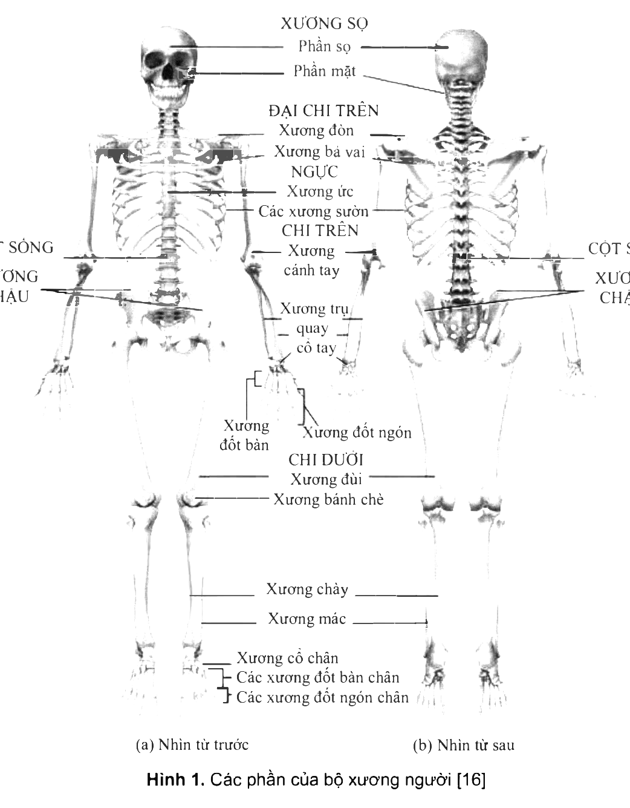
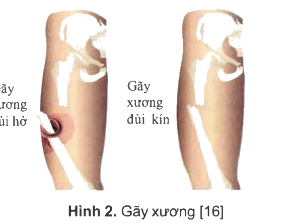
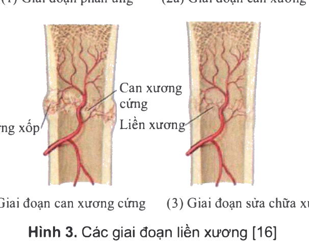
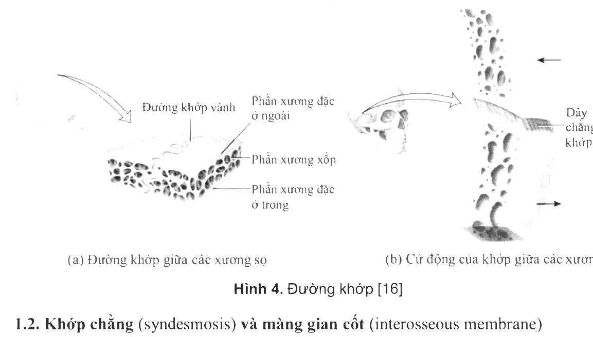
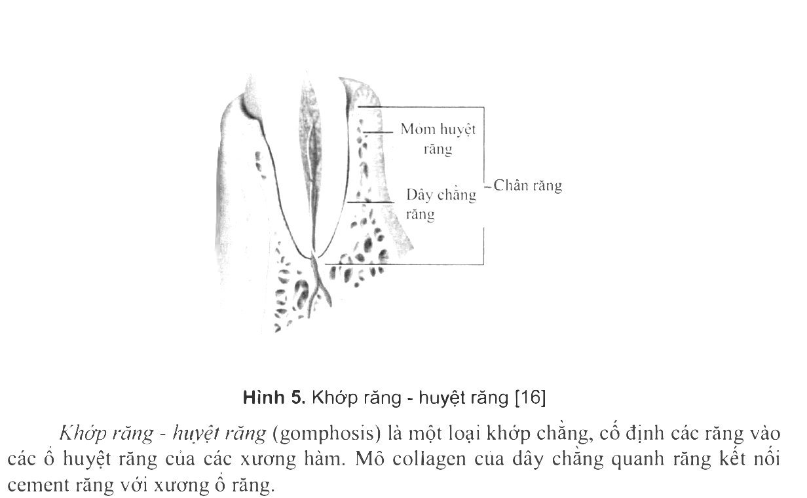
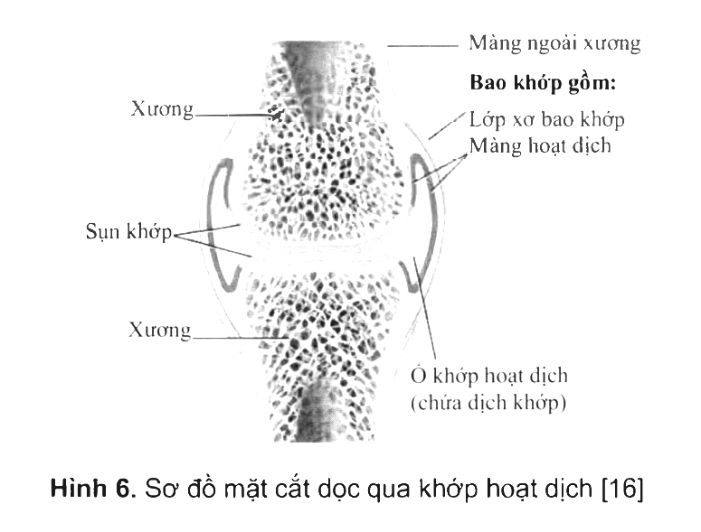
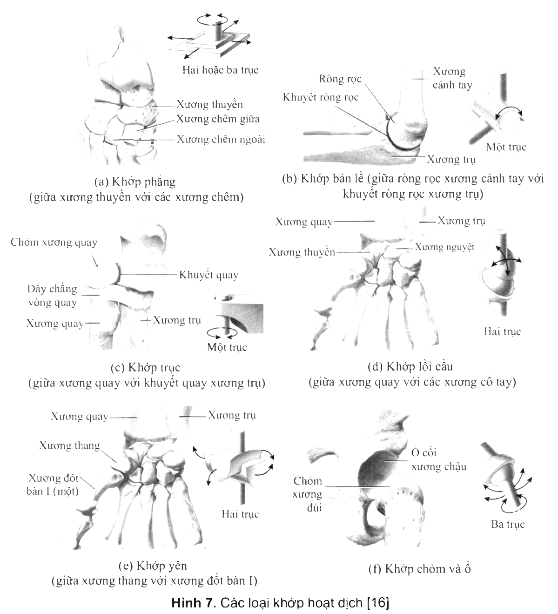

# ĐẠI CƯƠNG VỀ HỆ XƯƠNG - KHỚP

**Chương:** Chương 2: Hệ Xương - Khớp (Bài 1)  
**Tác giả:** PGS.TS. Nguyễn Văn Huy  
**Nguồn:** Giáo trình Giải phẫu học Y Hà Nội (Xuất bản 2025), Trang 29 - 43

---

## HỆ XƯƠNG (skeletal system)

Mô xương là một mô liên kết đặc biệt. Các tế bào xương được vây quanh bằng chất nền ngoại bào cứng chứa khoảng 15% nước, 30% sợi collagen và 55% các muối kết tinh. Muối khoáng nhiều nhất là calcium phosphate. Nó kết hợp với calcium hydroxide để tạo nên tinh thể hydroxyapatite. Khi các tinh thể này được hình thành, chúng còn kết hợp với các muối khác như calcium carbonate và các ion. Khi những muối khoáng này lắng đọng lên khung sợi collagen của chất nền ngoại bào, chúng kết tinh và mô cứng lại. Muối khoáng tạo nên tính cứng của xương, collagen tạo nên tính mềm dẻo của xương. Mật độ khoáng của xương (bone mineral density - BMD) giảm ở người cao tuổi và ở phụ nữ sau tuổi mãn kinh. Khi đo BMD qua đo mức hấp thụ tia X của xương, T-score trên -1 là bình thường, từ -1 đến -2,5 là BMD thấp, dưới -2.5 là loãng xương (osteoporosis).

### 1. CÁC CHỨC NĂNG CỦA BỘ XƯƠNG

Xương là mô cứng nhất cơ thể nên có các chức năng nâng đỡ, bảo vệ, vận động và dự trữ muối khoáng. Tủy xương có các chức năng tạo máu và dự trữ mỡ. Bộ xương cứng tạo nên khung hình hài cơ thể để các phần mềm bám vào. Nó tạo nên các khoang có tác dụng bảo vệ: hộp sọ bảo vệ não, ống sống bảo vệ tủy sống, khoang ngực chứa tim, phổi...vv. Bộ xương cùng với các khớp và các cơ tạo ra hệ thống vận động, trong đó các xương là những cánh tay đòn. Tủy xương đỏ chứa các tế bào gốc để tạo nên các dòng tế bào máu. 99% lượng calcium trong cơ thể lắng đọng ở xương, khi cần có thể huy động từ xương vào máu. Tủy xương vàng, có nhiều ở người cao tuổi, là một trong những nơi dự trữ mỡ.

### 2. CẤU TẠO CỦA XƯƠNG

Mỗi xương có thể được coi như một cơ quan mà các thành phần cấu tạo nên bao gồm mô xương đặc, mô xương xốp, màng ngoài xương, sụn khớp, ổ tủy, tủy xương, màng trong xương, mạch và thần kinh. Màng ngoài xương phủ mặt ngoài của xương, trừ nơi có mặt khớp hoạt dịch hoặc nơi mặt xương tiếp xúc với đĩa sụn sợi của khớp sụn sợi thì bề mặt xương được phủ bằng sụn trong. Bên dưới màng ngoài xương và sụn trong là mô xương, mô xương đặc ở bên ngoài mô xương xốp. Trong mô xương xốp có tủy xương, có thể là tủy đỏ ở người trẻ và tủy chứa mỡ ở người già. Cấu tạo xương như trên đúng với xương dẹt, xương ngắn và xương không đều. Với xương dài, xương xốp ở thân xương bị tiêu đi để tạo nên ổ tủy rộng chứa tủy mỡ màu vàng, thân xương hầu như được cấu tạo bằng ống xương đặc, chỉ có ít bè xương xốp ở mặt trong ống xương; vùng đầu xương được cấu tạo giống như ở xương ngắn với mô xương xốp bên trong và vỏ mỏng xương đặc bên ngoài.

*Màng ngoài xương* (periosteum) là một màng mô liên kết dai phủ mặt ngoài xương, gồm hai lớp. Lớp nông là lớp mô liên kết dày đặc giàu mạch máu và thần kinh, lớp sâu là lớp chứa các tế bào sinh xương (osteogenic cell) giúp xương phát triển về chiều dày. Màng ngoài xương là chỗ bám cho các gân và dây chằng. Nó có vai trò bảo vệ và nuôi dưỡng cho xương, tham gia vào sự liền xương trong gãy xương.

*Mô xương đặc* (compact bone) là thành phần cứng và khỏe nhất của xương nên đóng vai trò chính trong chức năng nâng đỡ, bảo vệ và vận động của xương, trong chống chịu trọng lực và lực do các cử động gây nên. Vì xương đặc luôn nằm ngoài nên nó còn được gọi là *xương vỏ* (cortical bone). Xương đặc được tạo nên từ các đơn vị cấu trúc gọi là osteon hay hệ thống Haver. Mỗi osteon gồm các lá xương đồng tâm bao quanh một ống trung tâm.

*Mô xương xốp* (spongy bone) nằm ở trong và được bảo vệ bởi xương đặc. Nó được tạo nên từ các bè xương đan nối với nhau nên còn được gọi là *xương bè* (trabecular bone). Khoang nằm giữa các bè có thể nhìn thấy bằng mắt và chứa tủy xương. Xương xốp không khỏe như xương đặc nhưng nhẹ hơn. Các hướng chính của các bè xương được sắp xếp phù hợp với hướng chính của các lực tác động tới xương. Nó nâng đỡ cho tủy xương. Sự huy động calcium từ xương vào máu chủ yếu là từ xương xốp. Những nơi xương xốp chứa tủy đỏ (tạo máu) gồm xương chậu, xương ức, các xương sườn, các đốt sống, đầu gần các xương cánh tay và đùi.

*Ổ tủy* (medullary cavity) ở người trưởng thành là khoang hình trụ bên trong thân xương dài chứa tủy vàng và các mạch máu nuôi xương. Sự tạo ổ tủy là cách làm giảm trọng lượng xương ở nơi mà xương đặc có cấu trúc dạng ống. Đây là cách đạt được sức mạnh tối đa với một trọng lượng tối thiểu.

*Màng trong xương* (endosteum) là một màng lót thành ổ tủy và chứa các tế bào tạo xương.

### 3. HÌNH THỂ CỦA XƯƠNG

Xương có màu trắng, trừ chỗ mặt khớp có phủ sụn trong có màu trắng xanh. Một mảnh xương đặc có mật độ chắc như ngà. Ở một xương bị vỡ hay bị cưa ra, ta nhìn thấy xương xốp nằm dưới xương đặc, có hốc rỗng lỗ rỗ như tổ ong. Các xương có kích thước và hình dạng khác nhau, dựa vào đó ta chia xương thành các loại dài, ngắn, dẹt và không đều. Xương mà nằm trong gân được gọi là xương vừng.

Mỗi xương dài có một *thân xương* (diaphysis) và các *đầu xương* (epiphysis); mỗi thân xương còn có các vùng *đầu thân xương* (metaphysis). Thân xương được cấu tạo chủ yếu bằng xương đặc; các đầu xương chủ yếu do xương xốp tạo nên.

*Xương dài* (long bone) có thể là những xương lớn như xương đùi, xương chày, xương cánh tay, hay là những xương nhỏ như xương đốt ngón chân, xương đốt ngón tay.

*Xương ngắn* (short bone) là những xương nhỏ có kích thước các chiều gần bằng nhau, như các xương cổ tay và hầu hết các xương cổ chân. Chúng được cấu tạo bằng xương xốp ở bên trong và xương đặc trên bề mặt.

*Xương dẹt* (flat bone) là những xương mỏng được cấu tạo bởi 2 lớp xương đặc song song bao quanh một lớp xương xốp. Chúng thường tham gia vào các cấu trúc bảo vệ, như các xương vòm sọ bảo vệ não, xương ức và xương sườn bảo vệ các cơ quan trong ngực. Xương vai ở sau trên lồng ngực là chỗ bám của nhiều cơ.

*Xương không đều* (irregular bone) là những xương không xếp vào được những loại trên, như các đốt sống xương. Những xương này có thân và nhiều mỏm, được hình thành từ nhiều trung tâm cốt hóa.

*Xương vừng* (sesamoid bone) ở trong các gân có tác dụng thay đổi hướng lực kéo của gân và tạo thêm lợi thế cơ học cho gân. Xương bánh chè là xương vừng lớn nhất.

Ngoài những nét hình thể giúp phân biệt các xương như nói trên, trên bề mặt xương còn có những chỗ lồi lõm là đặc điểm riêng của từng xương. Các chỗ lồi được gọi bằng những cái tên như *củ* (tubercle), *ụ* (tuberosity), *lồi* (eminence), *mỏm* (process), *lồi cầu* (condyle), *mỏm trên lồi cầu* (epicondyle), *mào* (crest), *đường* (line)... Những chỗ lõm mang những cái tên như *khuyết* (notch), *hố* (fossa), *rãnh* (groove), *hõm* (fovea)...

### 4. SỰ PHÂN CHIA BỘ XƯƠNG (H.1)

Bộ xương người trưởng thành gồm 206 xương và được chia thành 2 phần là bộ xương trục và bộ xương treo.

**Bộ xương trục** (axial skeleton) gồm 80 xương: xương ức, 24 xương sườn, 26 xương cột sống và 29 xương sọ (gồm cả xương móng). 26 xương cột sống gồm 7 đốt sống cổ, 12 đốt sống ngực, 5 đốt sống thắt lưng, xương cùng và xương cụt. Không kể xương móng và 6 xương nhỏ ở hai tai, sọ có 22 xương: 1 xương chẩm, 1 xương trán, 1 xương bướm, 1 xương sàng, 2 xương đỉnh, 2 xương thái dương, 2 xương gò má, 2 xương mũi, 2 xương lệ, 2 xương xoăn mũi dưới, 2 xương khẩu cái, 2 xương hàm trên, 1 xương hàm dưới, 1 xương lá mía.

**Bộ xương treo** (appendicular skeleton) bao gồm 126 xương: 64 xương chi trên và 62 xương chi dưới. Mỗi chi trên có 32 xương, gồm 2 xương của đai ngực: xương đòn và xương vai; và 30 xương của phần tự do: xương cánh tay, xương quay, xương trụ, 8 xương cổ tay, 5 xương đốt bàn tay và 14 xương đốt ngón tay. Mỗi chi dưới có 31 xương, gồm xương chậu (cùng với xương cùng tạo nên đai hông) và 30 xương của phần tự do: xương đùi, xương bánh chè, xương chày, xương mác, 7 xương cổ chân, 5 xương đốt bàn chân và 14 xương đốt ngón chân.

### 5. MẠCH MÁU VÀ THẦN KINH CỦA XƯƠNG

Xương là mô được cấp máu tốt, nhất là tủy xương. Các động mạch cấp máu cho xương bao gồm: nhiều *động mạch màng xương* nhỏ cấp máu cho màng xương cùng lớp xương vỏ bên ngoài và các *động mạch nuôi xương* lớn hơn đi vào trong tủy xương.

Với xương dài, các động mạch nuôi lớn đi vào trong xương ở thân xương, đầu thân xương và đầu xương. Ở thân xương, thường có 1 (hoặc đôi khi nhiều hơn như ở xương đùi) *động mạch nuôi* (nutrient artery) đi vào trong xương qua *lỗ nuôi* (nutrient foramen). Vị trí lỗ nuôi thường hằng định và hướng của ống đi vào thường ở phía ngược lại với phía đầu phát triển trội của xương. Sau khi vào đến ổ tủy, động mạch nuôi chia thành 2 nhánh đi về hai đầu xương, trên đường đi phân nhánh vào tủy xương của thân xương và xương trên thành ổ tủy (gồm xương xốp và lớp trong xương đặc). Ở đầu xương, những nhánh tận của động mạch nuôi tiếp nối với các động mạch đầu thân xương và động mạch đầu xương. Các động mạch đầu thân xương đi vào cấp máu cho xương và tủy xương ở vùng đầu thân xương. Các động mạch đầu xương là nhánh của các động mạch quanh khớp đi trên các bề mặt xương quanh mặt khớp. Chúng đi vào đầu xương qua các lỗ ở đầu xương, cấp máu cho xương và tủy xương ở đầu xương, kể cả sụn khớp. Ở xương đang phát triển, vùng cấp máu của các động mạch đầu xương được ngăn cách với vùng cấp máu của các động mạch đầu thân xương bởi tấm sụn đầu xương. Thường có 1 hoặc 2 tĩnh mạch nuôi xương chính.

Xương ngắn được nuôi bằng các động mạch màng xương đi vào ở các mặt xương không tiếp khớp. Đốt sống được nuôi bằng các động mạch đi vào ở gần nền các mỏm ngang; tĩnh mạch từ đốt sống đi ra qua một lỗ ở mặt sau thân đốt sống. Xương chậu và xương vai được nuôi bằng các động mạch màng xương và các động mạch xuyên vào trong xương xốp.

Thần kinh của xương đi theo các nhánh mạch nuôi của xương vào trong xương và tủy xương, bao gồm các sợi cảm giác và các sợi tự chủ. Trên màng xương có nhiều thần kinh nhận cảm đau.

### 6. SỰ HÌNH THÀNH VÀ PHÁT TRIỂN CỦA XƯƠNG

Sự hình thành xương được gọi là *sự cốt hóa* (ossification). Xương và sụn được hình thành từ tuần thứ 6 của phôi từ trung mô (mesenchyme) với hai cách khác nhau, gọi là cốt hóa nội màng và cốt hóa nội sụn.

*Cốt hóa nội màng* (intramembranous ossification) là cách cốt hóa để tạo nên các xương dẹt của sọ, các xương hàm ở mặt và xương đòn. Các xương được tạo nên từ những màng tế bào trung mô. Bên trong màng trung mô, dưới tín hiệu hóa học, các tế bào trung mô cụm lại, biến thành các tế bào sinh xương rồi thành các *nguyên bào xương* hay tạo cốt bào (osteoblast) và tạo ra một trung tâm cốt hóa. Nguyên bào xương tiết ra chất vô cơ ngoại bào của xương và tự vùi trong chất ngoại bào đó, biến thành *tế bào xương* (osteocyte). Khi sự tiết chất ngoại bào dừng thì các tế bào xương nằm trong các hồ, còn các nhánh bào tương của chúng nằm trong các ống, như các tia tỏa ra từ các hồ. Tiếp đó, calcium và các muối khoáng lắng đọng lên chất nền ngoại bào để *vôi hóa* (calcification) nó, biến thành bè xương. Các bè xương liên kết nhau thành xương xốp. Các mạch máu cùng các tế bào mà nằm giữa các bè xương biến thành *tủy xương* (bone marrow). Kết hợp với sự hình thành xương xốp, trung mô cô đặc lại ở ngoại vi của xương và biến thành màng xương. Màng xương tạo ra lớp xương đặc để thay thế cho lớp xương xốp trên bề mặt.

*Cốt hóa nội sụn* (endochondral ossification) là quá trình biến các sụn thành xương và hầu hết các xương của cơ thể được hình thành theo cách này.

Trước hết, tại nơi sẽ tạo nên xương sau này, các tế bào trung mô tụ lại tạo nên hình hài của xương tương lai và biệt hóa thành các nguyên bào sụn. Các nguyên bào sụn tiết ra chất nền ngoại bào tạo nên mô hình sụn bằng sụn trong, lớp vỏ bao bên ngoài mô hình sụn là màng sụn. Bị vùi trong chất căn bản do chúng tiết ra, các nguyên bào sụn biến thành các tế bào sụn. Chúng tiếp tục phân chia và tiết ra thêm chất căn bản để sụn dài ra. Trong khi đó, màng sụn tạo thêm sụn trên bề mặt để mô hình sụn to ra. Khi sụn tiếp tục lớn, ở vùng giữa của nó các tế bào sụn bị phì đại, chất căn bản bị calci hóa khiến cho tế bào sụn chết và nơi chứa tế bào biến thành khoang.

*Sự hình thành trung tâm cốt hóa nguyên phát và ổ tủy xương.* Ở vùng giữa thân xương, một động mạch nuôi xương xuyên qua màng sụn (lúc này đã biến thành màng xương) vào trong mô hình sụn bị calci hóa. Nó hoạt hóa, làm các tế bào sinh xương của màng xương biến thành các nguyên bào xương. Động mạch cùng các nguyên bào xương mà nó kéo theo tạo nên một *trung tâm cốt hóa nguyên phát* (primary ossification center). Các nguyên bào xương tiết ra chất nền ngoại bào của xương lên tàn tích sụn, biến nó thành các bè xương xốp. Khi quá trình này diễn ra từ giữa thân xương lan đến các đầu xương, các hủy cốt bào làm tiêu xương xốp mới được hình thành để lại một ổ tủy ở thân xương. Màng xương tạo ra xương đặc quanh ổ tủy cuối cùng, hầu hết thành thân xương được thay thế bằng xương đặc.

*Sự hình thành trung tâm cốt hóa thứ phát* (secondary ossification center) diễn ra quanh thời điểm đứa trẻ ra đời khi các động mạch đầu xương đi vào đầu xương và tạo ra sự cốt hóa giống như ở trung tâm cốt hóa nguyên phát. Điểm khác là xương xốp được tạo ra ở đầu xương không bị hủy đi để tạo nên ổ tủy như ở thân xương.

Phần sụn trong ở đầu xương sẽ trở thành sụn khớp nếu vùng đầu xương đó là mặt khớp. Trước khi trưởng thành, vẫn có một đoạn sụn trong nằm giữa thân xương và đầu xương gọi là *tấm đầu xương* (epiphysial plate) hay *tấm tăng trưởng* (growth plate) giúp xương tăng trưởng về chiều dài. Tấm tăng trưởng có một mặt hướng về thân xương và một mặt hướng về đầu xương. Mô sụn ở mặt đầu xương tăng sinh còn ở mặt thân xương thì bị thay thế bằng mô xương theo kiểu cốt hóa nội sụn, làm cho chiều dài thân xương tăng. Khi kết thúc thời kỳ vị thành niên (18 tuổi với nữ và 21 tuổi với nam), mô sụn ngừng tăng sinh và tấm sụn còn lại bị cốt hóa nốt. Tấm tăng trưởng biến đi để lại một vết tích gọi là *đường đầu xương* (epiphyseal line). Sự biến mất (đóng) của sụn đầu xương là một quá trình diễn ra chậm và chính vì thế mà dựa vào mức độ đóng của nó có thể biết được tuổi. Xương tăng trưởng về chiều dày nhờ sự tạo xương của màng xương. Khi đường kính xương tăng lên thì ổ tủy cũng rộng thêm ra do hoạt động của hủy cốt bào có trong nội cốt mạc làm tiêu xương trên thành ổ tủy.

### 7. GÃY XƯƠNG VÀ LIỀN XƯƠNG

Gãy xương (fracture) (H.2) là tổn thương làm mất tính liên tục của xương. Xương có thể gãy không hoàn toàn, một bên gãy, một bên cong, gọi là *gãy cành tươi* (greenstick fracture). Khi gãy hoàn toàn, phần mềm chỗ gãy có thể không bị rách và vẫn che kín các đầu xương gãy, gọi là *gãy kín* (closed fracture), hoặc rách và làm hở các đầu xương gãy, gọi là *gãy hở* (open fracture). Có khi gãy xương chỉ là một đường gãy chia xương thành 2 đoạn nhưng có thể cả một đoạn xương bị vỡ nát thành nhiều mảnh, gọi là *gãy vụn* (comminuted fracture).

Để chữa gãy xương, đầu tiên phải *nắn* (reduction) cho các đoạn xương thẳng lại với nhau như trước khi gãy, sau đó phải bất động các đoạn gãy bằng cố định, có thể là *cố định trong* (internal fixation) hoặc *cố định ngoài* (external fixation). Trong cố định trong, có thể dùng nẹp, vít hay chỉ thép cố định ở mặt ngoài hoặc dùng đinh đóng vào ổ tủy. Cố định ngoài bằng bó bột, nẹp, băng chun hoặc thiết bị cố định ngoài.

Liền xương gãy là một quá trình dài (H.3). Đầu tiên, trong vòng 8 giờ, hình thành một khối tụ máu ở khe giữa các đầu xương gãy. Các tế bào xương bị chết cùng khối máu tụ kích thích phản ứng viêm thu hút các đại thực bào đến dọn sạch ổ tế bào chết. Trong thời gian khoảng 3 tuần, các nguyên bào sợi từ màng ngoài xương xâm nhập ổ gãy và sản xuất ra các sợi collagen; đồng thời, các tế bào sinh xương từ màng ngoài xương biến thành tế bào sụn và tạo ra mô sụn. Các sự kiện này dẫn tới sự hình thành can (callus) sụn sợi, một khối mô sợi và sụn bắc cầu giữa các đầu xương gãy. Sau đó, can sụn sợi được các tạo cốt bào biến thành xương xốp và cầu nối các đầu xương gãy lúc này được gọi là can xương (mất khoảng 3 tới 4 tháng). Cuối cùng, can xương được sửa chữa, cầu xương xốp được biến thành xương đặc.

---

## HỆ KHỚP (Articular system)

Các xương của bộ xương được liên kết với nhau qua các khớp. Các khớp có kiểu cấu trúc khác nhau, cho phép sự tăng trưởng, sự truyền lực và sự vận động ở các mức độ khác nhau.

Mô liên kết tạo nên các khớp có thể vẫn là một khối đặc nối các xương hoặc là một cấu trúc có ổ chứa dịch. Khớp đặc được nhóm thành hai loại là khớp sợi và khớp sụn tùy theo loại mô liên kết chính xen giữa các xương là gì. Khớp hoạt dịch là khớp động có ở giữa các đầu hoặc các bề mặt của các xương cốt hóa nội sụn.

### 1. KHỚP SỢI (fibrous joint)

Ở khớp sợi, khe giữa các xương được lấp đầy bằng mô sợi, trong đó đa số trường hợp là mô collagen, mô sợi chun chỉ chiếm ưu thế ở số ít trường hợp. Có 3 loại khớp sợi là đường khớp, khớp chằng và màng gian cốt. Khớp răng - huyệt răng thuộc loại khớp chằng. Khớp sợi là khớp bất động hoặc có cử động hạn chế.

#### 1.1. Đường khớp (suture) (H.4)

Đường khớp là loại khớp sợi có ở khe giữa các bờ xương sọ. Mô liên sợi nối các bờ xương có vai trò như một dây chằng. Mô liên kết sợi này chính là phần mô màng chưa cốt hóa và nó liên tiếp với màng xương phủ mặt ngoài và mặt trong của các xương sọ.

Khi sự tăng trưởng của sọ ngừng lại, các tế bào sinh xương cốt hóa nốt mô sợi của đường khớp, dẫn tới sự tịt lại của đường khớp gọi là sự dính xương. Đường khớp rộng lúc mới sinh, sẽ hẹp lại dần và trở thành bất động. Các bờ xương tiếp khớp có các dạng hình học không đều (lồi lõm) theo kiểu hỗ tương để có thể lồng gài vào nhau và làm tăng tính bất động. Ngay cả ở những đường khớp được gọi là *đường khớp phẳng* (plane suture), như ở khớp gian xương hàm trên, các bờ xương tiếp khớp cũng xù xì và không đều nhau; đường khớp dọc giữa hai xương đỉnh và đường khớp vành giữa xương trán với các xương đỉnh là những *đường khớp kiểu răng cưa* (serrate sutures); đường khớp lamda giữa xương chẩm với hai xương đỉnh là *đường khớp kiểu răng* (dentate sutures), có những mỏm gài vào nhau như răng; đường khớp thái dương đỉnh là *đường khớp xiên* hay *khớp vảy* (limbus/squamous suture), nơi các bờ xương vát chờm lên nhau.

#### 1.2. Khớp chằng (syndesmosis) và màng gian cốt (interosseous membrane)

Khớp chằng là loại khớp sợi mà ở đó các bề mặt xương được liên kết với nhau bằng một dây chằng gian cốt ngắn, như ở khớp sợi chày mác dưới. Kiểu khớp chằng này có thể gặp ở các dây chằng cùng chậu gian cốt, các dây chằng gian cốt giữa các xương cổ tay, các xương cổ chân. Ở cột sống, các dây chằng dọc trước, dọc sau, vàng, gian gai, trên gai, gian ngang... đều được coi là các khớp chằng.

*Khớp răng - huyệt răng* (gomphosis) là một loại khớp chằng, cố định các răng vào các ổ huyệt răng của các xương hàm. Mô collagen của dây chằng quanh răng kết nối cement răng với xương ổ răng.

*Màng gian cốt* giữa xương quay và xương trụ, giữa xương chày và xương mác được xếp thành một loại khớp sợi riêng.

### 2. KHỚP SỤN (cartilaginous joint)

Các khớp sụn được phân loại thành *các khớp sụn trong* (synchondroses) hay *các khớp sụn nguyên phát* (primary cartilaginous joints) và *các khớp sụn - sợi* (symphyses) hay *các khớp sụn thứ phát* (secondary cartilaginous joints).

#### 2.1. Khớp sụn trong (synchondroses)

Khớp sụn trong là loại khớp sụn mà ở đó tấm sụn trong liên kết các xương. Sụn trong này là sụn tăng trưởng có mặt tạm thời ở các xương đang phát triển, nằm giữa các đầu và thân xương dài, giữa các mỏm của xương và thân xương, giữa ba phần của xương chậu trước khi dính lại, giữa cán ức và thân ức, giữa xương bướm và xương chẩm ở nền sọ. Về bản chất, tấm sụn trong là một phần của mô hình sụn chưa bị cốt hóa của các xương. Khớp sụn trong là kiểu cấu trúc khớp giúp hệ xương vừa có thể đảm bảo các chức năng chịu lực và vận động, vừa có thể tăng trưởng. Các sụn vẫn lớn lên, các mặt tiếp xúc với thân xương của tấm sụn vẫn bị cốt hóa để giúp xương tăng trưởng.

#### 2.2. Khớp sụn sợi (symphysis)

Các khớp sụn sợi trong cơ thể bao gồm các khớp giữa các thân đốt sống, khớp cán ức thân ức, khớp mu. Như vậy các khớp này đều nằm trên đường giữa và, trừ khớp mu, đều là khớp giữa các xương trục. Trong quá trình phát triển, khớp sụn sợi giữa các thân đốt sống cùng, giữa các thân đốt sống cụt, và giữa xương cùng và xương cụt đã trở thành các khớp dính xương.

Ở khớp sụn sợi, các mặt xương tiếp khớp của hai xương được phủ bằng sụn trong và nằm giữa sụn trong phủ mặt khớp của hai xương là đĩa sụn sợi gian đốt; ở đốt sống đĩa này gọi là đĩa gian đốt sống. Mặt ngoài các khớp sụn sợi có các dây chằng tăng cường. Mỗi đĩa gian đốt sống có thể được xem như một khớp sụn sợi. Nó như một dây chằng nối các thân đốt sống với nhau. Trên phim chụp X - quang, khoang nằm giữa các thân đốt sống tương đương với kích thước của đĩa gian đốt sống nên được gọi là khoang đĩa gian đốt sống. Về cấu tạo, đĩa gian đốt sống bao gồm một *nhân tủy* (nucleus polposus) ở giữa và một *vòng sợi* (annulus fibrosus) bao bên ngoài. Đĩa gian đốt sống có khả năng chịu lực nén và biến dạng khi bị nén ép.

Các khớp sụn sợi cho phép một cử động hạn chế giữa các xương. Cử động ở khớp mu chỉ được 2 độ, cử động góc tổng cộng giữa trục dọc cán và thân ức được 7 độ. Các thân đốt sống có thể chuyển động đồng thời tại đĩa gian đốt sống và các khớp giữa các mỏm khớp. Biên độ giữa 2 đốt không lớn nhưng biên độ của cả đoạn thì đáng kể.

### 3. KHỚP HOẠT DỊCH (synovial joint)

Khác với các khớp không có ổ khớp, các khớp hoạt dịch có ổ hoạt dịch để ngăn cách mặt khớp của các xương. Lớp xơ bao khớp và các dây chằng tuy nối các xương với nhau nhưng chỉ bao quanh ổ khớp mà không xen vào giữa các mặt khớp. Khớp hoạt dịch là *khớp động* (diarthrosis).

#### 3.1. Các mặt khớp (articular surfaces)

Các mặt khớp hầu hết được che phủ bằng sụn trong, gọi là *sụn khớp* (articular cartilage) (H.6). Sụn này là phần còn lại của các mô hình sụn trong đời sống bào thai. Ngoại lệ, các mặt khớp của các khớp ức đòn, cùng vai đòn và cả hai mặt khớp của khớp thái dương hàm dưới được phủ bằng một mô sợi đặc chứa những nhóm tế bào sụn và một ít chất nền bao quanh - đây chính là một di sản của việc những xương này được tạo ra từ cốt hóa màng. Sụn khớp có tính kháng mòn, có hệ số ma sát thấp và có bề mặt được bôi trơn. Nó có thể hơi nén ép được và chun giãn, thích hợp với bề mặt chuyển động. Nó cũng có khả năng hấp thu các lực nén ép và biến dạng lớn gây ra bởi trọng lực và lực co cơ.

Sụn khớp có chiều dày 1 - 2 mm ở những xương nhỏ nhưng có thể dày tới 5 - 7 mm ở những khớp lớn. Sụn của người trẻ thì trắng, nhẵn, sáng bóng và đàn hồi trong khi đó sụn khớp ở người già thì mỏng hơn, ít tế bào hơn, cứng hơn và giòn hơn, cùng với một bề mặt kém đều đặn và có màu vàng đục.

Bề mặt sụn khớp phản ánh bề mặt xương bên dưới nhưng chiều dày sụn thay đổi theo hình dạng xương bên dưới. Ở mặt khớp lồi, sụn dày nhất ở giữa và mỏng dần ra ngoại vi, ở mặt khớp lõm thì ngược lại.

Sụn khớp không có thần kinh hay mạch máu. Nó được nuôi dưỡng bằng dịch hoạt dịch, bằng đám rối mạch trong màng hoạt dịch ở ngoại vi (vòng mạch khớp), và bằng những mạch máu trong các khoang tủy xương liền kề.

Khi tuổi càng cao, bề mặt khớp càng kém nhẵn và có lẽ do sự mòn và rách mà có những mỏm nhô nhỏ bờm xờm. Sự mòn xảy ra ở những khớp bị khô có tính bệnh lý và ở những nơi độ nhớt của hoạt dịch bị thay đổi; nhưng ở những khớp khỏe mạnh thì những biến đổi diễn ra cực kỳ chậm. Sự thay thế lớp bề mặt bị mòn bằng những lớp sâu bên dưới chưa được rõ: sự phân bào không xảy ra ở những sụn khớp người lớn.

#### 3.2. Lớp xơ bao khớp (H.6)

Một bao khớp sợi bao kín quanh khớp, trừ ở nơi mà màng hoạt dịch thò ra. Bao khớp sợi tạo nên một ống hình trụ với hai đầu ống bám vào các đầu xương ở quanh bờ chu vi mặt khớp, ở gần hoặc xa bờ này tùy chỗ. Mạch và thần kinh xuyên qua bao khớp sợi và có thể có những lỗ để màng hoạt dịch nhô ra như những túi hoạt dịch. Mặt trong bao khớp sợi được lót bởi màng hoạt dịch (H.6).

Lớp xơ bao khớp thường có những chỗ dày lên thành những dây chằng bao khớp. Các dây chằng không phải là những chỗ dày lên của lớp xơ bao khớp có thể là những dây chằng ngoài bao hoặc trong bao khớp.

Tất cả các dây chằng không cản lại các cử động bình thường nhưng cản lại các cử động quá mức hoặc bất thường.

#### 3.3. Màng hoạt dịch (synovial membrane) (H.6)

Màng hoạt dịch lót tất cả các bề mặt trong ổ khớp mà không phải mặt khớp, bao gồm mặt trong lớp xơ bao khớp, các bề mặt xương trong bao khớp và ở quanh mặt khớp, các dây chằng và các gân trong ổ khớp, như gân cơ nhị đầu ở khớp vai hay các dây chằng chéo ở khớp gối. Màng hoạt dịch liên tiếp với màng của các túi hoạt dịch ngoài khớp qua các lỗ ở lớp xơ bao khớp. Những chỗ thông này là con đường tiềm tàng để lan truyền nhiễm trùng vào trong khớp. Mặt trong của nó được phủ bởi chất hoạt dịch do chính nó tiết ra. Màng có màu hồng, bóng, nhẵn, mặt trong có một số lông; lông có thể tăng về kích thước và số lượng theo tuổi. Ở một số khớp, màng có thể gấp nếp, như ở khớp gối có các nếp cánh. Mô liên kết bên dưới màng có thể đọng mỡ tạo nên những đệm mỡ. Những đệm và nếp này có thể dịch chuyển trong cử động của khớp để lấp vào những khoảng trống trong khớp.

Màng hoạt dịch có nguồn gốc từ trung mô. Nó gồm một lớp tế bào hoạt dịch trên bề mặt và một lớp mô liên kết chứa mạch máu bên dưới. Lớp tế bào hoạt dịch gồm tế bào type A giống đại thực bào và các tế bào type B giống nguyên bào sợi. Tế bào type A nuốt các cặn tế bào, tế bào type B tiết ra hyaluronan và các chất ngoại bào khác. Dịch được thấm từ các mao mạch ở lớp dưới qua lớp tế bào hoạt dịch.

Chất hoạt dịch là dịch trong hoặc vàng nhợt, sánh, hơi kiềm lúc nghỉ. Một khớp lớn như khớp gối thường chỉ hút được dưới 0,5 ml. Trong thành phần có các loại tế bào, hyaluronan, glycoprotein...

#### 3.4. Các cấu trúc nội khớp

Một số khớp có thêm các cấu trúc nội khớp như đĩa khớp, sụn chêm, sụn viền, đệm mỡ.

Khi các mặt khớp không phù hợp nhau, như ở khớp thái dương - hàm dưới, khớp ức đòn, khớp quay trụ xa, một tấm sụn sợi gọi là *đĩa khớp* (articular discus) băng ngang qua ổ khớp, chia khớp thành 2 ổ hoạt dịch và 2 cặp mặt khớp. Bờ chu vi đĩa khớp dính với bao khớp và nhận được mạch nuôi qua chỗ dính này. Các mặt đĩa khớp không có màng hoạt dịch, mỗi mặt có hình thể phù hợp để tiếp khớp với một xương. Đĩa khớp làm tăng độ phù hợp giữa các mặt khớp và làm dễ dàng cho các cử động kết hợp.

Ở khớp gối có các tấm sụn sợi hình liềm gọi là *sụn chêm* (menisci) đệm ở trên các mặt khớp trên xương chày. Bờ chu vi các sụn chêm dính với bao khớp và các sừng của chúng được cố định vào xương chày. Nó có tác dụng cản lại sự trượt của lồi cầu xương đùi trên xương chày, phân phối trọng lực trên các bề mặt rộng hơn.

Ở khớp vai và khớp hông, viền ổ chảo và viền ổ cối được gắn các vòng sụn sợi gọi là *sụn viền* (labrum). Các sụn viền này có mặt cắt ngang hình tam giác. Chúng làm cho các ổ khớp sâu thêm và làm tăng thêm diện tích tiếp xúc. Các sụn viền không chịu lực ép giữa các mặt khớp như với các sụn chêm. Đệm mỡ dưới bánh chè ở khớp gối là khối mô mỡ nằm dưới màng hoạt dịch.

#### 3.5. Mạch máu và thần kinh của các khớp

Khớp nhận được sự cấp máu từ đám rối động mạch quanh khớp. Từ đám rối này có các nhánh xuyên qua lớp xơ bao khớp để tạo nên các đám rối mạch dưới hoạt dịch. Một số mạch hoạt dịch tận cùng ở gần bờ chu vi mặt khớp, tại vòng mạch khớp. Một đám rối bạch huyết trong lớp sâu của màng hoạt dịch dẫn lưu dọc theo các mạch máu tới các hạch bạch huyết sâu của vùng.

Một khớp động được chi phối bởi các nhánh khớp của các thần kinh chi phối cho các cơ vận động cho khớp đó (luật Hilton). Mặc dù có sự chồng lấn giữa các vùng chi phối của các thần kinh khác nhau, mỗi thần kinh chi phối cho một phần riêng biệt của bao khớp. Vùng bao khớp mà bị căng lên bởi sự co cơ thì thường được cảm giác bởi các thần kinh mà có nhánh vận động chi phối cho các cơ đối kháng (với cơ gây nên sự căng bao khớp đó). Ví dụ, kéo căng phần bao khớp hông do thần kinh bịt chi phối trong lúc giạng đùi gây nên co cơ do phản xạ của các cơ khép.

#### 3.6. Các cử động và phân loại các khớp hoạt dịch (H.7)

Cử động ở một khớp có thể là *trượt* (translation) hoặc *quay* (rotation). Cử động trượt không được xem xét trong phân loại khớp. Cử động quay gồm các cử động trong 3 trục quay: cử động *xoay trục* (axial rotation) quanh trục dọc của một xương; cử động *gấp - duỗi* (flexion - extension); cử động *giạng - khép* (abduction - adduction). Trong 3 trục cử động nói trên, các cử động gấp - duỗi và giạng - khép là các cử động làm thay đổi góc giữa trục của các xương nên gọi là *cử động góc* (angulation). Một khớp có thể có một, hai hoặc cả ba trục quay; khớp càng có nhiều trục chuyển động thì càng linh hoạt, tức là có *cấp độ tự do* (degree of freedom) càng cao.

*Gấp* (flexion) khó có thể có một định nghĩa chung. Ở chi trên, gấp là đưa đoạn chi nào đó (cánh tay, cẳng tay, bàn tay, ngón tay) ra trước và lên trên, riêng đối với ngón cái là vào trong. Ở chi dưới, gấp đùi là đưa đùi lên trên, ra trước; gấp cẳng chân là đưa cẳng chân lên trên nhưng ra sau; riêng với bàn chân thì hợp lí nhất cần gọi là gấp gan chân và gấp mu chân. *Giạng* (abduction) và *khép* (adduction) dễ định nghĩa hơn: Đó là chuyển động của một xương ra ngoài (giạng) và vào trong (khép) so với trục cơ thể. Riêng ở bàn tay và bàn chân thì giạng các ngón là đưa các ngón ra xa khỏi ngón tay giữa hay ngón chân thứ hai, khép thì ngược lại. Cử động *quay tròn* (circumduction) là sự kết hợp các cử động gấp, giạng, duỗi và khép kế tiếp nhau. Cử động này xảy ra khi chuyển động của đầu xa của một xương dài vẽ nên đáy của một hình nón mà đỉnh của nó nằm ở hố khớp.

Các khớp hoạt dịch được phân loại dựa vào số lượng của các mặt tiếp khớp, các cử động của khớp, số trục chuyển động và dạng hình học của các mặt khớp.

Hầu hết các khớp hoạt dịch là *khớp đơn* (simple joint) với hai mặt khớp. Ở một số khớp, như khớp khuỷu và khớp gối, có nhiều hơn hai mặt khớp và chúng được gọi là *khớp phức hợp* (complex joint).

Dựa vào dạng hình học mặt khớp, có thể chia khớp hoạt dịch thành các loại sau:

*Khớp phẳng* (plane joint) là loại khớp mà các mặt xương tiếp khớp với nhau hầu như là các mặt phẳng hoặc hơi cong, như các khớp gian xương cổ chân và một số khớp gian xương cổ tay. Cử động chỉ đơn giản là trượt.

*Khớp bản lề* (ginglymus/hinge joint). Khớp bản lề là khớp một trục và là một trong hai loại *khớp trụ* (cylindrical joint). Ở loại khớp này, mặt khớp của một xương gần như là một khuyết/rãnh lõm nằm ngang, mặt khớp của xương kia gần như một nửa mặt trụ lồi nằm ngang, xương có mặt khớp là mặt trụ lồi làm trụ, xương có mặt khớp lõm chuyển động gấp - duỗi quanh trụ. Các ví dụ điển hình của khớp bản lề gồm khớp khuỷu (khớp cánh tay - trụ) và các khớp gian đốt ngón. Ở mức độ ít điển hình hơn còn có khớp gối. Khớp gối còn có cử động xoay và còn được xem như là một khớp lưỡng lồi cầu.

*Khớp trục* (pivot joint) là khớp một trục và cũng là một khớp trụ. Về cấu tạo, mặt khớp ở một bên là bề mặt của một khúc xương hình trụ được phủ bằng sụn trong; mặt khớp bên kia là một vòng tròn do một xương và một dây chằng tạo nên, mặt trong vòng tròn xương - sợi này cũng được phủ bằng sụn trong. Chuyển động có thể ở khớp trục là chuyển động xoay. Vòng xương - sợi có thể đứng yên để trụ xương bên trong xoay quanh trục của chính nó (như ở khớp quay - trụ gần, chỏm xương quay xoay trong cử động sấp - ngửa) hoặc ngược lại, trụ xương đứng yên để vòng xương - sợi xung quanh xoay quanh nó (như ở khớp đội - trục).

*Khớp lồi cầu* (condylar joint) hay *khớp xoan* (ellipsoid joint) là loại khớp hai trục. Về cấu tạo, mặt khớp ở một phía lồi hình oval (hình trứng), mặt khớp phía kia lõm hình ellip. Các cử động ở khớp lồi cầu là gấp - duỗi, giạng - khép. Loại khớp này không có cử động xoay. Các ví dụ về khớp lồi cầu gồm khớp quay - cổ tay và các khớp đốt bàn tay - đốt ngón tay.

*Khớp cầu* (spheroidal joint) hay *khớp chỏm - và - ổ* (ball-and-socket joint) là loại khớp nhiều trục. Về cấu tạo, mặt khớp ở một xương là một chỏm, ở xương kia là một hõm hình chén, cả chỏm và hõm có thể được coi như những phần của các mặt cầu lồi và lõm cho dù cũng hơi có hình trứng. Các khớp cầu có cấp độ tự do cao nhất với ba trục chuyển động: gấp - duỗi, giạng - khép và xoay. Các ví dụ về khớp cầu là khớp vai và khớp hông.

*Khớp yên* (saddle joint) là loại khớp mà mặt khớp ở mỗi xương có một diện lồi và một diện lõm. Khi khớp vào nhau, diện lõm xương này khớp với diện lồi xương kia và ngược lại, theo kiểu quan hệ hỗ tương. Tại khớp yên có thể làm các cử động gấp - duỗi, giạng - khép. Ví dụ điển hình về khớp yên là khớp cổ tay - đốt bàn tay của ngón tay cái. Các khớp khác bao gồm khớp cổ chân và khớp gót hộp.

*Khớp lưỡng lồi cầu* (bicondylar joint). Đây là thuật ngữ được dùng để chỉ những trường hợp mà mặt khớp ở hai bên đều lồi (như ở khớp thái dương - hàm, lồi cầu xương hàm dưới và củ khớp xương thái dương đều lồi) hoặc một bên lồi (như lồi cầu xương đùi), một bên gần như phẳng (mặt trên các lồi cầu xương chày). Khớp gối (đùi - chày) tuy có cử động chủ yếu như một khớp bản lề (gấp - duỗi) nhưng nó còn có cử động xoay.
