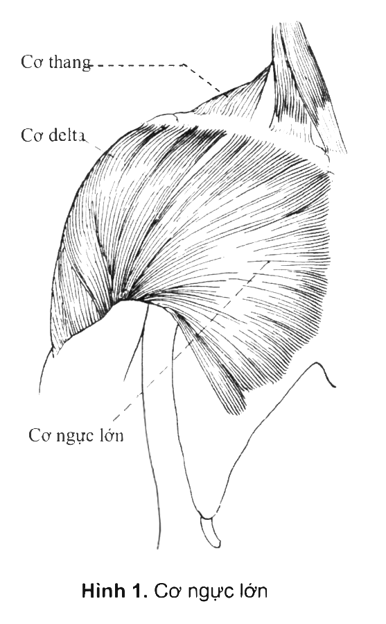
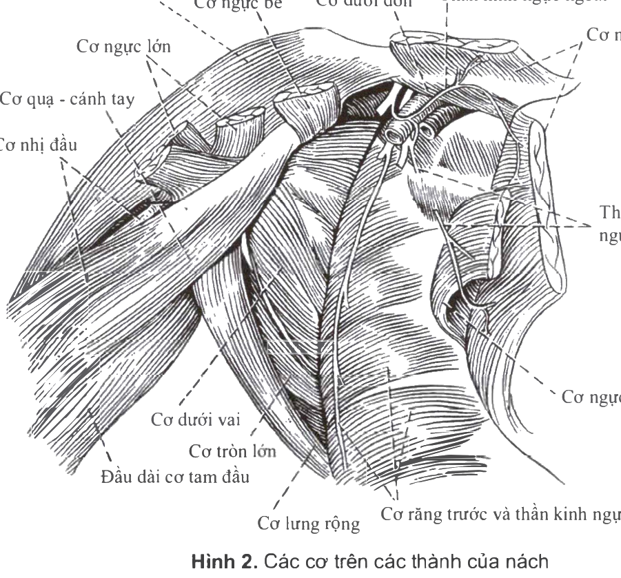
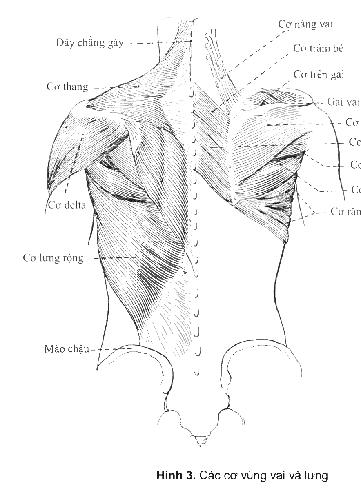
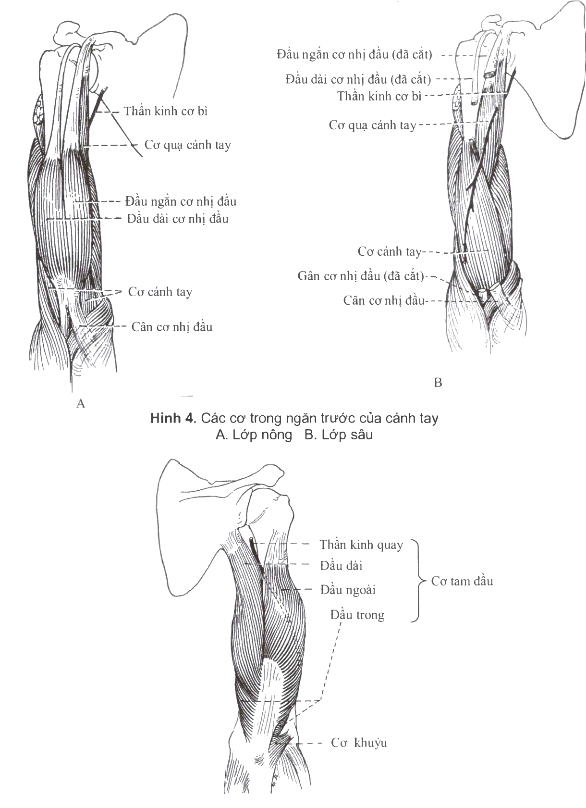
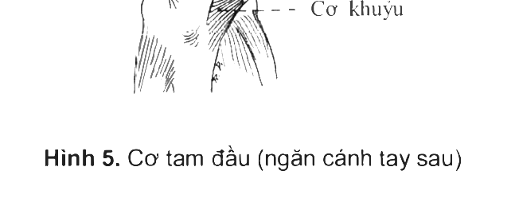
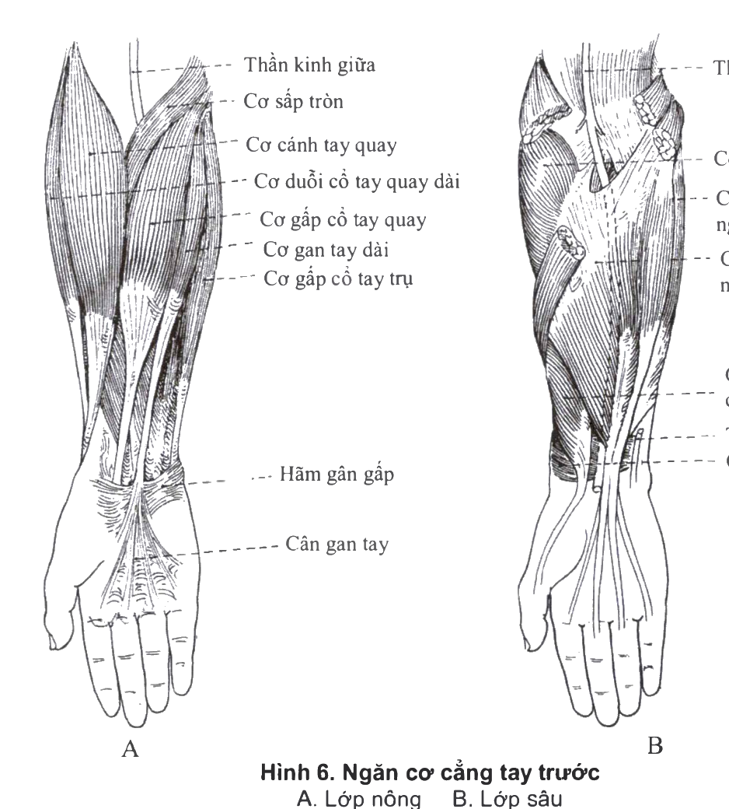
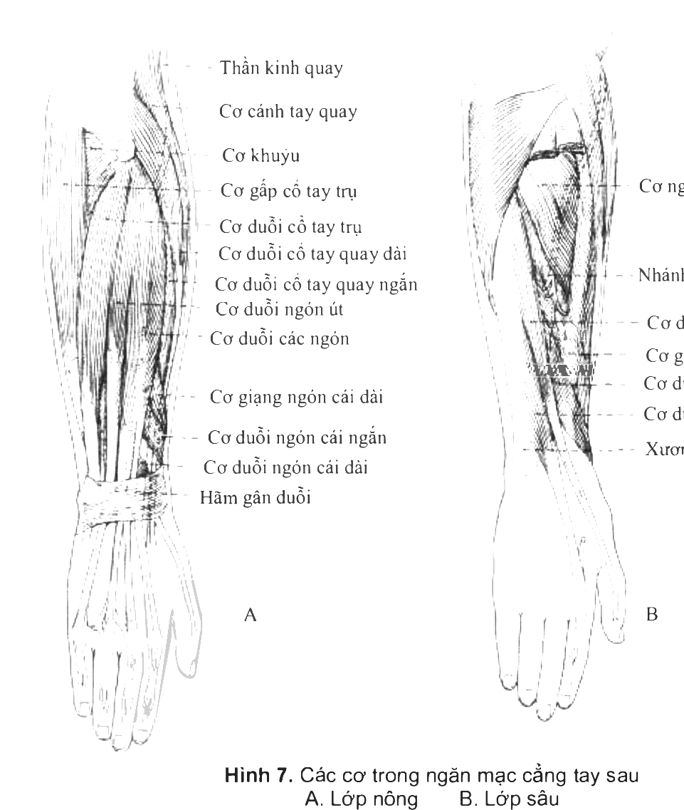
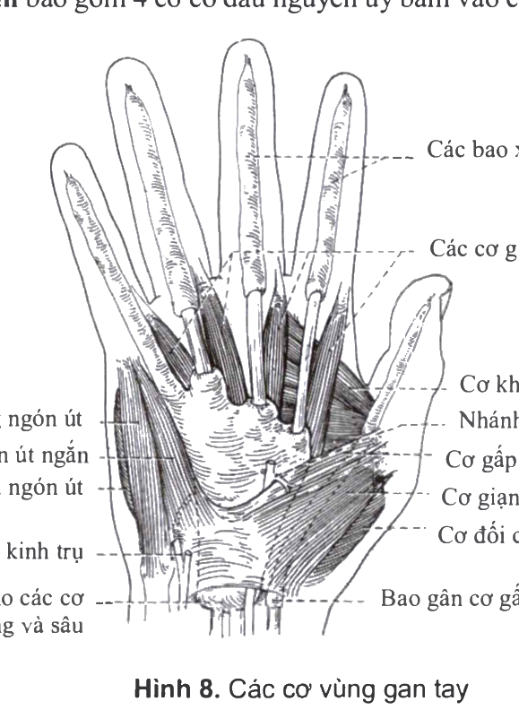

# CƠ VÀ MẠC CỦA CHI TRÊN

**Chương:** Chương 3: Hệ Cơ  
**Tác giả:** ThS. Phan Văn Hậu, ThS. Phạm Duy Đức  
**Nguồn:** Giáo trình Giải phẫu học Y Hà Nội (Xuất bản 2025), Trang 127 - 142

---

## Bài 2: CƠ VÀ MẠC CỦA CHI TRÊN

Các cơ chi trên thường được mô tả theo các vùng của chi trên: *vùng vai và nách*, *vùng cánh tay*, *vùng cẳng tay*, *vùng bàn tay*. Theo tác dụng, cơ chi trên còn được xếp theo các nhóm gây nên các cử động của các phần (đoạn) chi trên: cơ vận động đai ngực, cơ vận động cánh tay, cơ vận động cẳng tay, cơ vận động bàn tay và ngón tay. Các cơ trong một vùng có thể gây ra cử động của một số đoạn chi trên và cử động của một đoạn chi trên (trên 1 khớp) có thể do cơ ở một số vùng gây ra.

## 1. CÁC CƠ VÀ MẠC Ở VAI VÀ NÁCH (Bảng 1)

Các cơ ở vai và nách là những cơ vây quanh đai ngực và đầu trên xương cánh tay. Chúng thuộc vào ba vùng là *vùng ngực* ở trước, *vùng vai* ở sau và *vùng delta* ở ngoài. Xét về nguyên uỷ và bám tận, những cơ này thuộc hai loại:

- **Các cơ nội tại (7 cơ)** có cả hai đầu bám vào xương chi trên, cụ thể là đi từ đai ngực tới xương cánh tay. Chúng đích thực là cơ của chi trên và gây ra cử động của cánh tay trên khớp vai.
- **Các cơ ngoại lai (9 cơ)** đi từ cột sống hoặc lồng ngực tới đai ngực và xương cánh tay, tức là đầu nguyên uỷ của chúng bám vào các xương trục. Tuỳ theo chỗ bám tận mà cơ ngoại lai vận động đai ngực hay cánh tay. Theo mô tả định khu, các cơ ngoại lai thuộc về vùng lưng và vùng ngực nhưng do vận động đai ngực và cánh tay, chúng được mô tả cùng với các cơ đích thực của chi trên. Các cơ vận động đai ngực có vai trò cố định nguyên uỷ của các cơ vận động cánh tay hoặc làm tăng tầm cử động của cánh tay.

Về chi phối thần kinh, tất cả các cơ vùng vai và nách do các nhánh bên của đám rối cánh tay chi phối (trừ cơ thang do thần kinh phụ và đám rối cổ chi phối).

### 1.1. Các cơ và mạc của vùng ngực (H.1 và H.2)

Các cơ của vùng ngực được mô tả ở đây là các cơ nối chi trên với ngực và bao gồm: *cơ răng trước* và *cơ ngực nhỏ* nối các xương sườn với xương vai; *cơ ngực lớn* đi từ ngực và bụng tới xương cánh tay, và *cơ dưới đòn* nối xương sườn thứ nhất với xương đòn. Cơ răng trước nằm trên thành trong của nách, các cơ còn lại góp phần tạo nên thành trước của nách.

- *Cơ ngực lớn* là một cơ rộng, dày, hình quạt phủ phần trên thành ngực.
- *Cơ ngực bé* là một cơ dẹt hình tam giác nằm sau cơ ngực lớn.
- *Cơ dưới đòn* là cơ nhỏ hình trụ nằm dưới xương đòn.
- *Cơ răng trước* là một cơ rộng, dẹt nằm giữa xương vai và các xương sườn.

**Mạc vùng ngực trước.** Mạc vùng ngực trước được gọi là *mạc ngực (pectoral fascia)*. Mạc này che phủ cơ ngực lớn. Nó bám ở trong vào xương ức, ở trên vào xương đòn và liên tiếp ở phía dưới - bên với mạc của vai, nách và thành ngực. Ở giữa cơ ngực lớn và cơ lưng rộng, mạc ngực tạo nên sàn của nách và được gọi là *mạc nách*. Mạc nách chia ra ở bờ ngoài cơ lưng rộng thành hai lá bao bọc cơ này và bám vào mỏm gai các đốt sống ngực ở phía sau. Mạc nách tách ra tại bờ dưới cơ ngực lớn một lá đi lên ở mặt sâu của cơ; lá này tách ra bọc cơ ngực bé và tại bờ trên cơ ngực bé thì liên tiếp với *mạc đòn - ngực*. Phần mạc nối mạc nách với mạc bọc cơ ngực bé được gọi là *dây chằng treo nách*.

**Mạc đòn - ngực.** Mạc đòn - ngực là lá sợi dày nằm sau phần đòn của cơ ngực lớn; nó chiếm khoảng nằm giữa cơ dưới đòn và cơ ngực bé, và che phủ các mạch và thần kinh của nách. Ở trên, nó tách ra bọc cơ dưới đòn và bám vào xương đòn. Ở dưới, nó bọc quanh cơ ngực nhỏ và liên tiếp với mạc nách. Tĩnh mạch đầu, các mạch ngực - cùng vai và thần kinh ngực ngoài đi qua mạc đòn - ngực.

*Hình 1: Cơ ngực lớn*

### 1.2. Các cơ và mạc của các vùng bả vai và lưng (H.3)

Các cơ vùng này bao gồm hai nhóm nông và sâu:

**Nhóm nông có 2 cơ:** *cơ thang* và *cơ lưng rộng*; chúng đều là cơ ngoại lai với chi trên và kết nối cột sống với chi trên.
- *Cơ thang* là một cơ rộng, dẹt, hình tam giác trải rộng từ xương sọ và cột sống ở phía trong tới đai ngực ở phía ngoài. Nó là cơ nông nhất trùm lên vùng cổ sau và phần trên vùng lưng. Cơ thang hai bên hợp nên một hình thang.
- *Cơ lưng rộng* cũng là một cơ rộng hình tam giác che phủ phần dưới vùng lưng.

**Nhóm sâu** gồm các cơ ngoại lai và các cơ nội tại đối với chi trên.
- *Các cơ ngoại lai* đều chạy từ cột sống đến xương vai và vận động đai ngực. Đó là ba cơ: *cơ trám lớn*, *cơ trám bé* và *cơ nâng vai*.
- *Các cơ nội tại* gồm 6 cơ đi từ xương vai đến xương cánh tay và gây nên cử động của cánh tay: *cơ dưới gai*, *cơ trên gai*, *cơ dưới vai*, *cơ tròn bé*, *cơ tròn lớn* và *cơ quạ - cánh tay*.
  - *Cơ dưới vai* là một cơ rộng hình tam giác lấp đầy hố dưới vai của xương vai và tạo nên một phần thành sau của nách.
  - *Cơ trên gai* và *cơ dưới gai* là những cơ nằm trong các hố cùng tên của xương vai.
  - *Cơ tròn bé* và *cơ tròn lớn* là 2 cơ bám vào bờ ngoài xương vai. Cơ tròn lớn ở dưới cơ tròn bé và góp phần tạo nên thành sau của nách.
  - *Cơ quạ - cánh tay* là một cơ thuôn dài chạy dọc thành ngoài của nách.

> Cơ dưới vai, cơ trên gai, cơ dưới gai và cơ tròn bé có vai trò quan trọng trong việc giữ chắc khớp vai vì các gân dẹt của chúng dính liền nhau để tạo nên một vòng tròn gần hoàn chỉnh bao quanh khớp vai (đai xoay).

**Mạc vùng lưng.** Mạc vùng lưng nằm dưới tấm dưới da dày chứa nhiều mỡ. Nó là một màng sợi mỏng bám vào đường gáy trên và dây chằng gáy, và vào mỏm gai tất cả các đốt sống dưới đốt cổ bảy. Nó gắn ở ngoài vào gai vai và mỏm cùng vai và tiếp tục ở trên cơ delta xuống cánh tay. Ở ngực, nó liên tiếp với mạc nách và mạc cơ ngực lớn; trên bụng, nó liên tiếp với mạc phủ các cơ bụng và dính ở dưới với mào chậu.

*Hình 2: Các cơ trên các thành của nách*

*Hình 3: Các cơ vùng vai và lưng*

### 1.3. Cơ vùng delta (Các H.1, 2 và 3)

Vùng delta chỉ có một cơ: *cơ delta*. Cơ delta là một cơ dày và khoẻ trùm lên khớp vai và tạo nên u vai. Cơ này là vị trí thường dùng để tiêm bắp. Các sợi của cơ delta từ nhiều điểm khác nhau của đai ngực chạy xuống xương cánh tay nên mỗi nhóm sợi có thể gây nên một cử động riêng của cánh tay.

### Bảng 1. Các cơ ở vai và nách

| Cơ | Nguyên uỷ | Bám tận | Động tác |
| :--- | :--- | :--- | :--- |
| **Các cơ ở vùng ngực** | | | |
| *Cơ ngực lớn* (pectoralis major) Gồm phần đòn, phần ức sườn và phần bụng | - *Phần đòn:* 2/3 trong xương đòn - *Phần ức-sườn:* xương ức và các sụn sườn I - VI - *Phần bụng:* bao cơ thẳng bụng | Mép ngoài rãnh gian củ xương cánh tay (mào củ lớn) | Khép và xoay trong cánh tay tại khớp vai; riêng phần đòn gấp cánh tay |
| *Cơ ngực bé* (pectoralis minor) | Các xương sườn III - V | Mỏm quạ xương vai | Hạ và xoay xương vai xuống dưới; nâng các xương sườn lúc hít vào hết sức khi xương vai được cố định |
| *Cơ dưới đòn* (subclavius) | Sụn sườn và xương sườn I | Rãnh dưới đòn của xương đòn | Hạ và đưa xương đòn ra trước; cố định đai ngực |
| *Cơ răng trước* (serratus anterior) | 8 hoặc 9 xương sườn trên | Bờ trong và góc dưới xương vai | Giạng xương vai và xoay xương vai lên trên; nâng xương sườn lên khi xương vai được cố định |
| **Các cơ ở vùng vai và lưng** | | | |
| *Cơ thang* (trapezius) | Đường gáy trên của xương chẩm, mỏm gai của tất cả các đốt sống cổ và ngực | 1/3 ngoài bờ sau xương đòn, mỏm cùng vai và gai vai | Các sợi trên nâng xương vai và duỗi đầu; các sợi giữa khép xương vai; các sợi dưới hạ xương vai; các sợi trên và dưới cùng co xoay xương vai lên trên |
| *Cơ lưng rộng* (latissimus dorsi) | Mỏm gai các đốt sống từ N VI tới TL V, mào cùng, 1/3 sau mào chậu, 4 xương sườn cuối | Rãnh gian củ xương cánh tay | Duỗi, khép và xoay trong cánh tay tại khớp vai; kéo cánh tay xuống dưới và ra sau |
| *Cơ nâng vai* (levator scapulae) | Mỏm ngang của bốn hoặc năm đốt sống cổ trên | Phần trên gai vai của bờ trong xương vai | Nâng và xoay xương vai |
| *Cơ trám lớn* (rhomboid major) | Mỏm gai các đốt sống ngực II - V | Phần dưới gai vai của bờ trong xương vai | Nâng, khép và xoay xương vai xuống dưới |
| *Cơ trám bé* (rhomboid minor) | Mỏm gai các đốt sống cổ VII và ngực I | Phần trên gai vai của bờ trong xương vai | Nâng, khép và xoay xương vai xuống dưới |
| *Cơ dưới vai* (subscapularis) | Hố dưới vai của xương vai | Củ bé xương cánh tay | Xoay trong cánh tay tại khớp vai |
| *Cơ trên gai* (supraspinatus) | Hố trên gai của xương vai | Củ lớn xương cánh tay | Giạng cánh tay tại khớp vai |
| *Cơ dưới gai* (infraspinatus) | Hố dưới gai của xương vai | Củ lớn xương cánh tay | Xoay ngoài và khép cánh tay tại khớp vai |
| *Cơ tròn lớn* (teres major) | Góc dưới xương vai | Mép trong rãnh gian củ (mào củ bé) | Duỗi, khép và xoay trong cánh tay tại khớp vai |
| *Cơ tròn bé* (teres minor) | Phần dưới bờ ngoài xương vai | Củ lớn xương cánh tay | Xoay ngoài, duỗi và khép cánh tay tại khớp vai |
| *Cơ quạ - cánh tay* (coracobrachialis) | Mỏm quạ xương vai | Chỗ nối 1/3 trên và 1/3 giữa mặt trong thân xương cánh tay | Gấp và khép cánh tay tại khớp vai |
| **Cơ vùng delta** | | | |
| *Cơ delta* (deltoid) | 1/3 ngoài bờ trước xương đòn (các sợi trước); mỏm cùng vai (các sợi ngoài); gai vai (các sợi sau) | Lồi củ delta xương cánh tay | Tại khớp vai: các sợi ngoài giạng cánh tay; các sợi trước gấp và xoay trong cánh tay; các sợi sau duỗi và xoay ngoài cánh tay |

---

## 2. CÁC CƠ VÀ MẠC CỦA CÁNH TAY

**Mạc cánh tay.** Mạc cánh tay liên tiếp với mạc phủ cơ delta và cơ ngực lớn; nó bao bọc các cơ của cánh tay và tách ra hai vách gian cơ chạy vào sâu bám vào xương cánh tay.
- *Vách gian cơ ngoài* từ mép ngoài rãnh gian củ bám dọc mào trên lồi cầu ngoài tới mỏm trên lồi cầu ngoài; nó bị thần kinh quay xuyên qua.
- *Vách gian cơ trong* bám từ mép trong rãnh gian củ dọc mào trên lồi cầu trong tới mỏm trên lồi cầu trong; nó bị thần kinh trụ và động mạch bên trụ trên xuyên qua.

Hai vách gian cơ cùng xương cánh tay chia cánh tay thành hai ngăn mạc trước và sau, mỗi ngăn chứa các cơ, mạch máu và thần kinh của nó:
- **Ngăn trước của cánh tay** chứa ba cơ là *cơ nhị đầu cánh tay*, *cơ cánh tay* và *cơ quạ - cánh tay*. Các cơ này được động mạch cánh tay cấp máu và được chi phối bởi thần kinh cơ bì. Các cấu trúc đi qua ngăn trước bao gồm: các thần kinh cơ bì, giữa và trụ; động mạch cánh tay và tĩnh mạch nền.
- **Ngăn sau cánh tay** chứa *cơ tam đầu cánh tay*, một cơ do động mạch cánh tay sâu cấp máu và do thần kinh quay chi phối. Những cấu trúc đi qua đây bao gồm các thần kinh quay và trụ.

Ngăn trước của cánh tay còn được gọi là ngăn cơ gấp vì chứa hai cơ gấp cẳng tay: cơ cánh tay ở sâu và cơ nhị đầu cánh tay ở nông (H.4). Ngăn sau của cánh tay còn được gọi là ngăn cơ duỗi vì cơ tam đầu cánh tay nằm trong ngăn này (H.5) là cơ duỗi cẳng tay.

*Hình 4: Các cơ trong ngăn trước của cánh tay (A. Lớp nông; B. Lớp sâu)*

*Hình 5: Cơ tam đầu (ngăn cánh tay sau)*

### Bảng 2. Các cơ của cánh tay

| Cơ | Nguyên uỷ | Bám tận | Động tác |
| :--- | :--- | :--- | :--- |
| *Cơ cánh tay* (brachialis) | 2/3 dưới mặt trước xương cánh tay | Mỏm vẹt xương trụ | Gấp cẳng tay tại khớp khuỷu |
| *Cơ nhị đầu cánh tay* (biceps brachii) | Bám vào xương vai bằng hai đầu: - *Đầu dài:* củ trên ổ chảo - *Đầu ngắn:* mỏm quạ | Gân chính vào lồi củ xương quay, chẽ cân phụ vào mạc cẳng tay | Gấp cẳng tay tại khớp khuỷu, ngửa cẳng tay tại khớp quay - trụ gần và gấp cánh tay tại khớp vai |
| *Cơ tam đầu cánh tay* (triceps brachii) | Có 3 đầu bám: - *Đầu dài:* củ dưới ổ chảo xương vai - *Đầu ngoài:* bám vào mặt sau xương cánh tay ở phía trên - ngoài rãnh thần kinh quay - *Đầu trong:* bám vào mặt sau xương cánh tay ở phía dưới - trong rãnh thần kinh quay | Mỏm khuỷu xương trụ | Duỗi cẳng tay tại khớp khuỷu và duỗi cánh tay tại khớp vai |

> Nhìn chung 3 cơ ở cánh tay gây nên các cử động gấp và duỗi của cẳng tay trên khớp khuỷu (khớp cánh tay - quay - trụ). Cặp động tác đối kháng nhau này còn được thực hiện bởi 2 cơ ở cẳng tay là cơ cánh tay quay (gấp) và cơ khuỷu (duỗi). Ngoài ra, các động tác sấp, ngửa cẳng tay trên các khớp quay - trụ chủ yếu do các cơ ở cẳng tay thực hiện.

---

## 3. NHỮNG CẤU TRÚC CƠ - MẠC CỦA NÁCH VÀ CÁNH TAY

Các cơ và mạc ở vai và nách vây quanh một khoang chứa các mạch nách, các hạch bạch huyết và phần dưới đòn của đám rối cánh tay. Nách được coi như một hình tháp với bốn thành, một nền ở dưới và một đỉnh ở trên.
- *Nền nách* được trực tiếp tạo nên bởi mạc nách;
- *Đỉnh nách* là khe nằm giữa cơ dưới đòn và bó trên cùng của cơ răng trước.
- *Các thành của nách:*
  - *Thành trước:* cơ quạ cánh tay, các cơ ngực và các mạc có liên quan;
  - *Thành sau:* cơ dưới vai, cơ tròn lớn và đầu dài cơ tam đầu;
  - *Thành trong:* cơ răng trước;
  - *Thành ngoài:* phần trên xương cánh tay nằm trong khe hẹp giữa các thành trước và sau của nách.

Trên thành sau của nách, các cơ tròn cùng với xương cánh tay giới hạn nên một khe. Đầu dài cơ tam đầu đi ngang qua khe này và chia nó thành hai phần:
- Phần ngoài là **lỗ tứ giác**, nơi các mạch mũ cánh tay sau và thần kinh nách đi qua.
- Phần trong được gọi là **tam giác bả vai**, là nơi mà các mạch mũ vai đi qua.
- Khe hình **tam giác cánh tay tam đầu** nằm giữa xương cánh tay, đầu dài cơ tam đầu và cơ tròn lớn là nơi đi qua của động mạch cánh tay sâu và thần kinh quay.

Các mạch cánh tay đi qua ngăn mạc trước của cánh tay. Khoang cơ - mạc chứa các mạch này thường được gọi là **ống cánh tay**. Ống này được giới hạn bởi: ở sau là vách gian cơ trong, ở trong là mạc cánh tay, ở trước - ngoài là cơ quạ - cánh tay và cơ nhị đầu cánh tay.

---

## 4. CÁC CƠ VÀ MẠC CỦA CẲNG TAY

### 4.1. Các ngăn mạc của cẳng tay

Cẳng tay được bao bọc trong một bao mạc; mạc này gắn với bờ sau của xương trụ. Mạc cẳng tay cùng với màng gian cốt (giữa xương quay và xương trụ) và vách sợi gian cơ (giữa cơ cánh tay quay ở ngoài, cơ sấp tròn và cơ gấp cổ tay quay ở trong) chia cẳng tay thành hai ngăn mạc trước và sau:
- *Ngăn mạc trước* chứa các cơ gấp bàn tay và ngón tay nên còn được gọi là *ngăn cơ gấp* của cẳng tay.
- *Ngăn mạc sau* (*ngăn cơ duỗi*) chứa các cơ duỗi bàn tay và ngón tay.

### 4.2. Các hãm gân gấp và duỗi

- **Hãm gân gấp:** là chỗ dày lên của mạc ở mặt trước cổ tay. Nó bám ở trong vào xương đậu và móc xương móc, ở ngoài vào củ của xương thuyền và xương thang. Hãm gân gấp cùng với mặt trước lõm của khối xương cổ tay giới hạn nên một *ống cổ tay* để thần kinh giữa và các gân gấp ngón tay đi qua. Nó liên tiếp với mạc cẳng tay ở trên và với cân gan tay ở dưới.
- **Hãm gân duỗi:** là chỗ dày lên của mạc phủ vùng mu cổ tay. Nó cũng bám vào các bờ của khối xương cổ tay và cùng khối xương này giới hạn nên một khoang chứa các gân duỗi. Mặt sâu của hãm gân duỗi tách ra các vách sợi đến bám vào các xương cổ tay, chia ngăn chứa gân duỗi này thành 6 đường hầm nhỏ riêng biệt; mỗi đường hầm được lót bằng một bao hoạt dịch và chứa một gân duỗi.

### 4.3. Các cơ trong ngăn mạc trước của cẳng tay trước (Bảng 3) (H.6)

Ngăn này chứa 8 cơ xếp thành 4 lớp theo thứ tự từ nông vào sâu là:
- **Lớp thứ nhất** tính từ ngoài vào trong có 4 cơ: *cơ sấp tròn*, *cơ gấp cổ tay quay*, *cơ gan tay dài* và *cơ gấp cổ tay trụ*.
- **Lớp thứ hai** có 1 cơ: *cơ gấp các ngón tay nông*.
- **Lớp thứ ba** có 2 cơ: *cơ gấp ngón tay cái dài* ở ngoài và *cơ gấp các ngón tay sâu* ở trong.
- **Lớp thứ tư** có 1 cơ: *cơ sấp vuông* ở 1/4 dưới cẳng tay.

Phần bụng của các cơ vùng cẳng tay trước tạo nên phần bắp lồi ở nửa trên cẳng tay. Cơ sấp tròn và cơ sấp vuông là hai cơ không chạy xuống bám tận ở bàn tay và ngón tay và do đó không gây nên các cử động của hai phần này. Vì chúng chỉ gây nên các cử động của cẳng tay nên về chức năng có thể xếp chúng cùng nhóm với các cơ đã tả ở cánh tay. Ở cổ tay, gân của các cơ đi xuống bàn tay và ngón tay được giữ sát vào các xương cổ tay bởi một dải cân dày gọi là *hãm gân gấp*.

**Về chi phối thần kinh:** cơ gấp cổ tay trụ và hai bó trong cơ gấp các ngón sâu do thần kinh trụ chi phối, các cơ còn lại do thần kinh giữa chi phối.

*Hình 6: Ngăn cơ cẳng tay trước (A. Lớp nông; B. Lớp sâu)*

### Bảng 3. Các cơ trong ngăn mạc cẳng tay trước

| Cơ | Nguyên uỷ | Bám tận | Động tác |
| :--- | :--- | :--- | :--- |
| *Cơ sấp tròn* (pronator teres) | Mỏm trên lồi cầu trong xương cánh tay và mỏm vẹt xương trụ | Giữa mặt ngoài xương quay | Sấp cẳng tay tại khớp quay-trụ và gấp nhẹ cẳng tay tại khớp khuỷu |
| *Cơ gấp cổ tay quay* (flexor carpi radialis) | Mỏm trên lồi cầu trong xương cánh tay | Nền xương đốt bàn tay II | Gấp và giạng bàn tay tại khớp cổ tay |
| *Cơ gan tay dài* (palmaris longus) | Mỏm trên lồi cầu trong xương cánh tay | Hãm gân gấp và cân gan tay | Gấp nhẹ bàn tay tại khớp cổ tay |
| *Cơ gấp cổ tay trụ* (flexor carpi ulnaris) | Mỏm trên lồi cầu trong xương cánh tay và mỏm khuỷu xương trụ | Xương đậu, xương móc và nền xương đốt bàn tay V | Gấp và khép (nghiêng trong) bàn tay tại khớp cổ tay |
| *Cơ gấp các ngón tay nông* (flexor digitorum superficialis) | Có 2 đầu: - *Đầu cánh tay trụ:* mỏm trên lồi cầu trong xương cánh tay và mỏm vẹt xương trụ - *Đầu quay:* bờ trước xương quay | Chia thành 4 gân bám vào đốt giữa của 4 ngón tay II - V, mỗi gân tách đôi thành 2 chẽ để bám vào 2 sườn bên đốt giữa (gân thủng) | Gấp đốt giữa các ngón tay II - V tại khớp gian đốt ngón gần, gấp bàn tay tại khớp cổ tay |
| *Cơ gấp ngón cái dài* (flexor pollicis longus) | Phần giữa mặt trước xương quay và màng gian cốt cẳng tay | Nền đốt xa ngón tay cái | Gấp đốt xa ngón tay cái tại khớp gian đốt ngón |
| *Cơ gấp các ngón tay sâu* (flexor digitorum profundus) | Mặt trước trong thân xương trụ | Chia thành 4 gân xuống bám vào nền của đốt xa các ngón tay II - V | Gấp đốt xa và đốt giữa các ngón tay II-V tại các khớp gian đốt ngón, gấp bàn tay tại khớp cổ tay |
| *Cơ sấp vuông* (pronator quadratus) | 1/4 dưới mặt trước xương trụ | 1/4 dưới mặt trước xương quay | Sấp cẳng tay tại các khớp quay-trụ |

### 4.4. Các cơ trong ngăn mạc sau của cẳng tay (Bảng 4)

Ngăn mạc sau của cẳng tay chứa 12 cơ xếp thành 2 lớp:

- **Lớp nông (H.7):** tính từ ngoài vào trong có 7 cơ: *cơ cánh tay - quay*, *cơ duỗi cổ tay quay dài*, *cơ duỗi cổ tay quay ngắn*, *cơ duỗi các ngón tay*, *cơ duỗi ngón tay út*, *cơ duỗi cổ tay trụ* và *cơ khuỷu*. Cả 7 cơ lớp nông đều có đầu nguyên uỷ bám vào xương cánh tay. 2 trong số 7 cơ này không chạy xuống bám tận và gây ra cử động của bàn tay và ngón tay: cơ cánh tay quay bám tận vào xương quay (có tác dụng gấp cẳng tay), cơ khuỷu bám tận vào mỏm khuỷu xương trụ (duỗi cẳng tay). Cơ cánh tay quay chạy dọc bờ ngoài cẳng tay và còn lấn vào cả mặt trước cẳng tay. 5 cơ còn lại bám tận ở các xương bàn tay và ngón tay để gây nên các cử động theo tên gọi của chúng.
- **Lớp sâu (H.7):** có 5 cơ: *cơ giạng ngón cái dài*, *cơ duỗi ngón cái ngắn*, *cơ duỗi ngón cái dài*, *cơ duỗi ngón trỏ* và *cơ ngửa*. Cơ ngửa là một cơ ngắn nối đầu trên 2 xương cẳng tay và là cơ duy nhất của lớp sâu không gây ra cử động ở bàn tay; 4 cơ còn lại nói chung đi từ hai xương cẳng tay (nguyên uỷ) tới các xương của bàn tay và ngón tay (bám tận) để gây nên các cử động như tên gọi của chúng.

**Về chi phối thần kinh:** tất cả các cơ cẳng tay sau do thần kinh quay chi phối.

*Hình 7: Các cơ trong ngăn mạc cẳng tay sau (A. Lớp nông; B. Lớp sâu)*

### Bảng 4. Các cơ trong ngăn mạc cẳng tay sau

| Cơ | Nguyên uỷ | Bám tận | Tác dụng |
| :--- | :--- | :--- | :--- |
| **Lớp nông** | | | |
| *Cơ cánh tay quay* (brachioradialis) | Mào trên lồi cầu ngoài xương cánh tay | Ngay trên mỏm trâm xương quay | Gấp cẳng tay tại khớp khuỷu, ngửa và sấp cẳng tay về vị trí trung gian tại các khớp quay - trụ |
| *Cơ duỗi cổ tay quay dài* (extensor carpi radialis longus) | Mào trên lồi cầu ngoài xương cánh tay | Mặt mu của nền xương đốt bàn tay II | Duỗi và giạng bàn tay tại khớp cổ tay |
| *Cơ duỗi cổ tay quay ngắn* (extensor carpi radialis brevis) | Mỏm trên lồi cầu ngoài xương cánh tay | Mặt mu của nền xương đốt bàn tay III | Duỗi và giạng bàn tay tại khớp cổ tay |
| *Cơ duỗi các ngón tay* (extensor digitorum) | Mỏm trên lồi cầu ngoài xương cánh tay | Đốt xa và đốt giữa của các ngón tay từ II – V | Duỗi các đốt ngón tay và bàn tay |
| *Cơ duỗi ngón út* (extensor digiti minimi) | Mỏm trên lồi cầu ngoài xương cánh tay | Gân đi vào ngón út của cơ duỗi các ngón tay | Duỗi các đốt ngón út và bàn tay |
| *Cơ duỗi cổ tay trụ* (extensor carpi ulnaris) | Mỏm trên lồi cầu ngoài xương cánh tay và bờ sau xương trụ | Nền xương đốt bàn tay V | Duỗi và khép bàn tay tại khớp cổ tay |
| *Cơ khuỷu* (anconeus) | Mỏm trên lồi cầu ngoài xương cánh tay | Mỏm khuỷu và phần trên thân xương trụ | Duỗi cẳng tay tại khớp khuỷu |
| **Lớp sâu** | | | |
| *Cơ giạng ngón tay cái dài* (abductor pollicis longus) | Phần giữa mặt sau xương quay, xương trụ và màng gian cốt cẳng tay | Nền xương đốt bàn tay I | Giạng và duỗi ngón cái tại khớp cổ tay - đốt bàn tay và giạng bàn tay tại khớp cổ tay |
| *Cơ duỗi ngón tay cái ngắn* (extensor pollicis brevis) | Giữa mặt sau xương quay và màng gian cốt cẳng tay | Nền đốt gần ngón cái | Duỗi đốt gần ngón cái, đốt bàn tay I và bàn tay |
| *Cơ duỗi ngón cái dài* (extensor pollicis longus) | Giữa mặt sau xương trụ và màng gian cốt cẳng tay | Nền đốt xa ngón cái | Duỗi đốt xa ngón cái tại khớp gian đốt ngón, xương đốt bàn tay I tại khớp cổ tay - đốt bàn tay và giạng bàn tay tại khớp cổ tay |
| *Cơ duỗi ngón tay trỏ* (extensor indicis) | Phần dưới mặt sau xương trụ | Gân đi vào ngón trỏ của cơ duỗi các ngón tay | Duỗi các đốt của ngón trỏ và duỗi bàn tay |
| *Cơ ngửa* (supinator) | Mỏm trên lồi cầu ngoài xương cánh tay và mào cơ ngửa xương trụ | 1/3 trên mặt ngoài xương quay | Ngửa cẳng tay tại các khớp quay - trụ |

---

## 5. CÁC CƠ VÀ MẠC Ở BÀN TAY (Bảng 5) (H.8)

### 5.1. Mạc của gan tay

Mạc của gan tay mỏng ở chỗ che phủ các cơ mô út và mô cái nhưng dày lên ở vùng giữa gan tay, tạo nên **cân gan tay**. Cân gan tay có hình tam giác mà đỉnh gắn với bờ xa của hãm gân gấp và liên tiếp với gân của cơ gan tay dài. Nền của nó chia ra ở ngang mức nền các ngón tay dài thành bốn dải, mỗi dải chạy vào sâu tới gốc của một ngón tay và chia hai hai chẽ vây quanh các gân gấp dài và cuối cùng dính với bao sợi của gân gấp và các dây chằng đốt bàn tay ngang sâu.

### 5.2. Các khoang mạc của gan tay

Từ bờ trong của cân gan tay, một vách sợi chạy ra sau và tới bám vào bờ trước của xương đốt bàn tay V. Bên trong vách sợi này là một ngăn mạc chứa ba cơ mô út; đây là ngăn ít quan trọng về lâm sàng. Từ bờ ngoài của cân gan tay, một vách sợi thứ hai chạy chếch về phía sau, lách giữa gân gấp dài của ngón giữa và ngón trỏ, tới bờ trước của xương đốt bàn tay III. Vách này ngăn cách khoang mô cái ở bên ngoài và khoang giữa gan tay ở bên trong. Hai khoang này liên tiếp ở xa với các ống cơ giun. Khoang mô cái nằm sau các gân gấp dài của ngón trỏ, trước cơ khép ngón cái và chứa cơ giun I. Khoang giữa gan tay chứa các cơ giun II, III, IV và nằm sau các gân gấp dài tới các ngón tay III, IV và V; nó nằm trước các cơ gian cốt và các xương đốt bàn tay III-V.

Ở bàn tay có hai loại cơ:
- *Các cơ ngoại lai:* là những cơ có bụng cơ nằm ở cẳng tay nhưng gân của chúng chạy xuống bám tận ở ngón tay. Những cơ này tạo ra các cử động mạnh nhưng thô sơ của các ngón tay.
- *Các cơ nội tại của bàn tay:* là những cơ có nguyên uỷ và bám tận trong phạm vi bàn tay. Nhóm cơ này tạo ra các cử động yếu nhưng tinh tế và chính xác của các ngón tay.

Các cơ nội tại của bàn tay đều nằm ở gan tay và bao gồm 4 nhóm: nhóm cơ mô cái, nhóm cơ mô út, nhóm cơ giun ở ô gan tay giữa và nhóm cơ gian cốt.
- **Nhóm cơ mô cái** vận động cho ngón tay cái và tạo nên *mô cái* (ụ lồi tròn ở phần ngoài gan tay). Bốn cơ của nhóm này là: *cơ giạng ngón cái ngắn*, *cơ đối chiếu ngón cái*, *cơ gấp ngón cái ngắn* và *cơ khép ngón cái*.
- **Nhóm cơ mô út** vận động cho ngón tay út và tạo nên *mô út* (ụ lồi tròn ở phần trong gan tay). Nhóm này có 3 cơ là: *cơ giạng ngón út*, *cơ gấp ngón út ngắn* và *cơ đối chiếu ngón út*.
- **Nhóm cơ giun** bao gồm 4 cơ có đầu nguyên uỷ bám vào các gân gấp sâu các ngón.
- **Nhóm cơ gian cốt** bao gồm 4 cơ gian cốt gan tay và 4 cơ gian cốt mu tay nằm ở giữa các xương đốt bàn tay (khoang gian cốt).

*Hình 8: Các cơ vùng gan tay*

Các cơ giun và cơ gian cốt nói chung có tác dụng giạng, khép, gấp và duỗi các ngón tay (trừ ngón cái).

**Về chi phối thần kinh:** cơ của bàn tay do thần kinh giữa và thần kinh trụ chi phối. Thần kinh giữa chi phối cơ giạng ngón cái ngắn, cơ đối chiếu ngón cái, bó nông cơ gấp ngón cái ngắn và các cơ giun I, II. Thần kinh trụ chi phối tất cả các cơ còn lại.

### Bảng 5. Các cơ nội tại của bàn tay

| Cơ | Nguyên uỷ | Bám tận | Động tác |
| :--- | :--- | :--- | :--- |
| **Mô cái** | | | |
| *Cơ giạng ngón cái ngắn* (abductor pollicis brevis) | Hãm gân gấp, xương thuyền và xương thang | Mặt ngoài nền đốt gần ngón cái | Giạng ngón cái |
| *Cơ gấp ngón cái ngắn* (flexor pollicis brevis) Có hai đầu nông và sâu | Hãm gân gấp, xương thang (đầu nông), xương thê, xương cả (đầu sâu) | Nền đốt gần ngón cái | Gấp ngón cái tại khớp cổ tay-đốt bàn tay và khớp đốt bàn tay - đốt ngón tay |
| *Cơ đối chiếu ngón cái* (opponens pollicis) | Hãm gân gấp và xương thang | Mặt ngoài xương đốt bàn tay I | Kéo ngón cái qua gan tay để gặp các ngón khác (đối chiếu) tại khớp đốt bàn tay - đốt ngón tay |
| *Cơ khép ngón cái* (adductor pollicis) Có hai đầu chéo và ngang | - *Đầu chéo:* xương cả, xương thê - *Đầu ngang:* xương đốt bàn tay III | Mặt trong nền đốt gần ngón cái bằng một gân chứa xương vừng | Khép ngón cái tại khớp cổ tay - đốt bàn tay và khớp đốt bàn tay - đốt ngón tay |
| **Mô út** | | | |
| *Cơ giạng ngón út* (abductor digiti minimi) | Xương đậu và gân cơ gấp cổ tay trụ | Mặt trong nền đốt gần ngón tay út | Giạng ngón út và gấp ngón út tại khớp đốt bàn tay - đốt ngón tay |
| *Cơ gấp ngón út ngắn* (flexor digiti minimi brevis) | Hãm gân gấp và xương móc | Mặt trong nền đốt gần ngón út | Gấp ngón V tại khớp cổ tay - đốt bàn tay và khớp đốt bàn tay - đốt ngón tay |
| *Cơ đối chiếu ngón út* (opponens digiti minimi) | Hãm gân gấp và xương móc | Mặt trong xương đốt bàn tay V | Đưa ngón tay út ngang qua gan tay để gặp ngón cái (đối chiếu) tại khớp cổ tay - đốt bàn tay |
| **Cơ ô gan tay giữa** | | | |
| *Các cơ giun* (lumbricals) Có 4 cơ tính từ ngoài vào trong | - *Cơ giun I và II:* vào bờ ngoài gân gấp sâu của ngón II và III - *Cơ giun III và IV:* vào tất cả các bờ gân hướng vào khe giữa các gân gấp sâu của ngón III, IV và V | Bờ ngoài của các gân cơ duỗi các ngón tay, ở đoạn đi qua đốt ngón gần | Duỗi đốt giữa và xa của các ngón tay tại các khớp gian đốt ngón, gấp đốt gần tại khớp đốt bàn tay - đốt ngón tay |
| **Cơ gian cốt** | | | |
| *Các cơ gian cốt gan tay* (palmar interossei) Có 4 cơ tính từ ngoài vào trong | Nửa trước của mặt trước hướng vào trục bàn tay của của các xương đốt bàn tay I, II, IV, và V | Gân duỗi và nền đốt gần của các ngón tay (trừ ngón giữa) ở cùng phía với nguyên uỷ | Khép các ngón tay và gấp các ngón tay tại khớp đốt bàn tay - đốt ngón tay |
| *Các cơ gian cốt mu tay* (dorsal interossei) Có 4 cơ tính từ ngoài vào trong | Mỗi cơ chiếm cả bề rộng khoang gian cốt và bám các bờ hướng vào khoang gian cốt của hai xương đốt bàn tay kề nhau | Đốt ngón gần và gân duỗi của các ngón tay II - IV ở phía xa trục giữa bàn tay | Giạng và gấp các ngón tay II - IV tại các khớp đốt bàn tay - đốt ngón tay và duỗi đốt giữa và xa của các ngón tay đó |
