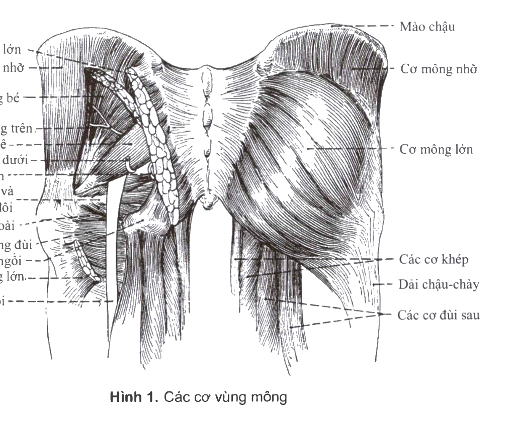
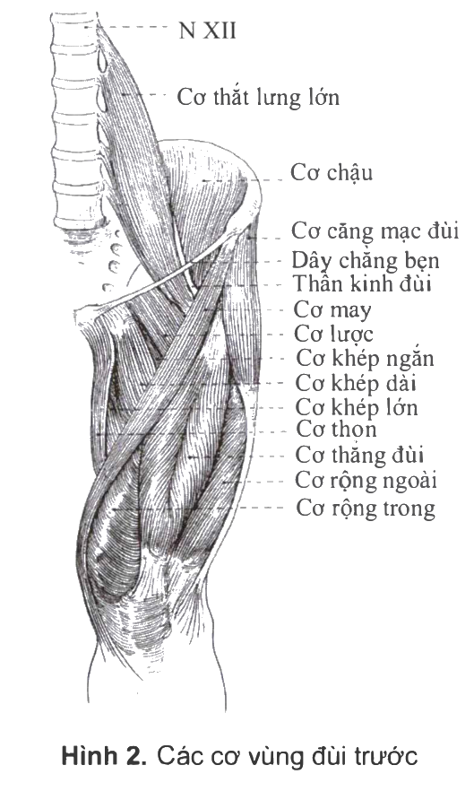
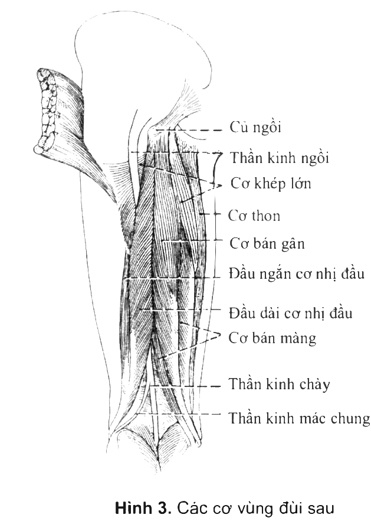
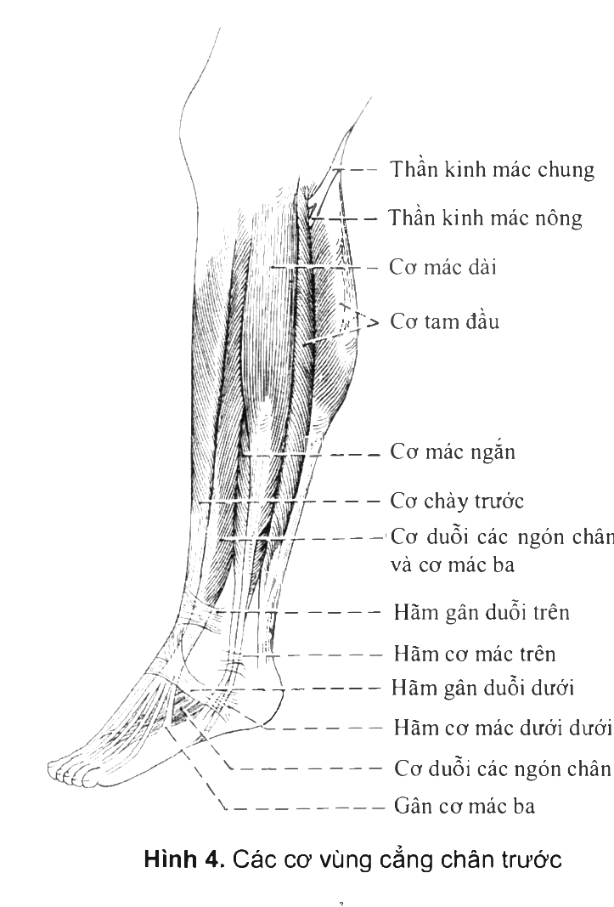
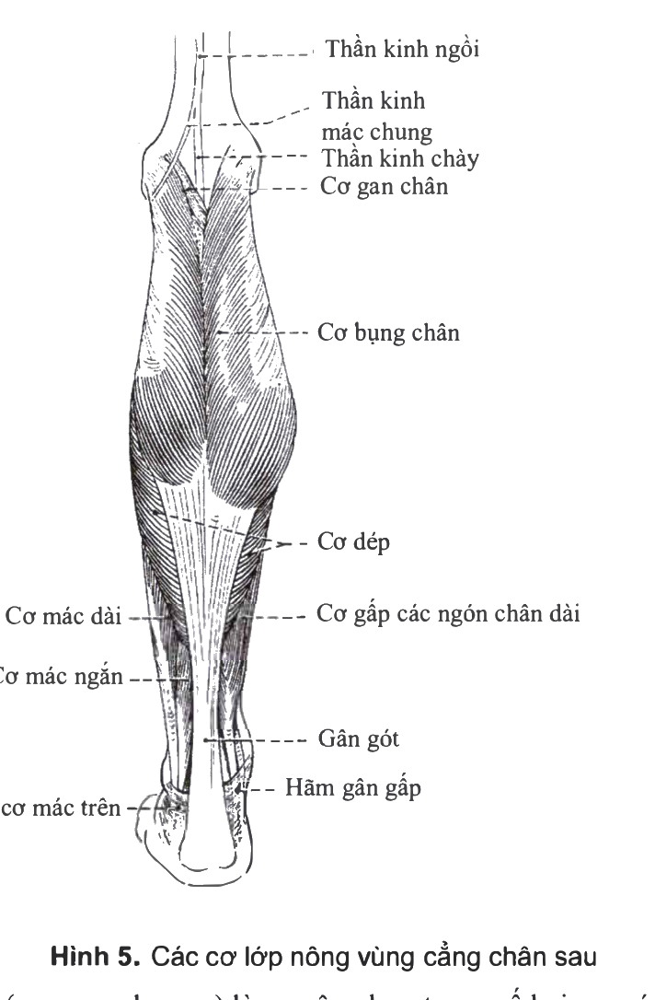
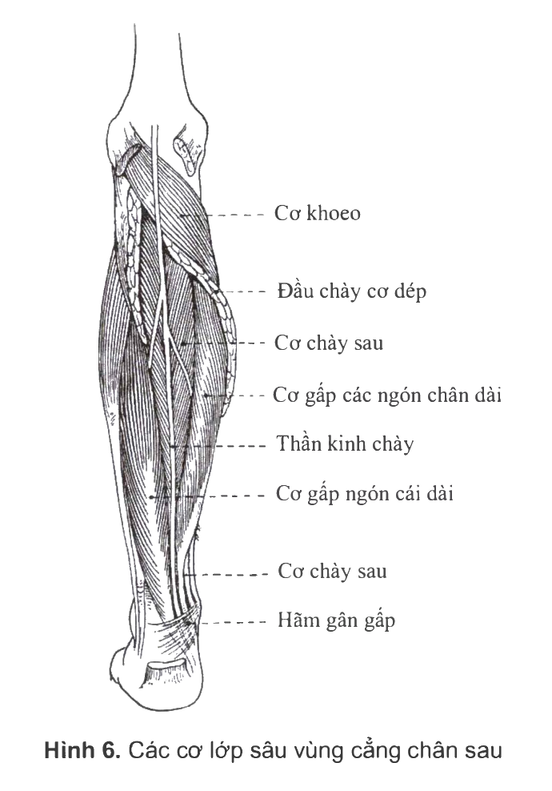
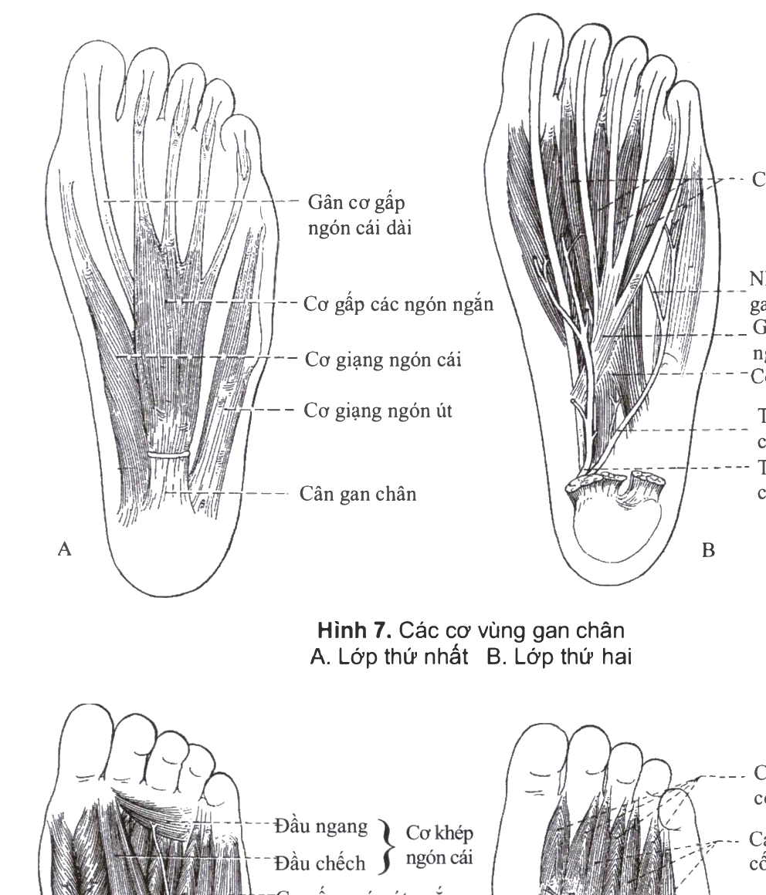
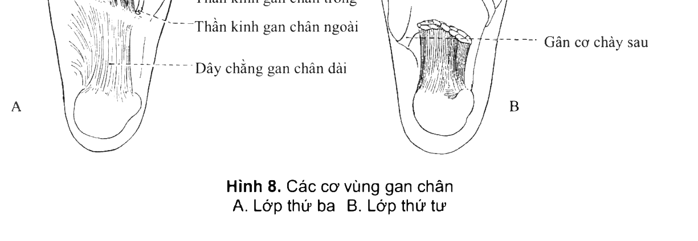

# CƠ VÀ MẠC CỦA CHI DƯỚI

**Chương:** Chương 3: Hệ Cơ  
**Tác giả:** ThS. Chu Văn Tuệ Bình, ThS. Phạm Duy Đức  
**Nguồn:** Giáo trình Giải phẫu học Y Hà Nội (Xuất bản 2025), Trang 143 - 156

---

## Bài 3: CƠ VÀ MẠC CỦA CHI DƯỚI

## 1. CÁC CƠ VÀ MẠC CỦA VÙNG MÔNG

### 1.1. Các cơ của vùng mông (Bảng 1) (H.1)

Các cơ của vùng mông che phủ các mặt sau và ngoài của khớp hông. Ba cơ lớn nhất của vùng này là *cơ mông lớn*, *cơ mông nhỡ* và *cơ mông nhỏ*. Chúng là những cơ duỗi và giạng đùi tại khớp hông. Cơ mông nhỡ là vị trí thuận tiện để tiêm bắp. Những cơ nhỏ, nằm ở sâu, là những cơ xoay ngoài đùi. Chúng bao gồm *cơ hình quả lê*, *các cơ bịt trong và ngoài*, *các cơ sinh đôi trên và dưới* và *cơ vuông đùi*. Các cơ mông được các nhánh thần kinh nhỏ của đám rối cùng chi phối.

### Bảng 1. Các cơ của vùng mông

| Cơ | Nguyên uỷ | Bám tận | Động tác |
| :--- | :--- | :--- | :--- |
| *Cơ mông lớn* (gluteus maximus) | Mặt ngoài phần sau cánh chậu (gồm cả mào chậu), mặt sau xương cùng và xương cụt, dây chằng cùng - củ | Dải chậu - chày, lồi củ cơ mông xương đùi (chẽ ngoài đường ráp) | Duỗi đùi |
| *Cơ mông nhỡ* (gluteus medius) | Mặt ngoài cánh chậu, giữa các đường mông trước và sau | Mặt ngoài mấu chuyển lớn xương đùi | Giạng đùi và xoay trong đùi |
| *Cơ mông bé* (gluteus minimus) | Mặt ngoài cánh chậu, giữa các đường mông trước và dưới | Bờ trước mấu chuyển lớn xương đùi | Giạng đùi và xoay trong đùi |
| *Cơ hình quả lê* (piriformis) | Mặt trước xương cùng và dây chằng cùng - củ | Bờ trên mấu chuyển lớn xương đùi | Giạng đùi và xoay ngoài đùi |
| *Cơ sinh đôi trên* (gemellus superior) | Gai ngồi | Mặt trong mấu chuyển lớn xương đùi | Giạng và xoay ngoài đùi |
| *Cơ sinh đôi dưới* (gemellus inferior) | Ụ ngồi | Mặt trong mấu chuyển lớn xương đùi | Giạng và xoay ngoài đùi |
| *Cơ bịt trong* (obturatorius internus) | Mặt trong màng bịt và các xương bao quanh | Mặt trong mấu chuyển lớn xương đùi | Giạng và xoay ngoài đùi |
| *Cơ bịt ngoài* (obturatorius externus) | Mặt ngoài màng bịt và các bờ lỗ bịt | Hố mấu chuyển của xương đùi | Xoay ngoài đùi |
| *Cơ vuông đùi* (quadratus femoris) | Bờ ngoài của củ ngồi | Củ cơ vuông đùi | Giạng và xoay ngoài đùi |
| *Cơ căng mạc đùi* (tensor fasciae latae) | Gai chậu trước - trên và mép ngoài mào chậu | Dải chậu - chày; dải này bám vào lồi cầu ngoài xương chày | Giạng và gấp đùi, giữ cho khớp gối ở tư thế duỗi |

*Hình 1: Các cơ vùng mông*

### 1.2. Mạc của vùng mông

Mạc của mông (mạc sâu hay mạc bọc cơ) liên tiếp ở dưới với mạc đùi. Ở vùng mông, nó tách ra để bao bọc cơ mông lớn. Ở trước và trên cơ mông lớn, nó tiếp tục như một lá đơn che phủ mặt nông cơ mông nhỡ rồi bám vào mào chậu. Trên mặt ngoài của đùi, nó liên tiếp với một dải cân rộng, chắc gọi là **dải chậu - chày**. Dải này bám ở trên vào củ của mào chậu và ở dưới vào lồi cầu ngoài xương chày. Dải chậu - chày tách ra bao bọc cho cơ căng mạc đùi và tiếp nhận phần lớn các sợi gân của cơ mông lớn.

---

## 2. CÁC CƠ VÀ MẠC CỦA VÙNG ĐÙI

### 2.1. Mạc đùi và các ngăn mạc của đùi

**Mạc đùi.** Mạc đùi (mạc sâu) (*fascia lata*) bao quanh đùi; đầu trên của nó được gắn với xương chậu và các dây chằng có liên quan. Chỗ tiếp giáp của nó với mạc mông ở mặt ngoài dày lên tạo nên dải chậu - chày. Ở mặt trước đùi, mạc đùi có một lỗ gọi là **lỗ tĩnh mạch hiển** (*saphenous opening*). Đây là nơi đi qua của tĩnh mạch hiển lớn, các nhánh nhỏ của động mạch đùi và các mạch bạch huyết. Lỗ này nằm ở khoảng 4 cm về phía dưới - ngoài của củ mu. Lỗ tĩnh mạch hiển có một bờ hình liềm ở phía dưới - ngoài; bờ này nằm giữa hai sừng: *sừng trên* chạy vào trong ở trước các mạch đùi và bám vào củ mu, *sừng dưới* chạy ra ngoài ở sau các mạch đùi rồi bám vào đường lược của ngành trên xương mu.

**Các ngăn mạc của đùi.** Từ mặt sâu của mạc đùi có ba vách gian cơ tiến vào sâu tới đường ráp xương đùi. Đó là *vách gian cơ đùi ngoài*, *vách gian cơ đùi trong* và *vách gian cơ trước - trong* (hay mạc dưới cơ may). Các vách gian cơ này chia đùi thành ba ngăn mạc là:
- *Ngăn trước* (ngăn cơ duỗi),
- *Ngăn trong* (ngăn cơ khép),
- *Ngăn sau* (ngăn cơ gấp).

### 2.2. Các cơ vùng đùi trước (Bảng 2) (H.2)

Vùng đùi trước có hai nhóm cơ: nhóm trong ngăn mạc trước và nhóm trong ngăn mạc trong.

- **Các cơ trong ngăn mạc trước** bao gồm *cơ may*, *cơ tứ đầu đùi* và phần tận cùng của hai cơ từ thành bụng sau đi xuống là *cơ chậu* và *cơ thắt lưng lớn* (được gọi chung là cơ thắt lưng - chậu). Cơ may, cơ thắt lưng - chậu và đầu thẳng đùi của cơ tứ đầu đùi có tác dụng gấp đùi. Cơ may và cơ tứ đầu còn đi qua khớp gối nên còn gây cử động ở cẳng chân (cơ may gấp còn cơ tứ đầu duỗi cẳng chân).
- **Các cơ trong ngăn mạc trong** bao gồm *cơ lược*, *cơ khép dài*, *cơ khép ngắn*, *cơ khép lớn* và *cơ thon*. Cả năm cơ này đều đi chếch từ xương mu tới xương đùi (trừ cơ thon bám tận vào xương chày) nên có tác dụng chung là khép đùi và vì vậy chúng được gọi *nhóm cơ khép đùi*. Cũng có thể coi cơ bịt ngoài là một cơ của nhóm trong.

**Về chi phối thần kinh:** các cơ nhóm trước, cơ lược và một phần cơ khép dài (của nhóm trong) do thần kinh đùi chi phối, các cơ còn lại do thần kinh bịt chi phối.

*Hình 2: Các cơ vùng đùi trước*

### Bảng 2. Các cơ vùng đùi trước

| Cơ | Nguyên uỷ | Bám tận | Động tác |
| :--- | :--- | :--- | :--- |
| **Nhóm trước** | | | |
| *Cơ thắt lưng lớn* (psoas major) | Thân và mỏm ngang các đốt sống N XII - TL IV | Mấu chuyển nhỏ xương đùi | Gấp đùi |
| *Cơ chậu* (iliacus) | Hố chậu, mào chậu và cánh xương cùng | Mấu chuyển nhỏ xương đùi | Gấp đùi |
| *Cơ may* (sartorius) | Gai chậu trước - trên | Phần trên mặt trong xương chày | Gấp đùi và cẳng chân; giúp giạng và xoay ngoài đùi |
| *Cơ tứ đầu đùi* (quadriceps femoris) Có 4 đầu: - *Cơ thẳng đùi* (rectus femoris) - *Cơ rộng ngoài* (vastus lateralis) - *Cơ rộng trong* (vastus medialis) - *Cơ rộng giữa* (vastus intermedius) | - *Cơ thẳng đùi:* gai chậu trước - dưới (đầu thẳng) và viền ổ cối (đầu quặt) - *Cơ rộng ngoài:* mấu chuyển lớn và mép ngoài đường ráp xương đùi - *Cơ rộng trong:* đường gian mấu và mép trong đường ráp xương đùi - *Cơ rộng giữa:* các mặt trước và ngoài thân xương đùi | Xương bánh chè và thông qua dây chằng bánh chè tới bám vào lồi củ xương chày | Duỗi cẳng chân; riêng cơ thẳng đùi còn gấp đùi |
| **Nhóm trong** | | | |
| *Cơ lược* (pectineus) | Lược xương mu (mào lược) | Đường lược xương đùi | Khép và gấp đùi |
| *Cơ khép dài* (adductor longus) | Thân xương mu, phía dưới mào mu | 1/3 giữa đường ráp xương đùi | Khép và hơi gấp đùi; xoay ngoài đùi khi đùi ở thế gấp |
| *Cơ khép ngắn* (adductor brevis) | Thân và ngành dưới xương mu | Đường lược và 1/3 trên đường ráp xương đùi | Khép và hơi gấp đùi |
| *Cơ khép lớn* (adductor magnus) | Ngành dưới xương mu, ngành xương ngồi và củ ngồi | Lồi củ cơ mông, đường ráp, đường trên lồi cầu trong và lồi củ cơ khép của xương đùi | Khép và duỗi đùi |
| *Cơ thon* (gracilis) | Thân và ngành dưới xương mu | Phần trên mặt trong xương chày | Khép đùi và gấp cẳng chân |

### 2.3. Các cơ của vùng đùi sau (Bảng 3) (H.3)

Vùng đùi sau có ba cơ nằm trong ngăn mạc sau của đùi: *cơ bán gân*, *cơ bán màng* và *cơ nhị đầu đùi*. Cả ba cơ này có nguyên uỷ chung là ụ ngồi, trừ cơ nhị đầu có thêm một đầu nguyên uỷ bám vào xương đùi. Chúng đi xuống qua mặt sau của đùi và có thể nhìn thấy các gân của chúng ở sau khớp gối. Do chạy qua hai khớp (khớp hông và khớp gối), tác dụng chung của ba cơ là duỗi đùi và gấp cẳng chân. Thần kinh ngồi phân nhánh vào cả ba cơ vùng đùi sau.

*Hình 3: Các cơ vùng đùi sau*

### Bảng 3. Các cơ vùng đùi sau

| Cơ | Nguyên uỷ | Bám tận | Động tác |
| :--- | :--- | :--- | :--- |
| *Cơ bán gân* (semitendinosus) | Ụ ngồi | Mặt trong đầu trên xương chày, sau chỗ bám của cơ thon và cơ may | Duỗi đùi, gấp cẳng chân, cùng với cơ bán màng xoay xương chày vào trong trên xương đùi |
| *Cơ bán màng* (semimembranosus) | Ụ ngồi | Mặt sau lồi cầu trong xương chày | Giống cơ bán gân |
| *Cơ nhị đầu đùi* (biceps femoris) | - *Đầu dài:* ụ ngồi - *Đầu ngắn:* mép ngoài đường ráp và đường trên lồi cầu ngoài | Chỏm xương mác | Đầu dài: duỗi đùi; cả hai đầu: gấp và xoay cẳng ngoài cẳng chân |

### 2.4. Các cấu trúc cơ - mạc của đùi

**Tam giác đùi (femoral triangle).** Tam giác đùi là một vùng hình tam giác nằm ở phần trên của mặt trong đùi.
- Nó được giới hạn ở trên bởi dây chằng bẹn, ở ngoài bởi cơ may và ở trong bởi bờ trong cơ khép dài.
- Sàn của nó trông như một rãnh và được tạo nên, từ ngoài vào trong, bởi cơ thắt lưng - chậu, cơ lược và cơ khép dài.
- Trần của nó do da và mạc đùi tạo nên.
- Tam giác đùi chứa phần tận cùng của thần kinh đùi, các mạch đùi cùng các nhánh của chúng, và các hạch bạch huyết bẹn sâu.

**Ống cơ khép (adductor canal).** Ống cơ khép là một khe gian cơ nằm ở mặt trong của phần ba giữa đùi, đi từ đỉnh tam giác đùi tới *lỗ gân cơ khép (adductor hiatus)* (lỗ ở gân cơ khép lớn). Nó có hình tam giác trên mặt cắt ngang với ba thành: thành sau, thành ngoài và thành trước - trong. Thành sau được tạo bởi cơ khép dài và cơ khép lớn. Thành ngoài do cơ rộng trong tạo nên. Thành trước - trong là lá mạc phủ mặt sâu cơ may. Ống cơ khép chứa đoạn xa của động mạch và tĩnh mạch đùi, thần kinh hiển, thần kinh tới cơ rộng trong và phần tận cùng của thần kinh bịt.

---

## 3. CÁC CƠ VÀ MẠC CỦA VÙNG CẲNG CHÂN

Cẳng chân được chia thành hai vùng trước và sau bởi xương chày, màng gian cốt, xương mác và vách gian cơ cẳng chân sau. Vùng cẳng chân trước lại được chia thành hai ngăn trước và ngoài bởi vách gian cơ cẳng chân trước. Như vậy, cẳng chân có ba ngăn mạc: *ngăn trước*, *ngăn ngoài* và *ngăn sau*.

### 3.1. Các cơ trong ngăn trước (Bảng 4) (H.4)

Ngăn này chứa *cơ chày trước*, *cơ duỗi các ngón chân dài*, *cơ duỗi ngón chân cái dài* và *cơ mác ba*. Chức năng của các cơ này là gấp mu chân tại khớp cổ chân và duỗi các ngón chân. Chúng được chi phối bởi các nhánh của thần kinh mác sâu, một nhánh của thần kinh mác chung. Ở vùng cổ chân, gân của các cơ này chạy dưới các hãm gân duỗi trên và dưới.

*Hình 4: Các cơ vùng cẳng chân trước*

### Bảng 4. Các cơ của ngăn trước cẳng chân

| Cơ | Nguyên uỷ | Bám tận | Động tác |
| :--- | :--- | :--- | :--- |
| *Cơ chày trước* (tibialis anterior) | Lồi cầu ngoài và nửa trên mặt ngoài xương chày | Các mặt trong và dưới của xương chêm trong và nền xương đốt bàn chân I | Gấp mu bàn chân (duỗi bàn chân) và nghiêng trong bàn chân |
| *Cơ duỗi ngón chân cái dài* (extensor hallucis longus) | 1/3 giữa mặt trong xương mác và màng gian cốt | Mặt mu của nền đốt xa ngón chân cái | Duỗi ngón chân cái và gấp mu chân |
| *Cơ duỗi các ngón chân dài* (extensor digitorum longus) | Lồi cầu ngoài xương chày, 3/4 trên mặt trong xương mác và màng gian cốt | Các đốt giữa và xa của 4 ngón chân ngoài | Duỗi bốn ngón chân ngoài và gấp mu chân |
| *Cơ mác ba* (peroneus tertius) | 1/3 dưới mặt trong xương mác và màng gian cốt | Mặt mu của nền xương đốt bàn chân V | Gấp mu chân và nghiêng bàn chân ra ngoài |

### 3.2. Các cơ trong ngăn ngoài (của vùng cẳng chân trước) (H.4)

Ngăn ngoài được giới hạn bởi mặt ngoài xương mác, các vách gian cơ cẳng chân trước và sau, và mạc cẳng chân. Ngăn này chứa *cơ mác dài* và *cơ mác ngắn* vốn là những cơ có tác dụng gấp gan chân và nghiêng ngoài bàn chân. Chúng đều do thần kinh mác nông, nhánh của thần kinh mác chung, chi phối.

- **Cơ mác dài (peroneus longus):** là cơ nông hơn trong số hai cơ mác.
  - *Nguyên uỷ:* chỏm và 2/3 trên mặt ngoài xương mác. Cơ còn bám cả vào các vách gian cơ cẳng chân trước và sau.
  - *Bám tận:* gân cơ mác dài chạy vòng sau mắt cá ngoài, ở dưới hãm cơ mác trên. Tiếp đó, gân chạy dưới ròng rọc mác của xương gót để đi vào rãnh gân cơ mác dài của xương hộp. Cuối cùng, gân chạy chếch qua gan chân để tới bám tận vào nền xương đốt bàn chân I và xương chêm trong.
  - *Động tác:* gấp gan chân và nghiêng ngoài bàn chân; giữ vững các vòm gan chân.
- **Cơ mác ngắn (peroneus brevis):**
  - *Nguyên uỷ:* 2/3 dưới mặt ngoài xương mác, các vách gian cơ cẳng chân trước và sau.
  - *Bám tận:* gân cơ chạy qua một rãnh ở mặt sau mắt cá ngoài và có thể sờ thấy ở dưới mắt cá ngoài. Tại đây, nó nằm trong một bao gân chung với gân cơ mác dài. Cuối cùng, gân bám tận vào mặt mu của lồi củ xương đốt bàn chân V (nằm ở mặt ngoài nền xương đốt bàn chân V).
  - *Động tác:* giống cơ mác dài nhưng vai trò giữ các vòm gan chân kém cơ mác dài (vì gân không chạy qua gan chân).

### 3.3. Các cơ vùng cẳng chân sau (ngăn sau)

Các cơ vùng cẳng chân sau được chia thành các nhóm nông và sâu bởi vách gian cơ ngang cẳng chân (mạc ngang sâu cẳng chân).

- **Nhóm cơ nông (Bảng 5) (H.5):** bao gồm *cơ tam đầu* và *cơ gan chân*. Cơ tam đầu do *cơ bụng chân* (với hai đầu trong và ngoài) và *cơ dép* tạo nên. Đây là cơ to khoẻ tạo nên bắp chân (phần lồi của vùng cẳng chân sau). Kích thước lớn của cơ tam đầu là một đặc trưng của cơ bắp người và liên quan trực tiếp đến tư thế đứng thẳng của loài người. Cơ này cần to khoẻ vì nó phải chống đỡ và dịch chuyển sức nặng của cơ thể. Động tác của nhóm cơ nông là gấp gan chân.
- **Nhóm cơ sâu (Bảng 5) (H.6):** bao gồm *cơ khoeo*, *cơ chày sau*, *cơ gấp các ngón chân dài* và *cơ gấp ngón chân cái dài*. Chúng nằm ngay sau các xương cẳng chân và màng gian cốt.

Toàn bộ các cơ vùng cẳng chân sau do thần kinh chày chi phối.

*Hình 5: Các cơ lớp nông vùng cẳng chân sau*

*Hình 6: Các cơ lớp sâu vùng cẳng chân sau*

### Bảng 5. Các cơ vùng cẳng chân sau

| Cơ | Nguyên uỷ | Bám tận | Động tác |
| :--- | :--- | :--- | :--- |
| *Cơ bụng chân* (gastrocnemius) | - *Đầu ngoài:* lồi cầu ngoài xương đùi - *Đầu trong:* diện khoeo của xương đùi, trên lồi cầu trong | Gân cơ dép và gân cơ gan chân hợp với gân cơ bụng chân tạo thành gân gót. Gân gót bám vào mặt sau xương gót | Gấp cẳng chân, gấp gan chân, nâng gót lên khi đi |
| *Cơ dép* (soleus) | Chỏm và 1/4 trên mặt sau xương mác; đường cơ dép và 1/3 giữa bờ trong xương chày | Gân gót bám vào mặt sau xương gót | Gấp gan chân và giữ vững cẳng chân trên bàn chân (kiễng chân) |
| *Cơ gan chân* (plantaris) | Đầu dưới đường trên lồi cầu ngoài và dây chằng khoeo chéo | Gân gót | Hỗ trợ cơ bụng chân trong gấp gan chân và gấp cẳng chân |
| *Cơ khoeo* (popliteus) | Mặt ngoài lồi cầu ngoài xương đùi và sụn chêm ngoài | Mặt sau xương chày, trên đường cơ dép | Gấp và xoay trong cẳng chân |
| *Cơ gấp ngón chân cái dài* (flexor hallucis longus) | 2/3 dưới mặt sau xương mác và phần dưới màng gian cốt | Nền đốt xa ngón chân cái | Gấp ngón chân cái, gấp gan chân và nghiêng trong bàn chân |
| *Cơ gấp các ngón chân dài* (flexor digitorum longus) | Nửa trong của 1/3 giữa mặt sau xương chày, dưới đường cơ dép | Nền của đốt xa bốn ngón chân ngoài bằng 4 gân | Gấp bốn ngón chân ngoài, gấp gan chân và xoay bàn chân vào trong |
| *Cơ chày sau* (tibialis posterior) | Màng gian cốt và mặt sau xương chày, mặt trong xương mác | Củ xương thuyền, ba xương chêm và nền của các xương đốt bàn chân II, III và IV | Gấp gan chân và nghiêng trong bàn chân |

### 3.4. Mạc và các ngăn mạc của cẳng chân

Mạc (mạc sâu) của cẳng chân bao bọc cẳng chân và liên tiếp ở trên với mạc đùi. Nó bám vào các bờ trước và trong của xương chày. Hai vách gian cơ cẳng chân, vách trước và vách sau, từ mặt sâu của mạc cẳng chân chạy tới bám vào xương mác. Các vách này, cùng với màng gian cốt, chia cẳng chân thành ba ngăn mạc: ngăn trước (ngăn cơ duỗi), ngăn sau (ngăn cơ gấp) và ngăn ngoài (ngăn mác). Ngăn mạc sau được mạc ngang sâu chia thành phần nông và phần sâu.

### 3.5. Các hãm gân của cổ chân

Ở vùng cổ chân, mạc cẳng chân dày lên để tạo nên một loạt hãm gân để giữ các gân tại vị trí:
- **Hãm gân cơ duỗi trên (superior extensor retinaculum):** là một dải mạc dày bám vào các bờ trước của đầu xa các xương chày và mác. Nó tách ra để bao bọc gân cơ chày trước ở gần đầu trong của nó.
- **Hãm gân cơ duỗi dưới (inferior extensor retinaculum):** là một dải mạc hình chữ Y với cuống của chữ Y bám vào mặt trên của phần trước xương gót. Trụ trên của chữ Y bám vào mắt cá trong còn trụ dưới liên tiếp với cân gan chân ở bờ trong bàn chân. Các vách sợi từ mặt sâu của hãm gân duỗi dưới ngăn cách các gân duỗi với nhau, mỗi gân nằm trong một ngăn riêng và được lót bằng bao hoạt dịch.
- **Hãm gân gấp (flexor retinaculum):** là một dải mạc dày từ mắt cá trong chạy xuống dưới và ra sau tới bám vào mặt trong xương gót. Nó giữ cho gân của các cơ lớp sâu vùng cẳng chân sau áp sát vào mặt trong gót chân, mỗi gân nằm trong một ngăn riêng và được bọc bằng bao hoạt dịch.
- **Hãm gân cơ mác trên (superior peroneal retinaculum):** là một dải mạc dày từ mắt cá ngoài chạy xuống dưới và ra sau để tới bám vào mặt ngoài xương gót. Nó giữ cho gân của các cơ mác dài và ngắn áp vào mặt ngoài cổ chân; hai gân được bọc bằng một bao hoạt dịch chung.
- **Hãm gân cơ mác dưới (inferior peroneal retinaculum):** là một dải mạc dày bám vào củ mác và vào xương gót ở trên và ở dưới các gân cơ mác.

---

## 4. CÁC CƠ VÀ MẠC Ở BÀN CHÂN

### 4.1. Cơ ở mu chân

Chỉ có một cơ nhỏ ở mu chân, **cơ duỗi các ngón chân ngắn** (*extensor digitorum brevis*), và cơ này tương đối ít quan trọng.
- *Nguyên uỷ:* mặt trên và ngoài của phần trước xương gót, ở phía trước - trong mắt cá ngoài.
- *Bám tận:* cơ chia thành bốn bó đến bám vào nền đốt gần ngón cái và vào gân đi vào các ngón chân II, III và IV của cơ duỗi các ngón chân dài. Bó đi vào ngón chân cái được gọi là *cơ duỗi ngón cái ngắn* (*extensor hallucis brevis*).
- *Động tác:* hỗ trợ cơ duỗi ngón cái dài và cơ duỗi các ngón chân dài trong việc duỗi các ngón chân I - IV.

### 4.2. Các cơ ở gan chân (Bảng 6)

Có bốn lớp cơ ở gan chân. Các cơ này đã được biệt hoá để giúp giữ vững các vòm gan chân và làm cho con người đứng vững trên mặt đất hơn là để thực hiện các chức năng tinh tế như các cơ ở bàn tay:

- **Lớp cơ nông (H.7, A)** (lớp thứ nhất) gồm ba cơ, tất cả đều đi từ phần sau của xương gót tới các ngón chân. Tính từ trong ra ngoài, ba cơ của lớp nông là: *cơ giạng ngón cái*, *cơ gấp các ngón chân ngắn* và *cơ giạng ngón út*. Cả ba cơ này hợp thành một nhóm đóng vai trò giữ vững các vòm gan chân và duy trì độ lõm của gan chân.
- **Lớp cơ giữa (H.7, B)** (lớp thứ hai) gồm hai cơ nội tại của gan chân là *cơ vuông gan chân* và *các cơ giun*. Lớp này còn có gân của cơ gấp các ngón chân dài và cơ gấp ngón cái dài từ cẳng chân đi xuống. Gân cơ gấp các ngón chân dài bắt chéo mặt nông của gân cơ gấp ngón cái dài và là chỗ bám các cơ nội tại của gan chân.
- **Lớp cơ sâu (H.8, A)** (lớp thứ ba) bao gồm các cơ ngắn của ngón cái và ngón út nằm ở nửa trước gan chân: *cơ gấp ngón cái ngắn*, *cơ khép ngón cái*, *cơ gấp ngón út ngắn*.
- **Lớp cơ gian cốt (H.8, B)** (lớp thứ tư) gồm *ba cơ gian cốt gan chân* và *bốn cơ gian cốt mu chân*. Chúng chiếm những khoảng nằm giữa các xương đốt bàn chân.

*Hình 7: Các cơ vùng gan chân (A. Lớp thứ nhất; B. Lớp thứ hai)*

*Hình 8: Các cơ vùng gan chân (A. Lớp thứ ba; B. Lớp thứ tư)*

**Về chi phối thần kinh:** cơ gan chân, cơ giạng ngón cái, cơ gấp ngắn ngón cái và cơ giun I do thần kinh gan chân trong chi phối, tất cả các cơ còn lại do thần kinh gan chân ngoài chi phối.

### Bảng 6. Các cơ vùng gan chân

| Cơ | Nguyên uỷ | Bám tận | Động tác |
| :--- | :--- | :--- | :--- |
| **Lớp nông** | | | |
| *Cơ giạng ngón cái* (abductor hallucis) | Mỏm trong của củ xương gót | Bờ trong nền đốt gần ngón cái | Giạng và gấp ngón cái |
| *Cơ gấp các ngón chân ngắn* (flexor digitorum brevis) | Mỏm trong của củ xương gót, cân gan chân và các vách gian cơ | Bốn gân tới bám vào hai bờ bên của đốt giữa bốn ngón chân ngoài | Gấp bốn ngón chân ngoài |
| *Cơ giạng ngón út* (abductor digiti minimi) | Các mỏm trong và ngoài của củ xương gót, cân gan chân và vách gian cơ ngoài | Mặt ngoài của nền đốt gần ngón út | Giạng và gấp ngón út |
| **Lớp giữa** | | | |
| *Cơ vuông gan chân* (quadratus plantae) | Mặt trong xương gót và bờ ngoài của mặt gan chân xương gót | Bờ sau ngoài của gân cơ gấp các ngón chân dài | Chỉnh lại hướng tác dụng của cơ gấp các ngón chân dài và góp phần giữ các vòm gan chân |
| *Các cơ giun (4)* (lumbricals) | Các gân của cơ gấp các ngón chân dài | Mặt trong của nền đốt gần bốn ngón chân ngoài và các gân của cơ duỗi các ngón chân dài | Gấp đốt gần, duỗi các đốt giữa và xa của bốn ngón chân ngoài |
| **Lớp sâu** | | | |
| *Cơ gấp ngón cái ngắn* (flexor hallucis brevis) | Xương hộp và xương chêm ngoài, gân cơ chày sau | Cả hai bờ bên của nền đốt gần ngón cái | Gấp đốt gần ngón cái |
| *Cơ khép ngón cái* (adductor hallucis) Có hai đầu chéo và ngang | - *Đầu chéo:* xương hộp, xương chêm ngoài và các xương đốt bàn II, III - *Đầu ngang:* khớp đốt bàn - đốt ngón III, IV và V | Nền đốt gần ngón I | Khép ngón I |
| *Cơ gấp ngón út ngắn* (flexor digiti minimi brevis) | Xương hộp, nền xương đốt bàn V | Nền đốt gần ngón V | Gấp đốt gần ngón V |
| *Cơ đối chiếu ngón út* (opponens digiti minimi) | Giống cơ gấp ngón út ngắn | Bờ ngoài xương đốt bàn chân V | Khép ngón út |
| **Lớp gian cốt** | | | |
| *Các cơ gian cốt mu chân (4 cơ)* (dorsal interossei) | Hai mặt đối nhau của các xương đốt bàn liền kề nhau | - *Cơ gian cốt mu chân I:* mặt trong xương đốt ngón gần ngón I - *Các cơ gian cốt mu chân II, III, IV:* mặt ngoài các xương đốt ngón gần các ngón tương ứng | Giạng ngón chân |
| *Các cơ gian cốt gan chân (3 cơ)* (plantar interossei) | Mặt trong các xương đốt bàn III, IV, V | Mặt trong nền đốt gần các ngón II, IV, V | Khép các ngón II, IV, V |

### 4.3. Mạc gan chân

Mạc (mạc sâu) của gan chân dày lên tạo nên **cân gan chân** (*plantar aponeurosis*). Cân gan chân có hình tam giác và chiếm vùng trung tâm của gan chân. Phần mạc phủ các cơ giạng của ngón cái và ngón thứ hai thì vẫn mỏng. Đỉnh của cân gan chân bám vào củ gót. Nền của cân gan chân chia ra ở ngang gốc các ngón chân thành 5 trẽ, mỗi trẽ lại tách đôi để bao quanh các gân gấp và cuối cùng hoà lẫn với bao sợi gân gấp. Từ các bờ trong và ngoài của cân gan chân, nơi nó liên tiếp với mạc phủ các cơ giạng ngón cái và ngón út, có các vách sợi chạy lên vào gan chân và tham gia vào sự hình thành các ngăn mạc của gan chân.
