# BÀI 16: MẠCH MÁU ĐẦU - CỔ

---

## I. MỤC TIÊU HỌC TẬP

1. Trình bày được nguyên ủy, đường đi, liên quan và vùng cấp máu của động mạch cảnh chung, động mạch cảnh ngoài và động mạch cảnh trong.
2. Mô tả được các nhánh bên và nhánh tận của động mạch cảnh ngoài; phân tích ứng dụng lâm sàng trong thắt cầm máu.
3. Trình bày được các đoạn liên quan của động mạch cảnh trong, đa giác Willis (vòng động mạch não) và ý nghĩa tuần hoàn bàng hệ nội sọ.
4. Mô tả được nguyên ủy, liên quan, các đoạn và các nhánh chính của động mạch dưới đòn vùng nền cổ.
5. Mô tả hệ thống tĩnh mạch đầu - cổ: tĩnh mạch cảnh trong, các tĩnh mạch nông và hệ thống xoang tĩnh mạch màng não tủy (xoang màng cứng).

---

## II. ĐỘNG MẠCH CẢNH CHUNG (*A. CAROTIS COMMUNIS*)

### 1. Nguyên ủy và phân chia

Động mạch cảnh chung là trục động mạch chính cấp máu cho toàn bộ vùng đầu, mặt và cổ.
- **Động mạch cảnh chung phải (*a. carotis communis dextra*)**: Tách từ thân cánh tay đầu (*truncus brachiocephalicus*) ở phía sau khớp ức - đòn phải, hoàn toàn nằm ở vùng cổ.
- **Động mạch cảnh chung trái (*a. carotis communis sinistra*)**: Tách trực tiếp từ cung động mạch chủ (*arcus aortae*) ở trung thất trên. Do đó, động mạch cảnh chung trái có một đoạn nằm trong lồng ngực dài khoảng 25 - 30 mm trước khi lên nền cổ phía sau khớp ức - đòn trái.

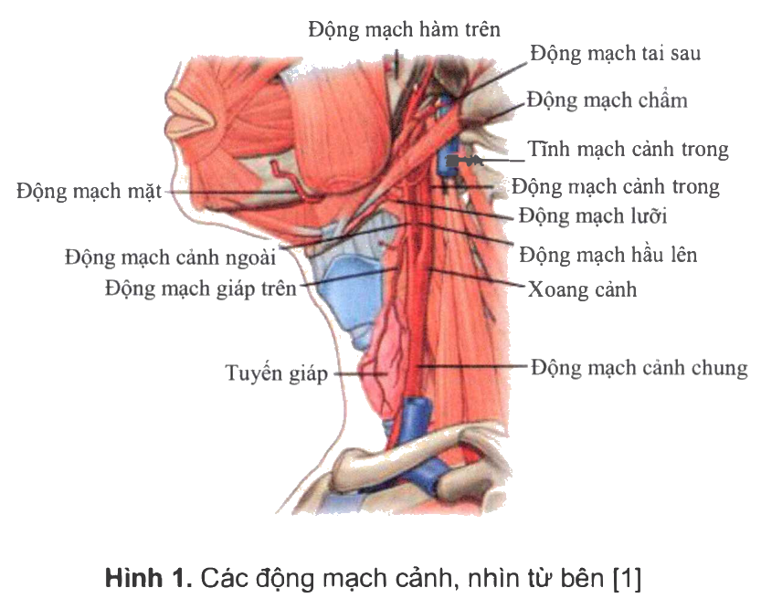

### 2. Tận cùng và xoang cảnh, thể cảnh

- Hai động mạch cảnh chung chạy thẳng đứng lên trên vùng cổ trong bao cảnh (*vagina carotica*).
- Đến ngang bờ trên sụn giáp (*cartilago thyroidea*) hoặc ngang mức đốt sống cổ C4, động mạch chia thành hai nhánh tận:
  - **Động mạch cảnh ngoài (*a. carotis externa*)**: Cấp máu chủ yếu cho cấu trúc bên ngoài hộp sọ, các tạng vùng cổ và khối xương hàm mặt.
  - **Động mạch cảnh trong (*a. carotis interna*)**: Chui vào trong hộp sọ cấp máu cho não bộ và nhãn cầu.

> [!IMPORTANT]
> **Xoang cảnh (*sinus caroticus*) và Thể cảnh (*glomus caroticum*)**:
> - **Xoang cảnh**: Chỗ phình nhẹ ở đoạn tận của động mạch cảnh chung hoặc đoạn đầu động mạch cảnh trong. Vách xoang chứa các thụ thể áp lực (*baroreceptors*), chịu sự chi phối cảm giác chủ yếu từ nhánh xoang cảnh của thần kinh thiệt hầu (dây IX) và một phần dây lang thang (dây X). Khi huyết áp tăng, kích thích thụ thể làm phản xạ giảm nhịp tim và giãn mạch hạ huyết áp.
> - **Thể cảnh (cúc cảnh)**: Khối mô nhỏ hình bầu dục nằm ở chỗ chẽ đôi của động mạch cảnh chung. Thể cảnh chứa các thụ thể hóa học (*chemoreceptors*) cực kỳ nhạy cảm với sự giảm nồng độ oxy ($pO_2$), tăng $CO_2$ và tăng ion $H^+$ (toan máu) trong máu động mạch, đóng vai trò điều hòa phản xạ thông khí hô hấp.

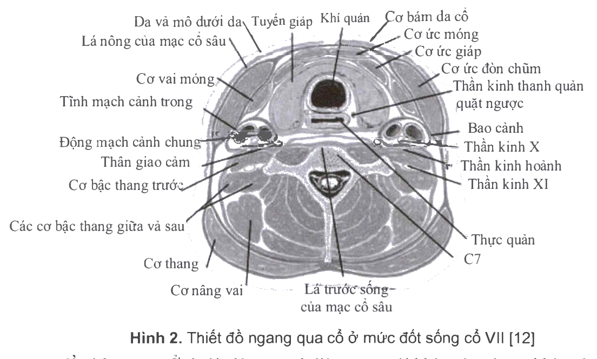

### 3. Đường đi và liên quan

#### 3.1. Đoạn ngực (chỉ có ở động mạch cảnh chung trái)
- **Phía trước**: Xương ức, cơ ức - giáp, cơ ức - móng, tuyến hung (ở trẻ em) và tĩnh mạch cánh tay đầu trái bắt chéo phía trước.
- **Phía sau**: Khí quản, thần kinh thanh quản quặt ngược trái, thực quản và động mạch dưới đòn trái.
- **Phía ngoài**: Phổi và màng phổi trung thất trái, thần kinh hoành trái, thần kinh lang thang (X) trái.
- **Phía trong**: Thân cánh tay đầu và khí quản.

#### 3.2. Đoạn cổ (chung cho cả hai bên)
Chạy trong **bao cảnh (*vagina carotica*)** thuộc mạc cổ:
- Trong bao cảnh: Động mạch nằm ở **phía trong**, tĩnh mạch cảnh trong (*v. jugularis interna*) nằm ở **phía ngoài**, và thần kinh lang thang (*n. vagus - X*) nằm ở **rãnh góc phía sau** giữa động mạch và tĩnh mạch. Quai cổ (*ansa cervicalis*) nằm trên mặt trước bao cảnh.

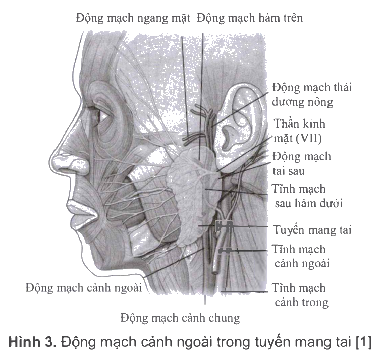

- **Liên quan phía trước - nông**:
  - Cơ ức - đòn - chũm che phủ phần dưới; phần trên động mạch nằm trong **tam giác cảnh (*trigonum caroticum*)**, được phủ bởi lá nông mạc cổ, cơ bám da cổ và da.
  - Cơ vai - móng bắt chéo phía trước động mạch ở ngang mức sụn nhẫn (chia liên quan thành đoạn dưới cơ vai móng và trên cơ vai móng).
  - Tĩnh mạch giáp trên và tĩnh mạch giáp giữa bắt chéo phía trước động mạch để đổ vào tĩnh mạch cảnh trong.
- **Liên quan phía sau**:
  - Mỏm ngang các đốt sống cổ (C4 - C6), các cơ trước sống (cơ dài đầu, cơ dài cổ) phủ bởi lá trước sống mạc cổ.
  - Chuỗi hạch giao cảm cổ nằm ngay sau bao cảnh (dọc trên cơ dài cổ).
  - Củ cảnh Chassaignac (mỏm ngang đốt sống cổ C6): Điểm mốc giải phẫu quan trọng để ép cầm máu động mạch cảnh chung.
  - Động mạch giáp dưới và quai thần kinh thanh quản quặt ngược bắt chéo phía sau bao cảnh ở nền cổ.
- **Liên quan phía trong**:
  - Khí quản, thực quản, thần kinh thanh quản quặt ngược nằm trong rãnh khí - thực quản.
  - Tuyến giáp (thùy bên tuyến giáp áp sát mặt trong bao cảnh).
  - Thanh quản và hầu ở phía trên.

---

## III. ĐỘNG MẠCH CẢNH NGOÀI (*A. CAROTIS EXTERNA*)

### 1. Nguyên ủy, đường đi và tận cùng

- **Nguyên ủy**: Tách từ động mạch cảnh chung ngang bờ trên sụn giáp (ngang mức C4).
- **Đường đi**: Từ tam giác cảnh, động mạch chạy lên trên và ra trước, sau đó đi sâu vào trong tuyến nước bọt mang tai, đi sau ngành đứng xương hàm dưới.
- **Tận cùng**: Ở ngang mức cổ lồi cầu xương hàm dưới (trong tuyến mang tai), động mạch chia thành 2 nhánh tận: **động mạch thái dương nông** và **động mạch hàm**.

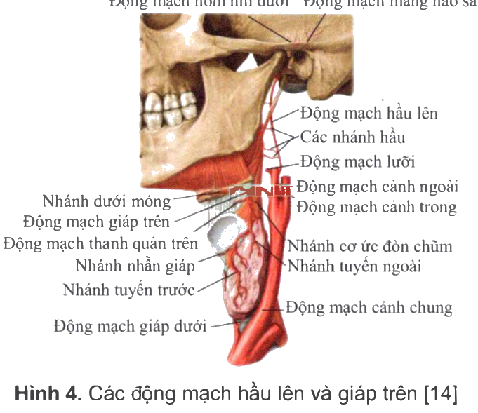
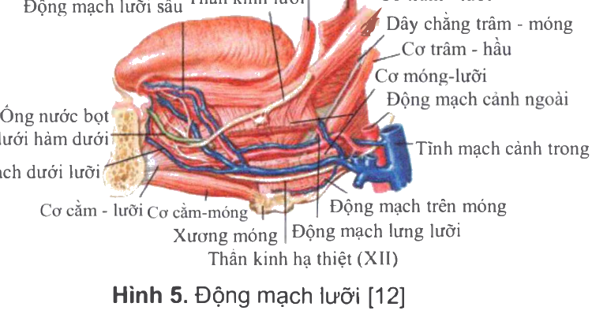

### 2. Liên quan giải phẫu

1. **Ở tam giác cảnh**: Động mạch nằm nông, ngay trước - trong so với động mạch cảnh trong. Được che phủ bởi da, cơ bám da cổ, lá nông mạc cổ và bờ trước cơ ức - đòn - chũm. Thần kinh hạ thiệt (dây XII) bắt chéo mặt ngoài động mạch cảnh ngoài.
2. **Đoạn sau cơ nhị thân và cơ trâm - móng**: Động mạch chạy sâu vào vùng sau hàm, bắt chéo phía sau bụng sau cơ nhị thân và cơ trâm - móng.
3. **Trong tuyến nước bọt mang tai**: Động mạch nằm ở lớp sâu nhất của tuyến mang tai. Từ nông vào sâu gồm:
   - Thần kinh mặt (VII) (nông nhất).
   - Tĩnh mạch sau hàm dưới (*v. retromandibularis*).
   - Động mạch cảnh ngoài (sâu nhất, sát bao tuyến và thành bên hầu).

### 3. Các nhánh bên của động mạch cảnh ngoài

Động mạch cảnh ngoài cho **6 nhánh bên** chính tỏa ra các hướng:

| Tên nhánh bên | Nguyên ủy & Hướng đi | Vùng cấp máu & Nhánh chính |
| :--- | :--- | :--- |
| **1. Động mạch giáp trên** (*a. thyroidea superior*) | Tách ngay gần nguyên ủy bờ trên sụn giáp, chạy xuống dưới và ra trước vào cực trên thùy tuyến giáp. | - Cực trên tuyến giáp. - Động mạch thanh quản trên (*a. laryngea superior*) chui qua màng giáp - móng cấp máu niêm mạc thanh quản. |
| **2. Động mạch hầu lên** (*a. pharyngea ascendens*) | Tách từ mặt sau - trong, chạy thẳng đứng lên trên dọc theo thành bên hầu đến nền sọ. | - Thành hầu, amidan khẩu cái, vòi tai. - Động mạch màng não sau (*a. meningea posterior*) qua lỗ rách/lỗ tĩnh mạch cảnh. |
| **3. Động mạch lưỡi** (*a. lingualis*) | Tách ngang mức sừng lớn xương móng, đi sâu vào cơ móng - lưỡi vào vùng sàn miệng và lưỡi. | - Nhánh trên móng, nhánh dưới lưỡi. - Động mạch lưỡi sâu (*a. profunda linguae*) chạy tới đỉnh lưỡi. - Các nhánh lưng lưỡi. |
| **4. Động mạch mặt** (*a. facialis*) | Tách trên đm lưỡi, chạy vòng qua bờ dưới thân xương hàm dưới (trước cơ cắn) lên mặt đến góc trong mắt. | - Đoạn cổ: ĐM khẩu cái lên, nhánh hạnh nhân, ĐM dưới cằm. - Đoạn mặt: ĐM môi dưới, ĐM môi trên, ĐM góc (*a. angularis*) nối với nhánh mắt của ĐM cảnh trong. |
| **5. Động mạch chẩm** (*a. occipitalis*) | Tách từ mặt sau ngang bụng sau cơ nhị thân, chạy ra sau dưới rãnh động mạch chẩm xương thái dương. | - Da đầu vùng chẩm, cơ vùng gáy, nhánh màng não chẩm, nhánh chũm. |
| **6. Động mạch tai sau** (*a. auricularis posterior*) | Tách phía trên đm chẩm, chạy ra sau lên trên giữa ống tai ngoài và mỏm chũm. | - Vành tai ngoài, da đầu sau tai. - Động mạch trâm - chũm (*a. stylomastoidea*) vào hòm nhĩ và ống thần kinh mặt. |

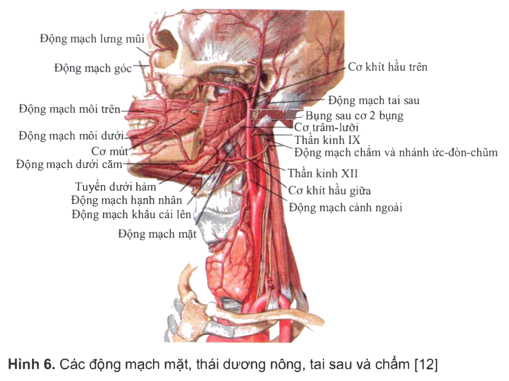
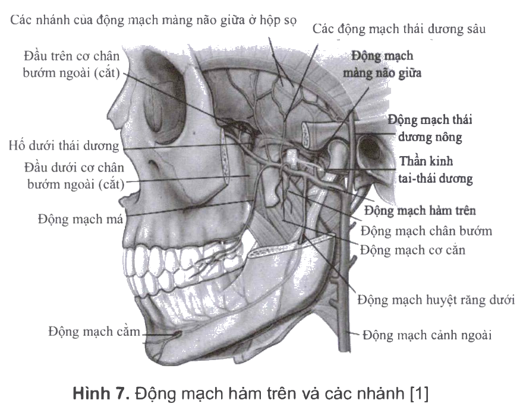

### 4. Hai nhánh tận của động mạch cảnh ngoài

#### 4.1. Động mạch thái dương nông (*a. temporalis superficialis*)
- Đi thẳng đứng lên trên qua rễ mỏm gò má xương thái dương (ngay trước nắp tai ngoài), cùng đi với thần kinh tai - thái dương.
- Cho các nhánh: nhánh ngang mặt (*a. transversa faciei*), nhánh tai trước, nhánh thái dương giữa.
- Tận cùng chia thành **nhánh trán** (*ramus frontalis*) và **nhánh đỉnh** (*ramus parietalis*) cấp máu cho da đầu vùng trán - đỉnh, nối phong phú với động mạch trên ổ mắt và động mạch chẩm.

#### 4.2. Động mạch hàm (*a. maxillaris*)
- Chạy ngang ra trước, đi qua hố sau hàm dưới, hố dưới thái dương rồi vào hố chân bướm - khẩu cái.
- Chia thành 3 đoạn chức năng cấp máu sâu cho khối xương hàm mặt:
  1. **Đoạn hàm dưới**: Cho **động mạch màng não giữa** (*a. meningea media*) chui qua lỗ gai (*foramen spinosum*) vào sọ cấp máu cho màng cứng (chấn thương va đập thái dương dễ gây rách đm màng não giữa dẫn đến máu tụ ngoài màng cứng); **động mạch huyệt răng dưới** vào ống hàm dưới nuôi răng hàm dưới.
  2. **Đoạn chân bướm**: Cho các nhánh cơ cắn, cơ thái dương, cơ chân bướm và động mạch má.
  3. **Đoạn chân bướm - khẩu cái**: Cho **động mạch dưới ổ mắt**, **động mạch khẩu cái lớn**, **động mạch huyệt răng trên sau**, và tận cùng là **động mạch bướm - khẩu cái** (*a. sphenopalatina*) qua lỗ bướm khẩu cái vào hốc mũi (nguồn cấp máu chính cho niêm mạc mũi).

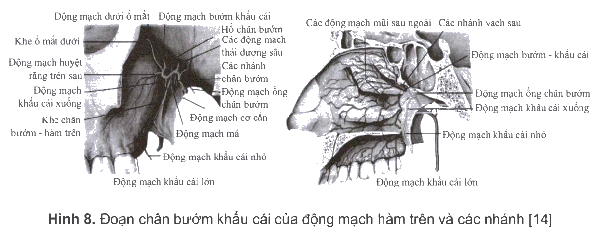
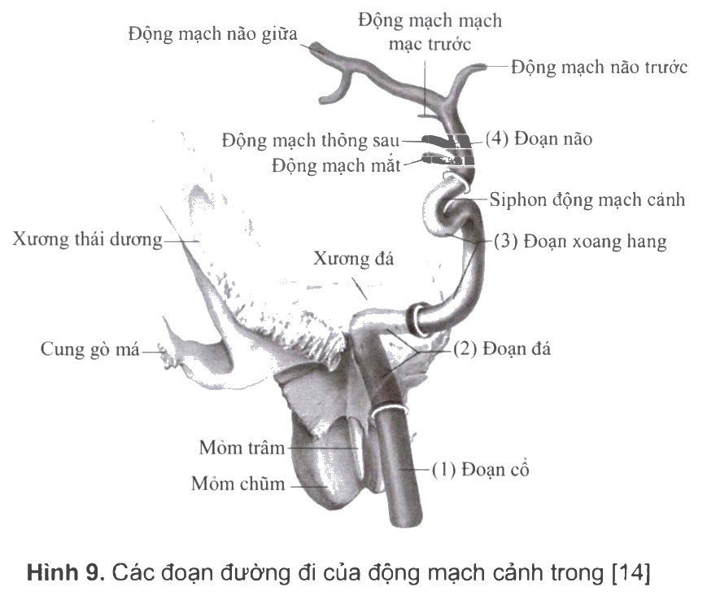

---

## IV. ĐỘNG MẠCH CẢNH TRONG (*A. CAROTIS INTERNA*)

### 1. Nguyên ủy và tổng quan

- **Nguyên ủy**: Tách từ động mạch cảnh chung ngang mức bờ trên sụn giáp (C4).
- Chạy thẳng đứng lên trên vào ống động mạch cảnh (*canalis caroticus*) của xương thái dương, vào trong sọ, đi qua xoang hang và tận cùng ở khoang dưới nhện nền não bằng cách chia thành 4 nhánh tận.
- Động mạch cảnh trong **không phân nhánh bên nào ở vùng cổ**.

### 2. Phân đoạn giải phẫu

Theo giải phẫu kinh điển và lâm sàng ngoại thần kinh (phân loại Bouthillier), động mạch cảnh trong gồm 4 đoạn chính:

1. **Đoạn cổ (*pars cervicalis*)**:
   - Nằm trong tam giác cảnh, sau đó chui sâu vào sau cơ nhị thân và cơ trâm, đi lên mặt bên thành hầu đến lỗ ống cảnh ở nền sọ ngoài.
   - Luôn nằm sau và ngoài so với động mạch cảnh ngoài ở đoạn đầu, sau đó đi sâu vào trong. Đi cùng tĩnh mạch cảnh trong (nằm ngoài) và 4 dây thần kinh sọ cuối (IX, X, XI, XII).
2. **Đoạn đá (*pars petrosa*)**:
   - Nằm trong ống cảnh của phần đá xương thái dương. Đoạn này có dạng chữ L (chạy đứng lên rồi bẻ góc nằm ngang ra trước vào trong).
   - Cho các nhánh cảnh nhĩ (*aa. caroticotympanicae*) vào hòm nhĩ và nhánh ống chân bướm.
3. **Đoạn hang (*pars cavernosa*)**:
   - Chui ra khỏi ống cảnh qua lỗ rách, uốn cong hình chữ S nằm bên trong **xoang tĩnh mạch hang**.
   - Chạy dọc theo rãnh cảnh của xương bướm, được nội mô xoang hang bao bọc. Thần kinh dạng (VI) đi áp sát mặt ngoài động mạch trong lòng xoang hang.
   - Thành ngoài xoang hang chứa: Thần kinh vận nhãn (III), thần kinh ròng rọc (IV), thần kinh mắt ($V_1$), và thần kinh hàm trên ($V_2$).
4. **Đoạn não (*pars cerebralis*)**:
   - Động mạch xuyên qua màng cứng ở mỏm yên trước vào khoang dưới nhện nền não. Uốn cong tạo thành **siphon cảnh**.
   - Cho **động mạch mắt (*a. ophthalmica*)** chui qua ống thị giác vào ổ mắt cùng dây thần kinh thị giác (II).

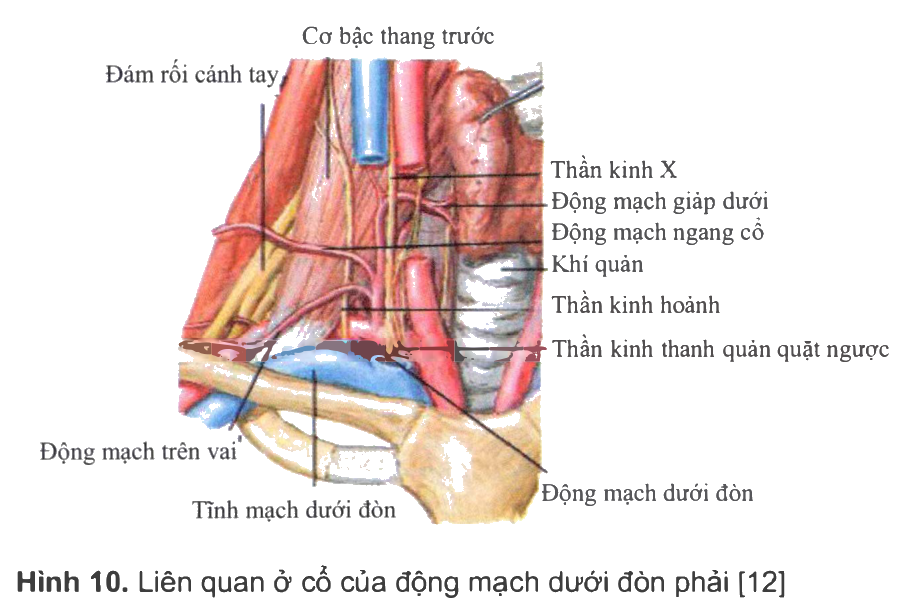

### 3. Các nhánh tận của động mạch cảnh trong

Tại khoang dưới nhện ở chất thủng trước, động mạch cảnh trong tận cùng bằng 4 nhánh chính:
1. **Động mạch não trước (*a. cerebri anterior*)**: Chạy ra trước và vào trong, nối với động mạch não trước đối bên qua **động mạch thông trước (*a. communicans anterior*)**, sau đó vòng quanh thể chai cấp máu cho mặt trong bán cầu đại não.
2. **Động mạch não giữa (*a. cerebri media*)**: Là nhánh cùng lớn nhất, chạy vào rãnh bên (Sylvius), cấp máu cho phần lớn mặt ngoài bán cầu đại não (vùng vận động, cảm giác, ngôn ngữ Broca và Wernicke).
3. **Động mạch thông sau (*a. communicans posterior*)**: Chạy ra sau nối với động mạch não sau (nhánh của động mạch nền), tạo thành cạnh bên của đa giác Willis.
4. **Động mạch mạch mạc trước (*a. choroidea anterior*)**: Chạy ra sau vào đám rối mạch mạc não thất bên, cấp máu cho bao trong và thể gối ngoài.

---

## V. ĐA GIÁC WILLIS (VÒNG ĐỘNG MẠCH NÃO - *CIRCULUS ARTERIOSUS CEREBRI*)

### 1. Cấu tạo của Đa giác Willis

Đa giác Willis là vòng nối động mạch nằm ở khoang dưới nhện quanh cuống não, tuyến yên và giao thoa thị giác tại đáy não. Vòng nối này kết nối hai hệ thống tuần hoàn chính:
- **Hệ động mạch cảnh trong** (hệ tuần hoàn trước).
- **Hệ động mạch đốt sống - thân nền** (hệ tuần hoàn sau).

**7 cạnh động mạch cấu tạo nên vòng cung hoàn chỉnh:**
1. **Phía trước**: Động mạch thông trước (*a. communicans anterior*) nối hai động mạch não trước.
2. **Phía trước - bên**: Hai đoạn A1 của động mạch não trước (*a. cerebri anterior*).
3. **Hai bên**: Hai động mạch thông sau (*a. communicans posterior*) nối động mạch cảnh trong với động mạch não sau.
4. **Phía sau - bên**: Hai đoạn P1 của động mạch não sau (*a. cerebri posterior*) - tách từ chỗ phân đôi của động mạch nền (*a. basilaris*).

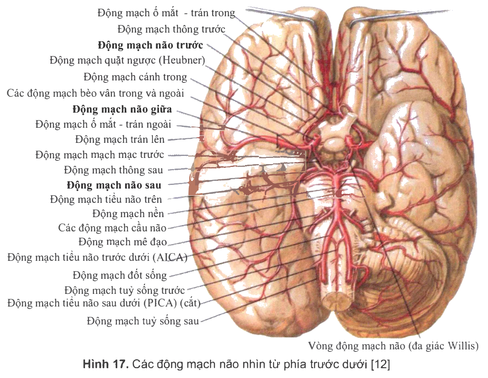

### 2. Ý nghĩa chức năng và lâm sàng
- Đa giác Willis đóng vai trò cân bằng áp lực tưới máu giữa hai bán cầu đại não và giữa hệ động mạch cảnh với hệ đốt sống - nền.
- Khi một động mạch lớn bị hẹp hoặc tắc từ từ (như xơ vữa động mạch cảnh), vòng nối giúp thiết lập tuần hoàn bàng hệ bù trừ sang vùng thiếu máu.
- Các chỗ phân nhánh của đa giác Willis (đặc biệt là động mạch thông trước và chỗ nối động mạch thông sau) là vị trí hay gặp nhất của túi phình động mạch nội sọ bẩm sinh (*berry aneurysm*). Khi túi phình vỡ gây xuất huyết dưới nhện cấp tính với triệu chứng đau đầu sét đánh, cứng gáy.

---

## VI. ĐỘNG MẠCH DƯỚI ĐÒN (*A. SUBCLAVIA*) ĐOẠN CỔ

Động mạch dưới đòn cấp máu cho chi trên, đồng thời cho các nhánh bên cực kỳ quan trọng lên nuôi não bộ và vùng cổ:

### 1. Nguyên ủy và liên quan
- **Bên phải**: Tách từ thân cánh tay đầu sau khớp ức - đòn phải.
- **Bên trái**: Tách trực tiếp từ cung động mạch chủ trong lồng ngực.
- Động mạch cong thành một vòm qua đỉnh màng phổi và xương sườn 1.
- **Cơ bậc thang trước (*m. scalenus anterior*)** bắt chéo phía trước động mạch, chia động mạch dưới đòn thành 3 đoạn:
  1. **Đoạn trong cơ bậc thang**: Liên quan phía trước với tĩnh mạch dưới đòn, dây thần kinh lang thang (X), thần kinh hoành, và quai thần kinh thanh quản quặt ngược phải.
  2. **Đoạn sau cơ bậc thang**: Nằm trong khe cơ bậc thang cùng với các thân của đám rối thần kinh cánh tay (ngay trên rãnh động mạch của xương sườn 1).
  3. **Đoạn ngoài cơ bậc thang**: Nằm trong tam giác chẩm / tam giác trên đòn trước khi đổi tên thành động mạch nách ở bờ ngoài xương sườn 1.

### 2. Các nhánh bên quan trọng vùng nền cổ

| Tên nhánh bên | Hướng đi | Vùng cấp máu chính |
| :--- | :--- | :--- |
| **1. Động mạch đốt sống** (*a. vertebralis*) | Chui vào lỗ mỏm ngang đốt sống cổ C6, chạy ngược lên qua các lỗ C6 - C1, chui qua màng chẩm đội vào lỗ lớn xương chẩm. | Hai động mạch hợp nhất ở rãnh hành - cầu tạo nên **động mạch nền (*a. basilaris*)**, cấp máu thân não, tiểu não và thùy chẩm (hệ tuần hoàn sau). |
| **2. Động mạch ngực trong** (*a. thoracica interna*) | Chạy xuống dưới vào lồng ngực sau các sụn sườn 1 - 6. | Thành ngực trước, tuyến vú, cơ hoành, cho nhánh màng ngoài tim - hoành. |
| **3. Thân giáp - cổ** (*truncus thyrocervicalis*) | Tách ở bờ trong cơ bậc thang trước, chia thành 3 - 4 nhánh: | - **ĐM giáp dưới** (*a. thyroidea inferior*): Cấp máu cực dưới tuyến giáp và tuyến cận giáp. - **ĐM ngang cổ** (*a. transversa colli*). - **ĐM trên vai** (*a. suprascapularis*). |
| **4. Thân sườn - cổ** (*truncus costocervicalis*) | Đi ra sau đỉnh màng phổi chia thành 2 nhánh: | - **ĐM gian sườn trên cùng**: Cho 2 khoang gian sườn đầu. - **ĐM cổ sâu**: Cấp máu cơ sâu vùng gáy. |

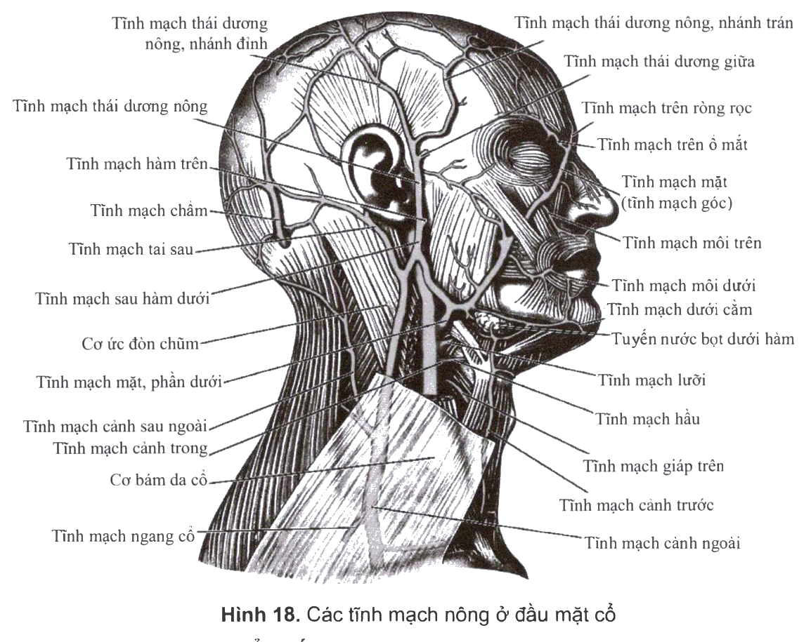

---

## VII. TĨNH MẠCH VÙNG ĐẦU - CỔ

Hệ thống tĩnh mạch đầu - cổ bao gồm:
1. **Các xoang tĩnh mạch màng cứng** (thu máu nội sọ).
2. **Tĩnh mạch cảnh trong** (thân thu máu chính của nội sọ và sâu vùng cổ).
3. **Các tĩnh mạch nông**: Tĩnh mạch cảnh ngoài, tĩnh mạch cảnh trước.

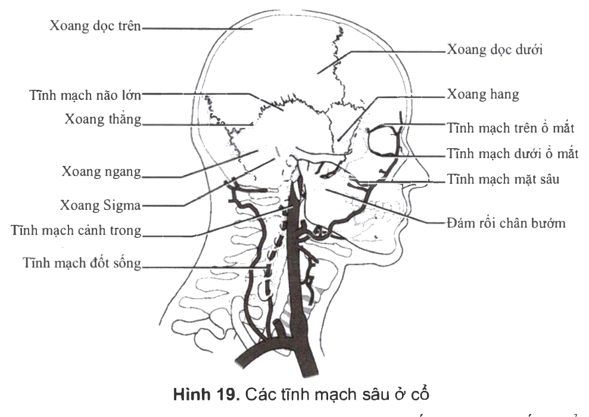

### 1. Tĩnh mạch cảnh trong (*V. jugularis interna*)

- **Nguyên ủy**: Là sự tiếp nối trực tiếp của **xoang tĩnh mạch sigma** tại lỗ tĩnh mạch cảnh (*foramen jugulare*) ở nền sọ. Tại đây tĩnh mạch phình to tạo thành **hành trên tĩnh mạch cảnh** (*bulbus superior v. jugularis*).
- **Đường đi**: Chạy thẳng đứng xuống dưới trong bao cảnh, nằm ở phía ngoài động mạch cảnh trong (ở trên) và động mạch cảnh chung (ở dưới).
- **Tận cùng**: Ở phía sau khớp ức - đòn, tĩnh mạch phình nhẹ tạo thành **hành dưới tĩnh mạch cảnh** (*bulbus inferior v. jugularis*) rồi hợp cùng **tĩnh mạch dưới đòn (*v. subclavia*)** để tạo thành **tĩnh mạch cánh tay đầu (*v. brachiocephalica*)** tại **góc tĩnh mạch Pirogoff**. 
  - Tại góc tĩnh mạch bên trái có **ống ngực (*ductus thoracicus*)** đổ vào.
  - Tại góc tĩnh mạch bên phải có **ống bạch huyết phải (*ductus lymphaticus dexter*)** đổ vào.

- **Các tĩnh mạch phụ lưu đổ vào tĩnh mạch cảnh trong**:
  - Xoang đá dưới (*sinus petrosus inferior*).
  - Thân tĩnh mạch giáp - lưỡi - mặt (*truncus thyrolinguofacialis*) (hoặc tách riêng: TM mặt, TM lưỡi, TM giáp trên).
  - Tĩnh mạch hầu (*vv. pharyngeae*).
  - Tĩnh mạch giáp giữa (*v. thyroidea media*).

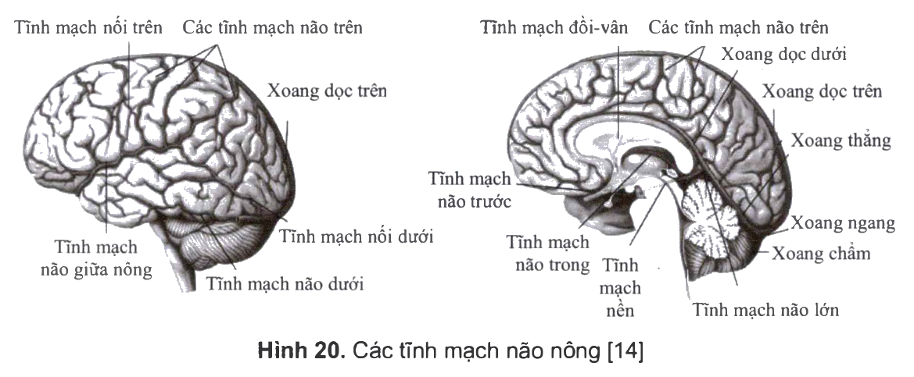

### 2. Các tĩnh mạch nông vùng cổ

#### 2.1. Tĩnh mạch cảnh ngoài (*v. jugularis externa*)
- Hình thành ở góc hàm do sự hợp nhất của **nhánh sau tĩnh mạch sau hàm dưới** và **tĩnh mạch tai sau**.
- Chạy thẳng xuống dưới bắt chéo nông mặt ngoài cơ ức - đòn - chũm ngay dưới cơ bám da cổ, đổ vào tĩnh mạch dưới đòn hoặc góc tĩnh mạch.

#### 2.2. Tĩnh mạch cảnh trước (*v. jugularis anterior*)
- Thu máu vùng dưới cằm, chạy dọc hai bên đường giữa cổ trước.
- Ở phía trên cán ức, hai tĩnh mạch cảnh trước nối với nhau qua **cung tĩnh mạch cảnh** (*arcus venosus jugularis*) trong khoang trên ức trước khi quặt ngang ra ngoài đổ vào tĩnh mạch cảnh ngoài hoặc tĩnh mạch dưới đòn.

---

## VIII. CÁC XOANG TĨNH MẠCH MÀNG CỨNG (*SINUS DURAE MATRIS*)

Các xoang tĩnh mạch màng cứng là những kênh tĩnh mạch nội sọ đặc biệt nằm giữa hai lá của màng cứng (lá cốt mạc và lá não) hoặc giữa các nếp màng cứng. 
- **Đặc điểm**: Thành xoang là mô xơ dày của màng cứng, không có lớp cơ trơn và **hoàn toàn không có van tĩnh mạch**. Vì vậy, áp lực dòng máu có thể đảo chiều tùy thuộc vào tư thế và áp lực nội sọ/ngoại biên.

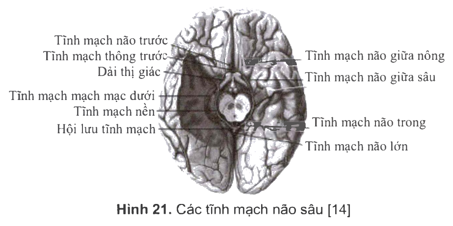

### 1. Nhóm xoang sau - trên
1. **Xoang dọc trên (*sinus sagittalis superior*)**: Chạy dọc bờ cong lồi của liềm đại não từ mào gà xương tràng đến ụ chẩm trong.
2. **Xoang dọc dưới (*sinus sagittalis inferior*)**: Chạy ở bờ tự do dưới của liềm đại não, cùng với **tĩnh mạch não lớn Galen (*v. cerebri magna*)** đổ vào **xoang thẳng**.
3. **Xoang thẳng (*sinus rectus*)**: Chạy dọc chỗ bám của liềm đại não vào lều tiểu não, chạy về hội lưu xoang.
4. **Hội lưu xoang Herophilus (*confluens sinuum*)**: Nằm ở mặt trong ụ chẩm trong, là nơi hội tụ của xoang dọc trên, xoang thẳng, xoang chẩm và hai xoang ngang.
5. **Xoang ngang (*sinus transversus*)**: Chạy ngang từ hội lưu xoang dọc theo rãnh xoang ngang của xương chẩm sang hai bên.
6. **Xoang sigma (*sinus sigmoideus*)**: Là sự tiếp nối uốn cong hình chữ S của xoang ngang trong rãnh xoang sigma xương thái dương, tận cùng đổ ra lỗ tĩnh mạch cảnh tạo nên tĩnh mạch cảnh trong.

### 2. Nhóm xoang trước - dưới
1. **Xoang hang (*sinus cavernosus*)**: 
   - Đôi xoang tĩnh mạch dạng tổ ong lớn nằm hai bên thân xương bướm và hố yên.
   - Nhận máu từ tĩnh mạch mắt trên, tĩnh mạch mắt dưới và xoang bướm - đỉnh.
   - Hai xoang hang nối với nhau qua xoang gian hang trước và sau.
   - Dẫn lưu máu ra sau theo hai con đường: **xoang đá trên** (đổ vào xoang ngang/sigma) và **xoang đá dưới** (đổ thẳng vào hành trên tĩnh mạch cảnh trong).
2. **Xoang chẩm (*sinus occipitalis*)**: Chạy quanh lỗ lớn xương chẩm.

> [!CAUTION]
> **Ứng dụng lâm sàng: Nhiễm trùng vùng tam giác mặt (Tam giác nguy hiểm) và Viêm tắc xoang hang**:
> - Vùng tam giác mặt (giới hạn từ gốc mũi xuống hai khóe miệng) có tĩnh mạch mặt nối thông trực tiếp với **tĩnh mạch mắt** và **đám rối tĩnh mạch chân bướm**, các cấu trúc này lại dẫn lưu trực tiếp vào **xoang hang**.
> - Do hệ tĩnh mạch mặt không có van, các ổ nhiễm trùng ở vùng này (mụn nhọt mủ, đinh râu) nếu nặn hoặc xử trí sai cách có thể làm vi khuẩn đi ngược dòng vào xoang hang gây **viêm tắc huyết khối xoang hang (*cavernous sinus thrombosis*)**. Đây là biến chứng ngoại thần kinh cực kỳ nặng nề, đe dọa tính mạng với các dấu hiệu lồi mắt, phù nề kết mạc, liệt các dây thần kinh vận nhãn (III, IV, VI) và tổn thương nhánh cảm giác dây V.

---

## IX. CÂU HỎI TỰ LƯỢNG GIÁ & ÔN TẬP

1. **Động mạch cảnh chung phân đôi thành động mạch cảnh trong và cảnh ngoài ở mốc ngang mức nào?**
   - A. Bờ dưới sụn nhẫn (C6)
   - B. Xương móng (C3)
   - C. Bờ trên sụn giáp (C4)
   - D. Góc xương hàm dưới (C2)
   *(Đáp án đúng: C)*

2. **Cấu trúc nào sau đây nhận cảm thụ thể áp lực giúp điều hòa huyết áp?**
   - A. Thể cảnh (*glomus caroticum*)
   - B. Xoang cảnh (*sinus caroticus*)
   - C. Tuyến ức
   - D. Hạch cổ trên

   *(Đáp án đúng: B)*

3. **Thành phần nào nằm sâu nhất trong tuyến nước bọt mang tai?**
   - A. Thần kinh mặt (VII)
   - B. Tĩnh mạch sau hàm dưới
   - C. Động mạch cảnh ngoài
   - D. Động mạch mặt

   *(Đáp án đúng: C)*

4. **Động mạch màng não giữa (*a. meningea media*) là nhánh tách từ động mạch nào và chui qua lỗ nào của nền sọ?**
   - A. Tách từ động mạch hàm, chui qua lỗ gai (*foramen spinosum*)
   - B. Tách từ động mạch thái dương nông, chui qua lỗ bầu dục
   - C. Tách từ động mạch cảnh trong, chui qua lỗ ống cảnh
   - D. Tách từ động mạch mặt, chui qua lỗ rách

   *(Đáp án đúng: A)*

5. **Đa giác Willis được tạo thành bởi các mạch máu sau đây, NGOẠI TRỪ:**
   - A. Động mạch thông trước
   - B. Động mạch não giữa
   - C. Động mạch não trước
   - D. Động mạch thông sau

   *(Đáp án đúng: B - Động mạch não giữa không trực tiếp tham gia tạo thành vòng đa giác Willis mà là nhánh tận tiếp nối tách từ động mạch cảnh trong)*

6. **Dây thần kinh sọ nào đi ngay bên trong lòng xoang tĩnh mạch hang, áp sát mặt ngoài động mạch cảnh trong?**
   - A. Thần kinh vận nhãn (III)
   - B. Thần kinh ròng rọc (IV)
   - C. Thần kinh dạng (VI)
   - D. Thần kinh mắt ($V_1$)

   *(Đáp án đúng: C)*
