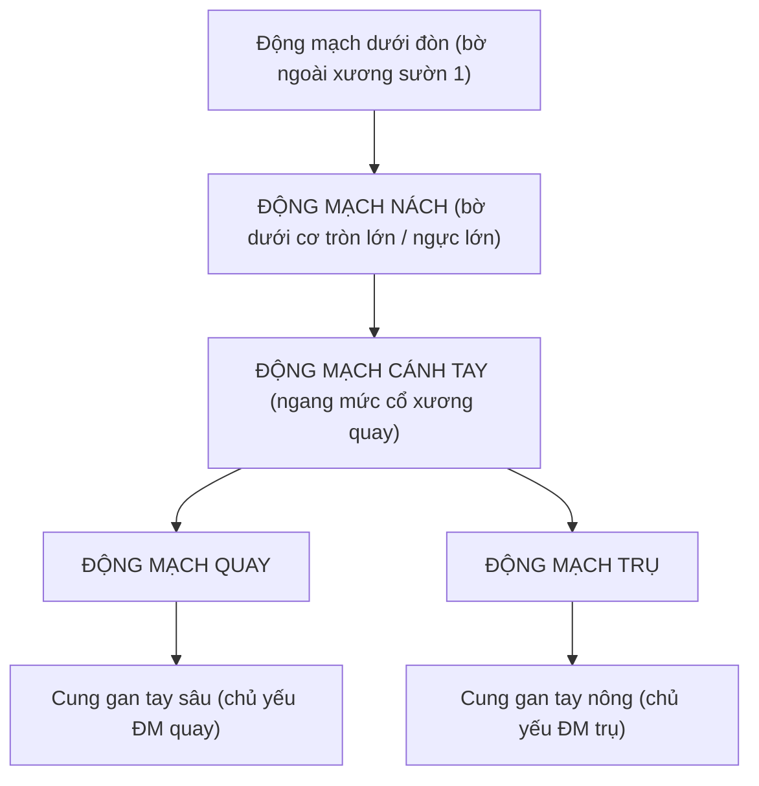
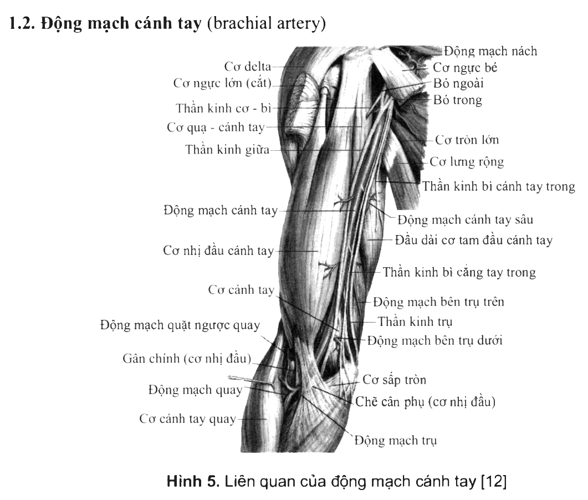
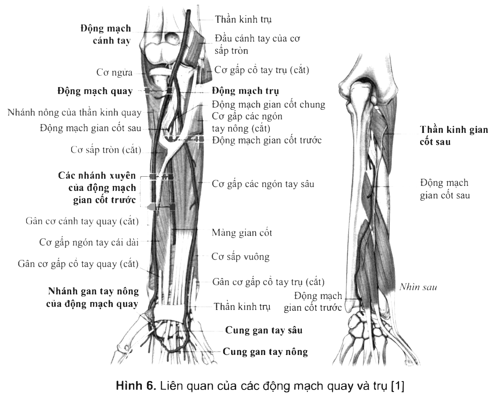
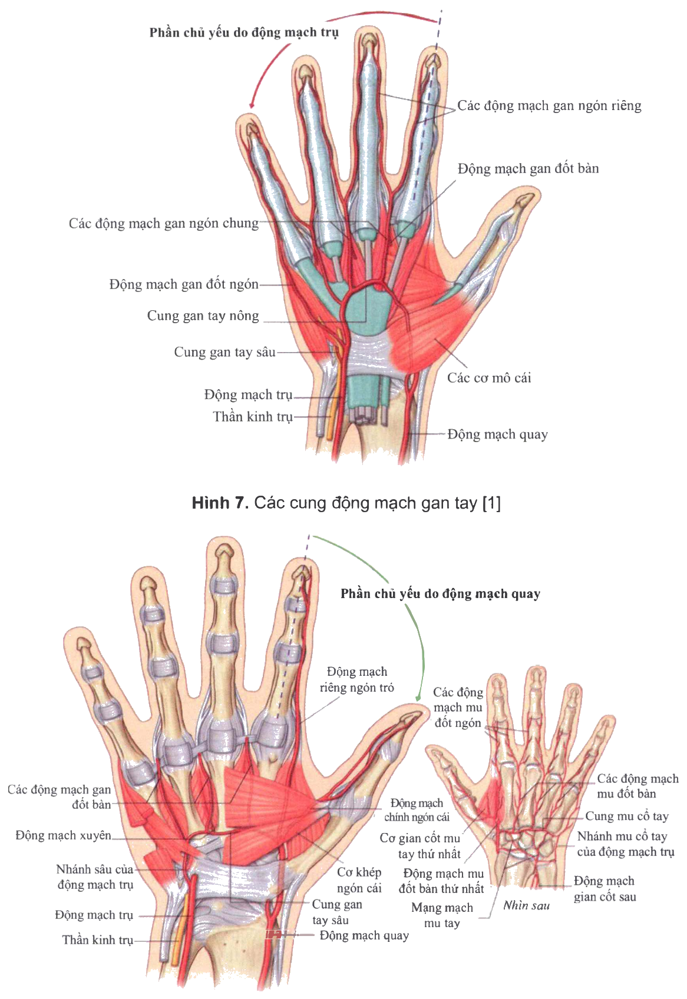
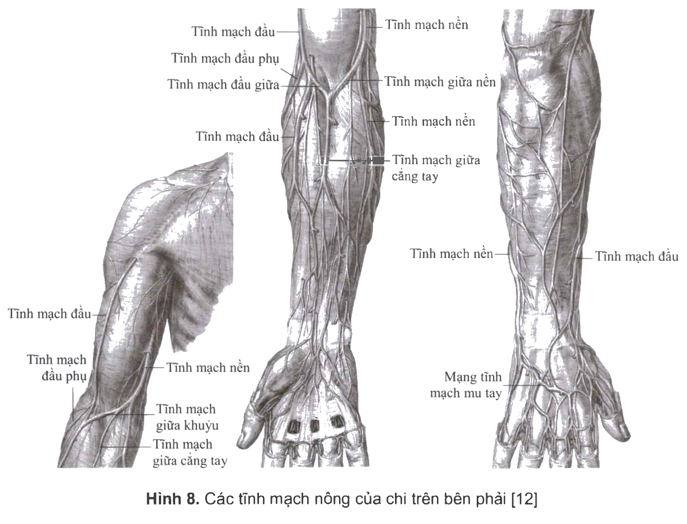

# BÀI 17: MẠCH MÁU CHI TRÊN

**Chương:** Chương 4: Hệ Tim Mạch  
**Chủ biên giáo trình:** PGS.TS. Nguyễn Văn Huy  
**Tác giả:** ThS. Phạm Duy Đức  
**Nguồn tham khảo:** Giáo trình Giải phẫu học Y Hà Nội (Bộ sách Đào tạo Bác sĩ Y khoa 2025), Trang 278 – 291  
**Đơn vị đào tạo:** Bộ môn Giải phẫu – Trường Đại học Y Hà Nội

---

## I. MỤC TIÊU HỌC TẬP

1. Trình bày được nguyên ủy, đường đi, các đoạn liên quan (với cơ bậc thang trước, cơ ngực bé, ống cánh tay, các bó của đám rối thần kinh cánh tay) và các phân nhánh của động mạch dưới đòn, động mạch nách, động mạch cánh tay, động mạch quay và động mạch trụ.
2. Mô tả chi tiết các vòng nối bàng hệ quan trọng: vòng nối quanh ngực, vòng nối quanh vai, mạng mạch quanh khuỷu, cung mu cổ tay, cung gan cổ tay và các cung động mạch gan tay (nông và sâu).
3. Nắm vững cấu trúc, sự tạo thành và các biến thể phân nhánh của các cung động mạch gan tay và mạng lưới cấp máu cho các ngón tay.
4. Trình bày được hệ thống tĩnh mạch chi trên: hệ tĩnh mạch nông (mạng mu tay, tĩnh mạch đầu, tĩnh mạch nền, tĩnh mạch giữa cẳng tay, các kiểu hình chữ M và chữ H ở nếp gấp khuỷu) và hệ tĩnh mạch sâu (tĩnh mạch nách, tĩnh mạch cánh tay, tĩnh mạch tùy hành).
5. Phân tích các ứng dụng lâm sàng cốt lõi: vị trí bắt mạch, đo huyết áp động mạch cánh tay, các vị trí thắt động mạch an toàn và vị trí thắt nguy hiểm, tổn thương đứt mạch máu cổ tay và xử trí cấp cứu chấn thương mạch chi trên.

---

## II. ĐỘNG MẠCH DƯỚI ĐÒN (*ARTERIA SUBCLAVIA*)

Động mạch dưới đòn là thân động mạch chính cấp máu cho chi trên, đồng thời cung cấp các nhánh bên nuôi dưỡng não bộ, tủy sống, vùng nền cổ, thành ngực và thành bụng trước.

### 1. Nguyên ủy và tận cùng
- **Bên phải:** Tách ra từ **thân cánh tay đầu** (*truncus brachiocephalicus*) ở phía sau khớp ức - đòn phải.
- **Bên trái:** Tách trực tiếp từ **cung động mạch chủ** (*arcus aortae*) trong trung thất trên, do đó động mạch dưới đòn trái có thêm một đoạn nằm trong lồng ngực dài khoảng 2,5 – 3 cm trước khi đi lên nền cổ.
- **Tận cùng:** Cả hai động mạch đi cong hình vòm qua vòm màng phổi và xương sườn 1, tới **bờ ngoài xương sườn thứ nhất** (hoặc bờ sau điểm giữa xương đòn) thì đổi tên thành **động mạch nách** (*arteria axillaris*).

### 2. Các đoạn liên quan theo cơ bậc thang trước
Cơ bậc thang trước (*musculus scalenus anterior*) bám vào củ cơ bậc thang (củ Lisfranc) ở mặt trên xương sườn 1, bắt chéo phía trước động mạch dưới đòn và chia động mạch thành 3 đoạn liên quan:

1. **Đoạn trong cơ bậc thang (đoạn trước cơ bậc thang):**
   - Động mạch cong lồi lên trên, vắt qua đỉnh màng phổi và xương sườn 1.
   - *Phía trước:* Liên quan với tĩnh mạch dưới đòn (ngăn cách với động mạch bởi cơ bậc thang trước), dây thần kinh lang thang (*thần kinh X*), dây thần kinh hoành (*n. phrenicus*), và các quai giao cảm cổ. Riêng bên phải, thần kinh thanh quản quặt ngược phải tách từ dây X vòng từ trước ra sau dưới động mạch dưới đòn.
   - *Phía sau:* Áp sát vòm màng phổi, ống ngực (ở bên trái) uốn cong ra trước qua mặt trên động mạch để đổ vào góc tĩnh mạch (hội lưu Pirogoff).
2. **Đoạn sau cơ bậc thang (đoạn trong khe cơ bậc thang):**
   - Động mạch nằm trong **khe cơ bậc thang** (giữa cơ bậc thang trước ở phía trước và cơ bậc thang giữa ở phía sau), áp sát vào rãnh động mạch dưới đòn trên mặt trên xương sườn 1.
   - Các thân của **đám rối thần kinh cánh tay** (*plexus brachialis*) nằm ở phía trên và phía sau động mạch.
   - Tĩnh mạch dưới đòn không đi qua khe này mà đi ở phía trước cơ bậc thang trước.
3. **Đoạn ngoài cơ bậc thang (đoạn sau cơ bậc thang / tam giác trên đòn):**
   - Nằm trong tam giác trên đòn (thuộc tam giác cổ sau).
   - Động mạch nằm nông hơn, tựa trên mặt trên xương sườn 1, phía sau là thân dưới đám rối cánh tay, phía trước ngoài có mạc cổ sâu và xương đòn che phủ. Đây là vị trí có thể ấn đè động mạch dưới đòn vào xương sườn 1 để cầm máu tạm thời trong các vết thương chi trên.

### 3. Các nhánh bên của động mạch dưới đòn
Động mạch dưới đòn cho 5 nhánh bên quan trọng:

| Nhánh bên | Đường đi & Tận cùng | Vùng cấp máu chính |
| :--- | :--- | :--- |
| **1. Động mạch đốt sống** (*a. vertebralis*) | Tách từ mặt trên đoạn trong cơ bậc thang, đi lên chui vào lỗ mỏm ngang đốt sống cổ C6, chạy qua các lỗ mỏm ngang C6 – C1, uốn quanh khối bên đốt đội C1, chui qua màng chẩm - đội vào lỗ lớn xương chẩm (*foramen magnum*). | Hai động mạch hợp nhất ở bờ dưới rãnh hành - cầu tạo nên **động mạch nền** (*a. basilaris*), cấp máu thân não, tiểu não, tủy sống cổ và thùy chẩm đại não (hệ tuần hoàn sau). |
| **2. Động mạch ngực trong** (*a. thoracica interna*) | Tách từ mặt dưới đoạn trong cơ bậc thang, chạy thẳng xuống khoang ngực ở sau các sụn sườn 1 – 6, cách bờ xương ức khoảng 1 – 1,2 cm. Tận cùng bằng ĐM thượng vị trên và ĐM cơ hoành. | Cấp máu thành ngực trước, tuyến vú, cơ hoành (qua ĐM màng ngoài tim - hoành), nối với ĐM thượng vị dưới của ĐM chậu ngoài tạo vòng nối ngực - bụng. |
| **3. Thân giáp - cổ** (*truncus thyrocervicalis*) | Thân ngắn tách từ bờ trên động mạch dưới đòn (gần bờ trong cơ bậc thang trước), nhanh chóng chia thành 3 – 4 nhánh: | - **ĐM giáp dưới** (*a. thyroidea inferior*): Nuôi cực dưới tuyến giáp và tuyến cận giáp. - **ĐM ngang cổ** (*a. transversa colli*) / ĐM cổ nông. - **ĐM trên vai** (*a. suprascapularis*): Chạy ra ngoài vùng vai, tham gia **vòng nối quanh vai**. |
| **4. Thân sườn - cổ** (*truncus costocervicalis*) | Tách từ mặt sau động mạch dưới đòn (đoạn sau cơ bậc thang), đi ra sau đỉnh màng phổi rồi chia thành 2 nhánh: | - **ĐM gian sườn trên cùng** (*a. intercostalis suprema*): Cấp máu 2 khoang gian sườn đầu (khoang 1 và 2). - **ĐM cổ sâu** (*a. cervicalis profunda*): Nuôi các cơ sâu vùng gáy. |
| **5. Động mạch vai sau** (*a. scapularis posterior*) | Thường tách trực tiếp từ đoạn ngoài cơ bậc thang (hoặc là nhánh sâu của ĐM ngang cổ). Đi sâu dưới cơ nâng vai và cơ trám. | Cấp máu cơ vùng lưng - vai, chạy dọc bờ trong xương bả vai, tham gia trực tiếp vào **vòng nối quanh vai**. |

---

## III. ĐỘNG MẠCH NÁCH (*ARTERIA AXILLARIS*)

Động mạch nách là sự tiếp tục của động mạch dưới đòn, bắt đầu từ **bờ ngoài xương sườn 1** (hay bờ sau điểm giữa xương đòn), chạy chếch xuống dưới và ra ngoài qua hố nách. Khi tới **bờ dưới cơ ngực lớn** (hoặc bờ dưới cơ tròn lớn) thì đổi tên thành **động mạch cánh tay** (*arteria brachialis*).

### 1. Đường định hướng và phân đoạn giải phẫu
- **Đường định hướng:** Đường nối từ điểm giữa xương đòn đến điểm giữa nếp gấp khuỷu (khi cánh tay dang vuông góc với thân mình và bàn tay để ngửa).
- **Phân đoạn theo cơ ngực bé (*m. pectoralis minor*):** Cơ ngực bé bắt chéo phía trước động mạch, chia động mạch nách làm 3 đoạn:
  1. *Đoạn trên cơ ngực bé (đoạn thứ nhất):* Từ bờ ngoài xương sườn 1 đến bờ trên cơ ngực bé.
  2. *Đoạn sau cơ ngực bé (đoạn thứ hai):* Nằm ngay sau cơ ngực bé.
  3. *Đoạn dưới cơ ngực bé (đoạn thứ ba):* Từ bờ dưới cơ ngực bé đến bờ dưới cơ ngực lớn (hay bờ dưới cơ tròn lớn).

### 2. Liên quan giải phẫu
- **Liên quan với thành hố nách:**
  - *Thành trước:* Cơ ngực lớn, cơ dưới đòn, cơ ngực bé, mạc đòn ngực.
  - *Thành sau:* Cơ dưới vai, cơ tròn lớn, cơ lưng rộng.
  - *Thành trong:* Cơ răng trước bám trên các xương sườn và các cơ gian sườn trên.
  - *Thành ngoài:* Cơ quạ - cánh tay, đầu ngắn cơ nhị đầu và rãnh gian củ xương cánh tay.
- **Liên quan với tĩnh mạch nách:**
  - **Tĩnh mạch nách** (*v. axillaris*) luôn nằm ở **phía trong** động mạch nách dọc suốt chiều dài của hố nách.
- **Liên quan với các bó và dây thần kinh của đám rối cánh tay:**
  - *Ở đoạn trên cơ ngực bé:* Các bó ngoài và sau nằm ở ngoài động mạch; bó trong chạy ở sau động mạch.
  - *Ở đoạn sau cơ ngực bé:* Các bó vây quanh động mạch đúng theo tên gọi giải phẫu:
    + **Bó ngoài** (*fasciculus lateralis*) nằm ở ngoài động mạch.
    + **Bó trong** (*fasciculus medialis*) nằm ở trong động mạch (giữa động mạch và tĩnh mạch nách).
    + **Bó sau** (*fasciculus posterior*) nằm ở sau động mạch.
  - *Ở đoạn dưới cơ ngực bé:* Các nhánh tận của đám rối cánh tay vây quanh động mạch:
    + Rễ ngoài (từ bó ngoài) và rễ trong (từ bó trong) hợp nhất ở ngay phía trước ngoài động mạch để tạo thành **thần kinh giữa** (*n. medianus*).
    + **Thần kinh cơ bì** (*n. musculocutaneus*) nằm ở phía ngoài rồi đâm xuyên qua cơ quạ - cánh tay.
    + **Thần kinh trụ** (*n. ulnaris*), **thần kinh bì cẳng tay trong** và **thần kinh bì cánh tay trong** nằm ở phía trong động mạch.
    + **Thần kinh quay** (*n. radialis*) và **thần kinh nách** (*n. axillaris*) nằm ở phía sau động mạch.

### 3. Sáu nhánh bên của động mạch nách

Động mạch nách cho 6 nhánh bên phân bố theo 3 đoạn:
1. **Động mạch ngực trên** (*a. thoracica superior*): Tách từ đoạn trên cơ ngực bé, cấp máu cho các cơ gian sườn 1, 2 và phần trên cơ ngực lớn, cơ răng trước.
2. **Động mạch cùng vai - ngực** (*a. thoracoacromialis*): Tách ở bờ trên cơ ngực bé, chọc thủng mạc đòn ngực chia thành 4 nhánh:
   - *Nhánh cùng vai* (*ramus acromialis*): Đi ra mỏm cùng vai, tiếp nối với ĐM trên vai.
   - *Nhánh delta* (*ramus deltoideus*): Đi cùng tĩnh mạch đầu trong rãnh delta - ngực cấp máu cho cơ delta và cơ ngực lớn.
   - *Nhánh ngực* (*rami pectorales*): Cấp máu cho các cơ ngực và tuyến vú.
   - *Nhánh đòn* (*ramus clavicularis*): Nuôi cơ dưới đòn và khớp ức - đòn.
3. **Động mạch ngực ngoài** (*a. thoracica lateralis*): Tách ở đoạn sau cơ ngực bé, đi dọc bờ dưới cơ ngực bé xuống thành ngoài ngực, cấp máu cho cơ răng trước, cơ ngực lớn và các nhánh ngoài cho tuyến vú.
4. **Động mạch dưới vai** (*a. subscapularis*): Là nhánh bên lớn nhất của động mạch nách, tách ở ngang bờ dưới cơ dưới vai rồi chia thành:
   - *Động mạch ngực - lưng** (*a. thoracodorsalis*): Chạy xuống nuôi cơ lưng rộng và cơ răng trước.
   - *Động mạch mũ vai* (*a. circumflexa scapulae*): Chui qua **tam giác vai - tam đầu** (lỗ tam giác tam đầu) ra vùng sau xương vai để tạo thành **vòng nối quanh vai**.
5. **Động mạch mũ cánh tay trước** (*a. circumflexa humeri anterior*): Nhỏ, chạy vòng quanh mặt trước cổ phẫu thuật xương cánh tay dưới cơ quạ - cánh tay và cơ nhị đầu, tiếp nối với động mạch mũ cánh tay sau.
6. **Động mạch mũ cánh tay sau** (*a. circumflexa humeri posterior*): Lớn hơn nhánh trước, cùng với **thần kinh nách** chui qua **tứ giác cánh tay - tam đầu** (lỗ tứ giác) vòng quanh mặt sau cổ phẫu thuật xương cánh tay, cấp máu cho cơ delta và khớp vai.

### 4. Các vòng nối bàng hệ của động mạch nách và ứng dụng thắt mạch
Động mạch nách nối rất phong phú với các mạch máu lân cận tạo nên 3 mạng mạch chính:
- **Vòng nối quanh vai:** Động mạch dưới vai tiếp nối với động mạch trên vai (thuộc thân giáp cổ) và động mạch vai sau (thuộc động mạch dưới đòn) trên các mặt trước và sau xương bả vai.
- **Vòng nối quanh ngực:** Động mạch ngực ngoài, động mạch cùng vai ngực và động mạch ngực trên tiếp nối với các nhánh gian sườn của động mạch ngực trong và các động mạch gian sườn sau (tách từ động mạch chủ ngực).
- **Vòng nối quanh cánh tay:** Hai động mạch mũ cánh tay trước và sau tiếp nối với nhau quanh cổ phẫu thuật xương cánh tay và nối với nhánh delta của động mạch cánh tay sâu.

> [!IMPORTANT]
> **Vị trí thắt động mạch nách nguy hiểm và an toàn:**
> - **Đoạn thắt nguy hiểm:** Đoạn nằm **giữa nguyên ủy của động mạch dưới vai và hai động mạch mũ cánh tay**. Nếu thắt động mạch nách ở khoảng này, máu từ vòng nối quanh ngực và quanh vai không thể đưa xuống nuôi chi dưới qua động mạch cánh tay vì thiếu cầu nối bàng hệ trực tiếp, dẫn đến hoại tử toàn bộ chi trên.
> - **Đoạn thắt an toàn:**
>   + **Ở trên động mạch dưới vai:** Dòng máu từ động mạch dưới đòn (qua ĐM trên vai, ĐM vai sau) đi ngược dòng qua động mạch dưới vai để tái tưới máu cho đoạn dưới động mạch nách và động mạch cánh tay.
>   + **Ở dưới hai động mạch mũ cánh tay:** Động mạch cánh tay vẫn nhận máu qua các nhánh nối của ĐM mũ với ĐM cánh tay sâu.

---

## IV. ĐỘNG MẠCH CÁNH TAY (*ARTERIA BRACHIALIS*)

### 1. Nguyên ủy, đường đi và tận cùng
- **Nguyên ủy:** Động mạch cánh tay chạy tiếp theo động mạch nách từ **bờ dưới cơ tròn lớn** (hay bờ dưới cơ ngực lớn).
- **Đường đi:** Đi xuống qua vùng cánh tay trước theo đường định hướng nối từ đỉnh hố nách (hoặc điểm giữa xương đòn) đến giữa nếp gấp khuỷu (ngang mức củ quay, cách nếp gấp khuỷu khoảng 3 cm).
- **Vị trí so với xương cánh tay:**
  + Ở đầu gần của cánh tay, động mạch nằm ở **phía trong xương cánh tay**.
  + Ở đầu xa của cánh tay, nó đi ra phía ngoài hơn, tại vị trí giữa các mỏm trên lồi cầu trong và ngoài xương cánh tay.
  + Động mạch đi qua phía trước khớp khuỷu và nằm ngay phía trong gân cơ nhị đầu cánh tay. Có thể sờ được mạch đập dọc suốt chiều dài của nó.
- **Tận cùng:** Khi tới vùng hố khuỷu, ngang mức với **cổ xương quay**, động mạch chia thành hai nhánh tận là **động mạch quay** (*a. radialis*) và **động mạch trụ** (*a. ulnaris*).

> [!NOTE]
> **Động mạch cánh tay nông (*superficial brachial artery*):**
> Trong khoảng hơn 10% số trường hợp, ngoài động mạch cánh tay bình thường còn có thêm một **động mạch cánh tay nông** tách ra từ động mạch nách. Động mạch này có thể biểu hiện dưới 3 dạng:
> 1. Đảm nhận vai trò cấp máu của động mạch cánh tay ở cẳng tay và bàn tay, tức là trực tiếp tách ra động mạch quay và động mạch trụ; khi đó động mạch cánh tay chính danh chỉ cấp máu cho các cơ ở vùng cánh tay.
> 2. Đi xuống song song với động mạch cánh tay rồi trở thành động mạch quay, còn động mạch cánh tay chính danh tiếp tục trở thành động mạch trụ.
> 3. Kích thước mảnh khảnh, chỉ cấp máu cho cơ và tận cùng ngay tại cánh tay.

### 2. Liên quan giải phẫu

#### 2.1. Liên quan với cơ và mạc
- Động mạch cánh tay đi ở phần trong ngăn mạc trước (ngăn cơ gấp) của cánh tay, dọc theo bờ trong cơ nhị đầu cánh tay. **Cơ nhị đầu cánh tay được coi là cơ tùy hành** của động mạch cánh tay.
- **Ở phần trên cánh tay (trong ống cánh tay - *canalis brachialis*):**
  + *Ở ngoài:* Cơ quạ - cánh tay (phần trên) và cơ nhị đầu cánh tay (phần dưới).
  + *Ở trong:* Da và mạc cánh tay nông che phủ.
  + *Ở sau:* Vách gian cơ trong và cơ cánh tay.
- **Ở phần dưới cánh tay (trong rãnh nhị đầu trong):**
  + *Ở trước:* Cân cơ nhị đầu (chẽ cân quạt vào mạc cẳng tay).
  + *Ở sau:* Cơ cánh tay che phủ mặt trước khớp khuỷu.
  + *Ở ngoài:* Gân chính cơ nhị đầu cánh tay.
  + *Ở trong:* Cơ sấp tròn.

#### 2.2. Liên quan với thần kinh và tĩnh mạch
- Động mạch đi cùng với **hai tĩnh mạch cánh tay** (*venae brachiales*) nằm kèm hai bên và nối với nhau bằng các nhánh bắt chéo.
- **Liên quan với thần kinh giữa (*n. medianus*):**
  + *Ở một phần ba trên cánh tay:* Thần kinh giữa nằm ở **phía trước - ngoài** động mạch.
  + *Ở một phần ba giữa cánh tay:* Thần kinh giữa **bắt chéo phía trước** động mạch từ ngoài vào trong.
  + *Ở một phần ba dưới cánh tay và hố khuỷu:* Thần kinh giữa nằm ở **phía trong** động mạch.
- **Liên quan với các thần kinh khác:**
  + **Thần kinh trụ** (*n. ulnaris*) và **thần kinh bì cẳng tay trong** lúc đầu nằm ở phía trong động mạch. Đến khoảng giữa cánh tay, thần kinh trụ đâm xuyên qua vách gian cơ trong cùng với động mạch bên trụ trên đi vào ngăn mạc cánh tay sau; còn thần kinh bì cẳng tay trong xuyên qua mạc cánh tay cùng tĩnh mạch nền ra nông dưới da.

### 3. Các nhánh bên và tiếp nối của động mạch cánh tay

| Tên nhánh bên | Nguyên ủy & Đường đi | Tiếp nối & Cấp máu |
| :--- | :--- | :--- |
| **1. Động mạch cánh tay sâu** (*a. profunda brachii*) | Nhánh đầu tiên và lớn nhất, tách ngay dưới bờ dưới cơ tròn lớn. Cùng với **thần kinh quay** chui qua **tam giác cánh tay tam đầu** vào ngăn mạc sau, đi trong rãnh thần kinh quay dưới đầu ngoài cơ tam đầu. Cho nhánh delta, nhánh nuôi xương cánh tay và chia thành 2 nhánh tận: | - **ĐM bên giữa** (*a. collateralis media*): Đi sau vách gian cơ ngoài, tiếp nối với **ĐM gian cốt quặt ngược** ở sau mỏm trên lồi cầu ngoài. - **ĐM bên quay** (*a. collateralis radialis*): Nhánh trước chọc qua vách gian cơ ngoài đi cùng TK quay vào rãnh nhị đầu ngoài, tiếp nối với **ĐM quặt ngược quay**; nhánh sau đi trong vách gian cơ ngoài. |
| **2. Động mạch bên trụ trên** (*a. collateralis ulnaris superior*) | Tách ở khoảng giữa cánh tay, cùng **thần kinh trụ** xuyên qua vách gian cơ trong đi vào ngăn mạc cánh tay sau, chạy xuống rãnh thần kinh trụ (sau mỏm trên lồi cầu trong). | Tiếp nối ở sau mỏm trên lồi cầu trong với **nhánh sau của động mạch quặt ngược trụ**. |
| **3. Động mạch bên trụ dưới** (*a. collateralis ulnaris inferior*) | Tách ở trên nếp khuỷu khoảng 5 cm, chạy trên mặt trước cơ cánh tay vào trong, cho nhánh chạy trước mỏm trên lồi cầu trong và nhánh xuyên vách gian cơ trong ra sau. | - Nhánh trước tiếp nối với **nhánh trước ĐM quặt ngược trụ**. - Nhánh sau tiếp nối với **ĐM bên trụ trên** và **nhánh sau ĐM quặt ngược trụ** ở sau mỏm trên lồi cầu trong. |
| **4. Các nhánh cơ và nuôi xương** | Tách rải rác dọc thân động mạch. | Cấp máu cho cơ quạ cánh tay, cơ nhị đầu và cơ cánh tay; nhánh nuôi xương chui vào lỗ nuôi xương cánh tay. |

> [!NOTE]
> **Các biến thể của động mạch cánh tay sâu:**
> Động mạch cánh tay sâu có thể tách ra từ động mạch mũ cánh tay sau, hoặc tách từ một thân chung với động mạch mũ cánh tay sau đi qua lỗ tứ giác (7%), hoặc đi qua tam giác cánh tay tam đầu (16%).

### 4. Mạng mạch quanh khớp khuỷu (*rete articulare cubiti*)
Mạng mạch quanh khuỷu được hình thành từ 4 cặp động mạch tiếp nối nhau tạo nên hai vòng nối chính:
1. **Mạng mỏm trên lồi cầu ngoài:**
   - *Phía trước:* Nhánh trước ĐM bên quay (tách từ ĐM cánh tay sâu) nối với **ĐM quặt ngược quay** (tách từ ĐM quay).
   - *Phía sau:* ĐM bên giữa (tách từ ĐM cánh tay sâu) nối với **ĐM gian cốt quặt ngược** (tách từ ĐM gian cốt sau).
2. **Mạng mỏm trên lồi cầu trong:**
   - *Phía trước:* Nhánh trước ĐM bên trụ dưới nối với **nhánh trước ĐM quặt ngược trụ**.
   - *Phía sau:* ĐM bên trụ trên và nhánh sau ĐM bên trụ dưới nối với **nhánh sau ĐM quặt ngược trụ**.

### 5. Ý nghĩa lâm sàng
- **Đo huyết áp động mạch cánh tay:** Động mạch cánh tay nằm nông ở vùng rãnh nhị đầu trong, được áp vào mặt trước xương cánh tay bởi bao hơi đo huyết áp. Khi bơm căng bao hơi vượt quá huyết áp tâm thu, dòng máu bị tắc hoàn toàn. Tháo hơi từ từ, khi áp lực bao hơi bắt đầu thấp hơn áp lực tâm thu thì nghe thấy tiếng đập đầu tiên (tiếng Korotkoff 1 – huyết áp tâm thu); khi tiếng đập biến mất (tiếng Korotkoff 5) ghi nhận huyết áp tâm trương.
- **Thắt động mạch cánh tay:** Thắt động mạch cánh tay **ở dưới nguyên ủy của động mạch cánh tay sâu** là tương đối an toàn vì mạng mạch bàng hệ phong phú quanh khuỷu đảm bảo tái lập tưới máu cẳng tay. Tuy nhiên, thắt **ở trên động mạch cánh tay sâu** rất nguy hiểm, nguy cơ hoại tử chi cao.

---

## V. ĐỘNG MẠCH TRỤ (*ARTERIA ULNARIS*)

### 1. Nguyên ủy, đường đi và tận cùng
- **Nguyên ủy:** Là một trong hai nhánh tận của động mạch cánh tay, tách ra ở hố khuỷu ngang mức cổ xương quay (cách nếp gấp khuỷu khoảng 3 cm). Động mạch trụ thường có kích thước lớn hơn động mạch quay.
- **Đường đi:**
  + *Đoạn một phần ba trên cẳng tay (đoạn chếch):* Chạy chếch xuống dưới và vào trong, đi sâu dưới khối cơ sấp - bẻ mỏm trên lồi cầu trong.
  + *Đoạn hai phần ba dưới cẳng tay (đoạn thẳng):* Chạy thẳng dọc theo cơ gấp cổ tay trụ đến bờ ngoài xương đậu.
  + *Đoạn cổ tay:* Đi trước hãm gân gấp (trong ống Guyon) vào gan tay.
- **Tận cùng:** Tới gan tay, động mạch trụ uốn cong ra ngoài nối với nhánh gan tay nông của động mạch quay để tạo thành **cung gan tay nông** (*arcus palmaris superficialis*).

> [!NOTE]
> **Biến thể số lượng động mạch ở cẳng tay:**
> Bình thường cẳng tay có 2 động mạch (quay và trụ). Nếu có 3 động mạch, động mạch thứ 3 có thể do:
> 1. Còn tồn tại **động mạch giữa** (*a. comitans nervi mediani*), động mạch này tách ra từ động mạch trụ ở trên nguyên ủy động mạch gian cốt chung và đi cùng thần kinh giữa xuống gan tay.
> 2. Có **hai động mạch trụ** (khi có động mạch cánh tay nông): một nhánh đi sâu là sự tiếp tục của động mạch cánh tay, một nhánh tách từ động mạch cánh tay nông gọi là động mạch trụ nông.

### 2. Liên quan giải phẫu
- **Ở 1/3 trên cẳng tay (đoạn chếch):**
  + Động mạch rời hố khuỷu bằng cách đi sâu dưới **cơ sấp tròn**, sau đó chạy giữa cơ gấp các ngón nông và cơ gấp các ngón sâu.
  + **Thần kinh giữa** bắt chéo phía trước đoạn này từ trong ra ngoài và được ngăn cách với động mạch bởi **đầu sâu (đầu trụ) của cơ sấp tròn**.
- **Ở 2/3 dưới cẳng tay (đoạn thẳng):**
  + Động mạch đi theo đường nối từ mỏm trên lồi cầu trong tới bờ ngoài xương đậu.
  + Nằm trên mặt nông cơ gấp các ngón sâu, giữa **cơ gấp cổ tay trụ ở trong** và **cơ gấp các ngón nông ở ngoài**.
  + Ở đoạn này, **cơ gấp cổ tay trụ là cơ tùy hành** của động mạch trụ.
  + **Thần kinh trụ** đi áp sát ngay ở **phía trong** động mạch.
  + Ở gần cổ tay, các cơ chuyển thành gân nên động mạch nằm nông hơn, chỉ được che phủ bởi da, mạc nông và mạc sâu cẳng tay, dễ dàng sờ thấy mạch đập ở bờ ngoài gân cơ gấp cổ tay trụ.
- **Ở cổ tay:**
  + Động mạch đi qua hãm gân gấp (*retinaculum flexorum*) ở **phía trước** hãm (bên trong ống Guyon), nằm ở **phía ngoài xương đậu** và **phía ngoài thần kinh trụ**.

### 3. Phân nhánh và tiếp nối của động mạch trụ

| Tên nhánh bên | Đường đi & Tiếp nối | Vùng cấp máu |
| :--- | :--- | :--- |
| **1. Động mạch quặt ngược trụ** (*a. recurrens ulnaris*) | Tách ở gần nguyên ủy, chia thành 2 nhánh: - **Nhánh trước** (*ramus anterior*): Chạy lên giữa cơ cánh tay và cơ sấp tròn (trước mỏm trên lồi cầu trong), nối với **ĐM bên trụ dưới**. - **Nhánh sau** (*ramus posterior*): Chạy lên sau mỏm trên lồi cầu trong (giữa 2 đầu cơ gấp cổ tay trụ), nối với **ĐM bên trụ trên** và **nhánh sau ĐM bên trụ dưới**. | Tham gia mạng mạch quanh mỏm trên lồi cầu trong khớp khuỷu. |
| **2. Động mạch gian cốt chung** (*a. interossea communis*) | Thân ngắn khoảng 1 cm, chạy xuống dưới và ra sau tới bờ trên màng gian cốt thì chia thành 2 nhánh: | - **Động mạch gian cốt trước** (*a. interossea anterior*): Đi trên mặt trước màng gian cốt cùng nhánh gian cốt trước TK giữa, tách ĐM giữa (*a. mediana*), xuyên qua màng gian cốt ở 1/3 dưới cẳng tay để tham gia mạng mu cổ tay. - **Động mạch gian cốt sau** (*a. interossea posterior*): Chui qua bờ trên màng gian cốt ra ngăn mạc sau, đi giữa 2 lớp cơ duỗi, cho **ĐM gian cốt quặt ngược** (*a. interossea recurrens*) chạy lên sau mỏm trên lồi cầu ngoài nối với ĐM bên giữa. |
| **3. Nhánh gan cổ tay** (*ramus carpeus palmaris*) | Tách ngay trước hãm gân gấp, chạy ngang ra ngoài trên mặt trước xương cổ tay (dưới các gân gấp). | Nối với nhánh gan cổ tay của ĐM quay tạo nên **cung gan cổ tay** (*arcus carpeus palmaris*). |
| **4. Nhánh mu cổ tay** (*ramus carpeus dorsalis*) | Tách ở trên xương đậu, vòng quanh bờ trong khớp cổ tay ra mu tay. | Nối với nhánh mu cổ tay của ĐM quay và nhánh tận ĐM gian cốt trước tạo **cung mu cổ tay** (*arcus carpeus dorsalis*). |
| **5. Nhánh gan tay sâu** (*ramus palmaris profundus*) | Tách ngay sau khi bắt chéo trước hãm gân gấp, lách qua giữa cơ gấp ngón út ngắn và cơ giạng ngón út đi vào sâu cùng nhánh sâu thần kinh trụ. | Tiếp nối với đầu tận của động mạch quay tạo thành **cung gan tay sâu** (*arcus palmaris profundus*). |

---

## VI. ĐỘNG MẠCH QUAY (*ARTERIA RADIALIS*)

### 1. Nguyên ủy, đường đi và tận cùng
- **Nguyên ủy:** Là nhánh tận bên ngoài của động mạch cánh tay, tách ra ở hố khuỷu ngang mức cổ xương quay.
- **Đường đi:**
  + *Ở cẳng tay:* Đi xuống dưới và ra ngoài qua ngăn cơ trước ngoài cẳng tay theo đường định hướng nối từ điểm giữa nếp gấp khuỷu đến rãnh mạch quay (ngay trong mỏm trâm quay).
  + *Ở cổ tay:* Vòng quanh mặt ngoài khớp cổ tay, luồn dưới gân các cơ giạng dài và duỗi ngắn ngón cái để vào **hõm lào giải phẫu** (*fovea radialis*).
  + *Ở bàn tay:* Lách dưới gân cơ duỗi ngón cái dài, chui qua khe giữa nền xương đốt bàn tay I và II (xuyên qua giữa hai đầu cơ gian cốt mu tay I) để vào mặt sâu của gan tay.
- **Tận cùng:** Tại mặt sâu gan tay, động mạch quay uốn cong sang trong nối với nhánh gan tay sâu của động mạch trụ để tạo thành **cung gan tay sâu** (*arcus palmaris profundus*).

### 2. Liên quan giải phẫu
- **Ở cẳng tay:**
  + *Cơ tùy hành:* **Cơ cánh tay - quay** (*m. brachioradialis*) nằm ở phía ngoài và che phủ động mạch ở phần trên cẳng tay.
  + *Phía trong:* Cơ sấp tròn (ở 1/3 trên) và gân cơ gấp cổ tay quay (ở 2/3 dưới).
  + *Phía sau:* Động mạch tựa lần lượt từ trên xuống dưới lên: gân cơ nhị đầu cánh tay, cơ ngửa, cơ sấp tròn, đầu quay cơ gấp các ngón nông, cơ gấp ngón cái dài, cơ sấp vuông và đầu dưới xương quay.
  + *Rãnh mạch quay:* Ở 1/3 dưới cẳng tay, động mạch nằm trong **rãnh mạch quay** hình thành giữa **gân cơ cánh tay - quay ở ngoài** và **gân cơ gấp cổ tay quay ở trong**. Tại đây, mặt trước động mạch chỉ có da, tổ chức dưới da và mạc che phủ, là nơi lý tưởng nhất để bắt mạch quay trên lâm sàng.
  + *Liên quan với thần kinh quay:* **Nhánh nông thần kinh quay** (*ramus superficialis n. radialis*) chạy áp sát ở **phía ngoài** động mạch ở 1/3 giữa cẳng tay; ở 1/3 dưới cẳng tay thì thần kinh luồn sâu dưới gân cơ cánh tay - quay vòng ra mu tay.
- **Ở cổ tay và hõm lào giải phẫu:**
  + Động mạch quay chạy dưới gân cơ giạng ngón cái dài và cơ duỗi ngón cái ngắn để vào hõm lào giải phẫu.
  + Nằm trên nền hõm lào (tạo bởi xương thuyền và xương thê/thang).
  + Sau đó luồn dưới gân cơ duỗi ngón cái dài để ra mu bàn tay.
- **Ở bàn tay:**
  + Chui giữa 2 đầu cơ gian cốt mu tay thứ nhất, sau đó đi giữa 2 đầu cơ khép ngón cái để tiến vào gan tay sâu.

### 3. Phân nhánh và tiếp nối của động mạch quay

| Tên nhánh bên | Đường đi | Vùng cấp máu & Tiếp nối |
| :--- | :--- | :--- |
| **1. Động mạch quặt ngược quay** (*a. recurrens radialis*) | Tách ngay dưới nguyên ủy, chạy ngược lên trong rãnh nhị đầu ngoài giữa cơ cánh tay quay và cơ cánh tay. | Cấp máu cho các cơ lân cận và tiếp nối với **nhánh trước ĐM bên quay** (thuộc ĐM cánh tay sâu). |
| **2. Nhánh gan tay nông** (*ramus palmaris superficialis*) | Tách ngay trước khi động mạch quay vòng ra mu tay ở cổ tay, đi trên hoặc xuyên qua các cơ mô cái. | Tiếp nối với đầu tận của động mạch trụ để tạo **cung gan tay nông**. |
| **3. Nhánh gan cổ tay** (*ramus carpeus palmaris*) | Nhánh nhỏ tách ngang mức nhánh gan tay nông, chạy ngang vào trong dưới các gân gấp. | Nối với nhánh gan cổ tay của ĐM trụ tạo nên **cung gan cổ tay**. |
| **4. Nhánh mu cổ tay** (*ramus carpeus dorsalis*) | Tách trong hõm lào giải phẫu, chạy vào trong trên mu cổ tay. | Nối với nhánh mu cổ tay của ĐM trụ và nhánh xuyên ĐM gian cốt trước tạo **cung mu cổ tay**. Cung này cho 3 **ĐM mu đốt bàn tay II, III, IV** rồi chia thành các **ĐM mu ngón tay**. |
| **5. Động mạch mu đốt bàn tay I** (*a. metacarpalis dorsalis prima*) | Tách ngay trước khi động mạch chui qua cơ gian cốt mu tay I. | Chia nhánh cấp máu cho bờ trong mu ngón cái và bờ ngoài mu ngón trỏ. |
| **6. Động mạch chính ngón cái** (*a. princeps pollicis*) | Tách ở mặt phẳng giữa cơ gian cốt mu tay I và cơ khép ngón cái. | Đi dọc bờ ngón cái, tới khớp bàn ngón thì chia 2 nhánh gan ngón riêng cho hai bờ ngón cái. |
| **7. Động mạch quay ngón trỏ** (*a. radialis indicis*) | Tách từ ĐM chính ngón cái hoặc tách trực tiếp từ cung gan tay sâu. | Chạy dọc bờ ngoài (bờ quay) của ngón trỏ. |

---

## VII. CÁC CUNG ĐỘNG MẠCH GAN TAY VÀ MẠCH MÁU NGÓN TAY

Bàn tay được cấp máu phong phú bởi mạng lưới tiếp nối giữa động mạch quay và động mạch trụ thông qua hai cung động mạch gan tay (cung nông và cung sâu) cùng cung mu cổ tay.

### 1. Cung gan tay nông (*arcus palmaris superficialis*)
- **Cấu tạo:** Được tạo thành chủ yếu bởi **đoạn tận của động mạch trụ** tiếp nối với **nhánh gan tay nông của động mạch quay** (đôi khi nối với động mạch chính ngón cái hoặc động mạch quay ngón trỏ).
- **Vị trí và liên quan:**
  + Nằm ngay dưới cân gan tay (*aponeurosis palmaris*).
  + Nằm ở phía trước các gân cơ gấp dài các ngón tay và các nhánh của thần kinh giữa, thần kinh trụ.
  + Đỉnh lồi xa nhất của cung nằm ngang mức **bờ dưới của ngón tay cái khi giạng tối đa**.
- **Các nhánh tách ra từ cung gan tay nông:**
  1. **Một động mạch gan ngón riêng cho bờ trong ngón út:** Cấp máu riêng cho bờ trong (bờ trụ) ngón V.
  2. **Ba động mạch gan ngón chung (*aa. digitales palmares communes*):** Chạy dọc theo các khoang gian đốt bàn tay 2, 3 và 4 hướng về các kẽ ngón tay.
  3. Tại kẽ ngón tay (gần khớp đốt bàn - ngón tay), mỗi động mạch gan ngón chung nhận thêm **nhánh động mạch gan đốt bàn tay** tương ứng từ cung sâu đổ vào, sau đó chia thành hai **động mạch gan ngón riêng (*aa. digitales palmares propriae*)** đi dọc theo hai bờ đối diện của các ngón kề cận:
     - Bờ ngoài ngón út và bờ trong ngón nhẫn.
     - Bờ ngoài ngón nhẫn và bờ trong ngón giữa.
     - Bờ ngoài ngón giữa và bờ trong ngón trỏ.

### 2. Cung gan tay sâu (*arcus palmaris profundus*)
- **Cấu tạo:** Được hình thành chủ yếu bởi **đoạn tận của động mạch quay** (sau khi chui qua cơ gian cốt mu tay I và cơ khép ngón cái vào gan tay) tiếp nối với **nhánh gan tay sâu của động mạch trụ**.
- **Vị trí và liên quan:**
  + Nằm ở mặt phẳng sâu của gan tay, áp sát vào nền các xương đốt bàn tay và các cơ gian cốt gan tay.
  + Nằm ở phía sau các gân cơ gấp dài các ngón tay và các cơ giun.
  + Đi kèm sát với cung là **nhánh sâu của thần kinh trụ** (*ramus profundus n. ulnaris*).
  + Vị trí của cung sâu nằm ở phía trên (gần cổ tay hơn) so với cung gan tay nông khoảng 1 – 1,5 cm.
- **Các nhánh tách ra từ cung gan tay sâu:**
  1. **Ba động mạch gan đốt bàn tay (*aa. metacarpales palmares*):** Chạy trên các cơ gian cốt ở các khoang gian đốt bàn 2, 3 và 4. Ở gần khớp bàn - ngón, chúng hòa vào các động mạch gan ngón chung của cung nông.
  2. **Ba nhánh xuyên (*rami perforantes*):** Chui qua khe giữa các đầu của cơ gian cốt mu tay thứ 2, 3 và 4 ra mặt mu tay, đổ vào các động mạch mu đốt bàn tay tương ứng.
  3. **Các nhánh quặt ngược cổ tay:** Nhánh nhỏ chạy ngược lên trên tham gia vào mạng mạch gan cổ tay nuôi các xương và dây chằng sàn ống cổ tay.

### 3. Cung mu cổ tay (*arcus carpeus dorsalis*)
- Được tạo bởi sự tiếp nối giữa:
  + Nhánh mu cổ tay của động mạch quay.
  + Nhánh mu cổ tay của động mạch trụ.
  + Nhánh xuyên tận của động mạch gian cốt trước.
- **Phân nhánh:** Tách ra 3 **động mạch mu đốt bàn tay** (*aa. metacarpales dorsales*) đi trong các khoang gian cốt 2, 3, 4. Ở gần khớp bàn - ngón, mỗi động mạch chia thành hai **động mạch mu ngón tay** (*aa. digitales dorsales*) cho các ngón. Các động mạch mu ngón tay chỉ cấp máu tới đốt ngón gần; hai đốt ngón giữa và xa chủ yếu do các nhánh vòng của động mạch gan ngón riêng cấp máu.

---

## VIII. HỆ THỐNG TĨNH MẠCH CHI TRÊN

Hệ thống tĩnh mạch của chi trên được phân chia làm hai hệ thống độc lập nhưng thông nối mật thiết với nhau: **tĩnh mạch nông** (nằm trong lớp mỡ dưới da trên mạc sâu) và **tĩnh mạch sâu** (đi kèm các động mạch bên dưới lớp mạc sâu).

### 1. Hệ thống tĩnh mạch nông (*venae superficiales*)
Các tĩnh mạch nông chạy trong lớp mỡ dưới da, không có động mạch đi kèm trực tiếp và cuối cùng đều xuyên qua mạc sâu để đổ về các tĩnh mạch sâu.

#### 1.1. Mạng tĩnh mạch mu bàn tay (*rete venosum dorsale manus*)
- Bắt nguồn từ các tĩnh mạch mu ngón tay đổ vào các tĩnh mạch mu đốt bàn tay. Sự liên kết hình mạng lưới giữa các tĩnh mạch mu đốt bàn tay tạo nên **mạng tĩnh mạch mu bàn tay**.
- Mạng mạch này thu nhận hầu hết lượng máu hồi lưu từ bàn tay và được dẫn lưu chính bởi hai thân tĩnh mạch lớn:
  + Cực ngoài dẫn lưu tạo nên **tĩnh mạch đầu**.
  + Cực trong dẫn lưu tạo nên **tĩnh mạch nền**.

#### 1.2. Tĩnh mạch đầu (*vena cephalica*)
- **Nguyên ủy:** Bắt đầu từ cực ngoài của mạng tĩnh mạch mu tay (vùng hõm lào giải phẫu ở nền ngón cái).
- **Đường đi:**
  + Vòng quanh bờ ngoài cẳng tay lên mặt trước ngoài của cẳng tay.
  + Đi qua mặt trước ngoài vùng khuỷu, tiếp tục đi lên ở bờ ngoài cơ nhị đầu cánh tay.
  + Tới 1/3 trên cánh tay, tĩnh mạch chui vào **rãnh delta - ngực** (giữa cơ delta và cơ ngực lớn).
  + Vào **tam giác đòn - ngực** (tam giác delta - ngực), tĩnh mạch uốn cong chọc thủng mạc đòn ngực ngay dưới xương đòn để đổ vào **tĩnh mạch nách**.
- *Biến thể:* Ở cẳng tay có thể có thêm **tĩnh mạch đầu phụ** (*v. cephalica accessoria*) chạy dọc bờ ngoài rồi hòa vào tĩnh mạch đầu.

#### 1.3. Tĩnh mạch nền (*vena basilica*)
- **Nguyên ủy:** Bắt đầu từ cực trong của mạng tĩnh mạch nông mu tay.
- **Đường đi:**
  + Chạy lên ở mặt sau trong cẳng tay, sau đó vòng qua bờ trong ra mặt trước trong ở ngay dưới nếp khuỷu.
  + Đi lên ở rãnh nhị đầu trong của vùng cánh tay.
  + Đến **khoảng giữa cánh tay**, tĩnh mạch nền chọc thủng mạc cánh tay đi vào sâu.
  + Sau đó chạy song song ở phía trong động mạch cánh tay, lên tới bờ dưới cơ tròn lớn thì liên tiếp trở thành **tĩnh mạch nách** (hoặc hợp lưu với tĩnh mạch cánh tay để tạo thành tĩnh mạch nách).

#### 1.4. Tĩnh mạch giữa khuỷu (*vena mediana cubiti*)
- Là cầu nối chéo quan trọng ở vùng hố khuỷu trước, nối giữa tĩnh mạch đầu và tĩnh mạch nền.
- Tĩnh mạch giữa khuỷu nằm ngay trên chẽ cân cơ nhị đầu cánh tay (chẽ cân này ngăn cách tĩnh mạch nông với động mạch cánh tay và thần kinh giữa ở sâu).

#### 1.5. Tĩnh mạch giữa cẳng tay (*vena mediana antebrachii*)
- Thu nhận máu từ mạng tĩnh mạch gan bàn tay, chạy thẳng lên ở mặt trước giữa cẳng tay tới vùng khuỷu.
- **Các dạng biến thể của tĩnh mạch vùng nếp gấp khuỷu:**
  + **Kiểu chữ H:** Tĩnh mạch giữa cẳng tay đổ vào tĩnh mạch nền hoặc tĩnh mạch đầu; tĩnh mạch đầu và nền nối với nhau qua một nhánh **tĩnh mạch giữa khuỷu** (*v. mediana cubiti*) nằm vắt chéo.
  + **Kiểu chữ M:** Tới gần khuỷu, tĩnh mạch giữa cẳng tay chẻ đôi thành hai nhánh hình chữ V:
    * **Tĩnh mạch giữa nền** (*v. mediana basilica*): Chạy chếch vào trong đổ vào tĩnh mạch nền.
    * **Tĩnh mạch giữa đầu** (*v. mediana cephalica*): Chạy chếch ra ngoài đổ vào tĩnh mạch đầu.
  + *Trường hợp không có tĩnh mạch giữa khuỷu:* Hai thân tĩnh mạch đầu và nền chạy độc lập song song lên cánh tay, tĩnh mạch giữa cẳng tay đổ trực tiếp vào tĩnh mạch nền.

### 2. Hệ thống tĩnh mạch sâu (*venae profundae*)
- Các tĩnh mạch sâu của chi trên đi kèm theo động mạch bên dưới mạc sâu và mang cùng tên với động mạch tương ứng:
  + Từ bàn tay lên đến hết cánh tay, mỗi động mạch đều có **hai tĩnh mạch đi kèm** (*venae comitantes*) nằm hai bên và thông nối chéo với nhau.
  + Riêng **động mạch nách chỉ có một tĩnh mạch nách duy nhất đi kèm**.
- **Tĩnh mạch nách (*vena axillaris*):**
  + Bắt đầu từ bờ dưới cơ tròn lớn (liên tiếp từ tĩnh mạch nền).
  + Nằm ở **phía trong động mạch nách**, ngăn cách với động mạch bởi bó trong đám rối cánh tay và thần kinh trụ.
  + Thu nhận hai tĩnh mạch cánh tay (đổ vào đầu xa tĩnh mạch nách), tĩnh mạch đầu (đổ vào đầu gần ngay dưới xương đòn), và các tĩnh mạch tùy hành các nhánh của động mạch nách (riêng các tĩnh mạch mũ cánh tay thường đổ vào tĩnh mạch nền).
  + Tới bờ ngoài xương sườn thứ nhất, tĩnh mạch nách liên tiếp đổi tên thành **tĩnh mạch dưới đòn** (*v. subclavia*).

---

## IX. LIÊN HỆ LÂM SÀNG & ỨNG DỤNG NGOẠI KHOA

### 1. Thăm khám và bắt mạch ngoại vi
- **Bắt mạch quay:** Tại rãnh mạch quay ở 1/3 dưới cẳng tay ngoài (giữa gân cơ cánh tay - quay và gân cơ gấp cổ tay quay). Đây là vị trí bắt mạch thường quy chuẩn xác nhất trên lâm sàng.
- **Bắt mạch trụ:** Ở bờ ngoài gân cơ gấp cổ tay trụ ngay trên xương đậu. Do nằm sâu hơn và được che một phần bởi gân nên mạch trụ khó bắt hơn mạch quay.
- **Bắt mạch cánh tay:** Đè nhẹ vào rãnh nhị đầu trong ở 1/3 dưới cánh tay hoặc nếp gấp khuỷu, ngay phía trong gân cơ nhị đầu.

### 2. Test Allen đánh giá tuần hoàn bàng hệ gan tay
- Trước khi thực hiện can thiệp vào động mạch quay (đặt catheter động mạch theo dõi huyết áp động mạch xâm lấn, chọc khí máu động mạch, hoặc bắc cầu mạch vành bằng động mạch quay), bắt buộc làm **nghiệm pháp Allen**:
  1. Ép chặt cả hai động mạch quay và trụ ở cổ tay bệnh nhân.
  2. Yêu cầu bệnh nhân nắm mở bàn tay nhiều lần cho đến khi lòng bàn tay trắng bợt.
  3. Thả ngón tay đang ép động mạch trụ, giữ nguyên ép động mạch quay.
  4. Quan sát thời gian tái tưới máu bàn tay:
     - Nếu lòng bàn tay hồng hào trở lại trong vòng dưới 7 – 10 giây: Nghiệm pháp Allen **dương tính** (vòng nối bàng hệ qua cung gan tay nông tốt, an toàn khi can thiệp động mạch quay).
     - Nếu bàn tay vẫn nhợt nhạt quá 10 giây: Nghiệm pháp Allen **âm tính** (cung gan tay nông không liên tục hoặc thiểu sản), chống chỉ định can thiệp phá hủy động mạch quay vì nguy cơ hoại tử ngón tay.

### 3. Vết thương đứt mạch máu vùng cổ tay
- Do động mạch quay và động mạch trụ nằm tương đối nông ở cổ tay, các vết thương cắt kính hoặc vật sắc nhọn rất dễ gây đứt một hoặc cả hai mạch máu kèm đứt các gân gấp và dây thần kinh giữa, thần kinh trụ.
- Nhờ có hai cung động mạch gan tay (nông và sâu) nối thông hai động mạch rất phong phú, trong trường hợp cấp cứu khẩn cấp có thể thắt động mạch quay hoặc động mạch trụ đơn thuần mà thường không gây thiếu máu cấp tính bàn tay (với điều kiện cung gan tay toàn vẹn). Tuy nhiên, nguyên tắc ngoại khoa hiện đại luôn ưu tiên vi phẫu khâu nối phục hồi lưu thông mạch máu.

### 4. Tiêm truyền tĩnh mạch và lấy máu xét nghiệm
- Các tĩnh mạch nông vùng khuỷu (tĩnh mạch giữa khuỷu, tĩnh mạch giữa đầu, tĩnh mạch giữa nền) là vị trí hàng đầu được lựa chọn để lấy máu tĩnh mạch, tiêm truyền và đặt đường truyền ngoại vi vì kích thước lớn, cố định và ít di động.
- Cần lưu ý chẽ cân cơ nhị đầu là màng chắn bảo vệ quan trọng ngăn cản kim tiêm đâm xuyên vào động mạch cánh tay và thần kinh giữa ở sâu.

---

## X. CÂU HỎI LƯỢNG GIÁ KIẾN THỨC

1. **Cơ nào sau đây bắt chéo phía trước động mạch nách và chia động mạch thành 3 đoạn liên quan?**
   - A. Cơ ngực lớn
   - B. Cơ ngực bé
   - C. Cơ dưới đòn
   - D. Cơ quạ - cánh tay  
   *(Đáp án: B)*

2. **Nhánh bên nào của động mạch nách có kích thước lớn nhất và tham gia chủ yếu vào vòng nối quanh vai?**
   - A. Động mạch cùng vai ngực
   - B. Động mạch ngực ngoài
   - C. Động mạch dưới vai
   - D. Động mạch mũ cánh tay sau  
   *(Đáp án: C)*

3. **Cấu trúc nào sau đây bắt chéo phía trước động mạch cánh tay từ ngoài vào trong ở khoảng giữa cánh tay?**
   - A. Thần kinh quay
   - B. Thần kinh trụ
   - C. Thần kinh giữa
   - D. Thần kinh cơ bì  
   *(Đáp án: C)*

4. **Vị trí thắt động mạch nách được coi là nguy hiểm nhất nằm ở đoạn nào?**
   - A. Trên cơ ngực bé
   - B. Giữa động mạch dưới vai và hai động mạch mũ cánh tay
   - C. Trên nguyên ủy động mạch ngực trên
   - D. Dưới hai động mạch mũ cánh tay  
   *(Đáp án: B)*

5. **Động mạch nào sau đây đi trong rãnh thần kinh quay cùng với thần kinh quay ở mặt sau xương cánh tay?**
   - A. Động mạch bên trụ trên
   - B. Động mạch bên trụ dưới
   - C. Động mạch cánh tay sâu
   - D. Động mạch mũ cánh tay sau  
   *(Đáp án: C)*

6. **Cung động mạch gan tay nông được tạo thành chủ yếu bởi cấu trúc nào tiếp nối với nhánh gan tay nông của động mạch quay?**
   - A. Đoạn tận của động mạch trụ
   - B. Động mạch gian cốt trước
   - C. Nhánh gan tay sâu của động mạch trụ
   - D. Động mạch chính ngón cái  
   *(Đáp án: A)*

7. **Tĩnh mạch nông nào sau đây chạy trong rãnh delta - ngực trước khi chọc thủng mạc đòn ngực để đổ vào tĩnh mạch nách?**
   - A. Tĩnh mạch nền
   - B. Tĩnh mạch giữa khuỷu
   - C. Tĩnh mạch đầu
   - D. Tĩnh mạch giữa cẳng tay  
   *(Đáp án: C)*

8. **Rãnh mạch quay ở đầu dưới cẳng tay được giới hạn bởi các gân cơ nào?**
   - A. Gân cơ gấp cổ tay quay và gân cơ sấp tròn
   - B. Gân cơ cánh tay - quay và gân cơ gấp cổ tay quay
   - C. Gân cơ cánh tay - quay và gân cơ gấp cổ tay trụ
   - D. Gân cơ gấp các ngón nông và gân cơ sấp vuông  
   *(Đáp án: B)*
