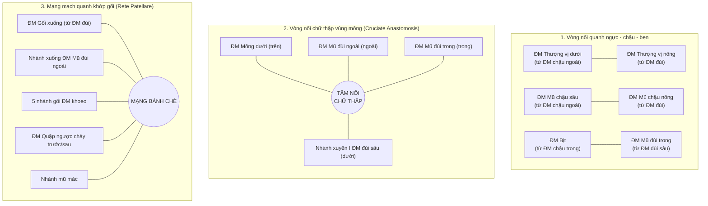

# BÀI 18: MẠCH MÁU CHI DƯỚI
*(Vasa Sanguinea Membri Inferioris)*

**Chương:** Chương 4: Hệ Tim Mạch (*Systema Cardiovasculare*)  
**Tác giả:** ThS. Phạm Duy Đức, PGS.TS. Ngô Xuân Khoa  
**Chủ biên:** PGS.TS. Nguyễn Văn Huy  
**Nguồn trích dẫn:** Giáo trình Giải phẫu học - Trường Đại học Y Hà Nội (Xuất bản 2025), Bài 6, Trang 292 - 308.

---

## ĐẶT VẤN ĐỀ VÀ MỤC TIÊU BÀI HỌC

Hệ thống mạch máu chi dưới (*vasa sanguinea membri inferioris*) đảm nhiệm chức năng vận chuyển dòng máu giàu oxy và dưỡng chất từ động mạch chủ bụng tới các cấu trúc vận động và nâng đỡ của chi thể, đồng thời dẫn lưu máu khử oxy trở về tuần hoàn tĩnh mạch trung tâm. Về phương diện phôi thai và giải phẫu chức năng, hệ mạch máu chi dưới được tổ chức thích nghi cao độ với tư thế đứng thẳng (*orthograde posture*) và chịu tải trọng của cơ thể:

1. **Nguyên ủy phân vùng:** Các động mạch cấp máu cho chi dưới xuất phát từ hai nguồn chính thuộc động mạch chậu:
   - Các nhánh xuyên qua khung chậu của **động mạch chậu trong** (*a. iliaca interna*): gồm động mạch mông trên, động mạch mông dưới và động mạch bịt, cấp máu cho vùng mông, vùng đùi sau và ngăn cơ khép.
   - Thân mạch chính là sự tiếp tục của **động mạch chậu ngoài** (*a. iliaca externa*): bắt đầu từ sau dây chằng bẹn đổi tên thành **động mạch đùi** (*a. femoralis*), tiếp tục thành **động mạch khoeo** (*a. poplitea*), rồi phân chia tại cẳng chân thành **động mạch chày trước** (*a. tibialis anterior*), **động mạch chày sau** (*a. tibialis posterior*) và **động mạch mác** (*a. fibularis / a. peronea*), tận cùng ở các cung mạch mu chân và gan chân.
2. **Hệ thống tĩnh mạch:** Phân thành mạng tĩnh mạch sâu (*venae profundae*) đi kèm động mạch có van một chiều và mạng tĩnh mạch nông (*venae superficiales*) nổi bật với tĩnh mạch hiển lớn (*v. saphena magna*) và tĩnh mạch hiển bé (*v. saphena parva*), liên kết chặt chẽ qua các tĩnh mạch xuyên (*venae perforantes*).
3. **Ứng dụng y học thực hành:** Nắm vững cấu trúc hình thái học, tam giác đùi Scarpa, ống cơ khép Hunter, trám khoeo, rãnh gân sau mắt cá trong và các vòng nối bàng hệ có ý nghĩa sống còn trong cấp cứu cầm máu, phẫu thuật bộc lộ thắt mạch, bắc cầu động mạch, can thiệp nội mạch lấy huyết khối và điều trị suy giãn tĩnh mạch chi dưới.

---

## 1. CÁC ĐỘNG MẠCH CỦA CHI DƯỚI (*ARTERIAE MEMBRI INFERIORIS*)

### 1.1. Các động mạch chạy tiếp theo động mạch chậu ngoài

Các động mạch cấp máu cho chi dưới xuất phát từ các động mạch chậu trong và ngoài. Các động mạch chạy tiếp theo động mạch chậu ngoài bao gồm:
* Động mạch đùi (*a. femoralis*)
* Động mạch khoeo (*a. poplitea*)
* Động mạch chày trước (*a. tibialis anterior*)
* Động mạch chày sau (*a. tibialis posterior*)
* Động mạch mu chân (*a. dorsalis pedis*)
* Động mạch gan chân trong (*a. plantaris medialis*) và động mạch gan chân ngoài (*a. plantaris lateralis*)

Các nhánh của động mạch chậu trong cấp máu cho chi dưới bao gồm các động mạch mông trên, mông dưới và bịt.

---

### 1.1.1. Động mạch đùi (*Arteria femoralis*)

#### A. Nguyên ủy, đường đi và tận cùng
* **Nguyên ủy:** Động mạch đùi là sự tiếp tục trực tiếp của động mạch chậu ngoài (*a. iliaca externa*). Động mạch bắt đầu từ sau (dưới) dây chằng bẹn (*ligamentum inguinale*), tại điểm giữa nằm giữa gai chậu trước trên (*spina iliaca anterior superior*) và khớp mu (*symphysis pubica*).
* **Đường đi:** Động mạch đùi chạy thẳng chếch xuống dưới và vào trong, đi qua mặt trước trong đùi:
  - Đoạn trên: Đi trong **tam giác đùi** (*trigonum femorale* - tam giác Scarpa).
  - Đoạn dưới: Chui vào và đi qua **ống cơ khép** (*canalis adductorius* - ống Hunter).
* **Tận cùng:** Động mạch rời khỏi ống cơ khép bằng cách chui qua **lỗ (vòng) gân cơ khép lớn** (*hiatus adductorius*) ở gần chỗ nối 1/3 giữa với 1/3 dưới đùi, để đổi tên thành **động mạch khoeo** (*a. poplitea*).
* **Hình chiếu bề mặt:** Động mạch đùi tương ứng với 2/3 trên của đường kẻ thẳng nối **điểm giữa bẹn** (điểm nằm giữa gai chậu trước trên và khớp mu) với **củ cơ khép** (*tuberculum adductorium*) trên lồi cầu trong xương đùi, khi đùi ở tư thế gấp nhẹ, dạng và xoay ngoài.

  
*Hình 1. Động mạch đùi, động mạch khoeo và các nhánh của chúng [12]*

---

#### B. Phân đoạn liên quan giải phẫu

##### 1. Ở tam giác đùi (*Trigonum femorale*)
Tam giác đùi được giới hạn ở trên bởi dây chằng bẹn, ở ngoài bởi bờ trong cơ may (*m. sartorius*), ở trong bởi bờ trong cơ khép dài (*m. adductor longus*). Đáy tam giác là hố lược tạo bởi cơ thắt lưng chậu (*m. iliopsoas*) ở ngoài và cơ lược (*m. pectineus*) ở trong.

* **Phía trước (nông):** Động mạch đùi nằm rất nông, được che phủ bởi da, mô mỡ dưới da (mạc nông) và mạc đùi (*fascia lata*). Trong mô dưới da có nhánh đùi của thần kinh sinh dục đùi (*ramus femoralis n. genitofemoralis*), tĩnh mạch mũ chậu nông và các nhánh thần kinh bì đùi trước.
* **Phía sau (sâu):** Mặt sau động mạch tựa lên cơ thắt lưng lớn, cơ lược và cơ khép dài. Gân cơ thắt lưng lớn ngăn cách động mạch với khớp hông (chỗ lồi chậu mu).  
  > [!IMPORTANT]
  > **Ứng dụng ép cầm máu:** Vị trí ngay dưới dây chằng bẹn, nơi động mạch đùi nằm ngay trước chỏm xương đùi và lồi chậu mu qua gân cơ thắt lưng lớn, là mốc giải phẫu tối ưu nhất để dùng ngón tay ấn ép động mạch đùi vào bờ xương đùi nhằm cầm máu khẩn cấp khi tổn thương mạch máu chi dưới.
* **Liên quan với các thành phần trong bao đùi (*Vagina femoralis*):**
  - Ở 3 - 4 cm dưới dây chằng bẹn, bó mạch đùi được bọc trong một bao sợi gọi là **bao đùi** (*femoral sheath*). Bao này hình phễu, tạo nên do sự mở rộng xuống dưới của mạc ngang (*fascia transversalis*) ở phía trước và mạc chậu (*fascia iliaca*) ở phía sau.
  - Vách liên kết dọc chia bao đùi thành 3 ngăn (từ ngoài vào trong):
    1. **Ngăn ngoài:** Chứa động mạch đùi (*a. femoralis*).
    2. **Ngăn giữa:** Chứa tĩnh mạch đùi (*v. femoralis*).
    3. **Ngăn trong:** Chứa các mạch bạch huyết và hạch bạch huyết bẹn sâu (hạch Cloquet / Rosenmüller). Ngăn này hình nón, chỉ dài độ 1,5 cm dưới dây chằng bẹn và được gọi là **ống đùi** (*canalis femoralis*). Đầu trên của ống đùi thông với khoang bụng qua **vòng đùi** (*anulus femoralis*), được giới hạn bởi dây chằng bẹn ở trước, dây chằng khuyết (*lig. lacunare*) ở trong, tĩnh mạch đùi ở ngoài và dây chằng lược (*lig. pectineale* Cooper) ở sau. Thoát vị đùi (*hernia femoralis*) xảy ra khi các tạng chui qua ống đùi này.
* **Liên quan với thần kinh đùi và tĩnh mạch đùi:**
  - **Thần kinh đùi** (*n. femoralis*): Nằm ngoài động mạch và nằm **ngoài bao đùi**, trong rãnh giữa cơ thắt lưng lớn và cơ chậu. Thần kinh nhanh chóng phân thành các nhánh tận ngay dưới dây chằng bẹn.
  - **Tĩnh mạch đùi** (*v. femoralis*): Ở đáy tam giác đùi (trên cao), tĩnh mạch nằm ở phía trong động mạch; khi chạy xuống đến đỉnh tam giác đùi, tĩnh mạch bắt chéo ở phía sau động mạch.

  
*Hình 2. Liên quan của động mạch đùi [12]*

---

##### 2. Trong ống cơ khép (*Canalis adductorius* - Ống Hunter)
Ống cơ khép là một rãnh cơ mạc hình lăng trụ tam giác dài khoảng 15 cm ở 1/3 giữa mặt trong đùi, dẫn bó mạch từ tam giác đùi ra vùng khoeo:
* **Thành trước-trong:** Cơ may (*m. sartorius*) và tấm mạc rộng-khép (*septum intermusculare vastoadductorium*) căng từ cơ rộng trong đến các cơ khép.
* **Thành trước-ngoài:** Cơ rộng trong (*m. vastus medialis*) và thần kinh chi phối cho nó.
* **Thành sau:** Cơ khép dài (*m. adductor longus*) ở đoạn trên, cơ khép lớn (*m. adductor magnus*) ở đoạn dưới.
* **Liên quan các thành phần trong ống:**
  - **Động mạch đùi:** Đi xuyên suốt chiều dài của ống từ trên xuống dưới.
  - **Tĩnh mạch đùi:** Nằm ở phía sau động mạch ở đầu gần, nhưng khi chạy xuống đầu xa của ống thì dần lách ra nằm ở phía ngoài động mạch.
  - **Thần kinh hiển** (*n. saphenus*): Bắt chéo phía trước động mạch đùi từ ngoài vào trong. Ở 1/3 dưới đùi, thần kinh hiển cùng nhánh hiển của động mạch gối xuống chọc thủng mạc rộng-khép để ra nông đi cùng tĩnh mạch hiển lớn ở cẳng chân.

---

#### C. Các nhánh bên của động mạch đùi

Động mạch đùi cho 6 nhánh bên: nhóm 4 nhánh nông tách ra ngay dưới dây chằng bẹn, nhánh động mạch đùi sâu lớn nhất, và nhánh động mạch gối xuống ở đoạn dưới ống cơ khép:

1. **Động mạch thượng vị nông** (*a. epigastrica superficialis*):
   - Tách ra từ mặt trước động mạch đùi ở khoảng 1 cm dưới dây chằng bẹn (gần nguyên ủy của động mạch mũ chậu nông).
   - Xuyên qua mạc sàng (*fascia cribrosa*), chạy ngược lên trên ở trước dây chằng bẹn, đi trong mô dưới da thành bụng hướng về phía rốn.
   - Tiếp nối với các nhánh của động mạch thượng vị dưới (*a. epigastrica inferior*) và nhánh của động mạch thượng vị nông bên đối diện.

2. **Động mạch mũ chậu nông** (*a. circumflexa ilium superficialis*):
   - Tách ra ở khoảng 1 cm dưới dây chằng bẹn, đôi khi có thân chung với động mạch thượng vị nông.
   - Xuyên qua mạc đùi, chạy chếch lên trên và ra ngoài song song với dây chằng bẹn về phía gai chậu trước trên trong mô dưới da.
   - Tiếp nối với động mạch mũ chậu sâu (*a. circumflexa ilium profunda*), động mạch mông trên và động mạch mũ đùi ngoài. Đây là mạch nuôi sống vạt bẹn (*groin flap*) trong phẫu thuật tạo hình.

3. **Động mạch thẹn ngoài nông** (*a. pudenda externa superficialis*) và **Động mạch thẹn ngoài sâu** (*a. pudenda externa profunda*):
   - Tách ra từ mặt trong của động mạch đùi, ngang mức hai nhánh nông nói trên, chạy vào trong về phía đáy chậu.
   - *Động mạch thẹn ngoài nông:* Xuyên qua mạc sàng, chạy bắt chéo trước (hoặc sau) tĩnh mạch hiển lớn trên mạc đùi, phân nhánh vào da vùng bụng dưới, dương vật và bìu ở nam (hoặc môi lớn ở nữ).
   - *Động mạch thẹn ngoài sâu:* Đi vào trong ở dưới mạc đùi, bắt chéo mặt trước cơ lược và cơ khép dài trước khi xuyên qua mạc đùi để cấp máu cho bìu (hoặc môi lớn) và đáy chậu. Cả hai tiếp nối với các nhánh của động mạch thẹn trong (*a. pudenda interna*).

4. **Động mạch đùi sâu** (*a. profunda femoris*):
   - Là nhánh bên lớn nhất, đóng vai trò nguồn cấp máu chính cho toàn bộ các cơ vùng đùi (đặc biệt là ngăn đùi trước, trong và sau).
   - Tách ra từ mặt ngoài động mạch đùi ở khoảng 3,5 cm (từ 2 - 5 cm) dưới dây chằng bẹn.
   - Trên lâm sàng: Đoạn 3,5 cm đầu tiên của động mạch đùi trước chỗ tách động mạch đùi sâu gọi là **động mạch đùi chung** (*arteria femoralis communis* - CFA). Đoạn thân chính tiếp tục xuống dưới sau nguyên ủy đùi sâu gọi là **động mạch đùi nông** (*arteria femoralis superficialis* - SFA).
   - **Đường đi:** Động mạch đùi sâu chạy cong lồi ra ngoài rồi vòng vào trong, đi phía sau động mạch đùi và tĩnh mạch đùi để đến bờ trong xương đùi. Sau đó, nó đi ra sau giữa cơ lược và cơ khép dài, rồi chạy xuống trong khoang giữa mặt sau cơ khép dài với mặt trước cơ khép ngắn và cơ khép lớn. Cuối cùng, nhánh tận của động mạch đùi sâu xuyên qua cơ khép lớn như một nhánh xuyên thứ tư (*a. perforans IV*) để tiếp nối với các nhánh cơ trên của động mạch khoeo.

  
*Hình 3. Động mạch đùi sâu [12]*

   - **Các phân nhánh của động mạch đùi sâu:**
     * **Động mạch mũ đùi ngoài** (*a. circumflexa femoris lateralis*): Tách ra từ mặt ngoài đoạn gần động mạch đùi sâu (hoặc trực tiếp từ động mạch đùi). Đi ngang ra ngoài giữa các nhánh của thần kinh đùi, luồn sau cơ may và cơ thẳng đùi rồi chia làm 3 nhánh:
       + *Nhánh lên* (*ramus ascendens*): Chạy dọc đường gian mấu, luồn dưới cơ căng mạc đùi; tiếp nối với động mạch mông trên và động mạch mũ chậu sâu. Cùng với nhánh của động mạch mũ đùi trong tạo nên vòng mạch nuôi cổ và chỏm xương đùi. Đây là cuống mạch của vạt da - cơ căng mạc đùi (TFL flap).
       + *Nhánh xuống* (*ramus descendens*): Đi xuống dưới cơ thẳng đùi, dọc theo bờ trước cơ rộng ngoài, cho các nhánh nuôi cơ rộng ngoài và tiếp nối với nhánh gối trên ngoài của động mạch khoeo. Nhánh này là cuống mạch chính của vạt nhánh xuyên đùi trước ngoài (ALT flap - *anterolateral thigh flap*).
       + *Nhánh ngang* (*ramus transversus*): Chạy ra ngoài và ra sau vòng quanh đầu trên thân xương đùi, xuyên qua cơ rộng ngoài để tiếp nối với động mạch mũ đùi trong, động mạch mông dưới và nhánh xuyên thứ nhất tạo nên **vòng nối chữ thập** (*cruciate anastomosis*).
     * **Động mạch mũ đùi trong** (*a. circumflexa femoris medialis*): Tách ra từ mặt sau trong động mạch đùi sâu (hoặc từ động mạch đùi). Vòng quanh mặt trong thân xương đùi ra sau, lách giữa cơ lược và cơ thắt lưng lớn, rồi hiện ra trong khe giữa cơ vuông đùi (*m. quadratus femoris*) và cơ khép lớn. Tại đây phân nhánh:
       + *Nhánh ngang:* Tham gia vào vòng nối chữ thập vùng mông.
       + *Nhánh lên:* Chạy trước cơ vuông đùi đến hố mấu chuyển, tiếp nối với các nhánh mông và mũ đùi ngoài. Cho **nhánh ổ cối** (*ramus acetabularis*) chui qua khuyết ổ cối vào dây chằng chỏm đùi để cấp máu cho chỏm xương đùi (tiếp nối với nhánh ổ cối của động mạch bịt).
     * **Các động mạch xuyên** (*arteriae perforantes*): Thường có 3 nhánh xuyên tách từ động mạch đùi sâu ở các mức trên, trước và dưới cơ khép ngắn, cộng thêm nhánh tận của động mạch đùi sâu được xem là nhánh xuyên thứ tư. Chúng chui qua các lỗ gân cơ khép lớn áp sát đường ráp xương đùi (*linea aspera*) để ra khoang cơ sau đùi. Mỗi động mạch chia nhánh lên và nhánh xuống nối với nhau thành chuỗi mạch dọc liên tục:
       + Nhánh lên của động mạch xuyên 1 tham gia vào vòng nối chữ thập vùng mông.
       + Nhánh xuống của động mạch xuyên 4 tiếp nối với các nhánh cơ trên của động mạch khoeo.

  
*Hình 4. Biến đổi các nhánh của động mạch đùi (theo Lippert và Pabst) [14]*

> [!NOTE]
> **Các dạng biến đổi giải phẫu của động mạch đùi (Hình 4):**
> * **a (58%):** Động mạch mũ đùi trong và ngoài đều tách từ động mạch đùi sâu (dạng kinh điển).
> * **b (18%):** Động mạch mũ đùi trong tách trực tiếp từ động mạch đùi, mũ đùi ngoài tách từ đùi sâu.
> * **c (15%):** Động mạch mũ đùi ngoài tách trực tiếp từ động mạch đùi, mũ đùi trong tách từ đùi sâu.
> * **d (4%):** Cả hai động mạch mũ đùi trong và ngoài đều tách trực tiếp từ động mạch đùi.
> * **e (3%):** Nhánh xuống của động mạch mũ đùi ngoài tách độc lập từ động mạch đùi.
> * **f (1%):** Cả hai động mạch mũ đùi xuất phát từ một thân chung tách ra từ động mạch đùi.

5. **Động mạch gối xuống** (*a. genus descendens*):
   - Là nhánh bên cuối cùng của động mạch đùi, tách ra ở ngay phía trên lỗ gân cơ khép lớn trong ống Hunter.
   - Tách ra hai nhánh chính:
     * *Nhánh hiển* (*ramus saphenus*): Xuyên qua mạc rộng-khép, đi cùng thần kinh hiển xuống mặt trong khớp gối và cẳng chân để cấp máu cho da mặt trên trong cẳng chân, tiếp nối với động mạch gối dưới trong.
     * *Các nhánh khớp* (*rami articulares*): Đi trong cơ rộng trong xuống tham gia vào mạng mạch bánh chè (*rete patellare*).

---

### 1.1.2. Động mạch khoeo (*Arteria poplitea*)

#### A. Nguyên ủy, đường đi và tận cùng
* **Nguyên ủy:** Tiếp tục từ động mạch đùi, bắt đầu từ **lỗ gân cơ khép lớn** (*hiatus adductorius*), ngang mức ranh giới giữa 1/3 giữa và 1/3 dưới đùi.
* **Đường đi:** Chạy chếch xuống dưới và ra ngoài qua giữa hố khoeo (*fossa poplitea* - trám khoeo).
* **Tận cùng:** Chạy đến **bờ dưới cơ khoeo** (*m. popliteus*) (ngang mức cung gân cơ dép - *arcus tendineus m. solei*), động mạch chia thành hai nhánh tận: **động mạch chày trước** (*a. tibialis anterior*) và **động mạch chày sau** (*a. tibialis posterior*).
* **Điểm yếu giải phẫu:** Bờ sợi cứng chắc của lỗ gân cơ khép ở trên và cung gân cơ dép ở dưới là hai cấu trúc xơ có thể cựa ép, gây thiếu máu hoặc tổn thương động mạch khoeo trong trật khớp gối hoặc gãy đầu dưới xương đùi / mâm chày.

#### B. Phân đoạn liên quan trong hố khoeo
Hố khoeo là một khoang hình trám ở mặt sau khớp gối:
* **Các thành bảo vệ:**
  - *Mặt trước (sâu):* Tựa từ trên xuống dưới lên diện khoeo xương đùi (*facies poplitea*), bao sau khớp gối (dây chằng khoeo chéo - *lig. popliteum obliquum*) và cơ khoeo.
  - *Mặt sau (nông):* Đoạn trên được cơ bán màng che phủ; đoạn dưới được hai đầu cơ bụng chân che phủ; đoạn giữa nằm nông ngay dưới mạc khoeo và da.
* **Trật tự giải phẫu bó mạch thần kinh khoeo (Quy tắc bậc thang từ nông vào sâu, từ ngoài vào trong):**
  - **Thần kinh chày** (*n. tibialis*): Nằm nông nhất và ở ngoài cùng.
  - **Tĩnh mạch khoeo** (*v. poplitea*): Nằm ở giữa, bắt chéo từ ngoài vào trong ở phía sau động mạch.
  - **Động mạch khoeo** (*a. poplitea*): Nằm sâu nhất và ở trong cùng, áp sát mặt xương và bao khớp gối.
  > [!TIP]
  > **Quy tắc nhớ nhanh lâm sàng:** *"Thần kinh ngoài - Tĩnh mạch giữa - Động mạch trong và sâu"* (N-G-T / Nông-Giữa-Sâu). Vì động mạch nằm sâu nhất, việc bắt mạch khoeo đòi hỏi người bệnh phải gập gối 90 độ để chùng mạc khoeo và các cơ bụng chân, sau đó người khám dùng hai tay ấn sâu các đầu ngón tay vào đỉnh giữa hố khoeo tựa lên diện khoeo xương đùi.

#### C. Các nhánh bên và vòng nối quanh khớp gối
Động mạch khoeo tách ra các nhánh bên quan trọng:
1. **Các động mạch gối trên ngoài và gối trên trong** (*a. genus superior lateralis / medialis*): Vòng quanh đầu dưới xương đùi ở trên các lồi cầu đùi ra trước khớp gối.
2. **Động mạch gối giữa** (*a. genus media*): Đâm xuyên thẳng qua dây chằng khoeo chéo vào bao khớp, cấp máu cho các dây chằng chéo và bao hoạt dịch khớp gối.
3. **Các động mạch gối dưới ngoài và gối dưới trong** (*a. genus inferior lateralis / medialis*): Chạy vòng quanh lồi cầu xương chày, đi dưới các dây chằng bên khớp gối ra mặt trước.
4. **Các động mạch bắp chân** (*aa. surales*): Tách ra từ mặt sau động mạch khoeo, là các nhánh nuôi dưỡng chính cho hai đầu cơ bụng chân (*m. gastrocnemius*) và cơ dép (*m. soleus*). Nhánh da nông (*a. suralis superficialis*) đi cùng tĩnh mạch hiển bé và thần kinh bắp chân.
5. **Mạng mạch bánh chè (*Rete patellare*) và mạng mạch khớp gối (*Rete articulare genus*):**
   - Được tạo thành bởi sự kết nối phong phú giữa:
     * Nhánh xuống của động mạch mũ đùi ngoài.
     * Nhánh khớp của động mạch gối xuống (từ ĐM đùi).
     * 4 nhánh gối (trên ngoài, trên trong, dưới ngoài, dưới trong) của động mạch khoeo.
     * Động mạch quặp ngược chày trước và quặp ngược chày sau (từ ĐM chày trước).
     * Nhánh mũ mác (từ ĐM chày sau / ĐM mác).
   - Vòng nối quanh bánh chè đảm bảo cung cấp máu liên tục cho khớp gối khi cẳng chân ở tư thế gập tối đa làm ép động mạch khoeo.

---

### 1.1.3. Động mạch chày trước (*Arteria tibialis anterior*)

#### A. Nguyên ủy và đường đi
* **Nguyên ủy:** Tách ra từ động mạch khoeo ở bờ dưới cơ khoeo (mặt sau cẳng chân).
* **Đường đi:**
  - Chạy ra trước bằng cách chui qua **lỗ trên của màng gian cốt** (*membrana interossea cruris*).
  - Đi xuống trong **ngăn cơ cẳng chân trước**, tựa trên mặt trước màng gian cốt.
  - Ở đoạn trên: Đi giữa cơ chày trước (*m. tibialis anterior*) ở trong và cơ duỗi các ngón chân dài (*m. extensor digitorum longus*) ở ngoài.
  - Ở đoạn dưới: Đi giữa cơ chày trước ở trong và cơ duỗi ngón cái dài (*m. extensor hallucis longus*) ở ngoài.
  - Đi qua trước khớp cổ chân, luồn sâu dưới hãm gân duỗi dưới (*retinaculum musculorum extensorum inferius*), tại điểm nằm chính giữa hai mắt cá chân (mắt cá trong và mắt cá ngoài) thì đổi tên thành **động mạch mu chân** (*a. dorsalis pedis*).

#### B. Liên quan bó mạch thần kinh
* Động mạch đi kèm hai tĩnh mạch chày trước.
* **Thần kinh mác sâu** (*n. fibularis profundus* / *n. peroneus profundus*): Bắt chéo từ phía ngoài ra trước rồi vào phía trong động mạch khi đi xuống cổ chân. Cùng động mạch tạo nên **bó mạch - thần kinh chày trước**.

#### C. Các nhánh bên
* **Động mạch quặp ngược chày sau** (*a. recurrens tibialis posterior*) và **Động mạch quặp ngược chày trước** (*a. recurrens tibialis anterior*): Đi ngược lên tham gia mạng mạch bánh chè.
* **Các nhánh cơ** nuôi các cơ ngăn trước cẳng chân.
* **Động mạch mắt cá trước trong** (*a. malleolaris anterior medialis*) và **Động mạch mắt cá trước ngoài** (*a. malleolaris anterior lateralis*): Cấp máu cho các mắt cá và tiếp nối với mạng mạch mắt cá (*rete malleolare*).

---

### 1.1.4. Động mạch mu chân (*Arteria dorsalis pedis*)

* **Đường đi:** Tiếp tục từ động mạch chày trước, bắt đầu từ sau hãm gân duỗi dưới (ngang mức đường liên mắt cá), chạy dọc theo bờ ngoài gân cơ duỗi ngón cái dài đến đầu sau của khoang gian cốt bàn chân I.
* **Phân nhánh:**
  - Cho các **động mạch cổ chân trong** (*aa. tarsales mediales*) và **động mạch cổ chân ngoài** (*a. tarsalis lateralis*).
  - **Động mạch cung** (*a. arcuata*): Vòng cong hình vòm qua nền các xương đốt bàn II - IV ra phía bờ ngoài mu chân, cho ra các **động mạch mu đốt bàn chân** (*aa. metatarsales dorsales* II, III, IV) rồi tách thành các động mạch mu ngón chân (*aa. digitales dorsales*).
  - **Động mạch mu đốt bàn chân I:** Cấp máu cho hai bên ngón cái và bờ trong ngón II.
  - **Động mạch gan chân sâu** (*a. plantaris profunda* - nhánh tận lớn): Đâm xuyên thẳng qua khoang gian đốt bàn I xuống gan chân để tiếp nối với động mạch gan chân ngoài, khép kín **cung động mạch gan chân sâu** (*arcus plantaris profundus*).
* **Khám lâm sàng bắt mạch mu chân:** Bắt động mạch ở mu chân ngay ngoài gân cơ duỗi ngón cái dài, ép nhẹ mạch lên các xương cổ chân (xương ghe / xương chêm). Mất mạch mu chân là dấu hiệu điển hình của viêm tắc động mạch chi dưới (bệnh Buerger) hoặc xơ vữa gây tắc động mạch tầng dưới gối.

---

### 1.1.5. Động mạch chày sau (*Arteria tibialis posterior*)

#### A. Nguyên ủy và đường đi
* **Nguyên ủy:** Là nhánh tận lớn chạy tiếp theo động mạch khoeo từ bờ dưới cơ khoeo.
* **Đường đi:**
  - Chạy thẳng xuống dưới ở **ngăn cẳng chân sau**, nằm giữa lớp cơ nông (cơ dép, cơ bụng chân) và lớp cơ sâu (cơ chày sau, cơ gấp các ngón chân dài).
  - Ở 1/3 dưới cẳng chân: Động mạch thoát ra khỏi bờ trong gân gót (gân Achilles), nằm nông chỉ được che phủ bởi da và mạc.
  - Động mạch đi qua rãnh sau mắt cá trong (ống cổ chân - *canalis tarsi*), nằm sâu dưới hãm gân gấp (*retinaculum musculorum flexorum*).
* **Tận cùng:** Ở dưới mắt cá trong (ngang mức mỏm nâng sên), động mạch chia thành hai nhánh tận: **động mạch gan chân trong** (*a. plantaris medialis*) và **động mạch gan chân ngoài** (*a. plantaris lateralis*).

#### B. Liên quan bó mạch thần kinh chày sau
* Động mạch chày sau đi kèm hai tĩnh mạch chày sau và **thần kinh chày** (*n. tibialis*). Thần kinh chày ban đầu nằm ở phía trong, sau đó bắt chéo mặt sau động mạch để chạy dọc ở phía ngoài động mạch xuống tới cổ chân.
* **Thứ tự các cấu trúc tại rãnh sau mắt cá trong (từ trước ra sau, từ nông vào sâu):**
  1. Gân cơ chày sau (*m. tibialis posterior*)
  2. Gân cơ gấp các ngón chân dài (*m. flexor digitorum longus*)
  3. Bó mạch chày sau (Động mạch và tĩnh mạch chày sau)
  4. Thần kinh chày (*n. tibialis*)
  5. Gân cơ gấp ngón cái dài (*m. flexor hallucis longus*)
  > [!TIP]
  > Khám bắt mạch chày sau được thực hiện bằng cách áp nhẹ các đầu ngón tay vào rãnh giữa mắt cá trong và gân gót.

#### C. Các nhánh bên
1. **Động mạch mác** (*a. fibularis* / *a. peronea*):
   - Là nhánh bên lớn nhất của động mạch chày sau, tách ra ở khoảng 2,5 cm dưới bờ dưới cơ khoeo.
   - Chạy chếch ra ngoài áp sát xương mác, đi trong khe giữa cơ chày sau và cơ gấp ngón cái dài.
   - Cho các nhánh nuôi xương mác, các nhánh cơ, **nhánh xuyên** (*ramus perforans*) chọc ra cẳng chân trước, và tận cùng bằng các nhánh mắt cá ngoài (*rami malleolares laterales*) và nhánh gót (*rami calcanei*).
2. **Nhánh mũ mác** (*ramus circumflexus fibularis*): Vòng quanh chỏm xương mác vào mạng mạch khớp gối.
3. **Động mạch nuôi xương chày** (*a. nutricia tibiae*).
4. **Các nhánh mắt cá trong** (*rami malleolares mediales*) và **nhánh gót** (*rami calcanei*).

---

### 1.1.6. Các động mạch gan chân và cung động mạch gan chân

#### A. Động mạch gan chân trong (*Arteria plantaris medialis*)
* Là nhánh nhỏ hơn, chạy dọc bờ trong gan chân trong rãnh giữa cơ giạng ngón cái (*m. abductor hallucis*) và cơ gấp các ngón chân ngắn (*m. flexor digitorum brevis*).
* Chia thành nhánh nông và nhánh sâu cấp máu cho bờ trong ngón chân cái và các cơ mô cái.

#### B. Động mạch gan chân ngoài (*Arteria plantaris lateralis*)
* Là nhánh lớn hơn, chạy chếch ra ngoài giữa cơ gấp các ngón chân ngắn và cơ vuông gan chân (*m. quadratus plantae*) hướng về nền xương đốt bàn chân V.
* Tại nền xương đốt bàn V, động mạch uốn cong vào trong chạy sâu dưới các gân cơ gấp và cơ khép ngón cái để tới khoang gian cốt bàn I, nối với **động mạch gan chân sâu** (nhánh tận của động mạch mu chân) tạo thành **cung động mạch gan chân sâu** (*arcus plantaris profundus*).

#### C. Cung động mạch gan chân sâu (*Arcus plantaris profundus*)
* Nằm tựa trên nền các xương đốt bàn chân và các cơ gian cốt.
* Tách ra:
  - 4 **động mạch gan đốt bàn chân** (*aa. metatarsales plantares* I - IV): Chạy dọc các khoang gian cốt, phân chia ở kẽ ngón thành các **động mạch gan ngón chân riêng** (*aa. digitales plantares propriae*) nuôi dưỡng hai bên các ngón chân.
  - Các **nhánh xuyên** (*rami perforantes*): Xuyên qua các khoang gian cốt nối với các động mạch mu đốt bàn chân.

---

### 1.2. Các nhánh của động mạch chậu trong cấp máu cho chi dưới

Các nhánh của động mạch chậu trong (*a. iliaca interna*) cấp máu cho chi dưới rời chậu hông qua các lỗ mấu mông để vào vùng mông và vùng đùi:

  
*Hình 9. Các động mạch mông [1]*

#### 1. Động mạch mông trên (*Arteria glutea superior*)
* Là nhánh lớn nhất của động mạch chậu trong.
* Cùng thần kinh mông trên rời chậu hông qua **khuyết ngồi lớn ở bờ trên cơ hình quả lê** (*m. piriformis*).
* Chia thành hai nhánh:
  - *Nhánh nông:* Đi giữa cơ mông lớn (*m. gluteus maximus*) và cơ mông nhỡ (*m. gluteus medius*), cấp máu cho cơ mông lớn và nối với động mạch mông dưới.
  - *Nhánh sâu:* Chạy giữa cơ mông nhỡ và cơ mông bé (*m. gluteus minimus*), chia nhánh trên và nhánh dưới cấp máu cho các cơ mông và khớp hông, tiếp nối với động mạch mũ đùi ngoài và động mạch mũ chậu sâu.

#### 2. Động mạch mông dưới (*Arteria glutea inferior*)
* Rời chậu hông qua **khuyết ngồi lớn ở bờ dưới cơ hình quả lê**, đi trong bó mạch thần kinh mông dưới (cùng thần kinh ngồi, thần kinh thẹn và thần kinh bì đùi sau).
* Cấp máu cho cơ mông lớn, các cơ chậu - mấu chuyển và cho **động mạch đi kèm thần kinh ngồi** (*a. comitans nervi ischiadici*).
* Nối với động mạch mông trên, động mạch bịt, động mạch mũ đùi trong và ngoài.

#### 3. Động mạch bịt (*Arteria obturatoria*)
* Đi qua ống bịt (*canalis obturatorius*) ra vùng đùi trong.
* Chia thành nhánh trước và nhánh sau ôm quanh lỗ bịt, cấp máu cho các cơ khép, cơ bịt ngoài. Cho **nhánh ổ cối** (*ramus acetabularis*) chui qua khuyết ổ cối vào dây chằng chỏm đùi cấp máu cho chỏm xương đùi, tiếp nối với nhánh ổ cối của động mạch mũ đùi trong.

---

### 1.3. Hệ thống vòng nối bàng hệ và ứng dụng thắt động mạch chi dưới

Tuần hoàn bàng hệ của chi dưới được thiết lập qua 3 vòng nối mạch máu chính:

> [!WARNING]
> **Ứng dụng phẫu thuật thắt động mạch đùi và động mạch khoeo:**
> 1. **Thắt động mạch đùi chung:** Vị trí thắt trên nguyên ủy động mạch đùi sâu rất nguy hiểm nhưng máu vẫn có thể xuống chi dưới qua vòng nối chữ thập vùng mông và vòng nối chậu - đùi. Tuy nhiên nguy cơ hoại tử chi vẫn cao nếu xơ vữa làm hẹp các vòng nối bàng hệ.
> 2. **Thắt động mạch đùi nông:** Thắt ở dưới nguyên ủy của động mạch đùi sâu tương đối an toàn vì động mạch đùi sâu là nguồn nuôi dưỡng khổng lồ, đưa máu xuống gối qua nhánh xuống của động mạch mũ đùi ngoài và các nhánh xuyên.
> 3. **Thắt động mạch khoeo:** Vô cùng nguy hiểm. Động mạch khoeo là động mạch tận chức năng, đặc biệt nếu tổn thương hoặc thắt ở đoạn giữa các nhánh gối trên và các nhánh gối dưới thì tỷ lệ hoại tử cẳng chân phải cắt cụt chi lên tới trên 70%.

---

## 2. CÁC TĨNH MẠCH CỦA CHI DƯỚI (*VENAE MEMBRI INFERIORIS*)

Hệ tĩnh mạch chi dưới gồm hai mạng lưới: **tĩnh mạch nông** (*venae superficiales*) nằm trong mô dưới da trên mạc sâu, và **tĩnh mạch sâu** (*venae profundae*) đi kèm động mạch dưới mạc sâu. Hai hệ thống này thông nối chặt chẽ với nhau qua các **tĩnh mạch xuyên** (*venae perforantes*).

---

### 2.1. Các tĩnh mạch nông (*Venae superficiales*)

Các tĩnh mạch mu ngón chân (*venae digitales dorsales pedis*) chạy về phía gần hợp thành các **tĩnh mạch mu đốt bàn chân** (*venae metatarsales dorsales pedis*). Các tĩnh mạch mu đốt bàn chân đổ về **cung tĩnh mạch mu chân** (*arcus venosus dorsalis pedis*).

Về phía gần, cung tĩnh mạch mu chân liên tiếp với **mạng tĩnh mạch mu chân** (*rete venosum dorsale pedis*), với hai thân tĩnh mạch chạy ở hai bên của mạng này:
* **Tĩnh mạch bờ trong** (*vena marginalis medialis*): Tiếp tục thành **tĩnh mạch hiển lớn**.
* **Tĩnh mạch bờ ngoài** (*vena marginalis lateralis*): Tiếp tục thành **tĩnh mạch hiển bé**.

Các tĩnh mạch bờ tiếp nhận các tĩnh mạch nông từ gan chân đi lên và là các tĩnh mạch khởi đầu của các tĩnh mạch hiển lớn và bé.

  
*Hình 10. Các tĩnh mạch và thần kinh nông chi dưới [12]*

---

#### 2.1.1. Tĩnh mạch hiển lớn (*Vena saphena magna*)

* **Đặc điểm:** Là tĩnh mạch dài nhất cơ thể người.
* **Nguyên ủy và đường đi:**
  - Bắt đầu ở bàn chân như là sự tiếp tục của tĩnh mạch bờ trong mu chân.
  - Đi lên ở khoảng **2,5 cm trước mắt cá trong**.
  - Bắt chéo 1/3 dưới mặt trong xương chày rồi đi lên ở sau bờ trong xương chày tới khớp gối.
  - Đi lên ở sau - trong các lồi cầu trong xương chày và xương đùi, rồi lên mặt trong đùi.
  - Tận cùng: Chui qua **lỗ tĩnh mạch hiển** (*hiatus saphenus* - hố bầu dục) trên mạc đùi và đổ vào **tĩnh mạch đùi** (*v. femoralis*), ở dưới dây chằng bẹn khoảng 3 - 4 cm.
* **Thành phần đi kèm:**
  - Ở đùi: Đi cùng nhánh bì đùi trước của thần kinh đùi.
  - Ở gối và cẳng chân: Đi sát cùng **thần kinh hiển** (*n. saphenus*) và nhánh hiển của động mạch gối xuống.
* **Hệ thống van:** Tĩnh mạch hiển lớn có từ **10 đến 20 van**, trong đó hằng định có 1 van tại chỗ đổ vào tĩnh mạch đùi (van tận) và 1 van ngay trước đó (van dưới tận). Các van này ngăn dòng máu trào ngược từ tĩnh mạch đùi vào hệ nông.
* **Các nhánh bên tiếp nhận:**
  - Ở cổ chân: Nhận các tĩnh mạch bờ trong từ gan chân đi lên.
  - Ở cẳng chân: Nhận **tĩnh mạch vòm sau** (*tĩnh mạch Leonardo / posterior arch vein*) đi dọc ở phía sau và đổ vào tĩnh mạch hiển lớn ở dưới gối.
  - Ở đùi: Nhận các nhánh từ các mặt trước ngoài và sau trong của đùi; nhánh từ mặt sau trong đôi khi phát triển lớn gọi là **tĩnh mạch hiển phụ** (*v. saphena accessoria*).
  - Tại lỗ tĩnh mạch hiển (vùng bẹn): Nhận chùm tĩnh mạch nông gồm:
    * Tĩnh mạch thẹn ngoài nông (*vv. pudendae externae*).
    * Tĩnh mạch mũ chậu nông (*v. circumflexa ilium superficialis*).
    * Tĩnh mạch thượng vị nông (*v. epigastrica superficialis*).
    * Các tĩnh mạch mu nông của dương vật hoặc âm vật.
* **Vòng nối ngực - thượng vị:** Tĩnh mạch thượng vị nông nối với tĩnh mạch ngực ngoài (nhánh của tĩnh mạch nách) qua **tĩnh mạch ngực - thượng vị** (*v. thoracoepigastrica*) chạy ở mặt bên thân. Khi có tắc tĩnh mạch chủ dưới, tĩnh mạch này giãn to tạo nên tuần hoàn bàng hệ cửa - chủ hoặc chủ - chủ có thể quan sát rõ dưới da bụng.

---

#### 2.1.2. Tĩnh mạch hiển bé (*Vena saphena parva*)

* **Nguyên ủy và đường đi:**
  - Bắt đầu từ **sau mắt cá ngoài** như là sự tiếp tục của tĩnh mạch bờ ngoài mu chân.
  - Đi lên ở cẳng chân sau cùng **thần kinh bắp chân** (*n. suralis*).
  - Ở 1/3 dưới cẳng chân: Đi dọc bờ ngoài gân gót.
  - Lên 1/3 giữa: Chếch dần vào trong tới đường giữa bắp chân, xuyên qua mạc cẳng chân để nằm trong rãnh giữa hai đầu cơ bụng chân.
* **Tận cùng:** Lách giữa hai đầu cơ bụng chân chui vào hố khoeo, đổ vào **tĩnh mạch khoeo** (*v. poplitea*) ở khoảng từ 3 đến 7,5 cm phía trên khe khớp gối.
* **Van và thông nối:** Có từ **7 đến 13 van**, có 1 van ở sát chỗ tận cùng. Cho một số nhánh nối thông với tĩnh mạch hiển lớn (tĩnh mạch Giacomini).

---

#### 2.1.3. Các tĩnh mạch xuyên (*Venae perforantes*)

Các tĩnh mạch xuyên đóng vai trò cầu nối một chiều dẫn máu từ mạng tĩnh mạch nông đổ vào mạng tĩnh mạch sâu:
1. **Nhóm ống đùi (Nhóm Dodd):** Nằm ở 1/3 giữa mặt trong đùi (trong ống cơ khép), nối tĩnh mạch hiển lớn với tĩnh mạch đùi.
2. **Nhóm dưới gối (Nhóm Boyd):** Nằm ở ngay dưới lồi cầu trong xương chày, nối tĩnh mạch hiển lớn với tĩnh mạch chày sau.
3. **Nhóm cẳng chân sau (Nhóm Cockett I, II, III):** Gồm 3 tĩnh mạch xuyên ở 1/3 dưới cẳng chân (cách mắt cá trong lần lượt khoảng 7 cm, 14 cm và 18 cm), nối tĩnh mạch vòm sau (*arch vein*) với các tĩnh mạch chày sau.

> [!IMPORTANT]
> **Cơ chế van tĩnh mạch xuyên:** Bình thường, van trong các tĩnh mạch xuyên chỉ cho phép dòng máu chảy **một chiều từ nông vào sâu**. Khi cơ cẳng chân co (bơm cơ dép), áp lực khoang sâu tăng lên đẩy máu về tim và đóng chặt van tĩnh mạch xuyên. Khi cơ giãn, van mở ra hút máu từ nông vào sâu.

---

### 2.2. Các tĩnh mạch sâu (*Venae profundae*)

* **Quy luật đi kèm:**
  - Từ bàn chân lên đến cẳng chân: Mỗi động mạch có **2 tĩnh mạch sâu đi kèm** (*venae comitantes*) nằm hai bên động mạch và mang tên tương ứng (tĩnh mạch chày trước, tĩnh mạch chày sau, tĩnh mạch mác). Các tĩnh mạch này có nhiều van và các nhánh nối bắt chéo quanh động mạch.
  - Ở đùi và khoeo: Chỉ có **1 tĩnh mạch duy nhất** đi kèm động mạch cùng tên (tĩnh mạch khoeo và tĩnh mạch đùi).

#### 1. Tĩnh mạch khoeo (*Vena poplitea*)
* Được hình thành do sự hợp lưu của các tĩnh mạch chày trước và tĩnh mạch chày sau ở bờ dưới cơ khoeo.
* Chạy lên qua hố khoeo, nằm giữa động mạch khoeo và thần kinh chày: ở dưới nằm trong động mạch, lên trên bắt chéo sau động mạch để nằm ở phía sau-ngoài động mạch khoeo.
* Tiếp nhận tĩnh mạch hiển bé và các tĩnh mạch cơ quanh khớp gối, đi qua lỗ gân cơ khép đổi tên thành tĩnh mạch đùi.

#### 2. Tĩnh mạch đùi (*Vena femoralis*)
* Chạy tiếp theo tĩnh mạch khoeo từ lỗ gân cơ khép lớn, đi qua ống cơ khép và tam giác đùi để tận cùng bằng cách trở thành **tĩnh mạch chậu ngoài** (*v. iliaca externa*) ở sau dây chằng bẹn.
* **Liên quan:** Nằm ở ngoài động mạch ở phần dưới ống cơ khép; nằm ở sau động mạch ở phần trên ống cơ khép; và nằm ở trong động mạch đùi tại tam giác đùi (bên trong ngăn giữa của bao đùi).
* **Tiếp nhận:**
  - Tĩnh mạch đùi sâu (*v. profunda femoris*) đổ vào mặt sau tĩnh mạch đùi ở khoảng 4 cm dưới dây chằng bẹn.
  - Tĩnh mạch hiển lớn đổ vào mặt trước qua lỗ tĩnh mạch hiển.
  - Chú ý: Các tĩnh mạch mũ chậu nông, thượng vị nông và thẹn ngoài đổ về tĩnh mạch hiển lớn trước khi vào tĩnh mạch đùi.

---

## 3. CÁC LIÊN HỆ LÂM SÀNG VÀ BỆNH HỌC MẠCH MÁU CHI DƯỚI

### 3.1. Bộc lộ tĩnh mạch hiển lớn (Saphenous Cutdown)
Vị trí của tĩnh mạch hiển lớn ở **khoảng 2,5 cm trước mắt cá trong** là vị trí giải phẫu cực kỳ hằng định và nông. Trong các trường hợp cấp cứu hồi sức sốc mất máu nặng, trụy mạch ngoại vi hoặc trẻ em không thể đặt được catheter tĩnh mạch ngoại vi, phẫu thuật bộc lộ tĩnh mạch hiển lớn tại mắt cá trong là phương pháp cứu cánh nhanh chóng để thiết lập đường truyền tĩnh mạch trung tâm hoặc bù dịch thể tích lớn.

### 3.2. Cầu nối động mạch bằng tĩnh mạch hiển (Coronary / Peripheral Bypass Graft)
Đoạn tĩnh mạch hiển lớn ở đùi có khẩu kính phù hợp, thành mạch đàn hồi tốt và chiều dài lý tưởng, là vật liệu tự thân tối ưu số một được sử dụng trong phẫu thuật làm cầu nối chủ - vành (*CABG - Coronary Artery Bypass Graft*) hoặc bắc cầu động mạch đùi - khoeo (*femoral-popliteal bypass*). Khi ghép mạch, bắt buộc phải **đảo ngược chiều đoạn tĩnh mạch** (*reversed vein graft*) hoặc dùng dụng cụ phá bỏ van (*valvulotome*) để các van tĩnh mạch không cản trở dòng chảy động mạch.

### 3.3. Bệnh suy giãn tĩnh mạch chi dưới mạn tính (*Varicose Veins*)
* **Cơ chế bệnh sinh:** Máu từ mạng tĩnh mạch nông đổ về mạng tĩnh mạch sâu nhờ các van một chiều. Khi các van tại quai tĩnh mạch hiển (chỗ nối hiển - đùi, hiển - khoeo) hoặc các van của tĩnh mạch xuyên (nhóm Cockett, Boyd, Dodd) bị mất tính co giãn hoặc hư hại, dòng máu sâu sẽ trào ngược (*reflux*) ra nông dưới tác động của trọng lực và áp lực cao của bơm cơ.
* **Hậu quả:** Tăng áp lực tĩnh mạch ngoại biên làm thành tĩnh mạch hiển và các nhánh nông giãn to ngoằn ngoèo thành từng búi. Ứ trệ vi tuần hoàn làm tăng tính thấm mao mạch, hồng cầu thoát mạch vào mô dưới da giải phóng hemosiderin gây **nhiễm sắc tố nâu da** (*stasis dermatitis*), teo xơ mỡ dưới da, phù chân mạn tính và cuối cùng dẫn đến **loét dinh dưỡng** khó lành ở vùng trên mắt cá trong cẳng chân.

### 3.4. Huyết khối tĩnh mạch sâu chi dưới (*Deep Vein Thrombosis - DVT*)
* **Nguyên nhân:** Do dòng máu tĩnh mạch sâu chảy chậm (bệnh nhân bất động lâu sau phẫu thuật, nằm liệt giường), kết hợp với tăng đông máu và tổn thương nội mạc (tam chứng Virchow). Vị trí hay gặp nhất là các xoang tĩnh mạch trong cơ dép (*soleal sinuses*) và các tĩnh mạch chày sau.
* **Nguy cơ tử vong do thuyên tắc phổi (*Pulmonary Embolism - PE*):** Cục máu đông từ tĩnh mạch sâu chi dưới có thể bong tách, trôi theo dòng máu qua tĩnh mạch đùi $\rightarrow$ tĩnh mạch chậu $\rightarrow$ tĩnh mạch chủ dưới $\rightarrow$ tâm nhĩ phải $\rightarrow$ tâm thất phải $\rightarrow$ động mạch phổi, gây tắc nghẽn cấp tính động mạch phổi. Đây là biến chứng cấp cứu nội ngoại khoa tối khẩn cấp với tỷ lệ tử vong rất cao nếu không được dự phòng bằng thuốc chống đông hoặc đặt lưới lọc tĩnh mạch chủ dưới (*IVC filter*).

---

## BẢNG TỔNG KẾT HỆ MẠCH MÁU CHI DƯỚI

| Mạch máu | Nguyên ủy | Tận cùng | Vùng cấp máu / Dẫn lưu chính | Đặc điểm lâm sàng cốt lõi |
| :--- | :--- | :--- | :--- | :--- |
| **ĐM Đùi** | Tiếp theo ĐM chậu ngoài sau dây chằng bẹn | Lỗ gân cơ khép lớn | Toàn bộ cơ và da vùng đùi, gối | Ép cầm máu tốt nhất ở điểm giữa bẹn trước chỏm xương đùi |
| **ĐM Đùi sâu** | Tách từ ĐM đùi (cách bẹn ~3,5 cm) | Nhánh xuyên thứ 4 | Ngăn cơ đùi trong, trước và sau | Nguồn nuôi dưỡng khổng lồ cho đùi; cuống vạt TFL, ALT |
| **ĐM Khoeo** | Tiếp theo ĐM đùi tại lỗ gân cơ khép | Bờ dưới cơ khoeo | Vùng gối, các cơ bắp chân | Nằm sâu nhất trong trám khoeo; thắt mạch nguy cơ hoại tử rất cao |
| **ĐM Chày trước** | Tách từ ĐM khoeo ở bờ dưới cơ khoeo | Đi qua trước khớp cổ chân $\rightarrow$ ĐM mu chân | Ngăn cẳng chân trước, khớp cổ chân, mu chân | Đi cùng TK mác sâu; bắt mạch ở mu chân ngoài gân cơ duỗi ngón I |
| **ĐM Chày sau** | Tách từ ĐM khoeo ở bờ dưới cơ khoeo | Rãnh sau mắt cá trong $\rightarrow$ ĐM gan chân | Ngăn cẳng chân sau, xương chày, toàn bộ gan chân | Đi cùng TK chày; cho ĐM mác; bắt mạch ở rãnh sau mắt cá trong |
| **TM Hiển lớn** | Tiếp theo TM bờ trong mu chân | Đổ vào TM đùi tại lỗ tĩnh mạch hiển | Toàn bộ mạng nông mặt trong cẳng chân và đùi | Dài nhất cơ thể; mốc bộc lộ ở trước mắt cá trong 2,5 cm; làm cầu nối CABG |
| **TM Hiển bé** | Tiếp theo TM bờ ngoài mu chân | Đổ vào TM khoeo ở hố khoeo | Mạng nông mặt sau ngoài cẳng chân | Đi kèm TK bắp chân; dễ suy giãn van ở mặt sau bắp chân |
| **TM Sâu** | Các mao mạch sâu ở cẳng chân và đùi | Tĩnh mạch chậu ngoài | Dẫn lưu dòng máu sâu từ xương, khớp và cơ | Dễ hình thành DVT dẫn đến biến chứng thuyên tắc mạch phổi |

---
**HẾT BÀI 18**
