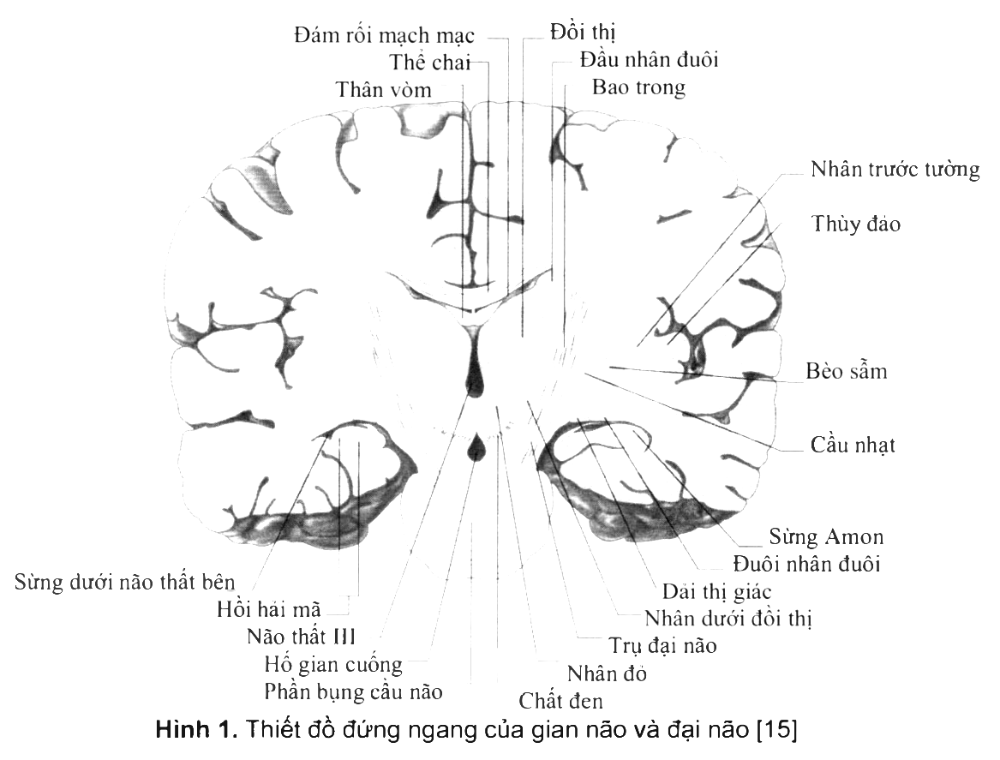
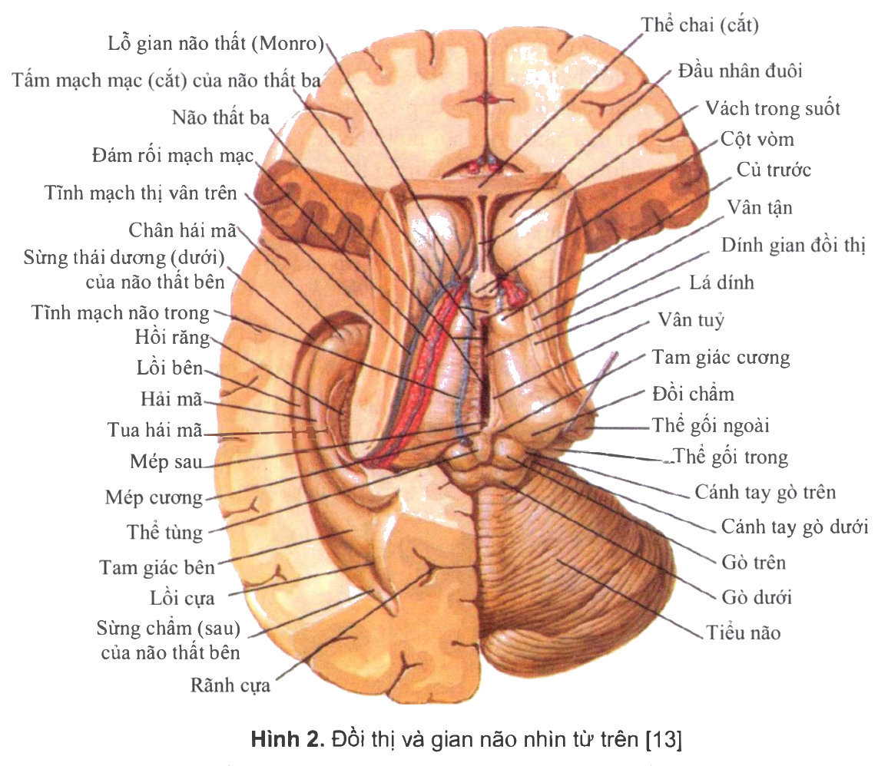
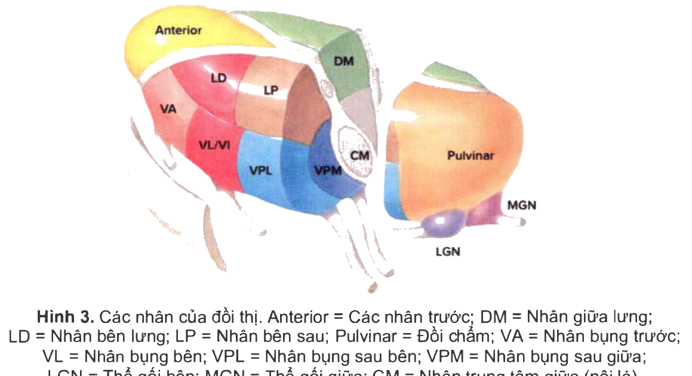
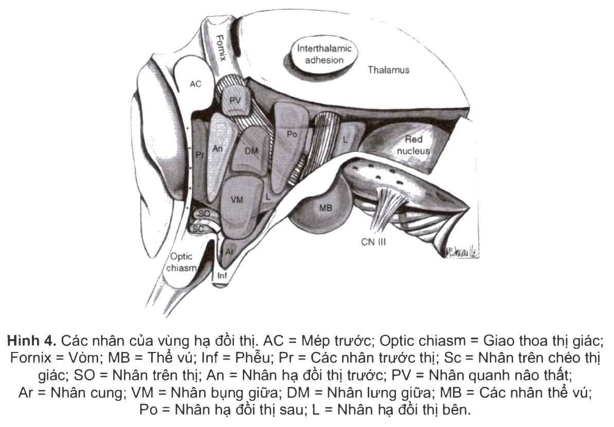
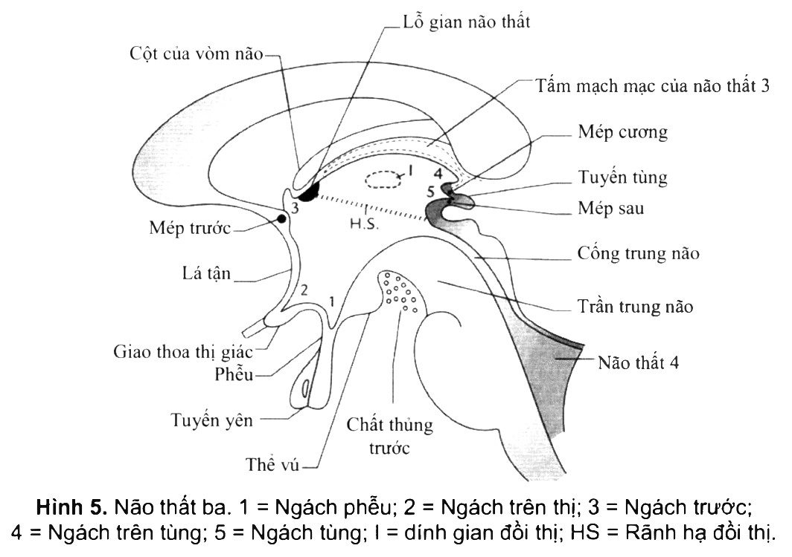

# GIAN NÃO (diencephalon)

**Chương:** Hệ Thần Kinh (Bài 5)  
**Tác giả:** PGS.TS. Nguyễn Văn Huy  
**Nguồn:** Giáo trình Giải phẫu học Y Hà Nội (Xuất bản 2025), Trang 361 - 369

---

Gian não (*diencephalon*) và đoan não (*telencephalon*) cùng nhau tạo nên não trước (*prosencephalon*), trong đó gian não tạo nên phần lõi trung ở tâm còn đoan não tạo nên hai bán cầu. Hầu như toàn bộ gian não bị vây quanh bởi hai bán cầu cho nên chỉ mặt bụng của nó là nhìn thấy được từ bên ngoài, trong một vùng chứa các cấu trúc của hạ đồi thị. Vùng này được giới hạn bởi giao thoa thị giác ở trước, các dải thị giác hai bên và ở sau là vùng mà tại đó bao trong liên tiếp với nền cuống đại não của trung não. Gian não được chia thành hai nửa cân xứng bởi một khe hẹp là não thất ba. Trên mặt cắt dọc giữa, chỗ nối tiếp gian não và trung não là đường thẳng đi qua mép sau và điểm nằm ở ngay sau thể vú. Giới hạn giữa gian não và đoan não là đường thẳng đi qua lỗ gian não thất và giao thoa thị giác, nhưng gian não còn gồm cả phần mở rộng ra trước của vùng hạ đồi thị tới lá tận cùng. Mặt ngoài gian não tiếp giáp với trụ sau của bao trong, thân và đuôi của nhân đuôi.

Gian não được chia thành bốn phần: đồi thị, vùng trên đồi thị, vùng hạ đồi thị và vùng dưới đồi thị. Đồi thị (*thalamus*) còn được gọi là *đồi thị lưng* (*dorsal thalamus*); vùng dưới đồi (*subthalamus*) còn được gọi là *đồi thị bụng* (*ventral thalamus*).

### 1. ĐỒI THỊ (thalamus)

#### 1.1. Hình thể ngoài (H.2)

Là phần lớn nhất của gian não, đồi thị là một khối nhân hình trứng nằm ở đầu trước trên của thân não. Nó có chiều trước sau, khoảng 4 cm, đi từ lỗ gian não thất tới mép sau và chiều giữa bên đi từ não thất ba tới mặt trong của trụ sau bao trong. Đồi thị nằm trên rãnh hạ đồi, một rãnh nông ở thành bên não thất ba. Các phần sau và bên của đồi thị phình to và nằm trên các gò trên của trung não.

Mặt trên của đồi thị trải rộng từ bờ trên trong tới chỗ tiếp giáp với thân nhân đuôi ở phía ngoài và tạo nên sàn của phần trung tâm não thất bên. *Vân tủy đồi thị* (*stria medullaris thalami*) nằm dọc bờ trong của mặt trên, còn *vân tận* (*stria terminalis*) và tĩnh mạch đồi vân nằm dọc chỗ tiếp nối đồi thị và nhân đuôi (H.2).

Mặt trong của đồi thị tạo nên phần trên của thành bên não thất ba và các mặt này ở hai bên dính một phần với nhau ở 80% số não người qua *dính gian đồi thị* (*adhesio interthalamica*).

Mặt ngoài đồi thị, nơi có nhân lưới, tiếp giáp với bao trong (H.1). Mặt dưới đồi thị tiếp giáp với vùng hạ đồi thị ở trước và vùng dưới đồi thị ở sau.

Đầu trước đồi thị nằm gần đường giữa hơn và là giới hạn sau của lỗ gian não thất; phần phình to phía sau nằm trên trung não được gọi là *đồi chẩm* (*pulvinar*). Nằm ở phía dưới ngoài đồi chẩm là hai thể gối: *thể gối bên* (*lateral geniculate body*) hay *thể gối ngoài* và *thể gối giữa* (*medial geniculate body*) hay *thể gối trong* (H.2). Đây là hai nhân chuyển tiếp quan trọng của các đường thị giác và thính giác. Cả hai thể gối được gọi chung là vùng đồi thị chuyển tiếp hay *vùng sau đồi thị* (*metathalamus*).

#### 1.2. Hình thể trong (H.3)

Đồi thị gồm khối nhân chính và nhân lưới nằm ở mặt ngoài. *Lá tủy ngoài* (*external medullary lamina*) phủ lên mặt ngoài khối nhân chính và ngăn cách khối nhân chính với nhân lưới. Khối nhân chính được *lá tủy trong* (*internal medullary lamina*) hình chữ Y chia thành ba phần, mỗi phần là một nhóm nhân. Phần trước nằm giữa 2 nét của chữ Y. Phần giữa, nhỏ hơn, nằm về phía đường giữa so với nét trái và gốc chữ Y. Phần bên, to nhất, nằm về phía bên so với nét phải và gốc chữ Y. Phần bên gồm các nhân phía lưng (trong đó có đồi chẩm) và các nhân phía bụng. Trên mặt bụng bên của phần bên có hai khối lồi gọi là các thể gối giữa và bên. Các thể gối có thể được coi như là hai nhân của nhóm nhân phía bụng của phần bên. Bên trong lá tủy trong có nhóm nhân nội lá. Các tiếp nối và chức năng của các nhân đồi thị được trình bày ở Bảng 1.

#### 1.3. Các tiếp nối và chức năng

**Bảng 1. Các tiếp nối và chức năng**

| Nhân | Nguồn của các sợi đến | Đích của các sợi đi | Chức năng |
| :--- | :--- | :--- | :--- |
| **1. Các nhân trước của đồi thị** (*anterior thalamic nuclei*) | Dải vú - đồi thị từ thể vú | Hồi đai | Trí nhớ |
| **2. Các nhân giữa của đồi thị** (*medial thalamic nuclei*) | | | |
| *2.1. Nhân giữa lưng* (*mediodorsal nucleus - MD*) | Vỏ entorhinal, amygdala, nhánh bên từ dải tủy - đồi thị, nhạt (các phần bụng và phần lưới chất đen). | Vỏ trước trán | Những đáp ứng hành vi mà liên quan đến các quyết định dựa trên sự dự đoán và các động cơ thúc đẩy. Cắt bỏ gây hậu quả giống với phẫu thuật vào vỏ trước trán |
| *2.2. Các nhân đường giữa* (*midline nuclei*) hay các nhân giữa bụng - MV | Amygdala, hạ đồi thị | Cấu tạo hải mã và hồi cạnh hải mã | Hành vi, bao gồm cả các đáp ứng tạng và cảm xúc |
| **3. Các nhân bên đồi thị** (*lateral thalamic nuclei*) | | | |
| *3.1. Các nhân lưng* | | | |
| - *3.1.1. Nhân bên lưng* (*lateral dorsal nucleus - LD*) | Cấu tạo hải mã, diện trước mái và gò trên | Hồi đai; vỏ liên hợp thị giác (các thùy chẩm, đỉnh sau và thái dương) | Trí nhớ; phiên giải tín hiệu thị giác |
| - *3.1.2. Nhân bên sau* (*lateral posterior nucleus - LP*) | Gò trên | Vỏ liên hợp đỉnh, thái dương và chẩm | Phiên giải tín hiệu thị giác và các tín hiệu cảm giác khác; công thức hóa các đáp ứng hành vi phức tạp |
| - *3.1.3. Đồi chẩm* (*pulvinar*) | Diện trước mái; vỏ thị giác thứ nhất và vỏ liên hợp thị giác; võng mạc | Thùy đỉnh, vỏ trán trước, hồi đai, amygdala | Phiên giải tín hiệu thị giác và các tín hiệu cảm giác khác; công thức hóa các đáp ứng hành vi phức tạp |
| *3.2. Các nhân bụng và các thể gối* | | | |
| - *3.2.1. Nhân bụng trước* (*ventral anterior nucleus - VA*) | Nhạt (cầu nhạt trong và phần lưới chất đen) | Thùy trán, bao gồm các diện tiền vận động và vận động bổ sung | Lập kế hoạch vận động và hành vi phức tạp hơn |
| - *3.2.2. Nhân bụng bên* (*ventral lateral nucleus - VL*): | | | |
| + *Phần sau - VLp* | Các nhân tiểu não đối bên | Diện vỏ vận động thứ nhất (hồi trước trung tâm) | Sự điều hòa của tiểu não với các lệnh được gửi tới các nơron vận động |
| + *Phần trước - VLa* | Nhạt | Các diện vỏ tiền vận động và vận động bổ sung | Trù tính các lệnh để gửi tới các nơron vận động |
| - *3.2.3. Nhân bụng sau* (*ventral posterior nucleus - VP*): | | | |
| + *Nhân bụng sau bên* (*ventral posterolateral nucleus - VPL*) | Nhân thon và nhân chêm đối bên; sừng sau của tủy sống đối bên | Diện vỏ cảm giác thân thể thứ nhất (hồi sau trung tâm) | Cảm giác thân thể cho cổ, thân và chi bên đối diện |
| + *Nhân bụng sau giữa* (*ventral posteromedial nucleus - VPM*) | Các nhân cảm giác của thần kinh sinh ba đối bên | Diện vỏ cảm giác thân thể thứ nhất (hồi sau trung tâm) | Cảm giác thân thể cho đầu, mặt, miệng, hầu, thanh quản và màng não bên đối diện |
| - *3.2.4. Thể gối giữa* (*medial geniculate body*) | Gò dưới | Vỏ thính giác thứ nhất (các hồi thái dương ngang) | Chuyển tiếp thính giác (từ cả hai tai) |
| - *3.2.5. Thể gối bên* (*lateral geniculate body*) | Các nửa cùng bên của cả hai võng mạc | Vỏ thị giác thứ nhất | Chuyển tiếp thị giác từ các thị trường đối bên |
| **4. Các nhân nội lá** (*intralaminar nuclei*), bao gồm cả các nhân trung tâm giữa, cận bó và trung tâm bên | Các nhân cholinergic và trung tâm của cấu tạo lưới, vết lục, các nhánh bên từ các dải tủy - đồi thị và sinh ba - đồi thị, các nhân cạnh cánh tay, các nhân tiểu não, nhạt | Phóng chiếu rộng lên vỏ não, đặc biệt là các thùy trán và đỉnh; vân | Kích thích vỏ đại não trong tình trạng thức tỉnh và khuấy động từ giấc ngủ; cảm giác thân thể, đặc biệt là đau, từ nửa người đối bên; kiểm soát vận động. |
| **5. Nhân lưới** (*reticular nucleus*) | Nhánh bên của các sợi trục đồi thị - vỏ và vỏ - đồi thị | Tới mỗi nhân đồi thị mà phóng chiếu sợi tới nhân lưới | Điều hòa ức chế sự dẫn truyền đồi thị - vỏ |

*(Hình 3: Anterior = Các nhân trước; DM = Nhân giữa lưng; LD = Nhân bên lưng; LP = Nhân bên sau; Pulvinar = Đồi chẩm; VA = Nhân bụng trước; VL = Nhân bụng bên; VPL = Nhân bụng sau bên; VPM = Nhân bụng sau giữa; LGN = Thể gối bên; MGN = Thể gối giữa; CM = Nhân trung tâm giữa (nội lá).)*

Các nhân đồi thị (bụng sau, thể gối giữa, thể gối bên) tiếp nhận các sợi cảm giác thân thể và giác quan từ tủy sống và thân não đi lên, trừ khứu giác, rồi chuyển tiếp lên các vùng vỏ cảm giác và giác quan khác nhau. Một số nhân đồi thị (bụng trước, bụng bên) cũng tiếp nhận các sợi đến từ tiểu não và nhân nền rồi phóng chiếu lên các vùng vỏ vận động, qua đó tham gia vào các chức năng vận động. Đồi thị có các tiếp nối qua lại với các vùng vỏ đại não. Các tiếp nối của đồi thị với vùng vú của hạ đồi thị, với phức hợp hạnh nhân và cấu tạo hải mã thuộc về hệ thống chức năng của hệ viền. Các nhân nội lá nằm trong hệ thống thức tỉnh; nhân lưới có vai trò điều hòa sự dẫn truyền đồi thị - vỏ.

### 2. VÙNG DƯỚI ĐỒI THỊ (subthalamus)

Vùng dưới đồi thị nằm dưới đồi thị, giữa đồi thị và trung não. Vùng này có các dải cảm giác, các bó sợi đến từ tiểu não và cầu nhạt, các phần mở rộng lên trên của các nhân trung não và nhân dưới đồi thị (H.1).

Các dải cảm giác gồm liềm giữa, dải tủy đồi thị và các dải sinh ba đồi thị. Chúng tỏa ra ngay dưới nhân bụng sau của đồi thị, nơi chúng tận cùng. Các sợi tiểu não đồi thị tận cùng ở phần sau của nhân bụng bên của đồi thị. Các sợi từ cầu nhạt đi qua bó bèo và quai bèo rồi tận cùng ở phần trước nhân bụng bên (VLa) và nhân bụng trước (VA). Bên dưới đồi thị, các sợi nhạt - đồi thị và tiểu não - đồi thị cùng nhau tạo nên *bó đồi thị* (*thalamic fasciculus*).

Chất đen và nhân đỏ mở rộng một phần vào vùng dưới đồi. Phần mở rộng của cấu tạo lưới trung não vào vùng dưới đồi là *vùng bất định* (*zona incerta*), nằm giữa bó bèo và bó đồi thị.

*Nhân dưới đồi thị* (*subthalamic nucleus*) nằm áp vào mặt trong của bao trong. Nó có tiếp nối qua lại với cầu nhạt và những sợi tiếp nối này tạo nên *bó dưới đồi thị* (*subthalamic fasciculus*), một bó chạy cắt ngang qua bao trong.

Tổn thương nhân dưới đồi thị do tắc mạch tại chỗ gây nên các rối loạn vận động ở nửa cơ thể bên đối diện gọi là *chứng múa vung bán thân* (*hemiballismus*).

### 3. VÙNG TRÊN ĐỒI (epithalamus)

Vùng trên đồi nằm trên và sau đồi thị, bao gồm các vân tủy đồi thị và các tam giác cương ở hai bên nối với nhau bằng mép cương trên đường giữa; sau mép cương là tuyến tùng.

*Tam giác cương* (*habenular trigone*) nằm giữa vân tủy đồi thị ở trước và gò trên ở sau. Trong tam giác này có các *nhân cương giữa và bên* (*medial and lateral habenular nuclei*). Các nhân này tiếp nhận các sợi đến trong vân tủy đồi thị; tế bào nguyên ủy của các sợi trong vân tủy đồi thị nằm ở vùng vách, một vùng thuộc hệ viền. Các sợi trục từ các nhân cương đi đến nhân gian cuống ở trung não tạo nên *dải cương - gian cuống*. Một số sợi của vân tủy đồi thị đi tới các nhân cương bên đối diện tạo nên *mép cương* (*habenular commissure*).

*Tuyến tùng* (*pineal gland*) hay *thể tùng* (*pineal body*), là một tuyến nội tiết nhỏ như hạt đậu, màu đỏ xám và có hình thù giống quả tùng. Nó được gắn vào gian não bằng một cuống, nơi có một ngách của não thất ba mở rộng vào. Mép cương nằm trên thành lưng của cuống tùng, là nơi chứa các sợi của vân tủy đồi thị đi tới các nhân cương đối bên. Thành bụng của cuống tùng bám vào mép sau, nơi chứa các sợi trục liên quan đến phản xạ đồng tử và các cử động mắt.

Tuyến tùng có cấu trúc của một tuyến nội tiết. Nó nhận các sợi giao cảm sau hạch đến từ hạch cổ trên qua đường thần kinh tùng, một thần kinh đi dưới nội mô xoang thẳng trước khi tới tuyến. Sau tuổi 16 thì các muối vôi và ma nhê lắng đọng trong tuyến tùng thành những hạt lớn gọi là cát não. Ở phim chụp sọ sau tuổi này, nếu thấy tuyến tùng lệch khỏi đường giữa thì có khả năng đã có một tổn thương chiếm khoang.

Tuyến tùng sản xuất melatonin. Chất này giảm trong máu lúc khởi phát dậy thì và lúc rụng trứng của chu kỳ kinh nên được xem là chất chống động dục. Melatonin, có nồng độ thấp lúc ban ngày và cao lúc ngủ, cũng được cho là có vai trò điều hòa các mẫu giấc ngủ theo các chu kỳ ngày - đêm và theo mùa.

Vùng trên đồi còn bao gồm cả *mép sau* (*posterior commissure*), *vùng (diện) trước mái* (*pretectal area*) với các *nhân trước mái* (*pretectal nuclei*).

### 4. VÙNG HẠ ĐỒI THỊ (hypothalamus)

Vùng hạ đồi bao quanh phần não thất ba kể từ các rãnh hạ đồi thị trở xuống. Trên mặt bụng của gian não và vùng hạ đồi, ta nhìn thấy giao thoa thị giác ở trước và các thể vú ở sau. Vùng giữa hai cấu trúc này là *củ xám* (*tuber cinereum*) với hai dải thị giác ở hai bên. Vùng giữa củ xám lồi lên thành *lồi giữa* (*median eminence*), nơi có ngách phễu của não thất ba đi vào. Lồi giữa thuôn lại như một phễu rồi trở thành *cuống phễu* (*infundibular stem*). Cuống phễu liên tiếp với thùy sau (thùy thần kinh) tuyến yên. Thùy sau tuyến yên cùng với cuống phễu và lồi giữa tạo nên *mỏm hạ não thần kinh* (*neurohypophysis*). Thùy trước và thùy giữa tuyến yên cùng phần biểu mô tuyến yên bao quanh lồi giữa và cuống phễu (gọi là *phần củ*) tạo nên *mỏm hạ não tuyến* (*adenohypophysis*). Mỏm hạ não tuyến cùng mỏm hạ não thần kinh tạo nên *mỏm hạ não* (*hypophysis*). Cuống phễu cùng với phần củ và các tĩnh mạch của hệ cửa mỏm hạ não tạo nên cuống tuyến yên. Giới hạn trước của vùng hạ đồi là *lá tận* (*lamina terminalis*) ở thành trước não thất ba, đi từ giao thoa thị giác tới mép trước.

*(Hình 4: AC = Mép trước; Optic chiasm = Giao thoa thị giác; Fornix = Vòm; MB = Thể vú; Inf = Phễu; Pr = Các nhân trước thị; Sc = Nhân trên chéo thị giác; SO = Nhân trên thị; An = Nhân hạ đồi thị trước; PV = Nhân quanh não thất; Ar = Nhân cung; VM = Nhân bụng giữa; DM = Nhân lưng giữa; MB = Các nhân thể vú; Po = Nhân hạ đồi thị sau; L = Nhân hạ đồi thị bên.)*

Từ sau ra trước, hạ đồi thị được chia thành bốn vùng:
- *Vùng vú* (*mammillary region*), hay vùng hạ đồi thị sau, có các nhân thể vú và nhân hạ đồi thị sau. Vùng này là nơi tận cùng của các sợi vòm đi từ cấu tạo hải mã tới và là nơi xuất phát của dải vú - đồi thị.
- *Vùng củ* (*tuberal region*) hay vùng hạ đồi thị trung gian, tương ứng với vùng có củ xám, lồi giữa và cuống phễu. Từ trên xuống, vùng này có nhân lưng giữa, nhân bụng giữa và nhân cung.
- *Vùng trên thị* (*supraoptic region*) nằm ở trên giao thoa thị giác, chứa các nhân: nhân trên thị, nhân cạnh não thất, nhân trên chéo thị giác, nhân hạ đồi thị trước. Sợi trục (chứa vasopressin và oxytocin) từ các nhân trên thị và cạnh não thất đi đến thùy sau tuyến yên tạo nên dải hạ đồi - mỏm hạ não.
- *Vùng trước thị* (*preoptic region*) nằm ngay sau và bên lá tận, chứa các nhân trước thị giữa và bên. Vùng trước thị và vùng trên thị được gọi chung là vùng hạ đồi thị trước.

Cột của vòm đi qua vùng hạ đồi thị và tận cùng ở thể vú, chia hạ đồi thị, theo chiều từ đường giữa ra, thành 3 vành đai: vành đai quanh não thất và vành đai giữa nằm bên trong cột vòm và vành đai bên nằm bên ngoài cột vòm.

Một số nhân của vùng hạ đồi thị trước và vùng củ, như nhân trên thị, nhân cạnh não thất, nhân cung... có tế bào thần kinh tiết hormone cho nên được gọi là *tế bào thần kinh - tiết* (*neurosecretory cells*). Một số hormone theo sợi trục thần kinh đi thẳng đến thùy sau tuyến yên. Các hormone điều hòa việc tiết hormone của thùy trước tuyến yên đi theo sợi trục đi tới vùng lồi giữa (nơi có nhân cung) và được vận chuyển từ vùng lồi giữa tới thùy trước tuyến yên bằng *hệ thống cửa mỏm hạ não* (*hypophysial portal system*). Hệ thống này gồm các tĩnh mạch cửa nằm giữa hai mạng mao mạch: mạng mao mạch thứ nhất ở lồi giữa do động mạch tuyến yên trên tỏa ra, nơi các hormone của vùng hạ đồi thấm vào; mạng thứ hai nằm ở thùy trước tuyến yên, nơi các hormone hạ đồi tác động lên các nhóm tế bào tuyến yên.

Hạ đồi thị tiếp nhận thông tin đến từ: các sợi cảm giác thân thể và tạng; các sợi thị giác, khứu giác và vị giác; các sợi từ cấu tạo hải mã (qua cột vòm); các sợi từ phức hợp hạnh nhân (qua vân tận); các sợi từ vùng vách (qua bó giữa của não trước). Các sợi từ hạ đồi thị đi tới: các nhân thần kinh tự chủ ở thân não và tủy sống (qua đó kiểm soát hệ thần kinh tự chủ); đồi thị; các vùng của đại não. Ngoài các thông tin đến theo đường thần kinh, hạ đồi thị còn cảm nhận được các thông tin đến theo đường máu như nhiệt độ, áp suất thẩm thấu, hàm lượng glucose và các hormone trong máu.

Hạ đồi thị có nhiều chức năng: nội tiết (sản xuất các hormone); điều hòa hệ thần kinh tự chủ; điều hòa các mẫu hành vi và cảm xúc (cùng hệ viền); điều hòa việc ăn, uống; kiểm soát thân nhiệt; điều hòa nhịp ngày đêm.

### 5. NÃO THẤT BA (third ventricle)

Não thất ba là một khoang hẹp chứa dịch não tủy nằm ở đường giữa gian não, được vây quanh bởi đồi thị và các vùng trên đồi, dưới đồi và hạ đồi thị. Não thất ba nằm ở vị trí trung tâm của hệ thống não thất, thông với các não thất bên qua các *lỗ gian não thất* (*interventricular foramen*) và với não thất bốn qua cống trung não.

Não thất ba gần như có hình chữ nhật trên mặt cắt dọc giữa với góc trước trên là lỗ gian não thất và góc sau dưới là đầu trên cống trung não. Mỗi thành bên não thất ba được *rãnh hạ đồi thị* (*hypothalamic sulcus*) chia thành hai phần: phần trên được tạo nên bởi mặt trong đồi thị, phần dưới được tạo nên bởi vùng hạ đồi ở trước và vùng dưới đồi ở sau. Mặt trong hai đồi thị được nối với nhau bởi *dính gian đồi thị* (*interthalamic adhesion*).

Thành trước được tạo nên bởi lá tận đi từ *mép trước* (*anterior commissure*) tới giao thoa thị giác.

Thành trên được tạo nên bởi đám rối mạch mạc và tấm mạch mạc não thất ba và màng nội tủy não thất ba căng ở giữa hai vân tủy đồi thị. Ở trên đám rối mạch mạc là thân vòm.

Thành dưới từ giao thoa thị giác chạy ra sau qua vùng lồi giữa và cuống phễu tới thể vú và cuống đại não rồi kết thúc ở *lỗ cống trung não* (*opening of aqueduct of midbrain*). Trên thành này có *ngách trên thị* (*supra-optic recess*) và *ngách phễu* (*infundibular recess*).

Thành sau, từ trên xuống, có *ngách trên tùng* (*suprapineal recess*), mép cương, *ngách tùng* (*pineal recess*) và mép sau.

*(Hình 5: 1 = Ngách phễu; 2 = Ngách trên thị; 3 = Ngách trước; 4 = Ngách trên tùng; 5 = Ngách tùng; I = dính gian đồi thị; HS = Rãnh hạ đồi thị.)*
