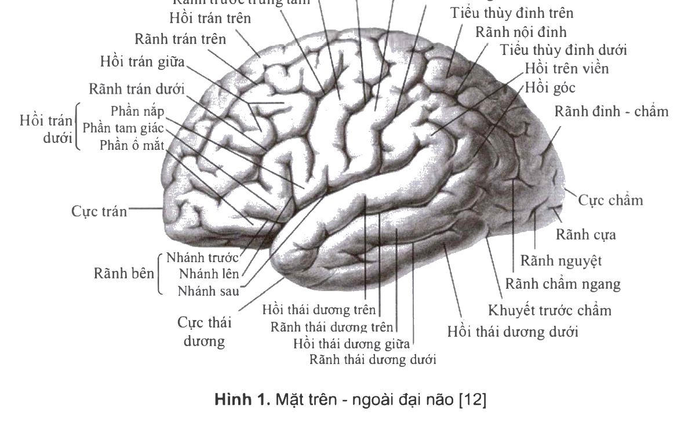
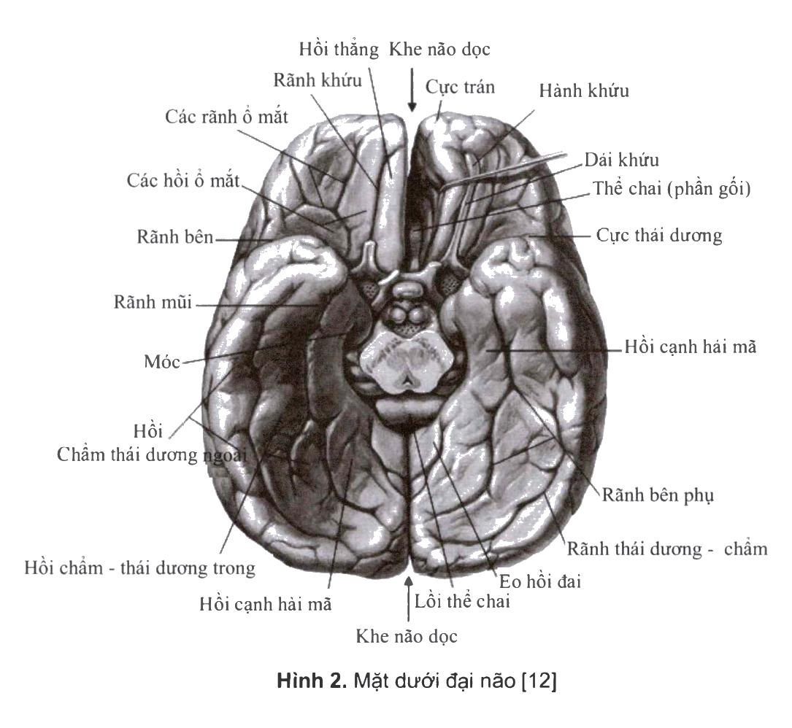
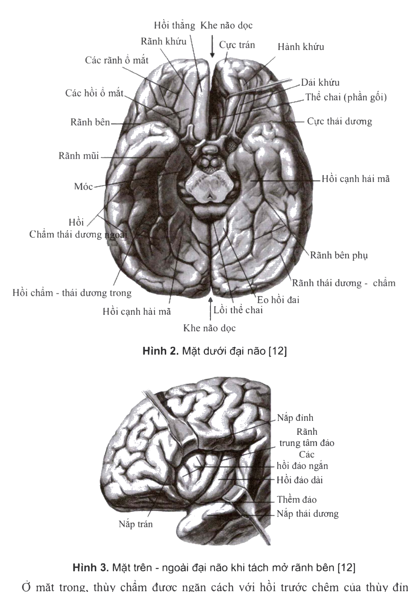
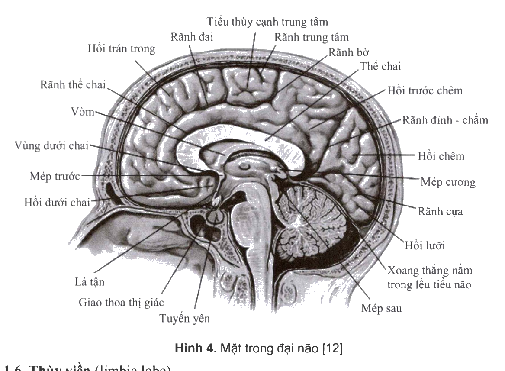
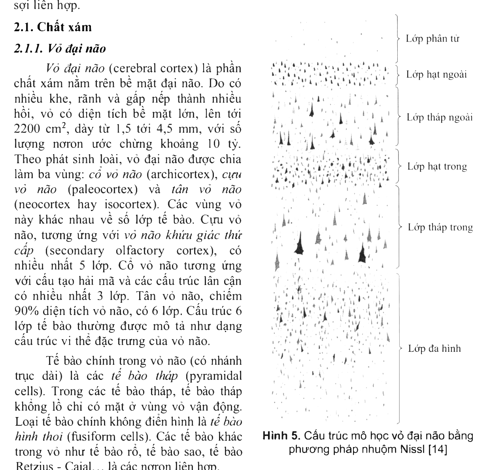
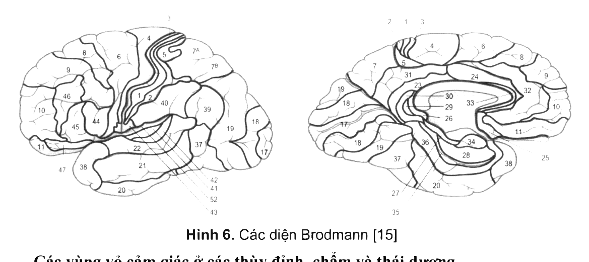
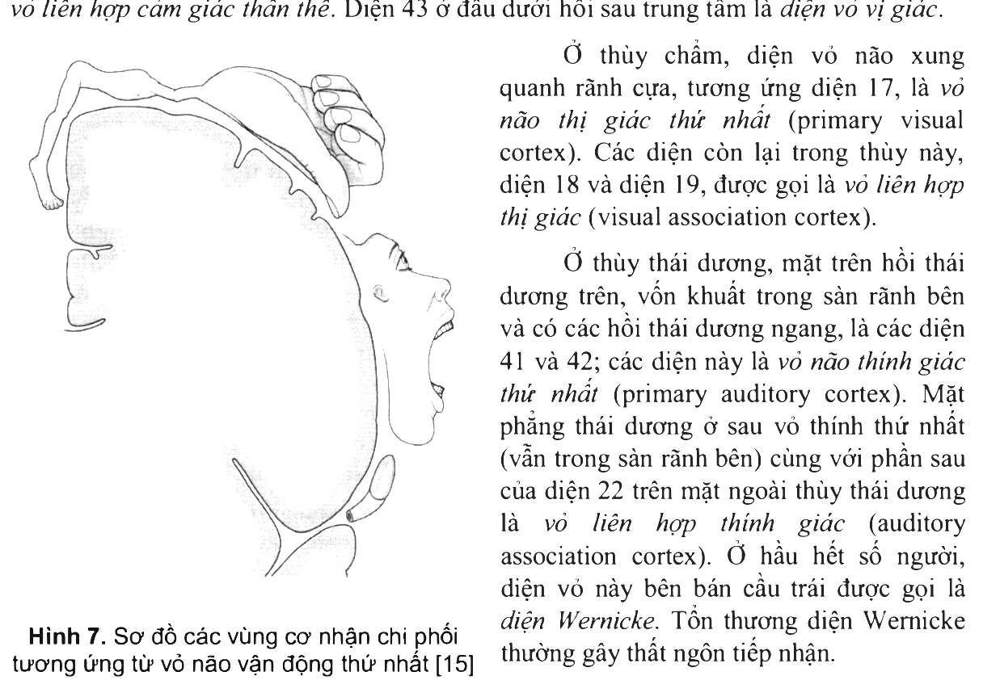
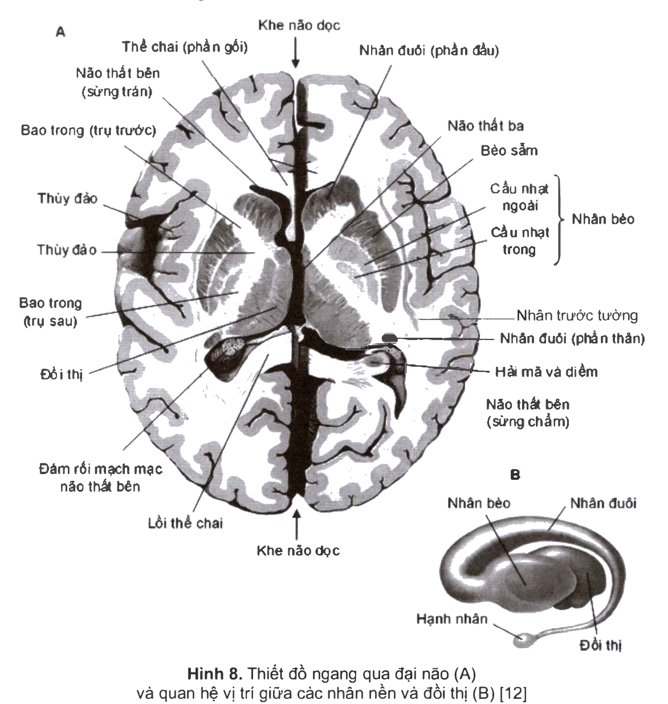
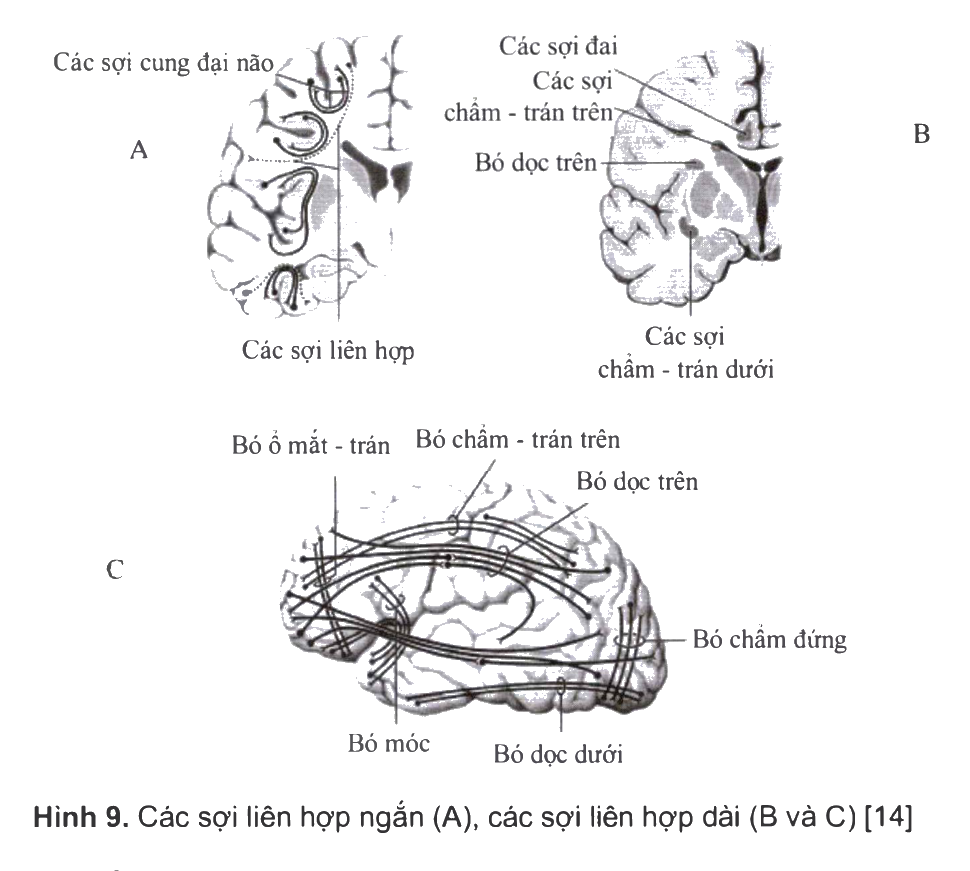
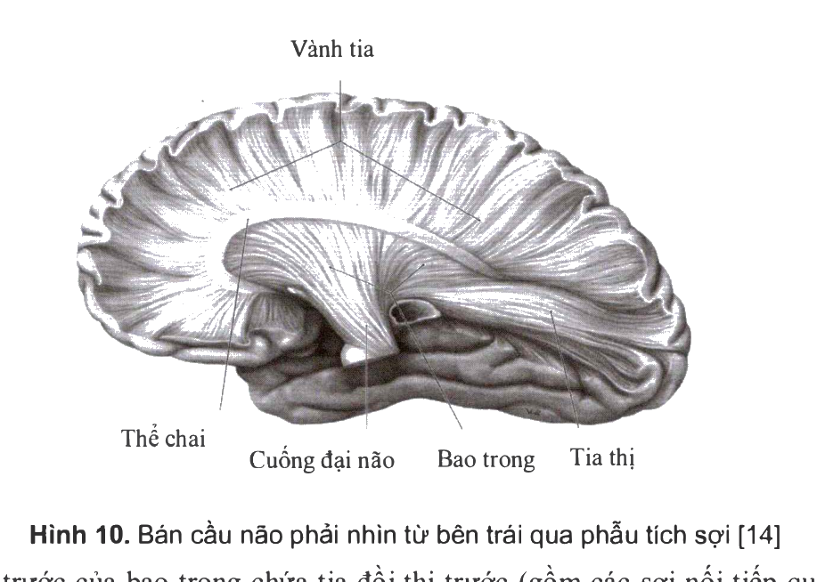

# ĐẠI NÃO (cerebrum)

**Chương:** Hệ Thần Kinh (Bài 6)  
**Tác giả:** PGS.TS. Nguyễn Văn Huy  
**Nguồn:** Giáo trình Giải phẫu học Y Hà Nội (Xuất bản 2025), Trang 370 - 382

---

Đại não (*cerebrum*), hay đoan não (*telencephalon*), là phần lớn nhất của hệ thần kinh trung ương. Nó cùng với gian não (*diencephalon*) phát triển từ bọng não trước (*forebrain vesicle*) trong thời kỳ bào thai. Khi đó, do sự gia tăng nhanh chóng về kích thước của đại não, gian não bị vùi sâu giữa hai nửa đại não. Đại não gồm hai *bán cầu đại não* (*cerebral hemispheres*) nằm ở hai bên khe não dọc (*longitudinal cerebral fissure*) và nối với nhau qua các mép gian bán cầu. Về vị trí, đại não và gian não chiếm toàn bộ các hố sọ trước và giữa, được ngăn cách với thân não và tiểu não ở hố sọ sau bởi *khe não ngang* (*transverse cerebral fissure*).

### 1. HÌNH THỂ NGOÀI

Đại não có ba mặt: mặt trên - ngoài (*superolateral surface*), mặt trong (*medial surface*), và mặt dưới (*inferior surface*). Các mặt này được ngăn cách nhau bởi ba bờ: *bờ trên* (*superior margin*), *bờ dưới trong* (*inferomedial margin*) và *bờ dưới ngoài* (*inferolateral margin*). Bề mặt đại não bị những *rãnh đại não* (*cerebral sulci*) chia thành các *thùy đại não* (*cerebral lobes*) và các *hồi đại não* (*cerebral gyri*). Các rãnh và các hồi không hoàn toàn giống nhau giữa các cá thể và giữa hai bán cầu nhưng những rãnh gian thùy sau đây tương đối hằng định (các H. 1; 2; 3):

- *Rãnh bên* (*lateral sulcus*) chạy từ hố đại não bên (*lateral cerebral fossa*) ở mặt dưới, bắt chéo bờ dưới ngoài rồi đi lên ở mặt trên - ngoài bán cầu. Nó ngăn cách các thùy trán và đỉnh với thùy thái dương.
- *Rãnh trung tâm* (*central sulcus*) ở mặt trên - ngoài đại não, đi gần như thẳng góc với rãnh bên, chạy lên trên và lấn cả vào mặt trong bán cầu. Nó ngăn cách thùy trán với thùy đỉnh.
- *Rãnh đỉnh - chẩm* (*parieto-occipital sulcus*) nằm trước cực chẩm và ngăn cách thùy chẩm với thùy đỉnh, gồm một đoạn dài ở mặt trong và một đoạn ngắn ở mặt trên - ngoài.
- *Rãnh đai* (*cingulate sulcus*) nằm ở mặt trong, gần như song song với mặt lưng của thể chai, ngăn cách hồi đai với mặt trong của các thùy trán và đỉnh.
- *Rãnh dưới đỉnh* (*subparietal sulcus*) nằm ở mặt trong, ngăn cách hồi trước chêm của thùy đỉnh với hồi đai của thùy viền.
- *Rãnh bên phụ* (*collateral sulcus*) nằm ở mặt dưới, ngăn cách hồi cạnh hải mã của thùy viền với hồi thái dương - chẩm trong ở mặt dưới thùy thái dương.

Trên bờ dưới ngoài của bán cầu đại não, trước cực chẩm vài centimeter, có một chỗ lõm gọi là *khuyết trước chẩm* (*pre-occipital notch*). Đường tưởng tượng nối rãnh đỉnh chẩm với khuyết này được xem là ranh giới giữa thùy đỉnh và thùy chẩm ở mặt ngoài.

Các rãnh và đường kẻ nói trên là ranh giới của 5 thùy đại não: thùy trán, thùy đỉnh, thùy chẩm, thùy thái dương và thùy viền.

#### 1.1. Thùy trán (frontal lobe)

Thùy trán nằm trên cả 3 mặt và đầu trước của nó được gọi là *cực trán* (*frontal pole*).

Ở mặt trên - ngoài, thùy trán nằm trên rãnh bên, trước rãnh trung tâm. Trên mặt này có 3 rãnh: *rãnh trước - trung tâm* (*precentral sulcus*) chạy gần như song song ở trước rãnh trung tâm; các rãnh ngang gồm *rãnh trán trên* (*superior frontal sulcus*) và *rãnh trán dưới* (*inferior frontal sulcus*). Các rãnh này chia mặt trên - ngoài của thùy trán thành các hồi: *hồi trước trung tâm* (*precentral gyrus*), *hồi trán trên* (*superior frontal gyrus*), *hồi trán giữa* (*middle frontal gyrus*) và *hồi trán dưới* (*inferior frontal gyrus*) (H.1).

Ở mặt dưới, thùy trán nằm trước hố não bên, tựa lên phần ổ mắt của xương trán và mảnh sàng của xương sàng. Trên mặt này có một rãnh dọc gọi là *rãnh khứu* (*olfactory sulcus*), nơi thùy trán tiếp xúc với hành khứu và dải khứu. Rãnh khứu chia mặt dưới thành 2 phần. Phần trong rãnh khứu là *hồi thẳng* (*straight gyrus*). Phần ngoài rãnh khứu có *các hồi ổ mắt* (*orbital gyri*) được ngăn cách nhau bởi các rãnh nối nhau thành hình chữ H gọi là *các rãnh ổ mắt* (*orbital sulci*) (H.3).

Phần thùy trán ở mặt trong được gọi là *hồi trán trong* (*medial frontal gyrus*). Hồi này được ngăn cách với hồi đai ở dưới bởi rãnh đai, liên tiếp với hồi trán trên ở mặt trên ngoài qua bờ trên và liên tiếp với hồi thẳng ở mặt dưới qua cực trán. Về phía sau, hồi trán trong ngăn cách với tiểu thùy cạnh trung tâm bởi rãnh cạnh trung tâm. *Tiểu thùy cạnh trung tâm* (*paracentral lobule*) là vùng lấn vào mặt trong bán cầu của các hồi trước và sau trung tâm. Nó cũng nằm trên rãnh đai và được giới hạn trước và sau bởi hai chẽ của rãnh đai là *rãnh cạnh trung tâm* (*paracentral sulcus*) ở trước và *rãnh viền* (*marginal sulcus*) ở sau. Phần trước tiểu thùy cạnh trung tâm được gọi là *hồi cạnh trung tâm trước* (*anterior paracentral gyrus*) và thuộc thùy trán.

#### 1.2. Thùy đỉnh (parietal lobe)

Thùy đỉnh nằm ở mặt trên ngoài và mặt trong bán cầu, 2 phần liên tiếp nhau qua bờ trên.

Ở mặt trên - ngoài, thùy đỉnh nằm sau rãnh trung tâm, phía trên rãnh bên và được ngăn cách với thùy chẩm ở sau bởi một đường tưởng tượng nối rãnh đỉnh - chẩm với khuyết trước chẩm. Mặt này của thùy đỉnh có hai rãnh: *rãnh sau trung tâm* (*postcentral sulcus*) chạy song song ở sau rãnh trung tâm; và *rãnh nội đỉnh* (*intraparietal sulcus*) chạy gần như song song với bờ trên đại não. Hai rãnh này chia thùy đỉnh thành ba vùng: *tiểu thùy đỉnh trên* (*superior parietal lobule*), *tiểu thùy đỉnh dưới* (*inferior parietal lobule*) và *hồi sau trung tâm*. Phần tiểu thùy đỉnh dưới bao quanh đầu sau của nhánh sau rãnh bên được gọi là *hồi trên viền* (*supramarginal gyrus*), còn phần bao quanh đầu sau rãnh thái dương trên được gọi là *hồi góc* (*angular gyrus*) (H.1).

Ở mặt trong, thùy đỉnh gồm phần tham gia tiểu thùy cạnh trung tâm (với tên gọi là *hồi cạnh trung tâm sau*) ở trước và *hồi trước chêm* (*precuneus*) ở sau. Hồi trước chêm được giới hạn bởi rãnh viền ở trước, rãnh dưới đỉnh ở dưới, rãnh đỉnh chẩm ở sau và liên tiếp với tiểu thùy đỉnh trên qua bờ trên.

#### 1.3. Thùy chẩm (occipital lobe)

Thùy chẩm nằm trên cả 3 mặt và đầu sau của nó là *cực chẩm* (*occipital pole*). Ở mặt trên - ngoài, thùy chẩm nằm phía sau đường kẻ tưởng tượng nối rãnh đỉnh - chẩm với khuyết trước chẩm. Ở mặt này có 2 rãnh là *rãnh chẩm ngang* (*transverse occipital sulcus*) ở trên và *rãnh nguyệt* (*lunate sulcus*) ở dưới. Trường hợp thường thấy nhất, thùy chẩm ở mặt trên - ngoài có hai hồi: *hồi chẩm trên* (*superior occipital gyrus*) và *hồi chẩm dưới* (*inferior occipital gyrus*) ngăn cách nhau qua rãnh chẩm ngang (H.1).

Ở mặt trong, thùy chẩm được ngăn cách với hồi trước chêm của thùy đỉnh bởi rãnh đỉnh - chẩm và có một múi não hình nêm gọi là *chêm* hay *hồi chêm* (*cuneus*) nằm giữa rãnh đỉnh chẩm và *rãnh cựa* (*calcarine sulcus*). Bên dưới rãnh cựa là *hồi lưỡi* (*lingual gyrus*). Hồi này nằm trên cả mặt dưới và mặt trong thùy chẩm và liên tiếp ở trước với hồi cạnh hải mã (các H. 2; 3).

Mặt dưới của thùy chẩm không có ranh giới với mặt dưới thùy thái dương và cùng với mặt dưới thùy thái dương tạo nên *hồi chẩm - thái dương ngoài* (*lateral occipitotemporal gyrus*) và *hồi chẩm - thái dương trong* (*medial occipitotemporal gyrus*).

#### 1.4. Thùy thái dương (temporal lobe)

Thùy thái dương gồm 2 phần nằm ở mặt trên ngoài và mặt dưới bán cầu, 2 phần liên tiếp nhau qua bờ dưới. Đầu trước được gọi là *cực thái dương* (*temporal pole*).

Ở mặt trên - ngoài, thùy thái dương nằm dưới rãnh bên, bị *rãnh thái dương trên* (*superior temporal sulcus*) và *rãnh thái dương dưới* (*inferior temporal gyrus* [sulcus]) chia thành 3 hồi: *hồi thái dương trên* (*superior temporal gyrus*), *hồi thái dương giữa* (*middle temporal gyrus*) và *hồi thái dương dưới* (*inferior temporal gyrus*). Hồi thái dương trên nằm ngay dưới rãnh bên và là *nắp thái dương* (*temporal operculum*) của rãnh này. Mặt trên hồi thái dương trên khuất trong rãnh bên và bao gồm *các hồi thái dương ngang* (*transverse temporal gyri*) ở trước và *mặt phẳng thái dương* (*temporal plane*) ở sau.

Ở mặt dưới, thùy thái dương được ngăn cách với thùy trán qua hố não bên và với hồi cạnh hải mã của thùy viền qua rãnh bên phụ. Mặt này có có phần trước của các hồi chẩm - thái dương trong và ngoài. Các hồi chẩm - thái dương được ngăn cách với nhau bởi *rãnh chẩm - thái dương* (*occipitotemporal sulcus*).

#### 1.5. Đảo (insula) hay thùy đảo (insular lobe)

Trong thuật ngữ TA, thùy đảo (*insular lobe*) chỉ là đảo (*insula*). Trong tiếng Anh người ta dùng cả hai từ là "insula" và "insular lobe". Trong tiếng Việt, ta hay gọi là "thùy đảo" hơn.

Đảo hay thùy đảo là một vùng vỏ não hình tam giác nằm vùi sâu trong rãnh bên. Tuy được ngăn với các thùy trán, đỉnh và thái dương bởi *rãnh vòng đảo* (*circular sulcus of insula*) nhưng nó vẫn bị các thùy trên trùm kín. Phần trùm lên đảo của ba thùy trên được gọi là các nắp: *nắp trán* (*frontal operculum*) và *nắp đỉnh* (*parietal operculum*) ở trên và *nắp thái dương* ở dưới. *Rãnh trung tâm đảo* (*central sulcus of insula*) chia đảo thành 2 phần sau và trước. Phần sau là *hồi đảo dài* (*long gyrus of insula*). Phần trước được các rãnh nhỏ chia thành *các hồi đảo ngắn* (*short gyri of insula*). Đầu trước dưới của đảo tiếp giáp với *thềm đảo* (*limen insulae*).

#### 1.6. Thùy viền (limbic lobe)

Thùy viền bao gồm các vùng đại não nằm ở mặt trong và mặt dưới bán cầu, bao quanh thể chai và gian não như một hình chữ C. Theo TA, thùy viền gồm các cấu trúc: diện dưới chai, hồi đai, hồi cạnh hải mã, móc, hồi răng, hồi dải, tua hải mã cùng các rãnh có liên quan là rãnh đai, rãnh bên phụ, rãnh mũi, rãnh hải mã, rãnh tua răng (H.2).

*Hồi đai* (*cingulate gyrus*) nằm ở mặt trong bán cầu; nó ôm quanh mặt lưng thể chai và được ngăn cách với thể chai qua rãnh thể chai. Hồi đai được ngăn cách với thùy trán bởi rãnh đai và với thùy đỉnh bởi rãnh dưới đỉnh. Đầu trước hồi đai vòng qua gối thể chai rồi hướng xuống dưới liên tiếp với *diện dưới chai* (*subcallosal area*) hay *diện cạnh khứu* (*paraolfactory area*). Phía sau diện cạnh khứu là *hồi cạnh tận cùng* (*paraterminal gyrus*) nằm sát trước lá tận. Ở đây cần lưu ý về mặt danh pháp, hồi cạnh tận cùng còn có tên gọi là *hồi dưới chai* (*subcallosal gyrus*), khác với *diện dưới chai*. Diện dưới chai và hồi cạnh tận cùng cùng nhau tạo nên *vùng (diện) vách* (*septal area*) nơi có các nhân vách (Xem bài Hệ viền). Ngược lại, đầu sau hồi đai liên tiếp với hồi cạnh hải mã ở sau lồi thể trai qua *eo hồi đai* (*isthmus of cingulate gyrus*).

*Hồi cạnh hải mã* (*parahippocampal gyrus*) nằm ở mặt dưới bán cầu, bao quanh hải mã ở mặt sâu. Hồi này được ngăn cách với mặt dưới thùy thái dương (ở phía ngoài) bởi *rãnh mũi* (*rhinal sulcus*) ở trước và rãnh bên phụ ở sau. Ở phía trên trong, nó được ngăn cách với *hồi răng* (*dentate gyrus*) bởi *rãnh hải mã* (*hippocampal sulcus*). Hồi răng nằm giữa hồi cạnh hải mã và hải mã, được ngăn cách với *các tua của hải mã* (*fimbria of hippocampus*) bởi *rãnh tua răng* (*fimbriodentate sulcus*). *Hồi dải* (*fasciolar gyrus*) là một dải từ đầu sau hồi răng chạy ra sau vòng quanh lồi thể chai nối với dải xám. Đầu trước hồi cạnh hải mã gập cong lên trên và vào trong, được gọi là *móc* (*uncus*); đầu sau liên tiếp với hồi lưỡi và nối với hồi đai qua eo hồi đai.

"Thùy viền" là một thuật ngữ giải phẫu được dùng để chỉ các vùng vỏ trên bề mặt, không đồng nghĩa với thuật ngữ "hệ viền". "Hệ viền" là thuật ngữ chỉ một hệ chức năng. Ngoài các phần của thùy viền được mô tả ở đây, hệ viền còn bao gồm hải mã, diện dưới chai, diện cạnh khứu và nhiều cấu trúc khác thuộc khứu não, đồi thị và vùng hạ đồi (Xem Hệ viền).

### 2. CẤU TẠO

Tương tự như các phần khác của hệ thần kinh trung ương, đại não được cấu tạo bởi hai phần chính là chất xám và chất trắng. Chất xám của đại não tập trung phần lớn ở vỏ đại não, một phần nhỏ trong các nhân nền. Chất trắng của đại não phân bố dày đặc trong mô não, có thể chia thành các nhóm sợi: các sợi mép, các sợi chiếu và các sợi liên hợp.

#### 2.1. Chất xám

##### 2.1.1. Vỏ đại não

*Vỏ đại não* (*cerebral cortex*) là phần chất xám nằm trên bề mặt đại não. Do có nhiều khe, rãnh và gấp nếp thành nhiều hồi, vỏ có diện tích bề mặt lớn, lên tới 2200 cm², dày từ 1,5 tới 4,5 mm, với số lượng nơron ước chừng khoảng 10 tỷ. Theo phát sinh loài, vỏ đại não được chia làm ba vùng: *cổ vỏ não* (*archicortex*), *cựu vỏ não* (*paleocortex*) và *tân vỏ não* (*neocortex* hay *isocortex*). Các vùng vỏ này khác nhau về số lớp tế bào. Cựu vỏ não, tương ứng với vỏ não khứu giác thứ cấp (*secondary olfactory cortex*), có nhiều nhất 5 lớp. Cổ vỏ não tương ứng với cấu tạo hải mã và các cấu trúc lân cận có nhiều nhất 3 lớp. Tân vỏ não, chiếm 90% diện tích vỏ não, có 6 lớp. Cấu trúc 6 lớp tế bào thường được mô tả như dạng cấu trúc vi thể đặc trưng của vỏ não.

Tế bào chính trong vỏ não (có nhánh trục dài) là *các tế bào tháp* (*pyramidal cells*). Trong các tế bào tháp, tế bào tháp khổng lồ chỉ có mặt ở vùng vỏ vận động. Loại tế bào chính không điển hình là *tế bào hình thoi* (*fusiform cells*). Các tế bào khác trong vỏ như tế bào rổ, tế bào sao, tế bào Retzius - Cajal... là các nơron liên hợp.

Các lớp tế bào từ nông vào sâu được đánh dấu bằng ký tự La Mã I - VI. Gồm:
- *Lớp I: Lớp phân tử*: nơi synáp với nhau giữa các nhánh cành (của tế bào tháp) với nhánh trục (đến từ vùng vỏ khác, đồi thị); chỉ có một số ít tế bào Retzius - Cajal xen giữa.
- *Lớp II: Lớp hạt ngoài*: nhiều tế bào sao và tế bào tháp nhỏ.
- *Lớp III: Lớp tháp ngoài*: chứa các tế bào tháp điển hình có kích thước tăng dần từ nông vào sâu. Nhánh trục phóng chiếu tới các vùng vỏ não khác (cùng hoặc khác bán cầu).
- *Lớp IV: Lớp hạt trong*: cấu tạo tương tự lớp hạt ngoài.
- *Lớp V: Lớp tháp trong*: chứa các tế bào tháp lớn nằm xen với các nơron liên hợp; riêng vùng vỏ vận động thứ nhất có tế bào tháp khổng lồ. Các nhánh trục phóng chiếu tới các đích dưới vỏ gồm thể vân, thân não và tủy sống.
- *Lớp VI: Lớp đa hình*: tế bào hình thoi là tế bào chính ở đây nhưng cũng có tế bào tháp và các nơron liên hợp khác.

*Các tiếp nối của vỏ não.* Các sợi đến vỏ não từ các nguồn sau: (1) các vùng vỏ khác cùng bán cầu (sợi liên hợp) hoặc bán cầu đối bên (sợi mép); (2) đồi thị; (3) nhân trước tường (tới vỏ các thùy đỉnh và chẩm); (4) các nhân nền não trước; (5) vết lục; (6) các nhân đường đan ở thân não; (7) một số nhân hạ đồi thị. Các sợi từ vỏ não đi là nhánh trục tế bào tháp và tế bào hình thoi. Chúng đi vào chất trắng của bán cầu và trở thành sợi mép, sợi liên hợp và một phần các sợi phóng chiếu.

Dựa trên cấu trúc các lớp, hình thái tế bào và phân bố các bó nhánh trục, Brodmann (1909) đã lập một bản đồ đánh số 52 diện vỏ não trên khỉ, trong đó có 44 diện tương đồng trên não người. Các nghiên cứu thực nghiệm và lâm sàng đã cho phép xác định được các tiếp nối và chức năng của một số *diện Brodmann* (*Brodmann's areas*) này.

**Vỏ não thùy trán**

Thùy trán có các diện vỏ vận động và các diện vỏ có vai trò trong khả năng xét đoán, tầm nhìn và tâm tính con người. Hồi trước trung tâm và phần trước tiểu thùy cạnh trung tâm, tương ứng diện 4, là *diện vận động thứ nhất* (*primary motor area*). Phần sau của hồi trán dưới (thường ở bán cầu não trái), tương ứng với diện 44 và 45, là *diện Broca*, chi phối vận động các cơ phát âm. Tổn thương diện Broca dẫn tới chứng mất ngôn ngữ biểu đạt. Vùng vỏ ngay trước diện 4, nằm trên phần sau các hồi trán ở mặt ngoài và hồi trán trong ở mặt trong, là diện 6; tại diện này có *diện vận động bổ sung* (*supplementary motor area*) ở mặt trong và *diện tiền vận động* (*premotor area*) ở mặt ngoài. Trước diện 6, phần dưới của diện 8 trên mặt ngoài là *trường mắt thùy trán* (*frontal eye field*) liên quan đến các vận động mắt. Các diện 9 tới 12 ở quanh cực trán là *vỏ trước trán* (*prefrontal cortex*) liên quan đến các chức năng trí tuệ.

Tại diện vận động thứ nhất, mỗi cơ (hay cơ ở mỗi vùng cơ thể) đều có một diện tích đại diện trên diện này, và vị trí sắp xếp của các diện tích đại diện cũng giống như vị trí sắp xếp của các cơ trên cơ thể, tức là trên hồi trước trung tâm và phần trước tiểu thùy cạnh trung tâm ta có thể vẽ lên một hình *người lùn* (*homunculus*). Hình người lùn này có 3 đặc điểm: (1) lộn ngược trên dưới: phần dưới thấp của diện vận động đại diện cho những cơ ở phần đầu mặt (cao) của cơ thể và ngược lại; (2) mất cân xứng: các cơ nhỏ nhưng vận động tinh tế như cơ nội tại ở bàn tay có diện tích đại diện rộng, có cơ lớn như cơ mông diện tích đại diện lại hẹp; (3) đảo ngược phải trái: diện vận động bên não phải chi phối cơ bên trái và ngược lại.

**Các vùng vỏ cảm giác ở các thùy đỉnh, chẩm và thái dương**

Ở thùy đỉnh, hồi sau trung tâm và phần sau tiểu thùy cạnh trung tâm, tương ứng với các diện 1, 2 và 3, là *vỏ não cảm giác thân thể thứ nhất* (*primary somatosensory cortex*). Tính chất đại diện ở vỏ cảm giác thân thể thứ nhất giống như ở diện vận động thứ nhất. Các diện 5 và 7, tương ứng với tiểu thùy đỉnh trên và hồi trước chêm, là *vùng vỏ liên hợp cảm giác thân thể*. Diện 43 ở đầu dưới hồi sau trung tâm là *diện vỏ vị giác*.

Ở thùy chẩm, diện vỏ não xung quanh rãnh cựa, tương ứng diện 17, là *vỏ não thị giác thứ nhất* (*primary visual cortex*). Các diện còn lại trong thùy này, diện 18 và diện 19, được gọi là *vỏ liên hợp thị giác* (*visual association cortex*).

Ở thùy thái dương, mặt trên hồi thái dương trên, vốn khuất trong sàn rãnh bên và có các hồi thái dương ngang, là các diện 41 và 42; các diện này là *vỏ não thính giác thứ nhất* (*primary auditory cortex*). Mặt phẳng thái dương ở sau vỏ thính thứ nhất (vẫn trong sàn rãnh bên) cùng với phần sau của diện 22 trên mặt ngoài thùy thái dương là *vỏ liên hợp thính giác* (*auditory association cortex*). Ở hầu hết số người, diện vỏ này bên bán cầu trái được gọi là *diện Wernicke*. Tổn thương diện Wernicke thường gây thất ngôn tiếp nhận.

Diện 34 ở móc hải mã và thềm đảo và diện 28 (nội khứu - entorhinal) ở hồi cạnh hải mã là các diện vỏ khứu giác.

##### 2.1.2. Các nhân nền (basal nuclei)

Các nhân nền hay các hạch nền là các nhân xám vùi trong chất trắng và tách biệt với vỏ não. Theo các nhà giải phẫu, các nhân này bao gồm *thể vân* (*corpus striatum*), *nhân trước tường* (*claustrum*) và *phức hợp hạnh nhân* (*amygdaloid complex*), tức là tất cả các chất xám dưới vỏ. Theo chức năng và lâm sàng, thể vân cùng với nhân dưới đồi thị và chất đen của trung não được mô tả như một hệ thống có chức năng liên hệ với nhau, ngay cả khi được mô tả dưới tiêu đề "các nhân nền". Trong khi đó, chức năng của nhân trước tường chưa thật rõ, còn phức hợp hạnh nhân lại có mối liên hệ chức năng với hệ viền và được mô tả cùng với hệ viền (xem Hệ viền).

Về giải phẫu, thể vân gồm *nhân đuôi* (*caudate nucleus*) và *nhân bèo* (*lentiform nucleus*). Nhân bèo gồm phần ngoài là *bèo sẫm* (*putamen*) và phần trong là *cầu nhạt* (*globus pallidus*). Về phân chia dựa theo tiếp nối và chức năng, nhân đuôi và bèo sẫm được gọi là *vân* (*striatum*) hay *tân thể vân* (*neostriatum*), còn cầu nhạt thuộc về *nhạt* (*pallidum*) hay *cựu thể vân* (*paleostriatum*). Vân tiếp nhận các sợi đến từ vỏ đại não, đồi thị và phần đặc chất đen. Trong bệnh Parkinson, vân không nhận được các sợi đến từ chất đen (mang tới dopamine). Các sợi từ vân phóng chiếu tới cả hai phần cầu nhạt và chất đen. Các sợi từ cầu nhạt phóng chiếu lên đồi thị và trung não. Con đường đồi thị - vỏ não khép kín vòng tiếp nối thần kinh từ vỏ đại não đi qua thể vân, một vòng thần kinh liên quan đến chức năng vận động.

Nhân bèo có hình nêm với phần hẹp hướng vào trong là cầu nhạt và phần rộng ở ngoài là bèo sẫm, hai phần được ngăn cách nhau bằng một lá chất trắng. Cầu nhạt lại được một lá chất trắng nữa chia thành hai phần trong và ngoài. Nhân bèo nằm ngang mức đảo, được ngăn cách với đảo ở phía ngoài bởi ba lớp, lần lượt từ trong ra là *bao ngoài* (*external capsule*), *nhân trước tường* và *bao ngoài cùng* (*extreme capsule*). Mặt trong nhân bèo tiếp xúc với bao trong, được bao trong ngăn cách với đồi thị và nhân đuôi. Mặt bụng nhân bèo sát với các cấu trúc ở nền não như chất thủng trước, dải thị giác.

*Nhân đuôi* (*caudate nucleus*) là một nhân uốn cong hình chữ C, nằm phía ngoài đồi thị, gồm đầu, thân, và đuôi, đầu và đuôi đều hướng ra trước. Mặt lõm nhân đuôi ôm quanh đồi thị và bao trong, còn mặt lồi của nó lại bị vây quanh bởi não thất bên và tham gia vào các thành của não thất bên: đầu tạo nên thành dưới ngoài của sừng trán, thân nằm ở thành dưới ngoài của phần trung tâm, đuôi nằm dọc trần của sừng thái dương. Sừng trán và phần trung tâm não thất bên ngăn cách nhân đuôi với thể chai. Đầu nhân đuôi liên tiếp với bèo sẫm, phần còn lại của nhân đuôi ngăn cách với nhân bèo bởi bao trong nhưng hai nhân vẫn nối với nhau bởi các cầu nối ngang qua bao trong.

#### 2.2. Chất trắng

Chất trắng đại não được tạo bởi ba loại nhánh trục (có myelin): các sợi liên hợp, các sợi mép, các sợi chiếu.

##### 2.2.1. Các sợi liên hợp (Hình 9)

*Các sợi liên hợp* (*association fibres*) kết nối những phần vỏ não khác nhau trong cùng một bán cầu đại não. Các sợi ngắn là những sợi thường chạy qua lại giữa các hồi não lân cận. Các sợi dài nối những vùng não ở các thùy não khác nhau. Các sợi dài đi trong các bó: *bó dọc trên* (*superior longitudinal fasciculus*), *bó dọc dưới* (*inferior longitudinal fasciculus*), *bó chẩm - trán dưới* (*inferior occipitofrontal fasciculus*), *bó móc* (*uncinate fasciculus*), *bó đai* (*cingulum*), và vòm.

Vòm là cấu trúc vừa chứa các sợi liên hợp vừa chứa các sợi mép. Trong đó, nó chủ yếu chứa các sợi liên hợp từ hải mã tới các vùng vỏ não khác (Xem bài Hệ viền).

##### 2.2.2. Các sợi mép

*Các sợi mép* (*commissural fibres*) là những sợi kết nối các vùng vỏ não ở hai bán cầu. Chúng băng qua đường giữa và tạo nên các mép nối 2 bán cầu, gồm: thể chai, mép trước và vòm (Hình 3).

*Thể chai* (*corpus callosum*) là mép gian bán cầu lớn nhất, nó chứa 150-200 triệu sợi thần kinh. Từ trước ra sau thể chai gồm bốn phần: *mỏ* (*rostrum*), *gối* (*genu*), *thân* (*trunk*) và *lồi* (*splenium*). Mặt lưng thể chai là đáy của khe não dọc và rãnh giữa lưng thể chai và hồi đai bao quanh là rãnh thể chai. Mặt bụng của thể chai là trần của các não thất bên và được nối với lưng của thân vòm bởi vách trong suốt. Các sợi từ gối thể chai khi đi vào 2 thùy trán thì tạo nên *kẹp trán* (*frontal forceps*). Gối thuôn hẹp dần tới mỏ. Mỏ nằm ngay trên diện dưới chai và liên tiếp với lá tận ở thành trước não thất ba. Lồi thể chai là phần dày nhất của thể chai, nhô ra ở ngay sau gian não. Các sợi từ lồi thể chai đi vào hai thùy chẩm tạo nên *kẹp lớn* hay *kẹp chẩm* (*occipital forceps*). Lớp sợi mỏng của thể chai chạy vào thành sừng thái dương não thất bên được gọi là *thảm trai* (*tapetum*). Khi các sợi mép của thể chai tỏa vào trong chất trắng của bán cầu, chúng đan vào với các sợi liên hợp và các sợi chiếu (các H.3 và 10).

*Mép trước* (*anterior commissure*) là một bó chứa khoảng 3,5 triệu sợi trục có myelin. Nó được cho là chủ yếu kết nối các vùng vỏ não thuộc thùy viền hoặc các trung tâm khứu giác, một số sợi liên kết các thùy trán và thùy thái dương. Mép trước có hình dạng như một chiếc tay lái xe đạp.

*Mép vòm* là một tấm các sợi nhỏ tạo thành hình tam giác, liên kết hai trụ của vòm với nhau.

##### 2.2.3. Các sợi chiếu và bao trong

*Các sợi chiếu* (*projection fibres*) là các sợi đi lên hoặc đi xuống liên kết các vùng vỏ não với những nơron nằm ở vùng não thấp hơn hoặc tủy sống. Khi đi giữa đồi thị và đầu nhân đuôi ở trong, nhân bèo ở ngoài, các sợi chiếu tạo nên bao trong, hay đóng góp hầu hết các sợi của bao trong. Ra khỏi bao trong, các sợi chiếu tỏa ra thành vành tia (Hình 10).

Trên thiết đồ ngang, *bao trong* (*internal capsule*) có hình chữ V với vị trí góc nhọn (gối bao trong) nằm giữa đồi thị và nhân đuôi. Bao trong thường được mô tả với năm phần là trụ trước, gối, trụ sau, phần sau bèo và phần dưới bèo. *Trụ trước* (*anterior limb*) nằm giữa nhân bèo và đầu nhân đuôi. *Gối bao* nằm trong đỉnh nhân bèo. *Trụ sau* (*posterior limb*) nằm giữa nhân bèo và đồi thị. *Phần sau bèo* (*retrolentiform part*) và *phần dưới bèo* (*sublentiform part*) chiếm các vùng nằm lần lượt sau và dưới nhân bèo (Xem bài Tủy sống).

Trụ trước của bao trong chứa tia đồi thị trước (gồm các sợi nối tiếp qua lại giữa đồi thị và vỏ não) và các sợi trán - cầu đi từ vỏ não thùy trán tới các nhân của cầu não. Gối của bao trong chứa các sợi vỏ - nhân. Trụ sau của bao trong chứa các sợi vỏ - tủy (dải tháp), các sợi vỏ - lưới, vỏ - đỏ, vỏ - đồi thị, đỉnh - cầu, đồi thị - đỉnh và tia đồi thị trung tâm. Phần sau nhân bèo của bao trong chứa các sợi chẩm - cầu, chẩm - mái và tia thị (các sợi gối cựa); một số các sợi đồi thị - vỏ não. Phần dưới nhân bèo của bao trong chứa các sợi trán - cầu, thái dương - cầu và tia thính.

Bởi phần lớn các sợi chiếu tập trung đi trong một cấu trúc hẹp như bao trong, một tổn thương nhỏ ở đây, đặc biệt là trụ sau bao trong, có thể gây ra những bệnh cảnh lâm sàng hết sức nặng nề như liệt hoàn toàn và đồng nhất ở nửa cơ thể.
