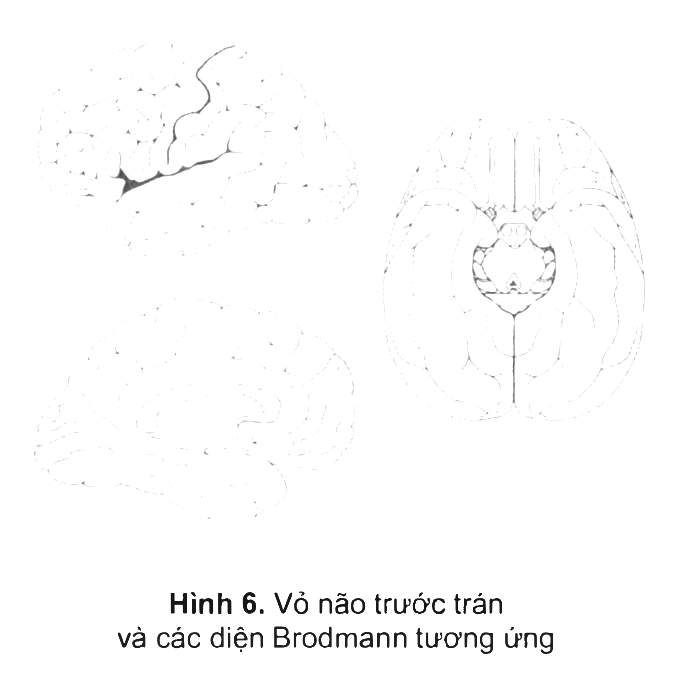

# HỆ VIỀN

**Chương:** Hệ Thần Kinh (Bài 7)  
**Tác giả:** PGS.TS. Nguyễn Văn Huy  
**Nguồn:** Giáo trình Giải phẫu học Y Hà Nội (Xuất bản 2025), Trang 383 - 393

---

Hệ viền là một hệ thống các cấu trúc thần kinh tham gia vào thu nhận, xử lý thông tin từ môi trường và phát xuất các đáp ứng hành vi và cảm xúc, nhất là các hành vi có tính chất sống còn của con người như tình dục và ăn uống, chống đỡ hay bỏ chạy. Hệ thống này cũng lưu giữ các thông tin, kinh nghiệm thu nhận được và các cảm xúc đã trải qua thành trí nhớ, yếu tố thiết yếu nhất của học tập.

Những cấu trúc thực hiện các chức năng của hệ viền bao gồm: thùy viền (hồi viền và cấu tạo hải mã) và phức hợp nhân hạnh nhân cùng nhiều phần khác của não kết nối với hai cấu trúc chính này. Những phần này gồm: một số nhân vùng hạ đồi, nhất là thể vú; các nhân vách; nhân cạp; một số vùng của vỏ não trước trán; các nhân cương; các nhân đồi thị trước và một số nhân đồi thị khác; một số phần của các nhân nền; một số nhân trung não. Các cấu trúc chất trắng tạo nên bởi các sợi kết nối các phần của hệ viền bao gồm: vòm, vân tận, bó vú - đồi thị, vân tủy đồi thị, bó sau phản chiếu, bó giữa của não trước, bó đai...

### 1. THÙY VIỀN (limbic lobe)

![Hình 1. Mặt trong và mặt dưới đại não [12]](figures/hinh_p384_1.png)

Thùy viền là vùng não bao quanh gian não, nằm giữa gian não và phần còn lại của đại não (H.1).

Thùy viền được mô tả như một cấu trúc với hai vành đai: *vòng đai ngoài của thùy viền* (*outer ring of limbic lobe*) hay *hồi viền* (*limbic gyrus*) và *vòng đai trong của thùy viền* (*inner ring of limbic lobe*) hay *cấu tạo hải mã* (*hippocampal formation*). Hai cấu trúc khác cũng nằm trong vành đai trong thùy viền là hồi dải và dải xám.

#### 1.1. Hồi viền (limbic gyrus) hay vòng đai ngoài thùy viền

Hồi viền là vùng não hình chữ C hay gần tròn, nằm ở mặt dưới trong bán cầu và bao quanh thể chai và các cuống đại não. Từ trước ra sau nó gồm ba phần: diện dưới trai, hồi đai và hồi cạnh hải mã. Các hồi đai và cạnh hải mã được gọi chung là *hồi vòm* (*fornicate gyrus*).

*Diện dưới chai* (*subcallosal area*), hay *diện cạnh khứu* (*paraolfactory area*), và *hồi cạnh tận cùng* (*paraterminal gyrus*) ở ngay phía sau là một vùng vỏ não nằm ở mặt trong đại não, ngay dưới mỏ thể chai và trước lá tận. Hai diện này được gọi chung là *vùng (diện) vách* (*septal area*), vùng mà các nhân bên dưới nằm trên các con đường tiếp nối của hệ viền.

*Hồi đai* (*cingulate gyrus*) từ đầu trước của diện dưới chai chạy vòng lên và ra sau ôm quanh lưng thể chai, được ngăn với thể chai bằng rãnh thể chai và với các thùy trán và đỉnh bởi rãnh đai. Khi chạy về phía sau đến ngang vị trí của lồi thể chai, hồi đai thu hẹp lại thành *eo hồi đai* (*isthmus of cingulate gyrus*) và liên tiếp với hồi cạnh hải mã ở mặt dưới.

*Hồi cạnh hải mã* (*parahippocampal gyrus*) nằm ở mặt dưới đại não, được ngăn cách với hồi chẩm-thái dương trong của thùy thái dương bằng rãnh bên phụ. Đầu trước của hồi cạnh hải mã quặt ra sau thành *móc* (*uncus*), đầu sau liên tiếp với hồi lưỡi của thùy chẩm. Hồi cạnh hải mã được ngăn cách với hồi răng bởi *rãnh hải mã* (*hippocampal sulcus*). Phần tiếp giáp rãnh hải mã của hồi cạnh hải mã được gọi là *bậc* (*subiculum*), như là nền của hải mã. Đầu trước của hồi cạnh hải mã là diện nội khứu. Như vậy, về chức năng và tiếp nối, phần lớn hồi cạnh hải mã thuộc về cấu tạo hải mã. Vùng vỏ của móc thuộc vỏ não khứu giác thứ nhất. Vùng này vây quanh các nhân của thể hạnh nhân ở bên dưới (H. 1; 2; 3).

#### 1.2. Cấu tạo hải mã (hippocampal formation) hay vòng đai trong thùy viền

*Về giải phẫu.* Hải mã là cấu trúc chính của tập hợp cấu trúc gọi là cấu tạo hải mã (*hippocampal formation*). Cấu tạo hải mã bao gồm hải mã, hồi răng, bậc và diện nội khứu.

*Hải mã* (*hippocampus*), hay *sừng Amon* (*cornu ammonis*), hay *hải mã đích thực*, là vùng vỏ đại não nằm ở phía trên trong của hồi cạnh hải mã. Tuy là vỏ nhưng lại bị vùi sâu ở sàn sừng thái dương não thất bên, bề mặt hướng về não thất của hải mã được phủ bằng chất trắng gọi là *ổ* (*alveus*) và *tua hải mã* (*fimbriae of hippocampus*).

*Hồi răng* (*dentate gyrus*) nằm dọc trên hồi cạnh hải mã, giữa hồi này và hải mã. Nó được ngăn cách với hồi cạnh hải mã bởi *rãnh hải mã* (*hippocampal sulcus*) và với tua của hải mã bởi rãnh tua. Phần hồi cạnh hải mã tiếp giáp với hồi răng ở trên và hải mã ở trên trong là *bậc* (*subiculum*). Bậc là cấu trúc thấp nhất của cấu tạo hải mã (có nghĩa ban đầu là nền sừng Amon - subiculum cornu ammonis). Diện vỏ ở đầu trước hồi cạnh hải mã, ngay trong rãnh mũi là *diện nội khứu* (*entorhinal area/cortex*) hay diện 28 Brodmann. Như vậy, phần lớn hồi cạnh hải mã (gồm diện nội khứu và bậc) tham gia vào cấu tạo hải mã. Nếu muốn mặc định coi hải mã đồng nghĩa với cấu tạo hải mã, thì cần hiểu hải mã như gồm cả hồi răng, bậc và diện nội khứu.

*Về mô học.* Hải mã được chia thành các vùng từ CA1 tiếp giáp với bậc tới CA4 tiếp giáp với hồi răng. Hải mã có cấu trúc vỏ 3 lớp trong đó lớp chứa tế bào chính là lớp tế bào tháp. Hồi răng cũng có cấu trúc 3 lớp nhưng lớp tế bào tháp được thay bằng lớp tế bào hạt; tế bào hạt là tế bào chính với các sợi trục đi ra khỏi nhân răng như là các sợi rêu. Bậc tuy thuộc hồi cạnh hải mã nhưng vỏ của bậc không có cấu trúc 6 lớp của vỏ não mới của hồi cạnh hải mã mà có cấu trúc chuyển tiếp giữa hải mã và hồi cạnh hải mã. Nó nhận các sợi đến từ CA1 và diện nội khứu và là nguồn chính của các sợi đi của cấu tạo hải mã. Diện nội khứu là vùng vỏ kết nối các vùng não khác với cấu tạo hải mã. Từ diện này có con *đường xuyên* (*perforant pathway*) là đường phóng chiếu sợi trục từ diện nội khứu tới các CA, bậc và hồi răng nhưng chủ yếu là tới hồi răng. Giữa các cấu trúc của cấu tạo hải mã có một vòng tiếp nối với 4 chặng chuyển tiếp nội tại (H.3): (1) Diện nội khứu - hồi răng (qua đường xuyên); (2) hồi răng - CA3 (qua sợi rêu); (3) CA3 - CA1 (qua nhánh bên sợi trục tế bào tháp của CA3); (4) CA1 - bậc (qua nhánh bên sợi trục tế bào tháp của CA1).

*Các tiếp nối đến* cấu tạo hải mã bao gồm: (1) các sợi đến từ hải mã đối bên, vùng vách và gian não (qua vòm và tua hải mã); (2) các sợi từ vỏ nội khứu. Vỏ nội khứu vừa là diện vỏ khứu thứ nhất vừa là diện vỏ tiếp nhận sợi đến từ vỏ thái dương, mang đến các thông tin cảm giác đủ loại. Vỏ nội khứu truyền thông tin đến cấu tạo hải mã qua đường xuyên và qua các sợi đi qua ổ (đường ổ).

![Hình 2. Hải mã và các cấu trúc lân cận (nhìn từ trên) [12]](figures/hinh_p386_2.png)

*Các sợi đi khỏi cấu tạo hải mã* là nhánh chính các sợi trục từ hải mã và bậc. Chúng đi qua ổ rồi đi qua tua hải mã. Tua hải mã chạy hướng ra sau và lên trên, trở thành *trụ vòm* (*crus of fornix*) khi đến dưới lồi thể chai, rồi trụ vòm hợp lại với trụ đối bên thành thân vòm. *Thân vòm* (*body of fornix*) có hình tam giác nằm ở dưới thể chai và được nối với thể chai bởi vách trong suốt. Hai góc sau bên của thân vòm được nối với nhau bằng *mép vòm* (*commissure of fornix*) hay *mép hải mã* (*hippocampal commissure*) do các sợi bắt chéo nhau giữa hai trụ vòm tạo nên. Những sợi mép này đi từ hồi cạnh hải mã của bán cầu này tới cấu tạo hải mã của bán cầu đối bên. Ở ngang mức lỗ gian não thất, góc trước của thân vòm tách thành hai *cột vòm* (*columns of the fornix*) ở ngay sau mép trước. Một số sợi của cột (phần trước mép) tách ra đi vào vùng vách, phần trước hạ đồi thị và chất vô danh. Phần cột còn lại hướng xuống dưới và ra ngoài, đi qua vùng hạ đồi, cho các sợi đi vào nhân đồi thị lưng bên rồi tận cùng ở thể vú. Những sợi bắt nguồn từ bậc phần lớn sau đó tận cùng ở các nhân vú, một số vào vùng hạ đồi và đồi thị. Những sợi bắt nguồn từ hải mã thường tỏa ra vào các nhân vách, vỏ não mặt trong thùy trán, vùng hạ đồi, và nhân cạp. Thể vú phóng chiếu tới các nhân trước của đồi thị qua *bó vú thị* (*mammillothalamic fasciculus*). Nhân đồi thị trước và nhân đồi thị lưng bên có tiếp nối qua lại với hồi đai. Hồi đai có tiếp nối qua lại với hồi cạnh hải mã, trong đó có diện nội khứu.

![Hình 3. Các tiếp nối nội tại ở cấu tạo hải mã [10]](figures/hinh_p387_3.png)
*(Hình 3: Vùng nội khứu (ENT - entorhinal) với các sợi xuyên đi tới hồi răng (DG - dentate gyrus); các sợi rêu từ hồi răng đi tới CA3; các sợi bên Schaffer (sợi trục) của tế bào tháp CA3 đi tới CA1; sợi trục từ CA1 đi tới bậc (SU - subiculum). Fx (fimbria): tua hải mã; CN (caudate nucleus) = nhân đuôi (phần đuôi); extrinsic afferents = các sợi đến từ bên ngoài.)*

Các tổn thương của cấu tạo hải mã trên người và các quan sát thực nghiệm trên động vật cho thấy hải mã gắn liền với quá trình hình thành ký ức mới hoặc lưu trữ những ký ức vừa xảy ra. Hiện tượng này cũng tương tự ở những bệnh nhân thiếu thiamine (vitamin B1) kéo dài làm mất nơron ở hải mã. Đặc biệt trong bệnh nhân nghiện rượu, với biểu hiện của mất trí do rượu, hoặc tình trạng nặng hơn là sảng rượu: bệnh nhân nói lảm nhảm do gắn kết sai lạc các mảng ký ức bị mất liên kết. Tế bào tháp vùng CA1 của hải mã rất dễ bị chết do thiếu ô xy thời gian ngắn, gây nên tình trạng quên thoáng qua.

#### 1.3. Hồi dải (fasciolar gyrus) và dải xám (indusium griseum)

Hồi dải là một dải não mỏng, chuyển tiếp từ phần sau của hồi răng ở vị trí ngang mức đuôi hải mã, ngay phía dưới lồi thể chai. Hồi dải sau đó tận cùng bằng cách thu nhỏ dần trở thành dải xám (các H.1 và 2).

Dải xám chạy tiếp theo với hồi dải. Nó là một lá chất xám mỏng đi vòng lên, sát vào mặt lưng thể chai. Về phía trước, khi đến gối thể chai, nó vòng xuống dưới và ra sau, liên tiếp với hồi cạnh tận cùng. (các H.1 và 2). Hồi dải và dải xám được xem như tàn tích của cấu trúc nối hải mã với vùng vách.

#### 1.4. Vòng kết nối cấu tạo hải mã với các cấu trúc khác của hệ viền

Vòng nối trong thùy viền được mô tả năm 1937 bởi James Papez, do đó còn có tên gọi *vòng Papez* (*Papez circuit*) (H.4). Không kể các chặng tiếp nối nội tại của riêng cấu tạo hải mã, vòng Papez là vòng khép kín với các chặng nơron sau (5 dải sợi nối các chặng được in nghiêng): diện nội khứu của hồi cạnh hải mã - *đường xuyên và đường ổ* - cấu tạo hải mã (hồi đai - CA3 - CA1 - bậc) - *tua hải mã và vòm* - thể vú - *bó vú-đồi thị* - nhân đồi thị trước - *bao trong* - hồi đai - *bó đai* - diện nội khứu. Vòng Papez cần phải toàn vẹn ở ít nhất một bán cầu để có thể nhớ được các sự việc, sự kiện mới xảy ra. Nhưng vòng Papez toàn vẹn không phải là điều thiết yếu đối với việc hồi tưởng lại trí nhớ đã có vì chúng được lưu giữ ở nhiều vùng vỏ não.

![Hình 4. Các tiếp nối của cấu tạo hải mã và thể hạnh nhân, bao gồm vòng Papez [10]](figures/hinh_p388_4.png)

### 2. PHỨC HỢP NHÂN HẠNH NHÂN (amygdaloid nuclear complex)

Phức hợp nhân hạnh nhân hay thể hạnh nhân (*amygdaloid body/amygdala*) là một nhóm nhân nhỏ nằm ở phía sau - trong cực thái dương của đại não, trước đầu trước hải mã và sừng thái dương não thất bên. Nhóm lưng - giữa (hay nhân vỏ - giữa) của thể hạnh nhân hòa lẫn với vỏ não của móc. Thể hạnh nhân có cấu tạo như một phức hợp với nhiều nhân, trong đó có hai nhân là *nhân nền bên* (*basolateral nucleus*) và *nhân trung tâm* (*central nucleus*) thuộc hệ viền.

Nhân nền bên của hạnh nhân có các tiếp nối qua lại với vỏ trước trán, thùy thái dương, hồi đai và bậc. Các sợi đến dưới vỏ đến từ đồi thị và các nhân của cấu tạo lưới thân não. Nhân trung tâm nhận các sợi khứu đến từ nhân vỏ - giữa và các sợi từ nhân nền bên. Thể hạnh nhân nói chung nhận thông tin rộng bao gồm cảm giác thân thể, cảm giác nội tạng, thông tin thị giác.

Các nhân nền bên và trung tâm có các sợi đi rời khỏi hạnh nhân qua *vân tận* (*stria terminalis*) và *đường ly hạnh nhân bụng* (*ventral amygdalofugal pathway*). Vân tận là bó sợi trục nhỏ nhưng dài đi theo chiều cong của đuôi nhân đuôi, rồi đi dọc trong rãnh giữa nhân đuôi và đồi thị ở sàn của thân não thất bên. Hầu hết các sợi tận cùng ở vùng vách, vùng trước thị, vùng hạ đồi thị trước và nhân cạp; số ít sợi đi vào bó giữa của não trước để qua đó đến thân não, trong đó có các nhân có chức năng tạng như nhân lưng thần kinh X và nhân đơn độc. Đường ly hạnh nhân bụng gồm các sợi ngắn đi qua chất thủng trước trong *dải chéo* (*diagonal band*) rồi: (1) Số ít sợi tận cùng ở *nhân nền* (*nucleus basalis*) của chất vô danh rồi qua trung gian nhân này phóng chiếu lên các vùng vỏ đại não; (2) Phần lớn các sợi xuyên qua chất vô danh rồi tới vùng hạ đồi, nhân cạp, vùng vách và đồi thị (tới nhân lưng giữa là nhân phóng chiếu tới vỏ trước trán); (3) Số ít sợi còn lại đi xuống về phía các nhân của thân não: nhân tạng thần kinh X, các nhân đường đan, chất xám quanh cống,... Phần lớn các vùng này đều có tiếp nối qua lại với thể hạnh nhân. Như vậy, vùng vách là đích đến của cả hai con đường từ thể hạnh nhân. Vùng này phóng chiếu lên các nhân cương qua các sợi đi trong vân tủy đồi thị. Các nhân cương phóng chiếu tới nhân gian cuống qua dải cương - gian cuống. Từ đây, con đường được tiếp tục qua cấu tạo lưới đến các nhân tự chủ.

*Chức năng.* Các chức năng đáp ứng hành vi và cảm xúc của hệ viền chủ yếu gắn liền với thể hạnh nhân. Cộng hưởng từ hạt nhân chức năng đã cho thấy sự biến đổi trong hoạt động của thể hạnh nhân khi một người được cho nhìn vào các bức tranh mà gây nên các cảm xúc khác nhau. Kích thích điện vào thể hạnh nhân của một người tỉnh gây nên cảm giác sợ hãi và đôi khi là sự kích động hay giận dữ. Chấn thương hay bệnh lý ở thể hạnh nhân thường kết hợp với tổn thương cấu tạo hải mã và đôi khi cũng tổn thương cả vùng vỏ liên hợp thị giác, gây nên những rối loạn hỗn hợp cả về hành vi và về nhận thức.

### 3. CÁC VÙNG NÃO KHÁC THAM GIA VÀ CHỨC NĂNG CỦA HỆ VIỀN

![Hình 5. Các nhân, vùng nhân và các dải chính của thùy viền [5]](figures/hinh_p390_5.png)

#### 3.1. Vùng hạ đồi (hypothalamus) (xem thêm bài Gian não)

Vùng hạ đồi là vùng nhân phía bụng (dưới) của gian não. Nó nằm sát thành bên của não thất ba, ngay dưới rãnh hạ đồi, phía trên tuyến yên, và phía sau lá tận.

Tuy chỉ có thể tích khoảng 4 cm³, tương đương 0,3% thể tích não bộ, nhưng vùng hạ đồi có vai trò đặc biệt quan trọng trong các hoạt động sống của cơ thể. Nó có thể được coi là trung tâm cao nhất chi phối các hoạt động tự chủ của cơ thể (tiết hormone; điều hòa thân nhiệt; duy trì cân bằng nội môi, nhịp sinh học, dinh dưỡng; và chi phối chức năng sinh dục, sinh sản). Theo TA, có hơn 30 nhân thần kinh nằm ở thành bên của não thất ba, tuy nhiên, có thể phân chia chúng thành một số nhóm nhân lớn theo chiều trước - sau:
- i/ *Nhóm nhân trước* tổng hợp hormone liên quan với thùy trước tuyến yên gồm có: *nhân trước thị* (*preoptic nucleus*), *nhân cạnh não thất* (*paraventricular nucleus*), *nhân trên thị* (*supraoptic nucleus*);
- ii/ *Nhóm nhân giữa* chi phối sự tiết hormone của thùy trước tuyến yên, gồm: *nhân lưng - giữa* (*dorsomedial nucleus*), *nhân bụng - giữa* (*ventromedial nucleus*), *nhân củ* (*tuberal nucleus*);
- iii/ *Nhóm nhân sau* hoạt hóa hệ thần kinh giao cảm khi nhận kích thích, gồm: *nhân sau* (*posterior nucleus*), *các nhân vú* (*mammillary nuclei*).

Trong các nhân của vùng hạ đồi, một số nhân quan trọng sau đây tham gia vào hệ viền: Các nhân nhận sợi đến (hướng tâm) từ các vùng của hệ viền gồm: các nhân thể vú nhận các sợi của vòm đến từ hải mã; các nhân trước thị nhận các sợi đến từ vỏ não khứu giác và hạnh nhân, các sợi này đi trong *bó giữa của não trước* (*medial forebrain bundle*). Ngược lại, các sợi rời vùng hạ đồi (ly tâm) tới các vùng của hệ viền chủ yếu xuất phát từ nhân vú qua một trong bốn nhóm ly tâm lớn nhất của thùy viền là *bó vú - đồi thị* (*mammillothalamic fasciculus*) tới nhân đồi thị trước (H.5).

#### 3.2. Các nhân vách (septal nuclei)

Các nhân vách nằm ở *vùng vách* (*septal area*), là một vùng có thể quan sát được ở mặt dưới mỏ thể chai (H.5).

Các đường đến chính tới các nhân vách gồm có: các sợi từ hải mã (qua vòm), các sợi từ hạnh nhân (qua vân tận cùng và đường ly hạnh nhân bụng), và các sợi đến từ vùng trần bụng. Ngoài ra còn có các sợi đến từ đồi thị và vùng hạ đồi. Các đường ra (ly tâm) chính rời các nhân vách sẽ đến hải mã (qua vòm), nhân cương (của vùng trên đồi), đồi thị và nhân trần bụng (qua bó giữa của não trước). Ngoài ra, các nhân vách có nhiều đường kết nối hai chiều với thể hạnh nhân.

Về mặt chức năng, các nghiên cứu trên động vật cho thấy các nhân vách đóng vai trò trong các hành vi theo cảm xúc, giới tính và sự nóng giận, đồng thời nó tham gia điều biến các chức năng tự chủ, chú ý và trí nhớ. Trên người, người ta mới chỉ quan sát thấy những bệnh nhân với nhồi máu ở vùng vách có xu hướng dễ giận dữ, trong khi việc kích thích liên tục vào các nhóm nhân ở đây lại đưa đến các cảm giác dễ chịu và hài lòng.

#### 3.3. Nhân cạp (nucleus accumbens)

Nhân cạp nằm ở nền não trước, giữa đầu của nhân đuôi và phần trước của nhân bèo. Nhân này là một phần của các nhân nền và là phần chính của vân bụng. Các tế bào của nhân cạp nhận sợi trục đến từ vỏ não trước trán, nhân nền bên của thể hạnh nhân và cấu tạo hải mã. Nó cũng nhận các sợi trục mang dopamine đến từ nhân trần bụng qua bó giữa của não trước. Các sợi ly tâm từ nhân cạp tới vùng hạ đồi, các nhân trung não, và các nhân nền đại não.

Lượng dopamine ở nhân cạp tăng khi cơ thể trải nghiệm các kích thích gây khoái cảm, thích thú, trong đó có khoái cảm gây nghiện (thưởng) cũng như các kích thích gây ác cảm (tiêu cực/phạt). Nhân cạp được cho là nơi lưu giữ thông tin từ những trải nghiệm này để cho khi lặp lại trải nghiệm đó trong tương lai cá thể có thể bị thúc đẩy, hấp dẫn bởi trải nghiệm tích cực và tránh gặp lại trải nghiệm tiêu cực.

#### 3.4. Vỏ não trước trán

Vỏ não trước trán thường được mô tả tóm lược như phần vỏ não thùy trán nằm trước rãnh trước trung tâm của thùy trán, chiếm phần trước cả ba mặt của thùy này. Vỏ não trước trán thường được mô tả trong ba vùng lớn: *vỏ não trước trán lưng - bên* (*dorsolateral prefrontal cortex*) nằm ở mặt trên - ngoài thùy trán; *vỏ não trước trán giữa* (*medial prefrontal cortex*) và *vỏ não trước trán ổ mắt* (*orbital prefrontal cortex*) (H.6). Về liên kết trong hệ viền, các bằng chứng lâm sàng cho thấy vùng ổ mắt của vỏ não trước trán có nhiều kết nối với thể hạnh nhân và được xem là một trung tâm điều tiết cảm xúc. Trong khi đó, vùng lưng - bên lại chủ yếu kết nối với hải mã, một trung tâm của trí nhớ và *cảm xúc hứng thú* (*emotional valence*) gắn với những trí nhớ này. Vỏ não trước trán còn có nhiều liên kết hai chiều với hồi đai, vùng hạ đồi, vỏ não khứu giác, nhân cạp, và các nhân trần bụng của trung não.

Ngoài các kết nối đến hệ viền, các kết nối chính của vỏ não trước trán là các đường từ *nhân lưng - giữa* (*dorsomedial nucleus*) của đồi thị và các đường liên hợp với các vùng vỏ não khác, đặc biệt là vỏ não tiền vận động và vỏ não cảm giác thân thể thứ nhất.

Bởi vậy, vỏ não trước trán được coi là một trong những trung tâm quan trọng nhất của các *chức năng cấp cao* (*executive functions*), cảm xúc, ngôn ngữ và hành vi (đặc biệt là các hành vi xã hội, nhân cách). Các chức năng cấp cao của vỏ não trước trán bao gồm tổ chức và tổng hợp các cảm giác, duy trì sự chú ý, theo dõi các thông tin trong *trí nhớ hoạt động* (*working memory*) (đôi khi còn được gọi là *trí nhớ ngắn hạn* (short - term memory)), và điều hòa các hành vi theo mục tiêu.

Phẫu thuật cắt chất trắng của vỏ trước trán (lobotomy/leucotomy) do Moniz (giải Nobel 1949) đề xuất nhằm cắt các sợi tiếp nối vỏ trước trán với các vùng não khác để chữa các chứng loạn thần đã được thực hiện rộng rãi trong những năm 40 và 50 của thế kỷ trước. Sau khi có thuốc chữa các chứng loạn thần nói trên thì phẫu thuật này không còn được thực hiện.

#### 3.5. Cương (habenula)

Cương có các *nhân cương* (*habenular nuclei*) ở phần sâu, là một cấu trúc của vùng trên đồi, nằm ngay phía trên trong của mỗi đồi thị, lộ ra ở hai thành bên của não thất ba. Bởi cương hai bên có các sợi bắt chéo lẫn nhau và dải cương - tuyến tùng chạy ra sau đi vào tuyến tùng nằm trên đường giữa, cấu trúc này trông giống như dây cương. (H.5).

Cương nhận các sợi đến từ vỏ não khứu giác, vùng hạ đồi, đồi thị, một số nhân trung não, và nhất là từ vùng vách. Đồng thời, nó gửi các sợi đi tới chủ yếu là các nhân trung não, một số sợi tới vùng hạ đồi.

#### 3.6. Các nhân đồi thị trước (xem bài Gian não)

Đồi thị bị *lá tủy trong* (*internal medullary lamina*) chia thành ba nhóm nhân: trước, trong và sau (xem bài Gian não). Nhóm nhân trước nằm giữa các chẽ của lá tủy trong hình chữ Y. Chúng là nơi tiếp nhận chính của *dải vú - đồi thị* (*mammillothalamic tract*) xuất phát từ các nhân vú của vùng hạ đồi. Các sợi đi từ nhân đồi thị trước hướng chủ yếu tới hồi đai, hồi cạnh hải mã, vỏ não khứu giác cùng một số vùng mặt trong đại não. Số ít các sợi từ nhân đồi thị trước đi đến vỏ não trước trán.

#### 3.7. Các nhân nền (xem bài Đại não)

Theo TA, các nhân nền đại não được gọi chung là *thể vân* (*corpus striatum*) bao gồm nhân đuôi và nhân bèo (Xem bài Đại não). Các kết nối chính của các nhân này vào hệ viền bao gồm: (1) Các nhân nền nhận sợi đến trực tiếp từ các vùng vỏ não của thùy viền. Thực chất, các nhân nền nhận sợi đến của tất cả các vùng vỏ não; (2) Hạnh nhân có các sợi đến chủ yếu cho phần đầu nhân đuôi, số ít hơn tới phần bụng và phần trước nhân bèo; (3) Các nhân nền cũng có các con đường hai chiều kết nối với vùng trần bụng và chất đen của trung não.

#### 3.8. Các nhân trung não (xem bài Thân não)

![Hình 7. Thiết đồ qua trung não [5]](figures/hinh_p393_7.png)

*Vùng trần bụng* (*ventral tegmental area*) là một vùng nhân của trung não. Nó nằm gần đường giữa, phía trong so với chất đen và nhân đỏ, phía trước nhân vận nhãn (nhân thần kinh III) và chất xám quanh cống trung não. Vùng trần bụng chứa lượng lớn nơron tiết dopamine, một trung gian dẫn truyền thần kinh đặc biệt quan trọng của các kết nối trong *hệ tưởng thưởng* (*reward system*). Vùng trần bụng có kết nối phong phú với thể vân, thể hạnh nhân, các nhân vách, và đặc biệt là nhân cạp (H.7).

*Chất xám quanh cống* (*periaqueductal gray*) là vùng nơron có kích thước nhỏ vây xung quanh cống trung não. Các nơron này nhận các tín hiệu đến từ hạnh nhân, đồi thị, vùng dưới đồi, và từ tủy sống (cảm giác thân thể đi trong dải tủy - trung não). Nó cũng gửi các sợi tới vỏ não trước trán, đồi thị, vùng hạ đồi, hạnh nhân, các nhân thấp hơn ở thân não. Nơron và sợi trục của chất xám quanh cống được phát hiện có nhiều thụ thể opioid (các chất hoặc dẫn xuất của thuốc phiện), do đó chất xám quanh cống được cho là có vai trò trong cơ chế đau (giảm đau), nghiện, và hành vi sinh dục. Dẫn truyền cảm giác thân thể (đau, nhiệt) và tương tác của chất xám quanh cống với vùng dưới đồi cùng đồi thị giúp nó có vai trò trong các hành vi tự bảo vệ.

*Các nhân đường đan* (*raphe nuclei*) là những nhân nằm trên đường giữa dọc theo các mức của thân não. Các nhân đường đan nhận sợi đến từ vùng hạ đồi, vùng trần bụng và vỏ não hồi đai. Đồng thời, chúng cũng gửi các đường đi đến mặt ngoài đại não qua bao trong hoặc đến hệ viền (vùng hạ đồi, hạnh nhân, hải mã, mặt trong đại não) qua bó giữa của não trước. Các tế bào của nhân đường đan phần lớn là các *tế bào tiết serotonin* (*serotonergic neuron*). Con đường serotonin tới hệ viền tham gia vào hàng loạt chức năng sinh lý và hành vi: điều biến cảm xúc, tâm trạng, phản ứng với căng thẳng (stress) và nhận thức. Nhân đường đan cũng được cho là có vai trò quan trọng trong nhịp thức - ngủ và cơ chế giảm đau.

Như vậy, kết nối của hệ viền với các cấu trúc khác của não bộ có mấy con đường chính: Bốn đường ly tâm lớn nhất của hệ viền gồm: (1) Vòm, chủ yếu dẫn truyền từ hải mã và bậc; (2) vân tận và (3) đường ly hạnh nhân bụng dẫn truyền từ hạnh nhân; (4) bó vú - đồi thị, dẫn truyền từ thể vú (nhóm nhân trong của thể vú). Những đường nhỏ hơn có các sợi liên hợp của hồi đai với các vùng khác của vỏ não; bó giữa của não trước hướng xuống trung não, chủ yếu là các nhân trần bụng, nhân đường đan, chất xám quanh cống, và cấu tạo lưới. Đồng thời, hệ viền tiếp nhận lượng thông tin rộng rãi từ cả các vùng vỏ não khác liên hợp hoặc chiếu xuống các nhân, cùng lúc tiếp nhận các thông tin từ tủy sống và nhân của thân não. Kết quả, hệ viền tham gia vào không chỉ các chức năng cơ bản như trí nhớ, cảm xúc, phản ứng với các kích thích đau, mà còn tham gia vào hàng loạt chức năng cấp cao của hệ thần kinh, liên quan đến nhận thức, hành vi, và tư duy.
