# CÁC THẦN KINH SỌ (CRANIAL NERVES)

**Chương:** Chương 8: Hệ Thần Kinh  
**Tác giả:** PGS.TS. Nguyễn Văn Huy  
**Nguồn:** Giáo trình Giải phẫu học Y Hà Nội (Xuất bản 2025), Trang 395 - 440

---

## BÀI GIẢNG CHUYÊN ĐỀ Y KHOA: CÁC THẦN KINH SỌ

## I. ĐẠI CƯƠNG VỀ CÁC THẦN KINH SỌ

Các thần kinh sọ (*cranial nerves*) kết nối não với các cấu trúc ở đầu cổ (và ngực - bụng đối với thần kinh X). Có 12 đôi thần kinh sọ, trong đó 10 đôi gắn với thân não (từ đôi III đến đôi XII). Các thần kinh sọ được gọi tên theo chức năng/đặc điểm phân bố và được đánh số bằng chữ số La Mã (I đến XII) theo trình tự từ trước - trên xuống sau - dưới của não:

1. **Thần kinh khứu giác (I)** (*Olfactory nerve*)
2. **Thần kinh thị giác (II)** (*Optic nerve*)
3. **Thần kinh vận nhãn (III)** (*Oculomotor nerve*)
4. **Thần kinh ròng rọc (IV)** (*Trochlear nerve*)
5. **Thần kinh sinh ba (V)** (*Trigeminal nerve*)
6. **Thần kinh giạng (VI)** (*Abducent nerve*)
7. **Thần kinh mặt (VII)** (*Facial nerve*) và **thần kinh trung gian** (*Intermediate nerve*)
8. **Thần kinh tiền đình - ốc tai (VIII)** (*Vestibulocochlear nerve*)
9. **Thần kinh lưỡi - hầu (IX)** (*Glossopharyngeal nerve*)
10. **Thần kinh lang thang (X)** (*Vagus nerve*)
11. **Thần kinh phụ (XI)** (*Accessory nerve*)
12. **Thần kinh hạ thiệt (XII)** (*Hypoglossal nerve*)

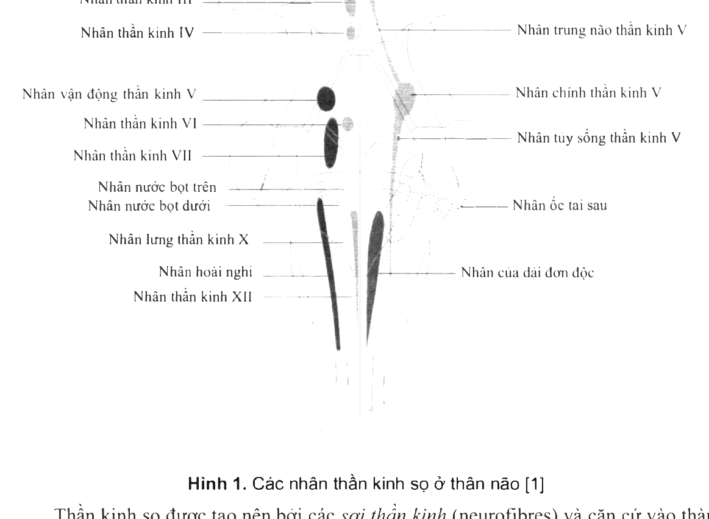
*Hình 1: Các nhân thần kinh sọ ở thân não*

### 1. Phân loại chức năng sợi thần kinh sọ
Căn cứ vào thành phần sợi thần kinh cấu tạo nên, các thần kinh sọ được chia thành:
- **Thần kinh cảm giác thuần túy:** Thần kinh I (khứu giác), II (thị giác), VIII (tiền đình - ốc tai).
- **Thần kinh vận động thuần túy:** Thần kinh III, IV, VI (vận nhãn), XI (cơ thang, cơ ức đòn chũm), XII (vận động cơ lưỡi).
- **Thần kinh hỗn hợp:** Thần kinh V (sinh ba), VII (mặt), IX (lưỡi - hầu), X (lang thang).

Các thành phần sợi chức năng bao gồm:
- *Sợi vận động cơ vân (vận động thân thể / vận động tạng đặc biệt):* chi phối cơ vân bám xương và các cơ có nguồn gốc từ các cung mang (cơ nhai, cơ bám da mặt, cơ hầu, thanh quản).
- *Sợi đối giao cảm trước hạch (vận tạng chung):* thuộc các dây III, VII, IX, X, phân bố tới các hạch mi, chân bướm khẩu cái, dưới hàm, tai và các hạch tận cùng trong thành tạng.
- *Sợi cảm giác thân thể:* cảm giác sờ, đau, nhiệt, bản thể từ da và niêm mạc vùng đầu mặt.
- *Sợi cảm tạng chung và đặc biệt:* cảm giác từ các nội tạng, cảm giác vị giác (VII, IX, X) và khứu giác, thị giác, thính giác, thăng bằng.

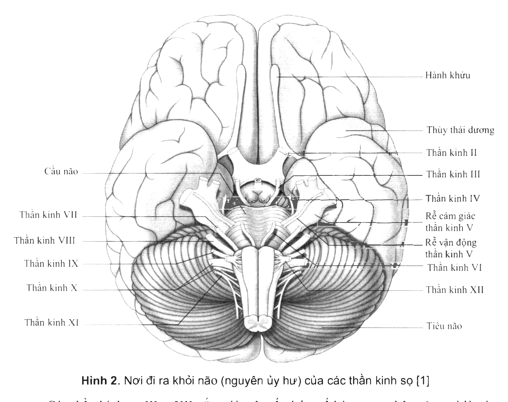
*Hình 2: Nơi đi ra khỏi não (nguyên uỷ hư) của các thần kinh sọ*

### 2. Nguyên ủy thật và nguyên ủy hư
- **Nguyên ủy thật (Real origin):**
  - Đối với sợi vận động: là các nhân vận động nằm sâu trong chất xám thân não (trung não, cầu não, hành não) hoặc sừng trước tuỷ gai cổ.
  - Đối với sợi cảm giác: là các thân nơron nằm ở các hạch cảm giác ngoại vi ngoài trục thần kinh trung ương (hạch sinh ba, hạch gối, hạch trên/dưới thần kinh IX, X, hạch tiền đình, hạch xoắn ốc tai).
- **Nguyên ủy hư (Apparent origin):** Là vị trí các rễ thần kinh sọ lộ ra trên bề mặt của não hoặc thân não.

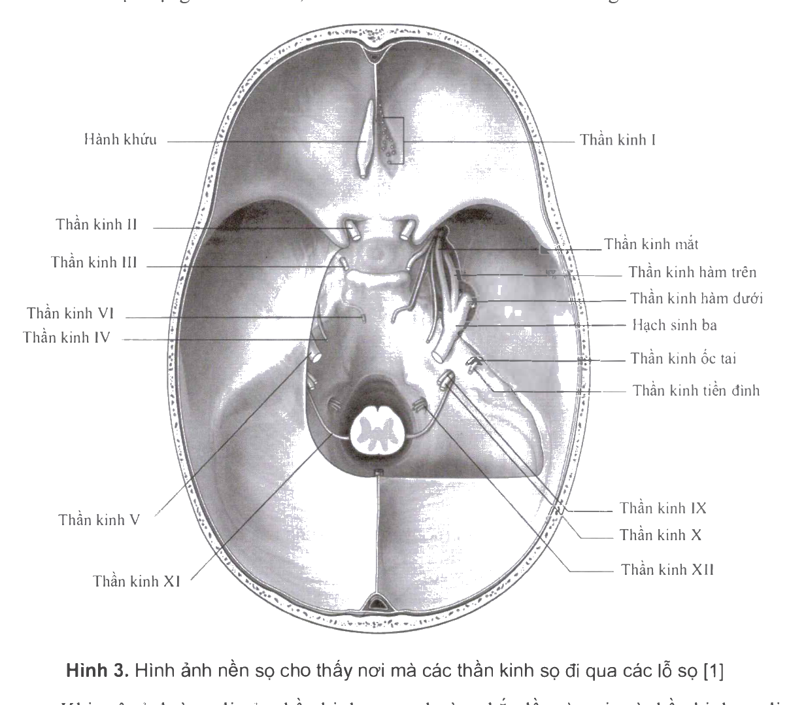
*Hình 3: Hình ảnh nền sọ cho thấy nơi mà các thần kinh sọ chui qua các lỗ sọ*

---
## II. CHI TIẾT 12 ĐÔI THẦN KINH SỌ

### 1. THẦN KINH KHỨU GIÁC (I) (Olfactory nerve) (H.2, 3, 4)

Thần kinh khứu giác là thần kinh cảm giác đặc biệt về mùi. Về mặt phôi thai học và giải phẫu học, thần kinh I không phải là một dây thần kinh ngoại vi điển hình mà là một phần lồi ra của não trước.

- **Nguyên ủy thật:** Là các tế bào nhận cảm khứu giác (tế bào thần kinh hai cực) nằm rải rác trong tầng niêm mạc khứu giác ở vòm ổ mũi (phần trên vách mũi và phần trên thành ngoài ổ mũi, tương ứng xương xoăn mũi trên).
- **Đường đi và tận cùng:**
  - Nhánh trục của các tế bào khứu giác tập hợp lại thành khoảng 15 - 20 sợi thần kinh khứu giác (*filia olfactoria*).
  - Các sợi này chui qua các lỗ của mảnh sàng xương sàng để vào hố sọ trước và tận cùng ở **hành khứu** (*olfactory bulb*).
  - Tại hành khứu, các sợi synáp với các tế bào hạt và tế bào van (mitral cells).
  - Nhánh trục của tế bào van tạo nên **dải khứu** (*olfactory tract*). Dải khứu chạy ra sau dọc rãnh khứu ở mặt dưới thùy trán, tới trước chất thủng trước thì tách ra thành các vân khứu ngoài, trong và trung gian. Vân khứu ngoài tận cùng ở vỏ não khứu giác nguyên thủy (hồi móc và thể hạnh nhân của thùy thái dương) mà không cần qua đồi thị.

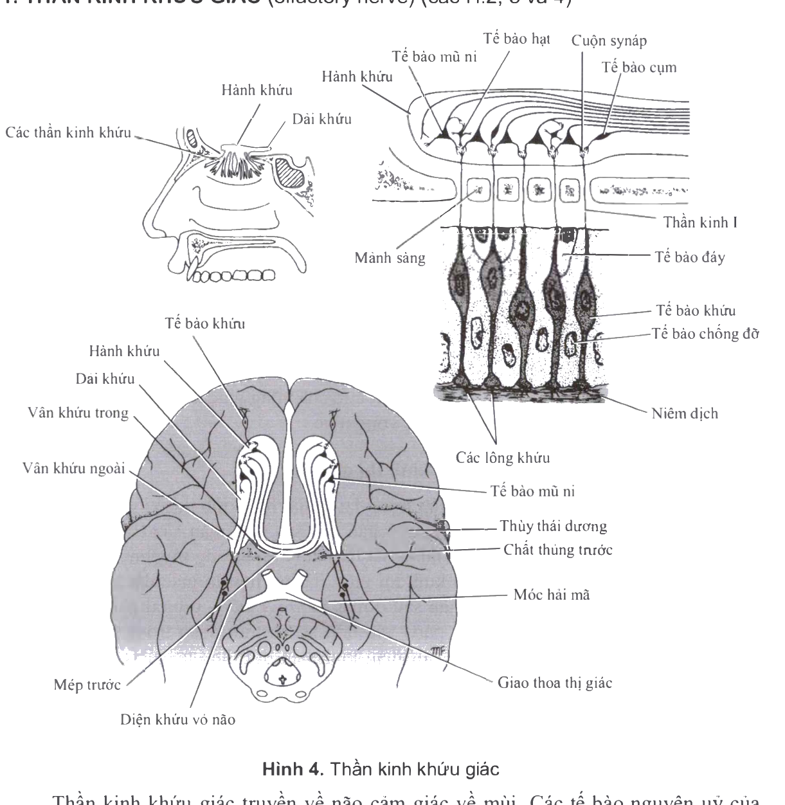
*Hình 4: Thần kinh khứu giác*

- **Liên hệ lâm sàng:**
  - *Mất khứu giác (Anosmia):* Thường do chấn thương vỡ tầng trước nền sọ làm rách màng cứng và đứt các sợi khứu giác qua mảnh sàng, kèm theo chảy nước não tủy qua mũi (*CSF rhinorrhea*). Viêm niêm mạc mũi mạn tính hoặc khối u chèn ép rãnh khứu (u màng não rãnh khứu - hội chứng Foster Kennedy: teo thị thần kinh cùng bên và phù gai thị đối bên) cũng gây giảm hoặc mất mùi.

---

### 2. THẦN KINH THỊ GIÁC (II) (Optic nerve) (H.2, 3, 5, 7)

Thần kinh thị giác là thần kinh cảm giác đặc biệt về thị giác, thực chất là một dải chất trắng của gian não phát triển ra ngoại vi, được bao bọc bởi cả 3 lớp màng não (màng cứng, màng nhện, màng nuôi) và khoang dưới nhện chứa dịch não tủy kéo dài đến tận củng mạc nhãn cầu.

- **Nguyên ủy thật:** Là lớp tế bào hạch (*ganglion cell layer*) của võng mạc thị giác nhãn cầu.
- **Đường đi và các đoạn liên quan:**
  - Các sợi trục của tế bào hạch hội tụ tại đĩa thần kinh thị giác (gai thị, điểm mù) rồi xuyên qua lá sàng củng mạc tạo nên thần kinh thị giác.
  - Thần kinh dài khoảng 4 - 5 cm, được chia thành 4 đoạn:
    1. *Đoạn trong nhãn cầu (1 mm):* rất ngắn, qua củng mạc.
    2. *Đoạn trong ổ mắt (25 mm):* nằm trong tháp cơ vận nhãn, cong hình chữ S nhẹ để mắt cử động tự do mà không làm căng dây thần kinh; đi cùng động mạch trung tâm võng mạc chui vào trong trục dây thần kinh.
    3. *Đoạn trong ống thị giác (5 mm):* chui qua ống thị giác cùng động mạch mắt, nằm ở trên - trong động mạch.
    4. *Đoạn trong sọ (10 mm):* nằm ở hố sọ giữa, trên yên bướm và hoành yên, tiến dần vào đường giữa để hợp với thần kinh đối bên tạo thành **giao thoa thị giác** (*optic chiasm*).

*Hình 5: Thần kinh thị giác và các tiếp nối trung ương của nó*

- **Giao thoa thị giác và dải thị giác:**
  - Tại giao thoa thị giác: Các sợi bắt nguồn từ nửa trong (phía mũi) của võng mạc bắt chéo sang bên đối diện; các sợi từ nửa ngoài (phía thái dương) đi thẳng ra sau cùng bên mà không bắt chéo.
  - **Dải thị giác (Optic tract):** Chứa các sợi thái dương cùng bên và các sợi mũi đối bên (mang toàn bộ thông tin của nửa thị trường đối diện). Dải thị vòng quanh cuống đại não để tận cùng ở **thể gối ngoài** (*lateral geniculate body*) của đồi thị. Một số sợi đi vào gò trên trung não và vùng trước mái để phục vụ các phản xạ ánh sáng (phản xạ đồng tử).
  - Từ thể gối ngoài, các nơron thứ ba tạo thành **tia thị giác** (*optic radiation - dải gối-chẩm*) đi qua phần sau bao trong để tới vỏ não thị giác sơ cấp (vùng 17 Brodmann) quanh rãnh cựa ở thùy chẩm.
- **Liên hệ lâm sàng:**
  - *Phù gai thị (Papilledema):* Do tăng áp lực nội sọ truyền trực tiếp qua khoang dưới nhện bao quanh dây II làm chèn ép tĩnh mạch trung tâm võng mạc, gây ứ trệ tuần hoàn tĩnh mạch ở đáy mắt.
  - *Tổn thương thị trường:*
    + Cắt đứt dây II một bên: Mù hoàn toàn mắt cùng bên.
    + Chèn ép giao thoa thị giác (u tuyến yên): Mất thị trường nửa thái dương hai bên (*bitemporal hemianopia*).
    + Tổn thương dải thị giác hoặc tia thị giác một bên: Bán manh đồng danh đối bên (*homonymous hemianopia*).

---

### 3. THẦN KINH VẬN NHÃN (III) (Oculomotor nerve) (H.1, 2, 3, 6, 7, 8)

Thần kinh vận nhãn là thần kinh vận động thân thể và đối giao cảm, phụ trách vận động cho đa số các cơ ngoài nhãn cầu và cơ nội nhãn.

- **Nguyên ủy thật:**
  - *Nhân vận động (Somatic motor nucleus):* Nằm ở chất xám quanh cống não ở mức gò trên trung não.
  - *Nhân vận nhãn phụ (Edinger - Westphal nucleus):* Nằm ngay sau - trong nhân vận động, chứa thân nơron đối giao cảm trước hạch.
- **Nguyên ủy hư:** Rãnh trong cuống đại não (thuộc khoang gian cuống) ở mặt trước trung não.
- **Đường đi và phân nhánh:**
  - Thần kinh III chạy ra trước giữa động mạch não sau và động mạch tiểu não trên, đi vào thành ngoài xoang hang (nằm trên thần kinh IV và V1).
  - Đi qua khe ổ mắt trên và chui qua vòng gân chung (vòng Zinn) để vào ổ mắt.
  - Chia thành 2 nhánh:
    + *Nhánh trên:* Vận động cơ thẳng trên (*superior rectus*) và cơ nâng mi trên (*levator palpebrae superioris*).
    + *Nhánh dưới:* Vận động cơ thẳng trong (*medial rectus*), cơ thẳng dưới (*inferior rectus*), cơ chéo dưới (*inferior oblique*); và cho **rễ đối giao cảm (rễ vận nhãn)** tới **hạch mi** (*ciliary ganglion*). Từ hạch mi, các sợi đối giao cảm sau hạch theo các thần kinh mi ngắn tới vận động cơ thắt đồng tử (*sphincter pupillae - co đồng tử*) và cơ thể mi (*ciliary muscle - điều tiết nhìn gần*).

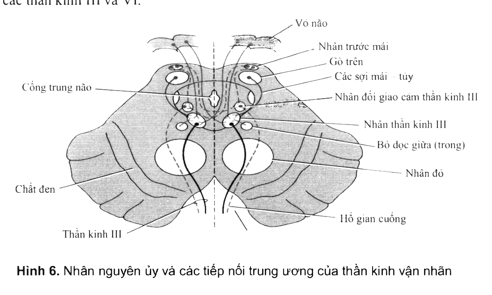
*Hình 6: Nhân nguyên uỷ và các tiếp nối trung ương của thần kinh vận nhãn*

*Hình 7: Khe ổ mắt trên, ống thị giác, vòng gân chung của các cơ thẳng*

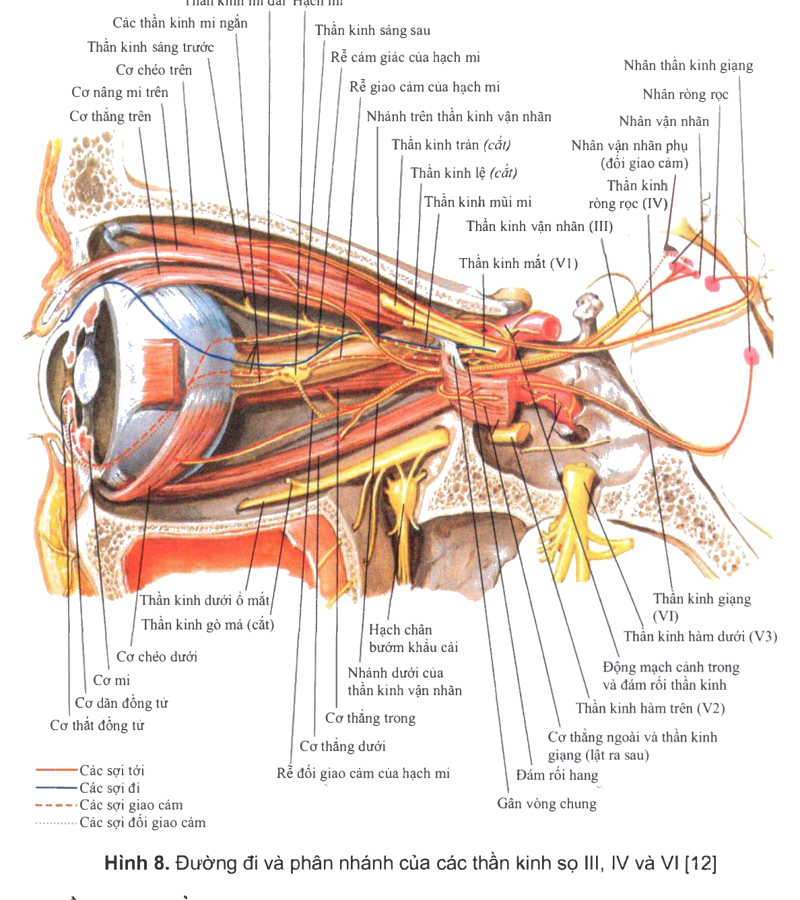
*Hình 8: Đường đi và phân nhánh của các thần kinh sọ III, IV và VI*

- **Liên hệ lâm sàng:**
  - *Liệt dây thần kinh III hoàn toàn:* Biểu hiện sụp mi trên (*ptosis*), lác ngoài và hơi lùi xuống dưới (do ưu thế của cơ thẳng ngoài [dây VI] và cơ chéo trên [dây IV]), giãn đồng tử tối đa mất phản xạ ánh sáng và mất khả năng điều tiết nhìn gần.
  - Thần kinh III dễ bị chèn ép do tụt kẹt hồi móc qua khuyết lều tiểu não trong tăng áp lực nội sọ (đồng tử giãn cùng bên là dấu hiệu định khu quan trọng) hoặc do phình động mạch thông sau.

---

### 4. THẦN KINH RÒNG RỌC (IV) (Trochlear nerve) (H.1, 2, 3, 7, 8, 9)

Thần kinh ròng rọc là thần kinh sọ mảnh nhất và là thần kinh sọ duy nhất bắt chéo hoàn toàn ra khỏi mặt sau thân não.

- **Nguyên ủy thật:** Nhân thần kinh ròng rọc nằm ở trung não, ngang mức gò dưới, ngay dưới nhân dây III.
- **Nguyên ủy hư:** Mặt sau trung não, ngay dưới hai gò dưới (hai bên hãm màn tủy trên).
- **Đường đi và phân nhánh:**
  - Các sợi sau khi rời nhân bắt chéo hoàn toàn trong màn tủy trên sang bên đối diện rồi vòng quanh cuống đại não ra mặt trước.
  - Đi qua thành ngoài xoang hang (nằm dưới dây III và trên dây V1).
  - Đi vào ổ mắt qua khe ổ mắt trên nhưng **ở ngoài vòng gân chung**.
  - Chạy chếch vào trong bắt chéo cơ nâng mi trên để tới bám và chi phối duy nhất cho **cơ chéo trên** (*superior oblique*).
- **Tác dụng của cơ chéo trên:** Đưa nhãn cầu nhìn xuống dưới và ra ngoài (đặc biệt là cử động nhìn xuống khi mắt đang khép vào trong).

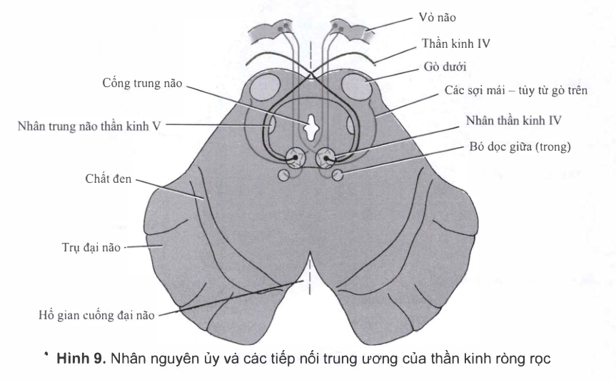
*Hình 9: Nhân nguyên uỷ và các tiếp nối trung ương của thần kinh ròng rọc*

- **Liên hệ lâm sàng:**
  - *Liệt dây IV:* Bệnh nhân bị song thị đứng (*vertical diplopia*), khó khăn nhất khi nhìn xuống dưới và vào trong (như khi bước xuống cầu thang hoặc đọc sách). Để bù trừ, bệnh nhân thường nghiêng đầu sang bên lành để tránh song thị.
---

### 5. THẦN KINH SINH BA (V) (Trigeminal nerve) (H.1, 2, 3, 10, 11, 12, 13, 14, 15, 16)

Thần kinh sinh ba là thần kinh sọ lớn nhất, là dây hỗn hợp đảm nhiệm cảm giác chính cho toàn bộ vùng mặt, ổ mắt, khoang mũi, xoang cạnh mũi, ổ miệng, răng, màng não và vận động cho các cơ nhai.

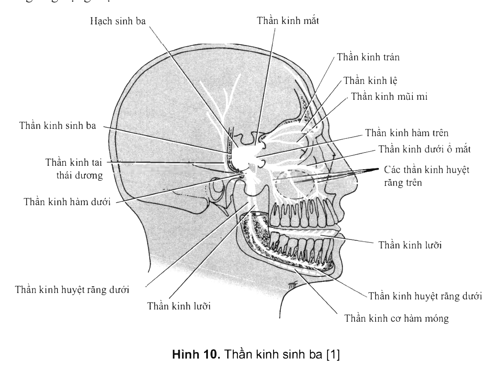
*Hình 10: Thần kinh sinh ba*

- **Nguyên ủy thật:**
  - *Phần cảm giác:* Thân nơron nằm ở **hạch sinh ba** (*trigeminal ganglion / hạch Gasser*), nằm trong khoang màng cứng (khoang Meckel) ở ấn thần kinh sinh ba trên mặt trước xương đá.
    + Nhánh gai ngoại vi nhận cảm giác từ ba vùng của mặt qua 3 nhánh lớn: Thần kinh mắt (V1), Thần kinh hàm trên (V2), Thần kinh hàm dưới (V3).
    + Nhánh gai trung ương đi vào cầu não để tận cùng ở các nhân cảm giác thần kinh sinh ba:
      1. *Nhân trung não:* Cảm giác bản thể sâu từ các cơ nhai và khớp thái dương hàm.
      2. *Nhân cảm giác chính:* Nằm ở cầu não, tiếp nhận cảm giác sờ nông và phân biệt hai điểm.
      3. *Nhân tủy sống thần kinh V:* Kéo dài từ cầu não xuống hành não và tuỷ cổ trên, tiếp nhận cảm giác đau và nhiệt.
  - *Phần vận động:* Thân nơron nằm ở **nhân vận động thần kinh V** ở cầu não. Các sợi vận động tạo nên *rễ vận động* nhỏ hơn, chạy dưới hạch sinh ba và chỉ nhập vào duy nhất **thần kinh hàm dưới (V3)**.

- **Nguyên ủy hư:** Mặt trước - bên cầu não (ranh giới giữa mặt trước cầu não và cuống tiểu não giữa), gồm rễ cảm giác lớn ở ngoài và rễ vận động nhỏ ở trong.

*Hình 11: Nguyên uỷ của các sợi vận động và cảm giác của thần kinh sinh ba*

#### 5.1. Thần kinh mắt (V1 - Ophthalmic nerve) (H.12, 13)
Là nhánh cảm giác thuần túy, đi qua thành ngoài xoang hang (dưới dây III và IV), rồi chui qua **khe ổ mắt trên** để vào ổ mắt. Trước khi vào ổ mắt chia thành 3 nhánh chính:
1. *Thần kinh trán (Frontal nerve):* Nhánh lớn nhất, chạy trên cơ nâng mi trên, chia thành:
   - *Thần kinh trên ròng rọc:* Cảm giác góc trong mắt và trán.
   - *Thần kinh trên ổ mắt:* Đi qua khuyết/lỗ trên ổ mắt cảm giác trán và đỉnh đầu.
2. *Thần kinh lệ (Lacrimal nerve):* Nhánh ngoài cùng, đi dọc bờ trên cơ thẳng ngoài tới tuyến lệ, nhận sợi đối giao cảm sau hạch từ hạch chân bướm khẩu cái (qua nhánh nối với thần kinh gò má) để vận tiết tuyến lệ, và cảm giác mi mắt trên góc ngoài.
3. *Thần kinh mũi - mi (Nasociliary nerve):* Đi trong chóp cơ qua vòng Zinn, cho nhánh nối tới hạch mi (rễ cảm giác hạch mi), các thần kinh mi dài (cảm giác giác mạc, củng mạc và mống mắt - đóng vai trò cung phản xạ giác mạc), thần kinh sàng sau, thần kinh sàng trước (tận cùng là thần kinh mũi ngoài) và thần kinh dưới ròng rọc.

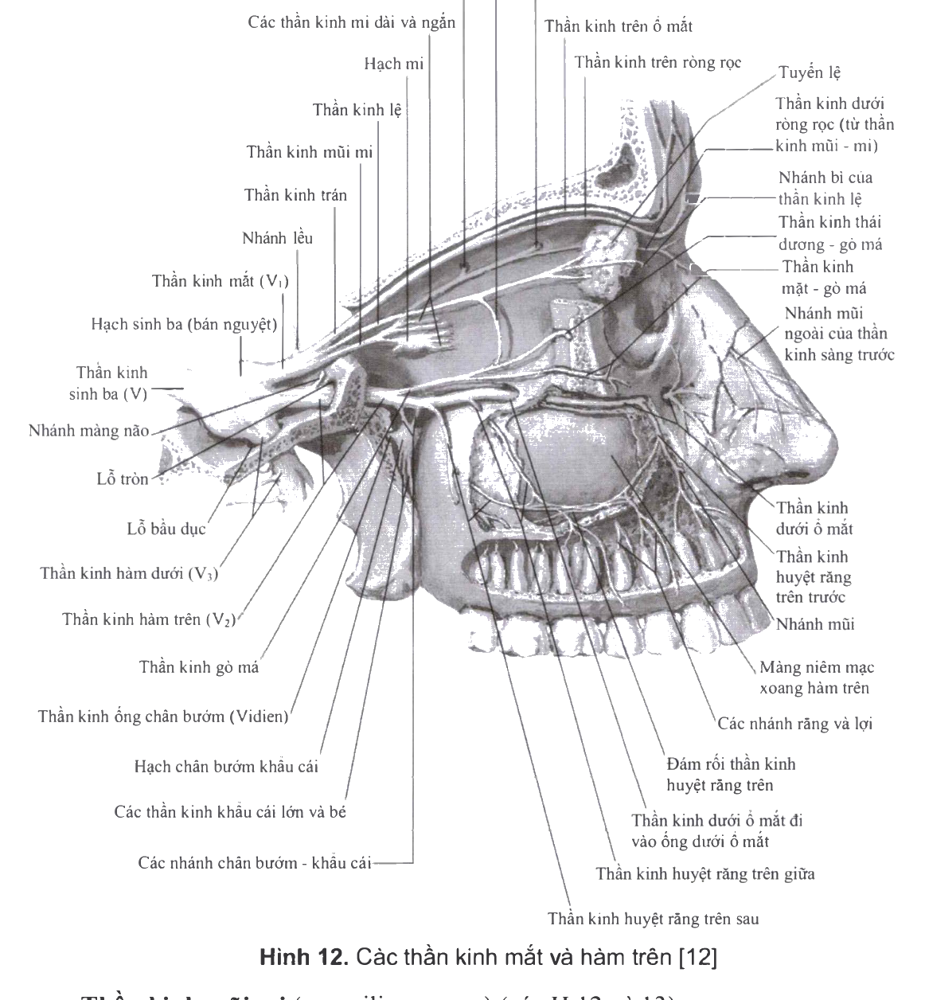
*Hình 12: Các thần kinh mắt và hàm trên*

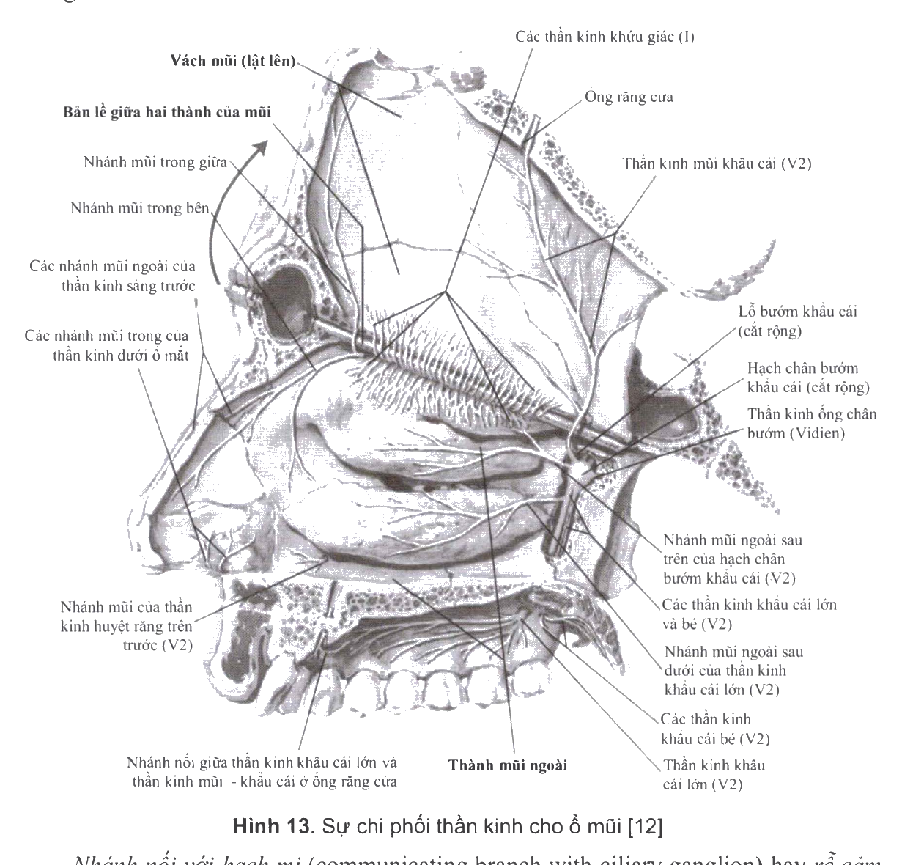
*Hình 13: Các nhánh của thần kinh mắt*

#### 5.2. Thần kinh hàm trên (V2 - Maxillary nerve) (H.12, 14)
Là nhánh cảm giác thuần túy, rời hố sọ giữa chui qua **lỗ tròn** (*foramen rotundum*) vào hố chân bướm - khẩu cái:
- Cho *nhánh màng não* trước khi ra khỏi sọ.
- Cho *các nhánh hạch* nối với **hạch chân bướm - khẩu cái** (*pterygopalatine ganglion*).
- Cho *thần kinh gò má* (chia thành nhánh gò má mặt và gò má thái dương).
- Cho *các thần kinh huyệt răng trên sau* chui qua các lỗ ở củ hàm trên cảm giác các răng hàm lớn và xoang hàm trên.
- Chạy vào rãnh và ống dưới ổ mắt ở sàn ổ mắt và đổi tên thành **thần kinh dưới ổ mắt** (*infra-orbital nerve*). Trong ống dưới ổ mắt tách thêm *thần kinh huyệt răng trên giữa* và *thần kinh huyệt răng trên trước* cho các răng tiền hàm và răng cửa. Thoát ra tại lỗ dưới ổ mắt chia thành các nhánh mi dưới, mũi ngoài và môi trên.

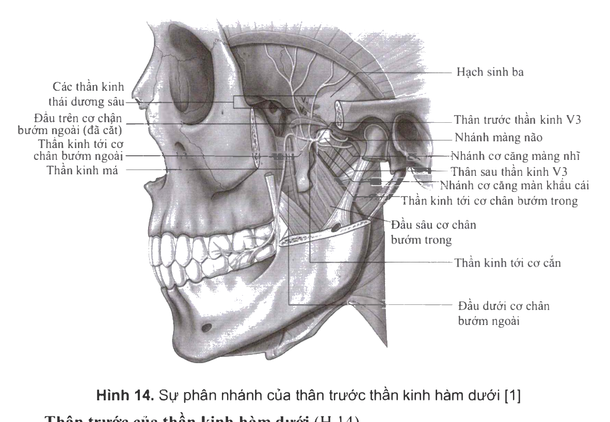
*Hình 14: Thần kinh hàm trên và hạch chân bướm khẩu cái*

#### 5.3. Thần kinh hàm dưới (V3 - Mandibular nerve) (H.15, 16)
Là dây hỗn hợp (chứa toàn bộ rễ vận động của dây V), rời sọ qua **lỗ bầu dục** (*foramen ovale*) vào hố dưới thái dương:
- Cho *nhánh màng não* (nhánh gai, chui ngược vào sọ qua lỗ gai) và nhánh tới *cơ chân bướm trong*, *cơ căng màn khẩu cái* và *cơ căng màng nhĩ*.
- **Các nhánh vận động:**
  - *Thần kinh cơ cắn:* Vận động cơ cắn.
  - *Các thần kinh thái dương sâu:* Vận động cơ thái dương.
  - *Thần kinh cơ chân bướm ngoài:* Vận động cơ chân bướm ngoài.
  - *Thần kinh cơ hàm móng:* Vận động cơ hàm móng và bụng trước cơ hai bụng (tách từ thần kinh huyệt răng dưới).
- **Các nhánh cảm giác:**
  - *Thần kinh má:* Cảm giác da và niêm mạc má.
  - *Thần kinh tai - thái dương:* Chạy vòng quanh động mạch màng não giữa, ôm cổ lồi cầu xương hàm dưới, đi qua tuyến mang tai lên vùng thái dương; mang theo sợi đối giao cảm sau hạch từ hạch tai tới tuyến mang tai; cảm giác loa tai, ống tai ngoài, màng nhĩ và da vùng thái dương.
  - *Thần kinh lưỡi:* Đi giữa cơ chân bướm trong và ngoài, nhận thừng nhĩ (dây VII), bắt chéo ống tuyến dưới hàm để vào 2/3 trước lưỡi; cảm giác thân thể (sờ, đau, nhiệt) cho 2/3 trước lưỡi và mang các sợi vị giác (từ thừng nhĩ) cho 2/3 trước lưỡi, đồng thời cho sợi đối giao cảm trước hạch tới **hạch dưới hàm**.
  - *Thần kinh huyệt răng dưới:* Đi vào lỗ hàm dưới cùng động mạch huyệt răng dưới chạy trong ống hàm dưới cảm giác tất cả các răng hàm dưới, tận cùng bằng *thần kinh cằm* (thoát ra ở lỗ cằm cảm giác da cằm và môi dưới).

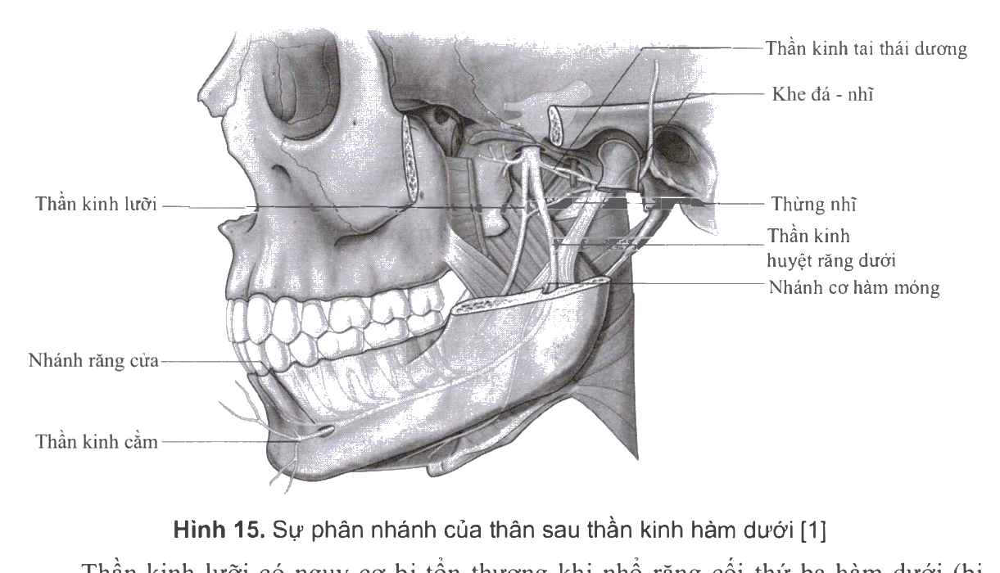
*Hình 15: Thần kinh hàm dưới và các hạch tự chủ liên quan*

*Hình 16: Vùng chi phối cảm giác của 3 nhánh thần kinh sinh ba*

- **Liên hệ lâm sàng:**
  - *Đau dây thần kinh sinh ba (Trigeminal neuralgia / Tic douloureux):* Các cơn đau dữ dội, chói buốt như điện giật xuất hiện ở vùng chi phối của V2 hoặc V3, khởi phát bởi các điểm kích hoạt (trigger zones) khi nhai, nói, đánh răng hoặc chạm nhẹ.
  - *Mất phản xạ giác mạc (Corneal reflex):* Mất cung cảm giác (dây V1 qua nhánh mũi-mi) hoặc cung vận động (dây VII làm chớp mắt).
  - *Liệt dây V3:* Liệt các cơ nhai, khi há miệng hàm dưới lệch về bên liệt (do cơ chân bướm ngoài bên lành đẩy sang).
---

### 6. THẦN KINH GIẠNG (VI) (Abducent nerve) (H.1, 2, 3, 7, 8, 17)

Thần kinh giạng là thần kinh vận động đơn thuần, chi phối duy nhất cho cơ thẳng ngoài của nhãn cầu.

- **Nguyên ủy thật:** Nhân thần kinh giạng nằm ở cầu não dưới sàn não thất IV, được các sợi của thần kinh VII vòng quanh tạo nên **gò mặt** (*facial colliculus*).
- **Nguyên ủy hư:** Rãnh hành - cầu, ngay phía trên tháp hành.
- **Đường đi và phân nhánh:**
  - Rời rãnh hành - cầu, dây VI chạy lên dọc dốc nền xương chẩm trong khoang dưới nhện.
  - Đi qua bờ trên xương đá dưới dây chằng bướm - đá (trong ống Dorello).
  - Chui vào **lòng xoang hang** (khác với dây III, IV, V1 nằm ở thành ngoài xoang hang), áp sát bờ ngoài động mạch cảnh trong.
  - Chui qua khe ổ mắt trên và đi **bên trong vòng gân chung** để vào ổ mắt.
  - Tận cùng ở mặt trong **cơ thẳng ngoài** (*lateral rectus*).
- **Tác dụng:** Giạng nhãn cầu (liếc mắt ra ngoài).

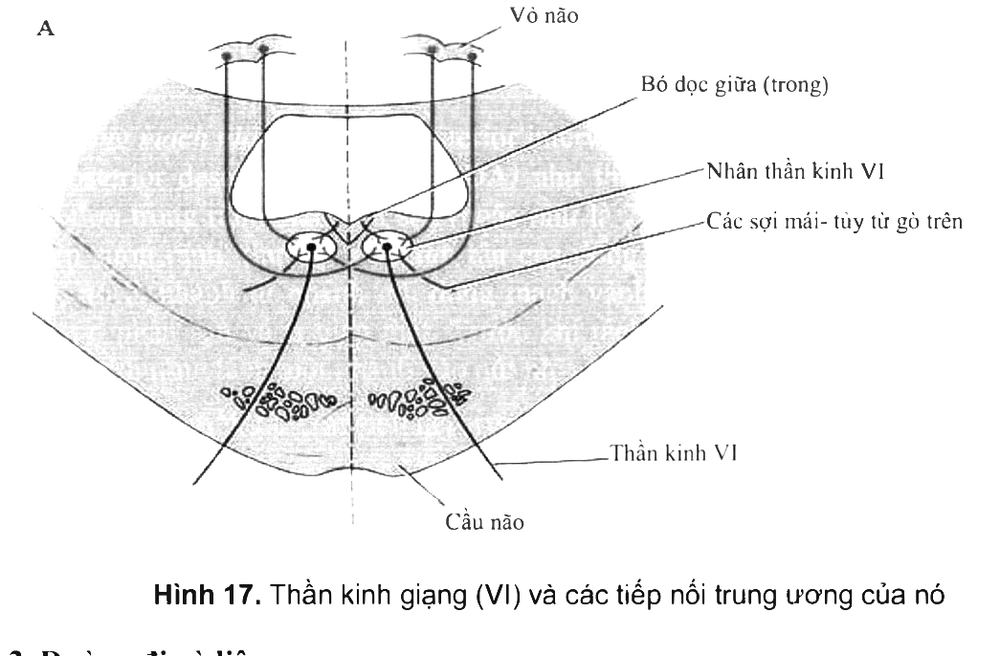
*Hình 17: Thần kinh giạng (VI) và các tiếp nối trung ương của nó*

- **Liên hệ lâm sàng:**
  - Do có đoạn chạy tự do trong khoang dưới nhện dài và gập góc qua mỏm mỏm yên sau/bờ xương đá, thần kinh VI rất nhạy cảm với tăng áp lực nội sọ.
  - *Liệt dây VI:* Mắt không thể liếc ra ngoài, nhãn cầu bị kéo vào trong gây **lác trong** (*convergent strabismus*) và song thị ngang khi nhìn về phía bên tổn thương.

---

### 7. THẦN KINH MẶT (VII) VÀ THẦN KINH TRUNG GIAN (H.1, 2, 3, 18, 19, 20, 21, 22, 23)

Thần kinh mặt là một dây thần kinh hỗn hợp phức tạp gồm 2 phần:
- *Thần kinh mặt chính danh:* Rễ vận động cơ vân lớn cho các cơ bám da mặt (cơ biểu cảm nét mặt), cơ bàn đạp, bụng sau cơ hai bụng và cơ trâm móng.
- *Thần kinh trung gian (Wrisberg):* Rễ nhỏ hơn mang sợi cảm giác (vị giác 2/3 trước lưỡi, cảm giác vùng Ramsay-Hunt) và sợi đối giao cảm trước hạch (vận tiết tuyến lệ, tuyến dưới hàm, tuyến dưới lưỡi, niêm mạc mũi - miệng).

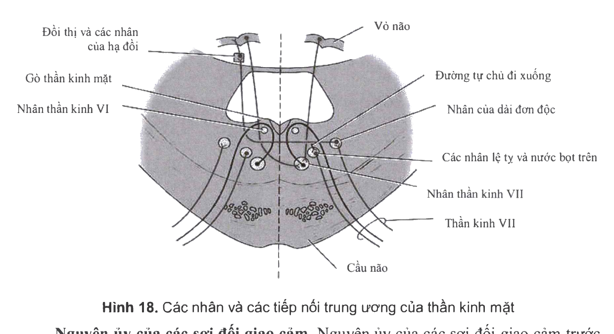
*Hình 18: Các nhân và các tiếp nối trung ương của thần kinh mặt*

- **Nguyên ủy thật:**
  - *Vận động cơ vân:* Nhân thần kinh mặt ở cầu não.
  - *Đối giao cảm:* Nhân nước bọt trên (và nhân lệ) ở cầu não.
  - *Cảm giác (vị giác):* Thân tế bào nằm ở **hạch gối** (*geniculate ganglion*) trong xương đá; sợi trung ương tận cùng ở nhân đơn độc (*solitary tract nucleus*).
- **Nguyên ủy hư:** Rãnh hành - cầu, ở góc cầu - tiểu não (phía ngoài dây VI và phía trong dây VIII).

- **Đường đi trong xương đá (Ống thần kinh mặt - ống Fallope):**
  Thần kinh VII cùng dây VIII chui qua **lỗ tai trong** vào ống tai trong. Ở đáy ống tai trong, dây VII chui vào ống thần kinh mặt và trải qua 3 đoạn:
  1. *Đoạn mê đạo:* Chạy ngang ra ngoài giữa ốc tai và tiền đình tới hạch gối. Tại hạch gối bẻ gập góc ra sau (gối thần kinh mặt) và tách ra **thần kinh đá lớn** (*greater petrosal nerve* - mang sợi đối giao cảm tới hạch chân bướm khẩu cái vận tiết tuyến lệ).
  2. *Đoạn màng nhĩ:* Chạy ra sau ở thành trong hòm nhĩ, dưới lồi ống bán khuyên ngoài và trên cửa sổ tiền đình.
  3. *Đoạn chũm:* Bẻ góc xuống dưới chạy thẳng đứng qua mỏm chũm để thoát ra ngoài sọ ở **lỗ châm chũm** (*stylomastoid foramen*). Trong đoạn này tách ra:
     - *Thần kinh cơ bàn đạp* (*nerve to stapedius*).
     - *Thừng nhĩ* (*chorda tympani*): Chạy qua hòm nhĩ vắt qua cổ xương búa, chui qua khe đá nhĩ ra ngoài sọ kết hợp với thần kinh lưỡi (dây V3) để mang sợi vị giác cho 2/3 trước lưỡi và sợi đối giao cảm cho hạch dưới hàm.

*Hình 19: A. Thần kinh mặt trong xương thái dương; B. Sự phân bố của thần kinh mặt*

*Hình 20: Thần kinh mặt trên thiết đồ ngang qua tuyến mang tai*

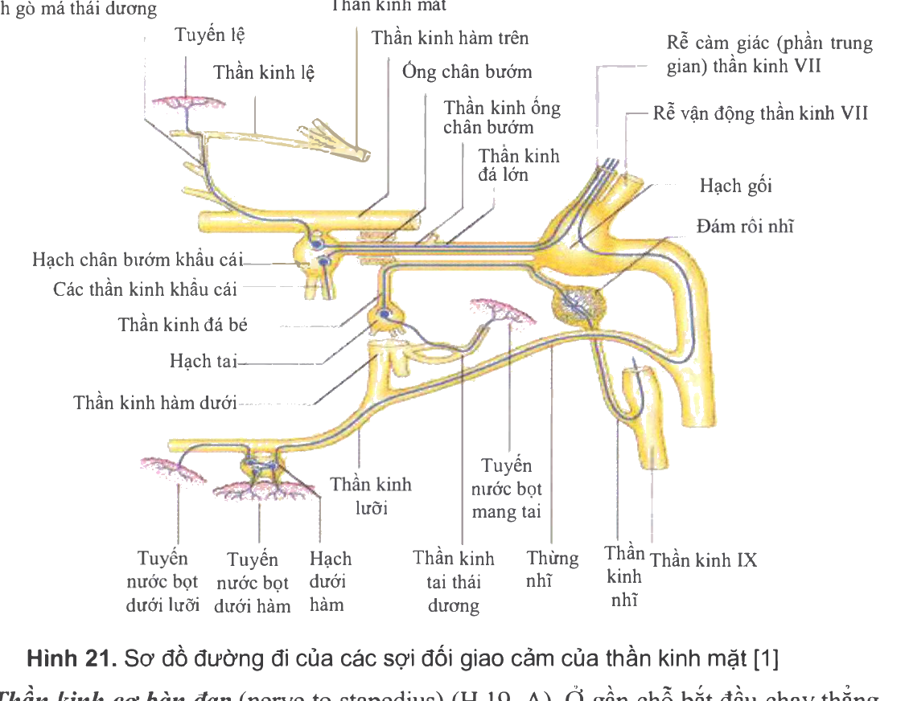
*Hình 21: Vùng chi phối cảm giác của thần kinh mặt ở da*

*Hình 22: Thần kinh trung gian và các nhánh nối*

- **Đường đi ngoài sọ:**
  - Thoát ra ở lỗ châm chũm, cho nhánh thần kinh tai sau, nhánh cho bụng sau cơ hai bụng và cơ trâm móng.
  - Đi vào chất tuyến mang tai, nằm nông hơn tĩnh mạch sau hàm dưới và động mạch cảnh ngoài.
  - Tại tuyến mang tai, chia thành đám rối mang tai với 5 nhóm nhánh tận chi phối toàn bộ cơ bám da mặt:
    1. *Nhánh thái dương* (cơ trán, cơ vòng mi).
    2. *Nhánh gò má* (cơ vòng mi, cơ gò má).
    3. *Nhánh má* (cơ mút, cơ vòng miệng, cơ nâng môi trên).
    4. *Nhánh bờ hàm dưới* (cơ hạ góc miệng, cơ hạ môi dưới, cơ cằm).
    5. *Nhánh cổ* (cơ bám da cổ).

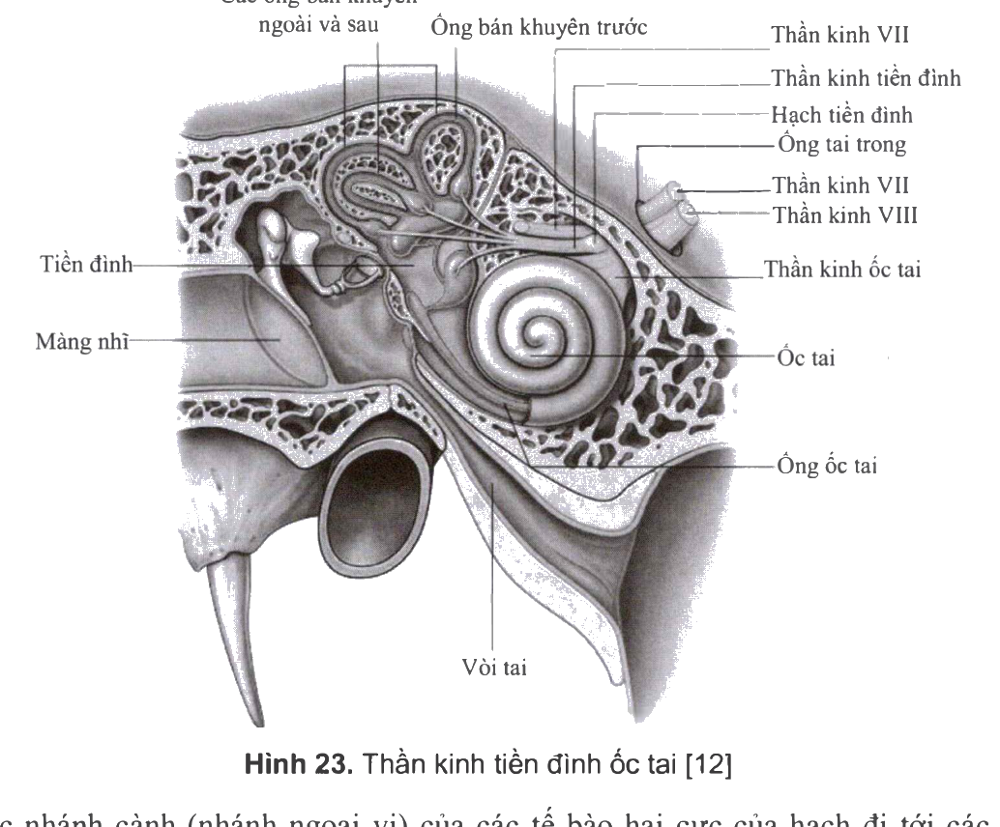
*Hình 23: Sơ đồ chi phối của các nhánh tận thần kinh mặt*

- **Liên hệ lâm sàng:**
  - *Liệt mặt ngoại vi (Liệt Bell - tổn thương nơron vận động dưới):* Liệt toàn bộ nửa mặt cùng bên (cả phần trên và phần dưới), mắt nhắm không kín (dấu hiệu Charles Bell dương tính), nếp nhăn trán và rãnh mũi má mờ hoặc mất, miệng lệch sang bên lành, ăn uống rơi vãi và đọng thức ăn ở ngách má do liệt cơ mút.
  - *Liệt mặt trung ương (Tổn thương nơron vận động trên):* Chỉ liệt 1/4 dưới mặt đối bên (bán cầu đại não chi phối hai bên cho phần trên của nhân dây VII, nhưng chỉ chi phối một bên đối diện cho phần dưới). Bệnh nhân vẫn nhăn trán và nhắm kín mắt được.
  - *Hội chứng Ramsay Hunt:* Do Herpes zoster tái hoạt ở hạch gối gây liệt mặt ngoại vi kèm mụn nước đau rát ở vùng vành tai, ống tai ngoài và mất vị giác 2/3 trước lưỡi.

---

### 8. THẦN KINH TIỀN ĐÌNH - ỐC TAI (VIII) (Vestibulocochlear nerve) (H.1, 2, 3, 24, 25)

Thần kinh tiền đình - ốc tai là thần kinh cảm giác đặc biệt gồm hai phần riêng biệt về nguồn gốc, chức năng và đường dẫn truyền: phần tiền đình (thăng bằng) và phần ốc tai (thính giác).

- **Nguyên ủy thật:**
  - *Thần kinh tiền đình:* Thân nơron nằm ở **hạch tiền đình** (*vestibular ganglion / hạch Scarpa*) ở đáy ống tai trong. Sợi gai ngoại vi nhận cảm giác thăng bằng từ các mào bóng của 3 ống bán khuyên (thăng bằng động) và các vết soan nang, cầu nang (thăng bằng tĩnh). Sợi trung ương đi vào thân não tận cùng ở 4 **nhân tiền đình** (trên, dưới, trong, ngoài) ở vùng góc ngoài sàn não thất IV.
  - *Thần kinh ốc tai:* Thân nơron nằm ở **hạch xoắn ốc tai** (*spiral ganglion / hạch Corti*) nằm trong trụ ốc tai của tai trong. Sợi gai ngoại vi đến cơ quan xoắn (cơ quan Corti). Sợi trung ương tận cùng ở **nhân ốc tai trước** và **nhân ốc tai sau** ở cầu não.

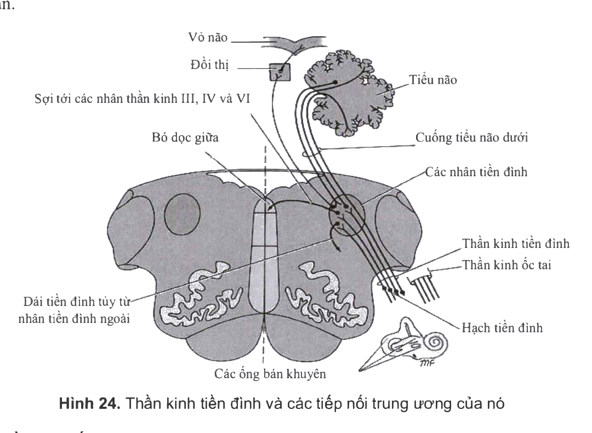
*Hình 24: Thần kinh tiền đình và các tiếp nối trung ương của nó*

*Hình 25: Thần kinh ốc tai và các tiếp nối trung ương của nó*

- **Nguyên ủy hư:** Rãnh hành - cầu, ở góc ngoài cầu - tiểu não (ngoài thần kinh VII và thần kinh trung gian).
- **Đường đi:** Đi cùng dây VII và động mạch mê đạo vào **lỗ tai trong**, chạy trong ống tai trong tới đáy ống thì phân thành các nhánh tiền đình và ốc tai tới mê đạo màng tai trong.
- **Liên hệ lâm sàng:**
  - *U bao dây thần kinh tiền đình (U góc cầu tiểu não - Acoustic neuroma / Vestibular schwannoma):* Triệu chứng sớm là ù tai (*tinnitus*), giảm thính lực tiếp nhận một bên, chóng mặt mất thăng bằng; khi u to sẽ chèn ép dây VII (yếu mặt), dây V (mất phản xạ giác mạc, tê mặt) và chèn ép tiểu não gây thất điều.
  - *Hội chứng Meniere:* Rối loạn ứ nội dịch mê đạo gây tam chứng: chóng mặt từng cơn dữ dội, ù tai và giảm thính lực tiến triển.
---

### 9. THẦN KINH LƯỠI - HẦU (IX) (Glossopharyngeal nerve) (H.1, 2, 3, 26, 27)

Thần kinh lưỡi - hầu (dây thần kinh sọ IX) là dây thần kinh hỗn hợp phức tạp, bắt nguồn từ cung mang thứ ba trong thời kỳ phôi thai. Dây IX đảm nhiệm 5 loại chức năng sinh lý đặc hiệu: vận động cơ vân, vận tiết đối giao cảm, cảm giác tạng (xoang cảnh - tiểu thể cảnh), cảm giác vị giác và cảm giác thân thể chung cho vùng hầu họng và 1/3 sau lưỡi.

#### 9.1. Thành phần chức năng và nguyên ủy thật
Dây IX tập hợp 5 loại sợi trục với các nhân nguyên ủy khu trú tại hành não và các hạch ngoại vi:
1. **Sợi vận động cơ vân (SVE - Special Visceral Efferent):**
   - *Nguyên ủy:* Xuất phát từ cực trên của **nhân hoài nghi** (*nucleus ambiguus*) ở phần lưng ngoài hành não.
   - *Vùng chi phối:* Vận động cho một cơ duy nhất là **cơ trâm hầu** (*musculus stylopharyngeus*) - cơ làm nhiệm vụ nâng hầu và thanh quản lên trên trong thì đầu của động tác nuốt.
2. **Sợi đối giao cảm trước hạch (GVE - General Visceral Efferent):**
   - *Nguyên ủy:* Xuất phát từ **nhân nước bọt dưới** (*nucleus salivatorius inferior*) ở chất lưới hành não.
   - *Đường đi và trạm hạch:* Các sợi trước hạch rời sọ qua nhánh nhĩ (dây Jacobson), tạo đám rối nhĩ trong hòm nhĩ, tiếp tục thành **thần kinh đá bé** (*n. petrosus minor*) chui qua lỗ rách hoặc lỗ bầu dục để tới tiếp khớp tại **hạch tai** (*ganglion oticum*).
   - *Vùng chi phối:* Các sợi sau hạch từ hạch tai mượn đường thần kinh tai - thái dương (nhánh của V3) tới vận tiết cho **tuyến nước bọt mang tai** (*glandula parotidea*).
3. **Sợi cảm giác tạng (GVA - General Visceral Afferent):**
   - *Nguyên ủy:* Thân nơron nằm ở **hạch dưới** (*ganglion inferius / hạch Andersch*).
   - *Vùng tiếp nhận:* Tiếp nhận các tín hiệu thụ cảm áp lực (baroreceptors) từ **xoang cảnh** (*sinus caroticus*) và thụ cảm hóa học (chemoreceptors đo pO2, pCO2, pH) từ **tiểu thể cảnh** (*glomus caroticum*) qua **nhánh xoang cảnh** (*ramus sinus carotici - dây Hering*).
   - *Tận cùng trung ương:* Tận cùng tại **nhân đơn độc** (*nucleus solitarius*), đóng vai trò sống còn trong cung phản xạ điều hòa huyết áp và nhịp thở của trung tâm vận mạch hành não.
4. **Sợi cảm giác vị giác (SVA - Special Visceral Afferent):**
   - *Nguyên ủy:* Thân nơron nằm ở **hạch dưới** của dây IX.
   - *Vùng tiếp nhận:* Tiếp nhận cảm giác vị giác từ **1/3 sau lưỡi**, bao gồm các **nhú gai đài** (*papillae vallatae*) - nơi nhạy cảm đặc biệt với vị đắng để cảnh báo độc chất.
   - *Tận cùng trung ương:* Đi vào phần trên (phần vị giác) của **nhân đơn độc** (*nucleus solitarius*).
5. **Sợi cảm giác thân thể chung (GSA - General Somatic Afferent):**
   - *Nguyên ủy:* Thân nơron nằm ở **hạch trên** (*ganglion superius / hạch Ehrenritter*).
   - *Vùng tiếp nhận:* Dẫn truyền cảm giác bản thể, sờ, đau và nhiệt độ từ niêm mạc 1/3 sau lưỡi, amidan khẩu cái, khẩu cái mềm, thành sau hầu, niêm mạc hòm nhĩ và vòi tai (vòi Eustache).
   - *Tận cùng trung ương:* Tận cùng tại **nhân tủy thần kinh sinh ba** (*nucleus spinalis nervi trigemini*).

#### 9.2. Nguyên ủy hư
Thần kinh IX thoát ra khỏi bề mặt não bộ ở phần trên cùng của **rãnh sau trám hành** (*sulcus retroolivaris* - rãnh bên sau của hành não), bằng 3 đến 5 rễ con nhỏ nằm ngay phía trên các rễ của thần kinh lang thang (X).

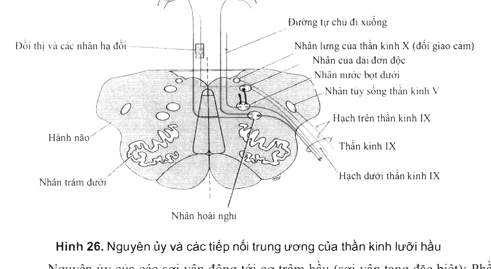
*Hình 26: Nguyên uỷ và các tiếp nối trung ương của thần kinh lưỡi - hầu*

#### 9.3. Đường đi và liên quan giải phẫu
Đường đi của thần kinh IX được chia thành 3 đoạn liên quan rõ rệt:
1. **Đoạn trong sọ và qua lỗ tĩnh mạch cảnh:**
   - Các rễ con hợp thành thân thần kinh, chạy chếch ra trước và ra ngoài qua khoang dưới nhện của hố sọ sau.
   - Dây IX chui qua **lỗ tĩnh mạch cảnh** (*foramen jugulare*) ở **ngăn trước** (*pars nervosa*), được ngăn cách với ngăn sau (*pars venosa* - nơi có dây X, XI và tĩnh mạch cảnh trong) bởi một vách xơ màng cứng hoặc cầu xương.
   - Tại lỗ tĩnh mạch cảnh, thần kinh phình ra tạo thành hai hạch cảm giác: **hạch trên** (nhỏ, nằm trong sọ) và **hạch dưới** (lớn hơn, nằm ở hố tam giác trên mỏm đá xương thái dương).
2. **Đoạn cổ (khoang sau trâm):**
   - Thoát khỏi nền sọ, dây IX đi xuống ở khoang sau trâm, ban đầu nằm sau động mạch cảnh trong, sau đó lách giữa động mạch cảnh trong và tĩnh mạch cảnh trong.
   - Tiếp tục chạy chếch xuống dưới và ra trước, đi giữa động mạch cảnh trong và động mạch cảnh ngoài.
   - Bắt chéo mặt ngoài và vòng quanh bờ sau **cơ trâm hầu** (*m. stylopharyngeus*), áp sát vào thành bên của hầu.
3. **Đoạn đáy lưỡi:**
   - Thần kinh chui qua khe giữa cơ khép hầu trên và cơ khép hầu giữa, đi sâu dưới **cơ móng lưỡi** (*m. hyoglossus*) cùng với động mạch lưỡi để tiến vào vùng đáy lưỡi.
   - Tại đây, dây IX tỏa thành các nhánh tận cùng phân bố cho niêm mạc và các gai đài của 1/3 sau lưỡi.

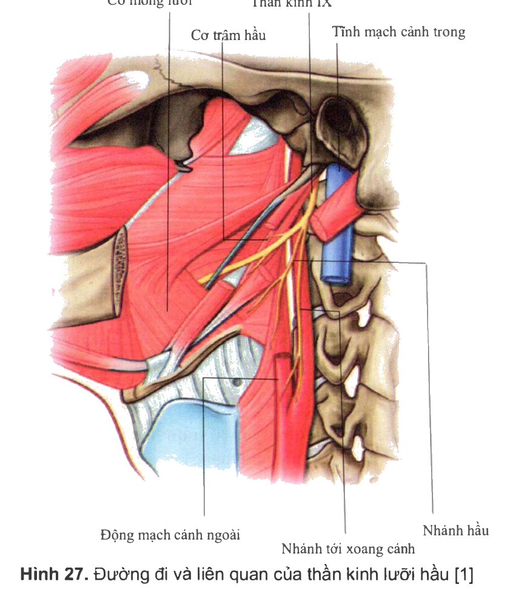
*Hình 27: Phân nhánh và vùng chi phối của thần kinh lưỡi - hầu*

#### 9.4. Các phân nhánh chính
Dọc đường đi, thần kinh lưỡi - hầu tách ra 6 nhóm nhánh quan trọng:
1. **Thần kinh nhĩ (*Nervus tympanicus* - Thần kinh Jacobson):**
   - Tách từ hạch dưới, đi qua tiểu quản nhĩ (*canaliculus tympanicus*) ở mào xương đá giữa lỗ cảnh và ống cảnh để chui vào hòm nhĩ.
   - Tại mặt trong hòm nhĩ (trên ụ nhô), nó tạo nên **đám rối nhĩ** (*plexus tympanicus*), chi phối cảm giác cho niêm mạc tai giữa, màng nhĩ trong và vòi nhĩ.
   - Sau đó tập hợp lại tạo thành **thần kinh đá bé** (*n. petrosus minor*), chui ra mặt trước xương đá qua khe đá bé, đi qua lỗ rách hoặc lỗ bầu dục xuống hố dưới thái dương để tới **hạch tai** (*ganglion oticum*), mang sợi đối giao cảm chi phối tuyến mang tai.
2. **Nhánh xoang cảnh (*Ramus sinus carotici* - Dây Hering):**
   - Chạy xuống chỗ chia đôi động mạch cảnh chung, phân nhánh vào xoang cảnh và tiểu thể cảnh. Có vai trò sống còn trong cung phản xạ giảm áp (khi huyết áp tăng, thụ thể xoang cảnh bị kích thích, tín hiệu theo dây IX về hành não kích hoạt trung tâm ức chế tim và giãn mạch, làm giảm huyết áp và chậm nhịp tim).
3. **Nhánh cơ trâm hầu (*Ramus musculi stylopharyngei*):**
   - Tách ra khi dây IX bắt chéo cơ trâm hầu, vận động cho cơ này.
4. **Các nhánh hầu (*Rami pharyngei*):**
   - Gồm 3 - 4 nhánh chạy tới thành bên của hầu, kết hợp với nhánh hầu của dây X và các sợi giao cảm cổ tạo thành **đám rối hầu** (*plexus pharyngeus*), chi phối cảm giác cho niêm mạc hầu.
5. **Các nhánh hạnh nhân (*Rami tonsillares*):**
   - Cấp máu cảm giác cho hạnh nhân khẩu cái (amidan), các hốc hạnh nhân và khẩu cái mềm.
6. **Các nhánh lưỡi (*Rami linguales*):**
   - Là các nhánh tận, phân bố cảm giác thân thể (đau, nhiệt, xúc giác) và cảm giác vị giác (đặc biệt là vị đắng qua các gai đài) cho 1/3 sau lưỡi (phía sau rãnh chữ V của lưỡi).

#### 9.5. Ứng dụng lâm sàng thần kinh lưỡi - hầu
- **Khám phản xạ nôn (Gag reflex):**
  - Kích thích nhẹ vào thành sau hầu hoặc amidan bằng tăm bông sẽ gây co phản xạ các cơ hầu và nâng vòm hầu.
  - Cung phản xạ: Nhánh hướng tâm (afferent limb) là **thần kinh IX**; nhánh ly tâm (efferent limb) là **thần kinh X** (qua đám rối hầu co cơ khép hầu). Nếu tổn thương dây IX, phản xạ nôn cùng bên sẽ bị mất hoàn toàn.
- **Đau dây thần kinh IX (Glossopharyngeal Neuralgia):**
  - Đặc trưng bởi những cơn đau nhói dữ dội như dao đâm hoặc điện giật khu trú ở góc hàm, amidan, đáy lưỡi lan sâu vào tai và hòm nhĩ.
  - Cơn đau thường khởi phát khi nuốt, nhai, nói, ho hoặc ngáp. Nguyên nhân thường do quai mạch máu (động mạch tiểu não sau dưới - PICA) chèn ép vào rễ dây IX tại rãnh sau trám hành.
- **Hội chứng xoang cảnh nhạy cảm (Carotid Sinus Hypersensitivity):**
  - Kích thích cơ học nhẹ vào vùng xoang cảnh (quay đầu mạnh, thắt caravat quá chặt, cạo râu) kích hoạt quá mức dây Hering về hành não, gây chậm nhịp tim kịch phát, giãn mạch tụt huyết áp dẫn đến ngất (*syncope*).

---

### 10. THẦN KINH LANG THANG (X) (Vagus nerve) (H.1, 2, 3, 28)

Thần kinh lang thang (dây thần kinh sọ X, trước đây còn gọi là thần kinh phế vị) là dây thần kinh sọ dài nhất, phân bố rộng lớn nhất và phức tạp nhất trong cơ thể người. Nó đi từ thân não, xuyên qua nền sọ, đi dọc toàn bộ vùng cổ, ngực và phân nhánh tận cùng tới hầu hết các tạng trong ổ bụng. Dây X là thành phần chủ lực của hệ thần kinh phó giao cảm (chiếm tới 75% toàn bộ lưu lượng sợi đối giao cảm của cơ thể).

#### 10.1. Thành phần chức năng và nguyên ủy thật
Dây X tập hợp 5 loại sợi trục xuất phát từ 4 nhân chính ở hành não và 2 hạch ngoại biên:
1. **Sợi vận động cơ vân (SVE - Special Visceral Efferent):**
   - *Nguyên ủy:* Xuất phát từ phần giữa và phần dưới của **nhân hoài nghi** (*nucleus ambiguus*) ở hành não.
   - *Vùng chi phối:* Vận động cho toàn bộ các cơ vân của hầu (trừ cơ trâm hầu [IX]), tất cả các cơ của khẩu cái mềm (trừ cơ căng màn khẩu cái [V3]), và toàn bộ các cơ nội tại của thanh quản (thông qua thần kinh thanh quản trên và thanh quản quặt ngược).
2. **Sợi đối giao cảm trước hạch (GVE - General Visceral Efferent):**
   - *Nguyên ủy:* Xuất phát từ **nhân lưng thần kinh lang thang** (*nucleus dorsalis nervi vagi*) nằm ở sàn não thất IV tại hành não.
   - *Vùng chi phối:* Cho các sợi trước hạch đến tiếp khớp với các hạch tận cùng nằm ngay trong thành các tạng: cơ tim, hệ thống dẫn truyền tim (nút xoang, nút nhĩ thất), cơ trơn phế quản và tuyến tiết khí - phế quản, thực quản, dạ dày, ruột non, tụy, gan mật và đại tràng tới tận góc đại tràng trái (2/3 phải đại tràng ngang). Tác dụng: làm chậm nhịp tim, co thắt phế quản, tăng tiết dịch vị và tăng nhu động ruột.
3. **Sợi cảm giác tạng (GVA - General Visceral Afferent):**
   - *Nguyên ủy:* Thân nơron nằm ở **hạch dưới** (*ganglion inferius / hạch kết khúc - ganglion nodosum*).
   - *Vùng tiếp nhận:* Dẫn truyền cảm giác tạng từ xoang thanh quản, khí phế quản, phổi, màng phổi, tim, thực quản và toàn bộ ống tiêu hóa dưới cơ hoành.
   - *Tận cùng trung ương:* Tận cùng tại **nhân đơn độc** (*nucleus solitarius*), tham gia các phản xạ ho, nuốt, nôn, phản xạ co bóp dạ dày ruột.
4. **Sợi cảm giác vị giác (SVA - Special Visceral Afferent):**
   - *Nguyên ủy:* Thân nơron ở **hạch dưới** của dây X.
   - *Vùng tiếp nhận:* Tiếp nhận cảm giác vị giác từ các chồi vị giác rải rác ở **nắp thanh môn** (*epiglottis*) và thung lũng nắp thanh môn (*vallecula*).
   - *Tận cùng trung ương:* Phần trên của **nhân đơn độc**.
5. **Sợi cảm giác thân thể chung (GSA - General Somatic Afferent):**
   - *Nguyên ủy:* Thân nơron nằm ở **hạch trên** (*ganglion superius / hạch cảnh - jugular ganglion*).
   - *Vùng tiếp nhận:* Dẫn truyền cảm giác đau, nhiệt, xúc giác từ da mặt sau loa tai, ống tai ngoài, màng nhĩ ngoài (qua nhánh tai Arnold) và màng cứng hố sọ sau (qua nhánh màng não).
   - *Tận cùng trung ương:* Tận cùng tại **nhân tủy thần kinh sinh ba**.

#### 10.2. Nguyên ủy hư
Thần kinh X thoát ra ở **rãnh sau trám hành** (*sulcus retroolivaris*) bằng 8 đến 10 rễ con xếp thành hàng dọc, nằm ngay bên dưới thần kinh IX và bên trên các rễ sọ của thần kinh XI.

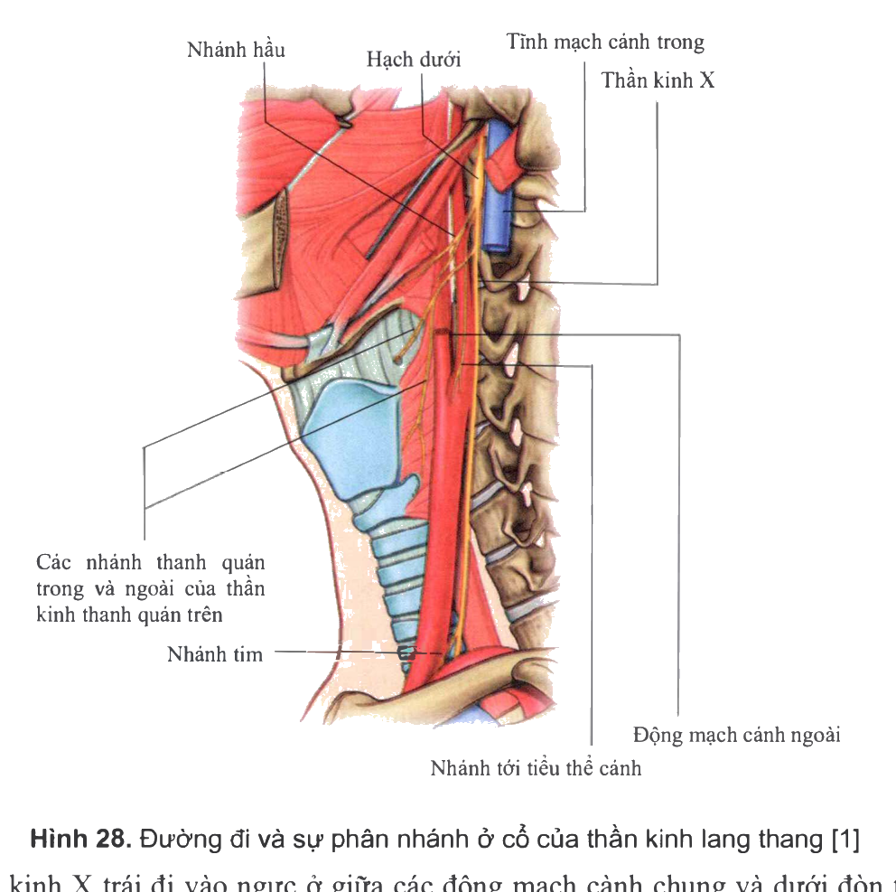
*Hình 28: Đường đi, phân nhánh và vùng chi phối của thần kinh lang thang*

#### 10.3. Đường đi và liên quan giải phẫu theo 4 đoạn
1. **Đoạn trong sọ và lỗ tĩnh mạch cảnh:**
   - Các rễ con quy tụ thành thân thần kinh, chạy qua khoang dưới nhện của hố sọ sau.
   - Thoát khỏi sọ qua **ngăn sau** (*pars venosa*) của **lỗ tĩnh mạch cảnh**, nằm cùng bao xơ màng cứng với thần kinh phụ (XI) và ngay phía trước tĩnh mạch cảnh trong.
   - Tại lỗ cảnh có **hạch trên** (hình cầu, đường kính 4mm); ngay dưới lỗ cảnh, thần kinh phình to thành **hạch dưới** (hình thoi, dài 2,5cm).
2. **Đoạn cổ:**
   - Thần kinh X chạy thẳng đứng từ trên xuống dưới trong **bao cảnh** (*vagina carotica*), nằm ở góc nhị diện phía sau giữa động mạch (động mạch cảnh trong ở trên, động mạch cảnh chung ở dưới) ở phía trong và tĩnh mạch cảnh trong ở phía ngoài.
   - *Phía sau:* Ngăn cách với các mỏm ngang đốt sống cổ bởi mạc trước cột sống và thân giao cảm cổ (chuỗi hạch giao cảm cổ nằm ngay sau bao cảnh).
   - *Phía trước ngoài:* Được cơ ức đòn chũm và quai cổ che phủ.
3. **Đoạn ngực (Bất đối xứng giải phẫu đặc biệt giữa hai bên):**
   - **Thần kinh X phải:**
     + Đi vào ngực bằng cách bắt chéo phía trước **động mạch dưới đòn phải** (giữa động mạch dưới đòn và tĩnh mạch dưới đòn).
     + Ngay tại bờ dưới động mạch dưới đòn, dây X phải tách ra **thần kinh thanh quản quặt ngược phải** (*n. laryngeus recurrens dexter*) vòng từ trước ra sau dưới động mạch dưới đòn rồi chạy ngược lên cổ.
     + Thân dây X phải tiếp tục đi xuống trung thất trên, nằm sau tĩnh mạch chủ trên và phế quản chính phải, đi vào trung thất sau áp sát mặt sau cuống phổi phải.
     + Tại mặt sau cuống phổi, dây X phải tách các nhánh tạo đám rối phổi sau, sau đó phân tán thành các sợi trên thành thực quản tạo **đám rối thực quản sau** và tập hợp lại thành **thân lang thang sau** (*truncus vagalis posterior*).
   - **Thần kinh X trái:**
     + Đi vào ngực giữa động mạch cảnh chung trái và động mạch dưới đòn trái, phía sau tĩnh mạch cánh tay đầu trái.
     + Bắt chéo mặt trước ngoài của **quai động mạch chủ** (*arcus aortae*), nằm sau thần kinh hoành trái.
     + Tại bờ dưới quai động mạch chủ, ngay phía ngoài dây chằng động mạch (*ligamentum arteriosum*), dây X trái tách ra **thần kinh thanh quản quặt ngược trái** (*n. laryngeus recurrens sinister*). Nhánh này vòng dưới quai động mạch chủ từ trước ra sau rồi chạy ngược lên cổ trong rãnh khí - thực quản trái.
     + Thân dây X trái tiếp tục đi sau phế quản chính trái, tạo đám rối phổi sau trái, rồi chạy ra mặt trước thực quản tạo **đám rối thực quản trước** và tập hợp lại thành **thân lang thang trước** (*truncus vagalis anterior*).
4. **Đoạn bụng:**
   - Hai thân lang thang cùng thực quản chui qua **lỗ thực quản của cơ hoành** (*hiatus oesophageus*) ở ngang mức đốt sống ngực T10 vào ổ bụng:
     + **Thân lang thang trước (*Truncus vagalis anterior*):** Áp sát mặt trước tâm vị và bờ cong nhỏ dạ dày. Tách các nhánh vị trước (nhánh Latarjet trước cấp máu và vận động thành trước dạ dày tới tận môn vị) và các nhánh gan (*rami hepatici*) đi trong mạc nối nhỏ tới cuống gan.
     + **Thân lang thang sau (*Truncus vagalis posterior*):** Đi ở mặt sau tâm vị và bờ cong nhỏ. Tách nhánh vị sau (nhánh Latarjet sau) và các nhánh thân tạng (*rami coeliaci*) rất lớn đi vào đám rối thân tạng (*plexus coeliacus*), từ đó phân tán theo các nhánh động mạch tới chi phối đối giao cảm cho tụy, lách, thận, tuyến thượng thận, toàn bộ ruột non, manh tràng, ruột thừa, đại tràng lên và 2/3 phải đại tràng ngang.

#### 10.4. Các phân nhánh chính
- **Ở đầu và cổ:**
  1. *Nhánh màng não:* Cảm giác màng não hố sọ sau.
  2. *Nhánh tai (Thần kinh Arnold):* Đi qua tiểu quản chũm, cảm giác da mặt sau loa tai và thành sau dưới ống tai ngoài (ngoáy tai gây ho do kích thích nhánh này).
  3. *Các nhánh hầu:* Tạo đám rối hầu, vận động các cơ co thắt hầu và cơ nâng màn hầu.
  4. *Thần kinh thanh quản trên (*Nervus laryngeus superior*):* Tách từ hạch dưới, đi chéo xuống dưới sâu dưới động mạch cảnh trong tới sừng lớn xương móng rồi chia 2 nhánh:
     - Nhánh trong (*ramus internus*): Xuyên qua màng giáp - móng cùng động mạch thanh quản trên, cảm giác toàn bộ niêm mạc thanh quản phía trên nếp thanh âm và nắp thanh môn.
     - Nhánh ngoài (*ramus externus*): Chạy dọc cơ khép hầu dưới, vận động cho **cơ nhẫn giáp** (*m. cricothyroideus*) - cơ làm căng dây thanh âm.
  5. *Thần kinh thanh quản quặt ngược (*Nervus laryngeus recurrens*):*
     - Dây phải quặt dưới ĐM dưới đòn; dây trái quặt dưới quai ĐM chủ. Cả hai chạy ngược lên trong rãnh giữa khí quản và thực quản, đi sát cực dưới thùy bên tuyến giáp (liên quan mật thiết với động mạch giáp dưới).
     - Đổi tên thành **thần kinh thanh quản dưới** (*n. laryngeus inferior*) khi chui dưới bờ dưới cơ khép hầu dưới vào thanh quản.
     - Vận động cho **toàn bộ các cơ nội tại của thanh quản** (trừ cơ nhẫn giáp): cơ nhẫn phễu sau (cơ duy nhất mở thanh môn), cơ nhẫn phễu bên, cơ giáp phễu, cơ phễu chéo và ngang. Đồng thời cảm giác niêm mạc thanh quản bên dưới nếp thanh âm.
- **Ở ngực:** Các nhánh tim ngực, nhánh phế quản (tạo đám rối phổi), nhánh thực quản.
- **Ở bụng:** Các nhánh dạ dày (thần kinh Latarjet trước và sau), nhánh gan, nhánh thân tạng.

#### 10.5. Ứng dụng lâm sàng thần kinh lang thang
- **Tổn thương thần kinh thanh quản quặt ngược trong phẫu thuật tuyến giáp:**
  - Do thần kinh quặt ngược bắt chéo hoặc đi xen kẽ với các nhánh của động mạch giáp dưới ngay tại cực dưới tuyến giáp, nó rất dễ bị kẹp, cắt đứt hoặc thiếu máu nuôi.
  - *Liệt một bên:* Gây khàn tiếng (*hoarseness*), giọng yếu do dây thanh âm bên liệt nằm ở tư thế trung gian không khép kín được.
  - *Liệt hai bên:* Hai dây thanh âm đều rũ ở tư thế trung gian làm hẹp hoàn toàn khe thanh môn, gây **khó thở thanh quản cấp tính**, thở rít (*stridor*), đe dọa tính mạng, đòi hỏi mở khí quản cấp cứu tức thì.
- **Khám tổn thương thân dây X (Dấu hiệu vén màn hầu - Vernet's curtain sign):**
  - Khi bảo bệnh nhân há miệng phát âm "A": nếu liệt dây X một bên, màn hầu bên lành được nâng lên trong khi bên liệt sa xuống, **lưỡi gà bị kéo lệch sang bên lành**.
  - Bệnh nhân bị mất phản xạ nôn, sặc thức ăn lỏng lên mũi khi nuốt (do hở vòm hầu) và giọng mũi hở (*rhinolalia*).
- **Hội chứng Horner phối hợp:** Khối u hoặc phẫu thuật bao cảnh tổn thương đồng thời dây X và chuỗi hạch giao cảm cổ nằm ngay sau bao cảnh.
- **Phẫu thuật cắt thần kinh X (Vagotomy):**
  - Cắt thần kinh X chọn lọc cao (bảo tồn nhánh nérf de Latarjet tới hang vị - môn vị nhưng cắt các nhánh tới thân và đáy vị) từng là phương pháp kinh điển điều trị loét dạ dày tá tràng kháng trị nhằm triệt tiêu kích thích tiết acid clohydric (HCl).

---

### 11. THẦN KINH PHỤ (XI) (Accessory nerve) (H.1, 2, 3, 29)

Thần kinh phụ (dây thần kinh sọ XI, trước đây gọi là thần kinh gai) là một thần kinh vận động thuần túy đặc biệt vì nó được hình thành từ sự kết hợp của hai thành phần có nguồn gốc phôi thai và giải phẫu hoàn toàn khác biệt: **rễ sọ** (bản chất thuộc hành não) và **rễ gai** (bản chất thuộc tủy sống cổ).

#### 11.1. Cấu tạo và nguyên ủy thật
1. **Rễ sọ (*Radix cranialis*):**
   - *Nguyên ủy:* Xuất phát từ cực dưới của **nhân hoài nghi** (*nucleus ambiguus*) ở hành não.
   - Các sợi này bản chất là thành phần vận động của dây X nhưng mượn đường đi tạm thời theo dây XI trong một đoạn ngắn.
2. **Rễ gai (*Radix spinalis*):**
   - *Nguyên ủy:* Xuất phát từ **cột nhân thần kinh phụ** (*nucleus nervi accessorii*) nằm ở sừng trước chất xám tủy sống cổ kéo dài từ đốt C1 đến C5 (đôi khi tới C6).

#### 11.2. Nguyên ủy hư và đường đi
1. **Nguyên ủy hư:**
   - *Rễ sọ:* Thoát ra ở phần dưới cùng của **rãnh sau trám hành** (dưới các rễ của dây X).
   - *Rễ gai:* Thoát ra ở mặt bên của tủy gai cổ, giữa rễ trước và rễ sau của các dây thần kinh gai sống cổ C1 - C5 bằng một chuỗi các sợi con.
2. **Đường đi trong sọ:**
   - Các sợi rễ gai hợp thành một thân duy nhất chạy ngược lên trên trong ống sống, chui qua **lỗ lớn xương chẩm** (*foramen magnum*) để vào hố sọ sau.
   - Tại hố sọ sau, thân rễ gai chạy ra ngoài hợp nhất với rễ sọ tạo thành **thần kinh phụ**.
3. **Qua lỗ tĩnh mạch cảnh và phân chia nhánh:**
   - Thần kinh phụ cùng dây X chui qua **ngăn sau của lỗ tĩnh mạch cảnh** ra ngoài sọ.
   - Ngay khi vừa ra khỏi lỗ cảnh, thần kinh XI lập tức phân đôi thành hai nhánh riêng biệt:
     - **Nhánh trong (*Ramus internus*):** Nhỏ hơn, mang toàn bộ các sợi của rễ sọ. Nhánh này hòa nhập ngay vào thân của **thần kinh lang thang (X)** ngay phía trên hạch dưới dây X, phân phối theo các nhánh hầu và thần kinh thanh quản quặt ngược để vận động các cơ hầu và cơ thanh quản.
     - **Nhánh ngoài (*Ramus externus*):** Lớn hơn, chính là sự tiếp tục của các sợi rễ gai. Đây là nhánh thực thụ duy nhất của dây thần kinh phụ tồn tại độc lập ở vùng cổ.

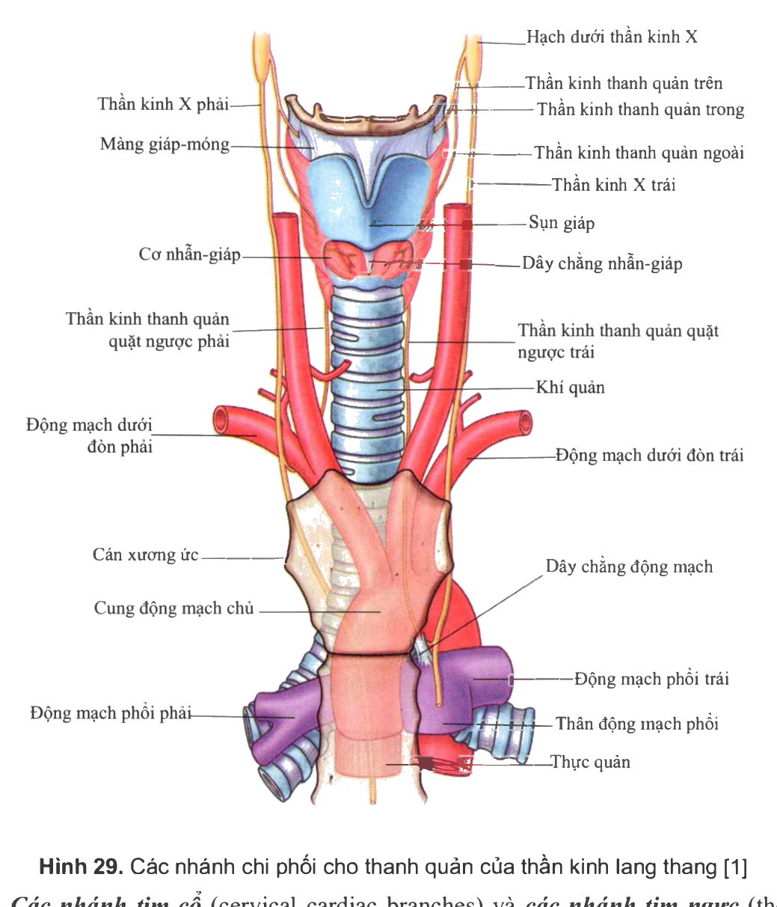
*Hình 29: Thần kinh phụ và vùng phân bố*

#### 11.3. Đường đi và liên quan của nhánh ngoài ở vùng cổ
Nhánh ngoài dây XI có lộ trình giải phẫu ngoại khoa tối quan trọng:
1. **Đoạn trên cơ ức đòn chũm:**
   - Đi chếch xuống dưới, ra sau và sang bên trong khoang sau trâm.
   - Bắt chéo phía trước (trong 70% trường hợp) hoặc phía sau (30%) tĩnh mạch cảnh trong.
   - Chạy sâu dưới bụng sau cơ hai bụng và cơ trâm móng, được động mạch chẩm bắt chéo.
2. **Đoạn qua cơ ức đòn chũm:**
   - Thần kinh đi tới mặt sâu **cơ ức đòn chũm** (*m. sternocleidomastoideus*), xuyên qua hoặc đi dưới cơ này ở vị trí nối 1/3 trên và 2/3 dưới của cơ, phân nhánh vận động cho cơ ức đòn chũm.
3. **Đoạn trong tam giác cổ sau:**
   - Thoát ra ở bờ sau cơ ức đòn chũm tại **điểm Erb** (điểm thần kinh - cách mỏm chũm khoảng 4 - 5cm).
   - Chạy chéo xuống dưới và ra sau qua **tam giác cổ sau** (*trigonum colli posterius*), tựa trên mặt nông cơ nâng vai (*m. levator scapulae*).
   - **Đặc điểm phẫu thuật cực kỳ nguy hiểm:** Tại tam giác cổ sau, nhánh ngoài dây XI nằm rất nông, chỉ được che phủ bởi da, mỡ dưới da, cơ bám da cổ và lá nông mạc cổ sâu (*lamina superficialis fasciae cervicalis*), đi kèm với chuỗi hạch bạch huyết cổ sau.
4. **Đoạn cơ thang:**
   - Thần kinh chui vào mặt sâu **cơ thang** (*m. trapezius*) ở vị trí cách bờ trên xương đòn khoảng 2 - 3 khoát ngón tay (ngang mức bờ trên sụn nhẫn), phân nhánh vận động cho toàn bộ cơ thang.
   - Tại mặt sâu cơ thang, nó tạo mạng nối với các nhánh cảm giác bản thể sâu từ đám rối cổ (C2, C3, C4).

#### 11.4. Ứng dụng lâm sàng thần kinh phụ
- **Tổn thương nhánh ngoài dây XI trong phẫu thuật vùng cổ:**
  - Do nằm nông ngay dưới mạc cổ trong tam giác cổ sau, dây XI là thần kinh sọ bị tổn thương do điều trị (iatrogenic injury) phổ biến nhất, thường gặp trong các thủ thuật: sinh thiết hạch cổ sau, nạo vét hạch cổ trong ung thư đầu mặt cổ, mổ u bọc mỡ hoặc chấn thương rách cổ.
- **Triệu chứng liệt dây thần kinh XI:**
  - *Liệt cơ thang:*
    + Vai bên tổn thương bị **sa trễ xuống dưới và ra trước**.
    + Bệnh nhân **mất khả năng nhún vai** bên tổn thương khi chống lại lực cản của người khám.
    + Mất khả năng giạng cánh tay lên quá 90 độ (do cơ thang không thể xoay góc dưới xương bả vai lên trên).
    + Teo cơ thang làm hố trên đòn sâu hoắm, bờ vai biến dạng lõm.
    + Xuất hiện biến dạng **xương bả vai hình cánh chim** (*winged scapula*): góc dưới xương bả vai bị xoay ra ngoài và trượt xuống dưới (khác với tổn thương thần kinh ngực dài làm xương bả vai nhô ra sau và trượt vào trong).
  - *Liệt cơ ức đòn chũm:*
    + Yếu hoặc mất khả năng xoay mặt sang phía đối diện khi có lực cản.
    + Teo cơ ức đòn chũm làm mất gờ nổi tự nhiên ở bờ trước bên cổ.

---

### 12. THẦN KINH HẠ THIỆT (XII) (Hypoglossal nerve) (H.1, 2, 3, 30, 31, 32)

Thần kinh hạ thiệt (dây thần kinh sọ XII) là dây thần kinh vận động thuần túy, chịu trách nhiệm chi phối vận động cho toàn bộ các cơ nội tại và hầu hết các cơ ngoại lai của lưỡi, đóng vai trò then chốt trong các hoạt động nói, nhai, nuốt và bảo vệ đường thở.

#### 12.1. Nguyên ủy thật
- **Nhân thần kinh hạ thiệt (*Nucleus nervi hypoglossi*):**
  - Là một cột tế bào vận động soma (GSE - General Somatic Efferent) dài khoảng 1,5 – 2 cm, nằm sát đường giữa ở phần lưng hành não.
  - Cột nhân này đội sàn não thất IV lên tạo thành **tam giác thần kinh hạ thiệt** (*trigonum nervi hypoglossi* - cánh trong) ở phần dưới sàn não thất IV.
  - Nhân nhận các sợi vỏ não - hành (corticobulbar fibers) bắt chéo chủ yếu từ bán cầu đại não đối diện.

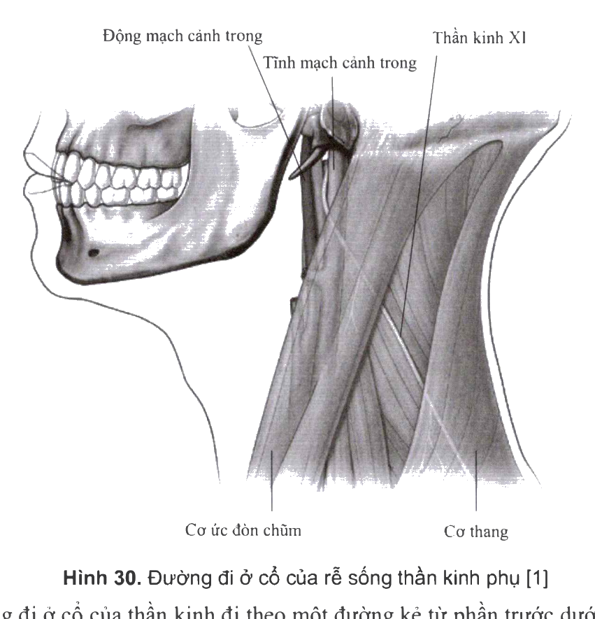
*Hình 30: Nhân nguyên uỷ và các tiếp nối trung ương của thần kinh hạ thiệt*

#### 12.2. Nguyên ủy hư
Thần kinh XII thoát ra ở **rãnh trước trám hành** (*sulcus preolivaris* - rãnh bên trước của hành não, giữa trám hành ở phía sau và tháp hành ở phía trước) bằng một chuỗi 10 đến 15 rễ con xếp thành hàng dọc.

#### 12.3. Đường đi và liên quan giải phẫu
Đường đi của thần kinh XII được mô tả qua 4 đoạn liên quan:
1. **Đoạn trong sọ và qua nền sọ:**
   - Các rễ con quy tụ thành hai bó sợi riêng biệt, chui qua màng cứng vào **ống thần kinh hạ thiệt** (*canalis nervi hypoglossi* - ống lồi cầu trước) ở nền xương chẩm.
   - Trong ống xương chẩm, hai bó này hợp nhất thành một thân thần kinh duy nhất thoát ra ngoài nền sọ.
2. **Đoạn khoang sau trâm (Cổ cao):**
   - Thoát khỏi ống hạ thiệt, dây XII nằm sâu nhất trong khoang sau trâm, nằm sau động mạch cảnh trong và tĩnh mạch cảnh trong, áp sát phía trong các dây thần kinh IX, X, XI.
   - Thần kinh chạy chếch xuống dưới, lách ra phía ngoài giữa động mạch cảnh trong và tĩnh mạch cảnh trong.
   - Tại đây, dây XII tiếp nhận một nhánh tiếp nối từ **nhánh trước thần kinh gai sống cổ thứ nhất (C1)**. Các sợi C1 này chỉ mượn đường chạy cùng dây XII (hiện tượng "hitchhiking") mà không hòa lẫn sợi trục.
3. **Đoạn tam giác cảnh:**
   - Đi xuống ngang mức góc hàm và xương móng, dây XII vòng ra trước tạo thành một đường cong lồi xuống dưới.
   - **Bắt chéo mặt ngoài:** lần lượt bắt chéo mặt ngoài động mạch cảnh trong, động mạch cảnh ngoài, và chỗ xuất phát của động mạch chẩm và động mạch lưỡi.
   - Được tĩnh mạch mặt và bụng sau cơ hai bụng, cơ trâm móng bắt chéo phía ngoài.
   - Tại đỉnh của đường cong (ngang mức góc hàm), các sợi C1 mượn đường tách khỏi dây XII chạy thẳng xuống dưới tạo thành **rễ trên quai cổ** (*radix superior ansae cervicalis*).
4. **Đoạn dưới hàm và sàn miệng:**
   - Thần kinh đi vào **tam giác dưới hàm**, chạy nông hơn động mạch lưỡi (nằm trên mặt nông cơ móng lưỡi, được tuyến nước bọt dưới hàm và cơ hàm móng che phủ).
   - Tạo thành cạnh trên của **tam giác Pirogoff** và **tam giác Béclard** (các mốc ngoại khoa kinh điển để tìm và thắt động mạch lưỡi).
   - Chui qua bờ sau cơ hàm móng, lách giữa cơ hàm móng và cơ móng lưỡi cùng với ống tuyến dưới hàm (ống Wharton) để tiến vào cấu trúc các cơ của lưỡi.
   - Tận cùng bằng cách tỏa ra vô số nhánh vận động đi sâu vào nhu mô lưỡi.

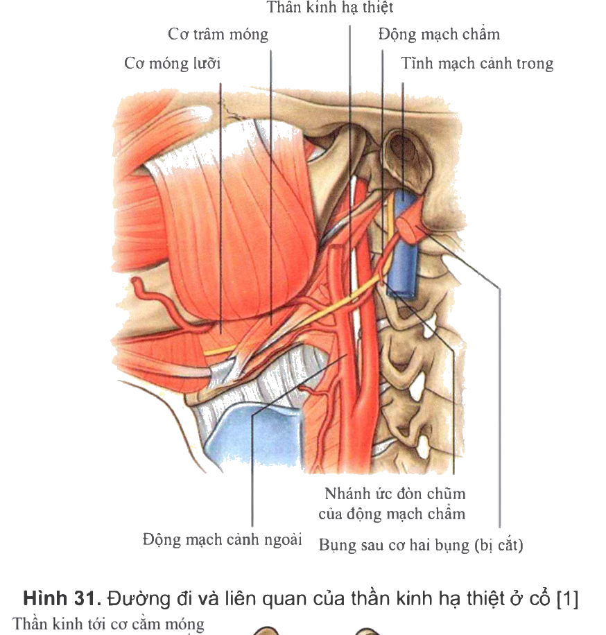
*Hình 31: Đường đi và phân nhánh của thần kinh hạ thiệt*

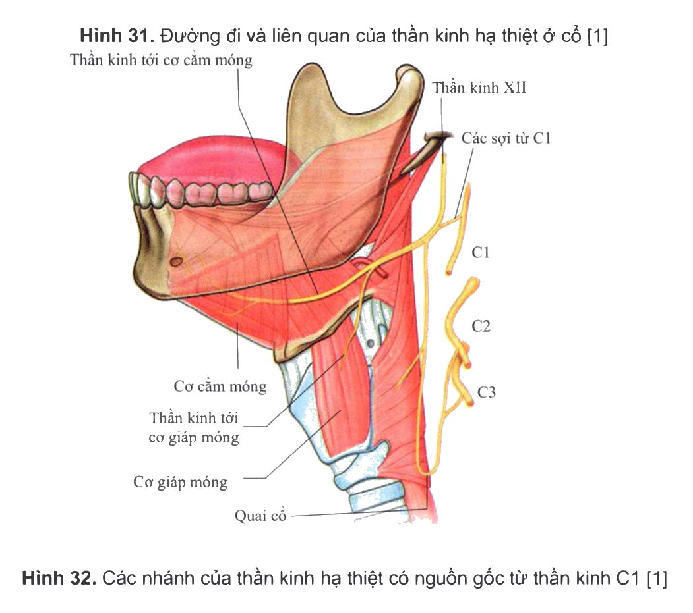
*Hình 32: Sơ đồ chi phối các cơ lưỡi của thần kinh hạ thiệt*

#### 12.4. Phân nhánh và tiếp nối
1. **Các nhánh thực sự của thần kinh XII (Sợi từ nhân hạ thiệt):**
   - **Chi phối toàn bộ các cơ nội tại của lưỡi:** Cơ dọc trên (*m. longitudinalis superior*), cơ dọc dưới (*m. longitudinalis inferior*), cơ ngang lưỡi (*m. transversus linguae*), và cơ thẳng đứng lưỡi (*m. verticalis linguae*). Các cơ này làm thay đổi hình dạng của lưỡi (uốn cong, dẹt, tròn).
   - **Chi phối hầu hết các cơ ngoại lai của lưỡi:**
     + **Cơ cằm lưỡi (*m. genioglossus*):** Cơ quan trọng nhất, có tác dụng kéo đáy lưỡi ra trước để thè lưỡi ra ngoài.
     + **Cơ móng lưỡi (*m. hyoglossus*):** Kéo hạ bờ bên của lưỡi xuống dưới.
     + **Cơ trâm lưỡi (*m. styloglossus*):** Kéo lùi lưỡi ra sau và nâng gốc lưỡi lên trên.
     - *Ngoại lệ duy nhất:* **Cơ khẩu cái lưỡi** (*m. palatoglossus*) không do dây XII chi phối, mà do **đám rối hầu của thần kinh X** chi phối.
2. **Các nhánh mượn đường từ thần kinh gai sống C1:**
   - **Nhánh màng não:** Quay ngược vào hố sọ sau cảm giác màng cứng.
   - **Rễ trên quai cổ (*Radix superior ansae cervicalis*):** Chạy xuống trước bao cảnh, hợp với rễ dưới (gồm các sợi từ C2, C3) tạo thành **quai cổ** (*ansa cervicalis*). Quai cổ phân nhánh vận động cho 3 cơ dưới móng: **cơ ức - móng**, **cơ ức - giáp**, và **cơ vai - móng**.
   - **Nhánh cho cơ giáp móng (*Ramus thyrohyoideus*):** Chạy tới cơ giáp móng.
   - **Nhánh cho cơ cằm móng (*Ramus geniohyoideus*):** Đi tới cơ cằm móng ở sàn miệng.

#### 12.5. Ứng dụng lâm sàng thần kinh hạ thiệt
- **Dấu hiệu tổn thương nơron vận động dưới (Liệt dây XII ngoại vi một bên):**
  - **Khám khi thè lưỡi:** Đầu lưỡi **lệch về bên tổn thương (bên liệt)**. Cơ chế: Cơ cằm lưỡi bên lành còn nguyên vẹn sẽ co và đẩy nửa lưỡi bên lành ra trước và đẩy chéo sang phía bên liệt (bên bị yếu không có lực đối kháng).
  - **Khám khi lưỡi nằm yên trong khoang miệng:** Lưỡi có thể hơi nghiêng nhẹ về bên lành do trương lực cơ trâm lưỡi bên lành co kéo.
  - **Dấu hiệu teo cơ:** Nửa lưỡi bên liệt bị teo nhỏ rõ rệt, niêm mạc nhăn nheo, bề mặt lồi lõm rãnh sâu.
  - **Rung giật bó cơ (*Fasciculations*):** Thấy rõ các sóng rung giật sợi cơ lăn tăn dưới niêm mạc nửa lưỡi bên liệt do tăng tính nhạy cảm thần kinh sau thoái hóa sợi trục.
  - Ảnh hưởng phát âm: Bệnh nhân khó phát âm các âm đầu lưỡi - răng (như đ, t, l, n).
- **Dấu hiệu tổn thương nơron vận động trên (Liệt trung ương do đột quỵ bán cầu não):**
  - Do bó vỏ não - hành bắt chéo sang nhân hạ thiệt đối bên, khi tổn thương vỏ não hoặc bao trong một bên: khi thè lưỡi, **đầu lưỡi lệch về bên đối diện với ổ tổn thương não** (tức là lệch về bên nửa người bị liệt). Lưỡi không có hiện tượng teo cơ hay rung giật bó cơ.
- **Nguy cơ tổn thương trong phẫu thuật bóc nội mạc động mạch cảnh (Carotid Endarterectomy - CEA):**
  - Do dây XII bắt chéo mặt ngoài chỗ phân đôi của động mạch cảnh chung và động mạch cảnh trong, việc bộc lộ phẫu trường động mạch cảnh rất dễ làm căng, dập hoặc cắt đứt dây XII nếu phẫu thuật viên không nhận diện được quai hạ thiệt.

---

### 13. BẢNG TỔNG KẾT CÁC HỘI CHỨNG LÂM SÀNG TỔN THƯƠNG PHỐI HỢP NỀN SỌ (IX, X, XI, XII)

Do 4 đôi dây thần kinh sọ cuối cùng (IX, X, XI, XII) xuất phát liền kề nhau ở hành não và cùng đi qua các cấu trúc hẹp ở nền sọ và vùng cổ cao, chúng thường bị tổn thương đồng thời trong các bệnh lý khối u nền sọ, gãy xương chẩm, huyết khối xoang cảnh hoặc phẫu thuật khoang sau trâm:

| Hội chứng lâm sàng | Vị trí tổn thương giải phẫu | Các dây thần kinh bị tổn thương | Biểu hiện lâm sàng kinh điển |
| :--- | :--- | :--- | :--- |
| **Hội chứng Vernet** *(Hội chứng lỗ tĩnh mạch cảnh)* | Lỗ tĩnh mạch cảnh (*Foramen jugulare*) | **IX, X, XI** | - Mất phản xạ nôn, mất vị giác 1/3 sau lưỡi (IX) - Khàn tiếng, liệt màn hầu, nuốt sặc (X) - Sa vai, yếu xoay đầu và nhún vai (XI) |
| **Hội chứng Collet-Sicard** *(Lỗ cảnh + Ống hạ thiệt)* | Lỗ tĩnh mạch cảnh lan sang ống thần kinh hạ thiệt | **IX, X, XI, XII** | Toàn bộ triệu chứng của hội chứng Vernet kèm theo **liệt và teo nửa lưỡi, thè lưỡi lệch về bên tổn thương (XII)**. |
| **Hội chứng Villaret** *(Hội chứng khoang sau trâm)* | Khoang sau trâm (*Spatium retrostyloideum*) | **IX, X, XI, XII + Chuỗi giao cảm cổ** | Toàn bộ triệu chứng của Collet-Sicard kèm theo **Hội chứng Horner** cùng bên (hẹp khe mi, co đồng tử, sụp mi nhẹ, giảm tiết mồ hôi nửa mặt). |
| **Hội chứng Jackson** | Thân não hoặc nền sọ vùng hành não | **X, XI, XII** | Liệt nửa màn hầu, liệt dây thanh âm (X), liệt cơ thang, ức đòn chũm (XI) và liệt nửa lưỡi (XII). |
| **Hội chứng Tapia** | Vùng dưới góc hàm / Cổ cao | **X + XII** | Liệt dây thanh âm cùng bên kèm liệt và teo cơ nửa lưỡi (thường do chèn ép của bóng chèn ống nội khí quản hoặc thủ thuật tai mũi họng). |
