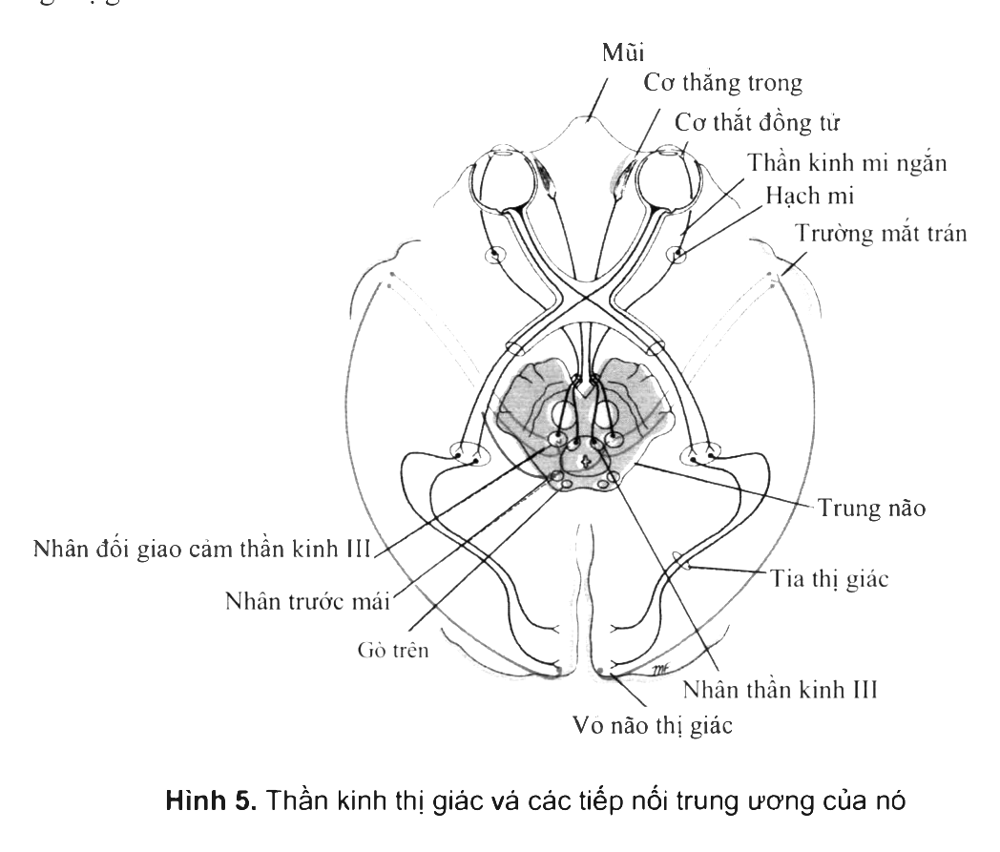
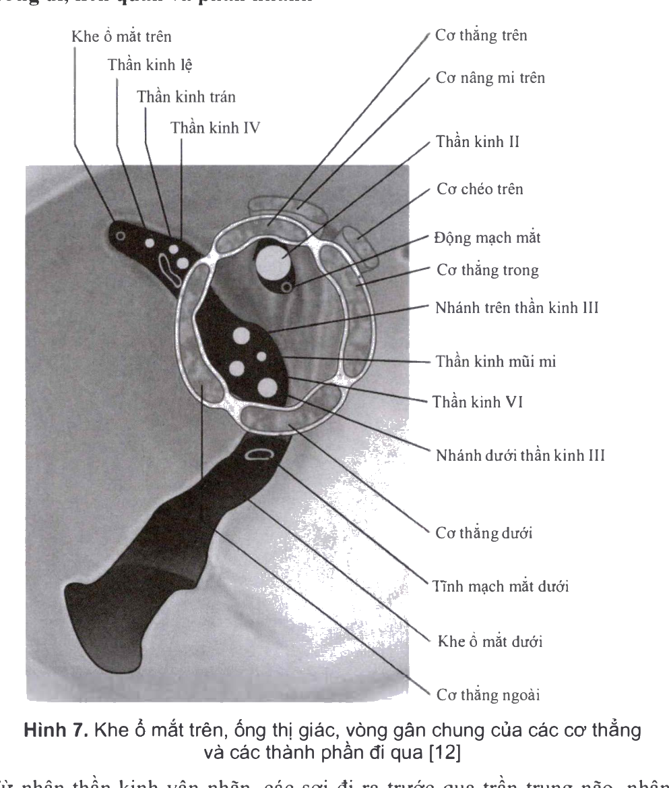
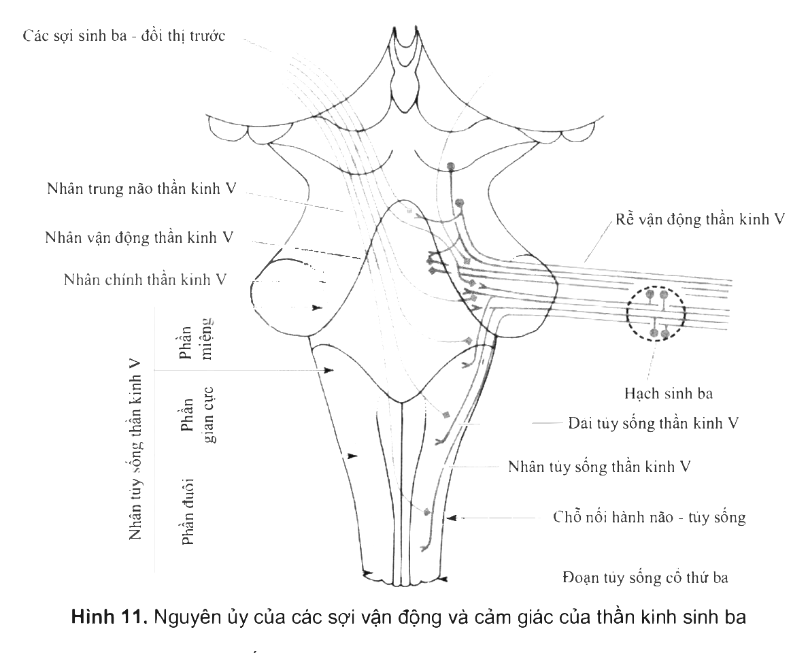
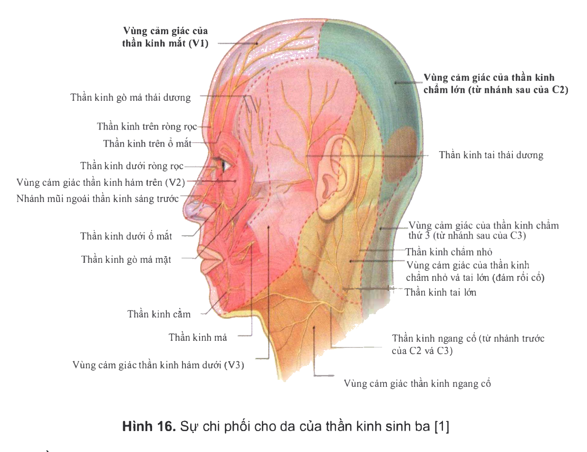
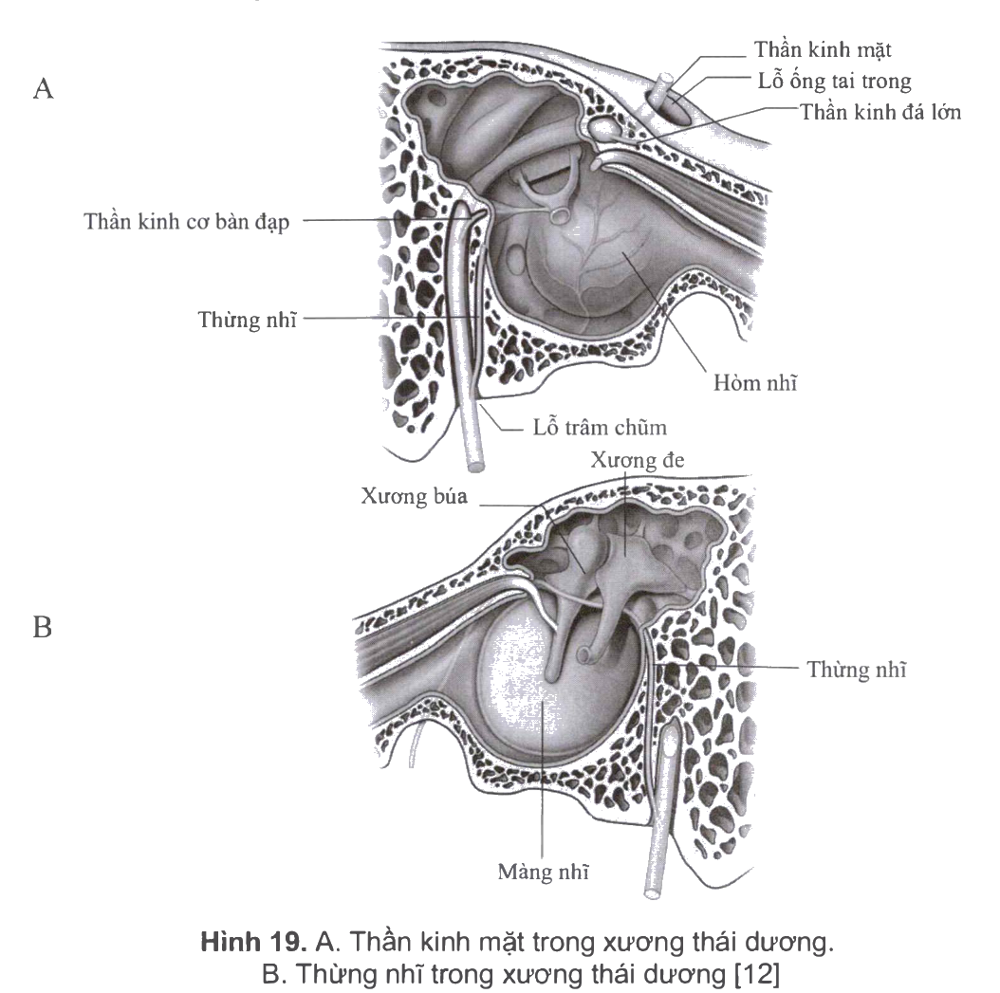
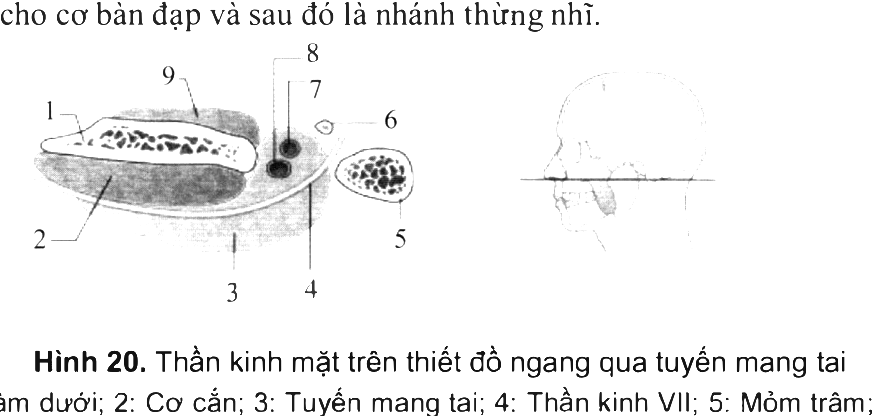
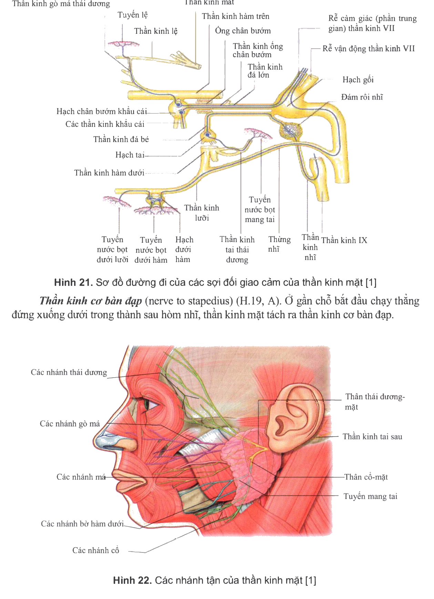
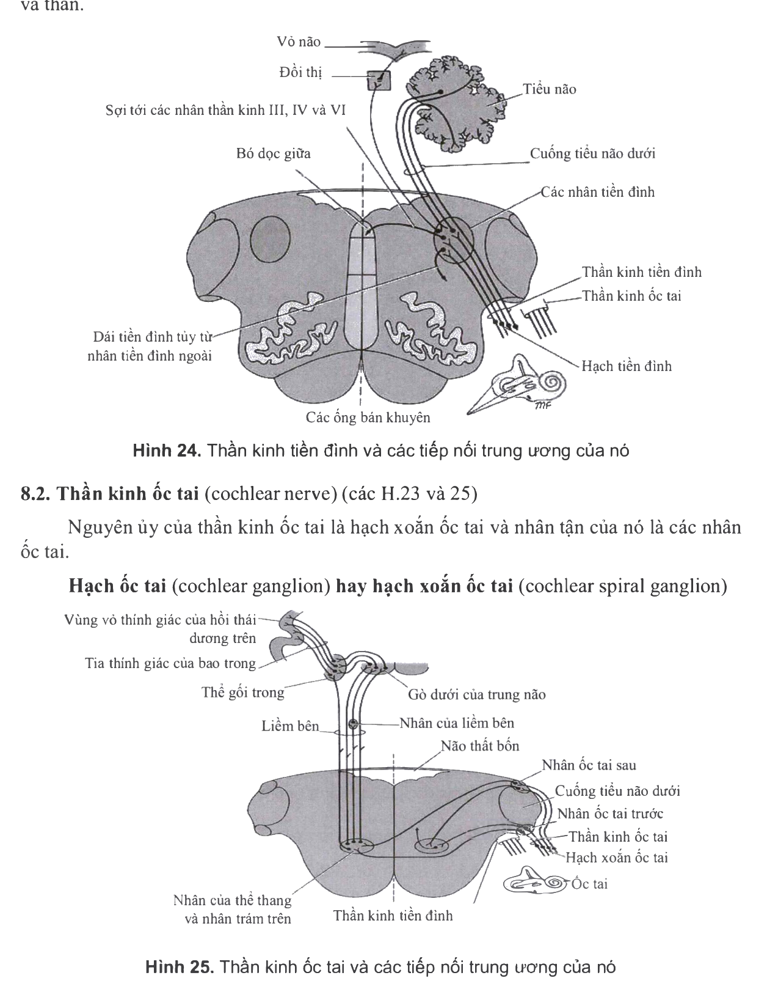

# CÁC THẦN KINH SỌ (CRANIAL NERVES)

**Chương:** Chương 8: Hệ Thần Kinh  
**Tác giả:** PGS.TS. Nguyễn Văn Huy  
**Nguồn:** Giáo trình Giải phẫu học Y Hà Nội (Xuất bản 2025), Trang 395 - 440

---

## BÀI GIẢNG CHUYÊN ĐỀ Y KHOA: CÁC THẦN KINH SỌ

## I. ĐẠI CƯƠNG VỀ CÁC THẦN KINH SỌ

Các thần kinh sọ (*cranial nerves*) kết nối não với các cấu trúc ở đầu cổ (và ngực - bụng đối với thần kinh X). Có 12 đôi thần kinh sọ, trong đó 10 đôi gắn với thân não (từ đôi III đến đôi XII). Các thần kinh sọ được gọi tên theo chức năng/đặc điểm phân bố và được đánh số bằng chữ số La Mã (I đến XII) theo trình tự từ trước - trên xuống sau - dưới của não:

1. **Thần kinh khứu giác (I)** (*Olfactory nerve*)
2. **Thần kinh thị giác (II)** (*Optic nerve*)
3. **Thần kinh vận nhãn (III)** (*Oculomotor nerve*)
4. **Thần kinh ròng rọc (IV)** (*Trochlear nerve*)
5. **Thần kinh sinh ba (V)** (*Trigeminal nerve*)
6. **Thần kinh giạng (VI)** (*Abducent nerve*)
7. **Thần kinh mặt (VII)** (*Facial nerve*) và **thần kinh trung gian** (*Intermediate nerve*)
8. **Thần kinh tiền đình - ốc tai (VIII)** (*Vestibulocochlear nerve*)
9. **Thần kinh lưỡi - hầu (IX)** (*Glossopharyngeal nerve*)
10. **Thần kinh lang thang (X)** (*Vagus nerve*)
11. **Thần kinh phụ (XI)** (*Accessory nerve*)
12. **Thần kinh hạ thiệt (XII)** (*Hypoglossal nerve*)

*Hình 1: Các nhân thần kinh sọ ở thân não*

### 1. Phân loại chức năng sợi thần kinh sọ
Căn cứ vào thành phần sợi thần kinh cấu tạo nên, các thần kinh sọ được chia thành:
- **Thần kinh cảm giác thuần túy:** Thần kinh I (khứu giác), II (thị giác), VIII (tiền đình - ốc tai).
- **Thần kinh vận động thuần túy:** Thần kinh III, IV, VI (vận nhãn), XI (cơ thang, cơ ức đòn chũm), XII (vận động cơ lưỡi).
- **Thần kinh hỗn hợp:** Thần kinh V (sinh ba), VII (mặt), IX (lưỡi - hầu), X (lang thang).

Các thành phần sợi chức năng bao gồm:
- *Sợi vận động cơ vân (vận động thân thể / vận động tạng đặc biệt):* chi phối cơ vân bám xương và các cơ có nguồn gốc từ các cung mang (cơ nhai, cơ bám da mặt, cơ hầu, thanh quản).
- *Sợi đối giao cảm trước hạch (vận tạng chung):* thuộc các dây III, VII, IX, X, phân bố tới các hạch mi, chân bướm khẩu cái, dưới hàm, tai và các hạch tận cùng trong thành tạng.
- *Sợi cảm giác thân thể:* cảm giác sờ, đau, nhiệt, bản thể từ da và niêm mạc vùng đầu mặt.
- *Sợi cảm tạng chung và đặc biệt:* cảm giác từ các nội tạng, cảm giác vị giác (VII, IX, X) và khứu giác, thị giác, thính giác, thăng bằng.

*Hình 2: Nơi đi ra khỏi não (nguyên uỷ hư) của các thần kinh sọ*

### 2. Nguyên ủy thật và nguyên ủy hư
- **Nguyên ủy thật (Real origin):**
  - Đối với sợi vận động: là các nhân vận động nằm sâu trong chất xám thân não (trung não, cầu não, hành não) hoặc sừng trước tuỷ gai cổ.
  - Đối với sợi cảm giác: là các thân nơron nằm ở các hạch cảm giác ngoại vi ngoài trục thần kinh trung ương (hạch sinh ba, hạch gối, hạch trên/dưới thần kinh IX, X, hạch tiền đình, hạch xoắn ốc tai).
- **Nguyên ủy hư (Apparent origin):** Là vị trí các rễ thần kinh sọ lộ ra trên bề mặt của não hoặc thân não.

*Hình 3: Hình ảnh nền sọ cho thấy nơi mà các thần kinh sọ chui qua các lỗ sọ*

---
## II. CHI TIẾT 12 ĐÔI THẦN KINH SỌ

### 1. THẦN KINH KHỨU GIÁC (I) (Olfactory nerve) (H.2, 3, 4)

Thần kinh khứu giác là thần kinh cảm giác đặc biệt về mùi. Về mặt phôi thai học và giải phẫu học, thần kinh I không phải là một dây thần kinh ngoại vi điển hình mà là một phần lồi ra của não trước.

- **Nguyên ủy thật:** Là các tế bào nhận cảm khứu giác (tế bào thần kinh hai cực) nằm rải rác trong tầng niêm mạc khứu giác ở vòm ổ mũi (phần trên vách mũi và phần trên thành ngoài ổ mũi, tương ứng xương xoăn mũi trên).
- **Đường đi và tận cùng:**
  - Nhánh trục của các tế bào khứu giác tập hợp lại thành khoảng 15 - 20 sợi thần kinh khứu giác (*filia olfactoria*).
  - Các sợi này chui qua các lỗ của mảnh sàng xương sàng để vào hố sọ trước và tận cùng ở **hành khứu** (*olfactory bulb*).
  - Tại hành khứu, các sợi synáp với các tế bào hạt và tế bào van (mitral cells).
  - Nhánh trục của tế bào van tạo nên **dải khứu** (*olfactory tract*). Dải khứu chạy ra sau dọc rãnh khứu ở mặt dưới thùy trán, tới trước chất thủng trước thì tách ra thành các vân khứu ngoài, trong và trung gian. Vân khứu ngoài tận cùng ở vỏ não khứu giác nguyên thủy (hồi móc và thể hạnh nhân của thùy thái dương) mà không cần qua đồi thị.

*Hình 4: Thần kinh khứu giác*

- **Liên hệ lâm sàng:**
  - *Mất khứu giác (Anosmia):* Thường do chấn thương vỡ tầng trước nền sọ làm rách màng cứng và đứt các sợi khứu giác qua mảnh sàng, kèm theo chảy nước não tủy qua mũi (*CSF rhinorrhea*). Viêm niêm mạc mũi mạn tính hoặc khối u chèn ép rãnh khứu (u màng não rãnh khứu - hội chứng Foster Kennedy: teo thị thần kinh cùng bên và phù gai thị đối bên) cũng gây giảm hoặc mất mùi.

---

### 2. THẦN KINH THỊ GIÁC (II) (Optic nerve) (H.2, 3, 5, 7)

Thần kinh thị giác là thần kinh cảm giác đặc biệt về thị giác, thực chất là một dải chất trắng của gian não phát triển ra ngoại vi, được bao bọc bởi cả 3 lớp màng não (màng cứng, màng nhện, màng nuôi) và khoang dưới nhện chứa dịch não tủy kéo dài đến tận củng mạc nhãn cầu.

- **Nguyên ủy thật:** Là lớp tế bào hạch (*ganglion cell layer*) của võng mạc thị giác nhãn cầu.
- **Đường đi và các đoạn liên quan:**
  - Các sợi trục của tế bào hạch hội tụ tại đĩa thần kinh thị giác (gai thị, điểm mù) rồi xuyên qua lá sàng củng mạc tạo nên thần kinh thị giác.
  - Thần kinh dài khoảng 4 - 5 cm, được chia thành 4 đoạn:
    1. *Đoạn trong nhãn cầu (1 mm):* rất ngắn, qua củng mạc.
    2. *Đoạn trong ổ mắt (25 mm):* nằm trong tháp cơ vận nhãn, cong hình chữ S nhẹ để mắt cử động tự do mà không làm căng dây thần kinh; đi cùng động mạch trung tâm võng mạc chui vào trong trục dây thần kinh.
    3. *Đoạn trong ống thị giác (5 mm):* chui qua ống thị giác cùng động mạch mắt, nằm ở trên - trong động mạch.
    4. *Đoạn trong sọ (10 mm):* nằm ở hố sọ giữa, trên yên bướm và hoành yên, tiến dần vào đường giữa để hợp với thần kinh đối bên tạo thành **giao thoa thị giác** (*optic chiasm*).

*Hình 5: Thần kinh thị giác và các tiếp nối trung ương của nó*

- **Giao thoa thị giác và dải thị giác:**
  - Tại giao thoa thị giác: Các sợi bắt nguồn từ nửa trong (phía mũi) của võng mạc bắt chéo sang bên đối diện; các sợi từ nửa ngoài (phía thái dương) đi thẳng ra sau cùng bên mà không bắt chéo.
  - **Dải thị giác (Optic tract):** Chứa các sợi thái dương cùng bên và các sợi mũi đối bên (mang toàn bộ thông tin của nửa thị trường đối diện). Dải thị vòng quanh cuống đại não để tận cùng ở **thể gối ngoài** (*lateral geniculate body*) của đồi thị. Một số sợi đi vào gò trên trung não và vùng trước mái để phục vụ các phản xạ ánh sáng (phản xạ đồng tử).
  - Từ thể gối ngoài, các nơron thứ ba tạo thành **tia thị giác** (*optic radiation - dải gối-chẩm*) đi qua phần sau bao trong để tới vỏ não thị giác sơ cấp (vùng 17 Brodmann) quanh rãnh cựa ở thùy chẩm.
- **Liên hệ lâm sàng:**
  - *Phù gai thị (Papilledema):* Do tăng áp lực nội sọ truyền trực tiếp qua khoang dưới nhện bao quanh dây II làm chèn ép tĩnh mạch trung tâm võng mạc, gây ứ trệ tuần hoàn tĩnh mạch ở đáy mắt.
  - *Tổn thương thị trường:*
    + Cắt đứt dây II một bên: Mù hoàn toàn mắt cùng bên.
    + Chèn ép giao thoa thị giác (u tuyến yên): Mất thị trường nửa thái dương hai bên (*bitemporal hemianopia*).
    + Tổn thương dải thị giác hoặc tia thị giác một bên: Bán manh đồng danh đối bên (*homonymous hemianopia*).

---

### 3. THẦN KINH VẬN NHÃN (III) (Oculomotor nerve) (H.1, 2, 3, 6, 7, 8)

Thần kinh vận nhãn là thần kinh vận động thân thể và đối giao cảm, phụ trách vận động cho đa số các cơ ngoài nhãn cầu và cơ nội nhãn.

- **Nguyên ủy thật:**
  - *Nhân vận động (Somatic motor nucleus):* Nằm ở chất xám quanh cống não ở mức gò trên trung não.
  - *Nhân vận nhãn phụ (Edinger - Westphal nucleus):* Nằm ngay sau - trong nhân vận động, chứa thân nơron đối giao cảm trước hạch.
- **Nguyên ủy hư:** Rãnh trong cuống đại não (thuộc khoang gian cuống) ở mặt trước trung não.
- **Đường đi và phân nhánh:**
  - Thần kinh III chạy ra trước giữa động mạch não sau và động mạch tiểu não trên, đi vào thành ngoài xoang hang (nằm trên thần kinh IV và V1).
  - Đi qua khe ổ mắt trên và chui qua vòng gân chung (vòng Zinn) để vào ổ mắt.
  - Chia thành 2 nhánh:
    + *Nhánh trên:* Vận động cơ thẳng trên (*superior rectus*) và cơ nâng mi trên (*levator palpebrae superioris*).
    + *Nhánh dưới:* Vận động cơ thẳng trong (*medial rectus*), cơ thẳng dưới (*inferior rectus*), cơ chéo dưới (*inferior oblique*); và cho **rễ đối giao cảm (rễ vận nhãn)** tới **hạch mi** (*ciliary ganglion*). Từ hạch mi, các sợi đối giao cảm sau hạch theo các thần kinh mi ngắn tới vận động cơ thắt đồng tử (*sphincter pupillae - co đồng tử*) và cơ thể mi (*ciliary muscle - điều tiết nhìn gần*).

*Hình 6: Nhân nguyên uỷ và các tiếp nối trung ương của thần kinh vận nhãn*

*Hình 7: Khe ổ mắt trên, ống thị giác, vòng gân chung của các cơ thẳng*

*Hình 8: Đường đi và phân nhánh của các thần kinh sọ III, IV và VI*

- **Liên hệ lâm sàng:**
  - *Liệt dây thần kinh III hoàn toàn:* Biểu hiện sụp mi trên (*ptosis*), lác ngoài và hơi lùi xuống dưới (do ưu thế của cơ thẳng ngoài [dây VI] và cơ chéo trên [dây IV]), giãn đồng tử tối đa mất phản xạ ánh sáng và mất khả năng điều tiết nhìn gần.
  - Thần kinh III dễ bị chèn ép do tụt kẹt hồi móc qua khuyết lều tiểu não trong tăng áp lực nội sọ (đồng tử giãn cùng bên là dấu hiệu định khu quan trọng) hoặc do phình động mạch thông sau.

---

### 4. THẦN KINH RÒNG RỌC (IV) (Trochlear nerve) (H.1, 2, 3, 7, 8, 9)

Thần kinh ròng rọc là thần kinh sọ mảnh nhất và là thần kinh sọ duy nhất bắt chéo hoàn toàn ra khỏi mặt sau thân não.

- **Nguyên ủy thật:** Nhân thần kinh ròng rọc nằm ở trung não, ngang mức gò dưới, ngay dưới nhân dây III.
- **Nguyên ủy hư:** Mặt sau trung não, ngay dưới hai gò dưới (hai bên hãm màn tủy trên).
- **Đường đi và phân nhánh:**
  - Các sợi sau khi rời nhân bắt chéo hoàn toàn trong màn tủy trên sang bên đối diện rồi vòng quanh cuống đại não ra mặt trước.
  - Đi qua thành ngoài xoang hang (nằm dưới dây III và trên dây V1).
  - Đi vào ổ mắt qua khe ổ mắt trên nhưng **ở ngoài vòng gân chung**.
  - Chạy chếch vào trong bắt chéo cơ nâng mi trên để tới bám và chi phối duy nhất cho **cơ chéo trên** (*superior oblique*).
- **Tác dụng của cơ chéo trên:** Đưa nhãn cầu nhìn xuống dưới và ra ngoài (đặc biệt là cử động nhìn xuống khi mắt đang khép vào trong).

*Hình 9: Nhân nguyên uỷ và các tiếp nối trung ương của thần kinh ròng rọc*

- **Liên hệ lâm sàng:**
  - *Liệt dây IV:* Bệnh nhân bị song thị đứng (*vertical diplopia*), khó khăn nhất khi nhìn xuống dưới và vào trong (như khi bước xuống cầu thang hoặc đọc sách). Để bù trừ, bệnh nhân thường nghiêng đầu sang bên lành để tránh song thị.
---

### 5. THẦN KINH SINH BA (V) (Trigeminal nerve) (H.1, 2, 3, 10, 11, 12, 13, 14, 15, 16)

Thần kinh sinh ba là thần kinh sọ lớn nhất, là dây hỗn hợp đảm nhiệm cảm giác chính cho toàn bộ vùng mặt, ổ mắt, khoang mũi, xoang cạnh mũi, ổ miệng, răng, màng não và vận động cho các cơ nhai.

*Hình 10: Thần kinh sinh ba*

- **Nguyên ủy thật:**
  - *Phần cảm giác:* Thân nơron nằm ở **hạch sinh ba** (*trigeminal ganglion / hạch Gasser*), nằm trong khoang màng cứng (khoang Meckel) ở ấn thần kinh sinh ba trên mặt trước xương đá.
    + Nhánh gai ngoại vi nhận cảm giác từ ba vùng của mặt qua 3 nhánh lớn: Thần kinh mắt (V1), Thần kinh hàm trên (V2), Thần kinh hàm dưới (V3).
    + Nhánh gai trung ương đi vào cầu não để tận cùng ở các nhân cảm giác thần kinh sinh ba:
      1. *Nhân trung não:* Cảm giác bản thể sâu từ các cơ nhai và khớp thái dương hàm.
      2. *Nhân cảm giác chính:* Nằm ở cầu não, tiếp nhận cảm giác sờ nông và phân biệt hai điểm.
      3. *Nhân tủy sống thần kinh V:* Kéo dài từ cầu não xuống hành não và tuỷ cổ trên, tiếp nhận cảm giác đau và nhiệt.
  - *Phần vận động:* Thân nơron nằm ở **nhân vận động thần kinh V** ở cầu não. Các sợi vận động tạo nên *rễ vận động* nhỏ hơn, chạy dưới hạch sinh ba và chỉ nhập vào duy nhất **thần kinh hàm dưới (V3)**.

- **Nguyên ủy hư:** Mặt trước - bên cầu não (ranh giới giữa mặt trước cầu não và cuống tiểu não giữa), gồm rễ cảm giác lớn ở ngoài và rễ vận động nhỏ ở trong.

*Hình 11: Nguyên uỷ của các sợi vận động và cảm giác của thần kinh sinh ba*

#### 5.1. Thần kinh mắt (V1 - Ophthalmic nerve) (H.12, 13)
Là nhánh cảm giác thuần túy, đi qua thành ngoài xoang hang (dưới dây III và IV), rồi chui qua **khe ổ mắt trên** để vào ổ mắt. Trước khi vào ổ mắt chia thành 3 nhánh chính:
1. *Thần kinh trán (Frontal nerve):* Nhánh lớn nhất, chạy trên cơ nâng mi trên, chia thành:
   - *Thần kinh trên ròng rọc:* Cảm giác góc trong mắt và trán.
   - *Thần kinh trên ổ mắt:* Đi qua khuyết/lỗ trên ổ mắt cảm giác trán và đỉnh đầu.
2. *Thần kinh lệ (Lacrimal nerve):* Nhánh ngoài cùng, đi dọc bờ trên cơ thẳng ngoài tới tuyến lệ, nhận sợi đối giao cảm sau hạch từ hạch chân bướm khẩu cái (qua nhánh nối với thần kinh gò má) để vận tiết tuyến lệ, và cảm giác mi mắt trên góc ngoài.
3. *Thần kinh mũi - mi (Nasociliary nerve):* Đi trong chóp cơ qua vòng Zinn, cho nhánh nối tới hạch mi (rễ cảm giác hạch mi), các thần kinh mi dài (cảm giác giác mạc, củng mạc và mống mắt - đóng vai trò cung phản xạ giác mạc), thần kinh sàng sau, thần kinh sàng trước (tận cùng là thần kinh mũi ngoài) và thần kinh dưới ròng rọc.

*Hình 12: Các thần kinh mắt và hàm trên*

*Hình 13: Các nhánh của thần kinh mắt*

#### 5.2. Thần kinh hàm trên (V2 - Maxillary nerve) (H.12, 14)
Là nhánh cảm giác thuần túy, rời hố sọ giữa chui qua **lỗ tròn** (*foramen rotundum*) vào hố chân bướm - khẩu cái:
- Cho *nhánh màng não* trước khi ra khỏi sọ.
- Cho *các nhánh hạch* nối với **hạch chân bướm - khẩu cái** (*pterygopalatine ganglion*).
- Cho *thần kinh gò má* (chia thành nhánh gò má mặt và gò má thái dương).
- Cho *các thần kinh huyệt răng trên sau* chui qua các lỗ ở củ hàm trên cảm giác các răng hàm lớn và xoang hàm trên.
- Chạy vào rãnh và ống dưới ổ mắt ở sàn ổ mắt và đổi tên thành **thần kinh dưới ổ mắt** (*infra-orbital nerve*). Trong ống dưới ổ mắt tách thêm *thần kinh huyệt răng trên giữa* và *thần kinh huyệt răng trên trước* cho các răng tiền hàm và răng cửa. Thoát ra tại lỗ dưới ổ mắt chia thành các nhánh mi dưới, mũi ngoài và môi trên.

*Hình 14: Thần kinh hàm trên và hạch chân bướm khẩu cái*

#### 5.3. Thần kinh hàm dưới (V3 - Mandibular nerve) (H.15, 16)
Là dây hỗn hợp (chứa toàn bộ rễ vận động của dây V), rời sọ qua **lỗ bầu dục** (*foramen ovale*) vào hố dưới thái dương:
- Cho *nhánh màng não* (nhánh gai, chui ngược vào sọ qua lỗ gai) và nhánh tới *cơ chân bướm trong*, *cơ căng màn khẩu cái* và *cơ căng màng nhĩ*.
- **Các nhánh vận động:**
  - *Thần kinh cơ cắn:* Vận động cơ cắn.
  - *Các thần kinh thái dương sâu:* Vận động cơ thái dương.
  - *Thần kinh cơ chân bướm ngoài:* Vận động cơ chân bướm ngoài.
  - *Thần kinh cơ hàm móng:* Vận động cơ hàm móng và bụng trước cơ hai bụng (tách từ thần kinh huyệt răng dưới).
- **Các nhánh cảm giác:**
  - *Thần kinh má:* Cảm giác da và niêm mạc má.
  - *Thần kinh tai - thái dương:* Chạy vòng quanh động mạch màng não giữa, ôm cổ lồi cầu xương hàm dưới, đi qua tuyến mang tai lên vùng thái dương; mang theo sợi đối giao cảm sau hạch từ hạch tai tới tuyến mang tai; cảm giác loa tai, ống tai ngoài, màng nhĩ và da vùng thái dương.
  - *Thần kinh lưỡi:* Đi giữa cơ chân bướm trong và ngoài, nhận thừng nhĩ (dây VII), bắt chéo ống tuyến dưới hàm để vào 2/3 trước lưỡi; cảm giác thân thể (sờ, đau, nhiệt) cho 2/3 trước lưỡi và mang các sợi vị giác (từ thừng nhĩ) cho 2/3 trước lưỡi, đồng thời cho sợi đối giao cảm trước hạch tới **hạch dưới hàm**.
  - *Thần kinh huyệt răng dưới:* Đi vào lỗ hàm dưới cùng động mạch huyệt răng dưới chạy trong ống hàm dưới cảm giác tất cả các răng hàm dưới, tận cùng bằng *thần kinh cằm* (thoát ra ở lỗ cằm cảm giác da cằm và môi dưới).

*Hình 15: Thần kinh hàm dưới và các hạch tự chủ liên quan*

*Hình 16: Vùng chi phối cảm giác của 3 nhánh thần kinh sinh ba*

- **Liên hệ lâm sàng:**
  - *Đau dây thần kinh sinh ba (Trigeminal neuralgia / Tic douloureux):* Các cơn đau dữ dội, chói buốt như điện giật xuất hiện ở vùng chi phối của V2 hoặc V3, khởi phát bởi các điểm kích hoạt (trigger zones) khi nhai, nói, đánh răng hoặc chạm nhẹ.
  - *Mất phản xạ giác mạc (Corneal reflex):* Mất cung cảm giác (dây V1 qua nhánh mũi-mi) hoặc cung vận động (dây VII làm chớp mắt).
  - *Liệt dây V3:* Liệt các cơ nhai, khi há miệng hàm dưới lệch về bên liệt (do cơ chân bướm ngoài bên lành đẩy sang).
---

### 6. THẦN KINH GIẠNG (VI) (Abducent nerve) (H.1, 2, 3, 7, 8, 17)

Thần kinh giạng là thần kinh vận động đơn thuần, chi phối duy nhất cho cơ thẳng ngoài của nhãn cầu.

- **Nguyên ủy thật:** Nhân thần kinh giạng nằm ở cầu não dưới sàn não thất IV, được các sợi của thần kinh VII vòng quanh tạo nên **gò mặt** (*facial colliculus*).
- **Nguyên ủy hư:** Rãnh hành - cầu, ngay phía trên tháp hành.
- **Đường đi và phân nhánh:**
  - Rời rãnh hành - cầu, dây VI chạy lên dọc dốc nền xương chẩm trong khoang dưới nhện.
  - Đi qua bờ trên xương đá dưới dây chằng bướm - đá (trong ống Dorello).
  - Chui vào **lòng xoang hang** (khác với dây III, IV, V1 nằm ở thành ngoài xoang hang), áp sát bờ ngoài động mạch cảnh trong.
  - Chui qua khe ổ mắt trên và đi **bên trong vòng gân chung** để vào ổ mắt.
  - Tận cùng ở mặt trong **cơ thẳng ngoài** (*lateral rectus*).
- **Tác dụng:** Giạng nhãn cầu (liếc mắt ra ngoài).

*Hình 17: Thần kinh giạng (VI) và các tiếp nối trung ương của nó*

- **Liên hệ lâm sàng:**
  - Do có đoạn chạy tự do trong khoang dưới nhện dài và gập góc qua mỏm mỏm yên sau/bờ xương đá, thần kinh VI rất nhạy cảm với tăng áp lực nội sọ.
  - *Liệt dây VI:* Mắt không thể liếc ra ngoài, nhãn cầu bị kéo vào trong gây **lác trong** (*convergent strabismus*) và song thị ngang khi nhìn về phía bên tổn thương.

---

### 7. THẦN KINH MẶT (VII) VÀ THẦN KINH TRUNG GIAN (H.1, 2, 3, 18, 19, 20, 21, 22, 23)

Thần kinh mặt là một dây thần kinh hỗn hợp phức tạp gồm 2 phần:
- *Thần kinh mặt chính danh:* Rễ vận động cơ vân lớn cho các cơ bám da mặt (cơ biểu cảm nét mặt), cơ bàn đạp, bụng sau cơ hai bụng và cơ trâm móng.
- *Thần kinh trung gian (Wrisberg):* Rễ nhỏ hơn mang sợi cảm giác (vị giác 2/3 trước lưỡi, cảm giác vùng Ramsay-Hunt) và sợi đối giao cảm trước hạch (vận tiết tuyến lệ, tuyến dưới hàm, tuyến dưới lưỡi, niêm mạc mũi - miệng).

*Hình 18: Các nhân và các tiếp nối trung ương của thần kinh mặt*

- **Nguyên ủy thật:**
  - *Vận động cơ vân:* Nhân thần kinh mặt ở cầu não.
  - *Đối giao cảm:* Nhân nước bọt trên (và nhân lệ) ở cầu não.
  - *Cảm giác (vị giác):* Thân tế bào nằm ở **hạch gối** (*geniculate ganglion*) trong xương đá; sợi trung ương tận cùng ở nhân đơn độc (*solitary tract nucleus*).
- **Nguyên ủy hư:** Rãnh hành - cầu, ở góc cầu - tiểu não (phía ngoài dây VI và phía trong dây VIII).

- **Đường đi trong xương đá (Ống thần kinh mặt - ống Fallope):**
  Thần kinh VII cùng dây VIII chui qua **lỗ tai trong** vào ống tai trong. Ở đáy ống tai trong, dây VII chui vào ống thần kinh mặt và trải qua 3 đoạn:
  1. *Đoạn mê đạo:* Chạy ngang ra ngoài giữa ốc tai và tiền đình tới hạch gối. Tại hạch gối bẻ gập góc ra sau (gối thần kinh mặt) và tách ra **thần kinh đá lớn** (*greater petrosal nerve* - mang sợi đối giao cảm tới hạch chân bướm khẩu cái vận tiết tuyến lệ).
  2. *Đoạn màng nhĩ:* Chạy ra sau ở thành trong hòm nhĩ, dưới lồi ống bán khuyên ngoài và trên cửa sổ tiền đình.
  3. *Đoạn chũm:* Bẻ góc xuống dưới chạy thẳng đứng qua mỏm chũm để thoát ra ngoài sọ ở **lỗ châm chũm** (*stylomastoid foramen*). Trong đoạn này tách ra:
     - *Thần kinh cơ bàn đạp* (*nerve to stapedius*).
     - *Thừng nhĩ* (*chorda tympani*): Chạy qua hòm nhĩ vắt qua cổ xương búa, chui qua khe đá nhĩ ra ngoài sọ kết hợp với thần kinh lưỡi (dây V3) để mang sợi vị giác cho 2/3 trước lưỡi và sợi đối giao cảm cho hạch dưới hàm.

*Hình 19: A. Thần kinh mặt trong xương thái dương; B. Sự phân bố của thần kinh mặt*

*Hình 20: Thần kinh mặt trên thiết đồ ngang qua tuyến mang tai*

*Hình 21: Vùng chi phối cảm giác của thần kinh mặt ở da*

*Hình 22: Thần kinh trung gian và các nhánh nối*

- **Đường đi ngoài sọ:**
  - Thoát ra ở lỗ châm chũm, cho nhánh thần kinh tai sau, nhánh cho bụng sau cơ hai bụng và cơ trâm móng.
  - Đi vào chất tuyến mang tai, nằm nông hơn tĩnh mạch sau hàm dưới và động mạch cảnh ngoài.
  - Tại tuyến mang tai, chia thành đám rối mang tai với 5 nhóm nhánh tận chi phối toàn bộ cơ bám da mặt:
    1. *Nhánh thái dương* (cơ trán, cơ vòng mi).
    2. *Nhánh gò má* (cơ vòng mi, cơ gò má).
    3. *Nhánh má* (cơ mút, cơ vòng miệng, cơ nâng môi trên).
    4. *Nhánh bờ hàm dưới* (cơ hạ góc miệng, cơ hạ môi dưới, cơ cằm).
    5. *Nhánh cổ* (cơ bám da cổ).

*Hình 23: Sơ đồ chi phối của các nhánh tận thần kinh mặt*

- **Liên hệ lâm sàng:**
  - *Liệt mặt ngoại vi (Liệt Bell - tổn thương nơron vận động dưới):* Liệt toàn bộ nửa mặt cùng bên (cả phần trên và phần dưới), mắt nhắm không kín (dấu hiệu Charles Bell dương tính), nếp nhăn trán và rãnh mũi má mờ hoặc mất, miệng lệch sang bên lành, ăn uống rơi vãi và đọng thức ăn ở ngách má do liệt cơ mút.
  - *Liệt mặt trung ương (Tổn thương nơron vận động trên):* Chỉ liệt 1/4 dưới mặt đối bên (bán cầu đại não chi phối hai bên cho phần trên của nhân dây VII, nhưng chỉ chi phối một bên đối diện cho phần dưới). Bệnh nhân vẫn nhăn trán và nhắm kín mắt được.
  - *Hội chứng Ramsay Hunt:* Do Herpes zoster tái hoạt ở hạch gối gây liệt mặt ngoại vi kèm mụn nước đau rát ở vùng vành tai, ống tai ngoài và mất vị giác 2/3 trước lưỡi.

---

### 8. THẦN KINH TIỀN ĐÌNH - ỐC TAI (VIII) (Vestibulocochlear nerve) (H.1, 2, 3, 24, 25)

Thần kinh tiền đình - ốc tai là thần kinh cảm giác đặc biệt gồm hai phần riêng biệt về nguồn gốc, chức năng và đường dẫn truyền: phần tiền đình (thăng bằng) và phần ốc tai (thính giác).

- **Nguyên ủy thật:**
  - *Thần kinh tiền đình:* Thân nơron nằm ở **hạch tiền đình** (*vestibular ganglion / hạch Scarpa*) ở đáy ống tai trong. Sợi gai ngoại vi nhận cảm giác thăng bằng từ các mào bóng của 3 ống bán khuyên (thăng bằng động) và các vết soan nang, cầu nang (thăng bằng tĩnh). Sợi trung ương đi vào thân não tận cùng ở 4 **nhân tiền đình** (trên, dưới, trong, ngoài) ở vùng góc ngoài sàn não thất IV.
  - *Thần kinh ốc tai:* Thân nơron nằm ở **hạch xoắn ốc tai** (*spiral ganglion / hạch Corti*) nằm trong trụ ốc tai của tai trong. Sợi gai ngoại vi đến cơ quan xoắn (cơ quan Corti). Sợi trung ương tận cùng ở **nhân ốc tai trước** và **nhân ốc tai sau** ở cầu não.

*Hình 24: Thần kinh tiền đình và các tiếp nối trung ương của nó*

*Hình 25: Thần kinh ốc tai và các tiếp nối trung ương của nó*

- **Nguyên ủy hư:** Rãnh hành - cầu, ở góc ngoài cầu - tiểu não (ngoài thần kinh VII và thần kinh trung gian).
- **Đường đi:** Đi cùng dây VII và động mạch mê đạo vào **lỗ tai trong**, chạy trong ống tai trong tới đáy ống thì phân thành các nhánh tiền đình và ốc tai tới mê đạo màng tai trong.
- **Liên hệ lâm sàng:**
  - *U bao dây thần kinh tiền đình (U góc cầu tiểu não - Acoustic neuroma / Vestibular schwannoma):* Triệu chứng sớm là ù tai (*tinnitus*), giảm thính lực tiếp nhận một bên, chóng mặt mất thăng bằng; khi u to sẽ chèn ép dây VII (yếu mặt), dây V (mất phản xạ giác mạc, tê mặt) và chèn ép tiểu não gây thất điều.
  - *Hội chứng Meniere:* Rối loạn ứ nội dịch mê đạo gây tam chứng: chóng mặt từng cơn dữ dội, ù tai và giảm thính lực tiến triển.
