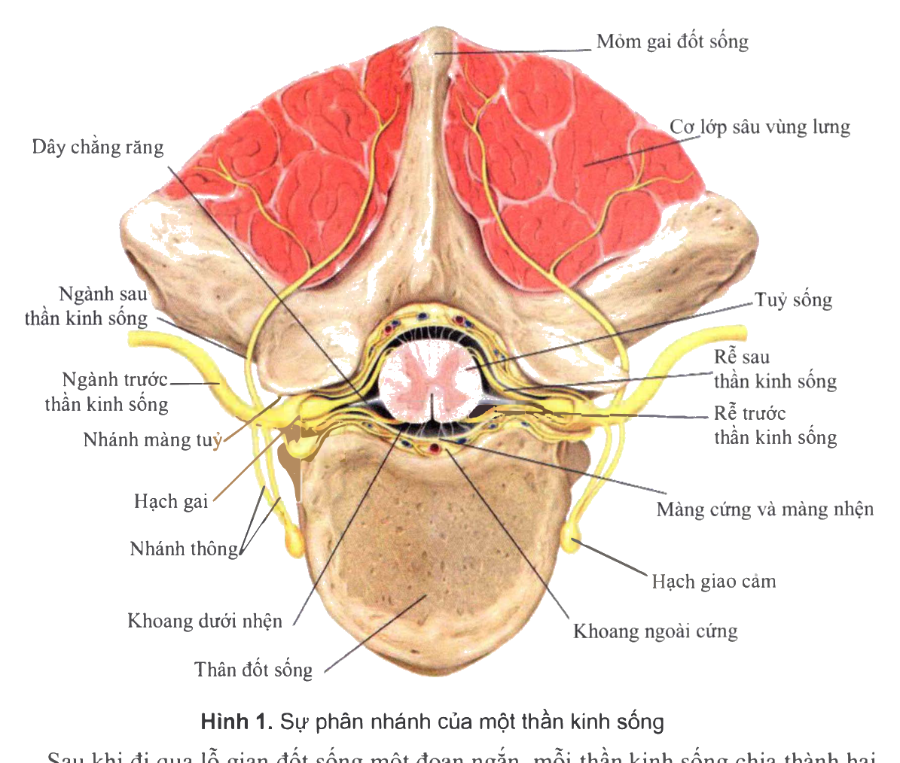
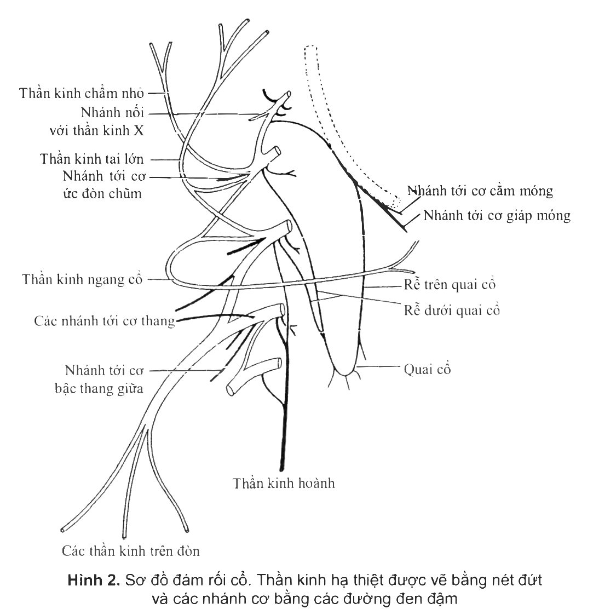
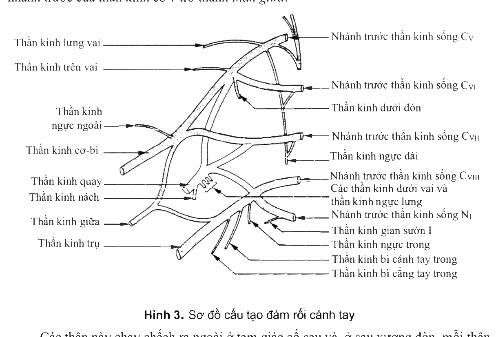
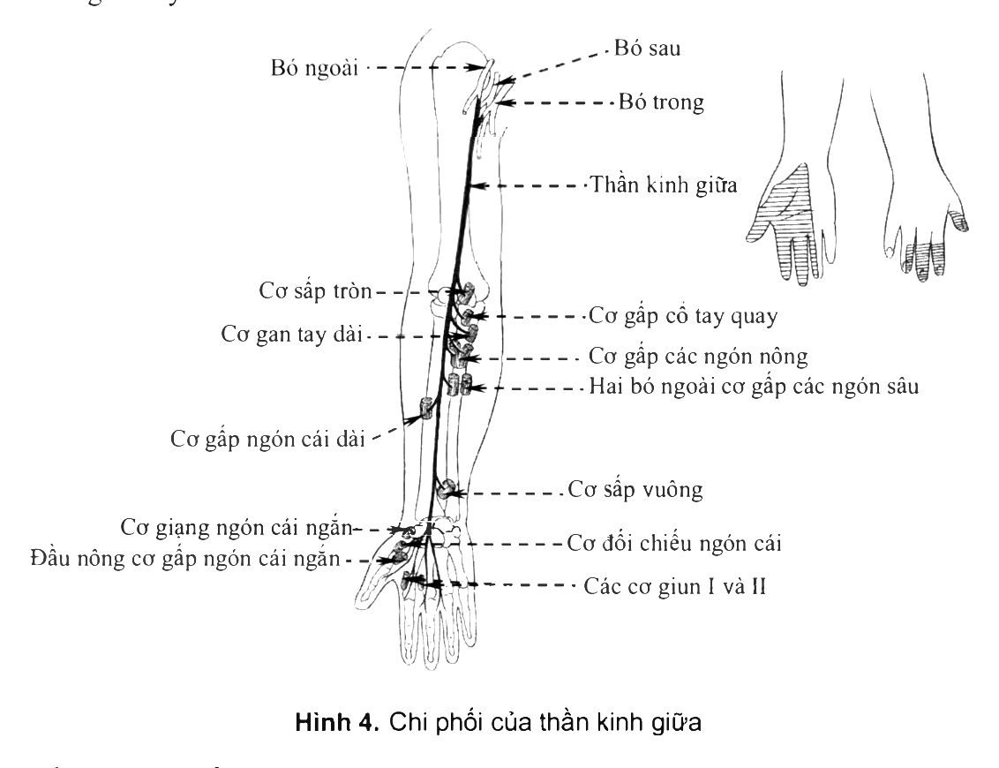
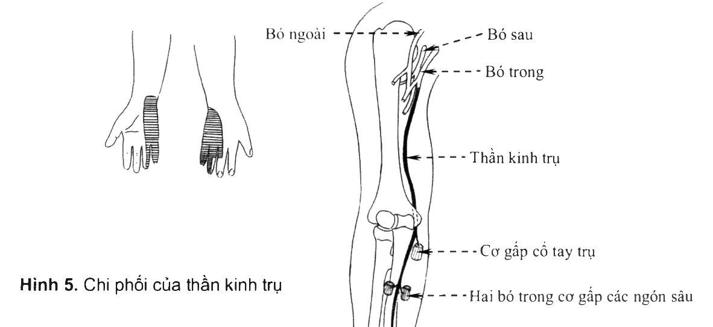
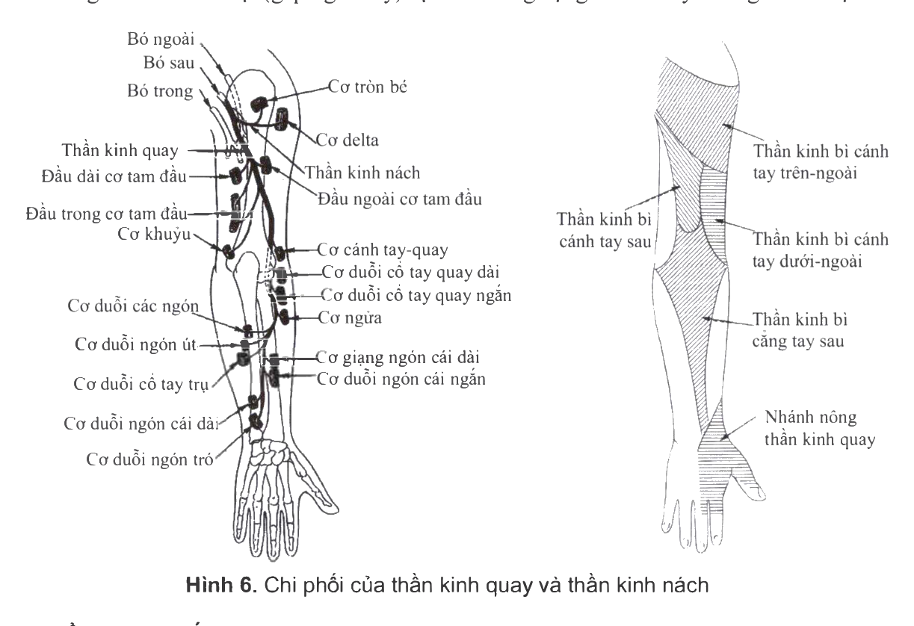
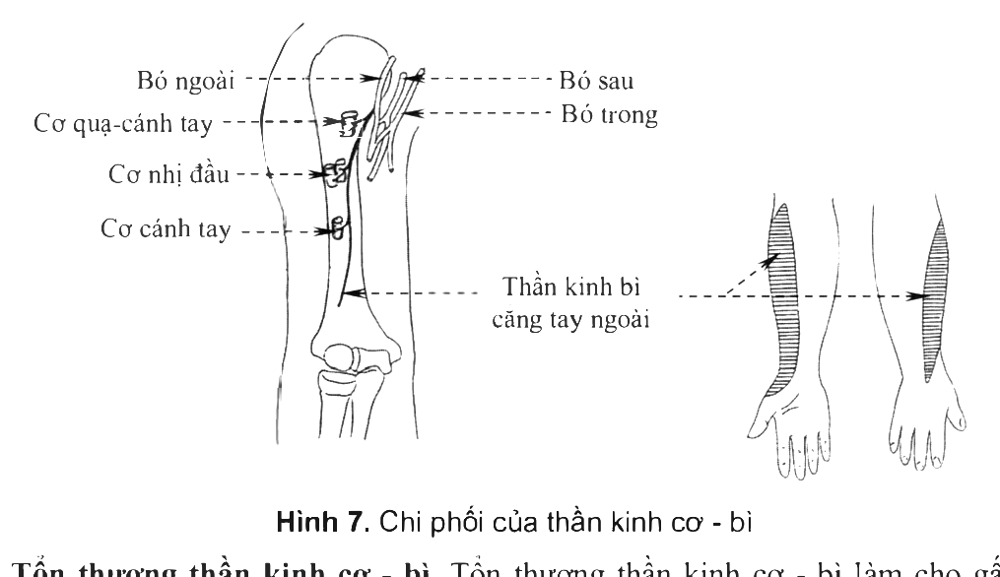

# THẦN KINH SỐNG: THẦN KINH CỦA CỔ VÀ CHI TRÊN

**Chương:** Chương 8: Hệ Thần Kinh  
**Tác giả:** PGS.TS. Nguyễn Văn Huy, ThS. Nguyễn Đức Nghĩa  
**Nguồn:** Giáo trình Giải phẫu học Y Hà Nội (Xuất bản 2025), Trang 441 - 454

---

## Bài 9: THẦN KINH SỐNG: THẦN KINH CỦA CỔ VÀ CHI TRÊN

## 1. ĐẠI CƯƠNG VỀ THẦN KINH SỐNG

Có 31 *thần kinh sống* (*spinal nerve*) kết nối tuỷ sống với các cấu trúc ở cổ, thân và các chi. Mỗi thân thần kinh sống là một thần kinh hỗn hợp của các sợi cảm giác đến từ rễ sau và các sợi vận động đến từ rễ trước. Mối liên quan giữa các thần kinh sống và cột sống đã được trình bày ở bài Tuỷ sống; cấu tạo của một thần kinh sống đã được trình bày ở bài Đại cương thần kinh.

### Sự phân bố (H.1)

*Hình 1: Sự phân nhánh của một thần kinh sống*

Sau khi đi qua lỗ gian đốt sống một đoạn ngắn, mỗi thần kinh sống chia thành hai nhánh chính là **ngành sau** (*posterior ramus*) và **ngành trước** (*anterior ramus*) và các nhánh khác gồm nhánh màng tuỷ và các nhánh thông. Các ngành sau chi phối các cơ sâu và da ở mặt sau thân (lưng) và cổ, quanh cột sống, kể cả phần sau da đầu. Các ngành trước chi phối vận động và cảm giác cho phần trước bên của cổ và thân, chi trên và chi dưới. *Nhánh màng tuỷ* (*meningeal branch*) quay trở lại ống sống qua lỗ gian đốt sống để chi phối cho các đốt sống, các dây chằng cột sống, các mạch máu của tuỷ sống và các màng tuỷ. *Các nhánh thông* (*rami communicantes*) nối thân thần kinh sống với hạch của thân giao cảm, gồm nhánh trắng chứa các sợi giao cảm trước hạch và nhánh xám chứa các sợi giao cảm sau hạch.

### Các đám rối

Các ngành trước thần kinh sống, trừ ngành trước các thần kinh N2 tới N12, không đi ngay tới các cấu trúc mà chúng chi phối. Thay vào đó, chúng nối với nhau thành các mạng tiếp nối gọi là **các đám rối** (*plexuses*), bao gồm đám rối cổ (C1 tới C4), đám rối cánh tay (C5 tới N1), đám rối thắt lưng (TL1 tới TL4), đám rối cùng (TL4 tới Cg4) và đám rối cụt (Cg5 tới Ctl). Từ những đám rối này, các thần kinh đi tới các vùng mà chúng chi phối. Đám rối cổ chi phối cho cổ và cơ hoành. Đám rối cánh tay chi phối cho chi trên. Các đám rối thắt lưng và cùng chi phối cho chi dưới.

### Các thần kinh gian sườn

Ngành trước của các thần kinh N2 tới N12 không nối với nhau thành các đám rối mà đi thẳng tới thành ngực - bụng qua các khoang gian sườn. Chúng được gọi là *các thần kinh gian sườn* (*intercostal nerves*), riêng ngành trước thần kinh N12 được gọi là *thần kinh dưới sườn* (*subcostal nerve*). Thần kinh gian sườn 2 chi phối các cơ gian sườn của khoang gian sườn 2 và chi phối cho da của nách và mặt sau trong của cánh tay. Các thần kinh gian sườn 3 tới 6 chi phối cho các cơ gian sườn của những khoang gian sườn tương ứng và da của thành ngực trước bên. Các thần kinh gian sườn 7 tới 11 và thần kinh dưới sườn chi phối các cơ gian sườn còn lại, các cơ bụng cùng với vùng da phủ bên trên. Mỗi thần kinh gian sườn hoặc dưới sườn có một nhánh bì bên cho thành ngực hoặc bụng bên và một nhánh bì trước cho thành ngực hoặc bụng trước. Ngành sau các thần kinh ngực chi phối cho các cơ lưng sâu cạnh cột sống và vùng da phủ trên như ngành sau thần kinh sống của các đoạn khác.

Đầu cổ do các thần kinh sọ và đám rối cổ chi phối. Đám rối cổ chi phối cảm giác cho cổ và phần sau da đầu; các thần kinh sọ chi phối cảm giác cho da mặt và phần trước da đầu cùng các tạng ở đầu cổ. Đám rối cổ chi phối các cơ cổ; thần kinh sọ chi phối cơ mặt và các cơ kết hợp với mắt, tai, miệng, hầu, lưỡi gà và thanh quản. Chi trên do đám rối cánh tay chi phối.

---

## 2. ĐÁM RỐI CỔ (cervical plexus)

### 2.1. Cấu tạo (H.2)

Đám rối cổ được tạo nên bởi nhánh trước của bốn thần kinh sống cổ đầu tiên. Các nhánh trước này liên kết với nhau thành các quai nối nằm trước cơ nâng vai và cơ bậc thang giữa, sau tĩnh mạch cảnh trong và cơ ức - đòn - chũm. Đám rối cổ tách ra các nhánh nông đi tới da và các nhánh sâu; các nhánh sâu bao gồm các nhánh cơ và các nhánh nối.

*Hình 2: Sơ đồ đám rối cổ (Thần kinh hạ thiệt được vẽ bằng nét đứt và các nhánh cơ bằng các đường đen đậm)*

### 2.2. Các nhánh nông

- **Thần kinh chẩm nhỏ** (*lesser occipital nerve*) (C2): uốn quanh thần kinh phụ và đi lên dọc bờ sau cơ ức đòn chũm, phân nhánh vào da phần bên vùng chẩm và da mặt trong loa tai.
- **Thần kinh tai lớn** (*great auricular nerve*) (C2, 3): đi lên, bắt chéo qua mặt nông cơ ức đòn chũm cùng tĩnh mạch cảnh ngoài, tới ngang đầu dưới tuyến mang tai thì chia thành các nhánh trước và sau. *Nhánh trước* phân phối vào vùng da phủ tuyến mang tai, *nhánh sau* vào vùng da phủ mỏm chũm và cả hai mặt của loa tai.
- **Thần kinh ngang cổ** (*transverse cervical nerve*) (C2, 3): uốn quanh gần điểm giữa bờ sau cơ ức - đòn - chũm và chạy ra trước ngang qua cơ, dưới cơ bám da cổ, rồi chia thành *các nhánh trên* và *các nhánh dưới*, phân phối vào da phủ các mặt trước và bên của cổ, từ thân xương hàm dưới tới xương ức.
- **Các thần kinh trên đòn** (*supraclavicular nerves*) (C3, 4): Sau khi lộ ra ở bờ sau cơ ức - đòn - chũm từ một thân chung, các thần kinh này đi xuống ngang qua tam giác cổ sau, ở dưới cơ bám da cổ và mạc cổ, tới thành ngực trước và vùng vai.
  - *Thần kinh trên đòn trong* bắt chéo qua xương đòn và đầu ức cơ ức đòn chũm để phân phối xa tới tận đường giữa và xuống thấp tới tận xương sườn 2.
  - *Thần kinh trên đòn trung gian* bắt chéo đoạn giữa xương đòn để phân phối vào da phủ trên cơ ngực lớn và cơ delta tới tận ngang mức xương sườn 2.
  - *Thần kinh trên đòn ngoài* bắt chéo đầu ngoài xương đòn và phân phối vào da phủ trên khớp vai và nửa trên cơ delta.

### 2.3. Các nhánh sâu

Các nhánh sâu của đám rối cổ bao gồm các nhánh nối và các nhánh cơ.

- **Các nhánh nối:** Đám rối cổ tiếp nối với các thần kinh sọ X, XI, XII và thân giao cảm cổ. Quai nối giữa nhánh trước các thần kinh cổ 1 và 2 tách ra một nhánh nối với thần kinh hạ thiệt. Những sợi trong nhánh này sau đó rời khỏi thần kinh hạ thiệt trong nhánh màng não, *rễ trên quai cổ* và các thần kinh tới cơ giáp - móng và cơ cằm - móng.
- **Các nhánh cơ:** Các nhánh cơ của đám rối cổ bao gồm hai nhóm:
  - *Nhóm trong* gồm các nhánh đi tới cơ thẳng đầu bên (C1), cơ thẳng đầu trước (C1, 2), cơ dài đầu (C1-3), cơ dài cổ (C2-4), rễ dưới của quai cổ (C2, 3) và thần kinh hoành (C3-5).
  - *Nhóm ngoài* gồm các nhánh đi tới cơ ức - đòn - chũm (C2, 3, 4), cơ thang (C2), cơ nâng vai (C3, 4) và cơ bậc thang giữa (C3, 4).
- **Rễ dưới của quai cổ** (*inferior root of the ansa cervicalis*): Rễ này được tạo nên bởi sự hợp lại của một nhánh của C2 và một nhánh của C3. Nó đi xuống trên bờ ngoài tĩnh mạch cảnh trong rồi nối với rễ trên ở trước động mạch cảnh chung tạo nên **quai cổ**. Quai cổ phân nhánh vào tất cả các cơ dưới móng, trừ cơ giáp - móng.
- **Thần kinh hoành** (*phrenic nerve*): Thần kinh hoành chứa các sợi vận động và cảm giác bản thể cho cơ hoành và cả các sợi cảm giác cho màng phổi và phúc mạc phủ các mặt của cơ hoành. Nó được tạo nên ở bờ ngoài cơ bậc thang trước bởi sự hợp lại của ba nhánh tách ra từ nhánh trước các thần kinh cổ 3, 4 và 5. Nó chạy thẳng đứng xuống dưới, bắt chéo mặt trước cơ bậc thang trước (từ bờ ngoài tới bờ trong) ở sau lá trước sống của mạc cổ, rồi lách giữa động mạch và tĩnh mạch dưới đòn đi vào ngực. Trong ngực, nó đi xuống ở trước cuống phổi, giữa ngoại tâm mạc sợi và màng phổi trung thất. Ở trung thất trên, thần kinh hoành phải đi ở ngoài tĩnh mạch cánh tay đầu phải và tĩnh mạch chủ trên, thần kinh hoành trái đi trong rãnh giữa các động mạch cảnh chung và dưới đòn trái, sau tĩnh mạch cánh tay đầu trái.

### 2.4. Liên hệ lâm sàng

- Đứt thần kinh hoành gây liệt và teo nửa cơ hoành, nếu có thần kinh hoành phụ thì chỉ liệt không hoàn toàn nửa cơ hoành. Đứt cả hai thần kinh hoành gây ra khó thở. Các tổn thương chèn ép thần kinh hoành gây nấc.
- Điểm thần kinh của cổ nằm trong vùng quanh điểm giữa bờ sau cơ ức đòn chũm. Một số nhánh của đám rối cổ nằm ở đây, ngay dưới cơ bám da cổ. Vết chém ở cổ vào vùng này có thể làm đứt các thần kinh này, làm mất cảm giác ở cổ và phần sau da đầu. Trong phóng bế đám rối cổ, dung dịch gây tê được tiêm ở vài điểm dọc bờ sau cơ ức đòn chũm. Điểm tiêm chính nằm ở chỗ nối giữa các phần ba giữa và trên của bờ sau cơ này, tức là ở quanh điểm thần kinh của cổ, nơi thần kinh phụ từ mặt sau cơ ức đòn chũm đi vào tam giác cổ sau. Phóng bế đám rối cổ bị hạn chế ở người có bệnh tim phổi vì sợ gây liệt thần kinh hoành.

---

## 3. ĐÁM RỐI CÁNH TAY (brachial plexus)

### 3.1. Cấu tạo (H.3)

Đám rối cánh tay được tạo nên từ nhánh trước của bốn thần kinh sống cổ dưới và phần lớn nhánh trước của thần kinh sống ngực 1. Nhánh trước của thần kinh cổ 4 thường tách một nhánh đi tới thần kinh cổ 5 và thần kinh ngực 1 thường nhận một nhánh từ thần kinh ngực 2. Các nhánh trước này được gọi là **các rễ** (*root*) của đám rối.

5 rễ hợp nên 3 thân (*trunk*):
- Nhánh trước của các thần kinh cổ 5 và 6 hợp thành **thân trên**;
- Nhánh trước của các thần kinh cổ 8 và thần kinh ngực 1 tạo nên **thân dưới**;
- Nhánh trước của thần kinh cổ 7 trở thành **thân giữa**.

*Hình 3: Sơ đồ cấu tạo đám rối cánh tay*

Các thân này chạy chếch ra ngoài ở tam giác cổ sau và, ở sau xương đòn, mỗi thân tách đôi thành 2 phần (*division*), phần trước và phần sau. 6 phần sau đó tạo nên 3 bó (*cord*):
- Các phần trước của thân trên và thân giữa tạo nên **bó ngoài** (*bên*), nằm ở ngoài động mạch nách.
- Phần trước của thân dưới đi xuống ở sau rồi ở trong động mạch nách và trở thành **bó trong** (*giữa*).
- Phần sau của cả ba thân tạo nên **bó sau**, nằm sau động mạch nách.

### 3.2. Liên quan

Đám rối cánh tay được chia thành *phần trên đòn* và *phần dưới đòn*. Phần trên đòn nằm ở cổ và bao gồm các rễ, các thân cùng các nhánh bên tách ra từ các rễ và thân. Phần dưới đòn nằm ở nách và bao gồm các bó và nhánh của các bó.

- **Ở cổ:** đám rối nằm trong tam giác cổ sau, được che phủ bởi mạc cổ, cơ bám da cổ và da; nó bị bắt chéo bởi các thần kinh trên đòn, bụng dưới cơ vai móng, tĩnh mạch cảnh ngoài và nhánh nông của động mạch ngang cổ. Các thân của đám rối hiện ra từ giữa các cơ bậc thang trước và giữa; chúng nằm trên đoạn ngoài cơ bậc thang của động mạch dưới đòn, riêng thân dưới nằm sau động mạch.
- **Ở nách:**
  - *Ở trên cơ ngực bé:* các bó ngoài và sau nằm ngoài động mạch nách, bó trong nằm sau động mạch nách.
  - *Ở sau cơ ngực bé:* các bó vây quanh động mạch nách đúng như tên gọi của chúng.
  - *Ở dưới cơ ngực bé:* các nhánh tận của bó ngoài nằm ngoài động mạch nách; các nhánh tận của bó sau nằm sau động mạch nách; các nhánh tận của bó trong nằm trong động mạch nách, trừ rễ trong của thần kinh giữa.

### 3.3. Sự phân nhánh

#### 3.3.1. Các nhánh ở phần trên đòn

- **Các nhánh từ các rễ:**
  - Các nhánh cơ tới các cơ bậc thang và cơ dài cổ (C5, 6, 7, 8);
  - *Thần kinh lưng vai* (C5) cho cơ trám và cơ nâng vai;
  - *Thần kinh ngực dài* (C5, 6, 7) cho cơ răng trước.
- **Các nhánh từ các thân:**
  - *Thần kinh cơ dưới đòn* (thân trên, C5, 6);
  - *Thần kinh trên vai* (thân trên, C5, 6) chạy sang bên qua khuyết trên vai, chi phối các cơ trên và dưới gai, khớp vai.

#### 3.3.2. Các nhánh ở phần dưới đòn: gồm các nhánh bên và các nhánh tận.

- **Các nhánh bên:**
  - *Bó ngoài* có 1 nhánh bên là **thần kinh ngực ngoài**. Thần kinh này đi qua mạc đòn ngực chi phối cơ ngực lớn và một phần cơ ngực bé (qua nhánh nối với thần kinh ngực trong).
  - *Bó trong* có 3 nhánh bên: **thần kinh ngực trong** cho cơ ngực bé và một phần cơ ngực lớn; **thần kinh bì cánh tay trong**; **thần kinh bì cẳng tay trong**.
  - *Bó sau* có 3 nhánh bên: **thần kinh dưới vai trên** cho phần trên cơ dưới vai; **thần kinh ngực - lưng** cho cơ lưng rộng; **thần kinh dưới vai dưới** cho phần dưới cơ dưới vai và cơ tròn lớn.
- **Các nhánh tận (cho chi trên):**
  - *Bó ngoài:* **thần kinh cơ - bì** và **rễ ngoài thần kinh giữa**.
  - *Bó trong:* **rễ trong thần kinh giữa** và **thần kinh trụ**.
  - *Bó sau:* **thần kinh nách** và **thần kinh quay**.

### 3.4. Liên hệ lâm sàng

Tổn thương đám rối cánh tay có thể xảy ra trực tiếp do vật đâm xuyên hoặc gián tiếp:
- **Tổn thương các rễ trên** của đám rối cánh tay có thể xảy ra khi có sự phân tách (bửa) giữa cổ và vai (ví dụ như ngã từ xe máy, tiếp đất ở vai theo cách làm doãn rộng khoảng cổ - vai; hay kéo mạnh cổ của đứa trẻ về một bên lúc đỡ đẻ). Trong chấn thương kiểu này, các rễ trước và sau của các thần kinh C5 và C6 có thể bị bứt khỏi tuỷ sống. Ở trường hợp này, có liệt của các cơ vai và mất cảm giác ở vùng của các rễ sau đi cùng với liệt và mất cảm giác ở chi trên. Thân trên đám rối cánh tay (C5, C6) có thể bị tổn thương ở cổ do dao đâm hay đạn bắn, làm mất gấp, giạng và xoay ngoài cánh tay ở khớp vai cũng như mất gấp cánh tay ở khớp khuỷu. Những cơ bị liệt do không nhận được sợi thần kinh từ C5 và C6 bao gồm cơ delta, cơ nhị đầu, cơ cánh tay, cơ cánh tay quay, cơ trên gai, cơ dưới gai và cơ tròn bé.
- **Tổn thương thân dưới** của đám rối cánh tay hay các rễ tạo nên thân này (C8 và N1) ít xảy ra hơn tổn thương thân trên và bứt các rễ C5 và C6. Nếu xảy ra, nó thường do các tình huống mà cánh tay bị kéo mạnh đột ngột lên trên (như trong đỡ đẻ, hay như khi dùng tay tóm bắt một vật gì đó đang rơi). Liệt và mất cảm giác thường thấy ở những cơ và vùng da được chi phối bởi thần kinh trụ (C8 và N1). Không gấp được bàn tay, liệt các cơ nội tại của bàn tay. Giảm cảm giác ở mặt trong cánh tay, cẳng tay và bàn tay. Thân dưới đám rối cánh tay có thể bị chèn ép bởi một xương sườn cổ (từ đốt sống cổ 7).

---

## 4. THẦN KINH GIỮA (median nerve) (H.4)

### 4.1. Nguyên uỷ

Thần kinh giữa có hai rễ bắt nguồn từ các bó ngoài và trong của đám rối cánh tay.

### 4.2. Đường đi và liên quan

Thần kinh giữa đi từ nách đến tận gan tay, qua tất cả các đoạn của chi trên:
- **Ở nách:** hai rễ của thần kinh giữa vây quanh đoạn dưới cơ ngực bé của động mạch nách rồi hợp lại ở ngoài động mạch nách.
- **Ở cánh tay:** thần kinh giữa đi cạnh động mạch cánh tay, trước tiên nằm ngoài động mạch, tiếp đó bắt chéo trước động mạch ở gần chỗ bám tận của cơ quạ - cánh tay rồi đi xuống ở trong động mạch tới tận hố khuỷu.
- **Ở hố khuỷu:** nó nằm trong rãnh nhị đầu trong, ngay sau cân cơ nhị đầu và trước cơ cánh tay.
- **Ở cẳng tay:** thần kinh giữa đi qua cẳng tay theo đường giữa cẳng tay. Nó thường đi vào cẳng tay ở giữa hai đầu của cơ sấp tròn và được ngăn cách với động mạch trụ bởi đầu sâu của này. Tiếp đó, nó đi sau cầu gân nối đầu cánh tay - trụ và đầu quay của cơ gấp các ngón nông rồi đi xuống ở sau cơ gấp các ngón nông và trước cơ gấp các ngón sâu. Ở trên hãm gân gấp khoảng 5 cm, nó lộ ra ở bờ ngoài cơ gấp các ngón nông, nằm sau và giữa gân cơ gan tay dài và gân cơ gấp cổ tay quay.
- **Ở cổ tay:** nó đi qua ống cổ tay, ở sau hãm gân gấp và trước các gân gấp nông, vào gan tay.

### 4.3. Sự phân nhánh

- **Các nhánh bên ở cẳng tay:** Lúc đi qua cẳng tay, thần kinh giữa lần lượt tách ra: các nhánh cơ, thần kinh gian cốt trước, nhánh nối với thần kinh trụ và nhánh gan tay.
  - *Các nhánh cơ* tách ra ở gần khuỷu và đi tới cơ sấp tròn, cơ gấp cổ tay quay, cơ gan tay dài và cơ gấp các ngón nông.
  - *Thần kinh gian cốt trước* tách ra ngay sau nhánh cơ cuối cùng, khi thần kinh giữa ra khỏi cơ sấp tròn. Nó cùng động mạch gian cốt trước đi xuống trước màng gian cốt, ở giữa cơ gấp các ngón sâu và cơ gấp ngón cái dài, phân nhánh vào cơ gấp ngón cái dài, phần ngoài cơ gấp các ngón sâu (có gân đi vào ngón trỏ và ngón giữa) và cơ sấp vuông.
  - *Nhánh nối với thần kinh trụ* thường tách ra ở phần gần của cẳng tay và đi vào trong ở giữa các cơ gấp các ngón nông và sâu để hoà nhập vào thần kinh trụ.
  - *Nhánh gan tay* tách ra ở ngay trên hãm gân gấp; nó phân nhánh vào da của mô cái và vùng giữa gan tay.
- **Các nhánh tận ở gan tay:** Thần kinh giữa tận cùng ở bờ dưới hãm gân gấp bằng cách chia thành một nhánh cơ tới các cơ mô cái và các nhánh gan ngón tay.
  - *Nhánh cơ* là nhánh ngoài cùng, phân phối vào cơ gấp ngón cái ngắn (đầu nông), cơ giạng ngón cái ngắn và cơ đối chiếu ngón cái.
  - *Các nhánh gan ngón tay* bao gồm các thần kinh gan ngón tay riêng và các thần kinh gan ngón tay chung. Các nhánh này chạy về phía xa ở sâu dưới cung gan tay nông và các nhánh của cung này, trước các gân gấp. Các nhánh gan ngón tay sắp xếp như sau:
    + Hai *thần kinh gan ngón tay riêng* (tách riêng hoặc từ một thân chung) đi tới hai bờ ngón tay cái.
    + *Thần kinh gan ngón tay riêng* tới bờ ngoài ngón trỏ; thần kinh này còn chi phối cả cho cơ giun thứ nhất.
    + Hai *thần kinh gan ngón tay chung* chạy ra xa giữa các gân gấp, nhánh bên ngoài phân nhánh vào cơ giun thứ hai rồi chia thành hai thần kinh gan ngón tay riêng đi tới các bờ kề nhau của ngón trỏ và ngón giữa, nhánh bên trong tiếp nhận một nhánh nối từ thần kinh gan ngón tay chung của thần kinh trụ rồi chia thành hai thần kinh gan ngón tay riêng đi vào các bờ kề nhau của ngón giữa và ngón nhẫn.
  - Tại bờ các ngón tay, các thần kinh ngón tay riêng nằm trước các động mạch. Các thần kinh gan ngón tay riêng tới các ngón tay trỏ, giữa và nhẫn cho nhánh cảm giác cho mu các đốt 2 và 3 của các ngón này.

*Hình 4: Chi phối của thần kinh giữa*

### 4.4. Tổn thương thần kinh giữa

Thần kinh giữa thường bị tổn thương ở cẳng tay và ở cổ tay:
- Ở cẳng tay, đoạn thần kinh giữa nằm dưới cân cơ nhị đầu, giữa hai đầu cơ sấp tròn và sau cung sợi nối các đầu của cơ gấp các ngón nông có thể bị chèn ép, dẫn đến *hội chứng cơ sấp*. Biểu hiện của tổn thương ở đoạn này là yếu tất cả các cơ do thần kinh giữa chi phối và rối loạn cảm giác ở gan tay.
- Ở cổ tay, thần kinh giữa có thể bị chèn ép khi ống cổ tay bị hẹp do các nguyên nhân khác nhau, gây nên *hội chứng ống cổ tay*. Bệnh nhân có yếu các cơ nội tại ở gan tay do thần kinh giữa chi phối và rối loạn cảm giác ở ngón cái, ngón trỏ, ngón giữa và nửa ngoài ngón nhẫn. Nhánh gan tay không bị ảnh hưởng do không đi qua ống.
- Thần kinh giữa có thể dễ bị đứt ở cổ tay, ngay trên hãm gân gấp, nơi nó nằm ngoài gân cơ gấp các ngón nông, ở sau và giữa gân cơ gấp cổ tay quay và gân cơ gan tay dài. Nếu liệt thần kinh giữa một thời gian dài, mô cái bị teo, ngón cái ở tư thế ép sát với ngón trỏ, các ngón tay 2 và 3 bị quá duỗi ở các khớp bàn tay - ngón tay và gấp nhẹ ở các khớp gian đốt ngón. Biến dạng bàn tay kiểu này gọi là **bàn tay khỉ** (*ape hand*).

---

## 5. THẦN KINH TRỤ (ulnar nerve) (H.5)

### 5.1. Nguyên uỷ

Thần kinh trụ tách ra từ bó trong của đám rối cánh tay (C7 và C8).

### 5.2. Đường đi và liên quan

Thần kinh trụ đi xuống qua nách, cánh tay, khuỷu, cẳng tay và cổ tay rồi tận cùng ở gan tay:
- **Ở nách và cánh tay:** nó nằm trong động mạch nách, giữa động mạch và tĩnh mạch nách. Từ nách, nó đi xuống vào ngăn mạc trước của cánh tay đến tận giữa cánh tay và nằm trong động mạch cánh tay; từ đây, nó cùng động mạch bên trụ trên xuyên qua vách gian cơ trong rồi tiếp tục đi xuống ở trước đầu trong cơ tam đầu tới tận khuỷu.
- **Ở khuỷu:** nó nằm trong rãnh giữa mỏm trên lồi cầu trong và mỏm khuỷu. Nó đi từ khuỷu vào ngăn mạc cẳng tay trước ở giữa hai đầu cơ gấp cổ tay trụ.
- **Ở cẳng tay:** lúc đầu nó đi xuống dọc theo bờ trong cẳng tay dưới mặt sâu của cơ gấp cổ tay trụ và trên mặt nông của cơ gấp các ngón sâu; nửa dưới của đoạn đi qua cẳng tay của thần kinh trụ nằm ngoài cơ gấp cổ tay trụ, dưới sự che phủ của da và mạc. Nó đi sát bờ trong động mạch trụ ở 2/3 dưới cẳng tay nhưng ở 1/3 trên thì ở xa động mạch.
- **Ở cổ tay:** nó cùng động mạch trụ đi trước hãm gân gấp, ngoài xương đậu và chia thành các nhánh tận nông và sâu ngay khi đi vào gan tay.

*Hình 5: Chi phối của thần kinh trụ*

### 5.3. Các nhánh bên

- *Các nhánh khớp* cho khớp khuỷu.
- *Các nhánh cơ:* Thường có hai nhánh tách ra ở gần khuỷu, một cho cơ gấp cổ tay trụ một cho nửa trong cơ gấp các ngón sâu.
- *Nhánh gan tay:* Nhánh này tách ra ở khoảng giữa cẳng tay, đi xuống trước động mạch trụ và xuyên qua mạc để tận cùng ở da mô út.
- *Nhánh mu tay:* Nhánh này tách ra ở khoảng 5 cm trên cổ tay; nó đi xuống và ra sau, ở dưới gân cơ gấp cổ tay trụ, và chia thành 2 hoặc 3 *thần kinh mu ngón tay*: một đi vào bờ trong ngón 5, một phân nhánh vào các bờ kề nhau của các ngón tay 4 và 5, và một (nếu có) phân nhánh vào các bờ kề nhau của các ngón tay 3 và 4.

### 5.4. Các nhánh tận

- **Nhánh nông:** Nhánh này tách ra một nhánh cho cơ gan tay ngắn và chia thành hai thần kinh gan ngón tay. Một thần kinh gan ngón tay đi vào bờ trong ngón út, nhánh còn lại là *thần kinh gan ngón tay chung*. Thần kinh gan ngón chung tách ra một nhánh tới thần kinh giữa và chia thành hai *thần kinh gan ngón tay riêng* cho các bờ kề nhau của các ngón tay 4 và 5.
- **Nhánh sâu:** Cùng với nhánh sâu của động mạch trụ, nhánh này đi giữa cơ giạng ngón út và cơ gấp ngón út và sau đó xuyên qua cơ cơ đối chiếu ngón út để đi theo cung động mạch gan tay sâu ở sau các gân gấp. Nó phân nhánh vào các cơ của mô út, các cơ gian cốt, các cơ giun 3 và 4, và tận cùng bằng các nhánh tới cơ khép ngón cái và đầu sâu cơ gấp ngón cái ngắn.

### 5.5. Tổn thương thần kinh trụ

Do gãy xương, thần kinh trụ có thể bị tổn thương khi có gãy mỏm trên lồi cầu trong xương cánh tay, vì nó nằm trong rãnh giữa mỏm trên lồi cầu trong và mỏm khuỷu. Với một vết thương do vật sắc cắt qua, phần dưới cẳng tay và cổ tay là nơi thần kinh trụ dễ bị tổn thương vì nó nằm nông. Thần kinh bị đứt làm mất cảm giác ở ngón 5 và nửa trong ngón 4, không giạng khép được các ngón tay (do liệt cơ gian cốt), mất khép ngón cái (do liệt cơ khép ngón cái). Do liệt 2 cơ giun bên trong, các ngón tay 4 và 5 quá duỗi ở các khớp bàn - ngón và quá gấp ở các khớp gian đốt ngón. Biến dạng bàn tay kiểu này gọi là **bàn tay hình vuốt** (*clawhand*), xuất hiện sau khi thần kinh bị đứt một thời gian.

---

## 6. THẦN KINH QUAY (radial nerve) (H.6)

### 6.1. Nguyên uỷ

Thần kinh quay tách ra từ bó sau của đám rối cánh tay.

### 6.2. Đường đi và liên quan

Thần kinh quay đi xuống ở sau đoạn dưới cơ ngực bé của động mạch nách, trước cơ dưới vai, cơ tròn lớn và cơ lưng rộng; tới bờ dưới của các gân cơ lưng rộng và cơ tròn lớn, nó cùng động mạch cánh tay sâu đi chếch ra sau qua tam giác cánh tay tam đầu để vào ngăn mạc sau của cánh tay. Trong ngăn mạc này, nó đi chếch trong rãnh thần kinh quay ở mặt sau xương cánh tay, giữa các đầu trong và ngoài của cơ tam đầu. Khi tới bờ ngoài xương cánh tay, nó cùng nhánh bên quay của động mạch cánh tay sâu xuyên qua vách gian cơ ngoài để đi vào ngăn mạc cánh tay trước; tiếp đó, nó đi xuống trong rãnh giữa cơ cánh tay và cơ cánh tay quay (rãnh nhị đầu ngoài) và, khi tới trước mỏm trên lồi cầu ngoài, chia thành các nhánh tận nông và sâu.

### 6.3. Các nhánh bên

- **Các nhánh cơ:** Các nhánh này bao gồm các nhánh cho cơ tam đầu và cơ khuỷu tách ra ở ngăn mạc sau; các nhánh tới cơ cánh tay - quay, cơ duỗi cổ tay quay dài và phần ngoài cơ cánh tay tách ra ở trước vách gian cơ ngoài.
- **Các nhánh bì:**
  - *Thần kinh bì cánh tay sau* tách ra ở nách và phân phối vào vùng da ở giữa mặt sau cánh tay.
  - *Thần kinh bì cánh tay dưới - ngoài* phân phối vào da của nửa dưới mặt ngoài cánh tay.
  - *Thần kinh bì cẳng tay sau* phân phối vào vùng da ở giữa mặt sau cẳng tay.

### 6.4. Các nhánh tận

- **Nhánh nông:** Nhánh này đi xuống dưới sự che phủ của cơ cánh tay - quay và nằm sát bờ ngoài động mạch quay ở 1/3 giữa cẳng tay. Ở khoảng chỗ nối của các phần ba giữa và dưới của cẳng tay, nó rời khỏi động mạch quay, chạy vòng ra sau quanh bờ ngoài xương quay ở dưới gân cơ cánh tay - quay, xuyên qua mạc và chia thành 4 - 5 *thần kinh mu ngón tay* tới hai ngón tay rưỡi hoặc ba ngón tay rưỡi bên ngoài và một phần mu bàn tay tương ứng: nhánh thứ nhất vào bờ ngoài ngón cái và vùng mô cái liền kề, nhánh thứ hai vào bờ trong ngón cái, nhánh thứ ba vào bờ ngoài ngón trỏ, nhánh thứ tư vào các bờ kề nhau của ngón trỏ và ngón giữa. Các thần kinh mu ngón tay chỉ chi phối cho phần gần của mu các ngón tay vì phần xa của mu các ngón tay được chi phối bởi các nhánh gan ngón tay của các thần kinh giữa và trụ.
- **Nhánh sâu:** Nhánh này chạy vòng ra sau quanh xương quay nhưng ở giữa hai lớp cơ ngửa. Nó phân nhánh vào cơ ngửa và khi thoát ra ở bờ dưới cơ này thì tách ra một số nhánh đi tới cơ duỗi các ngón tay, cơ duỗi ngón tay út, cơ duỗi cổ tay quay ngắn và cơ duỗi cổ tay trụ. Phần còn lại của nhánh sâu được gọi là *thần kinh gian cốt sau*. Nó đi xuống dọc theo động mạch gian cốt sau, chia nhánh vào tất cả các cơ lớp sâu của cẳng tay sau và tận cùng như một nhánh tới khớp cổ tay.

### 6.5. Tổn thương thần kinh quay

Ở trên khuỷu, thần kinh quay hay bị tổn thương ở hai tình huống: (1) bị chèn ép ở nách do đi nạng kéo dài; (2) tổn thương đoạn nằm trong rãnh thần kinh quay khi gãy xương cánh tay. Hai trường hợp này đều dẫn đến dấu hiệu **bàn tay rơi** (*drop wrist*) do liệt các cơ duỗi bàn tay và ngón tay; cơ tam đầu thường chỉ bị liệt nếu thần kinh bị tổn thương ở nách. Khả năng cầm nắm đồ vật (gấp ngón tay) bị ảnh hưởng nặng do bàn tay không duỗi được.

*Hình 6: Chi phối của thần kinh quay và thần kinh nách*

---

## 7. THẦN KINH NÁCH (axillary nerve)

Thần kinh nách tách ra từ bó sau của đám rối cánh tay, các sợi của nó bắt nguồn từ nhánh trước các thần kinh sống cổ 5 và 6. Lúc đầu, nó nằm ngoài thần kinh quay, ở sau động mạch nách và trước cơ dưới vai. Tại bờ dưới cơ dưới vai, nó cong ra sau ở dưới bao khớp vai - cánh tay và, cùng với các mạch mũ cánh tay sau, đi qua khoang tứ giác giới hạn bởi cơ dưới vai và cơ tròn bé ở trên (cơ tròn bé nằm sau), cơ tròn to ở dưới, đầu dài cơ tam đầu ở trong và cổ phẫu thuật xương cánh tay ở ngoài.

Cuối cùng, nó chia thành các nhánh trước và sau:
- *Nhánh trước*, cùng với các mạch mũ cánh tay sau, vòng quanh cổ phẫu thuật xương cánh tay ở dưới cơ delta tới tận bờ trước cơ này, phân nhánh vào cơ và tách ra một số nhánh da nhỏ xuyên qua cơ để phân nhánh vào vùng da phủ trên phần dưới của cơ.
- *Nhánh sau* phân nhánh vào cơ tròn nhỏ và phần sau cơ delta; trên nhánh vào cơ tròn nhỏ thường có một chỗ phình hay hạch giả. Nhánh sau xuyên qua mạc ở phần dưới bờ sau cơ delta, trở thành *thần kinh bì cánh tay trên ngoài* và chi phối cho vùng da phủ phần dưới cơ delta và phần trên đầu dài cơ tam đầu.

Thân thần kinh nách tách ra một nhánh tới khớp vai lúc đi dưới cơ dưới vai.

**Tổn thương thần kinh nách:** Thần kinh nách đi qua lỗ tứ giác và nhánh trước của nó vòng quanh cổ phẫu thuật xương cánh tay. Gãy cổ phẫu thuật có thể làm đứt thần kinh này, gây liệt và teo cơ delta, mất các cử động do cơ delta gây nên và mất cảm giác phần trên mặt ngoài cánh tay.

---

## 8. THẦN KINH CƠ - BÌ (musculocutaneous nerve) (H.7)

Thần kinh này tách ra từ bó ngoài đám rối cánh tay ở ngang bờ dưới cơ ngực bé và các sợi của nó có nguồn gốc từ nhánh trước các thần kinh sống cổ từ 5 tới 7. Nó xuyên qua cơ quạ - cánh tay rồi đi chếch xuống dưới và ra ngoài về phía bờ ngoài cánh tay ở giữa cơ nhị đầu và cơ cánh tay; ở ngay dưới khuỷu, nó xuyên qua mạc ở bên ngoài gân cơ nhị đầu và trở thành **thần kinh bì cẳng tay ngoài**. Thần kinh cơ - bì chi phối cho cơ quạ - cánh tay, cơ nhị đầu và hầu hết cơ cánh tay. Thần kinh bì cẳng tay ngoài đi xuống dọc bờ ngoài cẳng tay tới tận cổ tay, chi phối cho da của mặt trước - ngoài cẳng tay.

*Hình 7: Chi phối của thần kinh cơ - bì*

**Tổn thương thần kinh cơ - bì:** Tổn thương thần kinh cơ - bì làm cho gấp khớp khuỷu yếu đi một cách rõ rệt vì liệt cơ nhị đầu và phần lớn cơ cánh tay. Có mất cảm giác trên mặt trước - ngoài của cẳng tay tại vùng phân bố của thần kinh bì cẳng tay ngoài.

---

## 9. THẦN KINH BÌ CÁNH TAY TRONG (medial cutaneous nerve of arm)

Đây là thần kinh chi phối cho da mặt trong cánh tay và là nhánh nhỏ nhất của đám rối. Nó tách ra từ bó trong và chứa các sợi từ nhánh trước các thần kinh cổ 8 và ngực 1. Nó đi qua nách, bắt chéo trước hoặc sau tĩnh mạch nách, rồi nằm trong tĩnh mạch, và tiếp nối với thần kinh gian sườn cánh tay; nó đi xuống ở phía trong động mạch cánh tay và tĩnh mạch nền tới khoảng giữa cánh tay, nơi nó xuyên qua mạc để chi phối cho phần dưới mặt trong cánh tay.

---

## 10. THẦN KINH BÌ CẲNG TAY TRONG (medial cutaneous nerve of forearm)

Bắt nguồn từ bó trong, thần kinh này chứa các sợi từ nhánh trước của các thần kinh cổ 8 và ngực 1. Nó đi xuống ở dọc bên trong động mạch nách và động mạch cánh tay, đến giữa cánh tay thì cùng tĩnh mạch nền xuyên qua mạc cánh tay đi ra nông và tận cùng bằng các nhánh trước và sau. Các nhánh này phân nhánh vào các mặt trước - trong và sau - trong cẳng tay. Trước khi tận cùng, thần kinh còn tách ra một nhánh phân phối vào vùng da phủ cơ nhị đầu.
