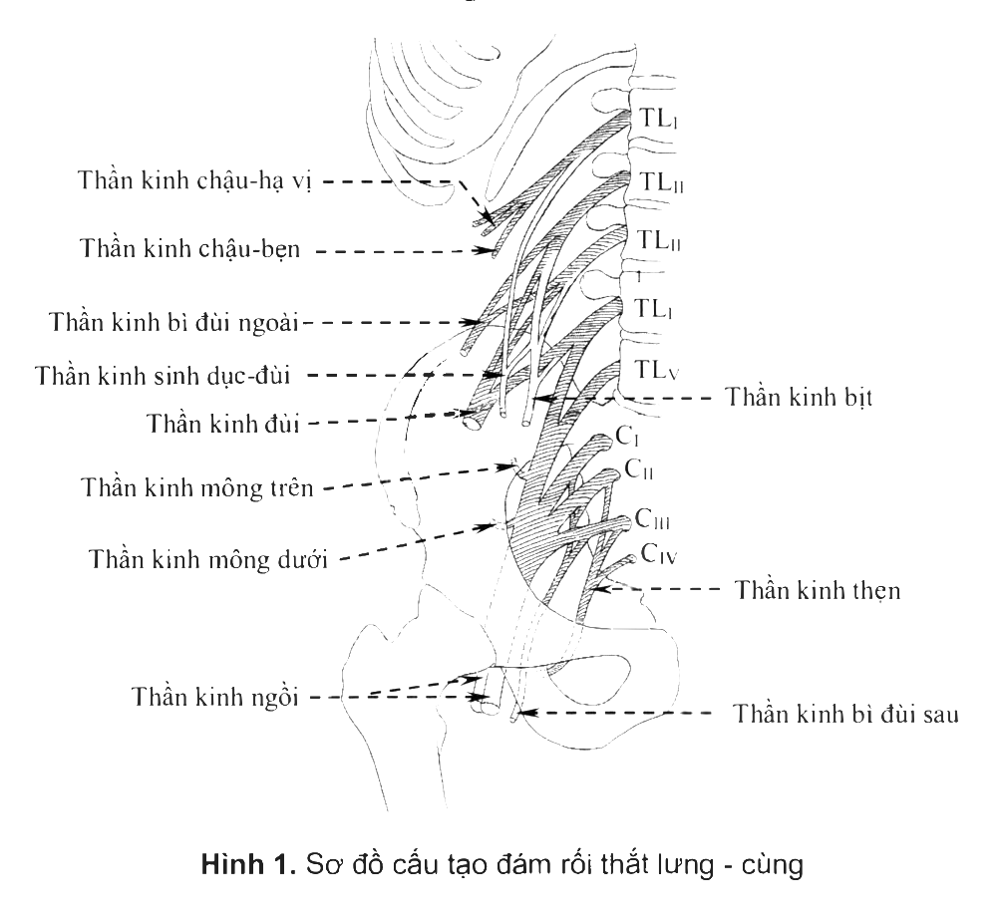
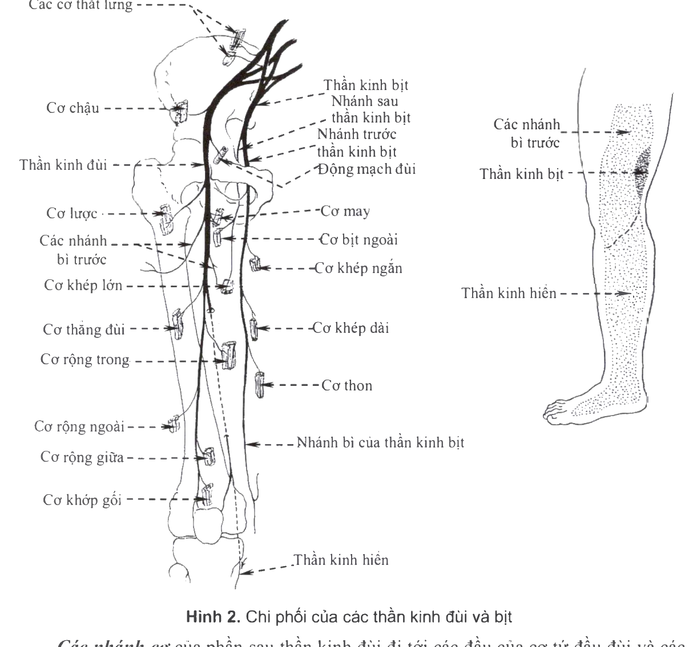
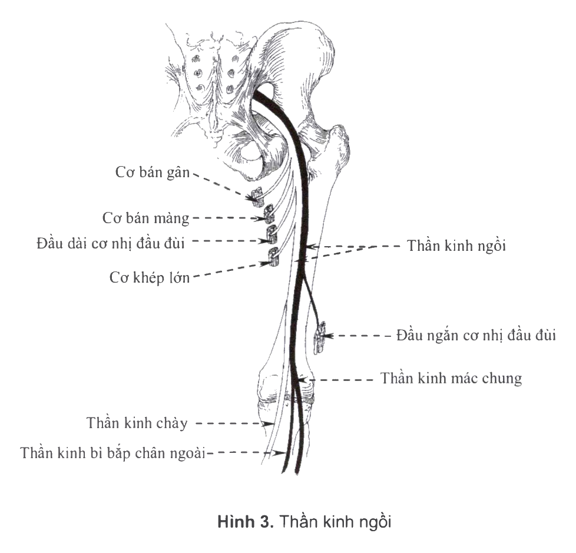
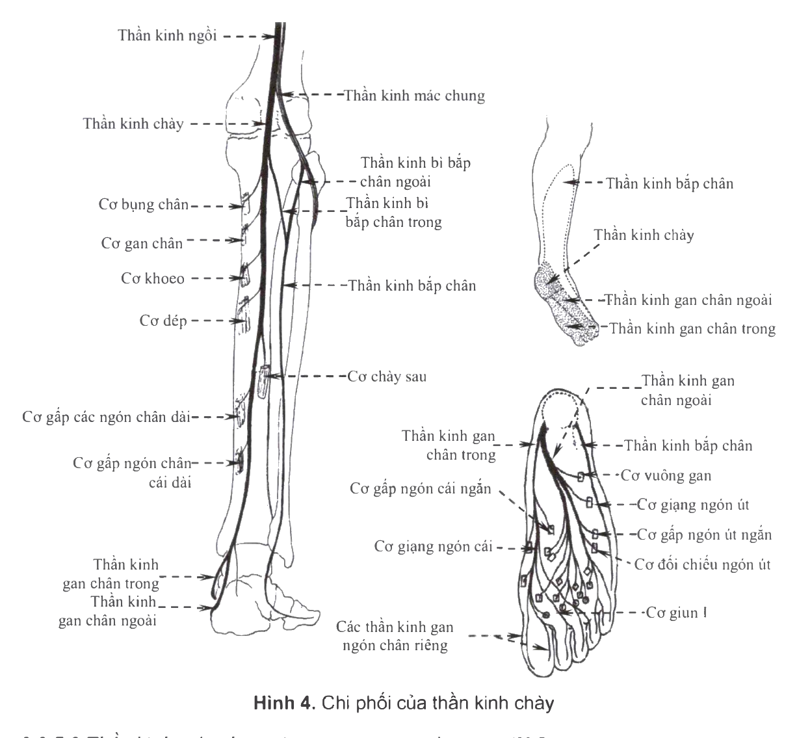
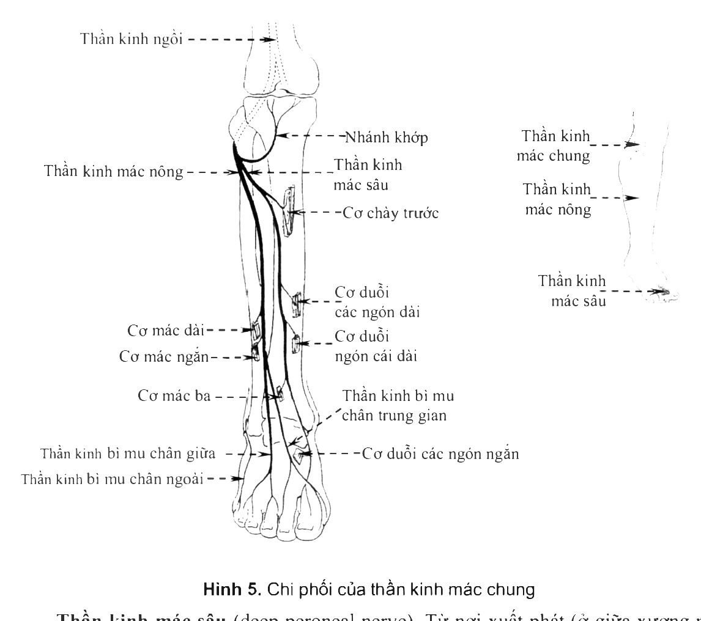

# THẦN KINH SỐNG: THẦN KINH CỦA CHI DƯỚI

**Chương:** Chương 8: Hệ Thần Kinh  
**Tác giả:** PGS.TS. Nguyễn Văn Huy, ThS. Nguyễn Đức Nghĩa  
**Nguồn:** Giáo trình Giải phẫu học Y Hà Nội (Xuất bản 2025), Trang 455 - 465

---

## Bài 10: THẦN KINH SỐNG: THẦN KINH CỦA CHI DƯỚI

## 1. ĐÁM RỐI THẮT LƯNG (lumbar plexus)

### 1.1. Cấu tạo (H.1)

Đám rối thắt lưng nằm giữa các phần bám vào mỏm ngang và vào thân đốt sống của cơ thắt lưng lớn. Nó được tạo nên bởi nhánh trước của ba thần kinh sống thắt lưng đầu tiên và hầu hết nhánh trước của thần kinh sống thắt lưng 4. Đám rối thường được cấu tạo như sau: ngành trước của thần kinh thắt lưng 1, được gia nhập bởi một nhánh từ ngành trước thần kinh ngực 12 (thần kinh dưới sườn), tách đôi thành nhánh trên và nhánh dưới; nhánh trên lại chia đôi thành *thần kinh chậu - hạ vị* và *thần kinh chậu - bẹn*; nhánh dưới hợp với một nhánh từ ngành trước thần kinh thắt lưng 2 tạo nên *thần kinh sinh dục - đùi*. Phần còn lại của ngành trước thần kinh thắt lưng 2, ngành trước thần kinh thắt lưng 3 và phần tham gia đám rối của ngành trước thần kinh thắt lưng 4 đều chia thành các nhánh trước và sau. Các nhánh trước của các thần kinh TL2-4 tạo nên *thần kinh bịt*, các nhánh sau tạo nên *thần kinh đùi*; các nhánh sau của các thần kinh thắt lưng 2 và 3 còn tạo nên *thần kinh bì đùi ngoài*.

*Hình 1: Sơ đồ cấu tạo đám rối thắt lưng - cùng*

### 1.2. Các nhánh của đám rối thắt lưng

#### 1.2.1. Các nhánh cơ (muscular branches)
Các nhánh này đi tới cơ vuông thắt lưng, cơ thắt lưng nhỏ, cơ thắt lưng lớn và cơ chậu.

#### 1.2.2. Thần kinh chậu - hạ vị (iliohypogastric nerve)
Thần kinh này thoát ra ở bờ ngoài cơ thắt lưng lớn; nó vòng ra trước, lúc đầu bắt chéo sau cực dưới thận và trước cơ vuông thắt lưng, sau đó xuyên qua cơ ngang bụng rồi đi giữa cơ này và cơ chéo bụng trong, phân nhánh vào hai cơ này và chia ra ở giữa hai cơ thành *các nhánh bì ngoài và trước*. Các nhánh bì xuyên qua các cơ chéo bụng để tới da: nhánh ngoài tới vùng da trên mào chậu, nhánh trước tới vùng da trên mu.

*Ý nghĩa ngoại khoa:* Trong cắt ruột thừa, khi thực hiện đường rạch McBurney, thần kinh chậu hạ vị có nguy cơ bị tổn thương khi nó đi trong thành bụng trước giữa các cơ chéo bụng ngoài và trong. Đứt thần kinh này dẫn tới yếu cơ vùng ống bẹn, từ đó có thể dẫn đến hình thành thoát vị bẹn trực tiếp.

#### 1.2.3. Thần kinh chậu - bẹn (ilio-inguinal nerve)
Thần kinh này cũng thoát ra ở bờ ngoài cơ thắt lưng lớn, ở ngay dưới thần kinh chậu-hạ vị. Nó chạy ra trước, lúc đầu ở trước cơ vuông thắt lưng và cơ chậu rồi xuyên qua cơ ngang bụng ở gần đầu trước mào chậu. Tiếp đó nó xuyên qua cơ chéo bụng trong, phân nhánh vào cơ này, rồi đi qua ống bẹn tới lỗ bẹn nông. Tại đây, nó phân nhánh vào da phần trên mặt trong của đùi và da của rễ dương vật và phần trên của bìu hoặc da phủ gò mu và phần môi lớn liền kề.

#### 1.2.4. Thần kinh sinh dục - đùi (genitofemoral nerve)
Thần kinh này thoát ra ở mặt trước cơ thắt lưng lớn. Nó đi xuống trên mặt trước cơ này và bắt chéo sau niệu quản, chia ra ở trên dây chằng bẹn thành các nhánh sinh dục và đùi. *Nhánh sinh dục* đi vào ống bẹn qua lỗ bẹn sâu, phân nhánh vào cơ bìu và da bìu (ở nam). Ở nữ, nhánh này đi theo dây chằng tròn rồi tận cùng ở da của gò mu và môi lớn. *Nhánh đùi* đi dưới dây chằng bẹn vào bao đùi và nằm ngoài động mạch đùi. Nó xuyên qua bao đùi và mạc đùi rồi phân nhánh vào da phần trên vùng tam giác đùi.

#### 1.2.5. Thần kinh bì đùi ngoài (lateral femoral cutaneous nerve)
Thần kinh này thoát ra ở bờ ngoài cơ thắt lưng lớn. Lúc đầu, nó đi về phía gai chậu trước - trên và bắt chéo trước cơ chậu. Thần kinh bên phải chạy ở sau - ngoài manh tràng, được ngăn cách với manh tràng bằng mạc chậu và phúc mạc; thần kinh bên trái đi sau phần dưới đại tràng xuống. Tiếp đó, nó đi sau hoặc xuyên qua dây chằng bẹn, ở trong gai chậu trước - trên khoảng 1 cm, rồi đi trước hoặc xuyên qua cơ may để vào đùi và chia thành các nhánh trước và sau. Nhánh trước xuyên qua mạc đùi ở dưới gai chậu trước - trên khoảng 10 cm và phân phối vào da mặt trước - ngoài của đùi đến tận gối. Nhánh sau xuyên qua mạc đùi sớm hơn nhánh trước và phân phối vào da mặt ngoài của đùi từ mấu chuyển lớn tới khoảng giữa đùi.

*Lâm sàng:* Ở người có thần kinh bì đùi ngoài đi qua dây chằng bẹn, thần kinh có thể bị ép ở chỗ này, đặc biệt là ở những người béo phì có bụng xệ xuống, gây nên một tình trạng gọi là dị cảm đau đùi, với biểu hiện là tê và đau ở phần dưới mặt ngoài đùi. Các triệu chứng giảm khi gấp đùi.

#### 1.2.6. Thần kinh bịt (obturator nerve) (H.2)
Thần kinh bịt đi xuống và thoát ra ở bờ trong cơ thắt lưng lớn, ngang eo trên. Nó đi vào chậu hông bé ở ngoài các mạch chậu trong và chạy ra trước ở thành bên chậu hông bé, trên mặt chậu hông của cơ bịt trong, và khi tới gần lỗ bịt thì chia thành các nhánh trước và sau.
- *Nhánh trước* rời khỏi chậu hông (qua lỗ bịt) ở trước cơ bịt ngoài rồi đi xuống trên mặt trước cơ khép ngắn, sau cơ lược và cơ khép dài. Nó phân nhánh vào khớp hông, cơ khép dài, cơ thon, cơ khép ngắn và một vùng da ở mặt trong đùi.
- *Nhánh sau* xuyên qua cơ bịt ngoài, phân nhánh vào cơ này, rồi đi xuống ở sau cơ khép ngắn tới mặt trước cơ khép lớn. Nó chia nhánh vào cơ khép lớn và khớp gối.

Thần kinh bịt đi trên thành chậu hông trước khi đi vào đùi. Nó có thể vô tình bị tổn thương khi nạo vét hạch ác tính trên thành chậu hông.

#### 1.2.7. Thần kinh đùi (femoral nerve)
- **Nguyên uỷ (H.1):** Thần kinh đùi là nhánh lớn nhất của đám rối thắt lưng, được tạo nên từ các nhánh sau của ngành trước các thần kinh thắt lưng 2, 3 và 4.
- **Đường đi và liên quan:** Thần kinh đùi đi xuống giữa hai phần cơ thắt lưng lớn và thoát ra ở phần dưới bờ ngoài cơ này. Tiếp đó, nó đi xuống giữa cơ thắt lưng lớn và cơ chậu, chui dưới dây chằng bẹn vào đùi ở ngoài động mạch đùi.
- **Sự phân nhánh (H.2):** Thần kinh đùi tách ra nhánh tới cơ chậu và cơ lược trước khi đi vào đùi. Ở đùi, nó chia thành phần trước và phần sau; phần trước chia thành *các nhánh bì trước* và nhánh tới *cơ may*, phần sau chia thành *thần kinh hiển* và *các nhánh tới các đầu của cơ tứ đầu*.
  - *Các nhánh bì trước* gồm hai nhánh tới mặt trước đùi và một nhánh tới mặt trong đùi. Hai nhánh bì tới mặt trước đùi (ngoài và trong) có thể là hai nhánh độc lập hoặc hai nhánh tách từ một thân chung, được gọi là *thần kinh bì đùi trung gian*; nhánh ngoài thường xuyên qua cơ may. Nhánh bì trước tới mặt trong đùi còn được gọi là *thần kinh bì đùi trong*.
  - *Thần kinh hiển:* Là nhánh bì lớn nhất của thần kinh đùi, thần kinh hiển đi xuống ở bên ngoài động mạch đùi vào ống cơ khép, nơi nó bắt chéo trước động mạch để trở nên nằm trong động mạch. Nó cùng nhánh hiển của động mạch gối xuống ra khỏi ống cơ khép ở đầu xa của ống này. Tiếp đó, nó đi thẳng xuống dọc mặt trong của gối ở sau cơ may, xuyên qua mạc đùi ở giữa các gân của cơ may và cơ thon để đi vào mô dưới da. Từ đây, nó đi xuống mặt trong cẳng chân cùng tĩnh mạch hiển lớn dọc theo bờ trong xương chày. Cuối cùng, nó đi trước mắt cá trong vào vùng da phủ mặt trong bàn chân tới tận khớp đốt bàn chân - đốt ngón chân của ngón cái. Trên đường đi thần kinh hiển tách ra nhánh dưới bánh chè và các nhánh bì cho mặt trong cẳng chân.
  - *Các nhánh cơ của phần sau thần kinh đùi* đi tới các đầu của cơ tứ đầu đùi và các khớp: nhánh tới cơ thẳng đùi đi vào đầu gần của cơ và phân nhánh vào khớp hông; nhánh tới cơ rộng ngoài cũng chi phối cả khớp gối; nhánh tới cơ rộng trong đi xuống qua phần gần của ống cơ khép ở bên ngoài các mạch đùi.

*Hình 2: Chi phối của các thần kinh đùi và bịt*

*Tổn thương thần kinh đùi:* Thần kinh đùi có thể bị tổn thương do một khối u sau phúc mạc, do áp - xe cơ thắt lưng - chậu, do các gãy xương chậu và phần trên xương đùi và do nhiều lí do khác. Đặc điểm nổi bật của tổn thương thần kinh đùi là teo và yếu cơ tứ đầu mà hậu quả là gây khó khăn đáng kể cho việc đi bộ; chân có xu thế bị khuỵu xuống.

---

## 2. ĐÁM RỐI CÙNG (sacral plexus)

### 2.1. Cấu tạo (H.1)

Đám rối cùng được tạo nên bởi *thân thắt - lưng cùng*, ngành trước của ba thần kinh sống cùng đầu tiên và một phần ngành trước của thần kinh sống cùng 4; phần còn lại của ngành trước thần kinh cùng 4 tham gia vào đám rối cụt. Thân thắt lưng - cùng bao gồm một phần ngành trước thần kinh thắt lưng 4 và toàn bộ ngành trước thần kinh thắt lưng 5. Nó hiện ra ở bờ trong cơ thắt lưng lớn, đi vào chậu hông bé ở trước khớp cùng - chậu và cùng với ngành trước các thần kinh cùng 1 - 3 tạo nên *thần kinh ngồi*. Phần còn lại của ngành trước của các thần kinh cùng 2 và 3 cùng với một phần ngành trước thần kinh cùng 4 tạo nên *thần kinh thẹn*.

Thần kinh ngồi bao gồm các thần kinh chày và mác chung, vốn là những thần kinh thường chỉ tách rời nhau ở đỉnh hố khoeo nhưng có thể lần theo chúng đến tận nguyên uỷ để thấy rằng thần kinh chày được tạo nên bởi các sợi trước của thân thắt lưng - cùng và ba thần kinh cùng đầu tiên, thần kinh mác chung được tạo nên bởi các sợi sau của thân thắt lưng - cùng và hai thần kinh cùng đầu tiên.

Các thần kinh chày và mác chung có thể tách rời nhau sớm hơn, ở bất kì đâu, và nếu tách rời nhau ngay tại đám rối thì thần kinh chày đi dưới cơ hình quả lê, thần kinh mác chung thường xuyên qua cơ hình quả lê (ở 10 - 12%) hoặc đi trên cơ hình quả lê (0,5%). Khi thần kinh mác chung đi trên cơ hình quả lê, nó dễ bị tổn thương do tiêm mông hơn.

Đám rối cùng nằm trên thành sau chậu hông, ở trước cơ hình quả lê, sau các mạch chậu trong và niệu quản. Các mạch mông trên nằm giữa thân thắt lưng - cùng và ngành trước thần kinh cùng 1 hoặc giữa các ngành trước của cùng 1 và 2, các mạch mông dưới nằm giữa các ngành trước của các thần kinh cùng 1 và 2 hoặc cùng 2 và 3.

Đám rối cùng khó bị tổn thương do chấn thương. Nó có thể bị chèn ép bởi một khối u gây đau lan xuống chi dưới. Đầu của thai cũng có thể đè ép vào đám rối.

### 2.2. Các nhánh của đám rối cùng

#### 2.2.1. Thần kinh tới cơ vuông đùi và cơ sinh đôi dưới (nerve to quadratus femoris and gemellus inferior)
Do các sợi trước của các ngành trước TL4, 5, Cg 1 tạo nên.

#### 2.2.2. Thần kinh tới cơ bịt trong và cơ sinh đôi trên (nerve to obturator internus and gemellus superior)
Do các sợi trước của các ngành trước TL5, Cg 1, 2 tạo nên.

#### 2.2.3. Thần kinh tới cơ hình quả lê (nerve to piriformis)
Do các sợi sau của ngành trước Cg 2 tạo nên.

#### 2.2.4. Thần kinh mông trên (superior gluteal nerve)
Thần kinh này do các sợi sau của các ngành trước TL4, 5, Cg1 tạo nên. Nó rời khỏi chậu hông qua lỗ ngồi lớn ở trên cơ hình quả lê cùng với các mạch mông trên và chia thành các nhánh trên và dưới. Nhánh trên đi kèm theo nhánh trên của nhánh sâu động mạch mông trên để chi phối cho các cơ mông nhỡ và bé. Nhánh dưới chạy cùng với nhánh dưới của động mạch mông trên ngang qua cơ mông bé, phân nhánh vào cơ mông nhỡ, cơ mông bé và tận cùng ở cơ căng mạc đùi.

#### 2.2.5. Thần kinh mông dưới (inferior gluteal nerve)
Thần kinh này do các sợi sau của các ngành trước TL5, Cg1, 2 tạo nên. Nó ra khỏi chậu hông qua lỗ ngồi lớn ở dưới cơ hình quả lê và chia thành các nhánh đi vào mặt sâu cơ mông lớn.

#### 2.2.6. Thần kinh bì đùi sau (posterior femoral cutaneous nerve)
Thần kinh này do các sợi sau của các ngành trước Cg1, 2 và các sợi trước của các ngành trước Cg2, 3 tạo nên. Nó đi ra khỏi chậu hông qua lỗ ngồi lớn ở dưới cơ hình quả lê và chạy xuống qua mông và đùi sau. Ở mông, nó nằm sau và trong thần kinh ngồi và được cơ mông lớn che phủ. Ở đùi sau, nó đi dưới mạc đùi và khi tới khoeo thì xuyên qua mạc ra nông, tiếp tục chạy xuống cùng tĩnh mạch hiển bé tới khoảng giữa bắp chân thì tận cùng. Các nhánh của bì của nó đi tới vùng mông (các nhánh bì mông dưới), bìu hoặc môi lớn (nhánh đáy chậu), mặt sau đùi, hố khoeo và phần trên mặt sau cẳng chân.

#### 2.2.7. Thần kinh ngồi (sciatic nerve) (H.3)

Thần kinh ngồi là thần kinh lớn nhất cơ thể, rộng tới 2 cm tại nguyên uỷ của nó. Nó rời khỏi chậu hông qua lỗ ngồi lớn ở dưới cơ hình quả lê, đi xuống qua các vùng mông và đùi sau và chia ra ở đỉnh hố khoeo thành các thần kinh chày và mác chung.
- Ở mông, nó nằm giữa củ ngồi và mấu chuyển lớn, ở trước cơ mông to và bắt chéo sau cơ bịt trong, các cơ sinh đôi và cơ vuông đùi; thần kinh bì đùi sau và động mạch mông dưới nằm trong thần kinh ngồi.
- Ở đùi sau, nó đi sau cơ khép lớn và bị bắt chéo sau bởi đầu dài cơ nhị đầu đùi.
- Hình chiếu của thần kinh ngồi lên bề mặt tương ứng với một đường kẻ từ ngay phía trong điểm nằm giữa củ ngồi và mấu chuyển lớn tới đỉnh hố khoeo.

*Hình 3: Thần kinh ngồi*

Thần kinh ngồi tách ra các nhánh khớp tới khớp hông, các nhánh cơ tới cơ nhị đầu đùi, cơ bán màng, cơ bán gân và phần bám vào củ ngồi của cơ khép lớn.

*Lâm sàng:* Thần kinh ngồi vẫn hay được gọi theo tên Hán Việt là *thần kinh toạ*. Trong tiêm mông, cần nhớ phần trên ngoài của mông là phần an toàn cho thần kinh ngồi, phần dưới trong là phần nguy hiểm. Cần tiêm mông vào vùng trên ngoài để kim chọc vào phần cơ mông nhỡ không có cơ mông lớn che phủ. Cần hiểu đúng về các giới hạn của vùng mông trước khi xác định vùng an toàn.

Tình trạng đau dọc theo đường đi và vùng phân bố của thần kinh ngồi được gọi là *đau thần kinh toạ* (*sciatica*), với đau ở: mông, nhất là vùng khuyết ngồi lớn; mặt sau của đùi; mặt sau và mặt ngoài cẳng chân; và phần ngoài bàn chân, nhất là ở quanh mắt cá ngoài. Mặc dù đau thần kinh toạ có thể do thần kinh bị kích thích do viêm, chèn ép các rễ thần kinh thường là nguyên nhân chính. Vì thần kinh ngồi chứa các sợi từ TL4 tới Cg3, vị trí của đau biến đổi tuỳ theo rễ nào bị chèn ép. Ví dụ, nếu đĩa gian đốt sống TL5-Cg1 bị thoát vị ra sau, rễ Cg1 bị chèn ép, bệnh nhân thấy đau ở vùng đùi sau và vùng sau ngoài cẳng chân.

##### 2.2.7.1 Thần kinh chày (tibial nerve)

- **Đường đi và liên quan:**
  - Từ đỉnh khoeo, thần kinh chày đi thẳng xuống qua hố khoeo; tới bờ dưới cơ khoeo, nó đi trước cung cơ dép vào cẳng chân sau và tiếp tục đi xuống tới mặt sâu hãm gân gấp, giữa gân gót và mắt cá trong, thì tận cùng bằng các thần kinh gan chân trong và ngoài. Hình chiếu của nó lên bề mặt là một đường thẳng đứng kẻ từ đỉnh khoeo tới một điểm nằm giữa gân gót và mắt cá trong.
  - Ở phần gần hố khoeo, nó nằm ngoài và nông hơn các mạch khoeo nhưng tới ngang đường khớp gối thì bắt chéo sau các mạch khoeo để nằm trong động mạch khoeo; ở phần xa hố khoeo, thần kinh và các mạch khoeo bị che phủ bởi cơ bụng chân.
  - Ở cẳng chân sau, thần kinh chày đi cùng các mạch chày sau; nó nằm trên mặt sau cơ chày sau và được che phủ bởi cơ dép, nhưng ở 1/3 dưới thì chỉ được che phủ bởi da và mạc. Lúc đầu thần kinh chày nằm trong các mạch chày sau, sau đó bắt chéo sau rồi đi xuống ở ngoài chúng tới tận chỗ chia đôi.
- **Sự phân nhánh (H.4):**
  - *Các nhánh bên:* Các nhánh bên của thần kinh chày bao gồm các nhánh cơ, thần kinh bì bắp chân trong và các nhánh gót trong; ngoài ra còn các nhánh khớp và các nhánh mạch.
    + *Các nhánh cơ (muscular branches):* Ở khoeo, các nhánh cơ tách ra ở giữa các đầu cơ bụng chân, chi phối cho cơ này, cơ gan chân, cơ dép và cơ khoeo. Thần kinh tới cơ khoeo còn tách ra *thần kinh gian cốt cẳng chân (interosseous nerve of leg)*; thần kinh này đi xuống ở gần xương mác để tới khớp chày - mác xa. Các nhánh cơ ở cẳng chân đi tới cơ dép, cơ chày sau, cơ gấp các ngón chân dài và cơ gấp ngón cái dài.
    + *Thần kinh bì bắp chân trong (medial sural cutaneous nerve):* Thần kinh này tách ra ở khoeo, đi xuống giữa hai đầu cơ bụng chân, xuyên qua mạc cẳng chân ở chỗ nối 1/3 trên và 1/3 giữa cẳng chân và tiếp nhận nhánh nối mác (nhánh nối bắp chân) của thần kinh mác chung tạo nên *thần kinh bắp chân*. Thần kinh bắp chân cùng tĩnh mạch hiển bé đi xuống ở ngoài gân gót và phân nhánh vào da vùng sau - ngoài của 1/3 dưới cẳng chân. Tới vùng nằm giữa gót và mắt cá ngoài, nó tách ra *các nhánh gót ngoài* và trở thành *thần kinh bì mu chân ngoài*; thần kinh này tiếp tục đi ra xa dọc bờ ngoài của bàn chân và ngón chân út.
    + *Các nhánh gót trong (medial calcaneal branches):* Các nhánh này xuyên qua hãm gân gấp để tới da gót.
  - *Các nhánh tận:*
    + *Thần kinh gan chân trong (medial plantar nerve):* Là nhánh tận lớn hơn của thần kinh chày, thần kinh này nằm ngoài động mạch gan chân trong. Nó đi vào gan chân dưới sự che phủ của cơ giạng ngón cái, lộ ra ở giữa cơ này và cơ gấp các ngón chân ngắn, tách ra một thần kinh gan ngón chân riêng tới bờ trong ngón cái rồi chia thành ba thần kinh gan ngón chân chung. Các nhánh bì xuyên qua cân gan chân để đi vào da gan chân. Các nhánh cơ bao gồm: nhánh đi tới cơ giạng ngón cái và cơ gấp các ngón ngắn tách ra ở gần nguyên uỷ của thần kinh gan chân trong; nhánh tới cơ gấp ngón cái ngắn tách ra từ thần kinh ngón chân riêng của bờ trong ngón cái; và nhánh tới cơ giun thứ nhất tách ra từ thần kinh gan ngón chân chung thứ nhất. Mỗi thần kinh gan ngón chân chung tách ra hai *thần kinh gan ngón chân riêng*: hai thần kinh gan ngón chân riêng của thần kinh gan ngón chân chung thứ nhất đi vào các bờ ngón chân kề nhau của các ngón chân thứ nhất và thứ hai, hai nhánh kế tiếp đi vào các bờ kề nhau của các ngón chân thứ hai và thứ ba, hai nhánh sau cùng đi vào các bờ kề nhau của các ngón chân thứ ba và thứ tư.
    + *Thần kinh gan chân ngoài (lateral plantar nerve):* Thần kinh này đi về phía trước-ngoài cùng động mạch gan chân ngoài và ở ngoài động mạch. Nó đi giữa cơ gấp các ngón chân ngắn và cơ vuông gan chân, tới nền xương đốt bàn chân 5 thì tận cùng bằng *nhánh nông* và *nhánh sâu*. Trước khi tận cùng, thần kinh gan chân ngoài phân nhánh vào cơ vuông gan chân, cơ giạng ngón V và da phần ngoài gan chân. Nhánh nông chia thành một thần kinh gan ngón riêng cho bờ ngoài ngón V và một thần kinh gan ngón chung; nhánh gan ngón chung chia thành 2 thần kinh gan ngón riêng đi vào các bờ kề nhau của các ngón chân IV và V, nhánh gan ngón chân riêng cho bờ trong ngón V còn phân nhánh vào cơ gấp ngón út ngắn và các cơ gian cốt trong khoang gian xương đốt bàn chân thứ tư. Nhánh sâu đi vào trong cùng cung động mạch gan chân sâu, ở sâu hơn các gân gấp và cơ khép ngón cái, và phân nhánh vào cơ khép ngón cái, các cơ giun 2 - 4 và tất cả các cơ gian cốt (trừ các cơ trong khoang gian xương đốt bàn chân thứ tư).

*Hình 4: Chi phối của thần kinh chày*

##### 2.2.7.2 Thần kinh mác chung (common peroneal nerve) (H.5)

Thần kinh mác chung bắt nguồn từ các sợi sau của các ngành trước TL4, 5, Cg1, 2. Nó đi chếch xuống dưới dọc bờ ngoài hố khoeo tới chỏm mác, lúc đầu ở dọc bờ trong gân cơ nhị đầu và sau đó nằm giữa gân cơ nhị đầu và đầu ngoài cơ bụng chân. Nó uốn cong ra ngoài tới cổ xương mác, dưới mặt sâu cơ mác dài, và chia thành *thần kinh mác nông* và *thần kinh mác sâu*. Trước khi tận cùng, nó tách ra các nhánh tới khớp gối và hai nhánh bì. Hai nhánh bì là *thần kinh bì bắp chân ngoài* và *nhánh nối mác* (nhánh nối bắp chân); chúng thường tách ra từ một thân chung. Thần kinh bì bắp chân ngoài (*lateral sural cutaneous nerve*) phân phối vào các mặt trước, sau và ngoài của phần trên cẳng chân. Nhánh nối mác chạy xuống bắt chéo đầu ngoài cơ bụng chân rồi gia nhập vào thần kinh bì bắp chân trong, tạo nên thần kinh bắp chân.

*Lâm sàng:* Chỗ thần kinh mác chung nằm ở mặt ngoài cổ xương mác dễ bị tổn thương, như do gãy xương mác hay do bó bột chặt hay nẹp cố định ép nó vào xương mác. Tổn thương thần kinh mác chung gây liệt các cơ duỗi bàn chân và các cơ nghiêng ngoài bàn chân. Liệt dẫn đến tình trạng bàn chân rơi (*foot-drop*).

*Hình 5: Chi phối của thần kinh mác chung*

- **Thần kinh mác sâu (deep peroneal nerve):** Từ nơi xuất phát (ở giữa xương mác và cơ mác dài), thần kinh này đi chếch ra trước dưới mặt sâu cơ duỗi các ngón chân dài tới mặt trước màng gian cốt, tiếp cận động mạch chày trước ở phần ba trên cẳng chân. Từ đây, nó đi xuống cùng động mạch tới cổ chân thì tận cùng bằng các nhánh ngoài và trong. Trên đường đi, nó tách ra các nhánh cơ tới cơ chày trước, cơ duỗi các ngón chân dài, cơ duỗi ngón chân cái dài và cơ mác thứ ba. Nhánh tận ngoài phân phối vào cơ duỗi các ngón chân ngắn, nhánh tận trong chạy ra xa dọc bên ngoài động mạch mu chân và chia thành hai nhánh mu ngón chân tới các bờ ngón chân kề nhau của ngón chân cái và ngón chân thứ hai.
- **Thần kinh mác nông (superficial peroneal nerve):** Từ chỗ chẽ đôi của thần kinh mác chung ở dưới mặt sâu cơ mác dài, thần kinh này đi xuống dưới và ra trước ở giữa các cơ mác và cơ duỗi các ngón chân dài rồi xuyên qua mạc cẳng chân ở phần ba dưới cẳng chân và chia thành các thần kinh bì mu chân trong và trung gian. Trước khi chia đôi, nó phân nhánh vào cơ mác dài, cơ mác ngắn và da phần dưới mặt ngoài cẳng chân. *Thần kinh bì mu chân trong* chia thành các thần kinh mu ngón chân cho bờ trong ngón cái và các bờ ngón chân kề nhau của các ngón chân 2 và 3. *Thần kinh bì mu trung gian* chia thành các thần kinh mu ngón chân đi tới các bờ kề nhau của các ngón chân 3 và 4 và các ngón chân 4 và 5 (có thể được thay thế bằng nhánh từ thần kinh bắp chân).

##### 2.2.7.3 Tổn thương thần kinh ngồi

Thần kinh ngồi có thể bị tổn thương do thoát vị đĩa gian đốt sống, trật khớp hông, gãy xương chậu hông, khối u, tiêm mông không đúng vị trí và do nhiều nguyên nhân khác. Bệnh nhân bị tổn thương thần kinh ngồi không thể gấp cẳng chân (do liệt các cơ ngồi - cẳng), không thể đứng trên gót chân hay ngón chân (do liệt các cơ dưới gối), ảnh hưởng nặng nề đến khả năng đi bộ. Thần kinh mác chung dễ bị chèn ép lúc nó đi qua mặt ngoài chỏm xương mác, thường là do bó bột. Biểu hiện của liệt cơ là yếu hoặc mất khả năng gấp mu chân và nghiêng ngoài gan bàn chân, nghiêng trong gan bàn chân và phản xạ gân gót bình thường.
