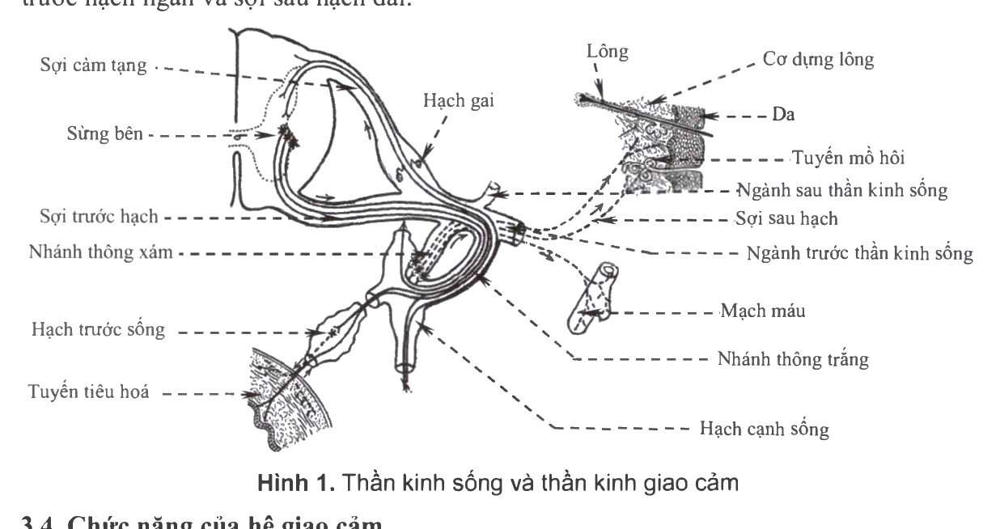
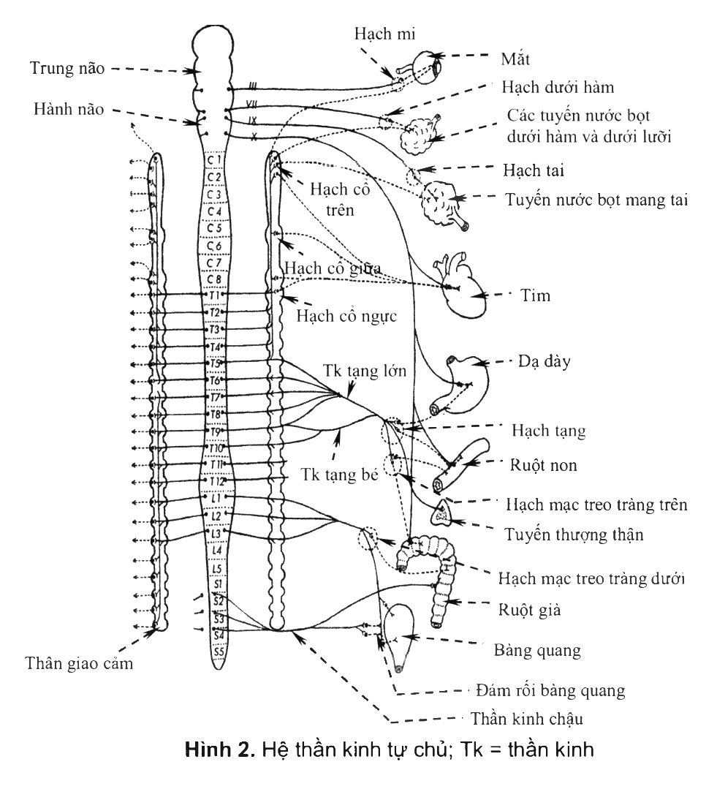
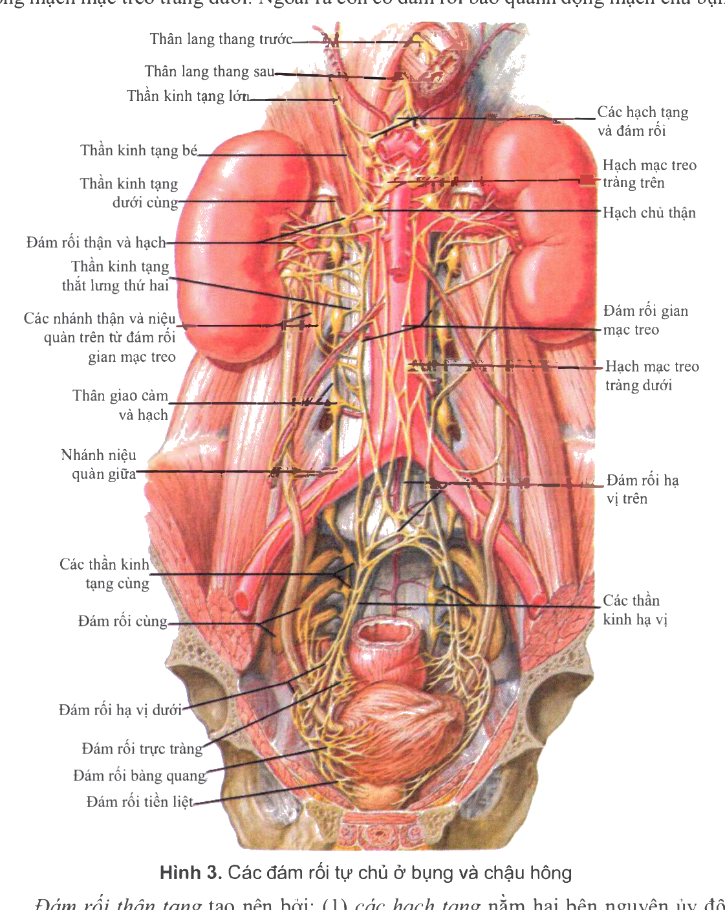

# HỆ THẦN KINH TỰ CHỦ

**Chương:** Chương 8: Hệ Thần Kinh  
**Tác giả:** PGS.TS. Nguyễn Văn Huy, ThS. Nguyễn Đức Nghĩa  
**Nguồn:** Giáo trình Giải phẫu học Y Hà Nội (Xuất bản 2025), Trang 466 - 478

---

## Bài 11: HỆ THẦN KINH TỰ CHỦ

## 1. ĐẠI CƯƠNG

### 1.1. Khái niệm về thần kinh tự chủ

*Thần kinh tự chủ* (*autonomic nervous system*) là thuật ngữ được John Newport Langley đưa ra năm 1898 để chỉ phần thần kinh chi phối vận động cho cơ trơn, cơ tim và tế bào tuyến ở các nội tạng; ngoài các tạng trong các khoang cơ thể còn có cơ trơn mống mắt và cơ thể mi trong nhãn cầu, các cơ trơn trong ổ mắt, tuyến lệ và các tuyến nước bọt, cơ dựng lông và tuyến mồ hôi ở da, và cơ trơn trong thành các mạch máu ở mọi nơi. Khái niệm “tự chủ” của Langley chủ yếu nhằm đưa ra sự phân biệt giữa phần thần kinh vận động cơ trơn, cơ tim và tuyến, với phần thần kinh chi phối vận động cơ vân, mà ta gọi là *thần kinh thân thể* (*somatic nervous system*). Hai loại thần kinh này không chỉ khác nhau về đối tượng chi phối, về tính chất tự ý (ở thần kinh thân thể) hay không tự ý (ở thần kinh tự chủ) của vận động, mà còn về cách mà nơron vận động của hai loại đi tới các tế bào thi hành (effector). Nơron vận động của thần kinh thân thể có nhánh trục đi thẳng từ nhân vận động ở thân não và tuỷ sống tới cơ bám xương. Con đường vận động của thần kinh tự chủ có ít nhất 2 nơron: thân nơron thứ nhất (gọi là *nơron trước hạch*) nằm ở nhân tự chủ ở thân não hay tuỷ sống và nhánh trục của nó (gọi là *sợi trước hạch*) đi tới synáp với nơron ở hạch tự chủ ngoại vi; thân nơron thứ hai (gọi là *nơron sau hạch*) nằm ở hạch tự chủ ngoại vi và nhánh trục của nó (*sợi sau hạch*) đi tới tế bào thi hành (cơ trơn, cơ tim và tế bào tuyến) hoặc nơron thứ 3 (trường hợp sợi giao cảm sau hạch đi tới synáp với nơron hạch của đám rối trong thành dạ dày - ruột). Một nơron trước hạch synáp với nhiều nơron sau hạch và điều này làm cho tác động của thần kinh tự chủ có tính chất lan toả rộng.

Thần kinh tự chủ gần như đồng nghĩa với khái niệm *thần kinh tạng* (*visceral nervous system*). Tuy nhiên, mặc dù thần kinh tạng cũng là phần thần kinh chi phối cơ trơn, cơ tim và các tuyến nhưng nó bao gồm không những chỉ *các sợi vận tạng* (*visceral efferents*) mà còn cả *các sợi cảm tạng* (*visceral afferents*). Cảm giác từ tạng được nơron cảm giác tạng chuyển về thần kinh trung ương không khác với con đường cảm giác thân thể. Những cảm giác này hoặc được dùng làm đầu vào cho các đáp ứng phản xạ tạng (với các cảm giác mà ta có thể không biết được như áp lực động mạch, nồng độ ôxy máu) hoặc để nhận thức được ở vỏ não (như cảm giác no, đầy của tạng rỗng; cảm giác đau khi có bất thường). Thần kinh tạng không có nơron chuyên về cảm giác đau như ở thần kinh thân thể nhưng trong tình trạng bệnh lý thì cường độ cao khác thường của cảm giác áp lực hoặc các kích thích khác được chuyển thành cảm giác đau. Đau tạng có đặc điểm là quy chiếu tới vùng cảm giác thân thể của những nơron cảm giác thân thể cùng tiết đoạn với nơron cảm tạng.

Thần kinh tự chủ được quan niệm như một *phần tự chủ của thần kinh ngoại vi* (*autonomic part of peripheric nervous system*) nhưng trong trục thần kinh trung ương từ vỏ não trở xuống có những cấu trúc tiếp nhận thông tin từ tạng và phóng chiếu thông tin đầu ra tới nơron trước hạch. Nơron tự chủ trước hạch chịu ảnh hưởng trực tiếp hay gián tiếp từ nhiều cấu trúc có chức năng tự chủ ở đại não, gian não và thân não như vỏ não trước trán, hệ viền, hạ đồi thị và cấu tạo lưới. Nếu nhìn vào các tiếp nối trung ương, “tự chủ” là một khái niệm không phù hợp vì có những tiếp nối, ảnh hưởng qua lại giữa tự chủ và thân thể.

Hệ thần kinh tự chủ điều hoà hoạt động của các cơ quan và các cấu trúc liên quan tới tiêu hóa, tuần hoàn, hô hấp, duy trì thân nhiệt bình thường, bài tiết và sinh sản, qua đó góp phần duy trì sự ổn định nội môi. Ngoài vai trò điều hòa của các phản xạ tạng, các hoạt động của cơ trơn, cơ tim và tuyến có thể bị thay đổi bởi các ảnh hưởng từ những tầng chức năng cao cấp nhất của não, đặc biệt là trong đáp ứng với cảm xúc và với môi trường bên ngoài.

### 1.2. Phân chia hệ thần kinh tự chủ

Các nơron vận động tự chủ kích thích hoặc ức chế cơ tim, cơ trơn và các tuyến, qua đó kích thích hoặc ức chế hoạt động của các tạng ở các trạng thái hoạt động khác nhau của cơ thể hay ở những pha hoạt động sinh lý bình thường khác nhau của các tạng. Dựa vào tác động kích thích hay ức chế của các nơron sau hạch mà hệ thần kinh tự chủ được chia thành hai phần chính khác nhau về cấu trúc và chức năng: **phần giao cảm** (*sympathic part*) và **phần đối giao cảm** (*parasympathic part*). Hầu hết các cơ quan được chi phối kép, tức là chúng nhận được các xung động đến từ cả các nơron giao cảm và đối giao cảm. Tác dụng của hai phần trên một cơ quan tuy có tính đối kháng nhau nhưng cân bằng để đảm bảo hoạt động bình thường của cơ quan. Phần thứ ba của hệ thần kinh tự chủ, chỉ có ở thành ống tiêu hóa, là **hệ thần kinh ruột** (*enteric nervous system*).

---

## 2. TRUNG ƯƠNG CỦA HỆ THẦN KINH TỰ CHỦ VÀ CÁC HẠCH TỰ CHỦ

### 2.1. Các cấu trúc trung ương của thần kinh tự chủ

Hạ đồi thị được coi là trung tâm kiểm soát và tích hợp quan trọng của hệ thần kinh tự chủ, với nhân cạnh não thất là nhân chủ chốt. Nó tiếp nhận thông tin đến từ nhiều nguồn và phóng chiếu trực tiếp hoặc gián tiếp (qua cấu tạo lưới) tới các nhân tự chủ ở thân não và tuỷ sống (các sợi hạ đồi - tuỷ). Hạ đồi thị chịu ảnh hưởng bởi vỏ não mới (vỏ não trước trán giữa, vỏ của đảo và phần trước hồi đai), cấu tạo hải mã, thể hạnh nhân và vùng vách, và các diện vỏ khứu. Các con đường đi lên từ tuỷ sống và thân não vận chuyển thông tin tạng và vị giác. Hơn nữa, hạ đồi thị còn đáp ứng trực tiếp với những thay đổi về nhiệt độ, áp lực thẩm thấu và nồng độ các chất khác nhau (bao gồm các hormone) trong máu. Tùy thuộc vào các cảm thụ chuyên biệt, các nơron hạ đồi thị có liên hệ hoặc với hệ thần kinh tự chủ hoặc với tuyến yên.

Thể hạnh nhân và vùng vách cũng phóng chiếu trực tiếp tới các nơron tự chủ trước hạch. Các nơron tự chủ trước hạch cũng chịu ảnh hưởng của các trung tâm tạng (như trung tâm tim mạch) và bởi các nhân tiếp nhận sợi cảm tạng, mà rõ nhất là nhân đơn độc ở hành não. Như vậy, đáp ứng tự chủ là kết quả của nhiều ảnh hưởng đến từ: thông tin tạng (bao gồm vị giác và khứu giác), cảm xúc, thậm chí cả những quá trình tâm thần ở mức vỏ não mới.

### 2.2. Các hạch tự chủ (autonomic ganglia)

Các *hạch giao cảm* (*sympathic ganglia*) và *hạch đối giao cảm* (*parasympathic ganglia*) của thần kinh tự chủ là những trạm chuyển tiếp trên con đường từ trung ương tới cơ trơn, cơ tim và tuyến. Các sợi đến hạch là các sợi trước hạch có myelin (nhóm B). Các nơron của hạch bao gồm các tế bào chính và các nơron liên hợp. Các sợi rời khỏi hạch là các nhánh trục sau hạch không có myelin của các tế bào chính. Đi qua hạch còn có các sợi cảm giác; ở một số hạch, sợi cảm giác đi qua hạch tách ra những nhánh đến synáp với các tế bào chính, thiết lập nên những cung phản xạ ở ngoại vi. Trường hợp có chuỗi hạch như ở thần kinh giao cảm, sợi trước hạch có thể đi qua hạch đầu tiên mà nó đến để đến tận cùng ở một hạch khác trong chuỗi. Một nhánh trục trước hạch có thể chia nhánh để có thể synáp với nhiều nơron sau hạch, qua đó đạt được sự phát tán rộng, và một số lượng tương đối nhỏ nơron ở thần kinh trung ương có thể chi phối số lượng lớn tế bào cơ trơn và tuyến ở ngoại vi. Mức độ khuếch đại, phát tán rộng như vậy ở hạch giao cảm lớn hơn ở hạch đối giao cảm.

---

## 3. PHẦN GIAO CẢM

Hệ giao cảm bao gồm nhân giao cảm ở tuỷ sống, các hạch giao cảm, các nhánh của thân giao cảm và các đám rối.

### 3.1. Nhân chứa nơron giao cảm trước hạch

Nơron giao cảm trước hạch nằm ở **cột nhân trung gian bên** nằm ở sừng bên chất xám của tuỷ sống từ đốt tuỷ ngực 1 tới đốt tuỷ thắt lưng 2 hoặc 3. Các sợi giao cảm trước hạch từ nhân này đi theo các rễ trước thần kinh sống rồi theo các nhánh thông trắng để đến các hạch thân giao cảm từ hạch ngực 1 tới hạch thắt lưng 3.

### 3.2. Các hạch giao cảm

Các hạch giao cảm bao gồm các hạch cạnh sống nằm ở hai thân giao cảm và các hạch trước sống.

- **Các hạch trước sống** (*prevertebral ganglia*), hay các hạch trước động mạch chủ (*preaortic ganglia*), hay các hạch phụ (*collateral ganglia*), là những hạch nằm trước cột sống hay trước động mạch chủ, giữa các thân giao cảm. Chúng bao gồm *các hạch thân tạng* (*celiac ganglia*), *hạch mạc treo tràng trên* (*superior mesenteric ganglion*), *các hạch chủ thận* (*aorticorenal ganglia*) và *hạch mạc treo tràng dưới* (*inferior mesenteric ganglion*). Những hạch này nằm cạnh nguyên uỷ các động mạch thân tạng, mạc treo tràng trên, thận và mạc treo tràng dưới; chúng cũng là thành phần của các đám rối mang tên các động mạch đó. Ngoài ra còn có các hạch nhỏ hơn như *hạch hoành*, *hạch thận* và các đám tế bào rải rác.
- **Thân giao cảm** (*sympathetic trunk*): Mỗi thân giao cảm là một chuỗi của 22 - 23 hạch thân giao cảm (*ganglion of sympathetic trunk*) hay hạch cạnh sống (*paravertebral ganglia*) (H.1) trải dài từ nền sọ tới xương cụt. Các hạch này nối với nhau bằng các nhánh gian hạch, bao gồm:
  - 3 hạch cổ (trên, giữa, dưới);
  - 12 hạch ngực (trong đó hạch ngực 1 thường kết hợp với hạch cổ dưới thành *hạch cổ - ngực* hay *hạch sao*);
  - 4 hạch thắt lưng;
  - 4 hạch cùng;
  - 1 hạch đơn nằm giữa hai thân ở trước xương cụt.
  - Từ trên xuống, mỗi thân nằm trước mỏm ngang các đốt sống ở đoạn cổ, trước chỏm các xương sườn ở đoạn ngực, trước mặt trước bên các thân đốt sống ở đoạn thắt lưng và trong các lỗ cùng trước ở đoạn cùng; hạch cổ trên nằm trước mỏm ngang các đốt sống cổ 2 và 3; hạch cổ ngực nằm giữa mỏm ngang đốt sống cổ 7 và cổ xương sườn 1.
  - Mỗi hạch ngực và 3 hạch thắt lưng trên được nối với thần kinh sống cùng số tương ứng bằng một **nhánh thông trắng** (*white ramus communicans*) chứa sợi trước hạch có myelin; và tất cả các hạch tiếp nối với các thần kinh sống liền kề bằng **các nhánh thông xám** (*grey ramus communicans*) chứa sợi sau hạch không có myelin (H.1).
  - Từ cột nhân trung gian bên của tất cả các đốt tuỷ ngực và hai hay ba đốt tuỷ thắt lưng trên, các sợi trước hạch đi tới thân giao cảm qua đường các rễ trước và các nhánh thông trắng tương ứng. Sau khi tới được thân giao cảm qua đường nhánh thông trắng, sợi giao cảm trước hạch có thể:
    (1) tận cùng ở thân giao cảm, ở ngay hạch đầu tiên đi tới hoặc hạch ở trên hay dưới của thân giao cảm (H.1);
    (2) không tận cùng ở thân giao cảm mà rời khỏi thân giao cảm đi tới tận cùng ở các hạch trước sống và chi phối các tạng bụng - chậu hông (H.1).
  - Nếu là trường hợp (1), các sợi sau hạch có thể:
    (a) đi trong các nhánh thông xám để được phân phối qua đường các thần kinh sống (H.1);
    (b) đi trong các nhánh mạch để tới các động mạch nằm trước cột sống và được phân phối theo đường cây phân nhánh của các mạch máu;
    (c) đi trong các nhánh tới tạng (như ở các nhánh tim, phổi, thực quản).

### 3.3. Con đường cung cấp thần kinh giao cảm cho các vùng cơ thể

- **Cho đầu - cổ và ngực (H.2):** các sợi trước hạch tận cùng ở hạch của thân giao cảm; các sợi sau hạch được phân phối qua các nhánh tới từng vùng, đầu - cổ hay ngực.
  - *Cho cơ trơn và các tuyến ở đầu - cổ:* các sợi sau hạch đi trong *thần kinh động mạch cảnh trong*, *các thần kinh động mạch cảnh ngoài* và *các nhánh thanh quản hầu* của hạch cổ trên; và *thần kinh động mạch đốt sống* của hạch cổ dưới. Các thần kinh động mạch cảnh tỏa ra thành các đám rối cảnh mà đi kèm theo các động mạch cảnh và các nhánh của chúng; các nhánh thanh quản hầu cho đám rối hầu và cho thanh quản.
  - *Cho các tạng ngực:* các sợi sau hạch rời khỏi 3 hạch cổ và 5 hạch ngực trên, bao gồm 3 *thần kinh tim cổ* (trên, giữa và dưới) từ 3 hạch cổ tương ứng, *các nhánh tim ngực*, *các nhánh phổi ngực* và *các nhánh thực quản* từ các hạch ngực trên.
- **Cho tạng bụng và chậu hông (H.2):** các sợi trước hạch chỉ đi qua thân giao cảm mà không synáp. Chúng rời khỏi thân giao cảm trong **các thần kinh tạng** (*splanchnic nerves*) (ngực, thắt lưng và cùng) và tận cùng ở các hạch trước sống.
  - Có 3 thần kinh tạng ngực từ phần ngực của thân giao cảm: *thần kinh tạng lớn* từ các hạch ngực 5 tới 9; *thần kinh tạng bé* từ các hạch ngực 9 tới 10; và *thần kinh tạng dưới cùng* từ hạch ngực 11 và/hoặc hạch ngực 12. Các thần kinh này đi xuống, xuyên qua trụ cơ hoành rồi tận cùng ở hạch thân tạng, hạch chủ thận và hạch mạc treo tràng trên.
  - Thường có 3 hay 4 *thần kinh tạng thắt lưng* tách ra từ các hạch thắt lưng. Chúng đi qua đám rối động mạch chủ bụng (đám rối gian mạc treo) tới tận cùng ở các hạch mạc treo tràng và hạch tạng.
  - Có 2 *thần kinh tạng cùng* tách ra từ 2 hạch cùng trên cùng. Chúng đi đến đám rối hạ vị dưới rồi đi lên qua đám rối hạ vị trên và đám rối động mạch chủ bụng tới tận cùng ở hạch mạc treo tràng dưới.
  - Ống tiêu hóa được chi phối chủ yếu bởi các hạch thân tạng và các hạch mạc treo; các sợi sau hạch không tận cùng trực tiếp trên các tế bào cơ trơn và các tế bào tuyến mà trên các nơron vận động của hệ thần kinh ruột.
- **Cho thành cơ thể và các chi (H.2):** các sợi trước hạch tận cùng ở tất cả các hạch của thân giao cảm, từ đó các sợi sau hạch được phân phối qua đường *các nhánh thông xám* (*gray communicating rami*) và các thần kinh sống tới các mạch máu, các cơ dựng lông và các tuyến mồ hôi. Một phần các sợi sau hạch đi theo các mạch máu để tới được vùng cấp máu của các mạch máu này.

> **Đặc điểm phân bố:** thần kinh giao cảm có phân bố rộng hơn thần kinh đối giao cảm, vì ngoài phân bố tới tất cả các đích mà thần kinh đối giao cảm chi phối, nó còn chi phối cho các tuyến mồ hôi, các cơ dựng lông và các mạch máu trên thành cơ thể và chi. Các hạch giao cảm nằm gần nguồn cung sợi trước hạch và xa cơ quan đích nên sợi trước hạch ngắn và sợi sau hạch dài.

*Hình 1: Thần kinh sống và thần kinh giao cảm*

### 3.4. Chức năng của hệ giao cảm

Hệ giao cảm kích thích các hoạt động mà đi kèm với sự tiêu hao năng lượng. Những hoạt động này bao gồm làm tăng nhịp tim và tăng lực co bóp của tim, tăng áp lực động mạch, và hướng dòng máu tới các cơ bám xương từ lượng máu bớt đi của tuần hoàn tạng và da. Các đáp ứng giao cảm thì biểu hiện rõ rệt nhất trong trạng thái căng thẳng và các tình huống khẩn cấp (tình thế phải tấn công hay bỏ chạy). Chất trung gian dẫn truyền giữa các nơron trước hạch và sau hạch là acetylcholine, như ở hệ đối giao cảm. Chất trung gian dẫn truyền giải phóng ra ở hầu hết các nhánh trục sau hạch là noradrenaline (norepinephrine) vì thế mà hệ giao cảm còn được gọi là *hệ noradrenergic*. Ngoại lệ, riêng các sợi giao cảm sau hạch chi phối cho tuyến mồ hôi lại có chất trung gian dẫn truyền là acetylcholine. Trên da không có thần kinh đối giao cảm; các nơron vận tiết tuyến mồ hôi cholinergic là thần kinh giao cảm về mặt giải phẫu nhưng về mặt chức năng thì tương tự như những nơron của các hạch đối giao cảm.

- Noradrenaline có những tác động khác nhau trên các mô khác nhau, tùy vào loại phân tử receptor trên các tế bào đáp ứng:
  - *Các receptor alpha* có trên bề mặt sợi cơ trơn ở cơ giãn con ngươi và ở các mạch máu của da và các nội tạng. Những sợi cơ này co khi noradrenaline được gắn với các receptor alpha, với kết quả là đồng tử giãn ra và co mạch ở nội tạng và da. Các nơron ruột mà làm đóng các cơ thắt cũng mang các receptor alpha.
  - *Các receptor beta* có mặt trên các sợi cơ tim ở mô dẫn nhịp tâm nhĩ và ở các tâm thất, trên các sợi cơ trơn ở phế quản, ở các mạch máu của cơ bám xương, và trên các nơron ruột mà ức chế các cử động nhu động của đường tiêu hóa. Các sợi cơ trơn có receptor beta giãn khi đáp ứng với noradrenaline do đó làm giãn phế quản và giãn mạch ở các cơ bám xương. Tần số và lực co của tim tăng, và sức đẩy dọc theo ống tiêu hóa bị kìm hãm. Một số thuốc quan trọng trên lâm sàng có tác dụng kích thích hoặc ức chế các receptor alpha hoặc beta.
- Kích thích giao cảm mạnh tạo ra các tác động lan tỏa rộng vì những yếu tố sau: mỗi nơron giao cảm trước hạch synáp với nhiều nơron sau hạch, và mỗi nơron sau hạch lại chi phối nhiều tế bào thi hành (cơ trơn, tế bào tuyến) hay nhiều nơron ruột. Noradrenaline được giải phóng ra ở tận cùng sợi sau hạch bị bất hoạt bằng cách bị thu hồi vào bên trong đầu tận cùng sợi trục mà từ đó nó được giải phóng ra, và đây là một quá trình chậm chạp hơn so với sự thủy phân acetylcholine bằng xúc tác enzyme. Các đáp ứng giao cảm thường có tính toàn thể, khác với các đáp ứng có tính cục bộ của thần kinh đối giao cảm.

---

## 4. PHẦN ĐỐI GIAO CẢM

Các sợi đối giao cảm trước hạch là nhánh trục của các thân nơron nằm ở thân não và tuỷ sống:
- Ở thân não, các thân nơron đối giao cảm nằm ở nhân đối giao cảm của các thần kinh sọ III (các nhân tạng), VII (nhân bọt trên), IX (nhân bọt dưới) và X (nhân lưng). Nhân hoài nghi có một nhóm tế bào đến chi phối cho tim theo đường thần kinh X.
- Ở Tuỷ sống, chúng nằm ở *các nhân đối giao cảm cùng* của các đốt tuỷ từ cùng II tới cùng IV.
- Các sợi trước hạch từ các nhân đối giao cảm của các thần kinh sọ và từ các nhân đối giao cảm cùng đi tới các hạch đối giao cảm ngoại vi. Các sợi đối giao cảm sau hạch từ hạch đối giao cảm ngoại vi đi tới tạng (cơ quan) hoặc các tuyến.

Các nhánh trục đối giao cảm trước hạch được bọc bằng myelin và có mặt ở các thần kinh vận nhãn, mặt, lưỡi - hầu, lang thang và ở các thần kinh sống cùng 2 tới 4.

- **Ở phần sọ (cranial part)** của hệ thần kinh đối giao cảm có 4 hạch nhỏ ở ngoại vi: *hạch mi* (*ciliary ganglion*), *hạch chân bướm - khẩu cái* (*pterygopalatine ganglion*), *hạch dưới hàm* (*submandibular ganglion*), *hạch dưới lưỡi* (*sublingual ganglion*) và *hạch tai* (*otic ganglion*), tất cả được mô tả cùng với các thần kinh sọ có liên quan. Các sợi đối giao cảm sau hạch thường không có myelin và ngắn hơn các sợi giao cảm, vì những hạch mà từ đó chúng xuất phát nằm ở trong hoặc gần các tạng mà chúng chi phối:
  1. *Thần kinh vận nhãn:* Các sợi đối giao cảm trước hạch bắt đầu tại trung não ở các nhân vận nhãn phụ (Edinger - Westphal) và đi ra theo thần kinh vận nhãn và nhánh cơ chéo dưới của thần kinh vận nhãn để đi tới hạch mi. Chúng synáp tại đó, các sợi sau hạch rời đi trong các thần kinh mi ngắn tới cơ thể mi và cơ thắt đồng tử.
  2. *Thần kinh mặt:* Chứa các nhánh trục đối giao cảm trước hạch từ *nhân nước bọt trên*. Các sợi này ra khỏi thân não trong thần kinh trung gian, rời khỏi thân chính của thần kinh mặt cùng với thừng nhĩ ngay trước khi thần kinh mặt đi tới lỗ châm chũm. Thừng nhĩ chạy qua hòm nhĩ để tới thần kinh lưỡi (nhánh của thần kinh hàm dưới) đưa các sợi tới *hạch dưới hàm* và *hạch dưới lưỡi*, phát sinh các sợi vận tiết sau hạch cho các tuyến nước bọt dưới hàm và dưới lưỡi. Các nhánh trục đối giao cảm vận tiết tuyến lệ từ nhân bọt trên đi theo đường *nhánh đá lớn* của thần kinh mặt rồi theo *thần kinh ống chân bướm*, cuối cùng synáp ở *hạch chân bướm - khẩu cái*; các sợi sau hạch đi tới tuyến lệ theo thần kinh gò má và thần kinh lệ và tới các tuyến của khẩu cái và mũi.
  3. *Thần kinh lưỡi - hầu:* Chứa các sợi vận tiết đối giao cảm trước hạch cho tuyến mang tai phát sinh từ *nhân bọt dưới*, đi lần lượt theo thần kinh lưỡi - hầu rồi nhánh nhĩ, qua đám rối nhĩ và thần kinh đá bé để tới *hạch tai*. Các sợi sau hạch chạy theo các nhánh nối để tới thần kinh tai - thái dương và mượn đường thần kinh này đi tới tuyến mang tai.
  4. *Thần kinh lang thang:* Chứa các sợi trước hạch phát sinh từ *nhân lưng thần kinh lang thang* và *nhân hoài nghi*; chúng đi trong thần kinh lang thang và các nhánh phổi, tim, thực quản, dạ dày, ruột... của nó. Những sợi ly tâm chuyển tiếp tại những hạch nhỏ ở thành các tạng:
     - Các nhánh tim làm chậm chu kỳ tim, gia nhập các đám rối tim và chuyển tiếp tại những hạch phân bố tự do trên cả hai tâm nhĩ trong mô dưới lá tạng của ngoại tâm mạc thanh mạc.
     - Các nhánh phổi vận động cho các sợi cơ trơn của phế quản và tiểu phế quản (co phế quản);
     - Các nhánh vị vận tiết và vận động cơ trơn của dạ dày, ngoại trừ cơ thắt môn vị vốn chịu sự ức chế của thần kinh lang thang;
     - Các nhánh ruột có tác động tương tự lên ruột non, manh tràng, ruột thừa, đại tràng lên, góc đại tràng phải và hầu hết đại tràng ngang; chúng vận tiết cho các tuyến, vận động áo cơ ruột nhưng ức chế cơ thắt hồi - manh tràng. Các điểm chuyển tiếp bằng synáp nằm trong các đám rối áo cơ ruột (Auerbach) và dưới niêm mạc (Meissner).
- **Ở phần chậu hông (pelvic part)** của hệ đối giao cảm: những nhánh trước của các thần kinh sống cùng 2, 3 và 4 tách ra *các thần kinh tạng chậu hông* tới các tạng chậu. Chúng liên kết với các nhánh của các đám rối giao cảm chậu hông. Các thần kinh tạng chậu hông vận động cho cơ của thành trực tràng và bàng quang nhưng ức chế cơ thắt bàng quang, phân phối các sợi giãn mạch tới mô cương của dương vật và âm vật, làm giãn mạch của tinh hoàn và buồng trứng và gây giãn mạch (và có thể là ức chế) tử cung và các vòi tử cung. Những sợi nhỏ từ các thần kinh tạng chậu hông đi lên trong đám rối hạ vị để cung cấp những sợi vận tạng cho đại tràng sigma và đại tràng xuống, góc đại tràng trái và đoạn tận cùng của đại tràng ngang.

*Hình 2: Hệ thần kinh tự chủ (Tk = thần kinh)*

---

## 5. HỆ THẦN KINH RUỘT

Từ thực quản tới trực tràng, trong thành ống tiêu hóa có khoảng 100.000.000 nơron, một quần thể nơron bằng với số nơron trong tuỷ sống. Các thân tế bào nằm ở các đám rối áo cơ ruột và dưới niêm mạc.
- **Đám rối áo cơ ruột** (*myenteric plexus/Auerbach's plexus*) nằm giữa các lớp cơ dọc và vòng;
- **Đám rối dưới niêm mạc** (*submucosal plexus/Meissner's plexus*) nằm trong mô liên kết giữa lớp cơ vòng và lớp cơ niêm.

Mỗi đám rối bao gồm các hạch ruột nhỏ được kết nối với nhau bằng những sợi thần kinh trong đó tất cả các sợi trục là sợi không có myelin. Các nơron trong các đám rối bao gồm các nơron cảm giác, các nơron liên hợp và các nơron vận động. Vòng tiếp nối giữa 3 loại nơron này có thể giúp cho ống tiêu hóa có thể vận động nhu động theo phản xạ và chế tiết cơ bản. Nơron cảm giác từ đám rối có nhánh đi về hạch thân tạng các hạch mạc treo tràng. Nơron vận động của hệ thần kinh ruột gồm 2 loại: loại kích thích cơ thành ruột và tế bào tuyến (cholinergic); loại ức chế cơ thắt. Các nơron vận động này cũng là nơron sau hạch của đường thần kinh vận động đối giao cảm cho ống tiêu hóa. Sợi giao cảm sau hạch không tận cùng trên sợi cơ trơn và tế bào tuyến mà trên nơron vận động của hệ thần kinh ruột.

---

## 6. CÁC SỢI CẢM TẠNG (visceral afferents)

Thân của các nơron cảm tạng chung (*general visceral afferent neurons*) nằm ở hạch dưới của các thần kinh IX và X và ở hạch rễ sau của các thần kinh sống. Nhánh ngoại vi của các nơron này đi qua các hạch và các đám rối tự chủ để tới các tạng mà chúng chi phối. Về mặt chức năng, có thể chia các nơron này thành 2 loại: loại cảm giác đau và loại dẫn truyền cảm giác phục vụ cho chức năng sinh lý bình thường. Các sợi cảm giác đau đi theo các sợi (vận động) của phần giao cảm; các sợi cho hoạt động sinh lý bình thường hầu hết đi theo phần đối giao cảm.

### 6.1. Các sợi cảm tạng sinh lý đi theo phần đối giao cảm

Các sợi cảm tạng đi trong phần đối giao cảm có tầm quan trọng đặc biệt về sinh lý vì chúng tạo nên đầu vào của các cung phản xạ tim mạch, hô hấp, tiêu hóa, tiết niệu:
- Thân nơron cảm giác áp lực cho cung động mạch chủ nằm ở hạch dưới thần kinh X; thân nơron cảm giác áp lực cho động mạch cảnh ở xoang cảnh nằm ở hạch dưới thần kinh IX. Thay đổi huyết áp ở hai nơi này được các nơron truyền về nhân đơn độc ở hành não; tiếp đó, nhân đơn độc phóng chiếu tới cấu tạo lưới, nơi ta thường nói là có các “trung tâm tim mạch”. Các sợi trục từ cấu tạo lưới và cả từ nhân đơn độc phóng chiếu tới nhân hoài nghi và cột nhân trung gian bên ở tuỷ sống. Hai nhân này truyền đáp ứng phản xạ tới tim (qua thần kinh X) và mạch (qua thần kinh giao cảm), qua đó duy trì huyết áp ở mức bình thường.
- Có nhiều cung phản xạ ở hệ hô hấp. Độ bão hòa oxy máu thấp được các thụ thể hóa học ở tiểu thể cảnh cảm nhận và được nơron hạch dưới thần kinh IX truyền về nhân đơn độc. Nhân đơn độc phóng chiếu tới các trung tâm hô hấp ở cấu tạo lưới thân não rồi từ cấu tạo lưới có con đường lưới tuỷ tới nhân thần kinh hoành và các nhân chi phối các cơ hít vào. Trong phản xạ Hering - Breuer, hít vào gây kích thích đầu tận cùng cảm giác thần kinh X ở cây phế quản và kích thích này được thần kinh X truyền vào trung tâm thở ra qua trung gian nhân đơn độc. Trung tâm thở ra ức chế trung tâm hít vào, làm giãn các cơ hít vào.
- Cảm giác tạng chung từ đường dạ dày ruột và bàng quang được truyền về não qua thần kinh X và các thần kinh tạng cùng. Cảm giác đầy (*fullness*) của dạ dày (no/đói) được thần kinh X truyền về nhân đơn độc rồi lên cấu tạo lưới, hạ đồi thị và đồi thị. Cảm giác đầy của bàng quang và trực tràng được các nhánh tạng cùng truyền về đoạn tuỷ cùng 2 - 4 rồi được các dải tuỷ đồi thị và tuỷ lưới truyền về cấu tạo lưới, hạ đồi thị và nhân bụng sau bên đồi thị. Đường đồi thị vỏ giúp cho vỏ não có được cảm giác đầy.

### 6.2. Các sợi cảm giác đau đi theo phần giao cảm

Các đầu tận cùng cảm giác cho cảm giác đau ở các nội tạng bị kích thích theo những cách khác nhau khi có hoạt động chức năng khác thường hay bệnh:
- Thông thường nhất, đau gây ra bởi sự căng giãn một tạng rỗng nào đó như ruột. Một đoạn ruột có thể bị căng giãn ở trên chỗ mà cơ trơn bị co mạnh khu trú hay ruột bị tắc. Tương tự, căng giãn ống mật hay niệu quản xảy ra khi lòng ống bị tắc do sỏi.
- Đau tạng cũng xuất hiện khi có sự giãn ra nhanh của bao xơ bọc các tạng đặc như gan hay lách. Viêm nhiễm kích thích lên phúc mạc hay màng phổi làm cho đau tăng lên.
- Trong đau thắt ngực và đau do nhồi máu cơ tim, đau là do thiếu oxy cơ tim.

Các nơron cảm giác cho đau từ các tạng ngực và bụng chỉ kết hợp với thần kinh giao cảm. Thân của các nơron cảm giác đau nằm ở các hạch rễ sau của các thần kinh sống từ N1 tới TL2. Nhánh ngoại vi của những nơron này đi tới thân giao cảm qua đường các nhánh thông trắng. Chúng chạy trong thân giao cảm các đoạn đường dài ngắn khác nhau rồi sau đó đi tới các tạng theo đường các thần kinh tim, phổi và tạng. Các nhánh trung ương đi vào tận cùng ở sừng sau tuỷ sống như ở thần kinh thân thể, và chặng đường tiếp theo cũng vẫn là dải tuỷ đồi thị với những nhánh bên đi vào cấu tạo lưới. Để điều trị đau do bệnh lý ở các tạng bụng trên (như gan và tuỵ), người ta có thể cắt các thần kinh tạng ngực mà đi tới đám rối thân tạng.

### 6.3. Đau quy chiếu

Đau tạng khác với đau thân thể ở chỗ là đau kém khu trú và hay đau lan tới các vùng thân thể (*đau quy chiếu* - *referred pain*). Vùng đau nội tạng thuộc đốt tuỷ nào thì quy chiếu lên vùng thân thể do các nơron cảm giác thân thể cảm giác ở cùng đốt tuỷ ấy. Ví dụ đau từ túi mật và ống mật chủ được thần kinh tạng lớn truyền về tuỷ sống qua các rễ sau N7 và N8. Đau quy chiếu tới phần tư trên và vùng dưới vai bên phải, cũng là những vùng thân thể do các thần kinh N7 và N8 chi phối.

---

## 7. CÁC ĐÁM RỐI VÀ CÁC HẠCH TỰ CHỦ

Các sợi thần kinh cùng các hạch tự chủ ở ngoại vi tạo nên các đám rối tự chủ. Các đám rối này thường bao quanh các mạch máu đi tới đầu cổ, các chi và các tạng. Cũng có đám rối nằm trong thành các tạng ống tiêu hóa hoặc ở gần các tạng. Các đám rối đi tới đầu - cổ và các chi là các đám rối thần kinh giao cảm do các sợi giao cảm sau hạch tạo nên. Các đám rối bao quanh các động mạch tạng lớn và các nhánh của chúng là các đám rối gồm các sợi cả giao cảm và đối giao cảm cùng các hạch tự chủ (là hạch đối giao cảm nếu là đám ở ngực là hạch giao cảm trước sống nếu là đám rối ở bụng). Ở các đám rối tạng ngực, thành phần sợi giao cảm là sợi sau hạch.

### Ở đầu cổ
Ở đầu cổ có đám rối động mạch cảnh chung, đám rối động mạch cảnh trong, đám rối động mạch cảnh ngoài, đám rối động mạch dưới đòn và đám rối động mạch đốt sống, tất cả đều là các đám rối giao cảm.
- *Đám rối động mạch cảnh trong* do thần kinh cảnh trong của hạch cổ trên tỏa ra. Nó đi theo các nhánh của động mạch cảnh trong và tách ra các nhánh: (1) các thần kinh cảnh nhĩ tới đám rối nhĩ cùng thần kinh IX; (2) thần kinh đá sâu, hay rễ giao cảm của hạch chân bướm khẩu cái, là nhánh giao cảm đi qua lỗ rách, kết hợp với nhánh đá lớn của thần kinh VII thành *thần kinh ống chân bướm* đi tới hạch chân bướm khẩu cái; (3) nhánh tới hạch mi, hay rễ giao cảm của hạch mi, qua khe ổ mắt trên tới hạch mi.
- *Đám rối động mạch cảnh ngoài* do các thần kinh động mạch cảnh ngoài của hạch cổ trên tỏa ra. Chi nhánh đi theo động mạch mặt của đám rối này tách ra rễ giao cảm của hạch dưới hàm; chi nhánh đi theo động mạch màng não giữa tách ra rễ giao cảm của hạch tai.
- *Đám rối động mạch đốt sống* do thần kinh động mạch đốt sống của hạch cổ dưới tỏa ra. Nó cùng với đám rối cảnh trong phân phối vào hệ động mạch trong sọ.
- *Đám rối dưới đòn* phân phối vào hệ động mạch chi trên.

### Ở ngực
Ở ngực có các đám rối tim, phổi và thực quản.
- *Đám rối tim* do các thần kinh tim cổ và tim ngực của thân giao cảm và các nhánh tim cổ và ngực của thần kinh X tạo nên; trong đám rối này có hạch tim, nơi tận cùng của các sợi đối giao cảm. Đám rối tim gồm phần nông nằm giữa cung động mạch chủ và thân động mạch phổi và phần sâu nằm giữa cung động mạch chủ và chỗ chia đôi khí quản.
- *Đám rối phổi* nằm trước và sau các cấu trúc của rốn phổi, phần trước do các sợi từ đám rối tim nông tỏa vào, phần sau do các nhánh phổi ngực từ các hạch ngực trên và các nhánh phế quản từ thần kinh X.
- *Đám rối thực quản* do các nhánh thực quản của 2 thần kinh X cùng các nhánh thực quản từ các hạch giao cảm ngực trên tạo nên. Ở ngực còn có đám rối động mạch chủ do các nhánh mạch của thân giao cảm tạo nên.

### Ở bụng (H.3)
Ở bụng có nhiều đám rối tự chủ bao quanh các động mạch lớn cho tạng bụng như động mạch thân tạng, động mạch thận, động mạch mạc treo tràng trên và động mạch mạc treo tràng dưới. Ngoài ra còn có đám rối bao quanh động mạch chủ bụng:
- **Đám rối thân tạng** tạo nên bởi: (1) các hạch tạng nằm hai bên nguyên uỷ động mạch thân tạng, (2) các sợi giao cảm trước hạch đi trong *thần kinh tạng lớn* và *thần kinh tạng thắt lưng thứ nhất* (tận cùng ở các hạch tạng) và (3) *các nhánh thân tạng từ thân lang thang sau* chỉ đi qua hạch. Đám rối thân tạng có các chi nhánh là: *đám rối gan*, *đám rối lách*, *đám rối tuỵ* và *các đám rối vị*. Nó cũng cho các nhánh tham gia vào đám rối thận.
- **Đám rối thận** bao quanh động mạch thận, chứa các hạch thận và được tạo nên bởi các sợi đến từ đám rối và hạch tạng, hạch chủ thận, đám rối động mạch chủ, thần kinh tạng dưới cùng và thần kinh tạng thắt lưng thứ nhất. Đám rối thận chi phối cho thận và còn cho nhánh tới đám rối niệu quản, đám rối tinh hoàn hay đám rối buồng trứng.
- **Đám rối mạc treo tràng trên** bao quanh động mạch mạc treo tràng trên và có *hạch mạc treo tràng trên* nằm ở gần nguyên uỷ động mạch. Các sợi giao cảm trước hạch trong thần kinh tạng (ngực) bé tận cùng ở hạch; các sợi của thần kinh X đi qua hạch.
- **Đám rối động mạch chủ bụng** do các nhánh từ hạch và đám rối thân tạng và từ các thần kinh tạng thắt lưng 2 và 3. Nó nằm giữa các nguyên uỷ của các động mạch mạc treo tràng nên còn gọi là *đám rối gian mạc treo*. Các sợi của nó đi vào đám rối mạc treo tràng dưới, một phần của đám rối tinh hoàn, một phần của đám rối thận - niệu quản, và tiếp nối ở dưới với đám rối hạ vị; nó cũng liên tiếp với các đám rối quanh các động mạch chậu và đùi.
- **Đám rối mạc treo tràng dưới** bao quanh động mạch mạc treo tràng dưới và có *hạch mạc treo tràng dưới* nằm gần nguyên uỷ của động mạch. Phần chi phối cho trực tràng của đám rối mạc treo tràng dưới là *đám rối trực tràng trên*.

*Hình 3: Các đám rối tự chủ ở bụng và chậu hông*

### Ở chậu hông
Trong chậu hông có các đám rối hạ vị:
- **Đám rối hạ vị trên** (hay thần kinh trước cùng) nằm trước ụ nhô xương cùng và liên tiếp ở trên với đám rối động mạch chủ bụng. Đầu dưới của nó tách ra thành hai phần gọi là các *thần kinh hạ vị phải và trái*. Các thần kinh hạ vị đi xuống chậu hông ở bên trong các động mạch chậu trong và trở thành các đám rối hạ vị dưới hay đám rối chậu hông.
- **Các đám rối hạ vị dưới** được tạo nên bởi: các thần kinh tạng thắt lưng 3 và 4 (vào đám rối trên), các thần kinh tạng cùng (vào đám rối dưới), các thần kinh tạng chậu hông (chứa sợi đối giao cảm, đi vào đám rối dưới) và các sợi từ đám rối động mạch chủ bụng. Đám rối hạ vị dưới liên tiếp với hoặc có các chi nhánh sau: *đám rối trực tràng giữa* và *đám rối trực tràng dưới*; *đám rối tử cung âm đạo*; *đám rối tiền liệt*; *đám rối ống dẫn tinh*; *đám rối bàng quang*; *các thần kinh hang dương vật hoặc hang âm vật*.
